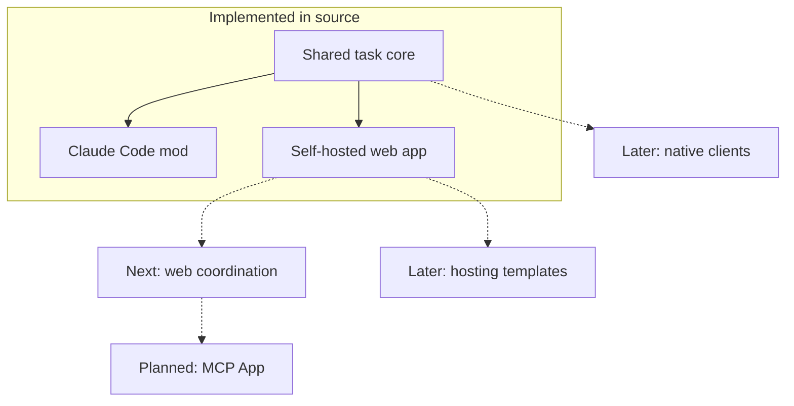

# beads-ui

A task manager for [Beads](https://github.com/steveyegge/beads) issues, with a
[Claude Code mod](https://code.claude.com/docs/en/plugins/mods/overview) inside the terminal and a
locally hosted web app, built on one shared core. Its Claude Code plugin is listed as "beads-ui for
Claude Code".

This project is not [mantoni/beads-ui](https://github.com/mantoni/beads-ui), the separate web UI
for Beads that runs with `npx beads-ui start`: this one centres on a Claude Code plugin whose task
counts follow the session that owns the work.

It brings familiar task-management views (board, backlog, sprints, roadmap and analytics), session
ownership and a review queue to Beads stores. Beads remains the task system of record; beads-ui
provides interfaces for working with it. An MCP server gives Claude Desktop and Claude Code the
task tools and a session-prompt draft you confirm; the full MCP App board, Claude on the web and
native clients are planned rather than implemented.

## Status

Both the Claude Code mod and the web app are implemented. The descriptions below reflect the
source as of 2026-11-10, not a claim that every design phase or deployment has been validated. The
web app runs from a checkout; its npm workspace is private and versioned `0.0.0`, not a published
web-app release.

[Three worked uses](docs/worked-uses.md) walk through real tasks, two in the mod and one in the
web app.

### Claude Code mod

The mod's pane opens on a task panel: the session's own tasks, a nav to the
board, backlog and settings, an options menu for every action and a Settings view
([docs/procedures/mod-install.md](docs/procedures/mod-install.md#the-task-panel)). Each view is
registered once and drawn on the band and the pane alike; `[surfaces]` in `beads-ui.toml`, or a
view's row in Settings, limits a view to `band` or `pane`
([docs/procedures/mod-install.md](docs/procedures/mod-install.md#configuration)). Everything you can
press is drawn between accent-coloured brackets, and the band's pane button is the icon `[◨]`. The
band has three levels: the summary line, every count in it a button; a pressed count's tasks under
its line, `[band] rows` at a time with `[+M more]`, `[collapse]` and `[summary]`; and the overview
(`[◫]`), the band's views under a nav from the same registry as the pane's: the Tasks view, the
Board, the Backlog, a task's Detail, the Timeline, Settings and the Review view all draw there, with
the same actions as in the pane and an options menu for the rest. Its keys are letters
(`p`, `b`, `o`, `d`, `t`, `e`, `v`, `m`, `c`, `s`), and `[band] level` sets the level it opens at
([docs/procedures/mod-install.md](docs/procedures/mod-install.md#the-bands-settings)). The
colours follow your Claude Code theme, and `[theme]` sets any of them to a hex value;
`[indicators] ascii = true` draws every glyph as ASCII
([docs/procedures/mod-install.md](docs/procedures/mod-install.md#the-look)). The pane's
Timeline draws a picture of its dated items: an image where the terminal draws one (kitty, Ghostty,
iTerm2 3.5 or later, and inside tmux only with `allow-passthrough on`), an SVG in Claude Desktop
and VS Code, and its alt text everywhere else
([docs/procedures/mod-install.md](docs/procedures/mod-install.md#the-timeline)). Every task row, in
the band, the Tasks view, the Backlog and on Board cards, starts with a gutter of row indicators:
`⟳` while an agent is working on the issue (dimmed when that agent's session is no longer live on
the host), `⊘` when it is blocked and `✎` when it has an open review item. The help and Settings list them, and `[indicators]` or
Settings switches each one off
([docs/procedures/mod-install.md](docs/procedures/mod-install.md#row-indicators)). With
`[review] command` set in your own `beads-ui.toml` to a held store's tool (on the fleet,
ai-harness's `held_cli.py`), an issue's Detail opens with a Review section above its description:
the held decisions, blockers and other items about the issue that you must review or act on, and
its bd blockers. An item opens in a reader with its whole body, where you can answer it; the
answer is recorded by the held store's own `answer` verb and handed to the session. The Review
view (key `7` in the pane, `[Rev]` in the band's overview) lists every held item in the
session's scope: the items it holds and those about issues it owns, or, for the firstmate, every
item of its machine pair, with `a` switching to its own. Its filter takes `kind:`, `status:`,
`selection:`, `session:`, `machine:`, `task:`, `epic:`, `label:`, `priority:` and free text,
opening on `status:open selection:current`; `o` sorts by updated, created, priority, task, epic,
kind or session, and `s` groups by task, epic, kind or session. A row whose issue has an open,
current item shows `✎`, and its options menu opens the first
([docs/procedures/mod-install.md](docs/procedures/mod-install.md#review-items)).

### Web app

The web app has a Node server and a React client, with these implemented views:

| View | What it provides |
|---|---|
| Board and Backlog | Drag-and-drop and menu-based moves, manual ordering, priority edits, owner and sprint assignment |
| Issue detail | Markdown descriptions, links, comments, ownership and a task prompt composer |
| Sprints | Board and list views, a sprint picker and moves between a sprint and the backlog |
| Roadmap | A Gantt timeline for dated epics, milestones and sprints, dependency links and an undated-items list |
| Analytics | Throughput, cycle time, cumulative flow, sprint burndown and aging; cost and token metrics from an optional configured export |
| Sessions | Tasks grouped by Beads assignee; optional work-queue session liveness, heartbeats and claim age |
| Review | Decisions and other held items when configured, blocked tasks, answers, unblock actions and prompt composition |
| Queue | An ordered task list with filters; work-queue order when configured, otherwise Beads priority, rank and age |

The app also has a Ctrl+K command palette, shareable view URLs, keyboard and touch controls, and
guarded task writes with conflict handling. Board and Backlog can combine allowlisted stores;
Roadmap, Analytics and Sessions use one selected store at a time.

Authentication uses one-time login links and expiring, revocable browser sessions, with host and
repository allowlists and checks on browser writes. Live updates use authenticated server-sent
events when the server detects a store-head change, with polling as a fallback. The server can
run locally, as a Linux systemd user service, or through the included Docker Compose setup.
Start with [web setup and usage](docs/procedures/web-run.md); the
[remote-access procedure](docs/procedures/web-access.md) covers the configured SSH and Tailscale
access paths.

Fleet integrations are optional, not bundled services. A configured work queue adds session
liveness, lease-aware task updates and queue-backed dispatch storage; a configured held-store
command supplies review items. Without them, the app can still work directly with Beads, and
dispatch records can use local storage. Prompts, answers and unblock requests are signed
dispatches exposed through a receiver API: delivery currently relies on a separately configured
receiving session pulling at a turn end. This does not yet provide every active-delivery,
handoff or goal-arming path in the design. See
[work-queue integration](docs/procedures/web-run.md#the-work-queue) and
[dispatches and the receiver API](docs/procedures/web-run.md#dispatches-and-the-receiver-api).

## Roadmap

This is a high-level direction, not a second task tracker. The repository's Beads store (prefix
`BU`) is the source of truth for task status, dependencies and priorities. The timing buckets are
tentative and relative; they are not release dates or commitments.



Solid arrows show the shared foundation; dashed arrows show proposed development directions,
not runtime connections or a guaranteed release sequence.

| Timing | Direction | Status and scope |
|---|---|---|
| Now | Claude Code mod and web app | Implemented in source: shared core, terminal task views, web views, authentication, live updates and local/service/container run paths. See [mod installation](docs/procedures/mod-install.md) and [web setup](docs/procedures/web-run.md). |
| Next | Complete the web coordination workflows | Event-based dispatch, policy-aware session handoff and goal arming, plus integration and deployment validation. The existing receiver-pull path is not the full delivery design. See the [web implementation phases](docs/designs/beads-ui-web-app-design.md#implementation-phases). |
| Planned | MCP App parity | Bring the shared task views into Claude Desktop and Claude on the web. The MCP server runs over stdio with the six task tools and the dispatch tools, and its MCP App shows a drafted prompt with its Confirm control ([MCP server setup](docs/procedures/mcp-app-install.md)); the full-screen board view and Claude on the web are not implemented yet. See the [MCP App design](docs/designs/beads-ui-design.md#phase-4-the-mcp-app-in-claude-desktop) and [web parity phase](docs/designs/beads-ui-web-app-design.md#phase-w4-mcp-app-parity). |
| Later | Additional clients and hosting options | Native iOS, macOS and Linux clients, and repeatable cloud-hosting templates, remain future work. Responsive web views are not native apps. See the [broader design](docs/designs/beads-ui-design.md) and [hosting phase](docs/designs/beads-ui-design.md#phase-6-hosted-web-app-and-claudeai-mcp). |

The [overall design](docs/designs/beads-ui-design.md),
[web-app design](docs/designs/beads-ui-web-app-design.md) and [research](docs/research/) provide
the rationale and intended architecture; design requirements should not be read as a list of
already shipped capabilities.

## Using the pane

How focus reaches the pane and leaves it, and how to close and reopen it. The pane's help (`h`) shows the same.

- Focus enters the pane: Ctrl+X then Tab (again for the next pane, then back to the prompt), a click on it (fullscreen rendering), or the band's pane button, [◨] right after the band's text (click it, or Ctrl+X then Tab to the band and Enter).
- Focus leaves: Esc returns it to the prompt and closes the pane.
- Close: Esc, Ctrl+X then X, the band's [⊠] button (drawn beside [◨] while the pane is open), or /bu (also /show-beads-ui).
- Reopen: /bu, the band's [◨] button, or a key chord bound to command:bu in ~/.claude/keybindings.json, such as this one for Meta+B:

```json
{
  "bindings": [
    {
      "context": "Chat",
      "bindings": {
        "meta+b": "command:bu"
      }
    }
  ]
}
```

If `~/.claude/keybindings.json` already exists, add the `Chat` entry to its `bindings` list rather than replacing the file. The chord opens the pane when it is closed and closes it when it is open; it cannot move the focus into a pane that is already open, which Ctrl+X then Tab and the `[◨]` button do. Claude Code has no way to hide a pane and keep it open, so hiding it is closing it, and `/bu` brings it back on the same view. It opens on the Tasks view the first time, and on whichever view you left it on after that.

## Repository structure

An npm-workspaces monorepo with one shared core and one package per surface.

The shared core holds five layers: data access, domain logic, view models, commands and design
tokens. It has no runtime dependency and no DOM, Node.js or timer reference, so it runs unchanged
inside a Claude Code mod, which draws to the terminal and has no DOM. The surfaces share these
layers and not their UI components: each surface draws its own views.

| Path | What it holds |
|---|---|
| `plugins/beads-ui/` | The Claude Code mod, with the shared core inside it |
| `plugins/beads-ui/core/` | The shared core (`src/`) and its tests (`test/`); the DOM packages import it as `@beads-ui/core` |
| `packages/` | Node and browser packages: the `bd` adapter, the web components and the MCP server |
| `packages/mcp-server/` | The MCP server over stdio: the task tools, the dispatch tools and the `ui://beads-ui/board` MCP App, all through the web server's `/api/mcp/v1/` routes |
| `packages/bd-node/` | The Node adapter that runs `bd ... --json` for the web server and returns the core's types; it needs `bd` on `PATH` |
| `packages/web-ui/` | React task views and controls used by the web app, with intended reuse in the future MCP App |
| `apps/web/` | The web app: a Node server (`server/`, every route under `/api/`) and a Vite and React 19 client (`client/`), with its Playwright specs (`e2e/`) |
| `scripts/check-core-purity.mjs` | The purity gate `npm run lint` runs on the shared core |
| `.claude-plugin/marketplace.json` | The marketplace that lists the mod, `./plugins/beads-ui` |
| `scripts/check-marketplace.mjs` | The pre-commit gate that runs `claude plugin validate .` and checks the marketplace lists the mod |
| `scripts/check-plugin-size.mjs` | The pre-commit gate that fails naming any file git tracks or stages under `plugins/beads-ui` over 1 MB, with no directory exempt |
| `scripts/check-plugin-allowlist.mjs` | The pre-commit gate that holds the hooks and `$` calls `claude plugin validate --json` reports to `plugins/beads-ui/validate-allowlist.json`, and every `$` call to the hooks module's own file: outside it no `$.` call and no claude-code engine type, inside it no bare `$` handed to a call |

The core sits inside the plugin because an installed plugin cannot reach files above its own
directory. The design doc records when the core moves to its own package.

## Development

```sh
npm ci
npm run lint
npm test
```

See [CONTRIBUTING.md](CONTRIBUTING.md) for the rules on the shared core and on secrets.

To run the web app from a checkout, follow [web setup and usage](docs/procedures/web-run.md).
It requires Node.js 24 or later, `bd` on `PATH`, and the host's authentication and repository
allowlist configuration before starting the launcher. The procedure also covers
[systemd](docs/procedures/web-run.md#run-it-as-a-service) and
[Docker Compose](docs/procedures/web-run.md#docker-compose).

To load the mod from a checkout, run `claude --plugin-dir plugins/beads-ui`. To install it from
this repository's marketplace (the mod needs Claude Code 2.1.299 or later):

```sh
claude plugin marketplace add sergeiwallace/beads-ui
claude plugin install beads-ui@beads-ui
```

Then run `/show-beads-ui` (or `/bu`) in a repository with a Beads store.
[docs/procedures/mod-install.md](docs/procedures/mod-install.md) covers the keys, quick-add,
configuration and how to report a bug.

## Open source

This repository is public and MIT licensed. It holds no secrets, credentials or private data, and
nothing of that kind may be committed to it. A gitleaks pre-commit hook scans every commit and
refuses one that matches a secret pattern. Copy `.env.example` to `.env` for local settings;
`.env` is gitignored. Report a vulnerability as [SECURITY.md](SECURITY.md) describes.

## Repository setup

The scaffold comes from a [Copier](https://copier.readthedocs.io/) template that is private, so
`copier update` works only for the maintainer; `.copier-answers.yml` records the answers it was
generated with. Contributors need neither. Git hooks install with
`bash .githooks/install.sh` (needs `pre-commit`).

## License

[MIT](LICENSE)
