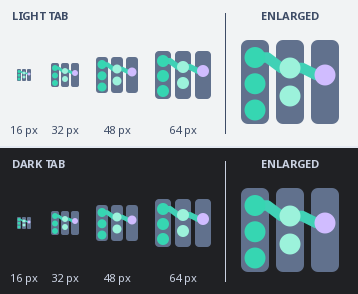
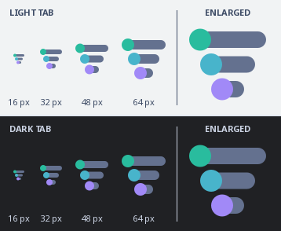
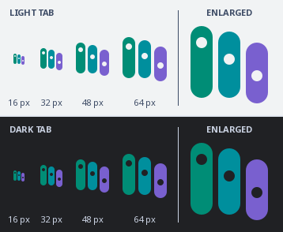
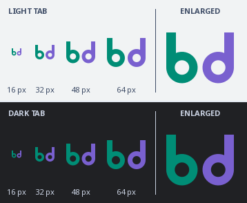
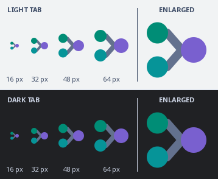
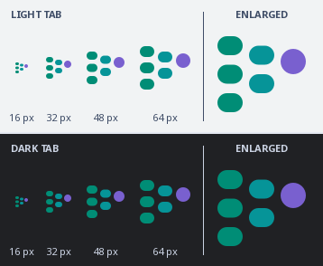
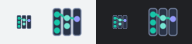

# Beads UI favicon candidates

The [full-size overview](overview.png) shows all six candidates and the current icon on light and dark tabs. Open the image directly to inspect the 16 and 32 px cells at their original size. The candidate panels below show native 16, 32, 48 and 64 px renders alongside a smooth 112 px render drawn directly from the same SVG.

## What shipped in PR 113

PR 113 added an [editable SVG](../../../apps/web/client/public/icon.svg), a [32 px browser fallback](../../../apps/web/client/public/icon-32.png), a [192 px installed-app icon](../../../apps/web/client/public/icon-192.png), and tests for the root and `/beads/` mounts. The merged SVG places six beads and a connecting thread on three slate-outlined columns.

At 16 px, the 2-unit column outline renders at half a pixel and the 4-unit thread renders at one pixel. On a dark tab the navy columns recede into the background. On both tabs the upper dots and thread crowd the column separators. The current comparison uses the shipped PNGs at 32 and 192 px and direct SVG renders for the other sizes.

## What the design session asked for

Sergei wanted the mark to “capture both the name and object beads but also that its a task management system” and asked for “just the logo with a transparent background.” He rejected the beaded checkmarks and later asked for something “simpler and more abstract” that could still suggest productivity. He also raised mirrored `bd` as a possible direction after rejecting the upstream green `bd` tile.

He later asked to “just use the image #4.” The handoff describes “the three-column Kanban-style logo with circular teal/mint/purple beads, connected across the top to suggest task progression.” That matches export image 005, with broad navy columns, beads that nearly fill the lanes, and a bright mint connector. The fourth attachment in the latest batch is image 008, a horizontal queue. C1 redraws the mark described in the handoff and C2 redraws the horizontal queue. The source is `ChatGPT_gpt-chat-beads-web-app-favicon_20261120-1950.md`, lines 154–190, 294–356 and 376–434.

## C1 · Kanban relay

The closest redraw of the three-column reference. It keeps the mint thread and the 3–2–1 arrangement of teal, mint and violet beads. Solid slate lanes and a wider thread give the board more presence at tab size.

[All seven sizes on both backgrounds](c1/all-sizes.png) · [SVG master](c1/c1.svg) · [16/32/48 px ICO](c1/c1.ico)

Transparent PNGs (px) · [16](c1/c1-16.png) · [32](c1/c1-32.png) · [48](c1/c1-48.png) · [64](c1/c1-64.png) · [128](c1/c1-128.png) · [192](c1/c1-192.png) · [512](c1/c1-512.png)

## C2 · Stepped queue

Three bead-headed bars shorten and step inward like a prioritized queue. This follows the horizontal mark in the fourth export attachment.

[All seven sizes on both backgrounds](c2/all-sizes.png) · [SVG master](c2/c2.svg) · [16/32/48 px ICO](c2/c2.ico)

Transparent PNGs (px) · [16](c2/c2-16.png) · [32](c2/c2-32.png) · [48](c2/c2-48.png) · [64](c2/c2-64.png) · [128](c2/c2-128.png) · [192](c2/c2-192.png) · [512](c2/c2-512.png)

## C3 · Punch lanes

Three solid bands take the place of outlined columns. Round cutouts make the beads part of the shape. This is the bolder board alternative.

[All seven sizes on both backgrounds](c3/all-sizes.png) · [SVG master](c3/c3.svg) · [16/32/48 px ICO](c3/c3.ico)

Transparent PNGs (px) · [16](c3/c3-16.png) · [32](c3/c3-32.png) · [48](c3/c3-48.png) · [64](c3/c3-64.png) · [128](c3/c3-128.png) · [192](c3/c3-192.png) · [512](c3/c3-512.png)

## C4 · Mirror beads

Two mirrored forms hint at `bd`. The bead openings and outer stems give it a compact silhouette with a looser connection to task management.

[All seven sizes on both backgrounds](c4/all-sizes.png) · [SVG master](c4/c4.svg) · [16/32/48 px ICO](c4/c4.ico)

Transparent PNGs (px) · [16](c4/c4-16.png) · [32](c4/c4-32.png) · [48](c4/c4-48.png) · [64](c4/c4-64.png) · [128](c4/c4-128.png) · [192](c4/c4-192.png) · [512](c4/c4-512.png)

## C5 · Bead merge

Two inputs feed one violet bead along wide links. The fork suggests dependencies and work converging on a single task.

[All seven sizes on both backgrounds](c5/all-sizes.png) · [SVG master](c5/c5.svg) · [16/32/48 px ICO](c5/c5.ico)

Transparent PNGs (px) · [16](c5/c5-16.png) · [32](c5/c5-32.png) · [48](c5/c5-48.png) · [64](c5/c5-64.png) · [128](c5/c5-128.png) · [192](c5/c5-192.png) · [512](c5/c5-512.png)

## C6 · Bead matrix

A 3–2–1 arrangement of rounded beads implies a board through spacing and color. The violet bead marks the last lane.

[All seven sizes on both backgrounds](c6/all-sizes.png) · [SVG master](c6/c6.svg) · [16/32/48 px ICO](c6/c6.ico)

Transparent PNGs (px) · [16](c6/c6-16.png) · [32](c6/c6-32.png) · [48](c6/c6-48.png) · [64](c6/c6-64.png) · [128](c6/c6-128.png) · [192](c6/c6-192.png) · [512](c6/c6-512.png)

## Tab-size comparison

Each half shows 16 px followed by 32 px. The light tab is on the left and the dark tab is on the right.

| Design | Light tab · Dark tab |
| --- | --- |
| Current · PR 113 |  |
| C1 · Kanban relay |  |
| C2 · Stepped queue |  |
| C3 · Punch lanes |  |
| C4 · Mirror beads |  |
| C5 · Bead merge |  |
| C6 · Bead matrix |  |

## Recommendation

C1 is the closest match to the three-column reference and keeps the board visible on the dark tab. C3 is my pick for the smallest tabs. Its three colored lanes remain distinct at 16 px, and the bead cutouts clarify the idea at 32 px.
