# Beads UI favicon candidates

## Registry

| ID | Slug | Version | Concept | Status | Source file |
| --- | --- | --- | --- | --- | --- |
| FAV-00 | current | 1.0.0 | Three outlined lanes with a bead thread | shipped · replaced by FAV-01 if confirmed | [fav-00-current.svg](fav-00-current/fav-00-current.svg) |
| FAV-01 | dark-tile | 1.0.0 | Four beads on a dark tile, faithful redraw | picked | [fav-01-dark-tile.svg](fav-01-dark-tile/1.0.0/fav-01-dark-tile.svg) |
| FAV-01 | dark-tile | 1.1.0 | Four beads on a dark tile, tuned for tabs | picked | [fav-01-dark-tile.svg](fav-01-dark-tile/fav-01-dark-tile.svg) |
| FAV-02 | kanban-relay | 1.0.0 | Three lanes joined by a mint thread | candidate | [fav-02-kanban-relay.svg](fav-02-kanban-relay/fav-02-kanban-relay.svg) |
| FAV-03 | stepped-queue | 1.0.0 | Three stepped bars with bead heads | candidate | [fav-03-stepped-queue.svg](fav-03-stepped-queue/fav-03-stepped-queue.svg) |
| FAV-04 | punch-lanes | 1.0.0 | Three solid lanes with bead cutouts | candidate | [fav-04-punch-lanes.svg](fav-04-punch-lanes/fav-04-punch-lanes.svg) |
| FAV-05 | mirror-beads | 1.0.0 | Mirrored forms suggesting bd | candidate | [fav-05-mirror-beads.svg](fav-05-mirror-beads/fav-05-mirror-beads.svg) |
| FAV-06 | bead-merge | 1.0.0 | Two inputs converge on a violet bead | candidate | [fav-06-bead-merge.svg](fav-06-bead-merge/fav-06-bead-merge.svg) |
| FAV-07 | bead-matrix | 1.0.0 | A 3–2–1 bead grid | candidate | [fav-07-bead-matrix.svg](fav-07-bead-matrix/fav-07-bead-matrix.svg) |

Sergei picked the dark-tile concept for now. FAV-00 is the shipped PR 113 icon and the replacement awaits his confirmation.

The [full-size overview](overview.png) shows all nine versions. Each design below starts with a 256 px render drawn directly from its SVG on light and dark tabs. Open an image directly for its native pixel size on a narrow screen. Each true-size strip uses the 16, 32, 48 and 64 px PNGs at 1:1.

## Versioning

The ChatGPT export paired letter IDs with descriptive names, such as `A · Linked Beads`, and used filenames such as `A-beaded-check-512.png` in a later round. The registry adds permanent, zero-padded IDs (`FAV-NN`), stable kebab-case slugs and semantic versions. Cite a particular release as `FAV-01 dark-tile@1.1.0`.

A distinct concept gets the next unused ID. Each design revision bumps its version. Bump **major** for a substantial redraw of the same concept, **minor** for a visible refinement such as tab-size tuning, and **patch** for an asset correction with no intended change to the mark. Keep the latest release in `fav-NN-<slug>/` and archive earlier releases in subdirectories named by version.

| Release | Change |
| --- | --- |
| FAV-00 current@1.0.0 | Registered the icon shipped in PR 113. |
| FAV-01 dark-tile@1.0.0 | Registered the faithful redraw of the third-row icon. |
| FAV-01 dark-tile@1.1.0 | Snapped bead centers to the 16 px grid, increased separation and tightened the tile corners. |
| FAV-02 through FAV-07 @1.0.0 | Registered the six existing candidates in their original order. |

## FAV-00 current@1.0.0

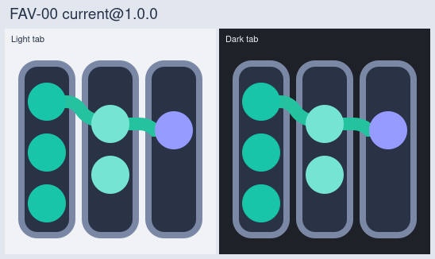

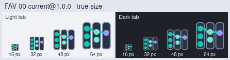

PR 113 shipped the [SVG](../../../apps/web/client/public/icon.svg), [32 px fallback](../../../apps/web/client/public/icon-32.png) and [192 px installed-app icon](../../../apps/web/client/public/icon-192.png). The comparison uses the shipped PNGs at those two sizes. At 16 px the lane outlines are half a pixel wide, and the thread crowds the top beads.

[All seven sizes on both backgrounds](fav-00-current/fav-00-current-all-sizes.png) · [SVG master](fav-00-current/fav-00-current.svg) · [16/32/48 px ICO](fav-00-current/fav-00-current.ico)

Transparent PNGs (px) · [16](fav-00-current/fav-00-current-16.png) · [32](fav-00-current/fav-00-current-32.png) · [48](fav-00-current/fav-00-current-48.png) · [64](fav-00-current/fav-00-current-64.png) · [128](fav-00-current/fav-00-current-128.png) · [192](fav-00-current/fav-00-current-192.png) · [512](fav-00-current/fav-00-current-512.png)

## FAV-01 dark-tile@1.0.0

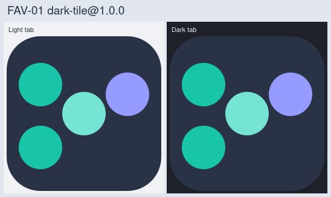

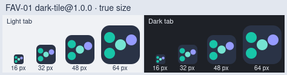

The third row of the review sheet. A dark slate tile holds two teal beads at left, a mint bead in the middle and a violet bead at right. At 16 px the dots are visible, with softer edges and tighter gaps than in 1.1.0.

[All seven sizes on both backgrounds](fav-01-dark-tile/1.0.0/fav-01-dark-tile-all-sizes.png) · [SVG master](fav-01-dark-tile/1.0.0/fav-01-dark-tile.svg) · [16/32/48 px ICO](fav-01-dark-tile/1.0.0/fav-01-dark-tile.ico)

Transparent PNGs (px) · [16](fav-01-dark-tile/1.0.0/fav-01-dark-tile-16.png) · [32](fav-01-dark-tile/1.0.0/fav-01-dark-tile-32.png) · [48](fav-01-dark-tile/1.0.0/fav-01-dark-tile-48.png) · [64](fav-01-dark-tile/1.0.0/fav-01-dark-tile-64.png) · [128](fav-01-dark-tile/1.0.0/fav-01-dark-tile-128.png) · [192](fav-01-dark-tile/1.0.0/fav-01-dark-tile-192.png) · [512](fav-01-dark-tile/1.0.0/fav-01-dark-tile-512.png)

## FAV-01 dark-tile@1.1.0

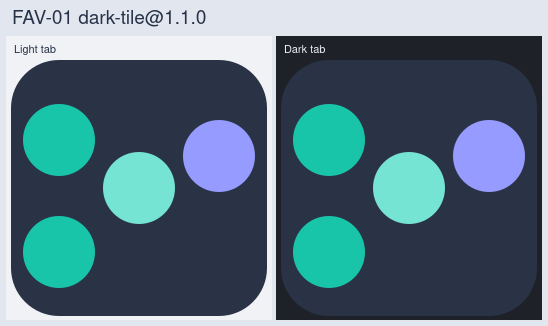

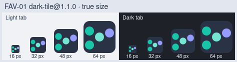

This version keeps the colors and 4.5 px bead diameter at 16 px. The bead centers sit on the 16 px grid, the outer beads sit farther from the mint bead, and the corner radius is 3 px instead of 3.5 px at that size.

[All seven sizes on both backgrounds](fav-01-dark-tile/fav-01-dark-tile-all-sizes.png) · [SVG master](fav-01-dark-tile/fav-01-dark-tile.svg) · [16/32/48 px ICO](fav-01-dark-tile/fav-01-dark-tile.ico)

Transparent PNGs (px) · [16](fav-01-dark-tile/fav-01-dark-tile-16.png) · [32](fav-01-dark-tile/fav-01-dark-tile-32.png) · [48](fav-01-dark-tile/fav-01-dark-tile-48.png) · [64](fav-01-dark-tile/fav-01-dark-tile-64.png) · [128](fav-01-dark-tile/fav-01-dark-tile-128.png) · [192](fav-01-dark-tile/fav-01-dark-tile-192.png) · [512](fav-01-dark-tile/fav-01-dark-tile-512.png)

## FAV-02 kanban-relay@1.0.0

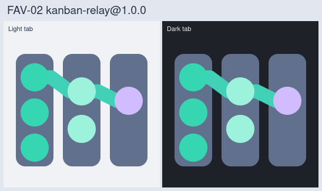

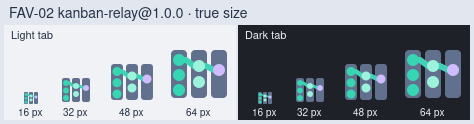

The closest redraw of the three-column reference. Solid slate lanes and a wider mint thread give the 3–2–1 arrangement more presence at tab size.

[All seven sizes on both backgrounds](fav-02-kanban-relay/fav-02-kanban-relay-all-sizes.png) · [SVG master](fav-02-kanban-relay/fav-02-kanban-relay.svg) · [16/32/48 px ICO](fav-02-kanban-relay/fav-02-kanban-relay.ico)

Transparent PNGs (px) · [16](fav-02-kanban-relay/fav-02-kanban-relay-16.png) · [32](fav-02-kanban-relay/fav-02-kanban-relay-32.png) · [48](fav-02-kanban-relay/fav-02-kanban-relay-48.png) · [64](fav-02-kanban-relay/fav-02-kanban-relay-64.png) · [128](fav-02-kanban-relay/fav-02-kanban-relay-128.png) · [192](fav-02-kanban-relay/fav-02-kanban-relay-192.png) · [512](fav-02-kanban-relay/fav-02-kanban-relay-512.png)

## FAV-03 stepped-queue@1.0.0

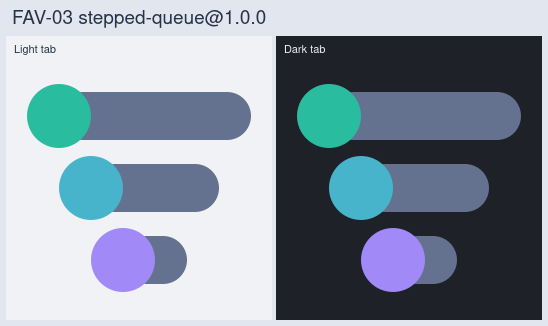

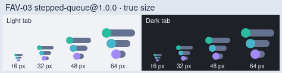

Three bead-headed bars shorten and step inward like a prioritized queue. This follows the horizontal mark in the fourth export attachment.

[All seven sizes on both backgrounds](fav-03-stepped-queue/fav-03-stepped-queue-all-sizes.png) · [SVG master](fav-03-stepped-queue/fav-03-stepped-queue.svg) · [16/32/48 px ICO](fav-03-stepped-queue/fav-03-stepped-queue.ico)

Transparent PNGs (px) · [16](fav-03-stepped-queue/fav-03-stepped-queue-16.png) · [32](fav-03-stepped-queue/fav-03-stepped-queue-32.png) · [48](fav-03-stepped-queue/fav-03-stepped-queue-48.png) · [64](fav-03-stepped-queue/fav-03-stepped-queue-64.png) · [128](fav-03-stepped-queue/fav-03-stepped-queue-128.png) · [192](fav-03-stepped-queue/fav-03-stepped-queue-192.png) · [512](fav-03-stepped-queue/fav-03-stepped-queue-512.png)

## FAV-04 punch-lanes@1.0.0

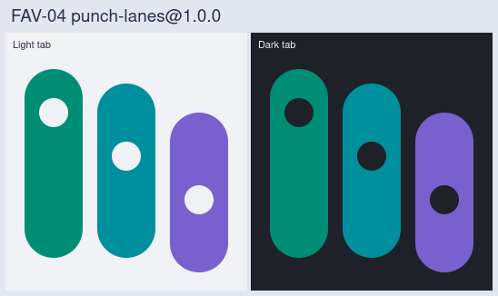

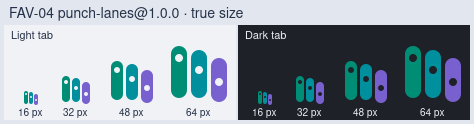

Round cutouts make the beads part of the three solid bands. The lane silhouettes remain distinct at tab size.

[All seven sizes on both backgrounds](fav-04-punch-lanes/fav-04-punch-lanes-all-sizes.png) · [SVG master](fav-04-punch-lanes/fav-04-punch-lanes.svg) · [16/32/48 px ICO](fav-04-punch-lanes/fav-04-punch-lanes.ico)

Transparent PNGs (px) · [16](fav-04-punch-lanes/fav-04-punch-lanes-16.png) · [32](fav-04-punch-lanes/fav-04-punch-lanes-32.png) · [48](fav-04-punch-lanes/fav-04-punch-lanes-48.png) · [64](fav-04-punch-lanes/fav-04-punch-lanes-64.png) · [128](fav-04-punch-lanes/fav-04-punch-lanes-128.png) · [192](fav-04-punch-lanes/fav-04-punch-lanes-192.png) · [512](fav-04-punch-lanes/fav-04-punch-lanes-512.png)

## FAV-05 mirror-beads@1.0.0

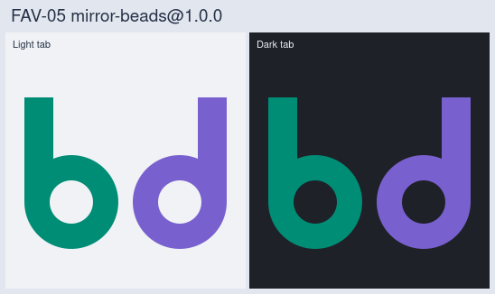

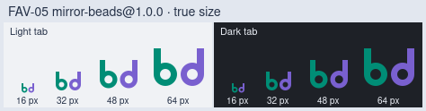

Two mirrored forms hint at `bd`. The bead openings and outer stems give it a compact silhouette.

[All seven sizes on both backgrounds](fav-05-mirror-beads/fav-05-mirror-beads-all-sizes.png) · [SVG master](fav-05-mirror-beads/fav-05-mirror-beads.svg) · [16/32/48 px ICO](fav-05-mirror-beads/fav-05-mirror-beads.ico)

Transparent PNGs (px) · [16](fav-05-mirror-beads/fav-05-mirror-beads-16.png) · [32](fav-05-mirror-beads/fav-05-mirror-beads-32.png) · [48](fav-05-mirror-beads/fav-05-mirror-beads-48.png) · [64](fav-05-mirror-beads/fav-05-mirror-beads-64.png) · [128](fav-05-mirror-beads/fav-05-mirror-beads-128.png) · [192](fav-05-mirror-beads/fav-05-mirror-beads-192.png) · [512](fav-05-mirror-beads/fav-05-mirror-beads-512.png)

## FAV-06 bead-merge@1.0.0

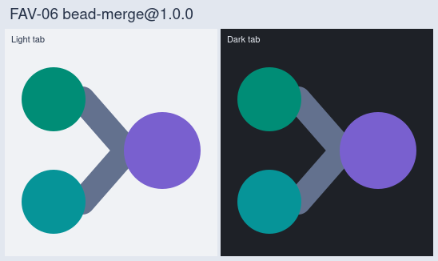

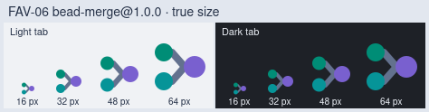

Two inputs feed one violet bead along wide links. The fork suggests dependencies and work converging on a single task.

[All seven sizes on both backgrounds](fav-06-bead-merge/fav-06-bead-merge-all-sizes.png) · [SVG master](fav-06-bead-merge/fav-06-bead-merge.svg) · [16/32/48 px ICO](fav-06-bead-merge/fav-06-bead-merge.ico)

Transparent PNGs (px) · [16](fav-06-bead-merge/fav-06-bead-merge-16.png) · [32](fav-06-bead-merge/fav-06-bead-merge-32.png) · [48](fav-06-bead-merge/fav-06-bead-merge-48.png) · [64](fav-06-bead-merge/fav-06-bead-merge-64.png) · [128](fav-06-bead-merge/fav-06-bead-merge-128.png) · [192](fav-06-bead-merge/fav-06-bead-merge-192.png) · [512](fav-06-bead-merge/fav-06-bead-merge-512.png)

## FAV-07 bead-matrix@1.0.0

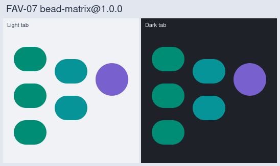

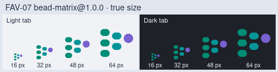

A 3–2–1 arrangement of rounded beads implies a board through spacing and color. The violet bead marks the last lane.

[All seven sizes on both backgrounds](fav-07-bead-matrix/fav-07-bead-matrix-all-sizes.png) · [SVG master](fav-07-bead-matrix/fav-07-bead-matrix.svg) · [16/32/48 px ICO](fav-07-bead-matrix/fav-07-bead-matrix.ico)

Transparent PNGs (px) · [16](fav-07-bead-matrix/fav-07-bead-matrix-16.png) · [32](fav-07-bead-matrix/fav-07-bead-matrix-32.png) · [48](fav-07-bead-matrix/fav-07-bead-matrix-48.png) · [64](fav-07-bead-matrix/fav-07-bead-matrix-64.png) · [128](fav-07-bead-matrix/fav-07-bead-matrix-128.png) · [192](fav-07-bead-matrix/fav-07-bead-matrix-192.png) · [512](fav-07-bead-matrix/fav-07-bead-matrix-512.png)

## Recommendation

Use **FAV-01 dark-tile@1.1.0** for browser tabs, pending Sergei’s confirmation. At 16 px the four round dots separate more clearly on both backgrounds, and the tile corners look cleaner. At 32 px the tuned version keeps a little more dark space around the mint bead. At 48 px and above, both versions read clearly. Use 1.0.0 at those sizes when fidelity to the picked reference matters. Both sets of PNGs render directly from their own SVG master.

## Design-session references

Sergei wanted the mark to “capture both the name and object beads but also that its a task management system” and asked for “just the logo with a transparent background.” He rejected the beaded checkmarks and later asked for something “simpler and more abstract” that could still suggest productivity. He also raised mirrored `bd` as a possible direction after rejecting the upstream green `bd` tile.

He later asked to “just use the image #4.” The handoff describes “the three-column Kanban-style logo with circular teal/mint/purple beads, connected across the top to suggest task progression.” That matches export image 005. The fourth attachment in the latest batch is image 008, a horizontal queue. FAV-02 redraws the mark described in the handoff and FAV-03 redraws the horizontal queue. The source is `ChatGPT_gpt-chat-beads-web-app-favicon_20261120-1950.md`, lines 154–190, 294–356 and 376–434.

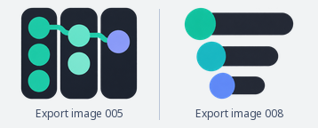
