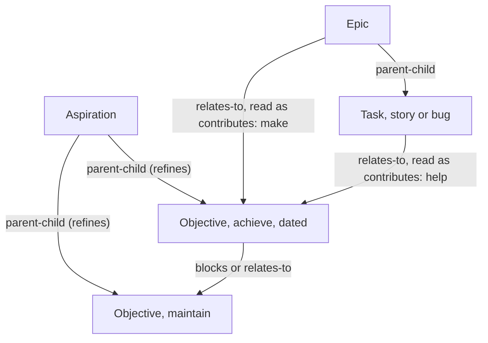
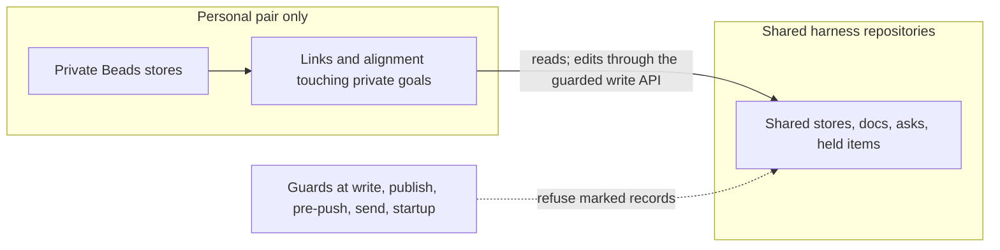

<!-- Full structure: see TEMPLATE.md in this directory -->

# Beads goals system: goals above epics, their links, views and alignment, and the private-goal guard — Design Document

## Founding Ask Coverage

`founding_ask_ref`: `{"blob_oid":"8b43d16fb45272c4911f8de4d1b491e6bb472134","capture_commit":"b5eaeefd646b1fee17f189518ca9d32a67e9aad2","content_sha256":"79619e87b5d6a8e02204a9bf35e294caa65ab910f8be7f0d136e7035009caed0","entry_ids":["A001"],"generation":1,"path":"docs/asks/BU-epic-goals-system-usmm.md","previous_ref_sha256":null,"repository":"ai-harness","schema_version":1,"task_id":"BU-epic-goals-system-usmm"}`

`founding_ask_ref_sha256`: `c12436184b45bdc5c279f8f1d3928c6610536b5802f38b0760a6d47d4997dae6`

The founding ask record has one entry, A001, recorded verbatim in ai-harness at `docs/asks/BU-epic-goals-system-usmm.md`. This index is non-authoritative; the raw entry governs. A001 covers two systems: this doc designs the goals system and the privacy guard, and [the web app design](beads-ui-web-app-design.md) designs the web app the goal views live in. Each row below is one goals clause of A001.

| Entry | Clause (quoted or closely paraphrased) | Coverage and disposition |
|---|---|---|
| A001 | a goals system "as a fundamental architectural component to the beads task system hierarchy where it will be like the chief most possible parent beads task type" | [Goal model](#goal-model); [D-1](#d-1), [D-4](#d-4) |
| A001 | "optionall assign all beads tasks to one or more goals (or no goals)" | [Goal model](#goal-model); [D-2](#d-2), [D-3](#d-3); a shared task can serve a private goal through [D-19](#d-19) |
| A001 | view goals organisationally by priority; "all the usual linkages such as relates to and dependencies and blocks" | [D-4](#d-4); [Goal views](#goal-views): the goal tree and the goal health board in priority order |
| A001 | a system that sits on top of epics, stories and tasks, better than Atlassian's | [Goal model](#goal-model), [Progress and health](#progress-and-health); [D-5](#d-5) |
| A001 | interactive visualisations of the work under each goal, its dependencies, blockers and links, "in a hierarchical linked graph" | [Goal views](#goal-views); [D-9](#d-9) |
| A001 | "start / end / due date fields"; Gantt chart, timeline and graph views with dependency and blocker links | [Goal model](#goal-model), [Goal views](#goal-views); [D-1](#d-1), [D-10](#d-10) |
| A001 | orient and prioritise work toward "my actual goals in life"; prioritise "my take and agentic ai work towards them" | [Alignment](#alignment); [D-7](#d-7), [D-8](#d-8) |
| A001 | the research gamut (products, libraries, goal science, ontology, visualisation patterns) | [research](../research/goals-system.md); applied throughout |
| A001 | fold in aih-fw-2's compile of the first goals attempt, link it, research new leads | [Prior work](#prior-work); [D-16](#d-16) |
| A001 | a privacy and access-control system so personal, private, sensitive or domain-specific goals and their tasks never reach ai-harness, ai-cli-utils, ai-core, project-template, aido or another shared core repo; enforcement and validation | [The private-goal guard](#the-private-goal-guard); [D-11](#d-11) to [D-15](#d-15) |
| A001 | the goal views inside the web app, app-portal and the shared core | [the web app design](beads-ui-web-app-design.md); [Goal views](#goal-views) |
| A001 | the process clauses | Process, not content: the [Run Ledger](#run-ledger) |

**Status:** DRAFT, held for Sergei's review

**Created:** 2026-10-28

**Task:** BU-ylx.11.2 (design), parent BU-ylx.11 (the goals epic); build: BU-ylx.11.3

**Research:** [docs/research/goals-system.md](../research/goals-system.md) and its findings under [docs/research/findings/](../research/findings/)

**Related:** [docs/designs/beads-ui-design.md](beads-ui-design.md) (its D-5 sprint convention and D-6 rank) and [the web app design](beads-ui-web-app-design.md)

<!-- doc:region name="overview" kind="replaceable" -->

## Table of Contents

- [Founding Ask Coverage](#founding-ask-coverage)
- [Executive Summary](#executive-summary)
- [Summary for a wide audience](#summary-for-a-wide-audience)
- [Problem Statement](#problem-statement)
- [Design Overview](#design-overview)
- [Architecture](#architecture)
  - [Goal model](#goal-model)
  - [Links](#links)
  - [Progress and health](#progress-and-health)
  - [Alignment](#alignment)
  - [Goal views](#goal-views)
  - [Private goals over shared work](#private-goals-over-shared-work)
  - [The private-goal guard](#the-private-goal-guard)
  - [Prior work](#prior-work)
- [Data Model](#data-model)
- [Integration](#integration)
- [Implementation Phases](#implementation-phases)
  - [Phase G1: The private-goal guard (lands in ai-harness, installed on every profile)](#phase-g1-the-private-goal-guard-lands-in-ai-harness-installed-on-every-profile)
  - [Phase G2: The goal model, links, progress and health (beads-ui core and stores)](#phase-g2-the-goal-model-links-progress-and-health-beads-ui-core-and-stores)
  - [Phase G3: The goal views (web app, mod and MCP App)](#phase-g3-the-goal-views-web-app-mod-and-mcp-app)
  - [Phase G4: Alignment in the queues](#phase-g4-alignment-in-the-queues)
- [Implementation Audit](#implementation-audit)
- [Risks and Mitigations](#risks-and-mitigations)
- [Open Questions](#open-questions)
- [Run Ledger](#run-ledger)
  - [Transition verdicts](#transition-verdicts)
- [Design Decisions](#design-decisions)
  - [Decision Summary](#decision-summary)
  - [Decision Details](#decision-details)
- [Feedback Rounds](#feedback-rounds)
- [Approval Log](#approval-log)

## Executive Summary

This design makes a goal a first-class Beads issue that sits above epics: an aspiration over dated objectives, each either an achievement or something to maintain, linked to any issue that serves it and to other goals. Progress is computed from the work linked to a goal, while health comes from short written check-ins, so a goal can show "60% done, at risk" honestly. The goal views (a linked graph, a Gantt and timeline with the critical path, and charts of where effort goes) live in the beads-ui web app, and an alignment score lifts the queue rank of work that serves Sergei's top goals, for his own work and for his agents'. Personal, private, sensitive and domain-specific goals live only in private stores on the personal machine pair, every link that touches them stays there, and client-side guards at every write, publish, push and message path refuse a marked record, and any goal record not marked shared, before it can reach a shared or public repository. Two calls are left for Sergei: whether the alignment score may reorder the fleet's agent queue ([D-8](#d-8)), and where employer-domain goals live ([D-14](#d-14)).

## Summary for a wide audience

Beads gains goals: the reason a piece of work exists. Any task, epic or bug can be tied to one or more goals, and the web app shows goals as a graph, a timeline and a progress view. Work that serves the most important goals rises in the queue for people and agents alike. Personal goals never leave the personal machines, and the fleet's tools refuse to write them anywhere shared. Nothing changes until the build, which waits for Sergei's review.

## Problem Statement

Beads has epics, stories and tasks but nothing that says why they matter, so neither Sergei nor his agents can tell whether the week's work serves the goals he cares about. The first goals system was never operationalised and lost its link to tasks when tasks moved to Beads ([research § 9](../research/goals-system.md#9-prior-work-from-the-first-goals-system)). And the fleet has no guard that keeps personal goal content out of the repositories every machine clones; the research found the Beads store's own publication path is the main leak route ([research § 8](../research/goals-system.md#8-privacy-and-access-control-for-personal-goals)).

## Design Overview

**Status:** stub; to be filled during and after implementation.

## Architecture

### Goal model

A goal is a Beads issue of a custom `goal` type, added to each store's `types.custom` ([D-1](#d-1)). Its own fields live in `metadata.goal`:

| Field | Values | Why |
|---|---|---|
| `level` | `aspiration` or `objective` | Two levels above epics fit the evidence: a superordinate "be ..." goal over dated, measurable objectives |
| `kind` | `achieve` or `maintain` | An achieve goal closes when met; a maintain goal never closes and demands work only when its condition fails |
| `target` | `{metric, start, current, target, unit}`, or `done_definition` text | Specific, measurable goals outperform vague ones, so a `perform` objective asks for a target; a `learn` or exploratory objective may carry a written definition of done instead, since measurable targets did no better for creative work |
| `starts_at`, `ends_at` | dates | The ask's start and end; Beads has only `due_at` and an actual `started_at` |
| `date_resolution` | `day`, `month`, `quarter`, `half`, `year` | A goal "for Q2" is not a goal "for 30 June" |
| `progress_source` | `work_estimate`, `work_count`, `subgoal`, `metric`, `manual` | Typed progress sources, as Asana names them |
| `orientation` | `learn` or `perform` | Goal effects shrink on complex work, where learning goals can do better |
| `motivation`, `obstacles` | short text | Mental contrasting; carried over from the first goals system |
| `marking` | `shared`, `personal`, `private`, `sensitive`, `domain` | The privacy guard's input ([D-11](#d-11)) |
| `order` | fractional index, optional | "Your order right now" among a person's active goals, carried over from the first system's unique rank and ordered like D-6's rank; priority stays the weight ([D-18](#d-18)) |
| `contributions` | `{member_id: "make" or "help"}` | Contribution strength until Beads can write edge metadata ([D-3](#d-3)) |
| `docs` | list of repository paths or URLs | Plans and research attached to the goal, carried over from the first system |

Priority (`priority` 0 to 4), the hard due date (`due_at`), owner and status are Beads' own fields; `starts_at` and `ends_at` are the planned start and end. A milestone is a member issue of Beads' built-in `milestone` type, linked like any member with `make` and drawn as a checkpoint on the timeline, as the fold-in research recommends over a third strength. A goal stays the top-most type: a `parent-child` edge that would make a non-goal the parent of a goal is refused. A goal's lifecycle is open, in progress, paused, dropped (with a reason) and done; `paused` and `dropped` are statuses recorded in metadata until Beads carries them ([D-6](#d-6)).

### Links

Work joins a goal through a `relates-to` edge from the member to the goal, read as "contributes to" because its target is a goal, many-to-many, with descendant inclusion: linking an epic counts its children ([D-2](#d-2)). Beads 1.3.2 accepts only its fixed edge kinds, so a dedicated `contributes-to` kind is an upstream request, not something this design can add. Goals link to goals with `parent-child` (an objective refines an aspiration), `blocks` and `relates-to` ([D-4](#d-4)). An issue may belong to no goal; the goal views list high-priority work with no goal as a review signal, as the first system did.



Legend: arrows point from the serving item to what it serves; `make` counts fully toward progress and alignment, `help` counts half.

### Progress and health

A goal with no members shows "no data", never 0% progress: the first goals system failed exactly there, when its links broke and every goal read zero. Progress is computed from members: by default from estimates (done plus a quarter of in-progress, over the total), falling back to counts when fewer than half the members carry estimates, from sub-goals for an aspiration, or from the target metric when one is set ([D-5](#d-5)). Health is separate: the owner's latest check-in sets `on track`, `at risk` or `off track`, and an overdue check-in shows "update missing" rather than a guess. Monitoring progress is itself effective, so check-ins are short, prompted and recorded; there are no streaks, points or achievements ([D-6](#d-6)).

### Alignment

Each item's alignment $A_i$ is a noisy-OR over the goals it serves, weighted by contribution strength and goal weight, and the queue score multiplies the fleet's existing WSJF composite $C_i$ ([D-7](#d-7)):

$$
A_i = 1 - \prod_{g \in G} \Bigl(1 - \min\bigl(1,\; c_{i,g}\, w_{g}\bigr)\Bigr), \qquad S_i = C_i \,\bigl(1 + \beta A_i\bigr), \quad \beta = 1
$$

Alignment also flows backwards along `blocks` edges, so a decision or blocker that holds up goal-serving work inherits that work's alignment, discounted by a call-time factor; the Review queue then ranks Sergei's own answers by the goals they unblock. Completion is read from `closed_at`, never `updated_at`. Unaligned work keeps its WSJF score and appears in an "unaligned work" list, never hidden, though aligned work can now overtake it in the queue. Agent-proposed links count only after Sergei reviews them, which closes the score's main gaming path. Where the score changes ordering is [D-8](#d-8), left for Sergei.

### Goal views

The goal views live in the beads-ui web app ([the web app design](beads-ui-web-app-design.md)) and draw from core models shared with the mod and the MCP App ([D-9](#d-9), [D-10](#d-10)):

| View | What it answers | Built with |
|---|---|---|
| Goal tree | What are my goals, in order, and how do they nest? | TanStack Table expanding rows if the Phase 3 backlog uses them, otherwise headless-tree after a spike; Pragmatic drag and drop to re-parent and reorder |
| Goal health board | Which goals need attention, in priority order? | A list of goals by priority with health, progress, pace, staleness and blockers |
| Goal graph | What serves this goal, and what blocks it? | React Flow with ELK layered layout in a Web Worker, dagre for pure trees |
| Timeline and Gantt | When, and what is on the critical path? | A custom SVG view on visx shared with the Roadmap, refining D-10 of the beads-ui design, which named Frappe Gantt ([D-9](#d-9)); critical path computed in core |
| Allocation | Where is my and my agents' effort going against goal weight? | Recharts Sankey, treemap and progress rings |
| Goal review | Which goals need a check-in, a replacement or a link review? | The web app's Review queue |

### Private goals over shared work

A private goal can be served by work in a shared store. Its links live in the private store ([D-12](#d-12)), so the web app on the personal pair joins them with the shared work at read time: progress, cycle checks and the critical path run in core over the joined set, and a store that cannot be read shows "no data" for the goals that depend on it ([D-19](#d-19)). The join only reads shared stores. An edit made to shared work from the goal views goes through the web app's guarded write API, which runs the private term-list check before it writes.

### The private-goal guard

Private records live only in Beads stores of private-class repositories on the personal pair, and every link that touches a private goal lives in that private store; a shared store knows nothing about a private goal, not even an id ([D-11](#d-11), [D-12](#d-12)). Every repository is shared unless it declares itself private with a committed marker in its own tree, and shared and public repositories carry a `privacy_class` key in the fleet's project registry, so beads-ui, which is public and where goal fixtures and screenshots will be made, is guarded too ([D-11](#d-11)). Client-side guards refuse a marked record, and any goal record not marked `shared`, at each point where content can leave for a shared repository, because no server-side guard can recognise this content on these repositories ([D-13](#d-13)):

| Guard point | What it refuses | Built on |
|---|---|---|
| `bd` create and update | A marked goal, a task under one, or a goal record not marked `shared`, written into a shared store | `bd-new` and the store registry |
| Store publication | Publishing a shared store that holds such a record, through the publisher or the raw `bd dolt push` | the store publisher, and a wrapper that refuses the raw verb for shared stores |
| Pre-commit and pre-push, full pushed range | Marked records, private-class ids and private-store references in any committed file, in every shared and public repository | the staged secret-scan gate with a private-id rule for hash and slug ids; the public-repo checker's external denylist; the `privacy_class` registry |
| Carrier send | A marked body in git-inbox, Agent Mail or held items routed to a shared repository | the artifact routing table's refuse-by-default row |
| Host startup | A private store present on a host whose class forbids it | the machine install contract |
| Periodic scan | Regressions, run from a personal host only | the same rules |

Every guard fails closed on missing or unreadable configuration, never echoes matched text, is pinned by a test, and is installed on every machine profile through the installer step that deploys each repository's hooks. One exception is deliberate: the private term list never exists on the employer host, so there the content scan reports `not-declared` while the structural rules still refuse.

The guarantee is exact for goal records and marked tasks. Two cases are covered only by the term-list scan: an unmarked task whose text is private, and text an agent derives from a private goal and writes into a shared task, comment, commit message or summary. The scan runs on personal hosts and in the web app's write API; it does not run on the employer host.



Legend: nothing private flows into a shared repository; the solid edge is a read, or an edit to shared work through the guarded write API, and the dashed edge marks the refusing guards.

### Prior work

The first goals system, compiled by aih-fw-2 into ai-harness ([prior-work reference](https://github.com/sergeiwallace/ai-harness/blob/main/docs/analysis/legacy-goal-system--prior-work-reference.md), gated link), failed at the goal-to-task link rather than in its goal model: tasks moved to Beads while goals and their link table stayed behind, and progress then read 0% instead of an error ([research § 9](../research/goals-system.md#9-prior-work-from-the-first-goals-system)). This design keeps a shared goal, its work and its links in one Beads store; a private goal's links stay in its private store and the personal-pair web app joins them with shared work ([D-19](#d-19)); either way an empty or unreadable link set shows "no data". It carries over the old record's motivation, obstacles, target date, pause state, many-to-many contributions (the old milestone kind becomes a member of Beads' `milestone` type), unique order, document links and the unlinked-work review signal ([D-16](#d-16)), and leaves the daily score, achievements and narrative coach out of the first release ([D-17](#d-17)). Nothing is imported from the archive; its algorithms are behaviour to respecify.

> **Feedback Round 1:** Does this approach feel right? What's missing?
> - <enter feedback here>

## Data Model

```text
Goal (Beads issue, issue_type = "goal")
  priority, due_at, owner, status            # Beads fields
  metadata.goal = {
    level: "aspiration" | "objective",
    kind: "achieve" | "maintain",
    target?: { metric, start, current, target, unit },   # asked for on a perform objective
    done_definition?: text,                              # a learn objective's alternative to a target
    starts_at?, ends_at?, date_resolution,
    progress_source: "work_estimate" | "work_count" | "subgoal" | "metric" | "manual",
    orientation: "learn" | "perform",
    motivation?, obstacles?,
    marking: "shared" | "personal" | "private" | "sensitive" | "domain",
    order?: fractional-index string,             # optional "your order right now" (D-18)
    docs?: [ <repo path or URL> ],
    lifecycle?: "paused" | "dropped", lifecycle_reason?,
    contributions: { <member-id>: "make" | "help" },   # a milestone is a member of Beads' milestone type
    links_pending_review: [ <edge ref> ]       # agent-proposed links
  }
Edge: <member> relates-to <goal>             # read as contributes-to because the target is a goal (D-2)
Edge: <objective> parent-child <aspiration>  # refines
Edge: <goal> blocks | relates-to <goal>
CheckIn: a bd comment on the goal with a structured first line
  "check-in: <on-track|at-risk|off-track>; progress <0-100>; <note>"
```

## Integration

| System | Change | Repository |
|---|---|---|
| Beads stores | `goal` in `types.custom`; membership as `relates-to` from member to goal ([D-2](#d-2)) | each store's config |
| Beads upstream | a request for a `contributes-to` edge kind and writable edge metadata | upstream issue, filed by the build |
| beads-ui core | goal model, progress, health, alignment, critical path | beads-ui |
| beads-ui web app | goal tree, graph, timeline, allocation, goal review | beads-ui |
| beads-ui mod | goal row indicator and a Goals view in the pane | beads-ui |
| Work queue ordering | consumes $S_i$ where goals exist, per [D-8](#d-8) | ai-core, after Sergei's ruling |
| Privacy guards | the six guard points and the raw `bd dolt push` wrapper | ai-harness, installed on every profile |
| Web app write API | the private term-list check on edits to shared work | beads-ui, personal pair |
| Prior-work compile | linked, not imported | ai-harness `docs/analysis/legacy-goal-system--prior-work-reference.md` |

## Implementation Phases

The guard ships before the goal type, so no marked record can exist before something refuses to publish it. Every phase ships enabled once merged and live-verified.

### Phase G1: The private-goal guard (lands in ai-harness, installed on every profile)

- **Scope:** the six guard points of [The private-goal guard](#the-private-goal-guard); the wrapper for the raw `bd dolt push`; the private-id scan rule extended to hash and slug ids; the shared-by-default repository rule and the `privacy_class` registry; the host-class rule; the periodic scan on a personal host.
- **Deliverables (ai-harness):** a `private_goal_guard` module with one entry point per guard point; hooks wired at `bd` create and update, at store publication and the raw `bd dolt push`, at pre-commit and pre-push over the full pushed range, at git-inbox, Agent Mail and held-item send, and at host startup; the private term list read from a personal-host-only path, never tracked; the periodic scan as a timer on a personal host; `docs/procedures/private-goal-guard.md`; tests for every guard point.
- **Tasks + acceptance criteria:**
  - **T-G1.1 Store writes**
    - [ ] `When a goal whose marking is personal, private, sensitive or domain is created or updated in a store of a shared-class repository, the system shall refuse the write, exit non-zero and name the guard and the rule without echoing the record's text.`
    - [ ] `When a task linked to such a goal is created or updated in a store of a shared-class repository, the system shall refuse the write in the same way.`
    - [ ] `When a goal-type record whose marking is not shared, or is absent, is written to a store of a shared-class repository, the system shall refuse the write.`
    - [ ] `When the same records are written to a store of a private-class repository on a personal-pair host, the system shall allow them.`
    - [ ] `If the store's repository class cannot be read, then the system shall refuse the write as shared.`
  - **T-G1.2 Publication**
    - [ ] `When a shared-class store is published through the store publisher and it holds a record T-G1.1 refuses, the system shall refuse the publication before any Dolt push and shall name the count of such records only.`
    - [ ] `When bd dolt push is run against a shared-class store, the wrapper shall run the same check and refuse a store holding such a record.`
    - [ ] `When the build first runs a Dolt push to a git+ssh remote, it shall record in the Approval Log whether the git pre-push hook ran, and if it ran, the pre-push guard shall also run the store check.`
  - **T-G1.3 Commit and push**
    - [ ] `When a commit or push to a shared-class or public repository adds a marked record, a private-class display id in its legacy, hash or slug form, or a reference to a private store, anywhere in the pushed range, the system shall refuse it.`
    - [ ] `If a commit is created by a path that bypasses pre-commit, such as a plumbing commit or a backup push, then the pre-push guard shall still refuse a matching range.`
    - [ ] `If a repository carries no committed private marker, then the guard shall treat it as shared.`
  - **T-G1.4 Carriers and held items**
    - [ ] `When git-inbox, Agent Mail or the held store would send or commit a body carrying a marked record to a shared-class repository, the system shall refuse it.`
    - [ ] `When a carrier refuses such a body, it shall permit a pointer-only message to the same recipient.`
  - **T-G1.5 Host startup, the employer exception and the periodic scan**
    - [ ] `When a host of the employer class starts the web app or the store refresher and finds a private-class store present, the system shall refuse to open it and report the store count only.`
    - [ ] `While the private term list is absent on an employer-class host, the content scan shall report not-declared, and the structural rules of T-G1.1 to T-G1.4 shall still refuse.`
    - [ ] `When the periodic scan runs on a personal-pair host and finds a marked record or private id in a shared-class repository's tip, the system shall file a report in a private store and never in a shared one.`
    - [ ] `When a reader that copies text out of Beads stores (recall indexing, transcript harvesting, a delegate's brief) runs on a host, it shall read only the repositories that host's allowlist permits, and a red-arm test per reader shall show it skipping a private-class store.`
  - **T-G1.6 Installation**
    - [ ] `When install.sh apply runs on any machine profile, the system shall install every guard and the bd dolt push wrapper.`
    - [ ] `When doctor runs, it shall report each guard point installed or missing, per repository.`
- **Exit gate:** ai-harness `pytest` green including a red-arm test per guard point (a marked fixture refused, and an unmarked goal record refused in a shared store) and a green-arm test (the same fixtures allowed in a private store); installed and verified on every profile, recorded in the Approval Log with the pre-push measurement of T-G1.2.

### Phase G2: The goal model, links, progress and health (beads-ui core and stores)

- **Scope:** the `goal` type in each store's `types.custom`; `metadata.goal`; membership as `relates-to` from member to goal; goal-to-goal links; the join of private links with shared work; progress, health and check-ins; the lifecycle with paused and dropped; the optional order.
- **Deliverables:** `plugins/beads-ui/core/src/goals/{model,links,join,progress,health,order}.ts`, exported from the core package's index; the store config change; `docs/procedures/goals.md`; tests `plugins/beads-ui/core/test/goals/*.test.ts`.
- **Tasks + acceptance criteria:**
  - **T-G2.1 Model and links**
    - [ ] `When a goal is created, the system shall default its marking to private and its level to objective, and shall require a title and a level.`
    - [ ] `When an objective whose orientation is perform is created without a target, the system shall ask for one, and when its orientation is learn it shall accept a definition of done instead.`
    - [ ] `When an issue is linked to a goal with a strength of make or help, the system shall write a relates-to edge from the issue to the goal and record the strength in the goal's contributions map.`
    - [ ] `If a goal link would create a cycle among goals, then the system shall refuse it and name the cycle.`
    - [ ] `If a parent-child edge would make an issue that is not a goal the parent of a goal, then the system shall refuse it.`
    - [ ] `When the core reads a relates-to edge, the system shall treat it as membership only when its target is a goal and its source is not, and as a goal relation when both endpoints are goals.`
    - [ ] `When a private goal's links name work in a shared store, the core shall join them with that work at read time and run the cycle check over the joined edges, and shall write nothing to the shared store.`
  - **T-G2.2 Progress and health**
    - [ ] `When a goal's progress source is work_estimate and at least half its members carry estimates, the system shall compute progress as done points plus a quarter of in-progress points over total points, counting an epic's children through descendant inclusion.`
    - [ ] `If fewer than half the members carry estimates, then the system shall compute progress from counts and label the method.`
    - [ ] `If a goal has no members, then the system shall show "no data" and shall not show 0% progress.`
    - [ ] `If a store holding a goal's members or links cannot be read, then the system shall show "no data" for that goal, name the store's repository class, and shall not show 0% progress.`
    - [ ] `When a member issue of Beads' milestone type is linked to a goal, the system shall count it as make and mark it as a checkpoint on the timeline.`
    - [ ] `When the system computes completion for progress, it shall read closed_at and shall not read updated_at.`
    - [ ] `When a check-in comment is added, the system shall set health from its first line.`
    - [ ] `If a goal's check-in cadence has passed with no check-in, then the system shall show "update missing" rather than a computed health.`
  - **T-G2.3 Lifecycle and order**
    - [ ] `When a goal is dropped, the system shall require a reason and shall offer to create or pick a replacement goal.`
    - [ ] `While a goal is paused, the system shall exclude it from alignment weights and from overdue warnings.`
    - [ ] `When a goal is reordered, the system shall write its order as a fractional index between its neighbours and shall not renumber other goals.`
- **Exit gate:** beads-ui `npx tsc --noEmit && npx vitest run` green; a goal tree with members created in a test store, including a private goal served by shared work, and its progress verified by hand, recorded in the Approval Log.

### Phase G3: The goal views (web app, mod and MCP App)

- **Scope:** goal tree, goal health board, goal graph, timeline and Gantt with critical path, allocation charts, goal review in the Review queue; the web app's write API check; the mod's goal indicator and Goals view.
- **Deliverables:** `plugins/beads-ui/core/src/goals/{critical-path,graph-model}.ts`; `packages/web-ui/src/goals/*`; `apps/web/server/write-guard.ts`; `plugins/beads-ui/` goal indicator and view; tests `plugins/beads-ui/core/test/goals/critical-path.test.ts`, `packages/web-ui/test/goals/*.test.tsx`, `apps/web/test/write-guard.test.ts`, `apps/web/e2e/goals.spec.ts`.
- **Tasks + acceptance criteria:**
  - [ ] `When the goal graph renders, the system shall draw each goal and its members with React Flow nodes laid out by ELK, and draw blocks edges as blocker lines.`
  - [ ] `When the goal graph renders, every node shall be reachable by keyboard and carry an accessible name.`
  - [ ] `When the goal health board renders, the system shall list goals in priority order with health, progress, pace, staleness and open blockers.`
  - [ ] `When the user moves a goal in the goal tree by drag or by the keyboard's move commands, the system shall re-parent or reorder it through T-G2.1's checks and T-G2.3's order write.`
  - [ ] `When the timeline renders, the system shall place goals and their members by start, end and due dates at their date resolution, and draw dependency and blocker lines.`
  - [ ] `When the timeline renders, the system shall highlight the critical path computed in core.`
  - [ ] `If a member has no dates, then the timeline shall list it in an undated lane rather than placing it at today.`
  - [ ] `If the critical-path module receives a dependency cycle, then it shall return the cycle as an error and draw no path.`
  - [ ] `When the allocation view renders, the system shall show closed and in-progress effort by goal for the person and for agents separately, and list work with no goal.`
  - [ ] `When an edit to a shared-store issue is made from a goal view on the personal pair, the write API shall run the private term-list check and refuse a matching edit without echoing the text.`
  - [ ] `When a goal's check-in is overdue, a goal is paused with no replacement, or an agent-proposed link awaits review, the Review queue shall list the item under goal review, in goal priority order.`
  - [ ] `When an issue serves one or more goals, the mod's task row shall show a goal indicator naming the goal with the highest weight.`
  - [ ] `When the mod's Goals view opens, it shall list the store's goals in order with their progress and health.`
  - [ ] `When the MCP App renders a goal, it shall draw it from the same core goal view model the web app uses.`
- **Exit gate:** beads-ui gate green; Playwright goals specs green at 390 px and 1280 px; the views used on a real store on the personal pair, recorded in the Approval Log.

### Phase G4: Alignment in the queues

- **Scope:** the alignment score in core, the person's and the agents' queue ordering per [D-8](#d-8)'s ruling, agent link review.
- **Deliverables:** `plugins/beads-ui/core/src/goals/alignment.ts`; the queue-ordering change in the repository D-8 names; tests `plugins/beads-ui/core/test/goals/alignment.test.ts`.
- **Tasks + acceptance criteria:**
  - [ ] `When an item's goals and contribution strengths are known, the system shall compute its alignment as the noisy-OR of strength times goal weight, capped at 1.`
  - [ ] `When an item's alignment is known, the system shall compute its score as the WSJF composite times one plus beta times alignment.`
  - [ ] `If an item has a priority override, then the system shall order it by the override as it does today.`
  - [ ] `When an item blocks goal-serving work, the system shall give it that work's alignment times the configured blocks discount.`
  - [ ] `When the Review queue orders Sergei's own items, it shall rank each by the alignment it unblocks.`
  - [ ] `When an agent proposes a goal link, the system shall record it as pending review and shall not count it in alignment until Sergei accepts it.`
  - [ ] `When a shared-store item's alignment depends on a private goal, the system shall compute it on the private side and shall not write the score or the goal's id into the shared store.`
- **Exit gate:** beads-ui gate green; the ordering change's own repository gate green; a week of queue order compared before and after, recorded in the Approval Log.

> **Feedback Round 1:** Does the phasing feel right: too big, too small? Should anything move earlier or later?
> - <enter feedback here>

## Implementation Audit

| # | Phase | Section / Decision | Verified | Notes |
|---|-------|--------------------|---------|-------|
| 1 | N/A | Design Overview filled with implementation knowledge, not a stub | - [ ] | |
| 2 | G1 | D-11 to D-15 (the guard) | - [ ] | |
| 3 | G2 | D-1 to D-6, D-18, D-19 | - [ ] | |
| 4 | G3 | D-9, D-10 | - [ ] | |
| 5 | G4 | D-7, D-8 | - [ ] | |

**Audit completed:** not yet

## Risks and Mitigations

| # | Risk | Impact | Mitigation |
|---|------|--------|------------|
| 1 | A marked record is written to a shared store before the guard ships | Personal content on every machine, kept in Dolt history | Phase G1 ships the guards before any goal type exists; a new goal defaults to `private` |
| 2 | Link inflation games the alignment score | Low-value work rises in the queue | Noisy-OR caps $A_i$ at 1; every link records its author; agent links count only after review |
| 3 | Maintenance work with no goal sinks | Hygiene work starves | Unaligned work keeps its WSJF score and its own list, though aligned work can overtake it; $\beta$ is call-time config; a breached maintain goal gets full weight |
| 4 | Check-ins become nagging | Goals are abandoned or ignored | Check-ins are prompted only for goals Sergei owns, at his chosen cadence, from the Review queue; no streaks |
| 5 | A private goal's existence leaks through a public item's rank | Indirect disclosure | Alignment for shared items is computed on the private side and never written back to a shared store |
| 6 | The first system's failure repeats: goals lose their link to tasks | Goals become decoration | Membership is a Beads edge in the same store as the task, read by every view; an empty link set shows "no data", never 0%; a test pins the roll-up |
| 7 | `relates-to` means two things: membership (member to goal) and a goal-to-goal relation | A view misreads a link | Core reads the meaning from the endpoint types only, in one function with a test per case; the upstream edge-kind request removes the overload when it lands |
| 8 | A strict goal order feels like a ranking to defend | Negative affect and conflict, measured for strict prioritisation | The order is optional and labelled "your order right now"; priority remains the weight |
| 9 | A raw `bd dolt push` publishes a shared store without the publisher's check | A private row reaches every machine and stays in Dolt history | A wrapper refuses the raw verb for shared stores; the build measures whether pre-push runs for a Dolt push and adds the store check there if it does (T-G1.2) |
| 10 | Private text reaches shared work unmarked, typed by hand or derived by an agent | Personal content in a shared store | The term-list scan on personal hosts and in the web app's write API; stated as a residual risk, since no structural rule can see it |
| 11 | A reader that copies text, such as recall indexing, transcript harvesting or a delegate's brief, carries private goal text into a shared data store | Personal content outside every guarded path | Each such reader reads only the repositories its host's allowlist permits, as the web app design's D-18 requires of the web server; Phase G1's build lists every reader of goal stores and adds a red-arm test per reader |

## Open Questions

1. **[RESOLVED]** Which edge kind should carry goal membership: an overloaded `relates-to`, a new custom kind, or membership held in the goal's metadata, given that `tracks` already means sprint membership under D-5 of the beads-ui design?
   - **Resolution:** framed as a choice and decided in [D-2](#d-2): `relates-to` from member to goal, read by endpoint type, with a `contributes-to` kind requested upstream.
2. Does Sergei's ruling on the prior-work compile ("don't worry about commit history ... just focus on files") also cover the ai-harness store's Dolt history and git-inbox ref history, both of which keep old content once published? This is about cleaning up content already published by the first goals system; nothing in this design depends on the answer, because the guard is forward-looking and refuses new marked records at every write and publish path. It is his ruling to scope, so it stays open for him.
3. **[RESOLVED]** Where do employer-domain goals live: in the employer workspace's own store on the work pair, or in a separate store?
   - **Resolution:** framed as a choice in [D-14](#d-14) and left for Sergei, with a recommendation.
4. **[RESOLVED]** Should the alignment boost change the fleet-wide WSJF rubric's derived priority, or stay a separate ordering?
   - **Resolution:** framed as a choice in [D-8](#d-8) and left for Sergei, with a recommendation.
5. **[RESOLVED]** What from the first goals system's scoring and narrative layers should return?
   - **Resolution:** decided in [D-17](#d-17): none in the first release; each layer's intent is served by a named mechanism.
6. **[RESOLVED]** Can a server-side guard back up the client-side guards on these repositories?
   - **Resolution:** by probe, read-only (2026-10-28): the repository rulesets endpoint answers for ai-harness, which has no rulesets, and the token does not expose the account's plan. Whether a push ruleset can be created is not proven without a write. Push rulesets match paths, extensions and sizes only, so they could not recognise a marked record anyway. [D-13](#d-13)'s client-side guards stand on their own; a path ruleset for private store directories is a possible later addition and is not required by any phase.

> **Feedback Round 1:** Your thoughts on the open questions:
> 1. <!-- Response to question 2 -->
> - <enter feedback here>

## Run Ledger

This design doc hosts the `/auto-flow` Run Ledger for the goals system's design stage. Written by the Opus coordinator for aih-ec2-3. The run's authority record is in [the beads-ui design's Run Ledger](beads-ui-design.md#run-ledger), run id `beads-ui-webapp-goals-2026-10-28-aih-ec2-3`.

`ledger-version`: `1`

| Field | Value |
|---|---|
| ledger-version | 1 |
| intent.tier | 3 |
| intent.canonical_root_json | byte-identical to the `canonical_root_json` in Founding Ask Coverage above |
| intent.founding_ask_ref_sha256 | c12436184b45bdc5c279f8f1d3928c6610536b5802f38b0760a6d47d4997dae6 |
| backend / source | prompt / flag |
| caller / source | auto-flow / flag |
| resolve_decisions / source | true / default |
| require_doc_approval / source | true / flag (Sergei's review is his explicit gate) |
| stages | explicit, by the launcher's brief: `research`, `doc`, `doc-audit`; `implement` and `impl-audit` withheld until Sergei approves this doc |
| model-family | claude (employer-API-billed host; Claude is the delegation default) |
| research route | claude / opus, four `researcher` leaves (the fourth folding in aih-fw-2's prior-work compile) and one `auditor` verifier; synthesis by the Opus coordinator under the orchestrator authorship override |
| doc route | claude / opus / n/a: the Opus coordinator authors this doc under `/doc --kind design --mode automated` through `flow_dispatch_doc.py --phase prepare` and `--phase complete`. Prepare pinned the integration snapshot at `4a3a17c` (lineage root `docs/research/goals-system.md`, lineage receipt `complete`, no protected decisions); `--phase complete` passed on 2026-10-28 against the same snapshot |
| doc-audit route | codex / audit / high, cross-family: read-only review rounds through `cx audit`, each writing one evidence file, with the fixes made by the Opus coordinator. The audit loop's fix stage would have Codex write doc text, which this host's rule that Codex only reviews rules out |
| decider | the Opus coordinator (`us.anthropic.claude-opus-5-5`) through `/decision-framework`; two decisions left for Sergei ([D-8](#d-8), [D-14](#d-14)) and one open question about the scope of his own ruling |
| max-agents | 3 concurrent children (launcher's cap); one at a time under the host's load holds of 2026-10-28 |
| target commit (beads-ui) | `4a3a17c` when the design stage began |
| worktree + branch | `/data/projects/beads-ui/.worktrees/aih-ec2-3-agents/bu-goals-webapp-coordinator` on `wt/aih-ec2-3/bu-goals-webapp-coordinator` |
| stage cursor | `doc done` (`flow_dispatch_doc.py --phase complete` passed against `4a3a17c`); `doc-audit` next; the run stops after it for Sergei's review |
| last completed integration boundary | research landed on main at `4a3a17c` (PRs #78, #79, #80, #81) |

### Transition verdicts

| Transition | Round | Verdict | Basis | Items | Recorded by | Commit |
|---|---:|---|---|---|---|---|
| `entry->research` | 0 | `research-run` | `explicit` | A001 names the stage: "i want you to /orchestrate /research-doc good UI/UX and design for how to build a goal system"; the launcher's brief repeats it | `session` | `c07cb3c` |
| `research->doc` | 1 | `converged` | `rubric` | none open: G1 to G6 clear after the verifier's pass (`docs/research/findings/evidence/goals-system-verification-2026-10-28.md`) and its MUST-FIX items 1 to 12 applied; item 13, the founding-ask capture commit not yet on a shared ai-harness ref, is a landing step handed to aih-ec2-3 | `session` | `6cb2901` |

<!-- /doc:region name="overview" -->

<!-- doc:region name="decisions" kind="replaceable" -->

## Design Decisions

Every decision below was taken through the decision framework (`ai-harness/docs/procedures/decision-framework.md`): Gate 0 first, then the Authority test, then the five criteria, and each chosen option's Cons carry a mitigation. `✅ Resolved by Opus orchestrator` decisions are final for this run and go to Sergei's review with the rest of the doc, as he asked; D-8 and D-14 are left `⏳ PENDING (human)` because a gate fires on each.

### Decision Summary

| # | Decision | Options Considered | Recommended (AI) | Chosen | Diverged? | Rationale | Status |
|---|----------|-------------------|------------------|--------|-----------|-----------|--------|
| D-1 | How a goal is represented | (a) a custom `goal` issue type with `metadata.goal`; (b) an epic with a label; (c) a separate goals store outside Beads | (a) | | | Reuses Beads' priority, dates, links and cycle checks; the ask makes goals a Beads type | `✅ Resolved by Opus orchestrator` |
| D-2 | The membership edge | (a) `relates-to` from member to goal, read by endpoint type; (b) membership only in the goal's metadata; (c) `tracks`; (d) wait for an upstream edge kind | (a), with (d) requested | | | Native, graph-visible, keeps members in `bd ready`; `tracks` is D-5's sprint edge | `✅ Resolved by Opus orchestrator` |
| D-3 | Where contribution strength lives | (a) the goal's `contributions` map; (b) labels on members; (c) edge metadata written by SQL | (a) | | | No CLI writes edge metadata; one record per goal | `✅ Resolved by Opus orchestrator` |
| D-4 | Goal-to-goal links | (a) `parent-child` to refine, `blocks`, `relates-to`; conflict in metadata; (b) `relates-to` only | (a) | | | The ask names relates, dependencies and blocks | `✅ Resolved by Opus orchestrator` |
| D-5 | Progress | (a) typed sources, estimates by default with a count fallback, descendant inclusion; (b) counts only; (c) manual only | (a) | | | Progress must move when work closes; Atlassian's gap | `✅ Resolved by Opus orchestrator` |
| D-6 | Health, check-ins and the lifecycle | (a) check-ins set health, paused and dropped states, no streaks or points; (b) the first system's daily score; (c) health derived from progress | (a) | | | Monitoring helps; rewards and streaks harm; health is a judgment | `✅ Resolved by Opus orchestrator` |
| D-7 | The alignment score | (a) noisy-OR of strength and weight, multiplying WSJF; (b) a weighted sum; (c) goal priority as a tiebreaker only | (a) | | | Keeps WSJF's structure; caps inflation | `✅ Resolved by Opus orchestrator` |
| D-8 | Where alignment changes ordering | (a) beads-ui views and both queues, the agents' queue ordering in ai-core; (b) a new fleet-wide WSJF rubric | (a) | | | Changes how every agent's work is ordered across repositories | `⏳ PENDING (human)` |
| D-9 | Views and libraries | (a) React Flow with ELK, a custom SVG timeline, Recharts; (b) Cytoscape and vis-timeline; (c) a commercial Gantt | (a) | | | Accessible DOM nodes; no permissive Gantt has a critical path | `✅ Resolved by Opus orchestrator` |
| D-10 | Critical path | (a) computed in core from dependency edges and dates; (b) none | (a) | | | The ask names dependency and blocker views on a Gantt | `✅ Resolved by Opus orchestrator` |
| D-11 | Marking and default | (a) a marking field plus the store's class, new goals default to private; (b) the store alone; (c) a label | (a) | | | The guard must detect a record in the wrong store | `✅ Resolved by Opus orchestrator` |
| D-12 | What a shared store may know of a private goal | (a) nothing; (b) an opaque id; (c) a digest | (a) | | | "Never make their way into" admits no trace | `✅ Resolved by Opus orchestrator` |
| D-13 | The enforcement core | (a) structure first, scanning as backstop, six client-side guard points and a wrapper for the raw Dolt push; (b) scanning only; (c) encryption in the shared repositories | (a) | | | Leak paths include stores and free text; no server-side guard can see this content | `✅ Resolved by Opus orchestrator` |
| D-14 | Where employer-domain goals live | (a) the employer workspace store on the work pair, marked domain; (b) a private store on the personal pair; (c) not supported | (a) | | | An employer-data boundary, Sergei's call | `⏳ PENDING (human)` |
| D-15 | Where the private term list lives | (a) a personal-host-only file, never tracked; (b) tracked and encrypted | (a) | | | The employer host should hold no private content, the list included | `✅ Resolved by Opus orchestrator` |
| D-16 | Reuse of the first goals system | (a) map selected concepts onto Beads, scoring optional and derived; (b) design from scratch; (c) adapt the archived services | (a) | | | The compile's own recommendation; Beads stays authoritative | `✅ Resolved by Opus orchestrator` |
| D-17 | Scoring in the first release | (a) no daily score, achievements or coach, intents served directly; (b) rebuild the daily score; (c) an opt-in score | (a) | | | Evidence against gamification; departs from the April design, called out for review | `✅ Resolved by Opus orchestrator` |
| D-18 | An order among goals | (a) an optional order beside priority; (b) a strict rank replacing priority; (c) priority only | (a) | | | Breaks the "everything is P0" failure without a strict ranking | `✅ Resolved by Opus orchestrator` |
| D-19 | Private goals over shared work | (a) join at read time on the personal pair, checks in core, "no data" for an unreadable store; (b) copy shared work into the private store; (c) private goals link only private work | (a) | | | (c) narrows the ask; the join failure becomes visible | `✅ Resolved by Opus orchestrator` |

### Decision Details

<a id="d-1"></a>

#### D-1: How a goal is represented — `✅ Resolved by Opus orchestrator`

**Context.** The ask makes a goal "the chief most possible parent beads task type". Beads 1.3.2 allows custom issue types per store and already has priority, `due_at`, dependency edges, cycle checks and a metadata column.

##### (a) A custom `goal` issue type with `metadata.goal`

**Pros:**
- Every Beads tool, view and edge works on goals as on any issue.
- Priority, due date, owner and status come free.

**Cons:**
- Goal fields live in metadata, which Beads does not validate.

##### (b) An epic with a `goal` label

**Pros:**
- No type change.

**Cons:**
- An epic has one parent and its own meaning; goals would be indistinguishable in tools that ignore labels.

##### (c) A separate goals store outside Beads

**Pros:**
- A schema made for goals.

**Cons:**
- The first goals system's failure mode: links to tasks across systems broke when tasks moved.

##### Recommendation

> **Decision:** `✅ Resolved by Opus orchestrator` — (a) A custom `goal` issue type with `metadata.goal`.
<!-- decision-record: chosen-option=(a); ai-family=claude; ai-model=us.anthropic.claude-opus-5-5; ai-effort=high; ai-profile=architect -->
<!-- decision-lineage: decision-id=BU-ylx.11.2/D-1; decision-topic=representation of a goal in Beads; governs=beads:types,core:goals; normalized-proposition=a goal is a custom goal issue type with its fields in metadata.goal; applicability=phase:G2; outcome-id=; relation=different-question; related-decision-id=; supersedes=; approval-log-decision-id=; approval-actor=; approval-date=; approval-commit= -->

Criterion 1: the representation becomes one-way fast as goals accumulate, and (a) keeps goals inside the system that owns tasks. Mitigation for unvalidated metadata: core validates `metadata.goal` against a schema on every read and write, and refuses an invalid write with the field named (T-G2.1). Confidence: high.

---

<a id="d-2"></a>

#### D-2: The membership edge — `✅ Resolved by Opus orchestrator`

**Context.** Membership is many-to-many. Beads 1.3.2 accepts only a fixed set of edge kinds (`blocks`, `tracks`, `related`, `parent-child`, `discovered-from`, `until`, `caused-by`, `validates`, `relates-to`, `supersedes`), measured on 2026-10-28. `tracks` is D-5's sprint-membership edge, and the default `blocks` removes the dependent from `bd ready`.

##### (a) `relates-to` from the member to the goal, read as membership by endpoint type

**Pros:**
- Native today; visible in `bd graph` and `bd dep tree`; does not affect `bd ready`.

**Cons:**
- `relates-to` also carries goal-to-goal relations, so the meaning depends on the endpoints.

##### (b) Membership only in the goal's metadata

**Pros:**
- No edge overload.

**Cons:**
- Invisible to every Beads graph tool; the first system's "links nobody reads" problem.

##### (c) `tracks`, told apart from sprint membership by its target's type

**Pros:**
- The natural word, and the products research's pick at medium confidence: one "belongs to" edge for sprints and goals.

**Cons:**
- D-5 of the beads-ui design already reads every `tracks` edge as sprint membership, so its built sprint code and views would all need the endpoint check, and an issue in a sprint that also serves a goal carries two `tracks` edges with different meanings.

##### (d) Wait for an upstream `contributes-to` edge kind

**Pros:**
- The cleanest model.

**Cons:**
- Blocks the build on a third party.

##### Recommendation

> **Decision:** `✅ Resolved by Opus orchestrator` — (a) `relates-to` from the member to the goal, read as membership by endpoint type, with (d) requested upstream.
<!-- decision-record: chosen-option=(a)+(d); ai-family=claude; ai-model=us.anthropic.claude-opus-5-5; ai-effort=high; ai-profile=architect -->
<!-- decision-lineage: decision-id=BU-ylx.11.2/D-2; decision-topic=the edge that records goal membership; governs=beads:edges,core:goals; normalized-proposition=goal membership is a relates-to edge from member to goal, read by endpoint type, with an upstream request for a dedicated kind; applicability=phase:G2; outcome-id=; relation=different-question; related-decision-id=BU-mg2.2/D-5; supersedes=; approval-log-decision-id=; approval-actor=; approval-date=; approval-commit= -->

(a) and (c) both read meaning from endpoint types; (a) is chosen because no existing beads-ui code reads `relates-to` as membership, so the overload touches only new goal code, while (c) would change D-5's built sprint code. Mitigation for the overload: one core function decides an edge's meaning from its endpoint types, with a test for each case (T-G2.1), and the build files the upstream request so a dedicated kind can replace the overload by migration. Confidence: medium-high.

---

<a id="d-3"></a>

#### D-3: Where contribution strength lives — `✅ Resolved by Opus orchestrator`

**Context.** The dependency table has a `metadata` column, but no `bd dep add` flag writes it.

##### (a) The goal's `contributions` map, keyed by member id

**Pros:**
- Written with the ordinary `bd update --metadata`; one record per goal.

**Cons:**
- Strength lives apart from the edge, so the two can disagree.

##### (b) Labels on members

**Pros:**
- Visible in lists.

**Cons:**
- A member serving several goals with different strengths cannot say which label applies.

##### (c) Edge metadata written by SQL

**Pros:**
- Strength sits on the edge.

**Cons:**
- Bypasses `bd` and its hooks, so the guards in Phase G1 would not see it.

##### Recommendation

> **Decision:** `✅ Resolved by Opus orchestrator` — (a) The goal's `contributions` map.
<!-- decision-record: chosen-option=(a); ai-family=claude; ai-model=us.anthropic.claude-opus-5-5; ai-effort=high; ai-profile=architect -->
<!-- decision-lineage: decision-id=BU-ylx.11.2/D-3; decision-topic=storage of contribution strength; governs=core:goals; normalized-proposition=contribution strength lives in the goal's metadata map keyed by member until edge metadata is writable; applicability=phase:G2; outcome-id=; relation=different-question; related-decision-id=; supersedes=; approval-log-decision-id=; approval-actor=; approval-date=; approval-commit= -->

A milestone is not a third strength: it is a member issue of Beads' built-in `milestone` type, linked with `make`, as the fold-in research recommends. Mitigation for drift: core writes the edge and the map entry in one `bd batch` and treats a map entry with no edge as absent; a reconcile test pins it. Confidence: high.

---

<a id="d-4"></a>

#### D-4: Goal-to-goal links — `✅ Resolved by Opus orchestrator`

**Context.** The ask names "relates to and dependencies and blocks"; the theory research adds that objectives refine aspirations and that goals can conflict. Beads has no conflict edge.

##### (a) `parent-child` for refinement, `blocks`, `relates-to`; conflict recorded in metadata

**Pros:**
- Every named link is a native edge; the hierarchy shows in every Beads tree.

**Cons:**
- Conflict is not an edge, so `bd` tools do not see it.

##### (b) `relates-to` only

**Pros:**
- Simplest.

**Cons:**
- Loses dependencies and blocks, which the ask names (a Gate 0 drop).

##### Recommendation

> **Decision:** `✅ Resolved by Opus orchestrator` — (a) `parent-child`, `blocks` and `relates-to`; conflict in metadata.
<!-- decision-record: chosen-option=(a); ai-family=claude; ai-model=us.anthropic.claude-opus-5-5; ai-effort=high; ai-profile=architect -->
<!-- decision-lineage: decision-id=BU-ylx.11.2/D-4; decision-topic=links between goals; governs=beads:edges,core:goals; normalized-proposition=goals refine by parent-child and relate by blocks and relates-to with conflict in metadata; applicability=phase:G2; outcome-id=; relation=different-question; related-decision-id=; supersedes=; approval-log-decision-id=; approval-actor=; approval-date=; approval-commit= -->

Mitigation: the goal graph draws conflict from metadata as its own edge style, and the upstream request in D-2 includes a conflict kind. Confidence: high.

---

<a id="d-5"></a>

#### D-5: Progress — `✅ Resolved by Opus orchestrator`

**Context.** Atlassian Goals does not compute progress from linked work; Asana names typed progress sources; Linear computes from estimates. The first goals system used completion counts.

##### (a) Typed progress sources, estimates by default with a count fallback, descendant inclusion

**Pros:**
- Progress moves when work closes, with the method labelled.

**Cons:**
- Estimates are sparse in practice.

##### (b) Counts only

**Pros:**
- Always available.

**Cons:**
- A large task and a trivial one weigh the same.

##### (c) Manual only

**Pros:**
- The owner's judgment.

**Cons:**
- Atlassian's gap, which the ask calls "just okay".

##### Recommendation

> **Decision:** `✅ Resolved by Opus orchestrator` — (a) Typed sources, estimates by default with a count fallback.
<!-- decision-record: chosen-option=(a); ai-family=claude; ai-model=us.anthropic.claude-opus-5-5; ai-effort=high; ai-profile=architect -->
<!-- decision-lineage: decision-id=BU-ylx.11.2/D-5; decision-topic=how goal progress is computed; governs=core:goals; normalized-proposition=goal progress comes from typed sources, estimates by default with a count fallback and descendant inclusion; applicability=phase:G2; outcome-id=; relation=different-question; related-decision-id=; supersedes=; approval-log-decision-id=; approval-actor=; approval-date=; approval-commit= -->

Mitigation for sparse estimates: the count fallback when fewer than half the members carry estimates, labelled on screen (T-G2.2). Confidence: high.

---

<a id="d-6"></a>

#### D-6: Health, check-ins and the lifecycle — `✅ Resolved by Opus orchestrator`

**Context.** Monitoring progress raises attainment (d+ = 0.40), more so when recorded; reward-contingent tasks lower intrinsic motivation; stalled goals need a re-engagement path. The first goals system built a daily score with streak-like consistency and achievements.

##### (a) Check-ins set health; paused and dropped states with a replacement prompt; no streaks, points or achievements

**Pros:**
- Keeps what the evidence supports and drops what it warns against.

**Cons:**
- Check-ins need a nudge to happen.

##### (b) The first system's daily score

**Pros:**
- Already designed.

**Cons:**
- The evidence against streaks and points, and the first system was never operationalised.

##### (c) Health derived from progress

**Pros:**
- No check-in burden.

**Cons:**
- Conflates "how much is done" with "is this on track".

##### Recommendation

> **Decision:** `✅ Resolved by Opus orchestrator` — (a) Check-ins set health; paused and dropped; no streaks or points.
<!-- decision-record: chosen-option=(a); ai-family=claude; ai-model=us.anthropic.claude-opus-5-5; ai-effort=high; ai-profile=architect -->
<!-- decision-lineage: decision-id=BU-ylx.11.2/D-6; decision-topic=goal health, check-ins and lifecycle; governs=core:goals,apps:web; normalized-proposition=health comes from check-ins, goals can be paused or dropped with a replacement prompt, and there is no gamification; applicability=phase:G2; outcome-id=; relation=different-question; related-decision-id=; supersedes=; approval-log-decision-id=; approval-actor=; approval-date=; approval-commit= -->

Mitigation for the nudge: check-ins due appear in the web app's Review queue at the owner's chosen cadence, never as a notification flood (Risk 4). Confidence: high.

---

<a id="d-7"></a>

#### D-7: The alignment score — `✅ Resolved by Opus orchestrator`

**Context.** The ask wants Sergei's and his agents' work prioritised toward his goals. The fleet orders work by a WSJF composite; weight over duration is Smith's rule.

##### (a) A noisy-OR of strength times goal weight, capped at 1, multiplying the WSJF composite

**Pros:**
- WSJF's structure and inputs are untouched; unaligned work keeps its score, though aligned work can overtake it.
- The cap stops many weak links from outweighing one strong one.

**Cons:**
- The constants are judgment until checked against outcomes.

##### (b) A weighted sum

**Pros:**
- Easy to explain.

**Cons:**
- Unbounded, so link inflation pays.

##### (c) Goal priority as a tiebreaker only

**Pros:**
- Least disruptive.

**Cons:**
- Barely moves work toward goals, so it narrows the ask's "prioritising ... towards them".

##### Recommendation

> **Decision:** `✅ Resolved by Opus orchestrator` — (a) Noisy-OR alignment multiplying WSJF.
<!-- decision-record: chosen-option=(a); ai-family=claude; ai-model=us.anthropic.claude-opus-5-5; ai-effort=high; ai-profile=architect -->
<!-- decision-lineage: decision-id=BU-ylx.11.2/D-7; decision-topic=the alignment score's formula; governs=core:goals; normalized-proposition=alignment is a capped noisy-OR of contribution strength and goal weight that multiplies the WSJF composite; applicability=phase:G4; outcome-id=; relation=different-question; related-decision-id=; supersedes=; approval-log-decision-id=; approval-actor=; approval-date=; approval-commit= -->

The fold-in adds one extension: alignment flows backwards along `blocks` edges, discounted by a call-time factor, so a decision that holds up goal-serving work inherits that work's alignment and the Review queue ranks Sergei's own answers by what they unblock; completion is read from `closed_at`. Mitigation: $\beta$, the strengths and the `blocks` discount are call-time config; Phase G4's exit gate compares a week of order before and after; agent links count only after review. Confidence: medium on the constants, high on the shape.

---

<a id="d-8"></a>

#### D-8: Where alignment changes ordering — `⏳ PENDING (human)`

**Context.** Gate 0: the ask's "prioritising my take and agentic ai work towards them" is explicit, so agent work must be reordered by goal alignment somewhere; an option that leaves agents' ordering unchanged would drop it and is not offered. The ordering of agents' work lives in the ai-core work queue and the fleet's WSJF rubric, which other repositories build on, so the blast radius crosses repository and contract boundaries (the Authority test's architectural category).

##### (a) beads-ui views use $S_i$, and the ai-core queue orders agents' claims by $S_i$ where goals exist

**Pros:**
- Meets the ask for both the person's and the agents' work with one score.
- WSJF's rubric and inputs are untouched; stores without goals order exactly as today.

**Cons:**
- A change to ai-core's claim ordering.

##### (b) Rewrite the fleet-wide WSJF rubric to include goal alignment as an input

**Pros:**
- One rubric everywhere.

**Cons:**
- Changes every repository's scoring before the score has been checked against outcomes.

##### Recommendation

> **Decision:** `PENDING` — recommended (a) beads-ui views and the ai-core queue order by $S_i$ where goals exist.
<!-- decision-record: chosen-option=PENDING; ai-family=N/A; ai-model=N/A; ai-effort=N/A; ai-profile=N/A -->
<!-- decision-lineage: decision-id=BU-ylx.11.2/D-8; decision-topic=where goal alignment changes work ordering; governs=integration:work-queue,rubric:wsjf; normalized-proposition=the ai-core queue orders agents' claims by the alignment-scaled WSJF score where goals exist; applicability=phase:G4; outcome-id=; relation=different-question; related-decision-id=BU-ylx.11.2/D-7; supersedes=; approval-log-decision-id=; approval-actor=; approval-date=; approval-commit= -->

The recommendation keeps the requirement for both queues while leaving the rubric alone until outcomes are measured. Its Con would be mitigated by a single ordering function the queue imports from beads-ui core's published package, a switch read at call time that defaults on once live-verified, and Phase G4's before-and-after comparison. Phases G1 to G3 do not depend on this ruling.

---

<a id="d-9"></a>

#### D-9: Views and libraries — `✅ Resolved by Opus orchestrator`

**Context.** The ask wants a hierarchical linked graph, a Gantt, a timeline and graph views with dependency and blocker lines. React Flow draws accessible DOM nodes; no permissive open-source Gantt offers a critical path; Recharts, already chosen in D-10 of the beads-ui design, ships Sankey, treemap and radial charts.

##### (a) React Flow with ELK, a custom SVG timeline on visx, Recharts

**Pros:**
- Accessible graph nodes; a timeline shared with the Roadmap; no new chart library.

**Cons:**
- ELK's bundle is large; React Flow's expand and auto-layout examples are paid.

##### (b) Cytoscape.js and vis-timeline

**Pros:**
- Mature, free.

**Cons:**
- Canvas rendering without accessible nodes; a second visual language.

##### (c) A commercial Gantt (Bryntum or a PRO edition)

**Pros:**
- Critical path and scheduling out of the box.

**Cons:**
- A paid licence in a public project.

##### Recommendation

> **Decision:** `✅ Resolved by Opus orchestrator` — (a) React Flow with ELK, a custom SVG timeline, Recharts.
<!-- decision-record: chosen-option=(a); ai-family=claude; ai-model=us.anthropic.claude-opus-5-5; ai-effort=high; ai-profile=architect -->
<!-- decision-lineage: decision-id=BU-ylx.11.2/D-9; decision-topic=libraries for the goal views; governs=apps:web,view:goals; normalized-proposition=the goal graph uses React Flow with ELK, the timeline is custom SVG on visx, and charts use Recharts; applicability=phase:G3; outcome-id=; relation=different-question; related-decision-id=BU-mg2.2/D-10; supersedes=; approval-log-decision-id=; approval-actor=; approval-date=; approval-commit= -->

The timeline choice refines D-10 of the beads-ui design, an AI-resolved decision whose stack named Frappe Gantt for the roadmap and did not include visx; Frappe Gantt has no hierarchy or critical path, which the ask's Gantt with dependency and blocker lines needs, so the Roadmap and the goal timeline share the custom view instead. The goal tree uses TanStack Table expanding rows if the Phase 3 backlog already uses them, otherwise headless-tree after a spike, as the products research recommends at low to medium confidence. Mitigations: ELK loads in a Web Worker only when the graph opens, with dagre for pure trees; expand and collapse are built from React Flow's documented node API rather than the paid examples; visx is added to D-10's stack list in the same change. Confidence: medium-high.

---

<a id="d-10"></a>

#### D-10: Critical path — `✅ Resolved by Opus orchestrator`

**Context.** The ask names a Gantt with dependency and blocker links; the permissive libraries omit a critical path.

##### (a) Computed in core from `blocks` edges and dates

**Pros:**
- One implementation for the web app and the mod; testable without a DOM.

**Cons:**
- Members without dates or estimates weaken it.

##### (b) No critical path

**Pros:**
- Nothing to build.

**Cons:**
- A Gantt without it cannot say what delays a goal.

##### Recommendation

> **Decision:** `✅ Resolved by Opus orchestrator` — (a) Computed in core.
<!-- decision-record: chosen-option=(a); ai-family=claude; ai-model=us.anthropic.claude-opus-5-5; ai-effort=high; ai-profile=architect -->
<!-- decision-lineage: decision-id=BU-ylx.11.2/D-10; decision-topic=critical path for the goal timeline; governs=core:goals; normalized-proposition=the critical path is computed in core from blocks edges and dates; applicability=phase:G3; outcome-id=; relation=different-question; related-decision-id=; supersedes=; approval-log-decision-id=; approval-actor=; approval-date=; approval-commit= -->

Mitigation: undated members sit in an undated lane and are excluded from the path with a count shown (T-G3). Confidence: high.

---

<a id="d-11"></a>

#### D-11: Marking and default — `✅ Resolved by Opus orchestrator`

**Context.** The ask names four markings: personal, private, sensitive, domain-specific. A guard must detect a marked record in the wrong store.

##### (a) A marking field plus the store's repository class; new goals default to private

**Pros:**
- The guard can see a marked record in a shared store and refuse it.
- The default fails safe: an extra flag costs a keystroke, a leak is permanent.

**Cons:**
- A shared goal needs an explicit marking.

##### (b) The store alone decides

**Pros:**
- No field.

**Cons:**
- A record written to the wrong store carries nothing to detect.

##### (c) A label

**Pros:**
- Visible in lists.

**Cons:**
- Labels are free text and easy to drop.

##### Recommendation

> **Decision:** `✅ Resolved by Opus orchestrator` — (a) A marking field plus the store's class; default private.
<!-- decision-record: chosen-option=(a); ai-family=claude; ai-model=us.anthropic.claude-opus-5-5; ai-effort=high; ai-profile=architect -->
<!-- decision-lineage: decision-id=BU-ylx.11.2/D-11; decision-topic=how a goal's privacy is marked; governs=privacy:marking; normalized-proposition=a goal carries a marking field, defaulting to private, checked against its store's class; applicability=phase:G1; outcome-id=; relation=different-question; related-decision-id=; supersedes=; approval-log-decision-id=; approval-actor=; approval-date=; approval-commit= -->

A task inherits the strictest marking of the goals it serves. Two rules make forgetting fail safe: a goal-type record whose marking is not `shared` is refused in a shared-class store, so an unmarked goal cannot slip through as unmarked; and every repository is shared unless it declares itself private with a committed marker in its own tree, so public repositories such as beads-ui are guarded too, which broadens the ask's "core repo ... cloned ... on all machines" in the protective direction. Mitigation for the shared-goal friction: creating a goal in a shared-class store offers `shared` as the one-key choice. Confidence: high.

---

<a id="d-12"></a>

#### D-12: What a shared store may know of a private goal — `✅ Resolved by Opus orchestrator`

**Context.** A Beads `external:` edge is stored as written, so it would name the private project in the shared store; Atlassian forbids links across its restriction boundary.

##### (a) Nothing: every link touching a private goal lives in the private store

**Pros:**
- Meets "never make their way into" with no trace.

**Cons:**
- The shared store's own tools cannot show a shared task's private goals.

##### (b) An opaque id

**Pros:**
- Shared tools could show "has a private goal".

**Cons:**
- The id is itself a trace of the goal's existence.

##### (c) A digest

**Pros:**
- No readable id.

**Cons:**
- Still a trace, and a stable digest correlates across stores.

##### Recommendation

> **Decision:** `✅ Resolved by Opus orchestrator` — (a) Nothing.
<!-- decision-record: chosen-option=(a); ai-family=claude; ai-model=us.anthropic.claude-opus-5-5; ai-effort=high; ai-profile=architect -->
<!-- decision-lineage: decision-id=BU-ylx.11.2/D-12; decision-topic=what a shared store holds about a private goal; governs=privacy:links; normalized-proposition=links touching a private goal live only in the private store and the shared store holds no trace; applicability=phase:G1; outcome-id=; relation=different-question; related-decision-id=; supersedes=; approval-log-decision-id=; approval-actor=; approval-date=; approval-commit= -->

Mitigation: the web app on the personal pair joins private and shared stores at read time, so Sergei sees a shared task's private goals there, and nowhere else. Confidence: high.

---

<a id="d-13"></a>

#### D-13: The enforcement core — `✅ Resolved by Opus orchestrator`

**Context.** The ask requires "an enforcement / validation etc system", not a convention. The research found the Beads store's publication path is the main leak route and that some writers bypass pre-commit. "Goal" already names the fleet's session-goal feature in hundreds of tracked paths, and no server-side guard is available on these repositories.

##### (a) Structure first (store class and marking), scanning as a backstop, at six client-side guard points

**Pros:**
- Covers stores and free text; fails closed; installs through the existing path.

**Cons:**
- Client-side guards can be skipped on a machine that lacks them.

##### (b) Content scanning only

**Pros:**
- One mechanism.

**Cons:**
- High false positives on "goal", and the term list is itself private.

##### (c) Encryption inside the shared repositories

**Pros:**
- Content unreadable without a key.

**Cons:**
- File names, messages and change patterns stay visible, keys cannot be revoked, and the ciphertext is still cloned onto the employer host; the ask says such content never goes into those repositories.

##### Recommendation

> **Decision:** `✅ Resolved by Opus orchestrator` — (a) Structure first, scanning as a backstop, six client-side guard points.
<!-- decision-record: chosen-option=(a); ai-family=claude; ai-model=us.anthropic.claude-opus-5-5; ai-effort=high; ai-profile=architect -->
<!-- decision-lineage: decision-id=BU-ylx.11.2/D-13; decision-topic=how the private-goal rule is enforced; governs=privacy:guard; normalized-proposition=enforcement is structural at six client-side guard points with content scanning as a backstop; applicability=phase:G1; outcome-id=; relation=different-question; related-decision-id=; supersedes=; approval-log-decision-id=; approval-actor=; approval-date=; approval-commit= -->

The design has three limits. The store publisher is not the only publication path: Beads ships a raw `bd dolt push`, so G1 wraps it for shared stores and measures whether git pre-push sees a Dolt push (T-G1.2). The content scan cannot run on the employer host, where the term list never exists, so it reports `not-declared` there while the structural rules still refuse (T-G1.5). And unmarked private text, typed by hand or derived by an agent from a private goal, is seen only by the term-list scan on personal hosts and in the web app's write API. Mitigation for skipped guards: doctor reports each guard point per machine, the installer deploys them on every profile, and the periodic scan from a personal host catches a regression that slipped past a machine without them (T-G1.5, T-G1.6). Confidence: high on the structural rules, medium on the free-text backstop.

---

<a id="d-14"></a>

#### D-14: Where employer-domain goals live — `⏳ PENDING (human)`

**Context.** The ask's privacy rule covers "personal / private / sensitive or in a domain-specific repo" goals and says they "can go in sergei repo or another domain-specific repo that is on my personal machine pair". Goals about employer work are domain-specific but are employer content, which the employer's own rules may not allow on personal machines. The ask's requirement, that such goals never reach a shared harness repository, holds under every option below; what is open is an employer-data boundary, which only Sergei can set.

##### (a) The employer workspace's own store on the work pair, marked `domain`, guarded like private

**Pros:**
- Employer content stays on employer machines; never in a shared harness repository.

**Cons:**
- Not "on my personal machine pair", which the ask names as an allowed home.

##### (b) A private store on the personal pair

**Pros:**
- Matches the ask's named location.

**Cons:**
- Puts employer content on personal machines.

##### (c) Not supported

**Pros:**
- No boundary to manage.

**Cons:**
- Employer work would have no goals.

##### Recommendation

> **Decision:** `PENDING` — recommended (a) The employer workspace's own store on the work pair, marked `domain`.
<!-- decision-record: chosen-option=PENDING; ai-family=N/A; ai-model=N/A; ai-effort=N/A; ai-profile=N/A -->
<!-- decision-lineage: decision-id=BU-ylx.11.2/D-14; decision-topic=home of employer-domain goals; governs=privacy:placement; normalized-proposition=employer-domain goals live in the employer workspace store on the work pair, marked domain; applicability=phase:G1; outcome-id=; relation=different-question; related-decision-id=; supersedes=; approval-log-decision-id=; approval-actor=; approval-date=; approval-commit= -->

The recommendation keeps the ask's requirement (no shared harness repository) and respects the employer boundary. Its Con would be mitigated by treating the employer workspace repository as a domain-specific repository under the same guards, so the only difference from the ask's wording is which pair holds it. Phase G1 builds the guard either way.

---

<a id="d-15"></a>

#### D-15: Where the private term list lives — `✅ Resolved by Opus orchestrator`

**Context.** The backstop scanner needs a list of private terms, and that list is itself private.

##### (a) A personal-host-only file, never tracked, read by the scanner at call time

**Pros:**
- The employer host never holds it; nothing private is committed.

**Cons:**
- The scanner on the employer host runs without the term rule.

##### (b) Tracked and encrypted

**Pros:**
- One list everywhere.

**Cons:**
- Ciphertext of private content cloned onto every machine.

##### Recommendation

> **Decision:** `✅ Resolved by Opus orchestrator` — (a) A personal-host-only file.
<!-- decision-record: chosen-option=(a); ai-family=claude; ai-model=us.anthropic.claude-opus-5-5; ai-effort=high; ai-profile=architect -->
<!-- decision-lineage: decision-id=BU-ylx.11.2/D-15; decision-topic=location of the private term list; governs=privacy:guard; normalized-proposition=the private term list is a personal-host-only untracked file; applicability=phase:G1; outcome-id=; relation=different-question; related-decision-id=; supersedes=; approval-log-decision-id=; approval-actor=; approval-date=; approval-commit= -->

Mitigation: on the employer host the structural rules and the private-id rule still run, and the periodic scan with the full term list runs from a personal host. Confidence: medium-high.

---

<a id="d-16"></a>

#### D-16: Reuse of the first goals system — `✅ Resolved by Opus orchestrator`

**Context.** The prior-work compile offers four reuse options and recommends B: keep Beads authoritative, map selected goal concepts onto Beads fields, and derive progress and optional scores in a separate view. Its archive services embed retired tables and are not runnable.

##### (a) Map selected concepts onto Beads; scoring optional and derived

**Pros:**
- Keeps the concepts that worked (unique rank, motivation and obstacles, contribution kinds, the unlinked-work review signal) without the storage that broke.

**Cons:**
- Each reused concept needs its intended behaviour respecified.

##### (b) Design from scratch

**Pros:**
- No legacy assumptions.

**Cons:**
- Rediscovers decisions already explored.

##### (c) Adapt the archived services

**Pros:**
- Concrete algorithms to start from.

**Cons:**
- Raw SQL against retired tables; behaviour that differs from its own design.

##### Recommendation

> **Decision:** `✅ Resolved by Opus orchestrator` — (a) Map selected concepts onto Beads; scoring optional and derived.
<!-- decision-record: chosen-option=(a); ai-family=claude; ai-model=us.anthropic.claude-opus-5-5; ai-effort=high; ai-profile=architect -->
<!-- decision-lineage: decision-id=BU-ylx.11.2/D-16; decision-topic=reuse of the first goals system; governs=core:goals; normalized-proposition=selected concepts of the first goals system are respecified on Beads and nothing is imported from its archive; applicability=phase:G2; outcome-id=; relation=different-question; related-decision-id=; supersedes=; approval-log-decision-id=; approval-actor=; approval-date=; approval-commit= -->

Mitigation: [Prior work](#prior-work) lists each reused concept with its new home, and nothing is imported from the archive. Confidence: high.

<a id="d-17"></a>

#### D-17: Scoring in the first release — `✅ Resolved by Opus orchestrator`

**Context.** The first goals system had an owner-approved design (April 2026) for a daily score of alignment, effort and consistency, plus achievements and a narrative coach. Its code diverged from that design in three measured places, its own research found no productivity system that sustained gamified engagement past one to two years, and this run's goal science finds reward-contingent tasks lower intrinsic motivation. The founding ask asks for prioritising work toward goals, not for a score. This departs from a design Sergei approved for the old system, so it is called out here for his review.

##### (a) No daily score, achievements or coach in the first release; serve their intents directly

**Pros:**
- Priority discipline comes from the goal order (D-18), credit for unblocking agents from D-7's `blocks` propagation, and confirmation of agent-made records from D-8's link review.
- No engagement mechanics the evidence warns against.

**Cons:**
- Drops a design the owner approved for the earlier system.

##### (b) Rebuild the daily score on Beads

**Pros:**
- Honours the April design.

**Cons:**
- Builds what the evidence and the first system's history argue against, before the goals core has proved itself.

##### (c) A score-free mode by default with the score as an opt-in

**Pros:**
- Keeps the option.

**Cons:**
- Builds and tests the whole score for a mode that is off.

##### Recommendation

> **Decision:** `✅ Resolved by Opus orchestrator` — (a) No daily score, achievements or coach in the first release.
<!-- decision-record: chosen-option=(a); ai-family=claude; ai-model=us.anthropic.claude-opus-5-5; ai-effort=high; ai-profile=architect -->
<!-- decision-lineage: decision-id=BU-ylx.11.2/D-17; decision-topic=scoring and gamification in the first goals release; governs=core:goals,apps:web; normalized-proposition=the first goals release has no daily score, achievements or narrative coach and serves their intents directly; applicability=phase:G2; outcome-id=; relation=different-question; related-decision-id=; supersedes=; approval-log-decision-id=; approval-actor=; approval-date=; approval-commit= -->

The April approval was for a different system, and no founding-ask requirement names a score, so Gate 0 does not fire; Sergei's review sees this decision explicitly. Mitigation for the dropped design: its intents are each met by a named mechanism above, and a later release can add an optional score on top of the same goal model without migration. Confidence: medium-high.

---

<a id="d-18"></a>

#### D-18: An order among goals — `✅ Resolved by Opus orchestrator`

**Context.** Priority 0 to 4 lets every goal become top priority, which the theory research names as a failure mode; the first system's unique active rank was its remedy. A 2021 study found strict prioritisation instructions raised negative affect and perceived conflict, while lenient ones did not.

##### (a) An optional order beside priority, framed as "your order right now"

**Pros:**
- Breaks ties among top-priority goals without a ranking to defend.

**Cons:**
- Two ordering signals to explain.

##### (b) A strict unique rank replacing priority

**Pros:**
- One signal.

**Cons:**
- The strict framing the study links to negative affect, and it breaks Beads' own priority filters.

##### (c) Priority only

**Pros:**
- Nothing new.

**Cons:**
- Leaves the "everything is P0" failure open.

##### Recommendation

> **Decision:** `✅ Resolved by Opus orchestrator` — (a) An optional order beside priority.
<!-- decision-record: chosen-option=(a); ai-family=claude; ai-model=us.anthropic.claude-opus-5-5; ai-effort=high; ai-profile=architect -->
<!-- decision-lineage: decision-id=BU-ylx.11.2/D-18; decision-topic=ordering among goals; governs=core:goals,apps:web; normalized-proposition=goals carry an optional order beside priority framed as the current order; applicability=phase:G2; outcome-id=; relation=different-question; related-decision-id=BU-mg2.2/D-6; supersedes=; approval-log-decision-id=; approval-actor=; approval-date=; approval-commit= -->

Mitigation: the goal tree shows priority as the weight and the order as position, with one sentence of help, and alignment weights read priority first and the order only to break ties. Confidence: medium.

---

<a id="d-19"></a>

#### D-19: Private goals over shared work — `✅ Resolved by Opus orchestrator`

**Context.** [D-12](#d-12) keeps every link that touches a private goal in the private store, so a private goal served by work in a shared store has its links on one side and its work on the other. The research's verifier showed that this recreates the cross-store join the first goals system failed on, where a broken join read as 0% progress. The ask lets any task be assigned to any goal.

##### (a) The personal-pair web server joins the private links with the shared work at read time; cycle checks, progress and the critical path run in core over the union; an unreadable store shows "no data"

**Pros:**
- Any task can serve a private goal, as the ask allows, and the shared store learns nothing.
- The failure the first system hid becomes a visible "no data" state.

**Cons:**
- Cycle checks that Beads runs within one store must be repeated in core across stores.

##### (b) Copy shared work into the private store

**Pros:**
- One store per private goal, so Beads' own checks apply.

**Cons:**
- The copies go stale, and a second copy of shared work is a second thing to keep in step.

##### (c) Private goals may link only private work

**Pros:**
- No join.

**Cons:**
- Narrows the ask: a shared task could no longer serve a personal goal.

##### Recommendation

> **Decision:** `✅ Resolved by Opus orchestrator` — (a) Join at read time on the personal pair, checks in core, "no data" for an unreadable store.
<!-- decision-record: chosen-option=(a); ai-family=claude; ai-model=us.anthropic.claude-opus-5-5; ai-effort=high; ai-profile=architect -->
<!-- decision-lineage: decision-id=BU-ylx.11.2/D-19; decision-topic=private goals served by shared work; governs=core:goals,apps:web,privacy:links; normalized-proposition=the personal-pair web server joins private-store goal links with shared-store work at read time and computes checks over the union in core; applicability=phase:G2; outcome-id=; relation=refines; related-decision-id=BU-ylx.11.2/D-12; supersedes=; approval-log-decision-id=; approval-actor=; approval-date=; approval-commit= -->

Gate 0 rules out (c). Mitigation for the Con: core's goal-graph module runs one cycle check over the joined edge set, with tests for a cycle that crosses stores and for a store that cannot be read (T-G2.1, T-G2.2); the join reads shared stores and writes nothing to them. Confidence: high.

---

> **Feedback Round 1:** Your approval/feedback on each decision:
> 1. D-8: <approval or feedback>
> 2. D-14: <approval or feedback>
> - <enter feedback here>

<!-- /doc:region name="decisions" -->

<!-- doc:region name="feedback_rounds" kind="append_only" -->

## Feedback Rounds

(none yet)

<!-- /doc:region name="feedback_rounds" -->

<!-- doc:region name="approval_log" kind="append_only" -->

## Approval Log

| Date | Decision | Actor | Notes |
|------|----------|-------|-------|

<!-- /doc:region name="approval_log" -->
