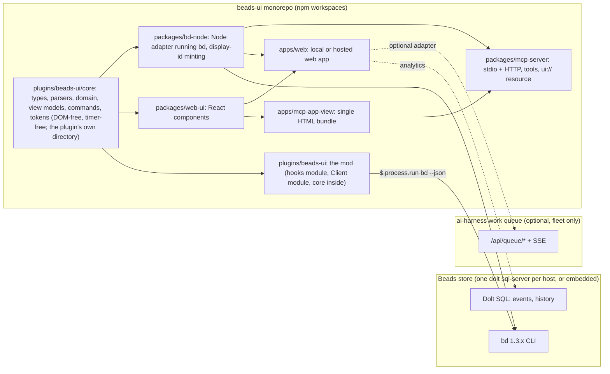
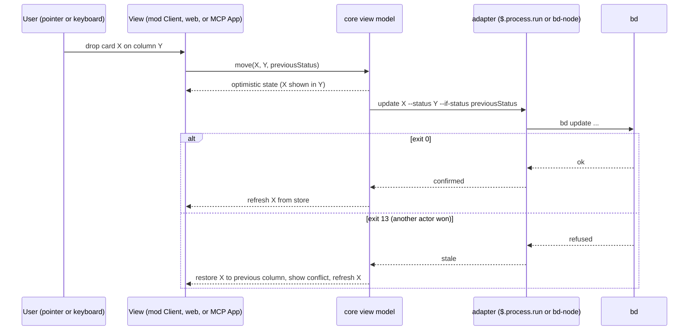

<!-- Full structure: see TEMPLATE.md in this directory -->

# beads-ui: a Beads task manager for the Claude Code TUI, an MCP UI app and a web app from one core

## Founding Ask Coverage

`founding_ask_ref`: {"blob_oid":"00cc84da65867ef4b34f8295d30e51d89e6e9827","capture_commit":"6c051184fdd9e11c5675e14d4f7be6f82892783f","content_sha256":"39dd74b3de7832730c7ce5c87b5d1b75e2fb41eea27666960a64f0407ccfd872","entry_ids":["A001","A002","A003","A004","A005","A006"],"generation":6,"path":"docs/asks/BU-epic-beads-ui-beads-task-manager-mg2.md","previous_ref_sha256":"cc0c973275fee19b55d27ac4fca453109b4693d0be4a817b6c3f2f95aa45a5b6","repository":"beads-ui","schema_version":1,"task_id":"BU-epic-beads-ui-beads-task-manager-mg2"}

`canonical_root_json`: {"blob_oid":"00cc84da65867ef4b34f8295d30e51d89e6e9827","capture_commit":"6c051184fdd9e11c5675e14d4f7be6f82892783f","content_sha256":"39dd74b3de7832730c7ce5c87b5d1b75e2fb41eea27666960a64f0407ccfd872","entry_ids":["A001","A002","A003","A004","A005","A006"],"generation":6,"path":"docs/asks/BU-epic-beads-ui-beads-task-manager-mg2.md","previous_ref_sha256":"cc0c973275fee19b55d27ac4fca453109b4693d0be4a817b6c3f2f95aa45a5b6","repository":"beads-ui","schema_version":1,"task_id":"BU-epic-beads-ui-beads-task-manager-mg2"}

`founding_ask_ref_sha256`: 9b1afb57ebfdcb15aa822d1c94d4bf89dd6e308faecdec798c10be85594e81eb

The raw record is `docs/asks/BU-epic-beads-ui-beads-task-manager-mg2.md` in this repository (generation 6, capture commit `6c05118`, kept reachable by the tag `far/BU-epic-beads-ui-beads-task-manager-mg2/g6`, as generation 5 is by `.../g5` (capture commit `d630f95`), because their PRs were squash-merged). This index is non-authoritative; the raw FAR governs.

| Authoritative raw entry | Coverage and disposition |
|---|---|
| A001 | ORIGINAL-ASK, 2026-10-14T23:39:51Z. The Beads task manager in the Claude Code TUI as a mod with board, sprint, backlog, kanban, roadmap and timeline views, mouse drag, reorder and sort, create, update and delete behind an are-you-sure flow, burndown and productivity analytics, and a view of every Claude Code session's tasks: requirements R-1 to R-10, the Architecture and Mockups, phases 1 to 3 and decisions D-3, D-5, D-6, D-8, D-13, D-16, D-22, D-23. The retirement of the Claude Code task panel per machine profile after a backup: R-15, phase 5, D-12 and D-21. Phases starting with an MVP, decisions through the framework, open questions spiked first: the Implementation Phases, the Design Decisions and the Open Questions. Public, MIT, no secrets, Beads store committable: R-16 and phase 0's hygiene tasks. The doc viewer and web-browser epics named in the same entry are other epics and out of scope. |
| A002 | FOLLOW-UP, 2026-10-14T23:40:00Z. One repo `beads-ui` for the mod, the MCP UI app and the web app sharing components, with mobile and native desktop later: D-1, D-2 and R-11; sharing is narrowed to logic across three surfaces and React components across two, as the research measured. The alias `bv` and the npm name collide with existing tools: D-7 is escalated to Sergei with a recommendation. Mobile and native desktop: the "Later sub-epics" note. |
| A003 | FOLLOW-UP, 2026-10-14T23:40:01Z. "mainly the web app, claude web / desktop mcp UI app, and claude code TUI for now": the three surfaces this design covers, phases 1 to 4 and 6; iOS, macOS and Linux deferred to separate agents, in that order. "lmk what you reocmmend": the Executive Summary and the recommendations inside D-7, D-11 and D-12. |
| A004 | FOLLOW-UP, 2026-10-14T23:40:01Z. Incorporate the autonomous task queue and its dashboard with the queue left where it is: R-14, the Integration table, phase 3's queue adapter and D-11 (escalated, with the recommendation that the web app becomes the queue's unbuilt Phase 2 member app). Where the queue should live is Open Question 1, deferred as the entry asks. |
| A005 | FOLLOW-UP, 2026-10-21T04:55:47Z. Sergei's review: D-7 option (a), D-11 option (a), and D-12 a new option (d), backups per launch repository with bms-semantic-knowledge-graph sessions going to sw-bms-workspace, recorded in those decisions, Feedback Round 1 and the Approval Log. "now /delegate opus 5.5 /orchestrate /auto-flow the rest as appropriate now": the build run in the Run Ledger (`entry->implement`), Phases 0 and 1 under run `beads-ui-build-2026-10-21-aih-ec2-3`. |
| ai-harness `docs/asks/BU-epic-agentic-ai-native-beads-ylx.md` A001 | ORIGINAL-ASK of epic BU-ylx, 2026-10-23T17:12:15Z, recorded in ai-harness. The band's counts by owning session, with a firstmate session's two labelled rows: T-1.8 (BU-mg2.3.12). The `/show-beads-ui` rename: T-1.7 (BU-mg2.3.13). Both in Feedback Round 2 and the Approval Log. The rest of that entry (an MCP-backed Beads plugin, exporting the ai-harness Beads setup, the fork) belongs to epic BU-ylx and is outside this design. |
| ai-harness `docs/asks/BU-epic-agentic-ai-native-beads-ylx.md` A002 | FOLLOW-UP, 2026-10-23T23:37:48Z. Only the firstmate session sees everything, with its own counts on a second line; every other session sees only what it owns: R-19, T-1.8 (unchanged) and T-1B.3, with D-25 explaining why kg-ec2-2's band read 1 in progress against 4 CC tasks (the bd assignee was never set on claim). "you don't need to show the 'as of ...' for every second ... I'm fine with every minute": D-26 and T-1B.5. "if it does add overhead ... ideally ... a single detached daemon (with self-healing and auto-restart etc as appropriate) or whatever makes sense that is shared across all cc sessions": the measurement in D-26's context, the host refresher in D-26 and T-1B.4. The task panel that replaces the CC task panel, with config for both or either and a later cutover, keyboard and mouse navigation, collapsed tasks, select to open details, edit fields, popup option menus and shortcuts for every capability, right and left click, a shortcut that moves the cursor from the prompt into the panel, auto-commit, push and sync of edits with formatted commits, a conflict fallback that tells the session to resolve it, and a root-cause loop for that automation, then kanban, sprint, backlog, timeline, a menu bar or side nav and settings views: R-20 to R-22, Phase 2B and Open Question 10. "if you need to ... /research-doc to see if / how that's possible": Open Question 10 and the research doc it names. |
| ai-harness `docs/asks/BU-epic-agentic-ai-native-beads-ylx.md` A003 | FOLLOW-UP, 2026-10-23. The `/show-beads-ui` name must be the one that loads, so `/beads-task` autocompletes again: T-1.7 built it; T-1B.2 makes it load, because six stale project-scope installs of 0.1.0 and 0.1.1 (four session worktrees and two agent worktrees, measured 2026-10-24T00:23Z) still loaded the build that registers `/beads`. |
| ai-harness `docs/asks/BU-epic-agentic-ai-native-beads-ylx.md` A004 | FOLLOW-UP, 2026-10-23T23:42:51Z. The pane fails with "no beads database found" in a kg-ec2-* session: D-24 and T-1B.1, with a regression test frozen first. Order: the `/show-beads-ui` fix first, then or with the pane bug, then research, design and the rest: the Phase 1B task order. |
| Sergei, 2026-10-23T23:44Z, relayed by aih-ec2-3 (how to enter, use, hide and close the pane; separate skills or shortcuts) | Answered in chat at 23:50Z, then D-27 and T-1B.6: the usage section in `docs/procedures/mod-install.md`, the README and the pane's help. |
| ai-harness ask record A006, 2026-10-24T00:36:40Z, and A007, 2026-10-24T00:39:54Z (a CORRECTION of A006's format) | The band reads `[bd] {N} tasks ({N} in progress, {N} blocked, {N} open, {N} done last 24h)`, in progress and blocked first (A007), with no session name and no store count: D-30 and T-1B.10. The read time only in a dev, test or debug mode: T-1B.5. The done window, and the order and set of the band's parts, set from the config file and from the pane: T-1B.11. "build the rest of our own version of the beads-ui task panel ... to replace the entire cc task panel. i'd prefer that": R-20, R-21 and Phase 2B. "what should we call this component": the band, Claude Code's `AbovePrompt` render site, as the Architecture section says; the side panel is a `Pane`. A002's firstmate second line is kept under the new format (D-30). |
| ai-harness ask record A008, 2026-10-24T01:03:49Z | The firstmate's lines: `[bd][all]` totals over an aligned `[fm]` line with the firstmate's own counts, both in A007's part order: D-34 (superseding D-30's `all repos:` label) and T-1B.10. A001's totals label is met by `[all]`. The sync-drift signal today's line 1 carries is kept as a short marker shown only while a store is out of step, recorded in D-34. |
| Sergei, 2026-10-25, in chat to aih-ec2-3, before 01:32:17Z and 01:32Z to 01:38:10Z, verbatim in the bodies of BU-mg2.3.16, BU-mg2.3.17 and BU-mg2.3.18, and in A006 | Fields cut short and the missing comments: BU-mg2.3.14 and BU-mg2.3.15, built by a parallel leaf. The name of the two surfaces: the band (`AbovePrompt`) and the pane, as Feedback Round 4 answered. The old band format: fixed by the D-26 version rule (0.9.4). "all the decisions / blockers etc (anything that i need to review and action basically) and all that info from the held docs inside the beads-ui pane": R-26, R-27, D-37, D-39, D-40 and T-2C.4 to T-2C.6, with every held kind and bd blockers in scope and the full body readable. Per issue, "select a tab / pane / option ... or they just appear by default in the task details pane": D-40's Review section, shown by default (T-2C.5). "an icon system ... next to task rows on the left side ... agent working ... blocked ... review items ... we can build out": R-29, D-41, D-42, T-2C.3 and T-2C.7. "its own tab ... filter / organize / sort them by task or epic or priority or last updated / created date or label": the Review view, D-40 and T-2C.6. The firstmate's "own beads tasks and also all of them in the fleet for its machine host pair": R-28, D-38. "eventually ... all my machine hosts with some access control restrictiosn for client repos": BU-mg2.3.17.4, later, as Sergei placed it; D-38 keeps the pair filter in the data so the later scope has one place to widen. |
| Sergei, 2026-10-25, in chat to aih-ec2-3, shortly before 01:53Z and about 01:58Z, verbatim in the bodies of BU-mg2.3.20 and BU-mg2.3.21, and in A006 | "add more rows under band and actually build out the task panel there under the band which is separate from the pane": R-30, D-36's row level, T-2C.2. The docked panel missing after `/reload-plugins` (BU-mg2.3.20 part 2): reversed by Sergei shortly before 02:27Z, "i don't want it to open by default or whenever i reload the plugin", so the pane opens only when asked, built by aih-ec2-3 (`[panel] open_at_start`, default false). "all the buttons should appear to the left", clickable counts that expand rows, "N amount and the rest collapse", "keep expanding", "collapse back to the default amount or ... to just the top band row(s)": D-36 and T-2C.2. "as much interactive funcitonality as we can add into bands", "the pane does possibly have advantages at scale. so we cna keep that surface": D-36's overview level, with the pane kept. "components that can be shared / reused / combined / stacked ... adapters ... for each tui surface": R-31, D-35, T-2C.1. "proper progressive disclosure": D-36's three levels. "then we can start to work towards retiring the cc task panel": Phase 5, after this phase. The 02:02Z amendment (verbatim in BU-mg2.3.21's comment): "same for all the others, not just in progress": D-36's every count; "i don't want two separate implementations for the bands views and pane views ... by default should render in both surfaces": D-35's view registry with `surfaces` both by default and the `[surfaces]` switch, T-2C.1 and T-2C.8 (BU-mg2.3.21.1 to .5). |
| Sergei, 2026-10-25, in chat to aih-ec2-3, 03:37:51Z, 03:42:13Z and about 03:50Z, verbatim in the bodies of BU-mg2.3.21.6, BU-mg2.3.21.6.6 and BU-mg2.3.21.6.7, and in A006 | "do the visual design pass for both band and pane": R-32, D-43, T-2C.9 to T-2C.13, built once in the shared components; "i don't want live browser": out of scope, as Sergei said. The `beads` button "shouldn't be called "beads"", "a more useful button icon", and "anything clickable with funcitonality should have clear indicators that its clickable. that needs to be a user interface language standard throughout": R-33, D-43's clickable affordance, T-2C.14. |
| ai-harness ask record A005, 2026-10-23T23:51:05Z (on an ai-harness PR not yet merged at this writing) | Tab `3`: D-28 and T-1B.7. "performance and caching or loading fast", "by default actually show useful stuff": D-29 and T-1B.8, fed by D-26's snapshots. Reflow to the terminal and pane size with no overflow and compact labels: T-1B.9 now, and R-24 in Phase 2B. Buttons, dropdowns, side nav and menu bars, icons when space is short, a richer stack (TypeScript, JavaScript, CSS or a framework) if it is fast and light, and "i saw someone load an entire browser": R-24, R-25 and Open Question 10, whose research comes first. |
| Sergei to aih-ec2-3 in chat, before 2026-10-25T01:32:17Z, verbatim in BU-mg2.3.14 and BU-mg2.3.15 | "some fields not showing the full text if there's space": T-2B.10. "i don't see comments? or an ability to add a comment": T-2B.11. The rest of that ask (blockers, decisions and held-doc information in the pane, and the band's format) is tracked outside these two tasks. |

**Status:** Approved by Sergei on 2026-10-21 (Feedback Round 1); Phases 0 and 1 built under run `beads-ui-build-2026-10-21-aih-ec2-3`; Feedback Rounds 3 to 5 (D-24 to D-34, Phase 1B, Phase 2B) under run `beads-ui-band-pane-panel-2026-10-24-aih-ec2-3`; Feedback Round 6 (D-35 to D-42, Phase 2C) under run `beads-ui-review-band-2026-10-25-aih-ec2-3`

**Created:** 2026-10-15

**Task:** BU-mg2.2 (display id BU-doc-beads-ui-prd-fnzx), under epic BU-mg2

**Research:** `docs/research/beads-ui-task-manager-landscape.md`

<!-- doc:region name="overview" kind="replaceable" -->

## Table of Contents

- [Executive Summary](#executive-summary)
- [Problem Statement](#problem-statement)
- [Design Overview](#design-overview)
- [Product requirements](#product-requirements)
  - [Users and actors](#users-and-actors)
  - [Requirements](#requirements)
  - [Acceptance criteria](#acceptance-criteria)
- [Architecture](#architecture)
  - [Surfaces, packages and the store](#surfaces-packages-and-the-store)
  - [The Claude Code mod](#the-claude-code-mod)
  - [The web app](#the-web-app)
  - [The MCP App](#the-mcp-app)
  - [Mockups](#mockups)
  - [How a move is written](#how-a-move-is-written)
- [Data Model](#data-model)
  - [Core types](#core-types)
  - [Conventions on Beads](#conventions-on-beads)
  - [Configuration](#configuration)
- [Integration](#integration)
- [Implementation Phases](#implementation-phases)
  - [Phase 0: Monorepo bootstrap and the DOM-free core](#phase-0-monorepo-bootstrap-and-the-dom-free-core)
  - [Phase 1: The MVP, a read-mostly board in the Claude Code mod](#phase-1-the-mvp-a-read-mostly-board-in-the-claude-code-mod)
  - [Phase 1B: Feedback Round 3, the store a session reads, owned counts and a shared refresh](#phase-1b-feedback-round-3-the-store-a-session-reads-owned-counts-and-a-shared-refresh)
  - [Phase 2: Mod enhancements, pointer drag, sprints and sparklines](#phase-2-mod-enhancements-pointer-drag-sprints-and-sparklines)
  - [Phase 2B: The beads-ui task panel, beside and then in place of the CC task panel](#phase-2b-the-beads-ui-task-panel-beside-and-then-in-place-of-the-cc-task-panel)
  - [Phase 2C: The band as the primary surface, review items and row indicators](#phase-2c-the-band-as-the-primary-surface-review-items-and-row-indicators)
  - [Phase 3: The web app, locally and as the queue dashboard's board](#phase-3-the-web-app-locally-and-as-the-queue-dashboards-board)
  - [Phase 4: The MCP App in Claude Desktop](#phase-4-the-mcp-app-in-claude-desktop)
  - [Phase 5: Retire the Claude Code task panel, per machine profile (lands in ai-harness)](#phase-5-retire-the-claude-code-task-panel-per-machine-profile-lands-in-ai-harness)
  - [Phase 6: Hosted web app and claude.ai MCP](#phase-6-hosted-web-app-and-claudeai-mcp)
  - [Later sub-epics (out of this doc's build scope)](#later-sub-epics-out-of-this-docs-build-scope)
- [Implementation Audit](#implementation-audit)
- [Risks and Mitigations](#risks-and-mitigations)
- [Open Questions](#open-questions)
- [Run Ledger](#run-ledger)
  - [Authority](#authority)
  - [Transition verdicts](#transition-verdicts)
- [Design Decisions](#design-decisions)
  - [Decision Summary](#decision-summary)
  - [Decision Details](#decision-details)
    - [D-1: Repository shape](#d-1)
    - [D-2: Package boundaries and the shared core's location](#d-2)
    - [D-3: MVP scope](#d-3)
    - [D-4: Beads access route](#d-4)
    - [D-5: Sprint modelling on Beads](#d-5)
    - [D-6: Board order](#d-6)
    - [D-7: The command alias, with the npm scope resolved](#d-7)
    - [D-8: Drag in the mod](#d-8)
    - [D-9: Display-id minting](#d-9)
    - [D-10: Web stack](#d-10)
    - [D-11: Relationship to the work-queue dashboard](#d-11)
    - [D-12: Task-panel backup destination](#d-12)
    - [D-13: Delete and close ladder](#d-13)
    - [D-14: MCP server topology](#d-14)
    - [D-15: Mod packaging and install](#d-15)
    - [D-16: Metrics data source](#d-16)
    - [D-17: Session identity on Beads](#d-17)
    - [D-18: Monorepo tooling](#d-18)
    - [D-19: Theme tokens](#d-19)
    - [D-20: Testing strategy](#d-20)
    - [D-21: Task-panel retirement switch](#d-21)
    - [D-22: WIP limits](#d-22)
    - [D-23: Quick-add grammar](#d-23)
    - [D-24: The store a session reads](#d-24)
    - [D-25: What "owned" means for the band](#d-25)
    - [D-26: How counts and boards are refreshed](#d-26)
    - [D-27: How focus enters and leaves the pane, and how it is shown and hidden](#d-27)
    - [D-28: Tab 3](#d-28)
    - [D-29: First paint and the default view](#d-29)
    - [D-30: The band's format and the firstmate's lines](#d-30)
    - [D-31: How the task panel is drawn](#d-31)
    - [D-32: Where the panel sits and how it lives beside the CC task panel](#d-32)
    - [D-33: How a panel edit is published, and what happens on failure](#d-33)
    - [D-34: The firstmate's two band lines and the sync-drift signal](#d-34)
    - [D-35: One component layer for the band and the pane](#d-35)
    - [D-36: The band's disclosure levels and where its controls sit](#d-36)
    - [D-37: Where review items come from](#d-37)
    - [D-38: Whose review items a session sees](#d-38)
    - [D-39: Acting on a review item from the pane](#d-39)
    - [D-40: Where review items are shown](#d-40)
    - [D-41: The row indicator registry](#d-41)
    - [D-42: How "an agent is working on it" is detected](#d-42)
    - [D-43: The visual language of the band and the pane](#d-43)
- [Feedback Rounds](#feedback-rounds)
- [Approval Log](#approval-log)

## Executive Summary

beads-ui is a task manager for Beads issues that runs in three places from one code base: as a Claude Code mod drawn inside the terminal, as an MCP App rendered inside a Claude Desktop or claude.ai conversation, and as a web app run locally or hosted from a template. It gives Sergei the views a Jira-like product offers (board, backlog, sprints, roadmap, analytics) over the fleet's own task store, with mouse and keyboard control, create, edit and delete behind a confirmation, and one view of what every Claude Code session on a machine is working on. The MVP is the terminal mod, read-mostly first, because that is where the sessions already are. The design settles three facts the research established: the mod shares DOM-free logic with the other two surfaces and no React components, so the shared core is a TypeScript package with no DOM, Node or timer dependencies; Beads has no sprint, rank or story-point field, so sprints, board order and flow metrics are conventions this doc defines on Beads labels, metadata and its events table; and the fleet's autonomous work queue already has a board-shaped dashboard, so the web app's relationship to it is a decision put to Sergei before any board is built. Deferred: iOS, Android, macOS, Linux and Windows surfaces (later sub-epics), and the long-term home of the queue service (Sergei's own deferral). Three decisions are escalated to Sergei; every other decision is resolved here for his review.

## Problem Statement

The fleet tracks its work in Beads, but the only ways to see that work are the `bd` CLI, a few read-only mods and the Claude Code task panel, a one-way mirror that shows at most five rows per session and will be retired. Nothing shows a board, a backlog, a sprint or a roadmap over a Beads store; nothing lets Sergei move a card, reorder, or create and close issues from a UI; nothing shows which Claude Code session holds which task across a machine; and the flow metrics Beads already records in its events table are not drawn anywhere. Sergei asked for a Jira-like task manager on Beads, inside the Claude Code TUI first, and for the same product as an MCP UI app and a web app so the views follow him into Claude conversations and onto a phone, as one public, MIT-licensed monorepo.

## Design Overview

**Status:** filled for Phases 0 and 1 as built. The sections after this one describe the design as decided; this section describes what exists.

### Phase 0 as built

The repository is an npm-workspaces monorepo (`plugins/*`, `packages/*`) with Turborepo running `lint`, `typecheck` and `test`, Biome for lint and format, Vitest for the Node-side suites and TypeScript in strict mode. The root `tsconfig.base.json` maps `@beads-ui/core` to `plugins/beads-ui/core/src`, so a later DOM package imports the core by alias and never by path. All tooling is a root dev dependency; `plugins/beads-ui/package.json` has no `dependencies` key.

The shared core lives at `plugins/beads-ui/core/src`. `model.ts` holds the Data Model's types as written above. `parsers.ts` turns `bd list --json`, `bd show --json` and `bd statuses --json` into those types and returns a typed parse error naming the JSON path instead of throwing, so a surface can keep its last good state when `bd` returns something unexpected. The human owner comes from `metadata.owner` (D-17), not from Beads' own `owner` field, which names the repository owner. The core compiles under its own `tsconfig.json` with `"lib": ["es2023"]` and `"types": []`.

The purity rule is enforced twice. `scripts/check-core-purity.mjs`, run by `npm run lint`, lexes every source file under `core/` outside `core/test/`, blanks comments and string contents, and fails naming `file:line` for any timer, DOM or Node global (including `console`, `globalThis` and `self`), for code generation (`eval`, `Function`), for an import that leaves the core, and for a dynamic `import()` of anything but a string literal, matching the mod runtime, which refuses code generation; the type check under `"types": []` catches what a lexer cannot. `core/test/purity.test.ts` proves the gate fails on a fixture of banned references and passes on the real core. The rule binds `core/src`, not the Vitest suites in `core/test/`, which need Node to run; that scope is recorded as a wording repair on T-0.1.

`packages/bd-node` is the Node adapter the web app and MCP server will use. `createBdClient({ cwd })` runs `bd` with `execFile` (an argument list, never a shell) in the store's repo root, with a 10-second default timeout and a 64 MiB output bound, and returns a discriminated result (`ok`, `stale`, `notFound`, `timeout`, `failed`) instead of throwing. It offers `list`, `show`, `statuses`, `ready`, a guarded `update` that returns `stale` on exit 13 and never retries, `create` and `close`, all through the core's argv builders and parsers. A missing binary reports that `bd` is not on PATH and names the Beads install page, and a missing directory is told apart from it. Every write asks `bd` for `--json`, and a timeout that is not a positive number of milliseconds is refused as a typed failure. Its tests read this repository's own store, compare every Issue field against the raw record, and use a stub `bd` for every failure path, so `npm test` needs `bd` on PATH.

The mod is a plugin at `plugins/beads-ui`: `.claude-plugin/plugin.json`, `hooks/hooks.json` naming `./register.ts`, and a hooks module that registered `/beads` (renamed `/show-beads-ui` in Feedback Round 2) and drew a hello pane from a core value, plus a `client/` module drawn as a `Client` region. Every `$` call sits in `register.ts`; a helper in another file receives plain closures, never `$`, the pattern the `diff` mod in Claude Code's public mods folder uses. The root `.claude-plugin/marketplace.json` lists `./plugins/beads-ui`. Three pre-commit gates guard the plugin: `scripts/check-plugin-allowlist.mjs` compares what `claude plugin validate --strict --json` reports (hooks, calls, environment reads and writes, surface modules, gating hooks) with the committed `plugins/beads-ui/validate-allowlist.json` and also refuses, outside the declared hooks module, any `$.` call and any import of the engine's types from `claude-code`, and inside it any bare `$` passed as a call argument, because validate does not say which file a call sits in (an `any`-typed parameter is the one hand-off a static scan cannot see); `scripts/check-marketplace.mjs` runs `claude plugin validate .`; and `scripts/check-plugin-size.mjs` fails naming any file git tracks or stages under `plugins/beads-ui` that is over 1 MB, with no directory exempt. `npm test` runs Vitest and then `claude plugin test`, and the import probe in `hooks/imports.test.ts` fails naming the refused import. Claude Code's command spec has no alias field, so a short `/bu` is a second command.

The core's tests follow D-2's rule that they pass under both runners. A pure core suite is a `*.test.ts` written against `claude-code/testing`; `plugins/beads-ui/vitest.config.ts` maps that import to `vitest`, so both runners execute the same file. The mod environment loads only code files, so each fixture such a suite reads is a `fixtures/<name>.json.ts` module kept byte-equal to its `.json` by a check. A suite that needs Node, such as the purity suite, is a Vitest-only `*.spec.ts`, and the mod's own hooks tests are kit-only. The hooks module is not type-checked by `tsc`: Claude Code writes its mod types only through the interactive `/plugin-types` command, into the gitignored `.claude-plugin/types/`, so the gate cannot rely on them; `claude plugin test` and `validate` are the hooks module's checks.

The repository's public hygiene is a pinned gitleaks pre-commit hook, with a test that stages a fabricated AWS key in a throwaway repository and asserts gitleaks refuses it (the test fails, naming the binary, when gitleaks is not installed), a test that the README names the core's five layers, `CONTRIBUTING.md`, `SECURITY.md` and `CODE_OF_CONDUCT.md`, and pre-commit hooks that run `npm run lint` and `npm test` on every commit. Parser fixtures are real `bd` output from this repository's own Beads store.

### Phase 1 as built

The Phase 1 core sits beside the Phase 0 core in `plugins/beads-ui/core/src`, every module pure and runner-neutral. `argv.ts` builds every `bd` call as an argument list, puts free text in `--flag=value` form and refuses an id or status that starts with `-`; `parsers.ts` adds `bd ready`, `bd history --events`, `bd create` and the delete previews. `columns.ts` builds one column per status in category order with counts and soft WIP flags, and swimlanes by none, assignee (with an unassigned lane) or epic. `sort.ts` sorts stably, priority then created by default, with blanks last. `filter.ts` parses `type:`, `label:`, `assignee:`, `sprint:` and `ready:` terms and, on an unknown key, keeps the previous filter and reports the accepted keys. `quickadd.ts` parses the D-23 grammar into `bd create` flags. `mint.ts` ports bd-new's slug rule (stopwords, lead verbs, the digit-bearing lead, the 32- and 20-character budgets) and mints under `id_policy` `auto` or `fleet-slug` the id bd-new would give the issue (see the T-1.4 wording repair). `commands.ts` lists every MVP action with its key (`m` is Move to on the focused card), and `tokens.ts` holds the semantic tokens with their terminal theme map. The view models in `views/` are reducers and pure views: the Board applies a move optimistically and restores the card on exit 13 with a conflict and a refresh, and keeps the last good board on a failed load; the Backlog lists issues in the `active` category, a page at a time; the Detail builds one guarded `bd update` per edited field and re-reads the issue; the delete confirmation is a state machine from the dry-run preview through a typed display id for a cascade, with Close instead reachable before any write and never running `bd delete`.

The mod's hooks module draws those models. `hooks/register.ts` holds every `$` call and hands `pane.ts`, `confirm.ts` and `bands.ts` a `Host` of plain closures. It registers `/show-beads-ui` (named `/beads` until Feedback Round 2) and, because Claude Code's command spec has no alias field, `/bu` as a second command (D-7 (a)); both toggle one Pane, and `/beads` is no longer registered. The pane has three tabs, `1` Board, `2` Backlog and `4` Detail, with `3` kept for the Phase 2 Sprint tab. It reads `bd statuses`, `bd ready` and, for the open Detail, `bd show` and `bd history --events` through `$.process.run`, and `bd list` through `$.process.spawn`, in the session's directory, on open, after each write and every 10 seconds while open. It reads `beads-ui.toml` at call time from the repository root, then the user's config directory, falling back to the design's defaults, and keeps view preferences in `$.store`. Every card carries a Move to `Select`. A move shows at once, is written with `--if-status`, and on exit 13 the card goes back with a conflict line and a refresh. The board pages instead of cutting, so every card stays reachable with its Move to under the mods API's 100,000-character tree limit. The core's `BOARD_PAGE_LIMIT` estimates a drawing's size per card, pager, column header and lane, pricing each card by the status names its Move to lists. It groups the swimlanes into lane pages, splits a lane too wide for the budget into column windows (`l` steps both), and gives each cell a page of up to 25 cards with a back control, the range drawn and a `+N more` control, both wrapping; `p` and `b` step the focused card's column. A card's Move to always lists every other status, whichever window is drawn. Tests walk a 600-card store, in one lane, over 200 assignees and over 30 custom statuses of 40 characters, and reach all 600 Move to controls with every page under 100,000 characters. A new filter, swimlane or sort goes back to the first page. The Backlog pages the same way: 60 rows a page, with back and `+N more` controls, `p` and `b`, and a count line that counts every row the filter kept. Quick-add writes `bd create` and then, under `id_policy` `auto` or `fleet-slug`, the display id bd-new would mint: the hash primary's suffix for a top-level issue, four letters for a child. The slug budgets honour bd-new's `AIH_SLUG_BODY_MAX_CHARS` and `AIH_SLUG_BODY_MAX_CHARS_CHILD` overrides, which `register.ts` reads through `$.env.get` and the core takes as arguments. If the display-id write fails after a create, the issue and its minted id stay pending in `$.store` and the same write is retried after every successful refresh, across sessions, until it lands. Each retry re-reads that one issue with `bd show` just before writing, and drops the entry without writing if the issue now carries any display id or `id:` label. bd 1.3.1 has no compare-and-set on metadata, so a write landing between that read and the update is the one race left. A warning line stays up until the write lands, and a second id is never minted. Delete opens a separate focused pane, with `holdToasts`, showing the dry-run text and Close instead. It re-runs the preview just before a forced delete, and a cascade needs the display id typed first. After any close, `u` undoes it through the same guarded write. The band above the prompt shows open, in-progress and blocked counts of the issues the session owns, as T-1.8 below describes. Under 110 columns an automatic reopen is withdrawn with a toast naming the width. The Detail tab shows the description as Markdown and edits it in a one-line Input. A line break shows as `\n`, a tab as `\t`, a carriage return as `\r` and a backslash as `\\`, and the escapes are read back on submit, so an unchanged description writes nothing and round-trips byte for byte. A description whose one-line form is over 20,000 characters shows the `bd update` command instead of a control, because an Input carries its whole value in the tree; the longest in this store is 1,847. Detail labels draw beside their controls, so a narrow pane cannot split one. The delete re-check compares every field of the cascade preview, events and labels included. `docs/procedures/mod-install.md` covers loading the mod from a checkout and from the marketplace, its keys, the quick-add grammar and the configuration. A first live run in a 120-column tmux session found three bugs that the kit cannot see, all fixed: the confirmation opening behind the board, a tab switch dropping the keyboard to the prompt, and layouts overflowing a 48-column dock.

The board read streams because `$.process.run` keeps only the first 4,194,304 bytes of a child's standard output and sets `isStdoutTruncated` on the rest (Claude Code 2.1.309's `ProcessRunResult` declaration). On the ai-harness store on 2026-10-23, `bd list --json --all --brief --limit 0` wrote 7,141,443 bytes for 6964 issues, so the mod parsed a cut array and the board stayed at "loading…" with a JSON parse error at `$`. Three fixes were weighed. Paging the bd read was ruled out: bd 1.3.1 supports `--offset` only under `--proxied-server`, and splitting by status still leaves the closed issues alone above 4 MiB. Narrowing fields was ruled out too, because `--brief` already drops the free text and bd has no field selector. Streaming was chosen: `$.process.spawn` delivers the whole output, waiting on the reader past 1 MiB unread instead of dropping it. `hooks/stream.ts` reads the stream to its end under the same 8-second deadline the other reads have, through `$.clock.after`, and ending the loop kills the child. The paging rule is unchanged: a test loads a 6964-issue store of about 7 MB and reaches all 6964 Move to controls with every drawing under 100,000 characters. A read that does not finish shows `bd list did not finish:` and why (timed out, stopped by a signal, could not start). A read that finishes with output the mod cannot parse shows `bd list gave output beads-ui cannot read:` and the parse error. Any other `$.process.run` read cut at 4 MiB fails, naming the cut.

### Releases and versioning as built

An installed copy of the mod updates only when `version` in `plugins/beads-ui/.claude-plugin/plugin.json` rises: `claude plugin update` and marketplace auto-update both compare it, and installed nothing for the large-store fix until 0.1.1 raised it. Sergei, 2026-10-23: "you need to know to always do this, and if we can automate it for bug fixes (patches) and new features (minor upates) then that'd be ideal. i'll always manually say when to do major semver update." So the version is enforced, not remembered. `plugin-release.json` at the root names each plugin's manifest, its shipped paths (everything under `plugins/beads-ui/` but tests, fixtures and the Vitest config) and the major-approval trailer. `scripts/plugin-version.mjs` reads the branch's commits since `origin/main` that change a shipped file, so a `feat` to repository tooling never raises the mod (and a squash title when given): any `feat` requires a minor bump, anything else a patch, and a `type!:` subject or `BREAKING CHANGE:` footer a major, which it refuses unless a commit carries `Semver-major-approved-by: Sergei`. A hand-made major bump without that trailer is refused too. The pre-push hook `plugin-version` runs it against the pushed branch and, when the version falls short, commits the required one as `chore(release): beads-ui <version>` and fails the push once. ai-harness's `ghp pr merge` reads the same policy from the PR's base and refuses a merge whose head version does not beat the base's at merge time, which closes the race between two PRs that each raised the same version. `scripts/plugin-version.test.mjs` drives the CLI in throwaway repositories, one case per rule. Procedure: `docs/procedures/releasing.md`.

## Product requirements

### Users and actors

Three actors use beads-ui. Sergei, the fleet owner, works in Claude Code sessions in tmux over AWS SSM on employer hosts and in Ghostty or kitty on personal machines, in Claude Desktop and claude.ai, and on a phone over a tailnet. A Claude Code session is an actor in its own right: it claims and closes Beads issues through `bd`, and the UI must show its work and never block its writes. An outside user of the public repository has a Beads store, no fleet tooling, and expects `npx`-style installation and a working board without the fleet's queue, display-id convention or app-portal shell.

### Requirements

Each row derives from the founding ask (entries A001 to A004 in `docs/asks/BU-epic-beads-ui-beads-task-manager-mg2.md`) and the research doc (`docs/research/beads-ui-task-manager-landscape.md`). The phase column names where the requirement first ships.

| # | Requirement | Source | First phase |
|---|---|---|---|
| R-1 | A kanban board over a Beads store, one column per status read from `bd statuses`, grouped by status category, with assignee swimlanes | A001; research 1.1 | 1 (mod), 3 (web), 4 (MCP) |
| R-2 | A backlog view sorted by priority then age, with filters by type, label, assignee, sprint and readiness | A001; research 1.1, 6.4 | 1 |
| R-3 | Sprint views: membership, current sprint board, sprint list with dates, carry-over of unfinished work | A001; research 1.1, 6.1 | 2 |
| R-4 | A roadmap or timeline view placing epics and milestones by date, with dependency lines | A001; research 1.1 | 3 |
| R-5 | Move a card between columns (status change) and across views (backlog to sprint) by keyboard and by mouse drag, with an optimistic update that rolls back on a stale write | A001; research 1.2, 3.2 | 1 (keyboard), 2 (drag) |
| R-6 | Reorder within a column by manual rank when enabled; sort by priority, created, updated, due or assignee | A001; research 1.2 | 1 (sort), 3 (rank) |
| R-7 | Create an issue from a one-line quick-add grammar; edit title, description, status, priority, type, labels, assignee, due date and estimate inline | A001; research 1.3 | 1 |
| R-8 | Delete behind an are-you-sure flow that shows `bd delete`'s own preview, offers close as the reversible alternative, and requires a typed id for a cascade | A001; research 1.3 | 1 |
| R-9 | Analytics: throughput, cycle time, cumulative flow, aging work in progress, a count-based sprint burndown, cost per closed issue where session cost data exists | A001; research 1.4 | 2 (mod sparklines), 3 (web charts) |
| R-10 | A cross-session view: every session's assigned, in-progress and done issues, with claim age against the lease, sourced from Beads assignees and, when configured, the queue's session registry | A001, A004; research 1.5, 6.2 | 1 (assignee swimlanes), 3 (registry) |
| R-11 | The three surfaces share one core; React components are shared by the web app and the MCP App | A002; research 5 | 0 |
| R-12 | The web app runs locally with one command and is hostable from infra-as-config templates with quick starts | A002; research 2.3 | 3, 6 |
| R-13 | The MCP App renders in Claude Desktop from a local stdio server and in claude.ai from a reachable server | A003; research 4 | 4, 6 |
| R-14 | The autonomous work queue and its dashboard are integrated, with the queue left where it is | A004; research 6.2 | 3 |
| R-15 | The Claude Code task panel is retired per machine profile by a config setting in ai-harness, after a backup of every panel's data | A001; research 6.3 | 5 |
| R-16 | Public and MIT: no secrets, credentials or private data in the repo; the Beads store and its ids may be committed | A001 | 0 |
| R-17 | Every write respects the Beads display-id convention when the store uses it, and never moves a published id | research 6.1 | 1 |
| R-18 | Each session's pane and band read the store its work lives in, which can differ from the directory it runs in, and a session with no resolvable store gets an explanatory empty state | ylx A004 | 1B |
| R-19 | A non-firstmate session's band counts only the issues it owns, across every store; the firstmate's band adds the host pair's totals on a first line; the counts agree with what the session owns in its task panel; one refresh about a minute with the least machine overhead, shared across the host's sessions | ylx A001, A002 | 1 (counts), 1B (ownership, shared refresh) |
| R-20 | A beads-ui task panel in the CC task panel's place: a configurable number of shown and collapsed tasks, set in a config file and from the panel; navigation up and down through every task, collapsed ones included; select to open details; edit fields; every capability reachable from both a popup option menu and a shortcut, by keyboard and by mouse with left and right click; a shortcut that moves focus from the prompt into the panel and back | ylx A002 | 2B |
| R-21 | Config flags let the beads-ui panel and the CC task panel co-exist, or run either alone, until a full cutover (R-15 is the cutover's last step) | ylx A002 | 2B, 5 |
| R-22 | An edit made in the panel is committed, pushed and synced on its own with a formatted commit; a conflict falls back to an alert, hook or context injection that tells the session to resolve it; failures in that automation get a root-cause and fix loop run by a delegate or, with no free slot, the driving session | ylx A002 | 2B |
| R-23 | The pane opens fast and shows useful content by default, from a cache, never a bare "loading" line | ylx A005 | 1B |
| R-24 | The pane and panel reflow to the terminal's and the pane's size with no text overflow; labels shorten, and become icons or glyphs, when space is short; controls look like buttons, dropdowns, a side nav and menu bars; later views (kanban, sprint, backlog, timeline, settings) sit behind a nav bar | ylx A002, A005 | 1B (reflow), 2B |
| R-25 | A richer rendering stack (TypeScript, JavaScript, CSS or a framework) is allowed where it is fast, light and low-latency | ylx A005 | 2B |
| R-26 | Every item Sergei must review or act on is in the pane: every held item (decisions, blockers, briefings, other items, and open questions, which the fleet holds as decisions) and each issue's bd blockers; per issue in its Detail, shown by default, and all of them in a Review view that filters, sorts and groups by task, epic, priority, updated and created dates, label, kind and session, with each item's full text readable | Sergei 2026-10-25 (BU-mg2.3.16, BU-mg2.3.17) | 2C |
| R-27 | Sergei can act on a review item from the pane: answer a held item, and comment on a blocked issue | Sergei 2026-10-25 (BU-mg2.3.16, BU-mg2.3.17) | 2C |
| R-28 | The firstmate sees its own review items and every item from its machine pair, the pairs read from ai-harness's configuration; every other session sees its own; a scope over all hosts with client-repo access control comes later | Sergei 2026-10-25 (BU-mg2.3.17) | 2C (pair), later (all hosts) |
| R-29 | Task rows carry indicators at their left: an agent is working on it, it is blocked, it has review items; the set grows by adding a registry entry, with a legend and a switch per indicator | Sergei 2026-10-25 (BU-mg2.3.18) | 2C |
| R-30 | The band is the primary interactive surface: its controls sit at the left, right after the summary text; each count expands rows of its tasks (N shown, configurable, a "+M more" row, collapse to N or to the summary); an overview shows as much of the pane as fits; the pane stays for scale | Sergei 2026-10-25 (BU-mg2.3.20, BU-mg2.3.21) | 2C |
| R-31 | One implementation of every view: each is registered once and drawn in the band and the pane through a thin adapter per surface, in both by default and switchable per surface in config and Settings, so a feature added to one surface appears in the other | Sergei 2026-10-25 (BU-mg2.3.21 and its 02:02Z amendment) | 2C |
| R-32 | A visual design pass over the band and the pane, built once in the shared components: theme tokens that follow the person's theme, one glyph set, Raster visuals in the band, a restyled pane, and Image or Svg only where a surface draws them, each with a text fallback; no live browser or web page | Sergei 2026-10-25T03:37:51Z and 03:42:13Z (BU-mg2.3.21.6) | 2C |
| R-33 | Every clickable element looks clickable, as a binding interface standard across the band and the pane; the band's pane toggle is an icon-first button whose glyph says what it does | Sergei 2026-10-25, about 03:50Z (BU-mg2.3.21.6.6, BU-mg2.3.21.6.7) | 2C |

### Acceptance criteria

The phase sections carry the per-task EARS criteria. The product-level criteria that hold across every phase:

- When a surface renders a board, the system shall build its columns from the store's `bd statuses` output and shall decide "done" by the `done` category, never by column position.
- When a user moves a card, the system shall write the new status with `bd update --if-status <previous>` (or the equivalent guarded API call), and if the write exits 13 then the system shall restore the card and refresh it from the store.
- When a user deletes an issue, the system shall show `bd delete --dry-run` output for that issue before any `--force` or `--cascade` write, and if the issue has dependents outside the selection then the system shall require a typed confirmation of the issue id.
- When beads-ui creates an issue in a store whose existing issues carry `metadata.display_id`, the system shall mint a display id of the same shape and write both the metadata field and the `id:<display_id>` label.
- If a store has no queue service configured, then every surface shall still render boards, backlog, detail and analytics from `bd` alone.
- While a surface runs inside the Claude Code mod, the system shall offer a keyboard path for every pointer action.

## Architecture

### Surfaces, packages and the store



The diagram follows the layer table and package proposal in the research doc (section 5.5), amended by decisions D-2 and D-18 after the doc-editor sibling repo's evidence on how Claude Code installs plugins. The core is the one module every surface imports. It holds the issue and status types, the `bd --json` parsers and argument builders, the domain rules (column grouping by status category, sort, filter, sprint membership, rank, flow metrics, dependency graph), the view models (board, backlog, sprint, roadmap, detail, analytics) as pure reducers and selectors, the command catalog (every user action as data with a stable id, label and default keys), and the semantic design tokens. It has no runtime dependency, no DOM, Node or timer reference, and compiles under the tsconfig the Claude Code mods type file suggests. Through phase 2 its source lives inside the plugin directory, `plugins/beads-ui/core/`, because an installed plugin is a copy that cannot reach files above its root and the fleet's mods design wants no build step; the web and MCP packages import it through the TypeScript path alias `@beads-ui/core`. At phase 3, when the web app and the MCP server land, D-2 records the re-evaluation of a `packages/core` move with a copy build. `packages/bd-node` is the Node adapter that spawns `bd` for the web server and the MCP server and owns display-id minting. `packages/web-ui` is the React component set shared by the web app and the MCP App view. `plugins/beads-ui` is the mod: a hooks module, the phase 2 `Client` module, and the core, with no `package.json` runtime dependencies, listed by a root `.claude-plugin/marketplace.json`. `packages/mcp-server` serves the `ui://` resource and the Beads tools over stdio and HTTP. `apps/web` is the local or hosted web app; it also exposes the HTTP MCP endpoint in the hosted configuration. The repo uses npm workspaces (D-18) so that any package that ever ships inside a plugin with dependencies has a lockfile Claude Code's plugin install reads.

### The Claude Code mod

The mod registers one `/show-beads-ui` command (D-7 and Feedback Round 2 settle the name) that opens a pane, plus bands above the prompt for counts and the issue in progress, following the read-only Beads mods already in the ecosystem. The pane holds four tabs: Board, Backlog, Sprint and Detail, switched by digit hotkeys; a fifth, Charts, arrives in phase 2. Each tab is a `Box` tree built by core's view models and drawn with `Text`, `Button`, `Input`, `Select` and `Markdown`. Status moves use a "Move to" `Select` on the focused card; creation uses a quick-add `Input`; deletes open a confirmation pane with `holdToasts` that shows `bd delete --dry-run` output. Phase 2 adds a `Client` region for the Board tab that draws the columns and cards, captures pointer drag and posts "move card X to column Y" messages to the hooks module, which performs the guarded `bd update`; the keyboard path stays. Data access is `bd ... --json` through `$.process.run`, once per refresh, with a refresh on `/show-beads-ui` commands, after a write, and on a `$.clock.every` timer of 10 seconds while the pane is open. View preferences (open tab, filters, column widths) persist in `$.store`; data never does.

### The web app

A Vite and React 19 single-page app served by a Node server in the same package. The server runs `bd` through `packages/bd-node`, exposes a small JSON API that mirrors core's view models, and pushes updates over Server-Sent Events by polling `bd` on a configurable interval. Views: Board, Backlog, Sprints, Roadmap, Analytics, Sessions and Issue detail, with a command palette and saved views. When a queue service is configured, the Sessions and Board views also read `/api/queue/sessions`, `/api/queue/tasks` and the queue's SSE stream; without one they read `bd` alone. The local run path is one command (`npx @<scope>/beads-ui` or `npm run dev`); the hosted path is Docker Compose with a volume for the checkout and Dolt state, behind Tailscale Serve or an OAuth proxy.

### The MCP App

The same React components as the web app, bundled into a single HTML resource served as `ui://beads-ui/board` by `packages/mcp-server`, requesting the `fullscreen` display mode and using Claude's style variables for colour, type and radius. The server exposes read tools for the model (`beads_list`, `beads_show`, `beads_ready`) and write tools (`beads_update_status`, `beads_create`, `beads_close`) that the app calls through `tools/call`; writes that the model may also call are confirmed in the app. Claude Desktop runs the server over stdio from `claude_desktop_config.json`; claude.ai reaches the hosted web app's HTTP MCP endpoint in phase 6.

### Mockups

Mockups are described as layout tables, because the design doc renders on GitHub and the mod has no pixel surface to screenshot before it exists. Each row is a region of the view and what it contains.

Board tab in the mod pane (120 columns by 30 rows, fullscreen rendering):

| Region | Content |
|---|---|
| Header row | Tab buttons `1 Board`, `2 Backlog`, `3 Sprint`, `4 Detail`; the store name and a freshness stamp (`as of 01:12:04`) |
| Filter row | `Input` for a filter expression (`type:task label:ui assignee:aih-3`), a `Select` for sprint, a `Select` for swimlane (none, assignee, epic) |
| Columns | One `Box` per status category group in order `active`, `wip`, `frozen`, `done`, each headed by status name and count, each a vertical list of cards; a count over a configured soft limit turns the header's colour key to `warning` |
| Card | Display id in `dimColor`, title truncated to the column width, priority badge `P1`, assignee, a `Select` labelled `Move to` with the other statuses, a `Button` `d` for detail |
| Footer | Hotkey hints: `n` new, `s` swimlane, `/` filter (an `Input`, since `/` is not a valid hotkey), `?` help (a `Button` with hotkey `h`) |

Detail tab: a two-column `Box` with the issue's fields (title, status, priority, type, assignee, labels, sprint, due, estimate, created, updated, started, closed) on the left as editable `Input` and `Select` controls, and the description, acceptance criteria and notes rendered with `Markdown` on the right; below, dependencies as a list of display ids with their status, and the last ten events from `bd history --events`.

Delete confirmation pane (opened with `holdToasts: true`, `focus: true`, `closeOnEscape: true`): the `bd delete --dry-run` output rendered with `Code`; a line naming the dependents that would be orphaned or cascaded; a `Button` `Close instead` (hotkey `c`) that runs `bd close`; a `Button` `Delete` (hotkey `x`); for a cascade, an `Input` whose `onSubmit` must equal the display id before `Delete` is enabled.

Web Board view: a left rail of saved views and sprints; a top bar with the command palette trigger, filter chips and a swimlane selector; the board as columns with drag handles on cards (Pragmatic drag and drop) and a "Move to" menu on each card for keyboard and touch; a right drawer for the selected issue's detail; an "as of" freshness stamp and a conflict toast when a guarded write is refused.

MCP App full-screen view: the web Board with menus replaced by segmented controls and the detail drawer replaced by a collapsible right panel, in Claude's style variables; an inline-card mode showing one issue (title, status, priority, assignee) with two actions, `Move to` and `Open board`.

### How a move is written



## Data Model

### Core types

```typescript
// plugins/beads-ui/core/src/model.ts (shape, not final code)
type StatusCategory = "active" | "wip" | "frozen" | "done";
interface Status { name: string; category: StatusCategory; builtin: boolean }
interface Issue {
  id: string;                // bd hash primary, hierarchical, e.g. "BU-mg2.1.3"
  displayId?: string;        // metadata.display_id when the store uses the convention
  title: string; description?: string; design?: string; acceptanceCriteria?: string; notes?: string;
  status: string; priority: 0 | 1 | 2 | 3 | 4; type: string;
  assignee?: string; owner?: string; labels: string[];
  parent?: string; dependencies: { type: string; id: string }[];
  estimatedMinutes?: number; dueAt?: string; deferUntil?: string;
  createdAt: string; updatedAt: string; startedAt?: string; closedAt?: string;
  leaseExpiresAt?: string; heartbeatAt?: string;
  metadata: Record<string, unknown>;
}
interface Sprint { name: string; milestoneId?: string; startsAt?: string; dueAt?: string }
interface Session { id: string; machine: string; name: string; state: "idle" | "busy" | "compacting" | "gone"; currentTask?: string; lastHeartbeatAt?: string }
```

### Conventions on Beads

| Concept | Representation | Rule |
|---|---|---|
| Board column | A Beads status; columns ordered by category `active`, `wip`, `frozen`, `done`, then by `bd statuses` order | Read from the store, never hard-coded (D-3) |
| Sprint membership | Label `sprint:<name>` | One active sprint label per issue; filterable with `bd list --label` (D-5) |
| Sprint dates | A `milestone` issue titled `Sprint <name>` with `due_at` and, in metadata, `sprint.starts_at` | Members link to it with `tracks`; `parent-child` stays for epics (D-5) |
| Manual rank | `metadata.rank`, a fractional-index string | Off by default; written only when a view enables rank ordering (D-6). Written as a quoted string, because `bd update --set-metadata rank=0.5` types the value from its spelling and would store a number; `bd update --metadata` merges top-level keys, and the only reserved metadata prefixes are `bd:` and `_` (spike 1) |
| Human owner of a session's task | `metadata.owner` | `assignee` names the session; `owner` names the person (D-17) |
| Display id | `metadata.display_id` plus label `id:<display_id>` | Minted on create when the store uses the convention; never changed after publication (D-9) |
| Estimate | `estimated_minutes` | Native field; shown in minutes or hours |
| Flow metrics | `events` audit table (`bd history --events`) and Dolt history | Journal and HTTP stream only for live updates (D-16) |

### Configuration

A `beads-ui.toml` (read at call time, never an environment snapshot) in the user's config directory, with per-store overrides in the repo:

```toml
[stores.default]
path = "/data/projects/beads-ui"          # a repo with a .beads/ store
id_policy = "auto"                         # auto | fleet-slug | off
refresh_seconds = 10

[queue]
url = ""                                   # empty: no queue adapter; else http://127.0.0.1:8400
events = true

[views]
rank = false                                # manual rank off until enabled
soft_wip_limit = { in_progress = 5 }

[theme]
preset = "claude"                          # claude | plain | custom
```

Phase 2C adds four tables, each read at call time: `[band]` with `rows` (5) and `level` (`summary`, `rows` or `overview`; D-36); `[surfaces]`, one key per view naming `both` (the default), `band` or `pane` (D-35); `[indicators]`, one boolean per registry entry plus `ascii` (D-41); and `[review]` with `command`, the held store's CLI as an argument array, read only from the user's own file as `[sync]` is, and written there by the ai-harness install step (D-37).

The ai-harness switch for the task panel (phase 5) is a per-machine-profile key in ai-harness's machine configuration, declared where the renderer composes `env` and `permissions.deny`; the exact file and key come from the second design spike and are recorded in D-21.

## Integration

| System | How beads-ui integrates | Constraint it inherits |
|---|---|---|
| Beads (`bd` 1.3.x) | `bd ... --json` for reads and writes in every surface; `--if-status` and `--if-assignee` on status and assignee writes; `bd history --events` for metrics; `bd delete --dry-run` for previews | No sprint, rank or story-point field; hash ids only; one shared `dolt sql-server` per host on the fleet, embedded single-writer elsewhere |
| Fleet display-id convention | `id_policy = auto` detects `metadata.display_id` on existing issues and mints the same shape through core | A published id is immutable; the convention is a fleet rule, off for stores that do not use it |
| ai-harness work queue | Optional adapter: `/api/queue/tasks`, `/sessions`, `/review`, `/inbox`, `/events` (SSE) for the fleet-wide board, sessions and review views; status writes through the queue when a task is leased | Loopback-only, no auth, fleet-only; its session registry is the only source of session liveness; D-11 decides the dashboard relationship |
| app-portal | When D-11 resolves to the member-app option, `apps.yaml` entry `{id: beads-ui, path: /beads, kind: portal}`, `serve-sync`, the shell's PWA | The shell owns the root PWA and service worker |
| ai-harness install | The mod installs from the beads-ui marketplace through `install.sh` on fleet machines; the task-panel switch and backup ship in ai-harness (phase 5) | Install contract: plan, apply, doctor; one plugin per mod; `claude plugin validate --json` allow-list |
| Claude Code mods API | `ui.render` on `Pane` and `AbovePrompt`; `$.process.run`, `$.process.spawn` for `bd list`, `$.store`, `$.state`, `$.clock.every`, `$.clock.after`, `$.ui.open` with `holdToasts`; `Client` for drag in phase 2 | Floor 2.1.299 (multi-file `$` passing); 10 s per hook; 4 MiB per file; 4 MiB of each pipe from `$.process.run`; 100,000 characters per tree; 10 redraws a second |
| MCP Apps | `@modelcontextprotocol/ext-apps` SDK, `registerAppTool` and `registerAppResource`, `ui://` resource, `fullscreen` mode, Claude style variables, CSP declared | Desktop: local stdio; claude.ai: internet-reachable server with auth; Claude Code is not a host |
| Docs in this repo | `docs/research/beads-ui-task-manager-landscape.md`, the three research packets and the two design-spike packets under `docs/research/findings/` are this design's evidence; `README.md`'s planned-layout wording was corrected on main in PR #7 | None |

## Implementation Phases

Each phase carries its scope, deliverables, tasks with EARS acceptance criteria and a runnable exit gate. Nothing in this doc is built; the first build starts after Sergei's review. Test commands name the repo's declared gate (`npm test`, which runs Vitest; `claude plugin test` for the mod; `npm run lint` for Biome) once phase 0 declares them.

<!-- doc:ac-rules:mirror:begin -->
- Every AC is independently testable — a test can fail if only this AC is violated.
- Every AC is falsifiable — "works correctly" is not an AC.
- Use EARS as the default for textual behavioral ACs: `When <trigger>, the system shall <response>` (event-driven); `While <state>` / `Where <feature>` (state-driven / optional); `If <condition>, then the system shall <response>` (unwanted-behavior / failure path). When a decision table, state machine, formula, executable Gherkin, property, or contract expresses the behavior more clearly, wrap it in an `<!-- ac-format: <value> ... --> ... <!-- /ac-format -->` scope (`decision-table` / `state-machine` / `formula` / `gherkin` / `property` / `contract`; unmarked ACs default to `ears`). Full per-format `ac-format` schemas are normative at `task-authoring-standards.md` § Per-Format AC Schemas — **always check that live source directly for the current schemas before relying on this reminder; this mirrored block itself can drift out of date and must never be treated as authoritative on its own.**
- At least one failure-path AC per public function changed — EARS `If <condition>, then the system shall …`, or the marked format's own negative-path convention (a decision table's infeasible-combination row, a state machine's invalid-transition row, a formula's invalid-input row).
- Replacement/refactor tasks: inventory the existing behaviors, then a parity AC for each (preserved, or intentionally dropped + reason).
<!-- doc:ac-rules:mirror:end -->

### Phase 0: Monorepo bootstrap and the DOM-free core

- **Scope:** the repository skeleton, the shared core inside the plugin with its purity rules enforced, the mod with a hello pane, the CI gates. No user-facing feature.
- **Deliverables:**
  - Files created: root `package.json` with `workspaces`, `package-lock.json`, `turbo.json`, `biome.json`, `tsconfig.base.json` (path alias `@beads-ui/core` to `plugins/beads-ui/core/src`), `plugins/beads-ui/` (`.claude-plugin/plugin.json`, `hooks/hooks.json`, `hooks/register.ts`, `core/`), `packages/bd-node/`, `.claude-plugin/marketplace.json` listing `./plugins/beads-ui`, `CONTRIBUTING.md`, `SECURITY.md`, `CODE_OF_CONDUCT.md`. `.github/` is out of scope (CI is the local pre-commit and pre-push gates per the fleet's retired-Actions rule).
  - Files modified: `README.md`, `.gitignore` (ignore `.claude-plugin/types/` and a generated `tsconfig.json` inside the plugin), `.pre-commit-config.yaml` (add `npm run lint`, `npm test`, `claude plugin validate --json` allow-list diff).
  - Tests added: `plugins/beads-ui/core/test/purity.spec.ts`, `plugins/beads-ui/core/test/parsers.test.ts`, `packages/bd-node/test/bd-adapter.test.ts`, `plugins/beads-ui/hooks/*.test.ts`.
    - File-name repair (Authority test Gate C, Opus build coordinator, 2026-10-21, from the T-0.3 build). Before: `core/test/purity.test.ts`. `claude plugin test` runs every `*.test.ts` under the plugin in the mod environment, which refuses `vitest`, Node built-ins and JSON imports. Ratified intent: D-2's rule that the core's tests pass under both runners. So a pure core suite is a `*.test.ts` written against `claude-code/testing`, which Vitest also runs through an alias in `plugins/beads-ui/vitest.config.ts`, with its fixtures as `fixtures/*.json.ts` modules; a suite that needs Node, such as the purity suite that spawns the gate, is a Vitest-only `*.spec.ts`. Not changed: the suites, their place under `core/test/`, and `*.test.ts` for the mod's own tests.
- **Tasks + acceptance criteria:**
  - **T-0.1 Core module and purity gate**
    - [x] `When plugins/beads-ui/core is built, the system shall compile under a tsconfig with "lib": ["es2023"] and "types": [] and shall emit no error.`
    - [x] `If any source file in plugins/beads-ui/core/src references setTimeout, setInterval, queueMicrotask, requestAnimationFrame, window, document, process or a Node built-in, then the lint gate shall fail naming the file and line.`
      - Wording repair (Authority test Gate C, Opus build coordinator, 2026-10-21). Before: "If any file in plugins/beads-ui/core references". Ratified intent: this phase's own Deliverables put the Vitest suites `plugins/beads-ui/core/test/purity.test.ts` and `parsers.test.ts` inside `core/`, and those suites must import Vitest and Node built-ins to run the gate, so the rule binds the module every surface imports (D-2: "the core is the one module every surface imports"), its `src/`. Not changed: the banned identifiers, the file-and-line failure, and the gate's place in `npm run lint`.
    - [x] `When plugins/beads-ui/package.json is read, the system shall find no runtime dependencies.`
    - [x] `When claude plugin test runs an import probe, a hooks module importing a core file by relative path and a Client module importing a sibling file shall both load; if either is refused, then the probe shall fail naming the import.`
  - **T-0.2 bd-node adapter**
    - [x] `When the adapter runs bd list --json against a store, the system shall return Issue objects whose fields match the core's Issue model for every record.`
    - [x] `If bd exits 13 on a guarded update, then the adapter shall return a typed StaleWrite result and shall not retry.`
    - [x] `If bd is not on PATH, then the adapter shall fail with a message naming the binary and the install page, not a stack trace.`
  - **T-0.3 Mod plugin and marketplace**
    - [x] `When claude plugin validate --json runs on plugins/beads-ui, the system shall list only the hooks and calls in the committed allow-list, every $ call shall sit in the hooks module's own files, and the pre-commit gate shall fail on any difference.`
    - [x] `When claude plugin validate . runs on the repository root, the marketplace shall validate and shall list ./plugins/beads-ui.`
    - [x] `When claude plugin test runs, the hello pane's render test shall pass on the terminal and desktop surfaces.`
    - [x] `If any file in plugins/beads-ui exceeds 1 MB, then the pre-commit gate shall fail naming it.`
  - **T-0.4 Repository hygiene for a public repo**
    - [x] `When a commit is attempted, the gitleaks pre-commit hook shall scan it, and if a secret pattern matches then the commit shall be refused.`
    - [x] `When README.md describes the layout, it shall name the shared layers as data access, domain logic, view models, commands and design tokens, and shall not name layout.`
- **Exit gate:** `npm run lint && npm test` green; `claude plugin validate .` and `claude plugin validate --json plugins/beads-ui` match the allow-list; `claude plugin test plugins/beads-ui` green including the import probe; a fresh-context diff review against the ACs above.

### Phase 1: The MVP, a read-mostly board in the Claude Code mod

- **Scope:** the `/show-beads-ui` pane with Board, Backlog and Detail tabs over the current repo's store; keyboard status moves with guarded writes; quick-add; the delete confirmation flow; bands above the prompt; display-id minting when the store uses it. No drag, no sprints, no charts.
- **Deliverables:**
  - Files created: `plugins/beads-ui/core/src/{model,parsers,columns,sort,filter,quickadd,commands,tokens}.ts`, `plugins/beads-ui/core/src/views/{board,backlog,detail}.ts`, `plugins/beads-ui/hooks/{register,pane,bands,confirm}.ts, `docs/procedures/mod-install.md`.
  - Tests added: `plugins/beads-ui/core/test/{columns,sort,filter,quickadd,views}.test.ts`, `plugins/beads-ui/hooks/{pane,confirm,bands}.test.ts`.
- **Tasks + acceptance criteria:**
  - **T-1.1 Board tab**
    - [x] `When the pane opens, the system shall render one column per status returned by bd statuses, ordered by category active, wip, frozen, done, each with its issue count.`
    - [x] `When the user picks a status in a card's Move to control, the system shall run bd update <id> --status <new> --if-status <shown>, and if bd exits 13 then the system shall restore the card to its shown column, show a conflict line and refresh that issue.`
    - [x] `While the swimlane selector is set to assignee, the system shall render one row per distinct assignee plus an unassigned row.`
    - [x] `If bd list fails or times out, then the system shall keep the last rendered board, show an error line with the exit code, and retry on the next refresh.`
  - **T-1.2 Backlog tab**
    - [x] `When the Backlog tab renders, the system shall list open issues sorted by priority then created date and shall honour the filter expression's type, label, assignee and ready predicates.`
    - [x] `When the user enters a filter with an unknown key, the system shall show the accepted keys and shall not change the list.`
  - **T-1.3 Detail tab and inline edit**
    - [x] `When a card's detail is opened, the system shall show every field in the Data Model's Issue type that the store returned, the dependencies with their statuses, and the last ten events from bd history --events.`
    - [x] `When a field is edited and submitted, the system shall write it with bd update and shall re-read the issue before redrawing.`
  - **T-1.4 Quick-add**
    - [x] `When the user submits a quick-add line, the system shall parse title, p0 to p4, type:, @assignee, +label, due: and sprint: tokens and shall create the issue with the matching bd create flags.`
    - [x] `While the store's existing issues carry metadata.display_id and id_policy is auto or fleet-slug, when an issue is created the system shall mint a display id of the form bd-new mints, PREFIX-<title-slug>-<suffix>, where the suffix is the new issue's hash-primary suffix for a top-level issue and 4 random letters from bd-new's alphabet for a child issue or a suffix the fleet's task-id rule would refuse, and shall write metadata.display_id and the id:<display_id> label.`
      - Wording repair (Authority test Gate C, Opus build coordinator, 2026-10-21). Before: "of the form PREFIX-<title-slug>-<4 random lowercase alphanumerics>". Ratified intent: D-9's Con and its mitigation, "Two implementations of the slug rule (core and `bd_new.py`) that must agree" and "the two implementations are pinned to the same rule", and the Conventions table's "Minted on create when the store uses the convention". bd-new's `display_id_from_primary` copies the hash-primary suffix for a top-level create and draws 4 letters only for a child or a gate-tripping suffix, so the old wording described a shape bd-new does not mint for top-level issues. Not changed: the slug body, the policy switch, the metadata field and the `id:` label.
    - [x] `If id_policy is off, then the system shall create the issue without touching metadata.display_id or labels.`
  - **T-1.5 Delete confirmation**
    - [x] `When the user chooses delete, the system shall open a focused pane showing bd delete <id> --dry-run output and a Close instead action before any destructive write.`
    - [x] `If the dry run lists dependents outside the selection, then the system shall require the display id typed into the confirmation Input before enabling Delete with --cascade.`
    - [x] `When Close instead is chosen, the system shall run bd close <id> and shall not run bd delete.`
  - **T-1.6 Bands and command**
    - [x] `When a session starts with the mod loaded, the system shall register /beads and shall draw a band with open, in-progress and blocked counts for the current repo's store, refreshed at most every 10 seconds.`
    - [x] `If the pane cannot be placed because the terminal is narrower than 110 columns and the user did not open it, then the system shall show a toast naming the width needed and shall not draw the pane.`
    - Superseded in part by Feedback Round 2: T-1.7 renames the command to `/show-beads-ui`, and T-1.8 has the band count the session's own issues, not the whole store.
  - **T-1.7 The command renamed to `/show-beads-ui`** (BU-mg2.3.13, Feedback Round 2)
    - [x] `When a session starts with the mod loaded, the system shall register /show-beads-ui and /bu, both toggling the pane, and shall not register /beads.`
  - **T-1.8 Band counts by owner** (BU-mg2.3.12, Feedback Round 2)
    - [x] `When a session whose name is known starts, the system shall draw a band row with open, in-progress and blocked counts of only the issues whose assignee is that name (D-17), summed over every store in the machine's store inventory, or over the session directory's store when there is no inventory, and the row's label shall name that scope.`
    - [x] `When a firstmate session starts, the system shall draw a second row, labelled as the host pair's totals over all the inventory's stores, above its own row, and shall name in that label any store not in step with the pair.`
    - [x] `When the session's name cannot be determined, the system shall label the band's counts as every owner's, never as the session's own.`
    - [x] `If a store cannot be read, then the system shall name it on that row and shall still draw the other rows.`
    - Superseded in part by Feedback Round 4: T-1B.10 replaces the row labels (no session name, no store count) with the `[bd]` format; the firstmate keeps both rows.
    - How it is built. `register.ts` reads the session's name from `CLAUDE_CODE_TASK_LIST_ID`, which `ai c` pins to the session's name (since PR #57, 0.9.1, a session Claude Code's background daemon hosts takes its name from `CLAUDE_CODE_SESSION_NAME` instead; see Risk 13), and hands `hooks/tally.ts` a `runIn` closure that runs `$.process.run` in another store's directory. The tally reads the inventory at `~/.beads/shared-server/publish-sweep.json`, which ai-harness's `bd_publish_sweep.py` writes on each sweep and which lists every repository store on the machine, and runs `bd count [--assignee=<name>] --by-status --json` in each store, at session start and every 30 seconds. The core's `bandReads` picks the rows and `bandRow` sums and labels each one. The inventory is this host's. Each store in it is published to the shared remote both hosts of the pair pull, and the sweep attests `sync_state: converged` when the two match, so the totals hold the other host's issues as of the last sync. A store that exists only on the other host is not in the inventory and is not counted: the label says `all <N> stores`, never more. The 30-second beat exists because a firstmate session makes two `bd count` calls a store (about 0.15 s each on this host's ai-harness store of 7,021 issues, measured 2026-10-23), and every session on a busy host runs its own.
- **Exit gate:** `npm test` and `claude plugin test` green; `claude plugin validate --json` matches the allow-list; a manual run in a 120-column tmux session on this host and in Ghostty or kitty locally confirms Board, Backlog, Detail, Move to, quick-add and the delete flow against the beads-ui store, recorded in the Approval Log; Sergei uses the MVP and records feedback (human step).

### Phase 1B: Feedback Round 3, the store a session reads, owned counts and a shared refresh

- **Scope:** the fixes and changes Feedback Round 3 asks for in the mod as it stands: the store resolution (D-24), the install fix that makes `/show-beads-ui` the build every session loads, ownership recorded on claim (D-25), one host refresher with a minute cadence (D-26), the focus shortcut and usage help (D-27), tab `3` (D-28), a fast and useful first paint (D-29), the band's `[bd]` format and its configurable parts (D-30, Feedback Round 4) and reflow without overflow. Two tasks land in ai-harness (T-1B.2, T-1B.3); the rest land here. Order, as Sergei set it: T-1B.2 first, T-1B.1 with or right after it, then the rest.
- **Deliverables:**
  - Files created: `plugins/beads-ui/core/src/resolve.ts` (or the name the build picks inside core), `plugins/beads-ui/refresher/` (the host refresher, no runtime dependencies), `plugins/beads-ui/core/src/snapshot.ts`.
  - Files changed: `plugins/beads-ui/hooks/{register,pane,bands,tally}.ts`, `plugins/beads-ui/core/src/{config,argv}.ts`, `docs/procedures/mod-install.md`, `README.md`; in ai-harness, `src/ai_harness/plugins.py`, `scripts/bd_new.py` and `skills/beads-task/SKILL.md`.
  - Tests added: regression tests frozen RED at base for T-1B.1 and T-1B.2; tests for every AC below.
- **Tasks + acceptance criteria:**
  - **T-1B.1 The store a session reads** (D-24)
    - [x] `When a session's directory has no Beads store and beads-ui.toml maps the directory's name to a store directory, the pane shall read that store, and the band shall include it in its sum over the inventory's stores when the inventory does not already list it.`
    - [x] `When no mapping applies and the session's directory has a store, the system shall read it as before.`
    - [x] `When neither applies and the session name's prefix, upper-cased with hyphens turned to underscores, is a store prefix in the store inventory, the system shall read that store; kg-ec2-3 shall read the KG store.`
    - [x] `If no store resolves, then the pane shall draw an empty state naming the directory, the mapping file and the inventory it checked, and how to add a mapping, and shall schedule no bd retry.`
    - [x] `When the pane draws, its header shall name the store it reads.`
  - **T-1B.2 The build that loads is the installed one** (ai-harness)
    - [x] `When the ai-harness plugins step runs on any machine profile and claude plugin list shows a local-scope row of a plugin the step installs at user scope, the step shall remove that row through the claude plugin CLI, whatever its version, and shall print one fixed line per row.`
    - [x] `When the step runs again, it shall find no such row and change nothing.`
    - [x] `If the CLI cannot remove a row, then the step shall print a named warning for it and shall not fail the install.`
    - [x] `Where a machine profile disables the plugin, the step shall leave its rows alone.`
  - **T-1B.3 Ownership is recorded when work is claimed** (D-25, ai-harness)
    - Moved 2026-10-24 to the ai-harness epic AIH-0u8srz (display id AIH-epic-beads-assignee-matches-0u8srz), which Sergei asked for at 02:36:36Z: a fleet-wide fix making the Beads assignee match every session's task panel, enforced by hooks and automation, with the data cleaned on both hosts. That run owns these criteria; the assignee stays the bare session name, so the band's D-17 filter does not change.
    - [ ] `When bd-new creates an in_progress issue in a session whose name CLAUDE_CODE_TASK_LIST_ID carries and the caller names no assignee, the system shall set the assignee to that name; when the caller names one, that assignee is the owner, as when a session files work for another.`
    - [ ] `When /beads-task or the fleet's claim path moves an issue to in_progress for a session, the system shall set the assignee to that session's name in every case, first copying any assignee that is not a session name to metadata.owner.`
    - [ ] `When the ownership reconcile runs, it shall list, and with --apply set, the empty assignee of each in-progress issue that exactly one session's task panel holds in progress, and shall leave issues held by two sessions or by none untouched and named.`
    - [ ] `When a restarted non-firstmate session's band draws, its in-progress count shall equal the number of distinct in-progress issues that session's task panel mirrors, after the reconcile.`
  - **T-1B.4 One refresher for the host** (D-26)
    - [x] `While at least one session with the mod loaded is open, at most one refresher process per host shall run, it shall read every inventory store's counts, by session and in total, once a minute (no sooner than every 50 seconds and no later than every 90), and shall write them to the host snapshot with a read time; after a refresher stops, a new one shall be running within two minutes.`
    - [x] `When a store's head has not changed since the last board read, the refresher shall not re-read that store's issues.`
    - As built (PR #41, d5c8e7e): the refresher (`plugins/beads-ui/refresher/refresher.mjs`) runs detached in its own session, holds a file lease in the state directory, writes counts once a minute (36 `bd count` calls a beat over 9 stores, whatever the number of sessions), and exits when no session has registered for its idle window. Sessions register in the state directory rather than `$.store`, because the refresher is a separate process with no mods API. Board snapshots, the lease-heartbeat restart and the prompt redraw after a write followed in PR #43 (a19033f, plugin 0.4.0): a board file per store a pane reads, re-read only when `bd vc status` reports a new Dolt head (0.46 to 0.65 s a store a minute); a session restarts a refresher whose lease heartbeat is 50 seconds old (a killed one was replaced 100.3 s after the kill, live); a session's write drops a wake marker and shows within 9 s. The lease is race-free: each refresher renews only its own `lease-<token>.json`, `lease.json` is a hard link that changes holder only by atomic rename, and release checks the inode first. Residual, accepted: an ousted refresher that stalls just after a passing check can still write one stale `counts.json`, which the holder overwrites at its next beat; it can no longer touch the lease (Risk 11). Fixed after a live check (PR #53, 9174713, 0.7.2): a session in a linked worktree registered its own `.beads` path, so the refresher counted the main tree's database a second time (aih-ec2-1's band read 12/27/14 against a hand count of 6/15/8). Stores are now one entry per database: `sameStore` in `core/src/views/band.ts` and `sameDatabase` in the refresher compare the prefix `bd where` reports (the database's name on the shared server, and the inventory's key), falling back to the symlink-resolved path where a store has no prefix. A session still on an older build registers without a prefix until it loads 0.7.2.
    - [x] `When a session's minute check finds the refresher's lease heartbeat older than 90 seconds, it shall take the lease and start a refresher; a second session finding a live lease shall start nothing; the band shall mark the counts stale once the snapshot is older than three minutes.`
      - Wording repair (Gate C, aih-ec2-3 Opus coordinator, 2026-10-24). Before: "When a session's minute check finds the snapshot older than three minutes and no live lease, it shall start the refresher and take the lease". The ratified intent is this task's first criterion, "after a refresher stops, a new one shall be running within two minutes", which a three-minute trigger cannot meet for a refresher that is killed; band v2 (PR #41) measured exactly that. Not changed: one refresher per host, the lease, the three-minute stale mark.
    - [x] `If the snapshot is older than three minutes and the refresher cannot be started, then the session shall read its own counts directly and the band shall mark the counts as read by this session.`
  - **T-1B.5 The band's cadence and stamp** (D-26, D-30)
    - [x] `While the session is open, the band shall redraw from the newest counts at least once every 90 seconds and at most once a minute, plus once after any write the session makes.`
    - [x] `Where beads-ui.toml sets debug mode on, the band shall append the read time to the second; otherwise it shall show no read time.`
  - **T-1B.6 Focus, show and hide** (D-27)
    - [x] `When the user runs /show-beads-ui or /bu, or presses a chord bound to command:bu in keybindings.json, the system shall open the pane focused if it is closed and close it if it is open.`
    - [x] `When the user presses the band's beads button, by click or Enter, the system shall open the pane focused if it is closed and move focus into it with $.ui.focus if it is open.`
    - [x] `When the user presses h in the pane, the help shall list how focus enters (Ctrl+X then Tab, a click, the band's beads button), how it leaves (Esc), how to close (Esc, Ctrl+X then X, /bu) and how to reopen (/bu, a command:bu chord), with a ready keybindings.json block.`
    - [x] `When README.md and docs/procedures/mod-install.md are read, each shall carry the same usage section.`
      - Wording repair (Gate C, aih-ec2-3 Opus coordinator, 2026-10-24). Before: "When the user presses h or ? in the pane". Claude Code 2.1.310 accepts a button hotkey only of the form `^[0-9a-z]$`, so `?` cannot be bound; the ratified intent, D-27's "help (`h`, `?`) and the same usage section", is help reachable by a key the pane names, which `h` meets. Not changed: what the help lists, or the usage section.
  - **T-1B.7 Tab 3** (D-28)
    - [x] `When the pane draws its tabs, it shall draw 3 Sprint dimmed, and pressing it shall show that the Sprint view is planned and not built, without leaving the current tab.`
  - **T-1B.8 First paint and default view** (D-29)
    - [x] `When the pane opens and a snapshot of its store exists, the system shall draw the board from the snapshot in the same render, with its read time, and shall then refresh.`
    - [x] `When a non-firstmate session opens the pane, the default board shall show the session's own open issues, with one key switching to all issues; the firstmate's default shall be all issues; the choice shall persist in $.store.`
    - [x] `When the board reads a store, it shall read the open issues and the most recent closed ones up to the done column's page, never every closed issue.`
  - **T-1B.9 Reflow without overflow** (R-24, first step)
    - [x] `When the pane's bodyColumns is below each layout tier the design names, the system shall shorten button and shortcut labels to their key and a short word or glyph, and no drawn line shall exceed bodyColumns at 40, 48, 64, 80 and 120 columns.`
    - [x] `When the pane sits above the prompt (placement inline) or its bodyRows is below 12, the system shall drop the help and hint lines first and keep the tabs, the board's header and at least one card visible.`
  - **T-1B.10 The band's format** (D-30, ylx A006 and A007)
    - [x] `When a non-firstmate session's band draws, it shall read [bd] {T} tasks ({P} in progress, {B} blocked, {O} open, {D} done last {W}), where P, B and O count the session's own issues by status, D counts its issues closed within the done window W (24h unless configured), and T is their sum, and it shall show neither the session's name nor a store count.`
    - [x] `When the firstmate session's band draws, its first line shall read [bd][all] followed by the same counts over every inventory store and every owner, and its second line shall read [fm] followed by the firstmate's own counts, with [fm] right-aligned under [all] so both lines' counts start in the same column (D-34).`
    - [x] `While one or more inventory stores are not in step with the pair, the firstmate's first line shall end with a short drift marker naming the count, such as 1 unsynced, and shall show no marker when every store is in step; the pane's header shall name each such store.`
    - [x] `If a store cannot be read, then the line shall still draw from the stores that answered and shall mark the count as partial with one short glyph that the help explains.`
  - **T-1B.11 The band's parts are configurable** (D-30)
    - [x] `When beads-ui.toml sets the done window, the order of the band's parts, adds a part from the part list or removes one, the band shall draw the result at its next redraw without a restart.`
    - [x] `When the user changes the done window, reorders the parts, adds a part from the part list or removes one in the pane's band settings, the system shall apply the change at once, keep it in $.store, and write it to beads-ui.toml when the user chooses Save to file.`
    - [x] `When the part list is read, it shall offer at least the four counts, the total, the done count and window, the unpublished-edit count of T-2B.6 and the drift marker of D-34, each addable and removable.`
- **Exit gate:** `npm run lint` and `npm test` green in beads-ui; ai-harness `pytest` green for T-1B.2 and T-1B.3; on sem-kg-ec2, after the chief's install, `installed_plugins.json` holds no local beads-ui row, a restarted kg session's pane lists the KG store, a restarted non-firstmate session's band equals a hand `bd count --assignee=<session> --by-status` summed across its stores, the firstmate's band shows both lines, and `ps -eo pid,etime,args` shows one refresher; each recorded in the Approval Log.

### Phase 2: Mod enhancements, pointer drag, sprints and sparklines

- **Scope:** a `Client` board region with drag between columns, the Sprint tab, the Charts tab with `Raster` sparklines, and the live refresh path.
- **Deliverables:**
  - Files created: `plugins/beads-ui/client/board.ts` (the `Client` module), `plugins/beads-ui/core/src/{sprint,metrics}.ts`, `plugins/beads-ui/core/src/views/{sprint,charts}.ts`.
  - Tests added: `plugins/beads-ui/core/test/{sprint,metrics}.test.ts`, `plugins/beads-ui/hooks/{client-board,sprint,charts}.test.ts`.
- **Tasks + acceptance criteria:**
  - **T-2.1 Pointer drag in a Client**
    - [ ] `While fullscreen rendering is active and a Client board is mounted, when the user presses on a card, moves and releases over another column, the Client shall post one move message naming the issue, the source and the target column, and the hooks module shall perform the guarded status write.`
    - [ ] `If the release lands outside any column, then the Client shall post nothing and shall redraw the card in place.`
    - [ ] `While the Client is mounted, the system shall keep the Move to keyboard control available on every card.`
    - [ ] `If the Client faults, then the hooks module shall handle ui.fault and redraw the Board tab without the Client on the next render.`
  - **T-2.2 Sprint tab**
    - [ ] `When the Sprint tab renders, the system shall list sprints from milestone issues titled Sprint <name> with their due dates and shall show the active sprint's board filtered by the sprint:<name> label.`
    - [ ] `When the user adds an issue to the active sprint, the system shall add the sprint:<name> label with bd update --add-label and shall remove any other sprint: label.`
    - [ ] `When a sprint is closed with unfinished issues, the system shall offer to move them to the next sprint and shall record the carry-over as a bd comment on the sprint milestone.`
  - **T-2.3 Charts tab**
    - [ ] `When the Charts tab renders in the terminal, the system shall draw throughput per week, cumulative flow by status category and aging work in progress as Raster sparklines computed from bd history --events, and on the Desktop surface it shall draw the same figures as Text tables.`
    - [ ] `If the events table returns no rows for the selected range, then the system shall show no data for <range> and shall not draw an empty chart.`
- **Exit gate:** `npm test` and `claude plugin test` green; the drag check recorded in the Approval Log for tmux over SSM with `set -g mouse on` and for one local terminal; Charts verified against a hand-computed throughput for one week.

### Phase 2B: The beads-ui task panel, beside and then in place of the CC task panel

- **Scope:** R-20 to R-22, R-24 and R-25 in full, built on the research in `docs/research/claude-code-mod-panel-rendering-and-focus.md` (Open Question 10) and decisions D-31 to D-33: the task panel with configurable shown and collapsed counts (config file and in-panel), navigation through every task, select to open, detail and field edits, popup option menus and shortcuts for every capability, keyboard and mouse with left and right click, the prompt-to-panel focus shortcut, co-existence with the CC task panel and the cutover, edits that publish themselves with a conflict fallback and a root-cause loop, reflow with compact and glyph labels, real-looking controls, and a nav bar leading to the board, backlog, sprint, timeline and settings views. Builds after Phase 1B, whose refresher snapshots (D-26) and store resolution (D-24) it reads.
- **Deliverables:**
  - Files created: `plugins/beads-ui/core/src/views/{panel,nav,menu,settings,timeline}.ts`, `plugins/beads-ui/core/src/layout.ts` (the width tiers), `plugins/beads-ui/core/src/sync.ts`, `plugins/beads-ui/client/tasks.ts` (the `Client` task list), `plugins/beads-ui/hooks/panel.ts`.
  - Files changed: `plugins/beads-ui/hooks/{register,pane,bands}.ts`, `plugins/beads-ui/core/src/config.ts`, `docs/procedures/mod-install.md`, `README.md`.
  - Tests added: core suites for layout, menu parity, settings, sync and timeline; hooks suites for the panel, the menu and sync under `claude plugin test`.
- **Tasks + acceptance criteria:**
  - **T-2B.1 Frame, nav bar and width tiers** (D-31, R-24)
    - [x] `When the panel draws with bodyColumns of 72 or more, it shall draw a side nav with Tasks, Board, Backlog, Sprint, Timeline and Settings; from 48 to 71, a top menu bar with short labels; below 48, a bar of key and glyph labels; and no drawn line shall exceed bodyColumns at 40, 48, 64, 72, 80 and 120 columns.`
    - [x] `When the terminal or the pane is resized, the panel shall redraw in the tier its new bodyColumns selects without losing the open view or the focused task.`
    - [x] `When the panel sits above the prompt or its bodyRows is below 12, the side nav shall become the top bar and the task list shall keep the focused task in view.`
  - **T-2B.2 The task list, shown and collapsed** (R-20)
    - [x] `When the Tasks view draws, it shall list the session's own tasks in progress first, then blocked, then open, showing the first N (panel.shown, default 10) and a "+M more" control for the rest; pressing it shall expand the rest in place, and Up, Down and Tab shall reach every listed task.`
    - [x] `When the user changes the shown count or the collapse rule in Settings, the system shall apply it at once, keep it in $.store, and write it to beads-ui.toml when the user chooses Save to file; a beads-ui.toml change shall apply at the next redraw.`
  - **T-2B.3 Open, read and edit a task** (R-20)
    - [x] `When the user presses Enter on a task or clicks it, the panel shall open its detail with every field the store returned, and each of title, status, priority, type, labels, assignee, due date and description shall have an edit control.`
    - [x] `When an edit is submitted, the system shall write it with bd update (a status with --if-status), re-read the issue, redraw it, and hand the write to T-2B.6's sync.`
  - **T-2B.4 Every action by menu and by key** (R-20)
    - [x] `When the user presses the menu key or right-clicks a task, the panel shall open an options menu listing every action for that task with its hotkey, and every hotkey the panel draws shall appear in a menu; a test shall enumerate the actions and fail on one reachable only one way.`
    - As built (slice 2B-a, beads-ui #45, 8991531, plugin 0.5.0): the Tasks view is the pane's default view; view models in `core/src/views/{nav,panel,menu,settings}.ts`, drawn by `hooks/panel.ts`; `panelActions()` is the one action list every drawer reads. Keys: `t` Tasks, `1` Board, `2` Backlog, `3` Sprint (planned), `4` Detail, `5` Timeline (planned), `6` Settings, `k` options menu, `r` show or collapse the rest, `e` edit title, `m` status (Move to on the Board); each row also carries a `⋮` menu button. The collapse rule has three values: `rest` (default: the tasks past `panel.shown` collapse into `+M more`), `open` (open tasks collapse, in-progress and blocked always show) and `none` (nothing collapses). An expanded list draws a 100-row window that follows the focus, so a 300-task list stays under the 100,000-character tree limit and reaches its last task. The saved view preference moved from the `tab` key to `view` in `$.store`, so every existing pane opened on Tasks once. In a wide pane the side nav takes 14 columns from the Board.
  - **T-2B.5 The mouse** (D-31, R-20)
    - [x] `While the Client task list is mounted, a left click shall select a task, a second left click or Enter shall open it, a right click shall open its options menu at the pointer, and hover shall highlight the row under the pointer.`
    - [x] `If the Client faults or the surface has no Client, then the panel shall draw the same list with the element tree, every action still reachable by key and by menu, and each row shall carry a menu button a left click presses.`
    - As built (slice 2B-b, beads-ui #47, b0357c2, plugin 0.6.0): `plugins/beads-ui/client/tasks.ts` draws the rows it is handed from `taskClientProps` (core `views/menu.ts`) and posts `select`, `open`, `menu` and `run` messages that `parseTaskMessage` checks; the `ui.message` hook runs the same actions the keys run. The terminal and Desktop draw the `Client`; VS Code and a faulted session draw the element tree. Each row carries a `▸` open button beside `⋮`, because with the `Client` holding focus, Enter on a row would otherwise open the menu rather than the task (T-2B.3). Hover is a style only and posts nothing. A `Client` draws with `surface.elements` (Box, Text, Button, Input, Select, Link, Code and Markdown in 2.1.310's types), not `h`. The test kit cannot raise `ui.fault` or show hooks a `ui.message`, so those paths are tested on the pane directly; a live tmux probe with fullscreen rendering and raw mouse codes saw the clicks, the menu and the hover work. A physical mouse through tmux over SSM is still Open Question 2.
  - **T-2B.6 Edits that publish themselves** (D-33, R-22)
    - [x] `When a write succeeds and no other write follows within 10 seconds, the system shall run the configured sync.command once, with no shell, and on exit 0 shall show a short synced notice.`
    - [x] `If sync.command exits non-zero or cannot start, then the system shall send a terminal notification and start a turn in the session with $.prompt.submit using a fixed template: the configured command's name, the exit code, the step from a fixed list, and the tool's detail truncated to 500 characters inside a fenced block marked as untrusted output, then an instruction to resolve the conflict or failure and to file a bug against the sync automation with that output and fix it with /bug-fix by a delegate or inline.`
    - [x] `When the same store, step and exit code fail again within 10 minutes, the system shall not submit a second turn; a refused or dropped submit shall be retried from turn.complete at most 3 times, after which the band shall show the failure until the next successful publish.`
    - [x] `While an edit is not yet published, the band shall show the count of unpublished edits.`
    - As built (slice 2B-c, beads-ui #50, d1bf94e, plugin 0.7.0): `beads-ui.toml` `[sync]` takes `command` (an argument array in which `{store}` is replaced by the resolved store's directory), `quiet_seconds` (10) and `timeout_seconds` (300), read at each write and again when the publish starts; unset means no publish and no notice. Core `core/src/sync.ts` holds the step list (exit 2 not verified, 3 refused, 4 pull failed, 5 conflict, 6 push failed, anything else and a start failure `other`), the 10-minute dedupe key `(store, step, exit code)`, and the session template; the hooks side is `EditSync` in `hooks/tally.ts`, with the `turn.complete` retry in `hooks/register.ts`. The template names only the program, fences the tool's output (cut to 500 characters, control characters removed) in a fence longer than any backtick run it contains, marks it untrusted, then asks the session to resolve the failure and to file and fix a bug against the sync automation by /bug-fix. Success shows `synced <store>`. The unpublished count and the failure mark sit on the session's own band line, never the firstmate's `[bd][all]` line. Hardened after a cross-family review (PR #58, 92a117f, 0.9.2): `[sync]` is read only from the user's own file (`userConfigPath`: `$XDG_CONFIG_HOME/beads-ui/beads-ui.toml`, else `~/.config/beads-ui/beads-ui.toml`), never from a repository's `beads-ui.toml`, so a checkout cannot name a command the mod runs; ai-harness's install step writes the fleet's command to that same path. The publish, the wake marker and the delete dialog use the store directory the write ran in, not the store the pane resolves later. The store path and program name are stripped of control characters before they enter the session's text, and a publish that succeeds clears the store's pending failure turns.
  - **T-2B.7 Beside the CC task panel, then in its place** (D-32, R-21)
    - [x] `Where panel.mode is both (the default) or beads, when a session starts, the system shall open the panel docked where Claude Code places an unasked pane, and otherwise keep the band.` Superseded by BU-ylx.10 (below): this holds only where `panel.open_at_start` is true.
    - [x] `When a session starts or the plugin reloads and panel.open_at_start is false (the default), the system shall open no pane; the pane opens only on /bu, /show-beads-ui or the band's button.` (BU-ylx.10)
    - [x] `Where panel.mode is native, the system shall open no panel unasked and shall draw no Tasks view, so the Claude Code task panel is the only task panel; the band and the /bu board pane stay available on request.`
    - [x] `When a machine profile's task-panel key is retired (T-5.2) and panel.mode is beads, the session shall show the beads-ui panel and no Claude Code task panel.`
    - As built (slice 2B-d, beads-ui #54, baca707, plugin 0.8.0): `BeadsPane.start` in `hooks/pane.ts`, called from `session.start` in interactive sessions only, opens the panel on the Tasks view, docked and unfocused, once a session, and does nothing if the person already opened the pane. A withheld pane keeps the band with a toast naming the 144- and 110-column floors. `native` hides Tasks from the nav and the options menu. The CC task panel counts as retired when the merged settings' `permissions.deny` holds the bare name `TaskCreate` (`isTaskPanelRetired` in `core/src/views/panel.ts`, read through `$.settings.read({ key: "permissions" })`): only the T-5.2 switch adds that rule, while an absent `CLAUDE_CODE_ENABLE_TODO_TOOLS` would also match every session that never turned the panel on. Retired with `beads` or `both` opens the beads-ui panel; retired with `native` shows one toast naming the setting. The Phase 1 path that reopened a pane left open last session is removed, since the session-start open replaces it and it would have opened unasked under `native`. Live checks wait for the plugin update: placement at session start, the toast, and a retired profile once T-5.2 is built.
    - As built (BU-ylx.10, plugin 0.10.0): Sergei asked on 2026-10-25 that the pane never open by itself ("i'll open the pane with the button if i want to but i don't want it to open by default or whenever i reload the plugin"). `BeadsPane.start` now returns before the open unless `panel.open_at_start` is true; it is false by default, read from `[panel]` and from Settings' `Open at start` row, and saved by Save to file. The native-mode toast is unchanged. A plugin reload runs `session.start` again, so the same rule covers it. D-32 is amended accordingly.
  - **T-2B.8 Settings view** (R-20, R-24, D-30)
    - [x] `When the Settings view draws, it shall offer the panel's shown count, the collapse rule (rest, open or none), panel.mode, the band's parts and order, the done window and debug mode, each applied at once and saved to beads-ui.toml on Save to file.`
  - **T-2B.9 Timeline view** (R-24)
    - [x] `When the Timeline view draws, it shall place the store's epics and milestone issues by due date, as Raster bars in the terminal and as Text rows elsewhere, and an issue with no due date shall be listed apart.`
    - As built (slice 2B-e, beads-ui #56, c3c1b7f, plugin 0.9.0): the view model is `core/src/views/timeline.ts` (`timelineView` picks type `epic` or `milestone`, sorts by due day, then priority and age; `timelineLayout` fits labels and bars to the width; `barCells` encodes a one-row Raster). `hooks/panel.ts` `drawTimeline` draws it; `register.ts` passes the terminal's `Raster` only on the terminal surface, so the desktop and VS Code draw Text rows. The axis starts at the earliest due date, or at the day of the last read when every due date is later. Bars are coloured by status category; the label sits beside the bar from the wide tier and above it below that. Key `5` opens it; Enter, a click or `d` opens an item's detail. It reads the board's bounded read (open issues plus the 25 newest closed), so an older closed epic is not drawn. Tested at 40 to 120 columns on both paths. Not yet checked live: the Raster cell encoding on a real terminal, and a store with due dates (none on this host had one at build time); both belong to this phase's exit gate.
  - **T-2B.10 Fields drawn whole when the pane has room** (R-24; the 2026-10-25 ask, BU-mg2.3.14)
    - [x] `When the pane is wide enough for a field's whole text, the system shall draw it whole; when it is not, the system shall cut only that field, ending it with an ellipsis, within the column it is drawn in.`
    - As built (plugin 0.11.0): the Detail view cut every field, its heading and each dependency and history row to the fields column less 14, even where a row spans the whole view; at 140 columns the heading stopped at 42 of its 119 characters. `detailView` now takes the view's `width`, which the heading and each dependency and history row (`line`) may use in full, and the fields column's `fieldWidth`, which each `label: value` row fits after its own label. The Backlog's id, type and assignee columns had fixed caps (32, 8 and 12), so `@aih-ec2-firstmate-1` and `milestone` were cut on any width; they now take the longest value on the drawn page, up to a cap (28 or 30% of the width, 12 and 24), and the title takes the rest. Board cards and the Tasks view's rows already cut only at their column's edge and are unchanged. Frozen in `hooks/fields.test.ts` at 48, 140 and 200 columns: red at 090b3f4, green after.
  - **T-2B.11 An issue's comments, and a comment added from the pane** (R-20, D-33; the 2026-10-25 ask, BU-mg2.3.15)
    - [x] `When an issue's detail opens, from a card, a Backlog row or a task in the task panel, the system shall list every comment bd comments <id> --json returns, oldest first and newest last, each with its author, time and body.`
    - [x] `When a comment is typed in the Detail view and submitted, the system shall write it with bd comments add as the session's actor, re-read the comments and draw them, and hand the write to T-2B.6's sync.`
    - [x] `If the write fails, then the system shall show why and keep the typed text in the control; if it is empty, the system shall say so and write nothing.`
    - As built (plugin 0.11.0): `bd show --json` leaves comments out (`comments_omitted`), so the Detail view reads them with a third call beside `bd show` and `bd history`, on open and on each re-read. The view model is `core/src/views/comments.ts` (`commentsView`, `parseCommentDraft`); `hooks/pane.ts` draws it after the history as its own section (`drawComments`), so the Detail view's other parts are unchanged. The bodies are Markdown blocks sharing a 30,000-character budget, newest first, each at most 10,000; a body past what is left keeps its author and time and says how to read it whole, so no comment drops off the list. The control is a one-line `Input`, as the description's is (`\n` is a line break). The write is `bd comments add <id> --actor=<session> --json -- <text>`: bd records `--actor` as the comment's author (measured on bd 1.3.2, 2026-10-25), the text after `--` is never read as a flag, and a session with no name lets bd choose the author. The task panel has no row of its own that expands in place: a task opens into this Detail view (T-2B.3), which is where its comments are drawn. No hotkey or menu entry focuses the control yet; Tab reaches it like the other Detail controls.
- **Exit gate:** `npm run lint` and `npm test` green; a live run on sem-kg-ec2 in tmux over SSM and in one local terminal covering T-2B.1 to T-2B.9, including left and right clicks reaching the `Client` in the local terminal and, inside tmux, either the `Client` or each row's menu button answering a left click (Open Question 2), recorded in the Approval Log; one profile run with panel.mode beads and the CC task panel retired for one day.

### Phase 2C: The band as the primary surface, review items and row indicators

- **Scope:** Feedback Round 6, R-26 to R-31, under D-35 to D-42: one component layer with a band adapter and a pane adapter (D-35); the band's three disclosure levels, its controls at the left and its clickable counts (D-36); the pane no longer opening unasked, which Sergei ruled shortly before 02:27Z (BU-mg2.3.20 part 2 reversed) and aih-ec2-3 builds in its own PR with `[panel] open_at_start` defaulting to false; review items read from the ai-harness held store at refresh (D-37), scoped per session and per machine pair (D-38), answerable from the pane (D-39), drawn in the Detail by default and in a Review view (D-40); left-side row indicators from a registry (D-41), with agent detection by D-42. One task lands in ai-harness (T-2C.4). Order, as Sergei and aih-ec2-3 set it: the framework first (T-2C.1), then T-2C.2, T-2C.3, T-2C.4, T-2C.5, T-2C.6, T-2C.7 built on it, the visual pass (T-2C.9, T-2C.10 and T-2C.14 first, then T-2C.11 and T-2C.12, then T-2C.13) in the same components, and T-2C.8 moving every remaining pane view onto it, the parallel leaf's Detail fields and comments (BU-mg2.3.14, BU-mg2.3.15) included; one leaf at a time under the host's load cap, each merged before the next starts. Sub-epic BU-mg2.3.21's children map as: .1 to T-2C.1, .2 and .3 to T-2C.2, .4 to T-2C.2's overview with T-2C.8, .5 to T-2C.8.
- **Deliverables:**
  - Files created: `plugins/beads-ui/hooks/components/` (the shared drawing components and the two adapters, D-35), `plugins/beads-ui/core/src/views/disclosure.ts` (the band's levels as a reducer), `plugins/beads-ui/core/src/indicators.ts` (the registry), `plugins/beads-ui/core/src/review.ts` (the review snapshot's parser, scope, filter grammar, sorts and groups), `plugins/beads-ui/core/src/views/review.ts` (the Review view model). In ai-harness: the `review` verb in `scripts/held_cli.py`, and the `[review]` lines in the install step that writes `[sync]` (AIH-qsmn3u's step).
  - Files changed: `plugins/beads-ui/hooks/{register,pane,panel,bands,tally}.ts`, `plugins/beads-ui/refresher/refresher.mjs`, `plugins/beads-ui/core/src/{config,snapshot,argv,parsers}.ts`, `plugins/beads-ui/core/src/views/{detail,panel,nav,menu,settings,band}.ts`, `plugins/beads-ui/validate-allowlist.json` when a call or environment read is added, `docs/procedures/mod-install.md`, `README.md`.
  - Tests added: component parity tests that draw one model through both adapters; hooks-entry tests for each disclosure level, each indicator, the Detail section, the reader and the answer path (with a stub held command), the Review view's every filter, sort and group, and the scope rule; refresher tests for the review beat; ai-harness pytest for the verb and the install lines.
- **Tasks + acceptance criteria:**
  - **T-2C.1 The component framework** (D-35, BU-mg2.3.21.1)
    - [x] `When the band and the pane draw a task row, a task list or an action bar, both shall draw it through the same component in hooks/components from the same core model, and a test shall draw one model through both adapters and find the same text and the same actions.`
    - [x] `When a view is added to the view registry with no surfaces named, it shall appear in the pane's nav and in the band's overview nav with no other change, and a test shall register a test view and find it in both.`
    - [x] `When [surfaces] in beads-ui.toml, or Settings, sets a view to band or pane, that view shall be drawn only on that surface from the next redraw; both, or no setting, shall draw it on both.`
    - [x] `When the components replace the duplicated band and pane drawing, every existing band, pane and panel test shall pass unchanged, except tests the criteria of this phase change, each named in the pull request.`
    - [x] `If a component is given an element the band cannot draw (Select, Input, Markdown), then the band adapter shall draw its button or menu form, and a test shall cover each such element.`
    - As built (T-2C.1, BU-mg2.3.21.1): the registry, the `Surface` adapters, the components and `[surfaces]` are in D-35's as-built note. The Tasks view, the task row and list, the action bar, the nav and Settings' fields and lists draw through `hooks/components`; the other views wait for T-2C.8. The band site measured as accepting Select, Input and Markdown, so the button forms apply where a band is handed only Box, Text and Button, as `drawBand`'s is today.
  - **T-2C.2 The band's disclosure levels** (D-36, BU-mg2.3.21.2, .3 and .4)
    - [x] `When the band draws its summary line, every count it draws (in progress, blocked, open, done, and any count part configured under T-1B.11) shall be a button inside the summary text, on each of the firstmate's lines too, and the expand and overview controls shall sit directly after the text, at the left; no beads-ui control shall sit at the line's right end.`
    - [x] `When the user presses a count, by click, by Enter after Ctrl+X Tab, or by its hotkey, the band shall draw rows of that count's tasks under the summary, band.rows of them (5 unless configured), then a "+M more" row while more remain; "+M more" shall add band.rows more; "collapse" shall return to band.rows; "summary" shall return to the summary line alone. The expand control shall do the same for every status the session owns, in the Tasks view's order.`
    - [x] `When the user presses the overview control, the band shall draw a nav row generated from the view registry (every view whose surfaces include the band) and the chosen view through the framework, within the band's maxRows, with an "n more" row and scrolling past it.`
    - [x] `When a band row is pressed, or receives Enter, the band shall open that task's detail in the overview level.`
    - [x] `When band.rows or band.level (summary, rows or overview) is set in beads-ui.toml or in Settings, the band shall apply it at its next redraw; the level the user last chose shall persist in $.store per session.`
    - [x] `No drawn band line shall exceed the band's columns at 40, 80, 120 and 364 columns, and at no level shall the band's tree exceed maxRows rows.`
    - As built (T-2C.2, BU-mg2.3.21.2, .3 and .4): the reducer, the drawing, the row reads, the keys, `[band] rows` and `level`, and the captures, in D-36's as-built note. The overview draws the Tasks view and any view registered later through the framework; Board, Backlog, Timeline and Settings each drew a button that opened them in the pane until T-2C.8, which draws them in the overview.
  - **T-2C.3 Row indicators: the registry, blocked and agent working** (D-41, D-42, BU-mg2.3.18.1, BU-mg2.3.18.2)
    - [x] `When a task row draws in the band, the Tasks view, the Backlog or a Board card, it shall draw a left gutter of one cell per enabled indicator, in registry order, each its glyph or a blank, so that rows stay aligned.`
    - [x] `When an issue's status is blocked, or an open issue blocks it through a blocks dependency, the blocked indicator shall show.`
    - [x] `When an issue has an in_progress child that is an agent row (label agent, or a title of the form "<name> agent: " or "<name> coordinator agent: "), or is itself one, the agent indicator shall show; while that row's assignee is a session the host's session registry does not hold live, the glyph shall be dimmed.`
    - [x] `Each glyph shall take one terminal cell and lie outside Unicode's East Asian ambiguous-width set and its emoji-presentation set, checked by a test; where indicators.ascii is true, each indicator shall draw its ASCII form.`
    - [x] `When the help or Settings draws, it shall list each indicator's glyph, ASCII form and meaning, and Settings shall switch each on or off; a test shall add a registry entry and find it drawn, in the legend and on a row, with no other change.`
    - [x] `While bodyColumns is below 48, the gutter shall be one cell, showing the first indicator in registry order that fires.`
    - As built (T-2C.3, BU-mg2.3.18.1 and .18.2): the registry's entry shape and its three entries, the gutter on the band's rows, the Tasks view (and its Client), the Backlog and Board cards, the snapshot's `blocks` dependencies and live sessions, `[indicators]`' switches, the legend, the cost and the captures, in D-41's and D-42's as-built notes. The review entry is reserved (`planned`) for T-2C.7.
  - **T-2C.4 The held store's review verb and its config** (ai-harness; D-37, D-38)
    - [ ] `When held_cli.py review --scope pair --json runs, it shall print every open and answered held item, from every routed store and landing pad, whose machine is a member of this host's pair in config/message-transports.json, each with its frontmatter, store, path and selection (current; superseded, with the path that supersedes it; escalated to a decider; ai-resolved), selected by the same functions compile and replay use.`
    - [ ] `When --if-changed is given the fingerprint that the store and landing-pad heads still give, the verb shall print only {"unchanged": true, "fingerprint": <it>}.`
    - [ ] `If this host is a member of no pair, then --scope pair shall cover this host alone and the output shall say so.`
    - [ ] `When the install step that writes beads-ui's [sync] runs, it shall also write [review] command, the absolute held_cli.py invocation, into the user's beads-ui.toml, and a second run shall change nothing.`
  - **T-2C.5 Review items in the Detail, and answering** (D-37, D-39, D-40, BU-mg2.3.17.1)
    - [x] `While [review] command is set in the user's beads-ui.toml, the refresher shall run it once a beat with --if-changed and write the host's review snapshot under its token, each item's task joined to its issue (title, status, priority, labels, parent, assignee, updated_at) through the store inventory, re-joined when that store's Dolt head moves.`
    - [x] `When the Detail draws an issue that has review items (held items whose task is the issue's id or display id, or which its latest [blocked] transition waits on) or bd blockers (open blocked-by links, and the latest [blocked] transition's why, waits on, to done and to in_progress), it shall draw a Review section above the description, unasked, one row per item with its kind, title, ask, status, session, and created and updated times.`
    - [x] `When the user opens a review item, the system shall show its full body from held_cli.py show --json in a reader, paged so that no drawing passes the 100,000-character tree limit, with Answer, Send to session, Go to issue and Close.`
    - [x] `When the user submits an answer, the system shall run held_cli.py answer on the item with the text exactly as typed, and on success shall start a turn in the session from a fixed template naming the item's path, its owner session and the answer commit, asking the session to record the answer's durable home and ship it when it holds the item, or to tell the owner session when another session does.`
    - [x] `If the answer command fails or refuses, then the system shall show its message, keep the typed text in the reader, and offer Send to session, which starts the same turn with the text and no answer commit.`
    - [x] `While [review] command is unset, the Detail shall draw its bd blockers alone, and the Review view shall say how to set the command.`
    - As built (T-2C.5; BU-mg2.3.17.1, BU-mg2.3.17.3): the command's form, the review beat, the join and the wake in D-37's as-built note; the reader, the answer's file, the turn's template, the refusal and Send to session in D-39's; the section, its rows, its paging, the unset line and the captures in D-40's. The sixth criterion's Detail half holds (the bd blockers alone and the line saying how to set the command); its Review view half lands with that view in T-2C.6, which draws the same `REVIEW_UNSET_TEXT`.
  - **T-2C.6 The Review view: scope, filters, sorts and groups** (D-38, D-40, BU-mg2.3.17.2, BU-mg2.3.17.3)
    - [x] `When a non-firstmate session opens the Review view, it shall list the items that session holds and the items whose task is an issue it owns; the firstmate's view shall list every item in the snapshot, its pair, with one key switching to its own and back.`
    - [x] `When the filter holds kind:, status:, selection:, session:, machine:, task:, epic:, label: or priority: terms, or free text, the list shall keep only the matching items; an unknown key shall keep the previous filter and name the accepted keys; the default filter shall be status:open selection:current.`
    - [x] `When the sort is updated, created, priority, task, epic, kind or session, the list shall order by it, with ties ordered by updated, newest first; when grouping by task, epic, kind or session, it shall draw a header with a count per group.`
    - [x] `When the user opens an item in the Review view, the reader of T-2C.5 shall show it, and Go to issue shall open its issue's Detail.`
    - [x] `When the band's overview shows Review, it shall draw the same list, filters and sorts through the shared components.`
    - [x] `If an item's machine is outside the snapshot's pair, then no session shall draw it; and a non-firstmate session shall draw no item it neither holds nor owns, outside an issue's own Detail.`
    - As built (T-2C.6; BU-mg2.3.17.2, BU-mg2.3.17.3): the rules in `core/src/reviewList.ts` rather than `core/src/review.ts`, so the refresher, which imports `review.ts` through Node's type stripping, loads none of them; the list model `reviewListView` in `core/src/views/review.ts`; the component `reviewList` in `hooks/components/review.ts`; the scope rule, the pair boundary and the keys in D-38's as-built note; the view, its layout and the captures in D-40's.
  - **T-2C.7 The review indicator** (D-41, BU-mg2.3.18.1)
    - [x] `When an issue has at least one open, current review item, the review indicator shall show on its rows, and the row's options menu shall name the count and open the first.`
    - As built (T-2C.7, BU-mg2.3.18.1): `detectReview`, the index the pane hands the gutter at every refresh, and the menu row, in D-41's as-built note.
  - **T-2C.8 Every pane view on the framework** (D-35, BU-mg2.3.21.5)
    - [x] `When this task lands, every view the pane draws (Tasks, Board, Backlog, Detail with its fields, comments and Review section, Timeline, Settings, Review) shall be a view registry entry drawn by both adapters, and hooks/pane.ts and hooks/panel.ts shall hold no view drawing outside the framework.`
    - [x] `When any view is drawn in the band's overview, every action it offers in the pane shall be reachable there, by a button or a menu, and a test shall enumerate each view's actions on both surfaces and fail on one reachable on one surface alone, unless [surfaces] limits the view.`
    - [x] `When the migration lands, every existing pane, panel, Detail, comment and Timeline test shall pass, with any expectation the migration changes named in the pull request.`
    - As built (T-2C.8, BU-mg2.3.21.5 and .4): the components each view moved into, the band's form of a view, its fields, menu and Detail, the parity test and the expectations it changed, in D-35's as-built note; the overview's layout and the captures of the Board, the Backlog and the Detail, in D-36's. No view is registered `pane` alone.
  - **T-2C.9 Theme tokens on Claude Code theme keys** (D-43, BU-mg2.3.21.6.1)
    - [x] `When the band or the pane draws a colour, it shall draw a token from core's token set, each token resolving to a Claude Code theme key by default, so the drawing follows the person's light or dark theme; a test shall fail on any raw colour (a hex value or a named colour) in hooks/ or client/ outside the token map.`
    - [x] `Where beads-ui.toml [theme] sets a hex value for a token, the system shall draw that value from the next redraw; an invalid value shall be ignored with one notice naming the key.`
    - As built (T-2C.9, BU-mg2.3.21.6.1): the `control` token added, `conflict` on the `merged` theme key, `[theme]` and the raw-colour scan, in D-43's as-built note.
  - **T-2C.10 One glyph table** (D-41, D-43, BU-mg2.3.21.6.2)
    - [x] `When any view draws a status, priority, type, control or indicator glyph, it shall take it from one glyph table in core, the same table the indicator registry (D-41) reads, with an ASCII form for each entry chosen by [indicators] ascii; a test shall render both forms and fail on a glyph drawn from outside the table.`
    - As built (T-2C.10, BU-mg2.3.21.6.2): `core/src/glyphs.ts`, `[indicators] ascii`, the width rule and the ten glyphs it replaced, in D-43's as-built note with the table.
  - **T-2C.11 Raster visuals in the band** (D-43, BU-mg2.3.21.6.3)
    - [x] `While the band's surface draws Raster (the terminal), the band's summary level shall carry at most one Raster row inside maxRows: a done-in-window sparkline and one bar per count, repainted through $.ui.blit no more than once per band redraw; on a surface without Raster it shall draw the same figures as Text.`
    - [x] `When the Raster row is drawn, the cost of one blit shall be measured and recorded in the design doc's as-built note.`
    - As built (T-2C.11, BU-mg2.3.21.6.3): the figures row, its sparkline and bars, the done-time reads, the blit, the desktop's Text form and the cost measured, in D-43's as-built note.
  - **T-2C.12 The pane's visual pass** (D-43, BU-mg2.3.21.6.4)
    - [x] `When the pane draws any view, it shall draw framed sections, a header bar, board cards with priority and status accents, one spacing scale, one weight scale, hover styles on pressable rows, and an empty and an error state per view, through the shared components, and the width tests at 40, 48, 64, 72, 80 and 120 columns shall pass.`
    - [ ] `When the pass lands, the design doc shall carry before and after captures of each restyled view in both themes.`
    - As built (T-2C.12, BU-mg2.3.21.6.4): the scales, the sections and their compact form, the header bar, the cards, the row hover, the states per view, the token table for the light and dark themes and the text captures of every view before and after, in D-43's as-built note. The second criterion holds for the text captures and the per-theme token record; the live captures in each theme are still to be taken, by the launcher.
  - **T-2C.13 Image and Svg where the surface draws them** (D-43, BU-mg2.3.21.6.5)
    - [x] `When a view offers a picture (the Timeline, a burndown), it shall draw an Image only where the surface profile says the terminal can show one, Svg on the desktop, VS Code and mobile surfaces, and the alt text elsewhere; a test shall cover each fallback.`
    - [x] `Before Image is enabled on a host, this host's tmux allow-passthrough setting shall be probed and the result recorded in the design doc.`
    - As built (T-2C.13, BU-mg2.3.21.6.5): the Timeline's picture, the terminal rule, the tmux probe on sem-kg-ec2 and the forms each surface draws, in D-43's as-built note. No burndown view exists yet, so the Timeline is the one view with a picture. The mobile pane draws a notice and no view, so its Svg form has no view to draw in yet.
  - **T-2C.14 Every clickable element looks clickable, and the pane toggle** (D-43, BU-mg2.3.21.6.6, BU-mg2.3.21.6.7)
    - [x] `When any component draws a Button, or any element with an onPress, it shall draw the shared clickable affordance (a button frame or bracket, a theme-accent colour and a hover style where the surface supports hover), and a test over every view's drawn tree, on both surfaces, shall fail on a pressable element drawn without it.`
    - [x] `When the band draws its pane control, it shall draw an icon-first button with one glyph for open and another for close, from the glyph table, with its ASCII form, the affordance above and the same hotkey, and no text label "beads".`
    - [x] `When this task lands, the design doc's visual language (D-43) shall state the standard and list each interactive element of the band and the pane with the affordance it draws.`
    - As built (T-2C.14, BU-mg2.3.21.6.6 and .6.7): the affordance, the pane toggle's glyphs and why, the list of interactive elements and the before and after captures, in D-43's as-built note. The per-element audit, each element's look at 473b5ff and after, is the table in D-43's T-2C.12 note.
- **Exit gate:** `npm run lint` and `npm test` green in beads-ui and the ai-harness pytest green for T-2C.4; the plugin version raised by each release; on sem-kg-ec2, after the chief installs each release and the session runs `/reload-plugins`, recorded in the Approval Log: no pane opening at session start or after `/reload-plugins` unless `[panel] open_at_start` is set; the summary line with its controls at the left; a count expanding rows, "+M more", collapse and summary; the overview; an issue with a held item showing its Review section and the reader; the firstmate's Review view holding an `acn-mac` item and no `fw-lnx` or `mac` item; the indicators on a blocked issue and on an issue with a live agent row.

### Phase 3: The web app, locally and as the queue dashboard's board

- **Scope:** the web app with Board, Backlog, Sprints, Roadmap, Analytics, Sessions and Issue detail; the local one-command run; Docker Compose; the queue adapter; and, if D-11 resolves to the member-app option, app-portal registration.
- **Deliverables:**
  - Files created: `packages/web-ui/`, `apps/web/` (server and client), `docker-compose.yml`, `docs/procedures/web-run.md`, core `src/{rank,roadmap,sessions}.ts`.
  - Tests added: `packages/web-ui/test/*.test.tsx` (Vitest), `apps/web/e2e/*.spec.ts` (Playwright at 390 px and 1280 px), core `test/{rank,roadmap}.test.ts`.
- **Tasks + acceptance criteria:**
  - **T-3.1 Board, backlog, detail and command palette**
    - [ ] `When the Board loads, the system shall render columns from bd statuses with Pragmatic drag and drop, and when a card is dropped on a column the system shall perform the guarded write and shall roll back on exit 13 showing a conflict toast.`
    - [ ] `When the user opens the command palette with Ctrl or Cmd K and runs Move to, the system shall move the selected card without a drag.`
    - [ ] `If the user is on a touch device, then every drag target shall also expose a Move to menu meeting WCAG 2.2 criterion 2.5.7.`
  - **T-3.2 Roadmap and manual rank**
    - [ ] `When the Roadmap renders, the system shall place epics and milestones by due date and shall draw blocks and parent-child dependencies as lines.`
    - [ ] `Where views.rank is enabled, when a card is reordered within a column the system shall write metadata.rank as a fractional-index key between its neighbours and shall not renumber other cards.`
  - **T-3.3 Analytics**
    - [ ] `When Analytics renders, the system shall draw throughput, cycle time with a rolling average, cumulative flow, a count-based sprint burndown and aging work in progress from bd history --events.`
    - [ ] `Where a Claude Code cost export is configured, when an issue closed with a session id the system shall show cost and tokens per closed issue.`
  - **T-3.4 Sessions and the queue adapter**
    - [ ] `Where queue.url is set, when the Sessions view renders the system shall read /api/queue/sessions and shall show state, current task, last heartbeat and claim age for every session.`
    - [ ] `If queue.url is empty, then the Sessions view shall render from Beads assignees alone and shall say that liveness is unavailable.`
    - [ ] `Where queue.url is set, when a status is changed on a task the queue holds a lease on, the system shall write through POST /api/queue/tasks/{repo}/{task_id}/status and shall show the 409 conflict if the expected status is stale.`
  - **T-3.6 Core location review (D-2)**
    - [ ] `When the web app and the MCP server both import @beads-ui/core, the team shall record in D-2 whether the core moves to packages/core with a copy build into the plugin or stays in the plugin; if it moves, then a pre-commit check shall fail when the plugin's copy differs from a fresh build.`
  - **T-3.5 Local run and Docker Compose**
    - [ ] `When a user runs the documented single command in a repo with a .beads store, the system shall serve the web app on a local port and open the Board within 10 seconds.`
    - [ ] `When docker compose up runs with the documented volume, the system shall persist the checkout and Dolt state across container restarts.`
- **Exit gate:** `npm test` green; Playwright smoke green at 390 px and 1280 px; the local run and the compose run recorded in the Approval Log; if D-11 chose the member-app option, `apps.yaml` entry present and the app reachable at `/beads` through the portal shell.

### Phase 4: The MCP App in Claude Desktop

- **Scope:** `packages/mcp-server` over stdio, the `ui://beads-ui/board` resource, the full-screen board and the inline card, Claude style variables.
- **Deliverables:** `packages/mcp-server/`, `apps/mcp-app-view/`, `docs/procedures/mcp-app-install.md`; tests `packages/mcp-server/test/*.test.ts`, Playwright against the ext-apps `basic-host` example.
- **Tasks + acceptance criteria:**
  - **T-4.1 Server and resource**
    - [ ] `When Claude Desktop starts the server over stdio, the system shall register beads_list, beads_show, beads_ready, beads_update_status, beads_create and beads_close tools and the ui://beads-ui/board resource with text/html;profile=mcp-app.`
    - [ ] `When the app initializes, it shall declare inline and fullscreen display modes and shall request fullscreen when the board is opened.`
    - [ ] `If the host does not advertise the io.modelcontextprotocol/ui capability, then the server shall register no app-only tool, every tool shall still answer with text results, and the server shall not fail.`
    - [ ] `When the server is connected to Claude Code, the exit gate shall record whether Claude Code advertised the io.modelcontextprotocol/ui capability and which tools it listed.`
  - **T-4.2 View**
    - [ ] `When the view renders, it shall use the host's style variables for background, text, border and radius and shall render correctly in light and dark mode.`
    - [ ] `When a write tool is called from the app, the app shall confirm the action in its own UI before the call.`
- **Exit gate:** `npm test` green; the `basic-host` Playwright run green; a manual run in Claude Desktop recorded in the Approval Log.

### Phase 5: Retire the Claude Code task panel, per machine profile (lands in ai-harness)

- **Scope:** a backup of every machine's `~/.claude/tasks/` into the destination D-12 decides; a per-machine-profile switch in ai-harness that drops `CLAUDE_CODE_ENABLE_TODO_TOOLS` and adds bare-name deny rules; guards on the fleet surfaces that read the panel; retirement one profile at a time, starting with the profile that uses the mod daily.
- **Deliverables (ai-harness):** the per-profile key and its renderer change at the insertion points the second spike names; `scripts/task_panel_backup.py`; guards in `/load-task-panel`, `/curate-task-panel`, `/clean-task-panel` and the queue's `wq next` reconciliation; `docs/procedures/task-panel-retirement.md`; tests for the renderer and the backup.
- **Tasks + acceptance criteria:**
  - **T-5.1 Backup**
    - [ ] `When the backup runs on a machine, the system shall copy every list under ~/.claude/tasks/ to the configured destination as one JSON Lines file per list with a header record naming the host, list id, capture time and Claude Code version, preserving every optional field.`
    - [ ] `If the destination is the public beads-ui repository, then the backup shall refuse to run.`
  - **T-5.2 The switch**
    - [ ] `Where a machine profile sets the task-panel key to retired, when install.sh apply renders settings.json the system shall omit CLAUDE_CODE_ENABLE_TODO_TOOLS from env and shall add TaskCreate, TaskGet, TaskList, TaskUpdate and TodoWrite to permissions.deny.`
    - [ ] `When install.sh plan runs on a retired profile, it shall show the env and deny changes before apply, and doctor shall report the profile as retired.`
    - [ ] `If the key is absent, then the rendered settings shall be byte-identical to today's output.`
  - **T-5.3 Guards on panel readers**
    - [ ] `When /load-task-panel, /curate-task-panel or /clean-task-panel runs on a retired profile, the skill shall exit with a message naming the retirement and shall not call a Task tool.`
    - [ ] `When wq next runs on a retired profile, the queue's TaskList reconciliation shall be skipped with a logged reason and pool selection shall proceed.`
- **Exit gate:** ai-harness `pytest` green including the renderer and backup tests; one profile retired, its backup verified by record count against the file count, and its sessions confirmed working with the mod for one day, recorded in the Approval Log.

### Phase 6: Hosted web app and claude.ai MCP

- **Scope:** infra-as-config templates (Fly.io, Railway, Render), the HTTP MCP endpoint with auth, Tailscale Serve and OAuth-proxy recipes.
- **Deliverables:** `deploy/fly.toml`, `deploy/railway.json`, `deploy/render.yaml`, `docs/procedures/hosting.md`; the HTTP transport in `packages/mcp-server` with a token or OAuth guard.
- **Tasks + acceptance criteria:**
  - [ ] `When the hosted app starts without an auth layer configured and is bound beyond loopback, the system shall refuse to start and shall name the required setting.`
  - [ ] `When claude.ai connects to the hosted MCP endpoint, the system shall compute ui.domain from the server URL and shall render the board in fullscreen mode.`
  - [ ] `If the hosted checkout cannot reach its Dolt remote, then the app shall serve the last synced state with a stale stamp and shall not write.`
- **Exit gate:** one template deployed to a test target and torn down, recorded in the Approval Log; a claude.ai connector test recorded.

### Later sub-epics (out of this doc's build scope)

iOS and Android (shared or separate), macOS, Linux and Windows native apps follow as their own epics once the web app proves the interaction model; MCP Apps already reach the Claude mobile app through a native WebView after a connector is added on web or desktop, which is the cheapest mobile path and is noted for those epics.

## Implementation Audit

> **Step 14 gate**: complete before updating docs or presenting UAT.
> Verify every design section and decision against the actual implementation. Check each item off;
> any gap restarts from implementation (step 5), not from planning.
> For multi-phase designs, tag every row with the phase whose Exit gate it verifies, or `N/A` for
> a whole-doc item. Only rows for the phase(s) implemented so far need to reach PASS; an unimplemented
> future phase's rows stay unchecked and do not block an earlier phase's own merge gate.

| # | Phase | Section / Decision | Verified | Notes |
|---|-------|--------------------|---------|-------|
| 1 | N/A | **Design Overview filled**: confirm the `## Design Overview` section above is filled in with concrete implementation knowledge, not left as a stub | - [x] | Filled 2026-10-21 for Phases 0 and 1 as built, at the Phase 1 landing; later phases add their own paragraphs |
| 2 | 0 | D-2 package boundaries and the five core rules | - [x] | Verified 2026-10-21 on wt/aih-ec2-3/bu-build at dad9a35 by two fresh-context verifiers and a Codex review: core compiles under es2023 with no ambient types; the purity gate names file and line (code generation and computed imports included); no runtime dependency; pure core suites run under Vitest and `claude plugin test`; `$` calls only in the hooks module. Core sits in the plugin as decided; the T-3.6 review stays open |
| 3 | 0 | D-15 mod packaging and validate allow-list | - [x] | Verified 2026-10-21 at dad9a35: plugin at `plugins/beads-ui` with no runtime dependencies, root marketplace listing it, `claude plugin validate .` passes, the `validate --strict --json` allow-list gate, the 1 MB gate over tracked and staged files, `claude plugin test` in `npm test` and pre-commit. Codex findings on the gates fixed in PR #20 |
| 4 | 1 | D-3 MVP scope; D-4 access route; D-9 display-id minting; D-13 delete ladder | - [x] | Verified 2026-10-21 on wt/aih-ec2-3/bu-build by two Codex reviews, a fresh-context Opus verifier and the coordinator. D-3: a read-mostly mod with Board, Backlog and Detail, no drag, sprints or charts. D-4: every read and write is a `bd` argument list through `$.process.run`, with no `bd serve` or HTTP route in core or hooks. D-9: core mints bd-new's id under `id_policy`, honours its budget overrides with parity tests against `bd_new.py`, and retries a failed attach with the same id after a fresh re-read. D-13: Close instead, a forced delete only after bd's dry-run preview and a full re-check, a typed id for a cascade, and undo after a close. Gate at the landing tip: lint 3/3, Vitest 279 and 37 passed, `claude plugin test` 287 pass 0 fail, tsc 0, allow-list matches |
| 5 | 2 | D-8 drag in a Client; D-5 sprint convention; D-16 metrics source | - [ ] | |
| 5a | 1B | D-24 store resolution; D-25 ownership on claim; D-26 host refresher; D-27 focus and visibility; D-28 tab 3; D-29 first paint and default view; D-30 band format; D-34 firstmate lines and drift marker | - [ ] | |
| 5b | 2B | D-31 panel drawing; D-32 placement and co-existence; D-33 edit publishing; R-20 to R-22, R-24, R-25 | - [ ] | |
| 5c | 2C | D-35 component layer; D-36 band disclosure; D-37 review source; D-38 review scope; D-39 acting on an item; D-40 review surfaces; D-41 indicator registry; D-42 agent detection; D-43 visual language and the clickable standard; R-26 to R-33 | - [ ] | |
| 6 | 3 | D-10 web stack; D-6 rank; D-11 queue relationship; D-17 session identity | - [ ] | |
| 7 | 4 | D-14 MCP topology | - [ ] | |
| 8 | 5 | D-21 retirement switch; D-12 backup destination | - [ ] | |
| 9 | 6 | hosting templates and auth per Recommendation 3 of the research doc | - [ ] | |

**Audit completed:** <!-- YYYY-MM-DD; update when all items above are checked -->

## Risks and Mitigations

| # | Risk | Impact | Mitigation |
|---|------|--------|------------|
| 1 | Mods API churn: the surface changed twice on 2026-10-14 and the vendor states events and methods can change between releases | A mod that stops loading after an upgrade | Pin the floor at 2.1.299, run `claude plugin test` and `validate --json` in the gate, keep the mod thin over core, re-read the changelog per release |
| 2 | Drag in a `Client` is undocumented beyond the types file and untested live; tmux passes whole cells only | Phase 2's headline feature may degrade | Keyboard path in every phase; the live drag check is Phase 2's exit gate, and the design degrades to keyboard without a redesign |
| 3 | Two writers: the queue holds leases while beads-ui writes `bd` directly | A board edit on a leased task is overruled until the lease releases | Route status writes through the queue API when `queue.url` is set and the task is leased; show the lease on the card |
| 4 | `bd` latency under host load: a whole-store list timed out at HOLD on the largest store | A fleet-wide board that polls `bd` stalls | Per-repo stores read `bd` directly; the fleet-wide board reads the queue projection; refresh interval configurable; last board kept on failure |
| 5 | Display-id invariant: a create that skips minting reddens the fleet push gate | Broken fleet gate on the first create | Minting in core with `id_policy = auto`; a test that creates against a fixture store with display ids |
| 6 | Public repo hygiene: Beads store and ids committed by design, employer data must never be | Data classification breach | gitleaks hook; D-12 keeps panel backups out of the repo; no employer store is ever added |
| 7 | Name collisions: npm `beads-ui` and the `bv` binary are taken; Beads Viewer's licence rider excludes Anthropic | Publishing blocked; legal exposure | D-7 escalated with a recommendation; Beads Viewer treated as patterns-only, no code or API reuse |
| 8 | Sustainability: Focalboard unmaintained, Huly's hosting shut, Vibe Kanban sunsetting | A large UI the fleet cannot keep alive | MVP-first phasing, the mod kept thin, every surface fed by one core |
| 9 | `bd serve` skips hooks and exposes bulk delete on loopback | A future server route bypasses minting or deletes closed issues | `bd` subprocess for writes until hook parity exists; `bd serve` only behind token, TLS and an allowlist, never with `:sweep` reachable from a UI |
| 10 | A child started with `$.process.spawn` may end with the session that started it | The host refresher stops when its starting session closes | The lease and heartbeat in D-26 let the next session's minute check restart it within about a minute; the first build step measures survival and the Approval Log records it |
| 11 | Two refreshers race when two sessions take the lease in the same second, or a stalled refresher wakes after another took over | Duplicate reads, the cost D-26 removes; a clobbered lease | Built (PR #43): per-token lease files with `lease.json` as a hard link moved only by atomic rename and released only after an inode check, tested by pausing a holder across a takeover. Hardened (PR #58, 92a117f, 0.9.2): each refresher writes `counts-<token>.json` and its board files under its own token, re-checks the lease after writing before it replaces the shared files, and drops other tokens' files; sessions accept counts and boards only from the token the current lease names. Store reads run four at a time under a 28-second cycle deadline, so snapshots are at most 88 seconds apart, and a store that has not answered by then is marked unread (a board keeps its last entry). Residual: an ousted refresher that stalls between its last lease check and the rename can still replace the shared `counts.json`, which sessions read only when no lease file exists |
| 12 | Setting the assignee on claim overwrites a human assignee | A human's name on an issue is replaced by a session name | D-17 already keeps the human in `metadata.owner`; the claim path copies a non-session assignee there before writing; the reconcile only fills empty assignees |
| 13 | A session hosted by Claude Code's background daemon runs in a worker whose environment copies the daemon's, so `CLAUDE_CODE_TASK_LIST_ID` names whichever session started the daemon (seen 2026-10-24: two aih sessions drew the firstmate's `[bd][all]` and `[fm]` rows and registered under its id) | Another session's counts, scope and registry id; the firstmate's form on a session that is not the firstmate | Built (PR #57, 73cbcda, 0.9.1): `sessionNameOf` in `hooks/store.ts` takes the name from `CLAUDE_CODE_SESSION_NAME` (less a ` (N)` copy suffix) when `CLAUDE_CODE_SESSION_KIND=bg` or `CLAUDE_BG_BACKEND=daemon`, and a hosted session with no name counts as unnamed, never as the firstmate; band, scope, tally and registry id read that one name. Residual: `CLAUDE_CODE_SESSION_NAME` is undocumented and a claimed spare may carry the spare's own id, which fails safe to one `[bd]` line. The daemon trigger and a session-start detector are tracked in ai-harness |
| 14 | The held store's read is heavy: `held_cli.py list --status open --json` took 3.7 s and wrote 541,233 bytes for 641 open items across 2 stores on sem-kg-ec2 at a LOOK reading (2026-10-25T01:50Z) | Host load grows if every session runs it, or if it runs every beat | One run per host, in the refresher (D-37); `--if-changed` makes an unchanged beat a few `git rev-parse` calls; the snapshot is pair-scoped and carries no bodies, which are read one at a time when the reader opens |
| 15 | The pair partner's items reach this host only when this host's ai-harness main tree moves: an `acn-mac` item exists on sem-kg-ec2 once its PR is merged and the main tree is fast-forwarded | The firstmate's view lags the partner host | The snapshot records its read time and fingerprint, drawn in the Review view's header; the chief already keeps the main tree in step (AIH-x99vg) |
| 16 | An answer written from the pane commits in the owning session's landing pad while that session may be using it | One of the two writes is refused | `held_cli.py answer` refuses a pad with any uncommitted change, so a race refuses one write and corrupts nothing; the pane keeps the text and offers Send to session (T-2C.5) |
| 17 | The agent-row convention is new: measured 2026-10-25, 8 of 89 beads-ui issues and 7 of 7,228 ai-harness issues carry the `<name> agent:` title, every one filed by aih-ec2-3, while 33 of 78 in-progress CC panel rows on the host name an agent owner | Agents launched by other sessions show no indicator until those sessions file agent rows | D-42 reads the label `agent` as well as the title, and ai-harness AIH-7m40p6 asks the launch path to set it; the CC panel signal stays out because its rows outlive their agents (rows owned by `bu-ylx6-coordinator`, long finished, still read in progress) |
| 18 | The band takes rows from the transcript: at most half the terminal's rows (maxRows), and every row it adds is one fewer line of conversation | A tall band crowds the session | The band opens at the summary level by default (D-36); rows and overview appear only when the user presses a control; band.rows is configurable; summary is one press away |

## Open Questions

1. Where should the autonomous task queue service live long term (ai-core, ai-harness, ai-chassis or its own package)? Sergei deferred this in his fourth follow-up. Recorded, not answered; D-11 is designed so either answer works.
2. Does a `Client` receive clicks and drags inside tmux over SSM with `set -g mouse on`, and does `ui.render` draw in an interactive Bedrock session on this host? Nothing was run live; Phase 1's exit gate measures the pane and Phase 2's measures the drag.
3. **[RESOLVED]** Does Claude Code hide MCP Apps' `visibility: ["app"]` tools from its model?
   - **Resolution:** by spike (`docs/research/findings/beads-ui-spike-bd-serve-and-tool-visibility.md`): no Claude Code page or changelog entry says what it does with such a tool, and the MCP Apps specification tells a server to check the client's `io.modelcontextprotocol/ui` capability before registering UI tools. The server therefore registers app-only tools only for hosts that advertise the extension and never relies on Claude Code filtering them; whether Claude Code advertises the capability is a live probe in phase 4's exit gate.
4. **[RESOLVED]** Does `bd serve`'s `events:watch` emit with the events journal off, and does `POST /v0/beads/issues` accept `metadata` at create?
   - **Resolution:** by spike (same packet, from the v1.3.0 spec read in full): `events:watch` answers `409 events_journal_disabled` while the journal is off, which it is in this store, so a live stream needs `bd events` enabled; create accepts `metadata`, `labels`, `assignee`, `parent_id` and `dependencies` in one transaction, while `:batchCreate` carries no `metadata` and `:batchApply` does. The upstream `main` spec (44 operations) differs from the v1.3.0 and v1.3.1 file (41); the design cites the tag.
5. **[RESOLVED]** Does a `permissions.deny` bare tool name remove the Task tools in background and cloud sessions?
   - **Resolution:** by spike (same packet): not stated anywhere for background sessions, and cloud sessions never read `~/.claude/settings.json`, so the per-machine switch cannot reach them by construction. D-21 scopes the retirement to terminal and Desktop sessions, and phase 5's exit gate keeps the headless check.
6. Which mouse tracking mode does Claude Code enable, and are sub-cell positions reported outside tmux? Phase 2's live check answers it; the board needs only cells.
7. Do the `mobile` and `vscode` render surfaces in the public types file mean mods will draw there? Vendor roadmap; re-check at each Claude Code release.
8. Will Claude Code become an MCP Apps host? Vendor roadmap; if yes, the mod narrows to terminal-only drawing and the MCP App view becomes the Desktop surface.
9. **[RESOLVED]** Can the vanilla cores of TanStack Query, Zustand or XState be copied into the mod, or does core need a hand-written store?
   - **Resolution:** by spike (`docs/research/findings/beads-ui-spike-harness-switch-and-core-libs.md`): `zustand/vanilla` 5.0.15 is a 25-line file with no timer, host global or import and runs in a mod unmodified; `@tanstack/query-core` 5.104.2 loads but throws on an unguarded `process.env.NODE_ENV` at its first timer or fetch, so it runs only as a build output with a define, a scheduler and a timeout provider over `$.clock`; `xstate` 5.33.2 cannot load in a hooks module because `createActor.ts:70` reads `console` at import. D-10 therefore fixes Zustand's vanilla store as the shared view-model store, keeps TanStack Query on the DOM surfaces only, and excludes XState. The phase 0 import probe confirms it under `claude plugin test`.

10. **[RESOLVED]** What should the task panel and the richer pane be drawn with, and how should panel edits commit and sync? The candidates measured so far (mods docs and the public types file, read 2026-10-24T00:32Z): the element tree (`Box`, `Text`, `Button`, `Select` as the dropdown, `Input`, `Markdown`, with `hover` styles on `Box` and `Button`); a `Client` region, a component module drawn with `h` on Claude Code's drawing thread, which gets pointer events with `left`, `middle` and `right` buttons, keys after a click gives it focus, a frame-clock timer and `post` to the hooks; `Raster` cell grids, which draw inside tmux; and `Image`, which draws only in kitty, Ghostty or iTerm2 and shows its alt text inside tmux, where the fleet's sessions run, so a browser rendered to an image would not show there. Resolved by the research doc this run writes before Phase 2B's tasks; the decisions it leads to are added here.
   - **Resolution:** by research (`docs/research/claude-code-mod-panel-rendering-and-focus.md`, 2026-10-24): the element tree for the frame, nav bar, menus, forms and detail; a `Client` for the task list and board, where right-click menus, hover and drag live, with the element tree as its fallback; three layout tiers from `bodyColumns` with glyph labels when narrow; no browser or `Image`, which shows only alt text in tmux; focus by a `command:bu` chord and Ctrl+X Tab; edits synced by the configured publish command after each write, with a conflict sent to the session through `$.prompt.submit` and an alert through `$.ui.notify`. Phase 2B's decisions and tasks are written from it.
11. **[RESOLVED]** Does a process started by a mod's `$.process.spawn` outlive the session that started it? D-26 works either way; the first Phase 1B build step measures it.
   - **Resolution:** by probe (band v2 build, 2026-10-24T02:34Z, Claude Code 2.1.310): a directly spawned child ended when its session exited; a grandchild started detached, in its own session, survived. The refresher therefore starts its run loop detached and exits its launcher at once.

## Run Ledger

This design doc hosts the `/auto-flow` Run Ledger for the beads-ui epic's research and design stages, because the run has no audit stage and so no audit doc. Written by the aih-3 Fable coordinator.

| Field | Value |
|---|---|
| ledger-version | 1 |
| intent.tier | 3 |
| intent.canonical_root_json | byte-identical to the `canonical_root_json` in Founding Ask Coverage above |
| intent.founding_ask_ref_sha256 | d7668b63750bbee3253a47d99a0b4106aede21e1952bdce105a15f6a01dde937 |
| backend / source | prompt / flag |
| caller / source | direct / flag |
| resolve_decisions / source | true / default |
| stages | explicit, by the launcher's brief: `research`, `doc`; `doc-audit`, `implement` and `impl-audit` withheld (the run stops at the design stage for Sergei's review) |
| model-family | claude (employer-API-billed host; Claude is the delegation default; no per-task launch permission) |
| research route | claude / opus / high, three `researcher` leaves; synthesis by the Fable coordinator under the orchestrator authorship override |
| doc route | session: the Fable coordinator authors this doc under `/doc --kind design --mode automated`, through `flow_dispatch_doc.py --phase prepare` and `--phase complete`. First prepare pinned the integration snapshot at `f68067e` (lineage receipt `complete`, lineage root `docs/research/beads-ui-task-manager-landscape.md`, no protected decisions). The first `--phase complete` was refused: `integration snapshot changed after doc-stage preparation` (main had moved to `17bf08c` through PRs #7, #8 and #9, all merged into this branch). Remedy: a second `--phase prepare` against `origin/main` at `17bf08c` (fresh boundary state, the authored document moved aside for the scaffold and restored byte-identical, tree clean), then `--phase complete` passed on 2026-10-14 (lineage receipt `complete`, verdict `complete`). Tooling note: `--phase complete` with a relative `--path` fails in `verify_document` (`parse_document` calls `path.relative_to(root)` on the unresolved path); an absolute `--path` works. Filed as ai-harness `AIH-me0be` |
| decider | the Fable coordinator (`us.anthropic.claude-fable-5-1[1m]`, an allowlisted tier) through `/decision-framework`; two `researcher` opus spikes for open questions |
| max-agents | 3 concurrent children (launcher's cap); a host memory hold from 00:06Z to 00:35Z on 2026-10-15 paused launches |
| target commit (beads-ui) | `c9261f3` at research launch; `f68067e` at the first design-stage prepare; `17bf08c` at the re-prepare and `doc done` |
| worktree + branch | `/data/projects/beads-ui/.worktrees/aih-3-agents/fable-auto-flow` on `wt/aih-3/fable-auto-flow` |
| stage cursor | `doc done` (`flow_dispatch_doc.py --phase complete` passed on this document against `17bf08c`); both spike packets folded in (PRs #8 and #9); the run stops here for Sergei's review |
| last completed integration boundary | research landed on main at `f68067e` (PR #5); child PRs #2, #3, #4; spike PRs #8 (`9a43c80`) and #9 (`17bf08c`); README fix PR #7 (`9929009`) merged into this branch |

### Authority

| Run ID | Contract | Decision classes | Push |
|---|---|---|---|
| `beads-ui-auto-flow-2026-10-14-aih-3` | `auto-flow/AIH-701#d-7` | `["adn:in-scope"]` | `true` |
| `beads-ui-build-2026-10-21-aih-ec2-3` | `auto-flow/AIH-701#d-7` | `["adn:in-scope"]` | `true` |
| `beads-ui-band-pane-panel-2026-10-24-aih-ec2-3` | `auto-flow/AIH-701#d-7` | `["adn:in-scope"]` | `true` |
| `beads-ui-review-band-2026-10-25-aih-ec2-3` | `auto-flow/AIH-701#d-7` | `["adn:in-scope"]` | `true` |

The launcher granted integration ownership (land on `main` by PR, self-merge on green, sync, reap), so `push` is `true`. `adn:in-scope` records that design decisions are resolved through `/decision-framework` by default; what the Authority test escalates goes to the launcher for Sergei.

### Transition verdicts

| Transition | Round | Verdict | Basis | Items | Recorded by | Commit |
|---|---:|---|---|---|---|---|
| `entry->research` | 0 | `research-run` | `explicit` | Sergei's founding ask A001 names the stage: "the fable agent will /delegate /orchestrate /research-doc and then do the /doc --kind design stage"; the launcher's brief repeats it | `session` | `862bb31` |
| `research->doc` | 1 | `converged` | `rubric` | none open: G1 to G3, G5 and G6 clear; G4 classified (OQ-1 design choice deferred by Sergei; OQ-2, OQ-3, OQ-5, OQ-6 need a live measurement; OQ-4 and OQ-9 handed to the design-stage spikes; OQ-7 and OQ-8 depend on the vendor) | `session` | `842db74` (landed at `f68067e`) |
| `entry->implement` | 0 | `implement-run` | `explicit` | Sergei approved the design and ruled D-7 (a), D-11 (a) and D-12 (d) in entry A005, closing with "now /delegate opus 5.5 /orchestrate /auto-flow the rest as appropriate now"; the launcher's brief (`docs/prompts/orchestrator/bu-mg2-build-run.md`) names the stages implement and impl-audit for Phases 0 and 1 only. Run `beads-ui-build-2026-10-21-aih-ec2-3`, Opus coordinator, worktree `.worktrees/aih-ec2-3-agents/bu-build` | `session` | `12a870f` |
| `impl-audit` (Phase 0) | 1 | `converged` | `findings-closed` | Codex review of 12a870f..cad816b (5 major, 2 minor) and of packages/bd-node 155981f..8d3e524 (4 major); every finding fixed in PR #20 or justified (the leaf delete preview stays text because the confirm pane shows it verbatim); a fresh-context verifier passed every Phase 0 AC and every fix at dad9a35 | `session` | `dad9a35` |
| `impl-audit` (Phase 1) | 2 | `converged` | `findings-closed` | Round 1: Codex review and a fresh-context Opus verifier of the Phase 1 branch at f6c71ec. Eight findings fixed in PR #23 (board and Backlog paging, so Move to reaches every card; inline description edit; slug budget overrides; display-id retry; full cascade re-check; doc labels; a positive filter test). Justified: the 15-second process timeout (time inside `$` calls is outside the hook budget), analytics (Phases 2 and 3), the band's `blocked` count, and the human steps. The employer-infrastructure-name finding was escalated to the launcher and closed by option (b) in 9e21420. Round 2: Codex review of the fixes at 032a5de, plus the coordinator's tmux run. Five findings fixed in PR #24 (status-priced card cost with column windows, re-read before a retry write, Unicode-digit budget parity, whole Detail labels, the stale hint). The residual metadata race is justified: bd 1.3.1 has no compare-and-set | `session` | `9d7148c` |
| `entry->doc` (Feedback Round 3) | 0 | `doc-run` | `explicit` | Sergei's ylx entries A002 and A004 name the stages: "/research-doc --refine ... and updates to /doc --kind design and all the rest of /auto-flow ... end-to-end, all phases". Run `beads-ui-band-pane-panel-2026-10-24-aih-ec2-3`, Opus coordinator for aih-ec2-3; this doc's D-24 to D-33, Phase 1B and Phase 2B; Open Question 10's research (`docs/research/claude-code-mod-panel-rendering-and-focus.md`) came first, and a Codex review of the changes returned eleven findings, each fixed in the same PR | `session` | pending (this change) |
| `entry->doc` (Feedback Round 6) | 0 | `doc-run` | `explicit` | Sergei's 2026-10-25 messages (verbatim on BU-mg2.3.16, BU-mg2.3.17, BU-mg2.3.18, BU-mg2.3.20 and BU-mg2.3.21) close with "do all this as autonomoulsy as possible now via /orchestrate /implement / /bug-fix / /auto-flow"; aih-ec2-3's brief names design first, then build. Run `beads-ui-review-band-2026-10-25-aih-ec2-3`, Opus coordinator (architect profile) for aih-ec2-3; D-35 to D-42 and Phase 2C | `session` | pending (this change) |

<!-- /doc:region name="overview" -->

<!-- doc:region name="decisions" kind="replaceable" -->

## Design Decisions

Every decision below ran through `/decision-framework` in its fresh-authoring context (the doc-stage boundary's lineage receipt is `complete` with no protected predecessor): the five criteria in order, then the scorer. An item is marked `✅ Resolved by aih-3 Fable coordinator` when the Authority test let the coordinator take it; the human-choice column stays empty for Sergei's later override. Three items are `⏳ PENDING (human)` because a gate fired: D-7 and D-11 change a requirement Sergei stated or another ratified design states (Gate C), and D-12 decides where employer data goes (a one-way, cross-boundary call with medium confidence, Gate D). Each pending item carries its options and the coordinator's recommendation.

### Decision Summary

| # | Decision | Options Considered | Recommended (AI) | Chosen (Sergei) | Diverged? | Rationale | Status |
|---|----------|-------------------|------------------|--------|-----------|-----------|--------|
| D-1 | Repository shape | (a) one monorepo for the three surfaces, later repos for mobile and native unless they reuse the web app; (b) one repo per surface with a published core; (c) everything in one repo including mobile | (a) | | | Sergei's stated lean; criterion 2: one core crosses three surfaces, so one repo keeps it one source of truth; two-way door while nothing is published | `✅ Resolved by aih-3 Fable coordinator` |
| D-2 | Package boundaries and the shared core's location | (a) a DOM-free, timer-free core with five checkable rules whose source lives inside the plugin directory through phase 2, imported by the DOM packages through a path alias, with a `packages/core` move re-evaluated at phase 3; (b) `packages/core` from day one with a copy build into the plugin; (c) per-surface apps with no shared core | (a) | | | Criterion 2: the core is the foundation three surfaces build on and an installed plugin is a copy that cannot reach `../packages`; aligns with the doc-editor sibling repo's D-9; the research's proposal (b) is the phase 3 candidate | `✅ Resolved by aih-3 Fable coordinator` |
| D-3 | MVP scope | (a) read-mostly mod: board, backlog, detail, quick-add, keyboard moves, delete flow; (b) drag-first mod; (c) web app first | (a) | | | Sergei named the mod first; criterion 3: drag rests on undocumented behaviour, so it ships second | `✅ Resolved by aih-3 Fable coordinator` |
| D-4 | Beads access route | (a) `bd --json` subprocess in every surface, `bd serve` later behind loopback or a token; (b) `bd serve` everywhere; (c) Dolt SQL for writes | (a) | | | `bd serve` skips hooks and exposes bulk delete; criterion 1: a subprocess adapter is a two-way door | `✅ Resolved by aih-3 Fable coordinator` |
| D-5 | Sprint modelling on Beads | (a) `sprint:<name>` label plus a `milestone` issue for dates, members linked by `tracks`; (b) `bd set-state sprint=<name>`; (c) a metadata key | (a) | | | Labels are indexed and filterable; `set-state` mints an event issue per change; criterion 4 weighted pass | `✅ Resolved by aih-3 Fable coordinator` |
| D-6 | Board order | (a) no manual rank in the MVP, sort by priority then created; (b) `metadata.rank` fractional index from the start; (c) rank as a sidecar file | (a) now, (b) as the phase 3 enhancement | | | Criterion 5: rank is a feature nobody has asked to use yet; a fractional index in metadata stays available with no migration | `✅ Resolved by aih-3 Fable coordinator` |
| D-7 | The command alias (the npm scope is resolved inside this decision) | (a) alias `bu`, with npm `@sergeiwallace/beads-ui` and command `beads-ui`; (b) keep `bv` and accept the shadow with Beads Viewer; (c) rename the project | (a) | (a) | no | The npm scope is self-resolved (no stated requirement, two-way door); the alias `bv` was Sergei's stated choice and is taken by Beads Viewer, so changing it fires Gate C | `✅ Approved by Sergei (human)` |
| D-8 | Drag in the mod | (a) keyboard "Move to" first, `Client` pointer drag in phase 2 behind fullscreen and tmux mouse mode; (b) `Client` drag in the MVP; (c) no pointer drag | (a) | | | Criterion 3: pointer capture is documented only in the types file and untested live | `✅ Resolved by aih-3 Fable coordinator` |
| D-9 | Display-id minting | (a) core mints fleet-style ids behind `id_policy = auto`, on when the store already uses them; (b) call `bd-new`; (c) never mint | (a) | | | A create without minting reddens the fleet gate; the convention is fleet-only so a public tool needs the switch; criterion 2 | `✅ Resolved by aih-3 Fable coordinator` |
| D-10 | Web stack | (a) React 19, Vite, TanStack Query, Table and Virtual, Zustand vanilla, shadcn/ui on Base UI, Pragmatic drag and drop, Recharts, cmdk; (b) Solid plus OpenTUI pattern; (c) lit-html as in mantoni's beads-ui | (a) | | | Research measured maintenance signals; app-portal already uses React 19 and shadcn-derived components; criterion 2 consistency | `✅ Resolved by aih-3 Fable coordinator` |
| D-11 | Relationship to the work-queue dashboard | (a) the beads-ui web app becomes the queue's unbuilt Phase 2 member app; (b) two separate boards that deep-link; (c) the queue SPA imports beads-ui packages | (a) | (a) | no | Gate C: option (a) changes a deliverable of another ratified design; the queue stays where it is under every option | `✅ Approved by Sergei (human)` |
| D-12 | Task-panel backup destination | (a) a private repo per machine class (ai-harness for personal machines, the employer workspace repo for employer machines); (b) one private archive outside any repo; (c) ai-harness for every machine | (a) | (d) | yes | Employer session data cannot enter a public repo; medium confidence on a cross-boundary data-classification call, Gate D | `✅ Approved by Sergei (human)` |
| D-13 | Delete and close ladder | (a) undo for close, modal with `bd delete --dry-run` for delete, typed id for cascade; (b) modal for everything; (c) undo toast for everything | (a) | | | Sergei asked for a confirmation step; Beads delete is permanent and has no trash; criterion 1 | `✅ Resolved by aih-3 Fable coordinator` |
| D-14 | MCP server topology | (a) one server package: stdio under Claude Desktop in phase 4, HTTP with auth from the hosted web app in phase 6; (b) remote only; (c) stdio only | (a) | | | Desktop needs local stdio; claude.ai needs an internet-reachable server; criterion 3 phases the costly half | `✅ Resolved by aih-3 Fable coordinator` |
| D-15 | Mod packaging and install | (a) the plugin at `plugins/beads-ui` is the source of truth with core inside and no runtime dependencies, listed by a root marketplace, with `validate .`, `validate --json` allow-list and `claude plugin test` in the gate; (b) a generated plugin folder built by copying core from `packages/core`; (c) install from a third-party marketplace | (a) | | | No build step, as the fleet's mods design prefers; plugin code cannot import outside its folder; (b) becomes relevant only if D-2's phase 3 review moves the core | `✅ Resolved by aih-3 Fable coordinator` |
| D-16 | Metrics data source | (a) `bd history --events` (the events audit table) plus Dolt history; (b) the events journal; (c) the queue's event stream | (a) | | | The audit table keeps every transition indefinitely; the journal is off by default with 7-day retention; the queue is fleet-only | `✅ Resolved by aih-3 Fable coordinator` |
| D-17 | Session identity on Beads | (a) `assignee` = `<machine>/<session>` as the queue does, human in `metadata.owner`; (b) assignee = human, session in metadata; (c) a `delegate` convention in labels | (a) | | | Matches the queue's existing convention; no schema change; criterion 2 consistency | `✅ Resolved by aih-3 Fable coordinator` |
| D-18 | Monorepo tooling | (a) npm workspaces with Turborepo, Vite, tsdown, Vitest, Playwright, changesets, Biome; (b) pnpm workspaces with the same tools; (c) Nx or Bun workspaces as opencode | (a) | | | Claude Code's plugin dependency install reads `package-lock.json` and skips `pnpm-lock.yaml` and workspace links (doc-editor finding 2); the sibling repo chose npm; the research's pnpm pick is a two-way door | `✅ Resolved by aih-3 Fable coordinator` |
| D-19 | Theme tokens | (a) one semantic token set in core mapped per surface (CSS variables, Claude style variables, theme keys); (b) per-surface themes; (c) Claude's tokens everywhere | (a) | | | Only names are shareable across the mod; the MCP App must use host variables | `✅ Resolved by aih-3 Fable coordinator` |
| D-20 | Testing strategy | (a) Vitest for core and servers, `claude plugin test` for the mod, Playwright for the web app and the MCP view in `basic-host`; (b) Vitest only; (c) end-to-end only | (a) | | | A mod is not an Ink app so `ink-testing-library` does not apply; each surface has one runner | `✅ Resolved by aih-3 Fable coordinator` |
| D-21 | Task-panel retirement switch | (a) a per-machine-profile key in ai-harness that drops `CLAUDE_CODE_ENABLE_TODO_TOOLS` and adds bare-name deny rules, with guards on the panel readers, retired one profile at a time; (b) delete the panel data and the env key fleet-wide at once; (c) a Claude Code setting that hides the panel | (a) | | | No hide setting exists; the panel exists only because of one env line; the fleet's own tooling reads it; criterion 1 | `✅ Resolved by aih-3 Fable coordinator` |
| D-22 | WIP limits | (a) soft limits coloured in the UI, hard limits only at claim time in the queue; (b) hard limits in the UI; (c) none | (a) | | | Jira and GitHub use soft limits; a UI limit cannot stop an agent's claim | `✅ Resolved by aih-3 Fable coordinator` |
| D-23 | Quick-add grammar | (a) Todoist-shaped tokens `p0`..`p4`, `type:`, `@assignee`, `+label`, `due:`, `sprint:`, mapped to `bd create` flags; (b) a form only; (c) natural-language dates | (a) | | | Text-first creation is what the surveyed products praise; Beads flags map one to one | `✅ Resolved by aih-3 Fable coordinator` |
| D-24 | The store a session reads | (a) a `beads-ui.toml` mapping, then the session's directory, then the session name's prefix against the store inventory, then an explanatory empty state; (b) a mapping only; (c) the directory, or `BEADS_DIR` | (a) | | | Criterion 2: the band and the pane share one rule; the inventory already names every store; works with no fleet config for an outside user | `✅ Resolved by aih-ec2-3 Opus coordinator` |
| D-25 | What "owned" means for the band | (a) the bd assignee is the session's name (D-17), set by every claim, with a one-time reconcile from the task panels; (b) count the CC task panel's in-progress rows; (c) the union of both | (a) | | | Criterion 2: Beads is the record and the panel a mirror that is being retired (R-15); measured cause of kg-ec2-2's mismatch | `✅ Resolved by aih-ec2-3 Opus coordinator` |
| D-26 | How counts and boards are refreshed | (a) one host refresher shipped in the plugin, started and supervised by sessions through a lease, writing snapshots once a minute with change detection, with a per-session fallback; (b) each session reads every store once a minute; (c) one session elected through `$.store` reads for all, inside its Claude Code process | (a) | | | Criterion 2 and the measured cost: about 75 `bd` processes every 30 s across 8 sessions and a 7.2 MB list every 10 s per open pane; one reader for the host is what Sergei asked for | `✅ Resolved by aih-ec2-3 Opus coordinator` |
| D-27 | How focus enters and leaves the pane, and how it is shown and hidden | (a) keep `/bu` and Esc as they are, document a `command:bu` chord and Claude Code's own Ctrl+X Tab, and add a band button that opens or focuses the pane; (b) separate show, hide and focus commands; (c) Esc only returns focus and the pane stays open | (a) | | | Criterion 1, two-way door; Sergei uses Esc to close (ylx A005); Claude Code has no hide-without-close, and its keybindings already run a command from a chord | `✅ Resolved by aih-ec2-3 Opus coordinator` |
| D-28 | Tab 3 | (a) draw `3 Sprint` dimmed with a planned notice until Phase 2 builds it; (b) renumber Detail to 3; (c) build the Sprint tab now | (a) | | | Criterion 1: keeps the digits stable for the Phase 2 tab; answers "why is there no 3" on screen | `✅ Resolved by aih-ec2-3 Opus coordinator` |
| D-29 | First paint and the default view | (a) draw from the refresher's snapshot at once, default to the session's own open issues (the firstmate's to all), one key to all, and read open issues plus recent closed ones; (b) keep the whole-store board and add a cache only; (c) open on the Backlog | (a) | | | Criterion 5: "by default actually show useful stuff" is a definite requirement; the measured 7.2 MB whole-store read is mostly closed issues | `✅ Resolved by aih-ec2-3 Opus coordinator` |
| D-30 | The band's format and the firstmate's lines | (a) `[bd] {N} tasks ({N} in progress, {N} blocked, {N} open, {N} done last 24h)` on every line, the firstmate's first line prefixed `all repos:`, its own line second; (b) the format on non-firstmate sessions only, the firstmate keeping today's labels; (c) one line for the firstmate, its own counts dropped | (a) | | | Sergei's format (ylx A006, A007) applied everywhere, and A002's firstmate second line kept with the A001 label it needs | `✅ Resolved by aih-ec2-3 Opus coordinator` |
| D-31 | How the task panel is drawn | (a) the element tree for frame, nav, menus, forms and detail, a `Client` for the task list and board, the element tree as fallback; (b) the element tree only; (c) a `Client` for everything | (a) | | | Research (Open Question 10): right-click, hover and drag exist only in a `Client`, which VS Code does not draw; `Image` shows alt text in tmux | `✅ Resolved by aih-ec2-3 Opus coordinator` |
| D-32 | Where the panel sits and how it lives beside the CC task panel | (a) a docked pane opened at session start under `panel.mode` (`both` by default, `beads`, `native`), the cutover being D-21's per-profile switch plus `beads`; (b) open only on `/bu`; (c) replace the CC task panel on every profile at once | (a), amended | | | Sergei asked for co-existence by config and a later cutover (ylx A002) and prefers the full replacement (A006); a requested feature ships enabled. Amended 2026-10-25 by Sergei (BU-ylx.10): the pane opens only when asked, and the session-start open needs `panel.open_at_start = true` | `✅ Resolved by aih-ec2-3 Opus coordinator`; amended by Sergei |
| D-33 | How a panel edit is published, and what happens on failure | (a) the mod runs a configured `sync.command` after a 10-second quiet, and hands any failure to the session with `$.prompt.submit` and a notification; (b) the host refresher publishes on its minute beat; (c) leave publishing to the session's own hooks | (a) | | | The failure must reach the session that made the edit, and only the mod can start a turn there; the fleet's publish tool already serializes per store | `✅ Resolved by aih-ec2-3 Opus coordinator` |
| D-34 | The firstmate's two band lines and the sync-drift signal | (a) `[bd][all]` then an indented `[fm]` line, as Sergei wrote them, with a short drift marker on line 1 only while a store is out of step and the stores named in the pane; (b) the same lines with drift moved to the pane only; (c) keep D-30's `all repos:` label | (a) | | | Sergei's format (ylx A008); A001's totals label is met by `[all]`; the drift signal stays on the band because an unsynced store makes the totals wrong | `✅ Resolved by aih-ec2-3 Opus coordinator` |
| D-35 | One component layer for the band and the pane | (a) one framework: every view registered once with its surfaces (both by default, switchable in config and Settings), composed of shared components fed by core models, drawn by a band adapter and a pane adapter; (b) shared core models only, each surface drawing its own elements, as today; (c) one surface, the pane's drawing put inside the band | (a) | | | Sergei asked for one implementation with adapters, a feature in one surface appearing in the other, both by default (BU-mg2.3.21 and its 02:02Z amendment) | `✅ Resolved by aih-ec2-3 Opus coordinator` |
| D-36 | The band's disclosure levels and where its controls sit | (a) three levels, summary, rows and overview, with the counts as buttons in the summary text and the controls right after it; (b) a fixed task list always under the summary; (c) the summary line only, with the pane for everything else | (a) | | | Sergei's words set every part: left controls, clickable counts, N rows with "+M more", collapse to N or to the summary, an overview, progressive disclosure | `✅ Resolved by aih-ec2-3 Opus coordinator` |
| D-37 | Where review items come from | (a) a new `held_cli.py review` verb that applies the held README's read-time rules and the pair scope, run once a beat by the host refresher behind a fingerprint, its command set in the user's `beads-ui.toml` by the ai-harness install step; (b) the refresher runs `held_cli.py list` and the core re-implements the selection rules; (c) the mod parses the `docs/held` trees itself | (a) | | | The selection rules (supersession, escalation, AI-resolved) and the pair table belong to ai-harness, so the tool that owns them applies them; one read per host, as D-26 set for counts | `✅ Resolved by aih-ec2-3 Opus coordinator` |
| D-38 | Whose review items a session sees | (a) the snapshot holds only the host pair's items; the firstmate's Review view lists all of them with a key for its own; any other session's lists the items it holds and those about issues it owns; an issue's Detail lists every pair item about that issue; (b) every session sees every pair item; (c) every session, the firstmate included, sees only items it holds | (a) | | | Sergei's firstmate rule, with the pair filter applied before anything is written so the later all-hosts scope has one place to widen | `✅ Resolved by aih-ec2-3 Opus coordinator` |
| D-39 | Acting on a review item from the pane | (a) an Answer control that records Sergei's text with `held_cli.py answer`, then starts a turn in the session to record, ship and act, or to tell the owner; comments for bd blockers; (b) send the text to the session, which runs `answer` itself; (c) read in the pane, act in chat | (a) | | | Sergei asked to review and act from the pane (Gate 0 keeps the action); Sergei's exact bytes are recorded at once by the store's own verb, and the follow-through stays with a session | `✅ Resolved by aih-ec2-3 Opus coordinator` |
| D-40 | Where review items are shown | (a) a Review section at the top of the Detail, shown unasked when an issue has items, and a Review view in the pane's nav and the band's overview, with a filter grammar, sorts and groups; (b) a Detail sub-tab and a Review view; (c) the Review view only | (a) | | | Sergei offered "a tab ... or they just appear by default"; shown by default needs no key to find them, and the view meets "its own tab ... filter / organize / sort" | `✅ Resolved by aih-ec2-3 Opus coordinator` |
| D-41 | The row indicator registry | (a) a data registry in core, each entry a detection function, a one-cell glyph, an ASCII form and a label, drawn as a left gutter on every task row, with a legend and a switch per entry; (b) icons coded into each view; (c) colour only | (a) | | | "we can build out the task icon / status / indicator system": a new indicator is one registry entry | `✅ Resolved by aih-ec2-3 Opus coordinator` |
| D-42 | How "an agent is working on it" is detected | (a) an in-progress agent-row child issue (label `agent`, or the `<name> agent:` title), dimmed when its session is not live on the host; (b) the CC task panel's rows with an agent owner; (c) agent transcripts and worktree liveness | (a) | | | Beads is the record and the fleet files one child issue per agent launch (AIH-813, owner-sync D-9); the panel is a mirror being retired and its rows outlive their agents | `✅ Resolved by aih-ec2-3 Opus coordinator` |
| D-43 | The visual language of the band and the pane | (a) D-19's tokens on Claude Code theme keys with [theme] hex overrides, one glyph table shared with the indicator registry, Raster in the band, a pane restyle, Image and Svg behind the surface profile, and one clickable affordance on every pressable element, all in the shared components with text fallbacks; (b) a fixed hex palette chosen now; (c) wait for the fleet palette (AIH-zl3bv) | (a) | | | Sergei asked for the pass now on both surfaces, and for every clickable element to look clickable; theme keys follow light and dark with no palette pick | `✅ Resolved by aih-ec2-3 Opus coordinator` |

### Decision Details

<a id="d-1"></a>

#### D-1: Repository shape — `✅ Resolved by aih-3 Fable coordinator`

**Context.** Sergei asked for one public repo, `beads-ui`, for the TUI mod, the MCP UI app and the web app, with mobile and native desktop as later sub-epics or separate repos, and said he leans toward one repo "unless you have a reason not to do that". The research found that three surfaces share one DOM-free core and that the two DOM surfaces share React components.

##### (a) One monorepo for the three surfaces

**Pros:**
- One source of truth for the core, the components and the conventions on Beads.
- A change to core lands in all three surfaces in one PR.
- Later mobile or native repos can depend on published core packages.

**Cons:**
- Tooling is heavier than a single-package repo.
- The mod's plugin folder must be generated, because plugin code cannot import outside its folder.

##### (b) One repo per surface with a published core

**Pros:**
- Each surface releases on its own cadence.

**Cons:**
- Every core change needs a publish and three bumps.
- Conventions on Beads drift between repos.

##### (c) Everything in one repo, mobile included

**Pros:**
- One place for everything.

**Cons:**
- Mobile toolchains (Xcode, Android Studio) do not fit a Node monorepo's gates.
- Sergei asked for mobile to be separate.

##### Recommendation

> **Decision:** ✅ Resolved by aih-3 Fable coordinator (2026-10-15); confidence: high — (a) One monorepo for the three surfaces
<!-- decision-record: chosen-option=(a); ai-family=claude; ai-model=us.anthropic.claude-fable-5-1[1m]; ai-effort=high; ai-profile=architect -->
<!-- decision-lineage: decision-id=BU-mg2.2/D-1; decision-topic=repository shape for the three surfaces; governs=repo:beads-ui; normalized-proposition=one monorepo serves the TUI mod, the MCP App and the web app from one core; applicability=surfaces:tui,mcp,web; outcome-id=monorepo; relation=different-question; related-decision-id=; supersedes=; approval-log-decision-id=; approval-actor=; approval-date=; approval-commit= -->

Criterion 2 decides it: the core is a foundation three surfaces build on, and a single repo is the only shape that keeps it one source of truth without a publish step on every change. Criterion 1: while nothing is published the door is two-way; a later split is a `git subtree` move. Mitigations for the Cons: D-18 picks npm workspaces and Turborepo so the tooling stays standard and matches the doc-editor repo, and D-15 makes the plugin-folder generation a committed build step with its own gate.

---

<a id="d-2"></a>

#### D-2: Package boundaries and the shared core's location — `✅ Resolved by aih-3 Fable coordinator`

**Context.** A Claude Code mod renders a plain element tree drawn by Ink, with no React, DOM, Node or timers, and may import only its own files and `claude-code`. The MCP App and the web app are browser DOM. The research's layer table and leg B's package proposal give the measured boundary. The doc-editor sibling repo's evidence adds the install fact: a marketplace plugin is copied into Claude Code's cache and "Files outside the plugin directory aren't copied", so a plugin cannot import `../packages/core`; doc-editor's D-9 therefore keeps its core inside the plugin until its phase 3 and asks beads-ui to align layouts.

##### (a) A DOM-free, timer-free core with five checkable rules, its source inside the plugin directory through phase 2, imported by the DOM packages through a path alias, with a `packages/core` move re-evaluated at phase 3

**Pros:**
- No build step and no committed generated copy; the plugin folder is the source of truth, as the fleet's mods design prefers.
- The core compiles under the mods tsconfig and is testable under both Vitest and `claude plugin test`.
- The purity rules are enforced from day one regardless of where the files sit.
- One layout shared with the doc-editor repo.

**Cons:**
- A web package importing from inside a plugin directory is an unusual shape.
- A later move to `packages/core` touches every import path once.

##### (b) `packages/core` from day one with a copy build into the plugin

**Pros:**
- The conventional package boundary; publishable to npm without a move.

**Cons:**
- A build step and a committed generated folder with a drift gate (the baselane-sh/mods pattern committed 3,305 generated files).
- Diverges from doc-editor's layout.

##### (c) Per-surface apps with no shared core

**Pros:**
- No purity rules.

**Cons:**
- Three copies of the Beads model and the board rules; the ask's "shared core" is dropped.

##### Recommendation

> **Decision:** ✅ Resolved by aih-3 Fable coordinator (2026-10-15); confidence: medium — (a) A DOM-free core inside the plugin through phase 2, with the `packages/core` move re-evaluated at phase 3
<!-- decision-record: chosen-option=(a); ai-family=claude; ai-model=us.anthropic.claude-fable-5-1[1m]; ai-effort=high; ai-profile=architect -->
<!-- decision-lineage: decision-id=BU-mg2.2/D-2; decision-topic=package boundaries and location of the shared core; governs=repo:beads-ui/plugins,packages; normalized-proposition=a DOM-free, timer-free core is the only module every surface imports, and it lives inside the plugin until phase 3; applicability=surfaces:tui,mcp,web; outcome-id=dom-free-core-in-plugin; relation=different-question; related-decision-id=BU-mg2.2/D-1; supersedes=; approval-log-decision-id=; approval-actor=; approval-date=; approval-commit= -->

Criterion 2 decides the boundary: the core is the shared foundation and is a one-way door once three surfaces depend on it, so the five rules (es2023 lib with no types, no timer, Node or DOM references, no runtime dependency, tests under both runners, every `$` call in the hooks module's own files and no file over 1 MB) become phase 0's purity gate wherever the files sit. Criterion 1 decides the location: the plugin directory is where an installed copy can reach, and moving the source later is a one-time path change, so the move waits until the web app and MCP server exist to need it (T-3.6). The research's proposal (b) stays the phase 3 candidate. Confidence is medium because importing from inside a plugin directory has no exemplar in the surveyed repos; the phase 0 import probe is the test. Mitigations for the Cons: the `@beads-ui/core` path alias hides the location from the DOM packages so the later move changes one tsconfig line; view models that need scheduling take a clock function as an argument so the surface supplies it.

---

<a id="d-3"></a>

#### D-3: MVP scope — `✅ Resolved by aih-3 Fable coordinator`

**Context.** Sergei asked for phases starting with an MVP and named the TUI mod first. Pointer drag in a mod rests on the `Client` type contract, is untested live, and needs fullscreen rendering and tmux mouse mode on the fleet's hosts.

##### (a) A read-mostly mod: board, backlog, detail, quick-add, keyboard status moves, the delete flow

**Pros:**
- Every piece rests on documented API (elements, `Input`, `Select`, `$.process.run`, `$.store`).
- Usable in tmux over SSM without mouse mode.
- Exercises the core, the adapter and the display-id minting on real data.

**Cons:**
- No mouse drag on day one, which the ask names.

##### (b) A drag-first mod

**Pros:**
- Matches the ask's headline interaction at once.

**Cons:**
- Rests on types-file-only behaviour; a failure blocks the MVP.

##### (c) The web app first

**Pros:**
- The richest surface and the best-understood stack.

**Cons:**
- Not where the sessions are; Sergei named the mod first.

##### Recommendation

> **Decision:** ✅ Resolved by aih-3 Fable coordinator (2026-10-15); confidence: high — (a) A read-mostly mod first
<!-- decision-record: chosen-option=(a); ai-family=claude; ai-model=us.anthropic.claude-fable-5-1[1m]; ai-effort=high; ai-profile=architect -->
<!-- decision-lineage: decision-id=BU-mg2.2/D-3; decision-topic=scope of the first shippable increment; governs=phase:1; normalized-proposition=the MVP is a read-mostly Claude Code mod with keyboard moves and guarded writes; applicability=surface:tui; outcome-id=read-mostly-mod; relation=different-question; related-decision-id=BU-mg2.2/D-8; supersedes=; approval-log-decision-id=; approval-actor=; approval-date=; approval-commit= -->

Criterion 3: the MVP must stay usable for months, and the parts that rest on undocumented behaviour belong in the phase whose exit gate measures them. Mitigation for the Con: drag is phase 2, with keyboard moves shipping in phase 1 so every status change is possible from day one.

---

<a id="d-4"></a>

#### D-4: Beads access route — `✅ Resolved by aih-3 Fable coordinator`

**Context.** Six routes reach a Beads store. `bd ... --json` is the contract every fleet tool uses; `bd serve` is new, skips hooks, has no TLS and exposes bulk delete on loopback; Dolt SQL bypasses `bd`'s write paths; the JSONL mirror is not the source of truth.

##### (a) `bd --json` subprocess in every surface; `bd serve` later, behind loopback or a token

**Pros:**
- One contract, already proven by the fleet's tooling.
- Hooks fire, so the fleet's gates see every write.
- The mod can only shell out anyway.

**Cons:**
- One process per call; a fleet-wide board that polls `bd` stalls under load.

##### (b) `bd serve` everywhere

**Pros:**
- No process per call; SSE for live updates.

**Cons:**
- Hooks do not fire; `issues:sweep` is reachable by any local process; no TLS.

##### (c) Dolt SQL for writes

**Pros:**
- Fastest reads for analytics.

**Cons:**
- Bypasses `bd`'s write paths and the journal; the table layout is not a contract.

##### Recommendation

> **Decision:** ✅ Resolved by aih-3 Fable coordinator (2026-10-15); confidence: medium — (a) `bd --json` subprocess in every surface, `bd serve` later behind loopback or a token
<!-- decision-record: chosen-option=(a); ai-family=claude; ai-model=us.anthropic.claude-fable-5-1[1m]; ai-effort=high; ai-profile=architect -->
<!-- decision-lineage: decision-id=BU-mg2.2/D-4; decision-topic=how surfaces read and write the Beads store; governs=packages:core,bd-node,claude-mod; normalized-proposition=every surface reads and writes Beads through bd --json; applicability=phases:0-4; outcome-id=bd-subprocess; relation=different-question; related-decision-id=BU-mg2.2/D-16; supersedes=; approval-log-decision-id=; approval-actor=; approval-date=; approval-commit= -->

Criterion 1: the adapter is a two-way door; swapping its transport to `bd serve` later changes one package. Criterion 2 weighs against (b) now: hooks that do not fire break the fleet's display-id gate. Mitigations for the Con: per-repo boards read small stores directly (124 ms measured); the fleet-wide board in phase 3 reads the queue projection; `bd history --events` is read through Dolt SQL for analytics only (D-16). The first design spike (`docs/research/findings/beads-ui-spike-bd-serve-and-tool-visibility.md`) read the v1.3.0 spec in full and settled what a later `bd serve` route would need: `POST /v0/beads/issues` accepts `metadata`, `labels`, `assignee`, `parent_id` and `dependencies` in one transaction, so a server-side create can carry `metadata.display_id`; `:casMetadata` swaps one top-level key and reports a lost race as `200` with `swapped: false`; and `GET /v0/beads/events:watch` answers `409 events_journal_disabled` while the Beads events journal is off, which it is in this store. Revisit (b) for the web server in phase 3 only if the journal is turned on and hooks parity is no longer needed for minting (D-9 mints in core, so it is not).

---

<a id="d-5"></a>

#### D-5: Sprint modelling on Beads — `✅ Resolved by aih-3 Fable coordinator`

**Context.** Beads has no sprint, iteration or rank field. The research costed four representations: a label, a milestone issue, a `set-state` dimension and a metadata key. The queue design measured that `set-state` mints an event issue per change and broke the display-id invariant until its bridge minted ids.

##### (a) `sprint:<name>` label plus a `milestone` issue for dates, members linked by `tracks`

**Pros:**
- Labels are indexed and filterable with `bd list --label`.
- The milestone carries `due_at` natively and a start date in metadata.
- No extra issues minted per membership change.

**Cons:**
- Two places to keep consistent (label and milestone).
- A `tracks` link per member is optional and may be skipped.

##### (b) `bd set-state sprint=<name>`

**Pros:**
- Atomic and audited.

**Cons:**
- One event issue per change, each needing a display id.

##### (c) A metadata key

**Pros:**
- One field.

**Cons:**
- Not filterable in `bd list`; no dates.

##### Recommendation

> **Decision:** ✅ Resolved by aih-3 Fable coordinator (2026-10-15); confidence: medium — (a) `sprint:<name>` label plus a `milestone` issue for dates
<!-- decision-record: chosen-option=(a); ai-family=claude; ai-model=us.anthropic.claude-fable-5-1[1m]; ai-effort=high; ai-profile=architect -->
<!-- decision-lineage: decision-id=BU-mg2.2/D-5; decision-topic=how sprints are represented on Beads; governs=convention:sprint; normalized-proposition=sprint membership is a sprint label and sprint dates live on a milestone issue; applicability=phases:2-3; outcome-id=label-plus-milestone; relation=different-question; related-decision-id=BU-mg2.2/D-6; supersedes=; approval-log-decision-id=; approval-actor=; approval-date=; approval-commit= -->

Criterion 4's weighted pass: (a) scores best on filterability and on avoiding minted issues; (b) loses on the measured event-issue cost; (c) loses on filtering. Reversibility is two-way: labels can be migrated by a script. Mitigations: core treats the label as the membership record and the milestone as derived display data, so an inconsistency shows as a missing date, never a missing member; the `tracks` link is written by the UI and never required.

---

<a id="d-6"></a>

#### D-6: Board order — `✅ Resolved by aih-3 Fable coordinator`

**Context.** Sergei asked to "reorder" and "sort". Beads has no rank field; Linear's single shared manual order is a documented complaint; a fractional index in metadata costs one Dolt commit per reorder.

##### (a) No manual rank in the MVP; sort by priority then created

**Pros:**
- No new convention until a view needs it.
- Deterministic order across sessions.

**Cons:**
- No drag-to-reorder within a column in phases 1 and 2.

##### (b) `metadata.rank` fractional index from the start

**Pros:**
- Reorder works on day one.

**Cons:**
- A commit per reorder on a store several sessions share; one person's drag reorders everyone's board.

##### (c) Rank in a sidecar file

**Pros:**
- No store churn.

**Cons:**
- Not shared across machines or surfaces.

##### Recommendation

> **Decision:** ✅ Resolved by aih-3 Fable coordinator (2026-10-15); confidence: medium — (a) No manual rank in the MVP, with (b) as the phase 3 enhancement behind `views.rank`
<!-- decision-record: chosen-option=(a); ai-family=claude; ai-model=us.anthropic.claude-fable-5-1[1m]; ai-effort=high; ai-profile=architect -->
<!-- decision-lineage: decision-id=BU-mg2.2/D-6; decision-topic=manual ordering of cards within a column; governs=convention:rank; normalized-proposition=sorting is by priority then age until a view enables a fractional-index rank in metadata; applicability=phases:1-3; outcome-id=sort-then-rank-later; relation=different-question; related-decision-id=BU-mg2.2/D-5; supersedes=; approval-log-decision-id=; approval-actor=; approval-date=; approval-commit= -->

Criterion 5: manual rank is a feature with no present user; sort covers "reorder" in the sense of ordering, and the fractional-index design keeps rank available without migration. Mitigation for the Con: phase 3 ships rank behind `views.rank` with the jittered `fractional-indexing` keys the research cites, so concurrent reorders rarely collide.

---

<a id="d-7"></a>

#### D-7: The command alias, with the npm scope resolved — `✅ Approved by Sergei (human)`

**Context.** Sergei's second follow-up stated "the shorthand alias / beads task / cc session alias will be `bv` / `BV`" and settled the repo name `beads-ui`. The research found both names taken: `beads-ui` is a 755-star MIT Beads web UI on npm whose command is `bdui`, and `bv` is Beads Viewer's Homebrew binary, whose licence rider excludes Anthropic. The GitHub repo name `sergeiwallace/beads-ui` is unaffected. Re-running the Authority test splits the decision. The npm package name was never stated, so publishing under the scope `@sergeiwallace/beads-ui` with the command `beads-ui` is a contained two-way door and is resolved here by the coordinator. The alias is different: `bv` is a requirement Sergei wrote down, and replacing it supplies a different intent, so Gate C fires on the alias and only the alias goes to Sergei.

##### (a) npm scope `@sergeiwallace/beads-ui`, command `beads-ui`, short alias `bu`

**Pros:**
- No collision on npm or on `PATH`.
- `bu` matches the repo's Beads prefix `BU`.

**Cons:**
- `bv` was Sergei's choice; muscle memory.

##### (b) Keep `bv` and accept the shadow

**Pros:**
- Honours the ask literally.

**Cons:**
- A machine with Beads Viewer installed gets whichever `bv` is first on `PATH`; confusing failure mode.

##### (c) Rename the project

**Pros:**
- A unique name everywhere.

**Cons:**
- The repo exists and is public; the ask settled on `beads-ui`.

##### Recommendation

> **Decision:** `✅ Approved by Sergei (human)` (a), 2026-10-21: alias `bu`, npm scope `@sergeiwallace/beads-ui`, command `beads-ui`. Sergei: "`bv` was just something i threw out before i went with beads-ui. it wasn't some meaningful decision."
<!-- decision-record: chosen-option=a; ai-family=N/A; ai-model=N/A; ai-effort=N/A; ai-profile=N/A -->
<!-- decision-lineage: decision-id=BU-mg2.2/D-7; decision-topic=the command alias given the bv collision; governs=repo:beads-ui/naming; normalized-proposition=the command alias is bu and the npm name is scoped; applicability=phases:0-6; outcome-id=; relation=different-question; related-decision-id=; supersedes=; approval-log-decision-id=BU-mg2.2/D-7; approval-actor=Sergei; approval-date=2026-10-21; approval-commit= -->

The coordinator recommends (a). The repo name stays; the npm scope is the only way to publish under the chosen name and is settled here; `bu` avoids shadowing Beads Viewer, whose licence also rules out any code or API reuse, and it matches the store's Beads prefix. The alias alone is escalated: Gate C fires because `bv` is a requirement Sergei stated and the coordinator cannot supply a different one.

**Later change (Feedback Round 2, 2026-10-23).** Sergei renamed the long command from `/beads` to `/show-beads-ui`, because `/beads` blocked autocompletion to `/beads-task`. The alias `/bu` and the npm name are unchanged.

---

<a id="d-8"></a>

#### D-8: Drag in the mod — `✅ Resolved by aih-3 Fable coordinator`

**Context.** Pointer input exists only inside a `Client` element; its types file documents capture from `down` to `up`, fullscreen rendering adds mouse support, tmux passes whole cells only, and nothing was tested live.

##### (a) Keyboard "Move to" first; `Client` drag in phase 2 behind fullscreen and tmux mouse mode, keyboard path kept

**Pros:**
- Every status change possible from day one.
- The live check sits in the phase whose exit gate measures it.

**Cons:**
- Drag arrives a phase later.

##### (b) `Client` drag in the MVP

**Pros:**
- Headline interaction on day one.

**Cons:**
- Rests on types-file-only behaviour; a `Client` fault takes the board with it until `ui.fault` handling is done.

##### (c) No pointer drag

**Pros:**
- Simplest.

**Cons:**
- Drops a stated requirement.

##### Recommendation

> **Decision:** ✅ Resolved by aih-3 Fable coordinator (2026-10-15); confidence: high — (a) Keyboard first, `Client` drag in phase 2 with the keyboard path kept
<!-- decision-record: chosen-option=(a); ai-family=claude; ai-model=us.anthropic.claude-fable-5-1[1m]; ai-effort=high; ai-profile=architect -->
<!-- decision-lineage: decision-id=BU-mg2.2/D-8; decision-topic=pointer drag inside the Claude Code mod; governs=app:claude-mod; normalized-proposition=drag is a Client region that posts moves to the hooks module, after a keyboard-first MVP; applicability=phases:1-2; outcome-id=client-drag-phase-2; relation=different-question; related-decision-id=BU-mg2.2/D-3; supersedes=; approval-log-decision-id=; approval-actor=; approval-date=; approval-commit= -->

Criterion 3 decides it. Mitigation for the Con: phase 2 is the next increment, and its design (one `Client` drawing the whole board, drag state in `setState`, one posted move per drop, `ui.fault` handled) is already specified above.

---

<a id="d-9"></a>

#### D-9: Display-id minting — `✅ Resolved by aih-3 Fable coordinator`

**Context.** The fleet gives every issue a readable `metadata.display_id` with an `id:<slug>` label echo; `bd` resolves only hash ids; a published id is immutable; the sanctioned create path is `bd-new`. The queue's own creates once skipped minting and reddened the fleet push gate. The convention is fleet-only and must not bind a public tool's other users.

##### (a) Core mints fleet-style ids behind `id_policy = auto`, on when the store already uses them

**Pros:**
- Works in every surface, including the mod, which cannot call `bd-new` reliably.
- Off by default for a store without the convention.

**Cons:**
- Two implementations of the slug rule (core and `bd_new.py`) that must agree.

##### (b) Call `bd-new`

**Pros:**
- One implementation.

**Cons:**
- `bd-new` lives in ai-harness and is absent on an outside user's machine.

##### (c) Never mint

**Pros:**
- Simplest.

**Cons:**
- Every create on the fleet reddens the push gate.

##### Recommendation

> **Decision:** ✅ Resolved by aih-3 Fable coordinator (2026-10-15); confidence: high — (a) Core mints behind `id_policy = auto`
<!-- decision-record: chosen-option=(a); ai-family=claude; ai-model=us.anthropic.claude-fable-5-1[1m]; ai-effort=high; ai-profile=architect -->
<!-- decision-lineage: decision-id=BU-mg2.2/D-9; decision-topic=who mints the fleet display id on create; governs=packages:core,bd-node; normalized-proposition=beads-ui mints fleet-shaped display ids when the store already carries them and never changes a published one; applicability=phases:1-6; outcome-id=core-minting-auto; relation=different-question; related-decision-id=BU-mg2.2/D-4; supersedes=; approval-log-decision-id=; approval-actor=; approval-date=; approval-commit= -->

Criterion 2: a create path is foundation code every surface shares, and the fleet gate makes a wrong default costly. Mitigation for the Con: a fixture test in core asserts the slug shape against three ids minted by `bd-new` in this store, so the two implementations are pinned to the same rule; edits never touch `metadata.display_id`.

---

<a id="d-10"></a>

#### D-10: Web stack — `✅ Resolved by aih-3 Fable coordinator`

**Context.** The research measured maintenance signals on 2026-10-15: Pragmatic drag and drop and dnd-kit lead for drag; TanStack Query, Table and Virtual for data; shadcn/ui switched its default to Base UI in July 2026; react-beautiful-dnd and gantt-task-react are archived; Planby went all-rights-reserved; app-portal already uses React 19, Tailwind 4 and shadcn-derived components.

##### (a) React 19, Vite, TanStack Query, Table and Virtual, Zustand vanilla, shadcn/ui on Base UI, Pragmatic drag and drop, Recharts, cmdk, Frappe Gantt for the roadmap

**Pros:**
- Every library is active and permissive; app-portal consistency; the MCP App examples include React.
- Zustand's vanilla store is the candidate for the shared view-model state if the second spike finds it timer-free.

**Cons:**
- `cmdk` released last in March 2025.

##### (b) Solid with the OpenTUI pattern

**Pros:**
- opencode proves the shape.

**Cons:**
- No Solid in the fleet; the MCP App view and app-portal are React.

##### (c) lit-html and Express as in mantoni's beads-ui

**Pros:**
- A working Beads UI to fork.

**Cons:**
- No component sharing with a React MCP App; Sergei chose a new repo.

##### Recommendation

> **Decision:** ✅ Resolved by aih-3 Fable coordinator (2026-10-15); confidence: high — (a) The React 19 stack above
<!-- decision-record: chosen-option=(a); ai-family=claude; ai-model=us.anthropic.claude-fable-5-1[1m]; ai-effort=high; ai-profile=architect -->
<!-- decision-lineage: decision-id=BU-mg2.2/D-10; decision-topic=web and MCP App front-end stack; governs=packages:web-ui,apps:web,mcp-app-view; normalized-proposition=the DOM surfaces are React 19 with TanStack data, Base UI primitives and Pragmatic drag and drop; applicability=phases:3-4; outcome-id=react-stack; relation=different-question; related-decision-id=BU-mg2.2/D-2; supersedes=; approval-log-decision-id=; approval-actor=; approval-date=; approval-commit= -->

Criterion 2 (consistency with app-portal and the MCP App examples) and the measured signals decide it. Dependencies are not weighed as a cost. The second design spike (`docs/research/findings/beads-ui-spike-harness-switch-and-core-libs.md`) settled the shared-store question: `zustand/vanilla` runs in a mod unmodified and is the view-model store copied into the core; `@tanstack/query-core` stays on the DOM surfaces, where its `process.env` guard and timers exist; `xstate` is excluded because it reads `console` at import. Mitigation for the Con: `cmdk` is isolated behind one component so a Base UI combobox can replace it. External adoption evidence is recorded in the research doc's section 2.1.

---

<a id="d-11"></a>

#### D-11: Relationship to the work-queue dashboard — `✅ Approved by Sergei (human)`

**Context.** Sergei's fourth follow-up asks to incorporate the autonomous task queue and its dashboard with beads-ui while the queue stays where it is. The research found the queue live on this host with a React SPA in ai-core that already has Board, Epics, Review, Sessions, Inbox and Task-detail views, and that its Phase 2 (the dashboard member app) is unbuilt. Gate C fires: option (a) changes a deliverable of another ratified design.

##### (a) The beads-ui web app becomes the queue's Phase 2 member app

**Pros:**
- One board over the fleet's Beads, not two.
- The queue's read models give beads-ui the session liveness it cannot get from `bd`.
- The queue stays in ai-core; only its UI deliverable moves.

**Cons:**
- Changes the queue design's Phase 2 deliverable (`ai-core web/`), which Sergei ratified.
- beads-ui gains a fleet-only adapter and an app-portal dependency behind a switch.

##### (b) Two separate boards that deep-link

**Pros:**
- Smallest change; matches "keep it where it is" literally.

**Cons:**
- Two Jira-style boards over the same data, built and maintained twice.

##### (c) The queue SPA imports beads-ui packages

**Pros:**
- Shared components without moving the deliverable.

**Cons:**
- Two apps still; ai-core gains a dependency on a public package before it is stable.

##### Recommendation

> **Decision:** `✅ Approved by Sergei (human)` (a), 2026-10-21: the beads-ui web app becomes the queue's Phase 2 member app, queue service unchanged. Sergei: "should have been automatic decision", as his fourth follow-up already asked for it.
<!-- decision-record: chosen-option=a; ai-family=N/A; ai-model=N/A; ai-effort=N/A; ai-profile=N/A -->
<!-- decision-lineage: decision-id=BU-mg2.2/D-11; decision-topic=whether beads-ui is the work queue's dashboard; governs=apps:web,integration:work-queue; normalized-proposition=the beads-ui web app is the queue's Phase 2 member app and consumes its read models; applicability=phase:3; outcome-id=; relation=different-question; related-decision-id=; supersedes=; approval-log-decision-id=BU-mg2.2/D-11; approval-actor=Sergei; approval-date=2026-10-21; approval-commit= -->

The coordinator recommends (a), with the queue adapter behind `queue.url` so the public project works without it, and with the queue service untouched. Phase 3 is written so that (b) needs only the removal of the app-portal registration task. Re-running the Authority test: Sergei's fourth follow-up asks to "merge the latter system / features or integrate / combine all that with beads UI", which every option satisfies, and it does not say which of the two boards survives. Choosing (a) supersedes the Phase 2 deliverable (`ai-core web/`) of a design Sergei ratified on 2026-09-15, in another repo, so Gate C fires on the decision itself and it goes to Sergei. The long-term home of the queue service is Open Question 1, deferred by Sergei.

---

<a id="d-12"></a>

#### D-12: Task-panel backup destination — `✅ Approved by Sergei (human)`

**Context.** Sergei asked to back up every panel's data before retiring the panel. On this host the panel holds 625 task files in 86 lists, one of them an employer-workspace session's list. beads-ui is public; ai-harness is private; the employer workspace repo is private and employer-classified.

##### (a) A private repo per machine class: ai-harness for personal machines, the employer workspace repo for employer machines

**Pros:**
- Each backup lands under the classification of the data it holds.
- Tracked, reviewable, restorable.

**Cons:**
- Two destinations to maintain; the backup script needs the machine class.

##### (b) One private archive outside any repo

**Pros:**
- One destination; no repo churn.

**Cons:**
- Not reviewable or restorable through git; a reap or a host stop can lose it.

##### (c) ai-harness for every machine

**Pros:**
- One repo.

**Cons:**
- Employer session subjects land in a personal repo.

##### (d) The repository each session was launched for, with bms-semantic-knowledge-graph sessions going to sw-bms-workspace (Sergei, 2026-10-21)

**Pros:**
- Each list is backed up beside the work it describes, so its classification follows its repository.
- bms-semantic-knowledge-graph carries no `.beads/` and must never get one, so its sessions' lists land in the employer workspace repo that already holds its Beads work.

**Cons:**
- The backup script needs each list's launch repository, not only the machine class.
- A list whose launch repository cannot be resolved needs a stated fallback, decided in Phase 5.

##### Recommendation

> **Decision:** `✅ Approved by Sergei (human)` (d), 2026-10-21, an option Sergei added: back up each session's task list into the repository that session was launched for; bms-semantic-knowledge-graph sessions go to sw-bms-workspace instead.
<!-- decision-record: chosen-option=d; ai-family=N/A; ai-model=N/A; ai-effort=N/A; ai-profile=N/A -->
<!-- decision-lineage: decision-id=BU-mg2.2/D-12; decision-topic=where the task-panel backups are stored; governs=phase:5/backup; normalized-proposition=panel backups go to a private repository matching the data's classification; applicability=phase:5; outcome-id=; relation=different-question; related-decision-id=BU-mg2.2/D-21; supersedes=; approval-log-decision-id=BU-mg2.2/D-12; approval-actor=Sergei; approval-date=2026-10-21; approval-commit= -->

The coordinator recommends (a). Re-running the Authority test: no act is performed here (Gate A clear), no protected text is changed (Gate B clear), and the backup is a requirement Sergei stated (Gate C clear), so the gate that fires is Gate D: a push of employer session subjects into any repository is one-way, it crosses the personal-versus-employer boundary, and the coordinator's confidence is low because the employer repo's own rules on storing session data were not measured and cannot be from this host. It goes to Sergei.

---

<a id="d-13"></a>

#### D-13: Delete and close ladder — `✅ Resolved by aih-3 Fable coordinator`

**Context.** Sergei asked for an "are you sure?" step before delete. `bd delete` is permanent with no trash, previews by default, refuses dependents unless `--cascade` or `--force`. Linear keeps deletes 30 days with undo; GitHub requires a typed name for its irreversible delete; Nielsen Norman reserves confirmation dialogs for actions that cannot be undone.

##### (a) Undo for close, a modal with `bd delete --dry-run` for delete, a typed id for cascade

**Pros:**
- Matches the reversibility of each action.
- The preview is `bd`'s own, so the user sees exactly what will go.

**Cons:**
- Three flows to build and test.

##### (b) A modal for everything

**Pros:**
- One flow.

**Cons:**
- Users stop reading confirmations for routine actions.

##### (c) An undo toast for everything

**Pros:**
- Fastest.

**Cons:**
- `bd delete` cannot be undone.

##### Recommendation

> **Decision:** ✅ Resolved by aih-3 Fable coordinator (2026-10-15); confidence: high — (a) The three-step ladder
<!-- decision-record: chosen-option=(a); ai-family=claude; ai-model=us.anthropic.claude-fable-5-1[1m]; ai-effort=high; ai-profile=architect -->
<!-- decision-lineage: decision-id=BU-mg2.2/D-13; decision-topic=confirmation flow for close, delete and cascade; governs=feature:delete; normalized-proposition=close has undo, delete has a preview modal, cascade needs a typed id; applicability=phases:1-4; outcome-id=three-step-ladder; relation=different-question; related-decision-id=; supersedes=; approval-log-decision-id=; approval-actor=; approval-date=; approval-commit= -->

Criterion 1: deletion is a one-way door and the ladder matches each step's reversibility. Mitigation for the Con: the three flows share one confirmation component in core's view models and one `bd` adapter call each.

---

<a id="d-14"></a>

#### D-14: MCP server topology — `✅ Resolved by aih-3 Fable coordinator`

**Context.** Claude Desktop runs MCP App servers locally over stdio from its config file; claude.ai reaches only an internet-reachable server, with `ui.domain` derived from the server URL; Claude Code is not an MCP Apps host.

##### (a) One server package: stdio under Claude Desktop in phase 4, HTTP with auth from the hosted web app in phase 6

**Pros:**
- One code path for tools and the `ui://` resource; the SDK picks the transport.
- The costly half (auth, hosting) waits for the hosted web app it depends on.

**Cons:**
- claude.ai arrives late.

##### (b) Remote only

**Pros:**
- One deployment.

**Cons:**
- Desktop users need a tunnel for a local store.

##### (c) stdio only

**Pros:**
- Simplest.

**Cons:**
- No claude.ai or mobile.

##### Recommendation

> **Decision:** ✅ Resolved by aih-3 Fable coordinator (2026-10-15); confidence: high — (a) One server, stdio first, HTTP later
<!-- decision-record: chosen-option=(a); ai-family=claude; ai-model=us.anthropic.claude-fable-5-1[1m]; ai-effort=high; ai-profile=architect -->
<!-- decision-lineage: decision-id=BU-mg2.2/D-14; decision-topic=transports and hosting for the MCP App server; governs=packages:mcp-server; normalized-proposition=one server serves stdio to Claude Desktop and authenticated HTTP to claude.ai; applicability=phases:4,6; outcome-id=stdio-then-http; relation=different-question; related-decision-id=BU-mg2.2/D-10; supersedes=; approval-log-decision-id=; approval-actor=; approval-date=; approval-commit= -->

Criterion 3 phases the half that needs hosting and auth. Mitigation for the Con: phase 6 is scoped and its auth AC (refuse to start unauthenticated beyond loopback) is written now.

---

<a id="d-15"></a>

#### D-15: Mod packaging and install — `✅ Resolved by aih-3 Fable coordinator`

**Context.** Plugin code cannot import outside its folder and an installed plugin is a copy; a hooks module over 1 MB is not read; Claude Code installs a plugin's `package.json` dependencies only from registry packages with a `package-lock.json`, `npm-shrinkwrap.json` or `bun.lock`; `claude plugin validate --json` lists hooks and calls; the fleet's mods design mandates one plugin per mod, no build step at load time and `claude plugin test` in the gate.

##### (a) The plugin at `plugins/beads-ui` is the source of truth, with core inside and no runtime dependencies, listed by a root marketplace, with `validate .`, the `validate --json` allow-list and `claude plugin test` in the gate

**Pros:**
- No build step and nothing generated; the fleet installs from the repo's marketplace through `install.sh`.
- No `package.json` dependencies, so the lockfile rule cannot bite the installed mod.
- The same shape as hamzafer's mods and the doc-editor repo.

**Cons:**
- The core's files live under the plugin (D-2's trade).

##### (b) A generated plugin folder built by copying core from `packages/core`

**Pros:**
- A conventional package boundary.

**Cons:**
- A build script, a committed generated folder and a drift gate.

##### (c) Install from a third-party marketplace

**Pros:**
- Discoverability.

**Cons:**
- The fleet's rule is build, do not install.

##### Recommendation

> **Decision:** ✅ Resolved by aih-3 Fable coordinator (2026-10-15); confidence: high — (a) The plugin directory is the source of truth, no build step, gated by validate and test
<!-- decision-record: chosen-option=(a); ai-family=claude; ai-model=us.anthropic.claude-fable-5-1[1m]; ai-effort=high; ai-profile=architect -->
<!-- decision-lineage: decision-id=BU-mg2.2/D-15; decision-topic=how the mod is packaged and installed; governs=plugins:beads-ui; normalized-proposition=the plugin is source, carries core inside and no runtime dependencies, and is validated and tested in the gate; applicability=phases:0-2; outcome-id=source-plugin; relation=different-question; related-decision-id=BU-mg2.2/D-2; supersedes=; approval-log-decision-id=; approval-actor=; approval-date=; approval-commit= -->

Criterion 2: the install path and the gate are shared with the fleet's own mods design and with the doc-editor repo. Mitigation for the Con: D-2's path alias keeps the DOM packages indifferent to where the core sits, and T-3.6 revisits the location when a copy build would earn its cost.

---

<a id="d-16"></a>

#### D-16: Metrics data source — `✅ Resolved by aih-3 Fable coordinator`

**Context.** Beads keeps three history surfaces: Dolt commit snapshots, the `events` audit table (kept indefinitely, 58 rows in this store today) and the durable journal (off by default, 7-day retention, off here). The queue's event stream is fleet-only.

##### (a) `bd history --events` plus Dolt history

**Pros:**
- Every transition, kept indefinitely, on any store.

**Cons:**
- No live push; polled.

##### (b) The events journal

**Pros:**
- Streamable.

**Cons:**
- Off by default; 7-day retention; per-replica re-baselining.

##### (c) The queue's event stream

**Pros:**
- Live over SSE.

**Cons:**
- Fleet-only; lags Beads by an export cycle.

##### Recommendation

> **Decision:** ✅ Resolved by aih-3 Fable coordinator (2026-10-15); confidence: high — (a) The events audit table and Dolt history
<!-- decision-record: chosen-option=(a); ai-family=claude; ai-model=us.anthropic.claude-fable-5-1[1m]; ai-effort=high; ai-profile=architect -->
<!-- decision-lineage: decision-id=BU-mg2.2/D-16; decision-topic=data source for flow metrics; governs=packages:core/metrics; normalized-proposition=metrics read the events audit table and Dolt history; live updates use polling or the queue stream; applicability=phases:2-3; outcome-id=events-table; relation=different-question; related-decision-id=BU-mg2.2/D-4; supersedes=; approval-log-decision-id=; approval-actor=; approval-date=; approval-commit= -->

Criterion 3: metrics need the whole history, and only (a) keeps it. Mitigation for the Con: live updates come from the refresh timer in phase 2 and the queue stream where configured in phase 3.

---

<a id="d-17"></a>

#### D-17: Session identity on Beads — `✅ Resolved by aih-3 Fable coordinator`

**Context.** Beads has one `assignee` field; the queue already writes `assignee = <machine>/<session>`; Linear separates a human `assignee` from an agent `delegate`.

##### (a) `assignee` names the session; the human owner goes in `metadata.owner`

**Pros:**
- Matches the queue's convention and the fleet's `bd update --claim` usage.
- No schema change; `metadata.owner` is free-form.

**Cons:**
- `bd list --assignee <person>` no longer finds a person's work directly.

##### (b) `assignee` names the human; the session goes in metadata

**Pros:**
- Human-centric filters work.

**Cons:**
- Breaks the queue's claim and reclaim logic.

##### (c) A `delegate:<session>` label

**Pros:**
- Filterable.

**Cons:**
- A label per claim churns labels on every handoff.

##### Recommendation

> **Decision:** ✅ Resolved by aih-3 Fable coordinator (2026-10-15); confidence: high — (a) Session in `assignee`, human in `metadata.owner`
<!-- decision-record: chosen-option=(a); ai-family=claude; ai-model=us.anthropic.claude-fable-5-1[1m]; ai-effort=high; ai-profile=architect -->
<!-- decision-lineage: decision-id=BU-mg2.2/D-17; decision-topic=how a Claude Code session and its human owner are recorded on an issue; governs=convention:assignee; normalized-proposition=assignee is the session id and the human owner is metadata.owner; applicability=phases:1-3; outcome-id=session-assignee; relation=different-question; related-decision-id=BU-mg2.2/D-11; supersedes=; approval-log-decision-id=; approval-actor=; approval-date=; approval-commit= -->

Criterion 2: consistency with the queue, which already owns claims. Mitigation for the Con: the backlog filter accepts `owner:<person>` and core resolves it to `metadata.owner`.

---

<a id="d-18"></a>

#### D-18: Monorepo tooling — `✅ Resolved by aih-3 Fable coordinator`

**Context.** The research measured pnpm, Turborepo, Nx, Vite, tsdown, tsup (unmaintained), Vitest, Playwright, changesets, Biome, oxlint, ESLint and Prettier on 2026-10-15, and what opencode, ext-apps and mantoni's beads-ui use; it proposed pnpm. The doc-editor sibling repo's evidence (finding 2) then established that Claude Code's plugin dependency install "needs `bun.lock`, `npm-shrinkwrap.json` or `package-lock.json`, skips `yarn.lock` and `pnpm-lock.yaml`, and gives 'no install' to 'a git, GitHub, folder, workspace, or linked dependency'", and doc-editor's D-10 chose npm workspaces on that basis.

##### (a) npm workspaces with Turborepo, Vite, tsdown, Vitest, Playwright, changesets, Biome

**Pros:**
- A `package-lock.json` is the lockfile Claude Code's plugin install reads, so any package that ever ships inside a plugin with dependencies installs.
- Same layout and tooling as the doc-editor repo.
- Every other tool is active and widely downloaded; one lint-and-format tool; tsdown is tsup's named successor.

**Cons:**
- npm's workspace linking is slower and less strict than pnpm's.
- Biome's rule set is smaller than ESLint's.

##### (b) pnpm workspaces with the same tools

**Pros:**
- Faster, stricter installs; the research's measured pick.

**Cons:**
- `pnpm-lock.yaml` is skipped by Claude Code's plugin install, and `workspace:*` links never resolve in an installed plugin; a second layout to maintain beside doc-editor's.

##### (c) Nx, or Bun workspaces as opencode

**Pros:**
- Nx has generators and module-boundary rules; Bun is one runtime for install, test and build.

**Cons:**
- More machinery than a small repo needs; Bun is not in the fleet's toolchain and the host's gates are npm and uv.

##### Recommendation

> **Decision:** ✅ Resolved by aih-3 Fable coordinator (2026-10-15); confidence: high — (a) npm workspaces with Turborepo, Vite, tsdown, Vitest, Playwright, changesets, Biome
<!-- decision-record: chosen-option=(a); ai-family=claude; ai-model=us.anthropic.claude-fable-5-1[1m]; ai-effort=high; ai-profile=architect -->
<!-- decision-lineage: decision-id=BU-mg2.2/D-18; decision-topic=monorepo tooling; governs=repo:beads-ui/tooling; normalized-proposition=npm workspaces with Turborepo, Vite, tsdown, Vitest, Playwright, changesets and Biome; applicability=phases:0-6; outcome-id=npm-turbo-biome; relation=different-question; related-decision-id=BU-mg2.2/D-1; supersedes=; approval-log-decision-id=; approval-actor=; approval-date=; approval-commit= -->

This re-resolves the research doc's pnpm recommendation after the doc-editor evidence. Criterion 1: the lockfile choice is a two-way door, so the deciding factor is criterion 2, consistency with how Claude Code installs plugins and with the sibling repo. The beads-ui mod itself carries no runtime dependencies (D-15), so the rule guards future plugin-shipped packages and costs nothing today. Mitigations for the Cons: Turborepo caches the slower npm steps; the purity rule for core (D-2) is a small custom Biome or script check, which Biome supports through its restricted-globals rule.

---

<a id="d-19"></a>

#### D-19: Theme tokens — `✅ Resolved by aih-3 Fable coordinator`

**Context.** The mod colours `Text` by theme key or named colour and draws `Raster` cells in a reduced palette; the MCP App must use Claude's style variables and support light and dark; the web app owns its CSS.

##### (a) One semantic token set in core, mapped per surface

**Pros:**
- Names (`status.wip`, `priority.p0`, `surface.card`) are shared; values differ per surface by design.

**Cons:**
- Three mappings to keep complete.

##### (b) Per-surface themes

**Pros:**
- No indirection.

**Cons:**
- Nothing shared; inconsistent semantics.

##### (c) Claude's tokens everywhere

**Pros:**
- One palette.

**Cons:**
- The mod cannot use CSS variables; the web app would look like Claude.

##### Recommendation

> **Decision:** ✅ Resolved by aih-3 Fable coordinator (2026-10-15); confidence: high — (a) One semantic token set, mapped per surface
<!-- decision-record: chosen-option=(a); ai-family=claude; ai-model=us.anthropic.claude-fable-5-1[1m]; ai-effort=high; ai-profile=architect -->
<!-- decision-lineage: decision-id=BU-mg2.2/D-19; decision-topic=design tokens across surfaces; governs=packages:core/tokens; normalized-proposition=semantic token names live in core and each surface maps them to its colour system; applicability=phases:1-4; outcome-id=semantic-tokens; relation=different-question; related-decision-id=BU-mg2.2/D-2; supersedes=; approval-log-decision-id=; approval-actor=; approval-date=; approval-commit= -->

Criterion 2: tokens are shared foundation. Mitigation for the Con: a test asserts every token name has a value in each surface's map.

---

<a id="d-20"></a>

#### D-20: Testing strategy — `✅ Resolved by aih-3 Fable coordinator`

**Context.** A mod is not an Ink app, so `ink-testing-library` does not apply; `claude plugin test` runs hooks in an environment like the runtime with stubs for every `$` call; the MCP App can be driven in the ext-apps `basic-host`.

##### (a) Vitest for core and servers, `claude plugin test` for the mod, Playwright for the web app and the MCP view

**Pros:**
- Each surface tested by the runner that matches its runtime.

**Cons:**
- Three runners.

##### (b) Vitest only

**Pros:**
- One runner.

**Cons:**
- Cannot exercise the mod's hooks or the browser.

##### (c) End-to-end only

**Pros:**
- Behaviour-first.

**Cons:**
- No fast gate for core rules; the fleet's gate needs a unit layer.

##### Recommendation

> **Decision:** ✅ Resolved by aih-3 Fable coordinator (2026-10-15); confidence: high — (a) Three runners, one per runtime
<!-- decision-record: chosen-option=(a); ai-family=claude; ai-model=us.anthropic.claude-fable-5-1[1m]; ai-effort=high; ai-profile=architect -->
<!-- decision-lineage: decision-id=BU-mg2.2/D-20; decision-topic=test runners per surface; governs=repo:beads-ui/testing; normalized-proposition=Vitest, claude plugin test and Playwright each cover the runtime they match; applicability=phases:0-6; outcome-id=three-runners; relation=different-question; related-decision-id=BU-mg2.2/D-18; supersedes=; approval-log-decision-id=; approval-actor=; approval-date=; approval-commit= -->

Behaviour-first at each real entry point, per the fleet's test standard. Mitigation for the Con: Turborepo runs all three under `npm test`.

---

<a id="d-21"></a>

#### D-21: Task-panel retirement switch — `✅ Resolved by aih-3 Fable coordinator`

**Context.** The Task tools are off by default on models newer than Opus 4.7; the fleet turns them on with `CLAUDE_CODE_ENABLE_TODO_TOOLS=1` in `settings.template.json`; a bare-name `permissions.deny` removes a tool from the model's context; no setting hides the panel while keeping the tools; the fleet's own skills and the queue read the panel. The second spike names the renderer's insertion points.

##### (a) A per-machine-profile key in ai-harness that drops the env var and adds deny rules, guards on panel readers, retirement one profile at a time after backup

**Pros:**
- Uses the two mechanisms Claude Code documents.
- Reversible per profile by flipping the key.
- Matches Sergei's "per machine profile" instruction.

**Cons:**
- Background and cloud sessions may still see the tools; the second spike checks.

##### (b) Remove the env key and panel data fleet-wide at once

**Pros:**
- One change.

**Cons:**
- Breaks every panel reader at once; no rollback per machine.

##### (c) A Claude Code setting that hides the panel

**Pros:**
- Would keep the tools for the fleet's tooling.

**Cons:**
- No such setting exists.

##### Recommendation

> **Decision:** ✅ Resolved by aih-3 Fable coordinator (2026-10-15); confidence: medium — (a) A per-profile key with deny rules and reader guards
<!-- decision-record: chosen-option=(a); ai-family=claude; ai-model=us.anthropic.claude-fable-5-1[1m]; ai-effort=high; ai-profile=architect -->
<!-- decision-lineage: decision-id=BU-mg2.2/D-21; decision-topic=mechanism for retiring the Claude Code task panel per machine profile; governs=repo:ai-harness/settings-renderer; normalized-proposition=a per-profile key drops the Task-tools env opt-in and denies the Task tools, with guards on fleet readers; applicability=phase:5; outcome-id=per-profile-switch; relation=different-question; related-decision-id=BU-mg2.2/D-12; supersedes=; approval-log-decision-id=; approval-actor=; approval-date=; approval-commit= -->

Criterion 1: per-profile is a two-way door, fleet-wide is not. The second design spike (`docs/research/findings/beads-ui-spike-harness-switch-and-core-libs.md`) fixed the insertion points: ai-harness renders `~/.claude/settings.json` in `settings_merge.merge_settings_template`, where the existing user file wins every leaf, so the opt-in key can only be removed by the `scrub_env_keys` argument of `_merge_settings` (`cli.py:755-763`), the same mechanism `_MOUSE_CAPTURE_MACHINES` (`cli.py:743-763`) uses for two env keys today; a machine fragment cannot carry the switch because `install.sh` Step 4b keeps an existing deny list whole; so the switch is a `task_panel` attribute on the `[machine.<name>]` registry entry (exported to `machines.json`), read by `_merge_settings` to scrub the key and append the deny rules, with a new `plan` line and a new `doctor` check, since neither verb prints anything about settings today. The spike's inventory names 92 ai-harness files that use a Task symbol (28 break, 23 degrade, 40 unaffected) and 28 that use `CLAUDE_CODE_TASK_LIST_ID` as the session identity key, so the launcher keeps setting that variable after retirement and the 28 breaking readers are the guard list for T-5.3. Confidence is medium because nothing was run. The first spike settled the reach of the switch: cloud sessions never read `~/.claude/settings.json`, so a per-machine deny rendered there cannot reach them, and no document says whether a deny removes the Task tools in a background session or whether `permissions.allow: ["TaskCreate"]` opts a session back in. The switch therefore retires the panel for terminal and Desktop sessions on the profile, which are the sessions the panel is shown in; cloud sessions are out of its reach by construction. Mitigation for the Con: a headless (`claude -p`) session check is part of the exit gate, and the reader guards make a leftover tool harmless.

---

<a id="d-22"></a>

#### D-22: WIP limits — `✅ Resolved by aih-3 Fable coordinator`

**Context.** Jira and GitHub colour a column header past a soft limit and block nothing; for agents that claim work automatically a UI limit cannot stop a claim; the queue enforces capacity at claim time.

##### (a) Soft limits coloured in the UI; hard limits only at claim time in the queue

**Pros:**
- Honest about what a UI can enforce.

**Cons:**
- Two places to configure a limit.

##### (b) Hard limits in the UI

**Pros:**
- Feels enforced.

**Cons:**
- Enforces nothing against `bd update --claim` from a session.

##### (c) None

**Pros:**
- Simplest.

**Cons:**
- Drops a Jira pattern the research found useful.

##### Recommendation

> **Decision:** ✅ Resolved by aih-3 Fable coordinator (2026-10-15); confidence: high — (a) Soft in the UI, hard in the queue
<!-- decision-record: chosen-option=(a); ai-family=claude; ai-model=us.anthropic.claude-fable-5-1[1m]; ai-effort=high; ai-profile=architect -->
<!-- decision-lineage: decision-id=BU-mg2.2/D-22; decision-topic=work-in-progress limits; governs=feature:wip-limits; normalized-proposition=the UI shows soft limits and only the queue enforces hard ones; applicability=phases:1-3; outcome-id=soft-ui-hard-queue; relation=different-question; related-decision-id=BU-mg2.2/D-11; supersedes=; approval-log-decision-id=; approval-actor=; approval-date=; approval-commit= -->

Criterion 2: enforcement belongs where claims happen. Mitigation: the UI reads the queue's capacity when configured so the two limits display as one.

---

<a id="d-23"></a>

#### D-23: Quick-add grammar — `✅ Resolved by aih-3 Fable coordinator`

**Context.** Todoist's one-line grammar is the praised pattern; Beads create flags map one to one; Todoist's own sigil change shows a grammar is a public interface.

##### (a) Tokens `p0`..`p4`, `type:`, `@assignee`, `+label`, `due:`, `sprint:`, mapped to `bd create` flags

**Pros:**
- Fast; the same parser in every surface; no natural-language ambiguity.

**Cons:**
- A grammar to document and keep stable.

##### (b) A form only

**Pros:**
- No parsing.

**Cons:**
- Slower; the mod's `Input` is one line.

##### (c) Natural-language dates

**Pros:**
- Friendlier.

**Cons:**
- Ambiguous; a dependency with timers is unlikely to run in the mod.

##### Recommendation

> **Decision:** ✅ Resolved by aih-3 Fable coordinator (2026-10-15); confidence: high — (a) Explicit tokens mapped to `bd create` flags
<!-- decision-record: chosen-option=(a); ai-family=claude; ai-model=us.anthropic.claude-fable-5-1[1m]; ai-effort=high; ai-profile=architect -->
<!-- decision-lineage: decision-id=BU-mg2.2/D-23; decision-topic=quick-add grammar; governs=packages:core/quickadd; normalized-proposition=creation parses explicit tokens into bd create flags; applicability=phases:1-4; outcome-id=token-grammar; relation=different-question; related-decision-id=BU-mg2.2/D-9; supersedes=; approval-log-decision-id=; approval-actor=; approval-date=; approval-commit= -->

Criterion 3: the grammar lives for the product's life, so it is explicit and versioned in core. Mitigation: the grammar is documented in the pane's help and never changes a sigil without a deprecation period.

---

<a id="d-24"></a>

#### D-24: The store a session reads — `✅ Resolved by aih-ec2-3 Opus coordinator`

**Context.** The pane runs every `bd` read in the session's directory (`hooks/register.ts`, `cwd: e.cwd`). A kg-ec2-* session runs in bms-semantic-knowledge-graph, which has no `.beads` and must never get one; its work lives in the sw-bms-workspace store, prefix `KG`. Sergei's screen showed `bd list failed (exit 1): Error: no beads database found ... retrying on the next refresh` (ylx A004). The store inventory at `~/.beads/shared-server/publish-sweep.json` maps every prefix to its repository (`KG` to sw-bms-workspace, measured 2026-10-24T00:27Z) and the band already reads it (T-1.8); it has no row for bms-semantic-knowledge-graph, because that repository has no store.

##### (a) A mapping, then the directory, then the session name's prefix, then an empty state

**Pros:**
- One pure function in core serves the pane and the band, and its prefix step needs no configuration on the fleet: `kg-ec2-3` gives `KG`, `aih-ec2-3` gives `AIH`, `ai-cli-ec2-1` gives `AI_CLI`.
- An outside user with no inventory still gets the directory's store, or a mapping line.

**Cons:**
- The prefix rule assumes the fleet's session naming.
- Three sources can disagree, and the user must see which one won.

##### (b) A mapping only

**Pros:**
- Explicit and simple.

**Cons:**
- Every machine needs a hand-kept file before a kg session works.

##### (c) The directory, or `BEADS_DIR`

**Pros:**
- bd's own convention.

**Cons:**
- `BEADS_DIR` is a launch-time variable, frozen for the session, which the fleet's config-over-code rule avoids; and it would point bd in every subprocess of the session, not only the mod's.

##### Recommendation

> **Decision:** ✅ Resolved by aih-ec2-3 Opus coordinator (2026-10-24); confidence: high — (a) A mapping, then the directory, then the session name's prefix, then an explanatory empty state
<!-- decision-record: chosen-option=(a); ai-family=claude; ai-model=us.anthropic.claude-opus-5-5[1m]; ai-effort=high; ai-profile=architect -->
<!-- decision-lineage: decision-id=BU-mg2.2/D-24; decision-topic=which Beads store a session's pane and band read; governs=packages:core/resolve,claude-mod; normalized-proposition=the store is resolved by an explicit mapping, then the session directory, then the session-name prefix against the store inventory, else an explanatory empty state; applicability=surface:tui; outcome-id=mapping-dir-prefix-empty; relation=different-question; related-decision-id=BU-mg2.2/D-17; supersedes=; approval-log-decision-id=; approval-actor=; approval-date=; approval-commit= -->

Criterion 2: the band and the pane must agree on a session's store, so the rule lives once in core. Mitigations: the prefix step accepts only an exact inventory key and is the last automatic step, so a mapping or a real store always wins; the pane header names the store it resolved, so a disagreement is visible; the empty state names each source it checked. Two-way door: the order is one function.

---

<a id="d-25"></a>

#### D-25: What "owned" means for the band — `✅ Resolved by aih-ec2-3 Opus coordinator`

**Context.** T-1.8 counts issues whose bd assignee is the session's name (D-17). Sergei saw kg-ec2-2's band at 1 in progress against 4 in-progress CC tasks (ylx A002). Measured 2026-10-24T00:30Z: 11 of the 15 in-progress KG issues have no assignee; kg-ec2-1's panel holds 4 in progress while bd assigns it 2; kg-ec2-3's panel holds 9 while bd assigns it 0. The fleet's filing path (`bd-new`, the `/beads-task` skill) never sets an assignee, so the band is right about bd and wrong about what the session owns.

##### (a) The assignee is the session's name, set by every claim, with a one-time reconcile

**Pros:**
- Beads stays the record; every surface (band, board swimlanes, web app, queue) reads the same field.
- No dependency on the task panel, which R-15 retires.

**Cons:**
- Changes ai-harness's filing and claim path, a second repository, and existing in-progress issues need a backfill.
- A claim could overwrite a human assignee.

##### (b) Count the CC task panel's in-progress rows

**Pros:**
- Matches the panel exactly, today.

**Cons:**
- Reads a mirror the design is retiring; rows repeat an issue and include agent rows, so a count is not an issue count; an outside user has no panel.

##### (c) The union of both

**Pros:**
- Covers both sources during the transition.

**Cons:**
- Two rules to explain, and the panel's duplicates leak into the count.

##### Recommendation

> **Decision:** ✅ Resolved by aih-ec2-3 Opus coordinator (2026-10-24); confidence: high — (a) The assignee is the session's name, set by every claim, with a one-time reconcile
<!-- decision-record: chosen-option=(a); ai-family=claude; ai-model=us.anthropic.claude-opus-5-5[1m]; ai-effort=high; ai-profile=architect -->
<!-- decision-lineage: decision-id=BU-mg2.2/D-25; decision-topic=what makes an issue owned by a session for its counts; governs=convention:assignee,repo:ai-harness/bd-new; normalized-proposition=an issue is owned by the session named in its bd assignee, which every claim sets; applicability=surfaces:tui,web; outcome-id=assignee-set-on-claim; relation=refines; related-decision-id=BU-mg2.2/D-17; supersedes=; approval-log-decision-id=; approval-actor=; approval-date=; approval-commit= -->

Moved 2026-10-24: the implementation of this decision (T-1B.3) belongs to the ai-harness epic AIH-0u8srz, which Sergei opened for a fleet-wide fix; the decision itself, the assignee as the ownership record, stands and is what that run implements.

Criterion 2: the assignee is the shared record every surface reads, and D-17 already chose it. Mitigations: the ai-harness change is T-1B.3 with its own tests and lands through that repository's PR path; the reconcile is dry-run by default, fills only empty assignees, and leaves an issue two panels hold untouched and named; a non-session assignee is copied to `metadata.owner` before a claim writes, as D-17 keeps the human there.

---

<a id="d-26"></a>

#### D-26: How counts and boards are refreshed — `✅ Resolved by aih-ec2-3 Opus coordinator`

**Context.** Sergei asked whether the band's "as of" stamp costs process calls, said once a minute is fine, and asked for one shared, self-healing host daemon if the per-session refresh has real overhead (ylx A002). Measured on sem-kg-ec2, 2026-10-24T00:27Z, under a HOLD reading: one `bd count --assignee=<s> --by-status --json` takes 0.22 to 0.28 s wall, 0.09 s CPU and 88 MB peak memory, before the Dolt server's own work; the band runs one per store per session every 30 s (two for the firstmate) over 9 stores, so about 75 `bd` processes every 30 s across 8 sessions. The stamp itself redraws only when a read lands; it does not tick every second and starts no process. The open pane runs `bd list --json --all --brief --limit 0` every 10 s: 7,225,735 bytes from the ai-harness store, 0.45 to 0.58 s and 143 MB, then a JSON parse inside Claude Code; open issues alone are 2,066,109 bytes. The cost is real and grows with every session.

##### (a) One host refresher, supervised by the sessions

A small Node process with no dependencies, shipped inside the plugin so it reaches every machine the mod does, reads every inventory store's counts (by session and in total) once a minute, re-reads a store's open issues only when the store's head changed, and writes one snapshot file per store plus a counts file, each by write-then-rename. Each session's mod reads the files with `$.fs.read` once a minute; its minute check starts the refresher when the snapshot is older than three minutes and no live lease is held, so any session restarts it.

**Pros:**
- One set of `bd` reads for the host, whatever the number of sessions, self-healing without a service manager, so it works on every machine profile and for an outside user.
- Board snapshots give the pane an instant first paint (D-29).

**Cons:**
- A new process type to supervise: whether a spawned child outlives its session is not documented (Open Question 11), and two sessions could start two refreshers.
- `$.fs.read` reads at most 4 MiB a file, below the ai-harness store's full list.

##### (b) Each session reads every store once a minute

**Pros:**
- No new process; halves today's cost.

**Cons:**
- Cost still grows with sessions; no shared snapshot for the pane.

##### (c) One session elected through `$.store` reads for all

**Pros:**
- No new process; `$.store` is shared by every session on the machine.

**Cons:**
- The leader parses multi-megabyte lists inside its own Claude Code process, which can stall that session's interface; `$.store` holds 4 MiB in total, too little for board snapshots.

##### Recommendation

> **Decision:** ✅ Resolved by aih-ec2-3 Opus coordinator (2026-10-24); confidence: medium — (a) One host refresher, supervised by the sessions, with a per-session fallback
<!-- decision-record: chosen-option=(a); ai-family=claude; ai-model=us.anthropic.claude-opus-5-5[1m]; ai-effort=high; ai-profile=architect -->
<!-- decision-lineage: decision-id=BU-mg2.2/D-26; decision-topic=how band counts and board data are refreshed across sessions on a host; governs=plugins:beads-ui/refresher,claude-mod; normalized-proposition=one supervised host refresher reads every store once a minute with change detection and writes snapshots every session reads; applicability=surface:tui; outcome-id=host-refresher; relation=different-question; related-decision-id=BU-mg2.2/D-4; supersedes=; approval-log-decision-id=; approval-actor=; approval-date=; approval-commit= -->

Criterion 2 and Sergei's stated preference: the reads are shared infrastructure, so one reader serves the host. Medium confidence because Open Question 11 is unmeasured; the design works under either answer. Mitigations: the first build step measures whether a spawned child survives its session and records it; if it does not, the next session's minute check restarts it, and T-1B.4 bounds the gap at two minutes, during which the band reads the last snapshot and marks it stale past three; the lease is a compare step in `$.store` re-checked by the refresher at start, and a loser exits (Risk 11, with a two-session test); a snapshot carries only the fields the board draws and is split per store, and a store whose snapshot would pass 4 MiB falls back to the session's own read for that store, named on the pane; a stale snapshot falls back to direct reads and the band says so. The stamp shows minutes, never seconds (T-1B.5). Two-way door: the refresher sits behind one read function, and (b) is the fallback path already.

**Version rule (BU-4af, 0.9.4).** The lease records the plugin build its refresher runs (`version`, from `.claude-plugin/plugin.json`), and a later build supersedes a live older lease. Measured 2026-10-24: a 0.4.0 refresher kept its lease across the upgrade to 0.9.3, writing only `counts.json` while 0.9.2 and later read only `counts-<token>.json`, so every restarted session read all 9 stores itself. The rule, as built:

- A refresher takes a live lease when its build is later than the one the lease records; a lease with no build (every build before 0.9.4) is older than any. Equal builds never supersede each other, and a refresher or session that cannot read its own build supersedes nothing, so two builds cannot take turns.
- The takeover is the stale-lease takeover (move `lease.json` aside, link its own file in), which every build since 0.3.0 obeys: an older refresher finds the lease is not its own at its next renewal or read and exits, with no signal sent.
- Before it takes the lease, the incoming refresher writes the last live `counts.json` stores and heartbeat as its own `counts-<token>.json`, so sessions read a snapshot from the moment the lease names it, with no beat of direct reads. Boards are left out, since their files are the old refresher's.
- A session whose build is later than the running refresher's starts one of its own build under a free `$.store` lease, draws the older refresher's snapshot meanwhile if it has one under its token, and otherwise waits as for any start.

Chosen over reading `counts.json` compatibly, which would stop the direct reads but keep the older process, its logic and its file format running for as long as sessions register, and would reopen the ousted-writer gap Risk 11 closed. Bug record: [older-refresher-keeps-lease-across-upgrade](../bugs/older-refresher-keeps-lease-across-upgrade.md).

---

<a id="d-27"></a>

#### D-27: How focus enters and leaves the pane, and how it is shown and hidden — `✅ Resolved by aih-ec2-3 Opus coordinator`

**Context.** Sergei asked how to enter the pane and use its keys, how to hide and show it, and whether separate skills or shortcuts are better (2026-10-23T23:44Z), then found he can click in and that Esc closes it (ylx A005). Claude Code's mods docs (read 2026-10-23T23:48Z, `plugins/mods/interface.md` § Keyboard focus and hotkeys, and `reference.md` § Elements): a pane gets focus when the mod opens it with `focus: true` (granted only while the prompt is empty and nothing else holds focus), when the user presses Ctrl+X then Tab, or on a click under fullscreen rendering; Esc returns focus to the prompt and, with `closeOnEscape`, closes the pane; Ctrl+X then X closes it; no API hides a pane without closing it; a mod cannot own a global shortcut, but a band button's digit hotkey fires from an empty prompt, and a button's `action` names one of Claude Code's keybinding actions so the user's chord for it presses the button. Claude Code's keybindings page (read 2026-10-24T00:45Z, `keybindings.md`) adds two routes: `command:<name>` in the `Chat` context runs a command from a chord, and `abovePrompt:focus` (Ctrl+X Tab) moves focus into the band, then each open pane, then back to the prompt.

##### (a) Keep `/bu` and Esc, document a `command:bu` chord and Ctrl+X Tab, and add a band button that opens or focuses the pane

**Pros:**
- Keeps what Sergei has learned; a one-chord open and close from the prompt with no digit taken from the prompt.
- No command that would only duplicate `/bu`.

**Cons:**
- The chord needs the user to add a line to `keybindings.json`.
- A `command:bu` chord toggles, so it cannot move focus into a pane that is already open.

##### (b) Separate show, hide and focus commands

**Pros:**
- Explicit names.

**Cons:**
- Hide can only close, so it duplicates `/bu`; each command costs a slash-menu entry and typing.

##### (c) Esc only returns focus, the pane stays open

**Pros:**
- Leaving and re-entering keeps the pane on screen.

**Cons:**
- Changes the Esc Sergei now uses to close it.

##### Recommendation

> **Decision:** ✅ Resolved by aih-ec2-3 Opus coordinator (2026-10-24); confidence: high — (a) Keep `/bu` and Esc as they are, document a `command:bu` chord and Ctrl+X Tab, and add a band button that opens or focuses the pane
<!-- decision-record: chosen-option=(a); ai-family=claude; ai-model=us.anthropic.claude-opus-5-5[1m]; ai-effort=high; ai-profile=architect -->
<!-- decision-lineage: decision-id=BU-mg2.2/D-27; decision-topic=how keyboard focus reaches the pane and how it is shown and hidden; governs=claude-mod:band,pane; normalized-proposition=the pane is toggled by /bu or a command:bu chord and closed by Esc, focus enters by Ctrl+X Tab, a click or a band button that opens or focuses it; applicability=surface:tui; outcome-id=band-focus-button; relation=different-question; related-decision-id=BU-mg2.2/D-7; supersedes=; approval-log-decision-id=; approval-actor=; approval-date=; approval-commit= -->

Criterion 1: a two-way door with no dependents. Mitigations: the README, `docs/procedures/mod-install.md` and the pane's help carry a ready `keybindings.json` block for the chord, and `/bu` works without it; Ctrl+X Tab and the band button cover the already-open case the chord cannot. The prompt-to-panel shortcut R-20 asks for is this pair, carried into Phase 2B.

Revised 2026-10-24T00:50Z, before any build: the first wording used a band digit hotkey as the shortcut. The keybindings page's `command:<name>` action gives a chord that takes no digit from the prompt, so the digit was dropped. Not changed: `/bu`, Esc, and the band button.

---

<a id="d-28"></a>

#### D-28: Tab 3 — `✅ Resolved by aih-ec2-3 Opus coordinator`

**Context.** The pane's tabs are `1` Board, `2` Backlog and `4` Detail; `3` is held for the Sprint tab Phase 2 builds (T-2.2). Sergei asked "why is there no `3` option?" (ylx A005).

##### (a) Draw `3 Sprint` dimmed, with a planned notice

**Pros:**
- Answers the question on screen; digits stay stable when Sprint ships.

**Cons:**
- A control that does not do its job yet.

##### (b) Renumber Detail to 3

**Pros:**
- No gap.

**Cons:**
- Detail moves again when Sprint arrives.

##### (c) Build the Sprint tab now

**Pros:**
- The real answer.

**Cons:**
- Phase 2 work ahead of the fixes Sergei ordered first.

##### Recommendation

> **Decision:** ✅ Resolved by aih-ec2-3 Opus coordinator (2026-10-24); confidence: high — (a) Draw `3 Sprint` dimmed with a planned notice until Phase 2 builds it
<!-- decision-record: chosen-option=(a); ai-family=claude; ai-model=us.anthropic.claude-opus-5-5[1m]; ai-effort=high; ai-profile=architect -->
<!-- decision-lineage: decision-id=BU-mg2.2/D-28; decision-topic=what the pane shows for tab 3 before the Sprint view exists; governs=claude-mod:pane; normalized-proposition=tab 3 is drawn as a dimmed Sprint tab that says it is planned; applicability=surface:tui; outcome-id=dim-sprint-tab; relation=different-question; related-decision-id=BU-mg2.2/D-5; supersedes=; approval-log-decision-id=; approval-actor=; approval-date=; approval-commit= -->

Criterion 1: a two-way door. Mitigation: the notice names the Sprint view as planned, and T-2.2 replaces the notice with the view under the same digit.

---

<a id="d-29"></a>

#### D-29: First paint and the default view — `✅ Resolved by aih-ec2-3 Opus coordinator`

**Context.** "its not really loading anything. we need it to by default actually show useful stuff" (ylx A005). The pane draws "loading…" until a 7.2 MB whole-store list (closed issues included) returns and is parsed, every 10 s while open (D-26's context).

##### (a) Snapshot first, the session's own open work by default, a bounded read

**Pros:**
- The first render has content, from D-26's snapshot.
- The default answers "what am I working on", one key shows everything, and the read shrinks to open issues plus a page of recent closed ones.

**Cons:**
- A session's default hides other sessions' work.
- A snapshot can be up to a minute old.

##### (b) Keep the whole-store board and add a cache only

**Pros:**
- Nothing about the view changes.

**Cons:**
- The default still opens on thousands of issues the session does not own.

##### (c) Open on the Backlog

**Pros:**
- A sorted list draws quickly.

**Cons:**
- Still every open issue, and not the session's own.

##### Recommendation

> **Decision:** ✅ Resolved by aih-ec2-3 Opus coordinator (2026-10-24); confidence: high — (a) Draw from the snapshot at once, default to the session's own open issues (the firstmate's to all), and read open issues plus recent closed ones
<!-- decision-record: chosen-option=(a); ai-family=claude; ai-model=us.anthropic.claude-opus-5-5[1m]; ai-effort=high; ai-profile=architect -->
<!-- decision-lineage: decision-id=BU-mg2.2/D-29; decision-topic=what the pane draws first and by default; governs=claude-mod:pane,packages:core/views; normalized-proposition=the pane paints from the host snapshot and defaults to the session's own open issues, with one key to all; applicability=surface:tui; outcome-id=snapshot-mine-default; relation=different-question; related-decision-id=BU-mg2.2/D-26; supersedes=; approval-log-decision-id=; approval-actor=; approval-date=; approval-commit= -->

Criterion 5: useful-by-default is a definite requirement, so the structure for it is built now. Mitigations: the Mine and All toggle is one key, labelled on the board, remembered in `$.store`, and the firstmate defaults to All as its band does; the snapshot's read time is drawn beside the board and a fresh read starts on open, so a stale paint is replaced within one read.

---

<a id="d-30"></a>

#### D-30: The band's format and the firstmate's lines — `✅ Resolved by aih-ec2-3 Opus coordinator`

**Context.** Sergei asked for a short band: "we don't even needs to show aih-ec2-3 cc session. we know its the aih-ec2-3 cc sessino from the cc statusline", no "all 9 stores", and a label that matches the native panel's `52 tasks (0 done, 6 in progress, 46 open)` with `[bd]` as the differentiator (ylx A006), then corrected the order to `[bd] {N} tasks ({N} in progress, {N} blocked, {N} open, {N} done last 24h)`, "in progress and blocked first as those are most important" (A007). A006 and A007 do not mention the firstmate. A001 asks that the firstmate see "both total counts in a row (labeled to indicate its totals across all repo beads stores on that machine host pair set) and also the aggregate task counts for the firstmate cc sesion specifically", and A002 repeats it.

##### (a) The format on every line; the firstmate's first line prefixed `all repos:`, its own line second

**Pros:**
- One format everywhere; A001's label and A002's second line both survive.

**Cons:**
- The firstmate's first line is a few characters longer than the rest.

##### (b) The format on non-firstmate sessions only; the firstmate keeps today's labels

**Pros:**
- Nothing changes for the firstmate.

**Cons:**
- Two formats to read, and the firstmate keeps the session name and store count Sergei asked to remove.

##### (c) One line for the firstmate, its own counts dropped

**Pros:**
- Shortest.

**Cons:**
- Drops A002's second line, which Gate 0 forbids.

##### Recommendation

> **Decision:** ✅ Resolved by aih-ec2-3 Opus coordinator (2026-10-24); confidence: high — (a) The `[bd]` format on every line, the firstmate's first line prefixed `all repos:`, its own line second
<!-- decision-record: chosen-option=(a); ai-family=claude; ai-model=us.anthropic.claude-opus-5-5[1m]; ai-effort=high; ai-profile=architect -->
<!-- decision-lineage: decision-id=BU-mg2.2/D-30; decision-topic=the band's text and the firstmate's two lines; governs=claude-mod:band,packages:core/views/band; normalized-proposition=every band line reads [bd] N tasks (in progress, blocked, open, done in window), and the firstmate adds an all-repos line above its own; applicability=surface:tui; outcome-id=bd-format-everywhere; relation=refines; related-decision-id=BU-mg2.2/D-25; supersedes=; approval-log-decision-id=; approval-actor=; approval-date=; approval-commit= -->

Gate 0 keeps A001's label and A002's second line; A006 and A007 set the format. Mitigation: `all repos:` is the shortest label that still says the line covers every store, and T-1B.11 lets the user reorder, add or remove parts from the config file or the pane, so a longer line can be trimmed without a code change. The total counts the parts drawn, including done within the window, as the native panel's total includes its done. A total of one reads `1 task`, the grammatical form of Sergei's `{N} tasks` (resolved by aih-ec2-3 Opus coordinator, 2026-10-24, after band v2 drew `1 tasks`).

Later change (Feedback Round 5, 2026-10-24): Sergei set the firstmate's labels himself (ylx A008), so the `all repos:` prefix of option (a) is superseded by D-34. The format on every line and the firstmate's second line stand.

---

<a id="d-31"></a>

#### D-31: How the task panel is drawn — `✅ Resolved by aih-ec2-3 Opus coordinator`

**Context.** Sergei asked for real-looking controls, a side nav and menu bars, icons when space is short, mouse control with left and right click, and a richer stack if it is fast and light (ylx A002, A005). The research doc (`docs/research/claude-code-mod-panel-rendering-and-focus.md`) found that the element tree draws on every surface with buttons, a dropdown `Select`, inputs, borders and hover styles; that only a `Client` region receives pointer events with a `right` button, and VS Code does not draw one; and that `Image` shows its alt text inside tmux, where the fleet's sessions run.

##### (a) The element tree for the frame, a `Client` for the task list and board, the element tree as fallback

**Pros:**
- Right-click menus, hover rows and drag where the mouse works, and a complete keyboard path everywhere.

**Cons:**
- Two drawing paths for the list and board to keep in step.
- Clicks into a `Client` inside tmux over SSM are unmeasured (Open Question 2).

##### (b) The element tree only

**Pros:**
- One path, fully covered by `claude plugin test`.

**Cons:**
- No right-click and no drag, both of which Sergei asked for.

##### (c) A `Client` for everything

**Pros:**
- The most control over the drawing.

**Cons:**
- Nothing draws in VS Code; forms and focus order must be rebuilt by hand.

##### Recommendation

> **Decision:** ✅ Resolved by aih-ec2-3 Opus coordinator (2026-10-24); confidence: medium — (a) The element tree for the frame, nav, menus, forms and detail, a `Client` for the task list and board, the element tree as fallback
<!-- decision-record: chosen-option=(a); ai-family=claude; ai-model=us.anthropic.claude-opus-5-5[1m]; ai-effort=high; ai-profile=architect -->
<!-- decision-lineage: decision-id=BU-mg2.2/D-31; decision-topic=what the beads-ui task panel is drawn with; governs=claude-mod:panel,plugins:beads-ui/client; normalized-proposition=the panel's frame and forms are element trees and its task list and board are a Client region with an element-tree fallback; applicability=surface:tui; outcome-id=elements-plus-client; relation=refines; related-decision-id=BU-mg2.2/D-8; supersedes=; approval-log-decision-id=; approval-actor=; approval-date=; approval-commit= -->

Criterion 5: right-click and drag are definite requirements, so the structure for them is built now. Medium confidence until Open Question 2 is measured. Mitigations: both paths draw from one core view model, so they differ only in the last step, and a test renders both from the same model and compares the actions they expose; the element-tree path is the tested baseline and the `Client` is added behind `ui.fault`; Phase 2B's exit gate measures clicks inside tmux. If clicks reach element-tree buttons but not a `Client`, every row keeps a menu button that a left click presses, so the mouse still reaches every action (T-2B.4); if no click arrives inside tmux at all, that is a terminal setting (`set -g mouse on`, fullscreen rendering) the exit gate records and the procedure names, and the keyboard and menu path is complete meanwhile.

---

<a id="d-32"></a>

#### D-32: Where the panel sits and how it lives beside the CC task panel — `✅ Resolved by aih-ec2-3 Opus coordinator`

**Context.** "we need to create our own tui claude code mod task panel ... that will sit in that same space as the cc task panel and we can have config file flags / settings to have both of them co-exist, or one or the other ... and eventually we'll do full cutover" (ylx A002); "build the rest of our own version of the beads-ui task panel / pane ui to replace the entire cc task panel. i'd prefer that" (A006). A mod cannot draw inside Claude Code's own panel; it draws in a pane, and an unasked pane appears only from 144 columns, or 110 once the user has opened it (research section 4). D-21 already retires the CC task panel per machine profile.

##### (a) A docked pane opened at session start under `panel.mode`, the cutover through D-21

**Pros:**
- Both, either or one by a config value; the cutover is a per-profile switch that already exists in the design.

**Cons:**
- Opening at session start takes width from the transcript.

##### (b) Open only on `/bu`

**Pros:**
- Never in the way.

**Cons:**
- Not "in that same space"; nothing replaces the CC panel until the user asks each time.

##### (c) Replace the CC task panel on every profile at once

**Pros:**
- The end state at once.

**Cons:**
- Skips the co-existence period Sergei asked for, and the fleet's panel readers are not guarded yet (T-5.3).

##### Recommendation

> **Decision:** ✅ Resolved by aih-ec2-3 Opus coordinator (2026-10-24); confidence: high — (a) A docked pane opened at session start under `panel.mode`, `both` by default, the cutover being D-21's per-profile switch plus `panel.mode = beads`
<!-- decision-record: chosen-option=(a); ai-family=claude; ai-model=us.anthropic.claude-opus-5-5[1m]; ai-effort=high; ai-profile=architect -->
<!-- decision-lineage: decision-id=BU-mg2.2/D-32; decision-topic=placement of the beads-ui task panel and its co-existence with the Claude Code task panel; governs=claude-mod:panel,config:panel.mode,repo:ai-harness/task-panel-switch; normalized-proposition=the panel opens docked at session start under panel.mode and the cutover is the per-profile retirement switch; applicability=surface:tui; outcome-id=docked-panel-mode; relation=refines; related-decision-id=BU-mg2.2/D-21; supersedes=; approval-log-decision-id=; approval-actor=; approval-date=; approval-commit= -->

**Amended 2026-10-25 (BU-ylx.10), by Sergei:** "i don't want it to open by default or whenever i reload the plugin or whatever. and especially as we're building out the bands surface to be interactive and to be a primary viewing and interaction surface for beads-ui anyway." The pane now opens only when asked; the session-start open below runs only where `panel.open_at_start` is true, false by default.

Sergei's ask decides it; the default ships enabled. Mitigation: Claude Code itself withholds an unasked pane below its width floor, and the mod then keeps the band with a toast, as it does today; the pane's width is the user's to change and Claude Code remembers it; `panel.mode = native` turns the automatic open off for anyone who wants that.

---

<a id="d-33"></a>

#### D-33: How a panel edit is published, and what happens on failure — `✅ Resolved by aih-ec2-3 Opus coordinator`

**Context.** "edit the fields and ideally the get auto-committed / pushed / /sync-git if possible with formatted commits and automation to handle all that; and maybe fallback alert / hook / context injection to tell the cc session to handle any git conflict resolution ... and also /delegate opus 5.5 (or just do inline in driving cc session if no agent slots are available) to investigate root cause and /bug-fix any issues" (ylx A002). Every write is a `bd` call (D-4). On the fleet, publishing is `bd_dolt_publish.py --repo <repo> --attest --json`, whose exit codes separate published, unverified, refused, pull failed, conflict aborted and push failed, and which locks per store. `$.prompt.submit` starts a turn in the session once it is idle (research section 5).

##### (a) The mod runs `sync.command` after a quiet period and hands failures to the session

**Pros:**
- The failure reaches the session that made the edit, through the context injection Sergei named, and an outside user sets their own command or none.

**Cons:**
- Each editing session publishes on its own, so two sessions can publish the same store close together.
- A publish costs seconds of process time per burst of edits.

##### (b) The host refresher publishes on its minute beat

**Pros:**
- One publisher per host.

**Cons:**
- The refresher has no mods API, so a failure needs a second hop back to the session; edits wait up to a minute.

##### (c) Leave publishing to the session's own hooks

**Pros:**
- Nothing new in the mod.

**Cons:**
- Nothing publishes an edit made in the panel until the session happens to run a hook; no conflict reaches the session.

##### Recommendation

> **Decision:** ✅ Resolved by aih-ec2-3 Opus coordinator (2026-10-24); confidence: high — (a) The mod runs a configured `sync.command` after a 10-second quiet and hands any failure to the session with `$.prompt.submit` and a notification
<!-- decision-record: chosen-option=(a); ai-family=claude; ai-model=us.anthropic.claude-opus-5-5[1m]; ai-effort=high; ai-profile=architect -->
<!-- decision-lineage: decision-id=BU-mg2.2/D-33; decision-topic=publishing panel edits and the failure path; governs=claude-mod:sync,config:sync.command; normalized-proposition=the mod publishes edits through a configured command after a quiet period and starts a turn in the session on any failure; applicability=surface:tui; outcome-id=mod-publishes-session-resolves; relation=different-question; related-decision-id=BU-mg2.2/D-4; supersedes=; approval-log-decision-id=; approval-actor=; approval-date=; approval-commit= -->

Criterion 2: the failure path must end in the session, and only the mod can start a turn there. Mitigations: the fleet's publish tool already takes a per-store lock, so two sessions' publishes serialize instead of colliding, and a session keeps at most one publish in flight; the 10-second quiet turns a burst of edits into one publish; the band counts unpublished edits (T-2B.6) so a slow or failed publish is visible. The fleet sets `sync.command` to its publish tool in the user's `beads-ui.toml` through an ai-harness install step (AIH-qsmn3u); the mod ships with the setting read at call time, so it is on wherever it is set. The fleet's command runs `bd_dolt_publish.py --repo {store} --json` without `--attest` (resolved by aih-ec2-3 Opus coordinator, 2026-10-24): the push is still verified by the tool's own `remotes/origin/main == pushed` check, and a full attestation, which refetches the store's whole Dolt data (about 661 MB for the largest store), would cost more than the edit; it happens instead on the host publish sweep's cadence, once per store every 24 hours by default (`--attest-after` in `scripts/bd_publish_sweep.py`), retried on every 15-minute sweep after a failure.

---

<a id="d-34"></a>

#### D-34: The firstmate's two band lines and the sync-drift signal — `✅ Resolved by aih-ec2-3 Opus coordinator`

**Context.** Sergei wrote the firstmate's lines himself (ylx A008, 2026-10-24T01:03:49Z): `[bd][all] {N} tasks ({N} in progress, {N} blocked, {N} open, {N} done last 24h)` over `     [fm] {N} tasks (...)`, replacing today's `beads host pair, all 9 stores, 1 not synced with the pair ... as of 21:00:18` and `beads aih-ec2-firstmate-1, all 9 stores ...`. A001 asks that the totals line be "labeled to indicate its totals across all repo beads stores on that machine host pair set", which `[all]` now does. Today's first line also carries "1 not synced with the pair", the only place the band says the totals may be wrong because a store has not converged with the other host; A008 does not mention it.

##### (a) Sergei's two lines, with a short drift marker on line 1 only while a store is out of step

**Pros:**
- His format exactly in the normal case, and the totals never look right when they are not.

**Cons:**
- One extra word on line 1 while a store is out of step.

##### (b) Sergei's two lines, with drift shown only in the pane

**Pros:**
- The band never grows.

**Cons:**
- Wrong totals look right on the band until someone opens the pane.

##### (c) Keep D-30's `all repos:` label

**Pros:**
- No change to work already designed.

**Cons:**
- Contradicts the format Sergei wrote.

##### Recommendation

> **Decision:** ✅ Resolved by aih-ec2-3 Opus coordinator (2026-10-24); confidence: high — (a) `[bd][all]` then `[fm]` right-aligned under it, with a short drift marker such as `1 unsynced` on line 1 only while a store is out of step, and each such store named in the pane's header
<!-- decision-record: chosen-option=(a); ai-family=claude; ai-model=us.anthropic.claude-opus-5-5[1m]; ai-effort=high; ai-profile=architect -->
<!-- decision-lineage: decision-id=BU-mg2.2/D-34; decision-topic=the firstmate's band labels and where sync drift is shown; governs=claude-mod:band,packages:core/views/band; normalized-proposition=the firstmate's band reads [bd][all] totals over an aligned [fm] line, and an out-of-step store adds a short count marker to the totals line; applicability=surface:tui; outcome-id=bd-all-fm-drift-marker; relation=supersedes; related-decision-id=BU-mg2.2/D-30; supersedes=BU-mg2.2/D-30; approval-log-decision-id=; approval-actor=; approval-date=; approval-commit= -->

Gate 0: A008 sets the labels, A001's totals label is met by `[all]`, and A002's second line stays. The drift signal is kept rather than dropped because without it the totals line can be wrong with nothing on screen to say so. Mitigation for the extra word: it appears only while a store is out of step (normally never), it is one count and one word, and the part list of T-1B.11 includes it, so a user who wants it gone removes it from the config file or the pane. Supersedes only D-30's `all repos:` prefix; D-30's format and second line stand.

---

<a id="d-35"></a>

#### D-35: One component layer for the band and the pane — `✅ Resolved by aih-ec2-3 Opus coordinator`

**Context.** "we can can properly abstract it so that there are components that can be shared / reused / combined / stacked or whatever in modular ways so we don't have to implement two separate surfaces for both bands and pane interfaces. if we can have underlying shared code / components etc and just have adapters or whatever for each tui surface, then do that" (BU-mg2.3.21). About 02:02Z Sergei added (BU-mg2.3.21's amendment comment, verbatim there): "i don't want two separate implementations for the bands views and pane views. it should be modular, abstract, library / framework / inheritance / class etc system. whatever abstraction makes sense so that when we add something to the pane it gets automatically added to the band and vice versa (perhaps we can configure it to be enabled / disabled for one or the other or both, but by default should render in both surfaces unless there's a reason not to, and should have proper adapters over re-used components / code etc to render and be properly usable and interactive and viewable etc in bands vs pane." Today the core holds the view models (`core/src/views/*`) and each surface draws its own elements: `hooks/bands.ts` draws the band from `Box`, `Text` and `Button` (its `BandUi` type picks those three), and `hooks/pane.ts` (2,606 lines) and `hooks/panel.ts` draw the pane from the same three plus `Select`, `Input`, `Markdown` and the `Client` task list. Review items, indicators and the band's task rows (D-36, D-40, D-41) would each be drawn twice under that split.

##### (a) One component framework: views registered once, each declaring its surfaces, drawn by a band adapter and a pane adapter

Two layers in `hooks/components/`:

- Components: functions that take a core model, a surface profile (columns, the row budget, which elements exist, whether a `Client` can mount) and the element constructors, and return elements: a task row with its indicator gutter, a task list with its "+M more" and collapse rows, an action bar, a filter line, a review row, a field form.
- Views: every view (Tasks, Board, Backlog, Detail, Timeline, Settings, Review, and any later one) is one registry entry `{ id, label, key, surfaces, model, draw }`, where `draw` composes components and `surfaces` is `both` unless the entry names a reason for `band` or `pane` alone. `[surfaces]` in `beads-ui.toml` and Settings override it per view (`review = "both"`).

The band adapter draws a view inside the band's overview level (D-36) with the band's profile (maxRows, no `Select`, `Input` or `Markdown`); the pane adapter draws it in the pane. A component that wants an element the band lacks asks the profile and draws a button or a menu instead. A view added to the registry appears in both surfaces with no other change, and the nav of each surface is generated from the registry.

**Pros:**
- One implementation of every view, as Sergei asked: a feature added for the pane is in the band, and the reverse, unless config turns it off for one.
- A test can draw one model through both adapters and compare their text and actions.
- It fits what exists: the core models stay, and the components are the drawing `bands.ts`, `pane.ts` and `panel.ts` already repeat.

**Cons:**
- A refactor of every pane view onto the framework, with the risk of changing what is drawn today.
- The profile check is one more branch in each component that wants a pane-only element.

##### (b) Shared core models only, each surface drawing its own elements, as today

**Pros:**
- Nothing to refactor.

**Cons:**
- Every new feature is drawn twice, which Sergei asked to avoid.

##### (c) One surface: the pane's drawing put inside the band

**Pros:**
- A single drawing path.

**Cons:**
- The band has no `Select`, `Input` or `Markdown` and at most half the terminal's rows; the pane, which Sergei keeps "at scale", would lose those controls.

##### Recommendation

> **Decision:** ✅ Resolved by aih-ec2-3 Opus coordinator (2026-10-25); confidence: high — (a) One component framework in `hooks/components/`: views registered once with `surfaces` (`both` by default, overridable in `[surfaces]` and Settings), composed of shared components fed by the core models, drawn by a band adapter and a pane adapter, each surface's nav generated from the registry
<!-- decision-record: chosen-option=(a); ai-family=claude; ai-model=us.anthropic.claude-opus-5-5[1m]; ai-effort=high; ai-profile=architect -->
<!-- decision-lineage: decision-id=BU-mg2.2/D-35; decision-topic=how the band and the pane share their views and drawing; governs=claude-mod:band,pane,panel,plugins:beads-ui/hooks/components,config:surfaces; normalized-proposition=every view is registered once with the surfaces it draws on, both by default and overridable in config, and is drawn from shared components by a band adapter and a pane adapter that state what each surface can draw; applicability=surface:tui; outcome-id=view-registry-two-adapters; relation=refines; related-decision-id=BU-mg2.2/D-31; supersedes=; approval-log-decision-id=; approval-actor=; approval-date=; approval-commit= -->

Sergei's ask decides the shape, one implementation with surfaces both by default; criterion 2 (one source for a feature both surfaces show) decides the level. Mitigations for the chosen Cons: the framework is its own slice (T-2C.1) with parity as a criterion, so every existing band, pane and panel test passes unchanged and any changed expectation is named in the pull request; it lands with the components the new features need (rows, lists, bars) and the views moved onto it one at a time, the remainder in T-2C.8, including the Detail fields and comments the parallel leaf (BU-mg2.3.14, BU-mg2.3.15) lands meanwhile, which T-2C.8 migrates as it stands; the profile check is one function per element kind, tested once for each element the band lacks. The `Client` task list (D-31) is the pane adapter's drawing of the task list component on the terminal surface, from the same row model.

**As built (T-2C.1, BU-mg2.3.21.1).**

- The registry entry is core's `NavEntry` (`view`, `command`, `labels`, `glyph`, `planned`, `surfaces?`) plus `draw(surface)`, which composes components. `ViewRegistry` (`hooks/components/registry.ts`) is a class holding the entries in nav order: `register`, `drawWith`, `get`, `byCommand`, `all`, `on(surface, overrides)`. View ids are strings, so a later view needs no core change.
- `BeadsPane` owns the one registry, the state and the actions; `viewsOn(surface)` applies `[surfaces]`, Settings and panel.mode's native rule. The pane's nav (`navLayout` takes the entries), the menu's Go to section (`ActionContext.nav`), `runCommand`'s view commands, `setTab` and the kept-view restore read it. The band's nav is `bandNav` over `viewsOn("band")`, drawn by `navBar`.
- The adapter interface is `Surface` (`hooks/components/adapters.ts`): `{ id, ui, columns, rows, short, elements, client?, raster? }`, built by `bandSurface(ui, { columns, maxRows })` and `paneSurface(ui, size, { client, raster })`. Components take a `Surface` and a core model: `taskRow`, `taskList` (its Client path where `client` is set), `actionBar`, `navFrame`, `navBar`.
- `choice`, `field` and `markdown` (`elements.ts`) are the one function per element kind: a `Select`, `Input` or `Markdown` where the profile has it, else buttons. A field's button form is its value, a button per preset and an "elsewhere" button that opens the pane; Markdown's is its source as text with the same button.
- The band profile, measured 2026-10-25 03:20Z with Claude Code 2.1.310's test kit (a scratch mod whose `AbovePrompt` hook resolved its elements and drew each one, mounted by `claude plugin test`): `$.ui.resolve` on the band site returned "Box,Button,Client,Code,Image,Input,Link,Markdown,Raster,Select,Svg,Text", and the mounted band drew "Select:el-Select", "Input:el-Input:x" and "Markdown ... **bold** text". So `BAND_ELEMENTS` holds Select, Input and Markdown, contrary to this decision's premise that the band has none. `has(surface, kind)` also needs the constructor, and today's `drawBand` hands the band Box, Text and Button alone, so the band draws the button forms until T-2C.2 hands it the rest. Not yet checked live in a real session: whether a Select or an Input in the band takes focus the way the pane's do.
- On the framework now: the task row, the task list, the action bar (the pane's toolbar), the nav, Settings' fields and lists, and the whole Tasks view, drawn by both adapters. Board, Backlog, Detail, Timeline and Settings are registry entries whose bodies the pane still draws; T-2C.8 moves them.
- Settings has one surfaces row a view, Settings' own left out, since that row would take Settings off the surface it is set from (`settings = "band"` in the file still does). Until T-2C.2 draws the band's overview, a view set to `band` draws nowhere live.

**As built (T-2C.8, BU-mg2.3.21.5 and .4).**

- Every view is a registry entry with a `draw`: Tasks, Board, Backlog, Detail, Timeline, Settings and Review, registered in `BeadsPane`'s constructor. The pane's `draw` takes every view's body from its entry; the switch that drew Board, Backlog, Detail, Timeline and Settings itself is gone. No view is registered `pane` alone: each draws in the band's overview, so the exception this decision allows is unused.
- The drawing moved into components, each from its core model: `board.ts` (`board`, `boardCard`, `boardPager`), `backlog.ts`, `detail.ts` (the fields, description and notes, dependencies, history, comments and the comment field, and the Review section through `reviewBlock` and `reviewRows`), `timeline.ts`, `settings.ts` (`drawSettings`, from `panel.ts`), `menu.ts` (`drawMenu`, from `panel.ts`) and `help.ts` (the help's parts, which `BeadsPane.helpParts` lists). `panel.ts` keeps the panel settings' state alone; `pane.ts` keeps the state, the bd reads and writes, and the pane's own frame (its header, notice lines, no-store state and footer), which no view draws. A view's model is built in `pane.ts` (`drawBoard`, `drawBacklog`, `drawDetail` and so on build each from the pane's state) and handed to its component.
- An entry can name its `controls`, one row each, drawn outside its body: the Tasks view's New field, and the Board's and the Backlog's Filter and New fields. The pane draws them where it drew `inputs`; the band's overview draws them above the view. Both draw through `field`, which now carries the Input's label and placeholder, as `choice` carries a Select's label (the Board card's Move to).
- The band's form of a view. A surface that scrolls a view by its own controls (`Surface.scroll`, the overview's) is `windowed`, and on it every view draws as lines of one row each in `lineWindow` (`components/window.ts`), a window of `surface.rows` with `[⇡ N above]` and `[⇣ N below]` buttons keyed `<view>:above` and `<view>:below`. A choice made here: a Board card in the band is one line, its gutter, priority, display id, title and assignee and then its Move to and `[detail]`, or two lines where those controls leave the title under 12 columns, since a framed card takes five rows of a band that has at most half the terminal; its strings are cut to the band's width, not a column's. A Detail field is one line, its label and its control; the description, notes and each comment are their source as lines, as `markdown`'s button form draws them. An Input sits in a box the width its line leaves (`fitted`), so a long value never passes the band's columns. The Tasks view keeps its own window (D-36). Only what a window draws is in the tree, so a band stays under the 100,000-character limit whatever the store holds.
- The overview's menu. The controls row carries `[⋮ menu]` (`band:menu`), which opens the view's options menu, the same `drawMenu` and `menuView`, in place of the view; it closes on a second press, `close the menu`, summary or a view change. The menu lists the band's view's actions and the band's nav (`actionContext` takes the surface). Its items run through `runOnBand(command, view)`: a view's command opens it in the overview; Open, Status and Edit open the task's Detail there, whose controls edit it; New says to type in the New field the band draws; Help draws the help in the overview; the band settings open Settings there; every other command runs as the pane runs it, for the band's view, and never moves the pane's view or its keyboard. A task row's menu opened on the band draws on the band (`menuOn`), not in the pane as before. The pane's last notice is a line above the view, so what a press on the band did is drawn there.
- The Detail on the band. A row pressed at the rows level or in the overview, or a card's `[detail]`, opens the Detail view (`showDetail`): the issue the band read is drawn at once, then read again with its history and comments in the task's own store, the store its edits and comments are then written to (`runForDetail`), so a task of another store opens, edits and comments in its store. The pane's own open view does not change. One Detail is open at a time, the same on both surfaces. A review item pressed in it opens the reader in the pane, as the Review view's do (T-2C.6).
- The parity test, `hooks/parity.test.ts`, at the hooks entry point: for each of the seven views it opens the view in the pane and in the overview, each tall enough to draw the fixture whole, and enumerates from the drawn trees every Button, Select and Input. In the pane: the view's section, its fields and its options menu, and each toolbar button's key found among the menu's items. In the band: everything the overview draws but its nav, controls row and window edges, and its menu. It fails on an action one surface offers and the other does not; a view `[surfaces]` keeps to one surface leaves the other's nav. With the band's Board card left without its `[detail]`, the Board's case failed and the other six passed.
- Expectations this changed: `levels.test.ts`' pressed row opens the Detail view (its heading, `edit:status`, `edit:assignee`, read in the task's store) in place of the band's own summary of the task (`band-detail`); its test of the note that opened the pane on the Board (`band-overview:note`, `band-pane:board`) is now one test a view finding the Board, the Backlog, the Timeline and Settings drawn in the overview with no pane opened. `components.test.ts`' affordance test opens a Detail first and counts a Select or an Input as something to press, since the Detail draws no Button on the pane, and draws each view on a windowed band as well; its Tasks test finds a band row's menu on the band (`menuOn` band) and none in the pane. The disclosure reducer's `open` now starts the detail at its first row and keeps the list's (`listStart`), which `back` restores.

---

<a id="d-36"></a>

#### D-36: The band's disclosure levels and where its controls sit — `✅ Resolved by aih-ec2-3 Opus coordinator`

**Context.** Sergei, about 01:58Z on 2026-10-25 (BU-mg2.3.21): "can you add the expand button right after the rest of the text on the left side at the end of the task summary text? or just add it to the left of the band text? ... all the buttons should appear to the left. also, can we make it so that the {N} in progress can be clicked and expand band rows to show some of them (can be configured via config file / beads-ui pane settings to display N amount and the rest collapse with it displaying how many are still collapsed) and i should be able to click to keep expanding to view more or should be able to collapse back to the default amount or collapse back to just the top band row(s) ... with proper progressive disclosure so that we can start from just the summary band". Shortly before 01:53Z (BU-mg2.3.20): "add more rows under band and actually build out the task panel there under the band which is separate from the pane". The `beads [-]` at the right end of the line Sergei pasted is Claude Code's own mark for the band, in the five cells the engine reserves, so beads-ui cannot move it; the beads button beads-ui draws is the one at the end of its text (D-27). A band may take up to its `maxRows`: in fullscreen, what the bottom slot has left above the prompt, capped at half the terminal's rows with the prompt included, and a taller tree scrolls with an "n more" row (BU-mg2.3.20, from the 2.1.310 types).

##### (a) Three levels, with the counts as buttons in the summary text and the controls right after it

- Summary (the default): today's `[bd]` line, every count a button inside the text (in progress, blocked, open, done, and any count part T-1B.11 adds), then the expand and overview controls directly after the text, at the left.
- Rows: pressing a count draws that count's tasks under the line, `band.rows` at a time (5 unless configured), a "+M more" row while more remain, and "collapse" (back to `band.rows`) and "summary" (back to the line alone) controls. The expand control opens the same rows for every status the session owns, in the Tasks view's order.
- Overview: a nav row generated from the view registry (every view whose surfaces include the band, D-35) and the chosen view, the full task manager as far as maxRows allows, scrolling past it.

About 02:02Z Sergei generalized the counts: "(and same for all the others, not just in progress, but make it generalized, that was just an example)" (BU-mg2.3.21's amendment comment).

The firstmate's `[bd][all]` and `[fm]` lines each carry their own count buttons; a press on the `[all]` line lists every owner's tasks, on the `[fm]` line the firstmate's own.

**Pros:**
- Every interaction Sergei listed, in Sergei's words, and the band stays one line until a press asks for more.
- The overview is the pane's views through the shared components (D-35), so it costs one layout over code that already exists.

**Cons:**
- Rows and overview take conversation lines while open.
- Count buttons inside the text change how the line wraps and truncates at narrow widths.

##### (b) A fixed task list always under the summary

**Pros:**
- Nothing to press.

**Cons:**
- Always takes rows; no progressive disclosure, which Sergei asked for.

##### (c) The summary line only, with the pane for everything else

**Pros:**
- No change.

**Cons:**
- Drops the band rows Sergei asked for, which Gate 0 forbids.

##### Recommendation

> **Decision:** ✅ Resolved by aih-ec2-3 Opus coordinator (2026-10-25); confidence: high — (a) Summary, rows and overview levels; each count a button inside the summary text; the expand and overview controls directly after the text; `band.rows` (5) and `band.level` (summary) set in `beads-ui.toml` and Settings
<!-- decision-record: chosen-option=(a); ai-family=claude; ai-model=us.anthropic.claude-opus-5-5[1m]; ai-effort=high; ai-profile=architect -->
<!-- decision-lineage: decision-id=BU-mg2.2/D-36; decision-topic=what the band shows at each level and where its controls sit; governs=claude-mod:band,config:band.rows,config:band.level; normalized-proposition=the band opens at a one-line summary whose counts are buttons and whose controls follow the text at the left, expands a pressed count into N task rows with more and collapse controls, and offers an overview of the pane's views within maxRows; applicability=surface:tui; outcome-id=band-three-levels-left-controls; relation=refines; related-decision-id=BU-mg2.2/D-34; supersedes=; approval-log-decision-id=; approval-actor=; approval-date=; approval-commit= -->

Gate 0: each part of the chosen option is a clause of Sergei's message, and the pane stays, as Sergei asked. Mitigations: the band opens at the summary, so rows appear only on a press, and "summary" is one press from any level (Risk 18); the level a session last chose persists, so a user who wants rows open keeps them; the summary text keeps `truncate-end`, and the count buttons are `plain` buttons drawn in the line's own text, so a narrow band truncates the tail as today and a test pins each width from 40 to 364 columns. The beads button of D-27 moves to the left with the other controls, drawn as D-43's icon-first pane toggle (T-2C.14). Claude Code's own `[-]` mark at the right end is untouched.

**As built (T-2C.2; BU-mg2.3.21.2, .3 and .4).**

- The levels are a reducer in core, `core/src/views/disclosure.ts`: `Disclosure` holds the level, the line and count whose rows are open, how many rows are drawn, the overview's view, the task it details, the overview list's first row, and `basis`, the `band.level` it was chosen under. `reduceDisclosure` takes a press (a count, expand, "+M more", collapse, summary, the overview control, a nav press, a row, back, a scroll). A press on the count whose rows are open returns to the summary. `settleDisclosure` keeps a session's state until `band.level` changes, and then opens at the new level at the next redraw, so the file or Settings wins over a kept choice only when it changes. The state is kept in `$.store` under `band-level`, by session name, beside every other session's.
- The drawing is one class, `BandLevels` (`hooks/levels.ts`), drawing through the band adapter (`bandSurface`) and the components in `hooks/components/band.ts` (`summaryLine`, `countRows`, `controlsRow`). `register.ts` hands it every element the `AbovePrompt` site resolved, Select, Input and Markdown included, with the props' `bodyColumns` and `maxRows`. Every control is a `Button` drawn through D-43's affordance (`styledUi`), and the look tests walk the band at each level.
- The summary line. A count is a button whose label is the count's text; since a Button draws no colour of its own (D-43), each status count follows its status glyph drawn in the count's token: `◒` in progress, `◉` blocked, `◦` open and, new in the glyph table, `✓` done (`status.done`, the Tasks view's glyph and ASCII form). The total, the drift marker and the unpublished count are buttons with no glyph. `summaryPieces` lays a line out in its columns: a count that does not fit whole is left out and the line ends with `⋯`, so a narrow band cuts the tail, and the controls follow the cut text. The first line's controls follow its text: `[▾]` (expand, `band.expand`), `[◫]` (overview, `band.overview`) and D-27's pane toggle, `[◨]`, with `[⊠]` while the pane is open. Both new control glyphs pass the width rule; ASCII `v` and `=`.
- The rows. A count press reads that count's tasks with `bd list --json --brief --limit 0 --status=<status>` (`--status=closed --closed-after=<window start>` for done), with `--assignee=<session>` on a line that counts one session, in every store the line sums, so the rows hold the same issues the count does, the other host's included as of the last sync (`countTasksArgv`, `BandTally.readTasks`). The reads run on the press and again when the count moves or the session writes, never on a quiet minute; a store whose read fails is named in a `not read from <store>` line and the rest are drawn. Rows are ordered as the Tasks view orders them (status, then priority, then age), done last, newest first. The drift count's rows are the stores out of step with the pair, and the unpublished count's the stores with edits not yet published (`SyncState.pendingStores`); neither is pressable. When "+M more" has drawn more rows than the band's height holds, the newest rows are drawn and the controls row says how many are above.
- The overview. Its nav is `bandNav` over `BeadsPane.viewsOn("band")`, the view registry under `[surfaces]` and Settings, with no hotkeys, since the pane's are digits. A view with a framework drawing (today the Tasks view, and any view registered later) is drawn through the band adapter with the rows the band has left, and its list scrolls with `[⇡ N above]` and `[⇣ N below]` buttons (the adapter's new `scroll`, and `windowStart` in core's `rowWindow`). A view needs 5 rows of the band (`MIN_VIEW_ROWS`); with fewer, it says so with a button that opens it in the pane. At short height, the band always, the task list cuts its count line to the columns instead of wrapping it, since a wrapped line would take a row the band does not have; every note the band draws is cut the same way. The views the pane still draws itself (Board, Backlog, Timeline, Settings) each draw a line saying so and a button that opens the pane on that view, until T-2C.8 moves them; Sprint draws its planned notice. A task row pressed at the rows level or in the overview's list draws that task's detail in the overview: its row, its status, type and assignee, its parent, its store and times, `[back]`, and, for a task of the pane's store, a button that opens it in the pane.
- The keys, all letters, since a band button's digit fires from an empty prompt: on the session's own line `t` total, `p` in progress, `b` blocked, `o` open, `d` done, `w` unpublished; on a firstmate's `[bd][all]` line `a`, `i`, `k`, `l`, `j` and `u` (unsynced), so the two lines never share one; `e` expand, `v` overview, `m` "+M more", `c` collapse, `s` summary. The kit cannot press a band hotkey (its `key` needs a Client), so the tests pin each button's `hotkey`.
- `[band] rows` (1 to 50, default 5) and `[band] level` (`summary`, `rows` or `overview`, default `summary`) are read with the rest of `[band]`, changed in the band settings (`Rows per press`, `Opens at:`) and written by Save to file. `level = "rows"` opens on every status, as expand does.
- Height and width: no level draws more rows than `maxRows` (each level's budget is what the lines leave), and no line passes the band's columns; `hooks/levels.test.ts` draws each level at 40, 80, 120 and 364 columns with a 6-row band for a session and for the firstmate.
- Expectations this changed: the format tests read a line's counts through `plainLine` and draw it 364 columns wide, as the buttons make a long line's tail cut short at 120; the pane toggle's first-line captures in `focus.test.ts` now hold the count buttons and the two controls before `[◨]`; Save to file writes `rows` and `level`.
The levels at 120 columns, from Claude Code 2.1.310's test kit, laid out from the drawn tree by `hooks/tests/render.ts` (colour and hover not shown), for a test fixture of a session owning tasks in two stores. The summary:

```text
[bd] [t: 7 tasks] (◒[p: 4 in progress], ◉[b: 1 blocked], ◦[o: 1 open], ✓[d: 1 done last 24h]) * [e: ▾] [v: ◫] [◨]
```

The rows of `[▾]`, after one "+M more":

```text
[bd] [t: 7 tasks] (◒[p: 4 in progress], ◉[b: 1 blocked], ◦[o: 1 open], ✓[d: 1 done last 24h]) * [e: ▾] [v: ◫] [◨]
  [◒ P0 AIH-qsmn3u write beads-ui's [sync] command]
  [◒ P1 BU-mg2.3.21.2 T-2C.2: the band's disclosure levels]
  [◒ P1 BU-mg2.3.21.3 the count buttons and their rows]
  [◒ P2 AIH-p811n7 idle session wakes]
  [◉ P2 BU-mg2.3.18.1 T-2C.3: row indicators]
  [◦ P2 BU-mg2.3.21.5 T-2C.8: every pane view on the framework]
  [✓ P2 BU-mg2.3.21.1 T-2C.1: the component framework]
  [c: collapse] [s: summary]
```

The overview on the Tasks view, a 12-row band:

```text
[bd] [t: 7 tasks] (◒[p: 4 in progress], ◉[b: 1 blocked], ◦[o: 1 open], ✓[d: 1 done last 24h]) * [e: ▾] [v: ◫] [◨]
[Tasks]  [Board]  [Bklg]  [Spr]  [Dtl]  [Time]  [Set]
15 tasks: 2 in progress, 1 blocked, 12 open
[◒ P1 BU-epic-beads-ui-beads-task-manager-mg2 EPIC beads-ui: Beads task manager for the Claude Code TUI, an MCP UI⋯] [⋮]
[◒ P1 BU-beads-ui-claude-code-aeyb beads-ui Claude Code mod: the task manager inside the Claude Code TUI, with mou⋯] [⋮]
[◉ P1 BU-t-1-5-delete-xmxe T-1.5: delete confirmation flow] [⋮]
[◦ P1 BU-t-0-1-core-module-gset T-0.1: core module and purity gate] [⋮]
[◦ P1 BU-t-0-2-bd-node-nrrb T-0.2: bd-node adapter] [⋮]
[⇣ 5 below]
[r: +5 more]
  [s: summary]
```

A row's detail in the overview:

```text
[bd] [t: 7 tasks] (◒[p: 4 in progress], ◉[b: 1 blocked], ◦[o: 1 open], ✓[d: 1 done last 24h]) * [e: ▾] [v: ◫] [◨]
[Tasks]  [Board]  [Bklg]  [Spr]  [Dtl]  [Time]  [Set]
◒ P0 AIH-qsmn3u write beads-ui's [sync] command
  in_progress, task, @aih-ec2-3
  ai-harness, updated 2026-10-20T08:32:04.000Z
  [back] [s: summary]
```

The firstmate's two lines at the summary, and with the `[bd][all]` line's in-progress count open:

```text
[bd][all] [a: 9 tasks] (◒[i: 5 in progress], ◉[k: 1 blocked], ◦[l: 2 open], ✓[j: 1 done last 24h]) * [e: ▾] [v: ◫] [◨]
     [fm] [t: 2 tasks] (◒[p: 1 in progress], ◉[b: 0 blocked], ◦[o: 1 open], ✓[d: 0 done last 24h]) *
```

```text
[bd][all] [a: 9 tasks] (◒[i: 5 in progress], ◉[k: 1 blocked], ◦[l: 2 open], ✓[j: 1 done last 24h]) * [e: ▾] [v: ◫] [◨]
  [◒ P0 AIH-qsmn3u write beads-ui's [sync] command]
  [◒ P1 BU-mg2.3.21.2 T-2C.2: the band's disclosure levels]
  [◒ P1 BU-mg2.3.21.3 the count buttons and their rows]
  [◒ P1 AIH-x1 chief loop]
  [◒ P2 AIH-p811n7 idle session wakes]
  [s: summary]
     [fm] [t: 2 tasks] (◒[p: 1 in progress], ◉[b: 0 blocked], ◦[o: 1 open], ✓[d: 0 done last 24h]) *
```

The `*` ends each line because the test world runs no host refresher, so the session read its counts itself.

**As built (T-2C.8, BU-mg2.3.21.4 and .5).**

- The overview draws every view from its registry entry through the band adapter (D-35's T-2C.8 note): the Board, the Backlog, the Detail, the Timeline and Settings each in place of the line and button that opened the pane. Under its nav it draws, in order, the pane's last notice, the view's fields (the New field, and on the Board and the Backlog the Filter field), the view in the rows left, and the controls row, which now carries `[⋮ menu]` before `[summary]`. Where the notice and the fields would leave the view fewer than `MIN_VIEW_ROWS` (5), the view keeps the rows and they are left out; with fewer still, the note and its button to the pane stay, for every view alike.
- A view scrolls by the same buttons the Tasks view's list has, `[⇡ N above]` and `[⇣ N below]`, from the state's `start`. Opening a task's Detail starts it at its first row and keeps the list's first row in `listStart`, which `[back]` restores.
- The detail of a task pressed in the band is the Detail view, no longer a summary of its own: every field with its control, the description, notes, dependencies, history and comments, the comment field and the Review section, read from the task's own store. `[back]` returns to the view it was opened from.

The overview at 120 columns from Claude Code 2.1.310's test kit, a 14-row band, laid out from the drawn tree by `hooks/tests/render.ts` (colour and hover not shown), for the core's fixture store with the session owning fifteen of its tasks and the pane open. The Board, its first column's cards with their Move to (`open v`) and `[detail]`:

```text
[bd] [t: 15 tasks] (◒[p: 2 in progress], ◉[b: 1 blocked], ◦[o: 12 open], ✓[d: 0 done last 24h]) * [e: ▾] [v: ◫] [◨] [⊠]
[Tasks]  [Board]  [Bklg]  [Spr]  [Dtl]  [Time]  [Set]  [Rev]
Filter: _
New: _
open 12
    P1 BU-t-0-1-core-module-gset T-0.1: core module and purity gate @aih-ec2-3 open v [detail]
    P1 BU-t-0-2-bd-node-nrrb T-0.2: bd-node adapter @aih-ec2-3 open v [detail]
    P1 BU-t-0-3-mod-plugin-fumv T-0.3: mod plugin and marketplace @aih-ec2-3 open v [detail]
    P1 BU-t-0-4-repository-zach T-0.4: repository hygiene for a public repo @aih-ec2-3 open v [detail]
    P1 BU-t-1-1-board-tab-nxdt T-1.1: Board tab with keyboard Move to @aih-ec2-3 open v [detail]
    P1 BU-t-1-2-backlog-tab-vptb T-1.2: Backlog tab with sort and filter @aih-ec2-3 open v [detail]
[⇣ 18 below]
  [⋮ menu] [s: summary]
```

The Backlog:

```text
[bd] [t: 15 tasks] (◒[p: 2 in progress], ◉[b: 1 blocked], ◦[o: 12 open], ✓[d: 0 done last 24h]) * [e: ▾] [v: ◫] [◨] [⊠]
[Tasks]  [Board]  [Bklg]  [Spr]  [Dtl]  [Time]  [Set]  [Rev]
Filter: _
New: _
12 of 12 open issues, priority order
    P1 BU-t-0-1-core-module-gset         task T-0.1: core module and purity gate          @aih-ec2-3 2026-10-21 [detail]
    P1 BU-t-0-2-bd-node-nrrb             task T-0.2: bd-node adapter                      @aih-ec2-3 2026-10-21 [detail]
    P1 BU-t-0-3-mod-plugin-fumv          task T-0.3: mod plugin and marketplace           @aih-ec2-3 2026-10-21 [detail]
    P1 BU-t-0-4-repository-zach          task T-0.4: repository hygiene for a public re⋯  @aih-ec2-3 2026-10-21 [detail]
    P1 BU-t-1-1-board-tab-nxdt           task T-1.1: Board tab with keyboard Move to      @aih-ec2-3 2026-10-21 [detail]
    P1 BU-t-1-2-backlog-tab-vptb         task T-1.2: Backlog tab with sort and filter     @aih-ec2-3 2026-10-21 [detail]
[⇣ 6 below]
  [⋮ menu] [s: summary]
```

The Detail of BU-mg2.3, opened from its row in the overview's Tasks view, its fields' controls drawn (a Select as `value v`, an Input as `value_`, cut at the band's edge):

```text
[bd] [t: 15 tasks] (◒[p: 2 in progress], ◉[b: 1 blocked], ◦[o: 12 open], ✓[d: 0 done last 24h]) * [e: ▾] [v: ◫] [◨] [⊠]
[Tasks]  [Board]  [Bklg]  [Spr]  [Dtl]  [Time]  [Set]  [Rev]
BU-beads-ui-claude-code-aeyb beads-ui Claude Code mod: the task manager inside the Claude Code TUI, with mouse control
Title: beads-ui Claude Code mod: the task manager inside the Claude Code TUI, with mouse control_
Description: The first surface and the first MVP target: board, backlog, sprint and roadmap views inside the Claude Code
Id: BU-mg2.3
Display id: BU-beads-ui-claude-code-aeyb
Status: in_progress v
Priority: 1 v
Type: epic v
Assignee: _
[⇣ 49 below]
  [back] [⋮ menu] [s: summary]
```

---

<a id="d-37"></a>

#### D-37: Where review items come from — `✅ Resolved by aih-ec2-3 Opus coordinator`

**Context.** Every output Sergei must review or act on is a held item in ai-harness's held store (`docs/held/README.md` there): a Markdown file under `docs/held/<host>--<slug>/` with `kind` (decision, blocker, exit-goal, progress-review, summary, fleet-brief, other), `status` (open, answered), `session`, `machine`, `task`, `title`, `ask` and timestamps, routed to one of several stores (`ai-harness`, and `sw-bms-workspace` for employer work) and written first into each session's landing pad. `held_cli.py list --json` walks every routed store and pad; `show <path> --json` prints one body. Measured on sem-kg-ec2, 2026-10-25T01:50Z, at a LOOK reading: `list --status open --json` ran 3.7 s and printed 541,233 bytes, 641 open items, 552 in ai-harness and 89 in sw-bms-workspace, from five machines (`sem-kg-ec2` 251, `fw-lnx` 330, `acn-mac` 31, `mac` 29), 186 of them with `task: none`. The README also sets read-time rules that `list` does not apply: only the newest open briefing of each kind per session is current, the rest superseded (142 of `fw-lnx`'s open items are summaries); an item addressed to a decider is not Sergei's; an AI-resolved decision is left out (`held_output.briefing_kinds`, `escalated`, `ai_resolved_decision`, used by `compile`). Pair membership is `config/message-transports.json`'s `pairs` block (one pair is `acn-mac` and `sem-kg-ec2`, the other `fw-lnx` and `mac`, the machine Sergei calls sw-mac). The aih-ec2-3 brief named the data source as the held store's read verbs and the git-tracked held tree, read at refresh.

##### (a) A `held_cli.py review` verb, run once a beat by the host refresher behind a fingerprint, its command set by the ai-harness install step

The verb (T-2C.4) prints every open and answered item of every routed store and pad whose machine is in this host's pair, each tagged with its selection (current, superseded and by which path, escalated, ai-resolved) by the same functions `compile` and replay call, plus a fingerprint of the store and pad heads; `--if-changed <fingerprint>` prints only `unchanged`. The refresher runs it on its beat, writes `review-<token>.json` (no bodies), and joins each item's task to its issue through the store inventory (title, status, priority, labels, parent, assignee, updated_at). Sessions read the snapshot as they read counts. The command is `[review] command` in the user's own `beads-ui.toml`, never a repository's (as `[sync]` is, PR #58), written by the ai-harness install step that writes `[sync]`. Unset, the mod shows bd blockers alone and says how to set it.

**Pros:**
- The rules that decide what Sergei is shown stay in the one tool that owns them, so beads-ui never drifts from `compile` and replay.
- One read per host whatever the number of sessions, and an unchanged beat costs a few `git rev-parse` calls.
- The public plugin names no ai-harness path; an outside user sets a command or none.

**Cons:**
- A new ai-harness verb and install lines, a second repository's change before the pane shows anything.
- Up to a minute between an item being held and the pane showing it.

##### (b) The refresher runs `held_cli.py list`, and the core re-implements the selection rules

**Pros:**
- No ai-harness change.

**Cons:**
- A second copy of the supersession, escalation and AI-resolved rules in TypeScript, which drifts when ai-harness changes them; the AI-resolved test reads the body, which `list` does not print.

##### (c) The mod parses the `docs/held` trees itself

**Pros:**
- No subprocess.

**Cons:**
- Re-implements the routing table, the pads and the frontmatter schema, the tools the store already ships.

##### Recommendation

> **Decision:** ✅ Resolved by aih-ec2-3 Opus coordinator (2026-10-25); confidence: high — (a) A `held_cli.py review --scope pair --json` verb with a fingerprint, run once a beat by the host refresher into a pair-scoped snapshot joined to its issues, its command in the user's `beads-ui.toml` `[review]`, written by ai-harness's install step
<!-- decision-record: chosen-option=(a); ai-family=claude; ai-model=us.anthropic.claude-opus-5-5[1m]; ai-effort=high; ai-profile=architect -->
<!-- decision-lineage: decision-id=BU-mg2.2/D-37; decision-topic=the source of the review items beads-ui shows; governs=plugins:beads-ui/refresher,config:review.command,repo:ai-harness/held_cli; normalized-proposition=review items come from an ai-harness held store verb that applies the store's own selection rules and the host pair scope, read once a beat by the host refresher behind a fingerprint, its command configured in the user's beads-ui config by the ai-harness install; applicability=surface:tui; outcome-id=held-review-verb-refresher; relation=different-question; related-decision-id=BU-mg2.2/D-26; supersedes=; approval-log-decision-id=; approval-actor=; approval-date=; approval-commit= -->

Criterion 2: the selection rules are the held store's, so its own tool applies them, and the read is host infrastructure, so the refresher does it once (D-26). Mitigations: the ai-harness change is T-2C.4, a small verb over functions `compile` already calls, with its own pytest, landed first so that nothing in beads-ui waits on it; the install writes the command where it writes `[sync]` (ai-harness's AIH-qsmn3u step), so the feature ships on wherever `[sync]` does; the minute's lag is the band's own (D-26), a write from the pane drops a wake marker that re-reads at once, and the Review view's header shows the snapshot's read time. Bodies are never in the snapshot: the reader runs `show --json` for one item when it opens.

**As built (T-2C.5; BU-mg2.3.17.1).**

- The command. `[review] command` is an argument list naming the held tool, read from the user's own `beads-ui.toml` alone (`resolveReview` in `core/src/config.ts`, through `StoreResolver.userConfigText`, as `[sync]` is). The mod and the refresher run everything before a `review` argument, or the whole list when there is none, with their own verb (`heldBase` in `core/src/review.ts`). So both forms work: T-2C.4's `held_cli.py` alone, and the whole call ai-harness PR #6108's install writes (`beads_ui_sync.review_command`: `<python> held_cli.py review --scope pair --json`). The session passes the user's file to the refresher as `--config` when it starts it, and the refresher reads `[review]` from that file at every beat, so a change applies without a restart.
- The beat. The refresher runs `<held> review --scope pair --json`, with `--if-changed <fingerprint>` once it holds one, in the home directory, beside the counts and by the same 28-second deadline, at most 20 seconds (`REVIEW_TIMEOUT_MS`). It reads stdout whatever the exit, since the verb exits 1 with its payload when one routed store could not be read; that exit is named in the snapshot's `error`. It writes `review-<token>.json` whole after a lease check: `schema`, `token`, `readAt` (when items were last printed), `checkedAt`, `fingerprint`, `host`, `pair`, `scope`, `pairNote`, `error`, `items` and `joins`. Each item carries the verb's keys (path, store, relpath, kind, status, session, machine, task, title, ask, created and answered times, answer_recorded_in, decider, selection, superseded_by), never a body, and `issue` when joined. With the command unset nothing runs and the file is removed. A run that fails keeps the last items and names why. No shared fallback file is written: a session reads only the file of the token `lease.json` names. A refresher taking over keeps the last token's fingerprint and joins in memory, so its first run prints `unchanged`, and it drops another token's review file with that token's counts.
- The join. `joinPlan` sends each task to the inventory store whose prefix starts it, `_` read as `-` (`AI_CLI` holds `AI-CLI-...`), the longest prefix first. Each beat, each store with tasks gets `bd vc status --json`. Only when its head moved or its tasks changed is it read again, with `bd list --json --brief --all --limit 0 --id=<tasks>` and `--label-any=id:<tasks>`, since a task is either a bd id or a display id. A store whose head or rows cannot be read keeps its last join.
- The wake. After the held store records an answer, the reader drops `wake/review.json`. The refresher, polling every second, runs the verb again then. A wake's review read and a beat's are queued, never run at once.
- Measured on sem-kg-ec2, 2026-10-25T12:00Z under a LOOK reading, with this build's refresher in a scratch state directory, the real store inventory, and PR #6108's verb (head fafc77f) run by the main venv: a changed beat's verb run took 0.91 s and printed 282,119 bytes for 305 items. The whole review read, verb, six head checks, six joins and the write, took 1.82 s, and wrote a 319,575-byte snapshot with 212 items joined in 6 stores. The next beat's run with `--if-changed` took 0.52 s and printed 109 bytes; with no join read again, the whole review read took 1.08 s and kept the items and their read time.
- The Review view's heading draws the snapshot's read time (`held items read <time>`) in the pane (T-2C.6).

---

<a id="d-38"></a>

#### D-38: Whose review items a session sees — `✅ Resolved by aih-ec2-3 Opus coordinator`

**Context.** "for firstmate cc sesion, it should be able to view all of them for both its own beads tasks and also all of them in the fleet for its machine host pair (and eventually we can expand it to all my machine hosts with some access control restrictiosn for client repos / information so that doesn't get shared on my acn-mac or sw-mac or fw-lnx machine host cc sessions in beads-ui. so we'll eventually get there. but for now firstmate cc session should just be able to see everythign across its machine profile pair" (BU-mg2.3.17). The ai-harness held tree on every host carries every host's items once synced (D-37's measurement holds `fw-lnx` and `mac` items on sem-kg-ec2), and `sw-bms-workspace`, an employer-work store, exists only on the employer pair. Sergei does not say what a non-firstmate session sees. A session is the firstmate when its name ends `-firstmate-<N>` (`isFirstmate`, D-30).

##### (a) A pair-scoped snapshot; the firstmate lists all of it, any other session its own; an issue's Detail lists every pair item about it

- The verb writes only the pair's items (D-37), so nothing from another pair reaches this host's beads-ui state.
- Firstmate: the Review view lists every item in the snapshot, with one key for its own (items it holds, and items about issues it owns), as D-29's Mine and All key does on the board.
- Any other session: the Review view lists the items it holds (`session` is `<name>@<host>`) and the items whose task is an issue it owns (assignee is its name, D-25).
- Any session's Detail of an issue lists every pair item whose task names that issue, whoever holds it, since the issue is the scope there.

**Pros:**
- Sergei's firstmate rule exactly, and a non-firstmate view of what is its own, by both of the ways a session owns work.
- The filter sits before any file is written, so the later all-hosts scope (BU-mg2.3.17.4) widens one place and adds its access control there.

**Cons:**
- A non-firstmate's Detail can show an item another session holds.
- An item with `task: none` (186 of 641) reaches a non-firstmate's view only if that session holds it.

##### (b) Every session sees every pair item

**Pros:**
- Simplest.

**Cons:**
- Every session's view is the firstmate's; Sergei gave the pair view to the firstmate.

##### (c) Every session, the firstmate included, sees only items it holds

**Pros:**
- Strict.

**Cons:**
- Drops the firstmate's pair view, which Gate 0 forbids.

##### Recommendation

> **Decision:** ✅ Resolved by aih-ec2-3 Opus coordinator (2026-10-25); confidence: high — (a) The snapshot holds the host pair's items; the firstmate's Review view lists all of them with a key for its own; any other session's lists the items it holds and those about issues it owns; every session's Detail lists the pair's items about that issue
<!-- decision-record: chosen-option=(a); ai-family=claude; ai-model=us.anthropic.claude-opus-5-5[1m]; ai-effort=high; ai-profile=architect -->
<!-- decision-lineage: decision-id=BU-mg2.2/D-38; decision-topic=which review items each session sees; governs=packages:core/review,claude-mod:review,repo:ai-harness/held_cli; normalized-proposition=the review snapshot holds only the host pair's items, the firstmate lists all of them, another session lists the items it holds or whose issue it owns, and an issue's detail lists the pair's items about that issue; applicability=surface:tui; outcome-id=pair-snapshot-firstmate-all; relation=refines; related-decision-id=BU-mg2.2/D-25; supersedes=; approval-log-decision-id=; approval-actor=; approval-date=; approval-commit= -->

Gate 0 keeps the firstmate's own items and its pair. Mitigations: a Detail is opened on one issue, and every item it lists is one Sergei must act on for that issue, inside the same pair the firstmate already sees, so it crosses no boundary Sergei drew; `task: none` items held by a session reach it through the session's own list, and the firstmate sees all of them; a test proves that no session draws an item from outside the pair and that a non-firstmate's Review view holds nothing it neither holds nor owns (T-2C.6).

**As built (T-2C.6; BU-mg2.3.17.2, BU-mg2.3.17.3).**

- The pair boundary is one place in the session: `ReviewFeed.items` (`hooks/review.ts`) keeps only the items whose `machine` is a member of the snapshot's `pair`, or this host alone when the verb named no pair, and none when the snapshot names neither (`inPair`, `pairMembers` in `core/src/reviewList.ts`). The Review view, every Detail and the review indicator read that getter, so an item from outside the pair is drawn nowhere. The verb already prints only the pair's items; this keeps a snapshot written some other way from widening it, and the later all-hosts scope (BU-mg2.3.17.4) widens these two functions.
- Holding is `holdsItem`: the item's `session` is `<session name>@<this host>`, the host read from the snapshot's `host`, or the name alone when `session` names no host. So `aih-ec2-3@acn-mac` is not held by `aih-ec2-3` on sem-kg-ec2. Owning is `ownsItem`: the joined issue's assignee is the session's name. A session with no name lists nothing on its own scope.
- The firstmate (`isFirstmate`, D-30) opens on `pair`, every item of the snapshot; its key is `a`, the board's Mine and All key (D-29), shown as the `Showing: the pair's` and `Showing: mine` control, which switches to the items it holds or owns, the same rule as any other session's, and back. The choice lasts the session and is kept apart from the board's Mine and All. Any other session draws no scope control; `a` on its Review view says that only the firstmate lists the pair.
- Tests: `core/test/review-list.test.ts` (whose items the Review view lists: mine, pair, a session with no name, the pair boundary with and without a pair) and `hooks/review-view.test.ts` (a non-firstmate's held-or-owned list with the default filter and with `selection:all`, the firstmate's whole pair and `a` both ways, an item from outside the pair drawn in no Review view, Detail or gutter, and a non-firstmate's list on the band).

---

<a id="d-39"></a>

#### D-39: Acting on a review item from the pane — `✅ Resolved by aih-ec2-3 Opus coordinator`

**Context.** "anything that i need to review and action basically ... i want to be able to use the beads-ui pane" (BU-mg2.3.16, BU-mg2.3.17); the sub-epic's Done-when reads "Sergei can review and act on a held decision from the pane". The held lifecycle (README § Lifecycle): Sergei's answer is written verbatim under `## Answer` by `held_cli.py answer <path> --text-file <f>`, which commits in the owning session's landing pad, refuses an item that is not open and refuses a pad with any uncommitted change; the owning session then records the answer in its durable home, ships and retires; an answered item a session has not acted on shows at its next window start and is a prod condition for the chief. `answer` checks authority only when the text makes a Gate 0 claim. `$.prompt.submit` starts a turn in the session once it is idle (D-33). Leaf BU-mg2.3.15 adds posting a bd comment from the pane.

##### (a) An Answer control that records the text with `held_cli.py answer`, then a turn in the session

The reader (D-40) carries an Answer input. On submit the mod writes the text, byte for byte, to a file in its state directory and runs `answer`. On success it starts a turn from a fixed template naming the item's path, kind, title, owner session and answer commit, with Sergei's text in a fence: when the session holds the item, record the answer's durable home, ship and act; when another session does, tell that session by the fleet's messaging ladder (the firstmate is the chief). A bd blocker is acted on by a comment on the issue, through the comment control BU-mg2.3.15 builds.

**Pros:**
- Sergei's exact bytes are recorded at once, by the store's own verb, whether or not the session is busy.
- The follow-through stays where the lifecycle puts it, in a session.

**Cons:**
- The mod writes into another session's landing pad when that session holds the item.
- A second write path into the held store, from a public plugin.

##### (b) Send the text to the session, which runs `answer` itself

**Pros:**
- No new write path in the mod.

**Cons:**
- The answer waits for the session to be idle, and is re-typed into a file by the model, which the README forbids for a held body.

##### (c) Read in the pane, act in chat

**Pros:**
- Nothing to build.

**Cons:**
- Drops acting from the pane, which Gate 0 forbids.

##### Recommendation

> **Decision:** ✅ Resolved by aih-ec2-3 Opus coordinator (2026-10-25); confidence: medium — (a) An Answer control that runs `held_cli.py answer` with Sergei's text exactly as typed, then a fixed-template turn in the session to record, ship and act, or to tell the owner; a comment for a bd blocker
<!-- decision-record: chosen-option=(a); ai-family=claude; ai-model=us.anthropic.claude-opus-5-5[1m]; ai-effort=high; ai-profile=architect -->
<!-- decision-lineage: decision-id=BU-mg2.2/D-39; decision-topic=how Sergei acts on a review item from the pane; governs=claude-mod:review,config:review.command; normalized-proposition=the pane records Sergei's typed answer with the held store's answer verb and then hands the follow-through to the session in a fixed-template turn, and a bd blocker is answered with a comment; applicability=surface:tui; outcome-id=answer-verb-then-session-turn; relation=refines; related-decision-id=BU-mg2.2/D-33; supersedes=; approval-log-decision-id=; approval-actor=; approval-date=; approval-commit= -->

Gate 0 keeps the action in the pane. Medium confidence because the answer path has not run against a live pad. Mitigations: a race with the owning session is refused by `answer`'s own clean-pad check, so it corrupts nothing, and the reader keeps the text and offers Send to session (Risk 16); the write path is the store's own verb, named by the user's own config (D-37), never a repository's, so a checkout cannot redirect it, and the text reaches the verb as a file, never through a shell; the turn's template is fixed, like D-33's, and Sergei's text is fenced and marked as Sergei's answer. Tests drive the path with a stub held command at the hooks entry point; the live proof answers a throwaway item in a scratch store, never one of Sergei's.

**As built (T-2C.5; BU-mg2.3.17.1).**

- The reader is `ReviewReader` in `hooks/review.ts`, drawn by `reviewReader` in `hooks/components/review.ts`. Its Answer field is an Input three rows tall: Enter submits, Shift+Enter types a line break, and `onInput` keeps the draft, so Send to session has the text before any submit.
- Answer writes the field's value, unchanged, with `$.fs.write` to `<state dir>/answers/<ms>-<session dir>_<file>.txt`. It then runs `<held> answer <path> --text-file <file> --json` through `$.process.run` in the session's directory, as an argument list, for at most 120 seconds. Success is exit 0 with JSON `status: ok` and a `commit`. The answer's file is kept. On success the reader drops the review wake marker (D-37's as-built note), marks the item answered until the next snapshot has it, clears the field and submits `answerTurn` (`core/src/views/review.ts`) with `$.prompt.submit`. The session holds the item when its name is the slug of the item's `session`.
- The turn, when the session holds the item (each field cut to one line by D-33's `inlineText`, the fence longer than any run of backticks in the text):

````text
beads-ui recorded Sergei's answer to a held item, typed in the pane's reader.

- Item: <path>
- Kind: <kind>
- Title: <title>
- Owner session: <session>
- Answer commit: <commit>

The text below is Sergei's answer, verbatim. held_cli.py answer wrote it under the item's ## Answer.

```text sergei-answer
<the text>
```

This session holds the item. Record the answer in its durable home (a bd comment on its task, or the decision in its design or plan doc), ship that, act on the answer, then retire the item with held_cli.py retire naming that home.
````

  When another session holds it, the last paragraph reads: "`<owner>` holds the item, not this session. Tell `<owner>` through the fleet's messaging ladder that Sergei answered it, with the item's path and the answer commit, so that it records the answer, records its durable home and ships it. Do not record or retire the item from this session."
- A refusal or failure shows, under the field, "the answer was not recorded: the answer command exited `<code>`: `<the JSON detail, else stderr>`. The text is kept: Send to session hands it to the session." The field keeps the text and no turn starts. Send to session submits the same template with `Answer commit: none`, its second paragraph saying the text is not yet under `## Answer`, and its last asking the holder to record it with `held_cli.py answer` from a file holding it byte for byte, or asking this session to tell the holder.
- A bd blocker is answered with the Detail's own comment control (BU-mg2.3.15), below the Review section.
- Not yet done: the live proof on a throwaway item in a scratch store. It is part of Phase 2C's exit gate, once the chief installs this release.

---

<a id="d-40"></a>

#### D-40: Where review items are shown — `✅ Resolved by aih-ec2-3 Opus coordinator`

**Context.** "all decisions / blockers etc that i need to review per issue so if i click a beads task and go to the details, i can select a tab / pane / option or whatever and veiw those. or they just appear by default in the task details pane ... also i want to be able to view all decisions / blockers / open questions (held doc info) in the beads-ui not just in task details view, but also as its own tab where i can view all of them and can filter / organize / sort them by task or epic or priority or last updated / created date or label or whatever teh case may be" (BU-mg2.3.17). The pane's keys are `t`, `1` to `6`, `k`, `r`, `e` and `m` (T-2B.4). A held item has `created_at` and `answered_at` and no updated time of its own; its issue has `updated_at`, priority, labels and parent. The fleet holds an open question that needs Sergei as a held decision, so open questions arrive as decisions.

##### (a) A Review section at the top of the Detail, shown unasked, and a Review view in the pane's nav and the band's overview

- Detail: when the issue has review items or bd blockers, a Review section above the description, one row per item (kind, title, ask, status, session, created and updated time); Enter or a click opens the reader (the body from `show --json`, paged under the tree limit, with Answer, Send to session, Go to issue and Close).
- The Review view: key `7` in the nav and an entry in the band's overview. A filter line with the Backlog's grammar: `kind:`, `status:`, `selection:` (current, superseded, escalated, ai-resolved, all), `session:`, `machine:`, `task:`, `epic:` (the issue's parent), `label:`, `priority:`, and free text over title and ask; default `status:open selection:current`. Sorts: updated (the item's answered or created time), created, priority, task, epic, kind, session. Groups: none, task, epic, kind, session, each with a count.

**Pros:**
- Nothing to find: an issue's items are on its Detail when it opens.
- Every filter and sort Sergei named, and Sergei's "or whatever" as session, machine and selection, so superseded and AI-resolved items stay reachable.

**Cons:**
- The Detail grows taller for an issue with many items.
- "Updated" for an item is its answered or created time, since the store records no other.

##### (b) A Detail sub-tab and a Review view

**Pros:**
- A short Detail.

**Cons:**
- One more key to find the items Sergei asked to see by default.

##### (c) The Review view only

**Pros:**
- One place.

**Cons:**
- Drops the per-issue view Sergei asked for, which Gate 0 forbids.

##### Recommendation

> **Decision:** ✅ Resolved by aih-ec2-3 Opus coordinator (2026-10-25); confidence: high — (a) A Review section at the top of the Detail, shown unasked when the issue has items, and a Review view (key `7`, and the band's overview) with the filter grammar, sorts and groups above
<!-- decision-record: chosen-option=(a); ai-family=claude; ai-model=us.anthropic.claude-opus-5-5[1m]; ai-effort=high; ai-profile=architect -->
<!-- decision-lineage: decision-id=BU-mg2.2/D-40; decision-topic=where review items are drawn; governs=claude-mod:pane,claude-mod:band,packages:core/views/review; normalized-proposition=an issue's review items show by default at the top of its detail, and every item in scope is listed in a review view with filters, sorts and groups by task, epic, priority, dates, label, kind and session; applicability=surface:tui; outcome-id=detail-section-review-view; relation=different-question; related-decision-id=BU-mg2.2/D-38; supersedes=; approval-log-decision-id=; approval-actor=; approval-date=; approval-commit= -->

Criterion 5: per-issue and all-item views are both definite requirements. Mitigations: the Detail's section draws a row per item and only the opened item's body, so its height grows by one row an item and pages like the Board past its page; the issue's own `updated_at` is a sort through `priority`, `task` and `epic` grouping, and the item's time is labelled "held" or "answered" where it is drawn, so the sort says what it orders by.

**As built (T-2C.5; BU-mg2.3.17.1, BU-mg2.3.17.3).**

- The section is one component, `reviewRows` and `reviewBlock` in `hooks/components/review.ts`, over core's `reviewSection` (`core/src/views/review.ts`). The pane's Detail draws it after its heading and error lines, above the fields and the description, whenever the issue has review items. The band's overview draws the same rows in a task's detail, after its open-in-the-pane button and cut to the band's rows. A Detail reads the review snapshot as it loads, and the band's detail as it opens.
- Which items: every snapshot item whose `task` is the issue's bd id or display id, or whose `docs/held/<dir>/<file>.md` part is the one its latest transition comment waits on (`owner:` or `decision:`, projects-relative or absolute), whoever holds it (D-38). A later `[unblocked ...]` comment ends that wait. Every kind and every selection is listed. Current items come first, each group oldest first, twelve at a time (`REVIEW_PAGE_ROWS`) with `earlier items` and `later items`. A row is the item's `kind: title` button, its ask, then its status, its selection when not current, its session, `held <time>` and `answered <time>`, plus "the blocked transition waits on it" for the waited-on item.
- The bd blockers follow under "bd blockers": each `blocks` dependency whose issue is not closed (`blocked by <id>: <title> (<status>)`, the title and status from `bd show`, else from the board), then the transition's `blocked <time> from <status> by <who>`, `why`, `waits on`, `to done` and `to in_progress`. The heading counts held items and blocker lines together.
- With `[review] command` unset the section draws the blockers alone and one line: `Held items are not read: set [review] command in your own beads-ui.toml, such as command = ["held_cli.py"].` A command set only in a repository's `beads-ui.toml` counts as unset. While the command is set but no snapshot is there, one line says why (no refresher running, no review snapshot yet); a snapshot's `error` is drawn the same way.
- The reader replaces the Detail's body while it is open. It shows the title, path, status line and ask, then the body as Markdown, a page at a time. A page is at most 24,000 characters (`READER_PAGE_CHARS`), cut after a line break where one falls in it, with `earlier page`, `later page` and `page i of n`. Then come the Answer field, Send to session, Go to issue and Close. In the hooks test a 310,890-character body pages into 14 pages of at most 23,949 characters that join back to the body, with no drawing at or past 100,000 characters. Go to issue closes onto the joined issue's Detail, or the task's, or the Detail already open when it is that issue. Close closes onto the Detail. In the band an item's row opens the reader in the pane, where the Answer field has its three rows.
- At 120 columns, from Claude Code 2.1.310's test kit (`hooks/tests/render.ts`; colour and hover not shown): an issue with a held decision held by this session, a held blocker held by the firstmate and named by the issue's display id, a held blocker its blocked transition waits on, and a bd blocker. The capture is cut after the first fields:

```text
╭─────────────╮ beads-ui  as of 21:12:04
│[t: Tasks]   │ [a: Showing: mine]  [s: Swimlane: none]  [o: Sort: priority]  [n: New]  [d: Detail]  [m: Move to]
│[1: Board]   │ [x: Delete]  [g: Band]  [k: Menu]  [h: Help]
│[2: Backlog] │ BU-beads-ui-claude-code-aeyb beads-ui Claude Code mod: the task manager inside the Claude Code TUI,⋯
│[3: Sprint]  │ Review (9)
│[4: Detail]  │ [decision: D-37: where review items come from]
│[5: Timeline]│   Approve (a), the held_cli.py review verb; one word is enough.
│[6: Settings]│   open, aih-ec2-3@sem-kg-ec2, held 2026-10-25 09:00
╰─────────────╯ [blocker: the review command is not installed on acn-mac]
                  Run the install on acn-mac, or say to wait.
                  open, aih-ec2-firstmate-1@sem-kg-ec2, held 2026-10-25 10:00
                [blocker: Sergei to approve the Confluence space]
                  Approve the space request.
                  open, kg-ec2-1@sem-kg-ec2, held 2026-10-25 08:00; the blocked transition waits on it
                bd blockers
                  blocked by BU-mg2.3.9: T-1.5: delete confirmation flow (open)
                  blocked 2026-10-25 08:05 from in_progress by kg-ec2-1@sem-kg-ec2
                  why: the Confluence space must exist before the pages move.
                  waits on: owner:ai-harness/docs/held/sem-kg-ec2--kg-ec2-1/2026-10-25-01-blocker-owner.md
                  to done: the pages are published in the space.
                  to in_progress: the space is approved; publish from the drafts.
                Title: beads-ui Claude Code mod: the task manager inside the Claude Code TUI, with mouse control_
                Description: The first surface and the first MVP target: board, backlog, sprint and roadmap views inside
                Id: BU-mg2.3
                Display id: BU-beads-ui-claude-code-aeyb
                Status: blocked v
```

  The reader on the decision:

```text
╭─────────────╮ beads-ui  as of 21:12:04
│[t: Tasks]   │ [a: Showing: mine]  [s: Swimlane: none]  [o: Sort: priority]  [n: New]  [d: Detail]  [m: Move to]
│[1: Board]   │ [x: Delete]  [g: Band]  [k: Menu]  [h: Help]
│[2: Backlog] │ decision: D-37: where review items come from
│[3: Sprint]  │ /home/me/projects/ai-harness/docs/held/sem-kg-ec2--aih-ec2-3/2026-10-25-01-decision-d37.md
│[4: Detail]  │ open, aih-ec2-3@sem-kg-ec2, held 2026-10-25 09:00
│[5: Timeline]│ Ask: Approve (a), the held_cli.py review verb; one word is enough.
│[6: Settings]│ ## D-37: where review items come from
╰─────────────╯
                The body, byte for byte.

                ## Answer

                Answer: _
                [Send to session] [Go to issue] [Close]
                t Tasks ⋅ 1 Board ⋅ 2 Backlog ⋅ 3 Sprint ⋅ 4 Detail ⋅ 5 Timeline ⋅ 6 Settings ⋅ k menu ⋅ r more tasks
```

**As built (T-2C.6; BU-mg2.3.17.2, BU-mg2.3.17.3).**

- The view is one registry entry (D-35), `review`, `tab.review` on key `7`, labelled `Review` and `Rev`, its glyph `view.review` (`⁇`, ASCII `?`, new in the glyph table and inside the width rule), drawn by `BeadsPane.drawReviewView` through the pane adapter and, in the band's overview, through the band adapter. `[surfaces] review` and Settings' surfaces row set it like any view; by default it is on both.
- The model is `reviewListView` over `scopedItems`, `matchesReview`, `sortReviewItems` and `groupReviewItems` (`core/src/reviewList.ts`): the items in scope through the filter, sorted, grouped, and cut into pages of whole items, each group's header on every page it spans with its whole count. The heading is `Review: <kept> of <in scope> items, <whose>`, where whose is `the pair's (<pair>)` or `this session's own`, then, in the pane, `held items read <time>`.
- The filter line is a `Filter:` field (`field`, D-35), opening on `status:open selection:current`. A word with a colon is a term; any other word is free text, every word to be found in the title or ask in any case, so free text cannot hold a colon. `selection:` takes the five values Sergei's list and the held README give, `priority:` 0 to 4 or P0 to P4; `session:` takes the whole `<name>@<host>` or the name alone; `task:` the item's task or the joined issue's bd id or display id; `epic:` the joined issue's parent; `label:` and `priority:` the joined issue's, so an item with no joined issue never matches them. An unknown key, an unknown value or an empty value keeps the previous filter and names the accepted keys (`describeReviewFilterError`), as the Backlog's filter does. The choice is held for the session, not in `$.store`.
- The sorts, stepped by `o` or the `Sort:` control: `updated (answered, else held)`, `created (held)`, priority, task, epic, kind and session, the labels saying which time the two time sorts read. Updated and created are newest first; the others ascending, with an item that has no value (no joined issue, `task: none`) last. Ties go to updated, newest first, then the path, so the order is the same on every draw. Groups, stepped by `s` or the `Group:` control: none, task (`<task>: <issue title>`, or `no task`), epic (`<parent>: <title>` when the board holds the parent, or `no epic`), kind and session, each header `<name> (<count>)`, the groups placed where their first item falls, so the sort orders them too.
- The keys reuse the pane's: `a`, `o`, `s`, `p` and `b` run the Review view's own scope, sort, group and pager while it is open, and the options menu lists them under This view. No new hotkey was needed beside `7`. The commands' labels are unchanged.
- The row, in the pane: the item's `kind: title` button, its ask, then its status, its selection when not current, its session, `held` and `answered` times, its task (the joined display id, or `no task`) and its issue's priority; 25 items to a page (`REVIEW_LIST_PAGE_ITEMS`), so a page stays far under the tree limit beside the pane's chrome (the 30-item test's second page drew under 100,000 characters). In the band, one line an item, the button and that status line, and as many items as the overview's rows leave beside the heading, controls, filter and pager; the band's page is its own. In the band the filter field is the band's Input where the band was handed one, else its button form, the two presets and a button that opens the view in the pane.
- Opening an item opens the reader of T-2C.5 over the Review view (`readerOn`), so `Close` returns to the list and `Go to issue` opens the issue's Detail; in the band an item opens the pane's reader. With `[review] command` unset the view draws `REVIEW_UNSET_TEXT`; with a snapshot missing or failed, the same note the Detail draws.
- The help adds a line naming the Review view's filter keys and its default.

The Review view at 120 columns, from Claude Code 2.1.310's test kit (`hooks/tests/render.ts`; colour and hover not shown), for a snapshot of a pair `acn-mac` and `sem-kg-ec2` holding: a blocker held by `kg-ec2-1` about BU-1 (assigned to `aih-ec2-3`), a decision held by `aih-ec2-3`, a decision held by `kg-ec2-1` about its own BU-3, a question on `acn-mac`, an item on `fw-lnx` that names BU-1 (drawn nowhere), a superseded summary and an answered decision. The firstmate's pane:

```text
╭─────────────╮ BU (beads-ui)  as of 21:12:04
│[t: Tasks]   │ [k: Menu]  [g: Band]  [h: Help]
│[1: Board]   │ Review: 4 of 6 items, the pair's (acn-mac, sem-kg-ec2)  held items read 2026-10-21 01:11
│[2: Backlog] │ [a: Showing: the pair's]  [o: Sort: updated (answered, else held)]  [s: Group: none]
│[3: Sprint]  │ Filter: status:open selection:current_
│[4: Detail]  │ [blocker: a blocker on my issue]
│[5: Timeline]│   Approve the space request.
│[6: Settings]│   open, kg-ec2-1@sem-kg-ec2, held 2026-10-25 10:00, task BU-1, P1
│[7: Review]  │ [decision: my own decision]
╰─────────────╯   Pick (a) or (b).
                  open, aih-ec2-3@sem-kg-ec2, held 2026-10-25 09:00, no task
                [decision: someone else's decision]
                  open, kg-ec2-1@sem-kg-ec2, held 2026-10-25 08:00, task BU-3, P2
                [decision: the partner host's question]
                  open, aih-3@acn-mac, held 2026-10-25 07:00, no task
                t Tasks ⋅ 1 Board ⋅ 2 Backlog ⋅ 3 Sprint ⋅ 4 Detail ⋅ 5 Timeline ⋅ 6 Settings ⋅ 7 Review ⋅ k menu ⋅ r
```

The same, grouped by task (`s` once):

```text
                Filter: status:open selection:current_
                BU-1: the reviewed work (1)
                [blocker: a blocker on my issue]
                  Approve the space request.
                  open, kg-ec2-1@sem-kg-ec2, held 2026-10-25 10:00, task BU-1, P1
                no task (2)
                [decision: my own decision]
                  Pick (a) or (b).
                  open, aih-ec2-3@sem-kg-ec2, held 2026-10-25 09:00, no task
                [decision: the partner host's question]
                  open, aih-3@acn-mac, held 2026-10-25 07:00, no task
                BU-3: someone else's (1)
                [decision: someone else's decision]
                  open, kg-ec2-1@sem-kg-ec2, held 2026-10-25 08:00, task BU-3, P2
```

`aih-ec2-3`'s pane, the items it holds and the one about the issue it owns:

```text
╭─────────────╮ BU (beads-ui)  as of 21:12:04
│[t: Tasks]   │ [k: Menu]  [g: Band]  [h: Help]
│[1: Board]   │ Review: 2 of 4 items, this session's own  held items read 2026-10-21 01:11
│[2: Backlog] │ [o: Sort: updated (answered, else held)]  [s: Group: none]
│[3: Sprint]  │ Filter: status:open selection:current_
│[4: Detail]  │ [blocker: a blocker on my issue]
│[5: Timeline]│   Approve the space request.
│[6: Settings]│   open, kg-ec2-1@sem-kg-ec2, held 2026-10-25 10:00, task BU-1, P1
│[7: Review]  │ [decision: my own decision]
╰─────────────╯   Pick (a) or (b).
                  open, aih-ec2-3@sem-kg-ec2, held 2026-10-25 09:00, no task
                t Tasks ⋅ 1 Board ⋅ 2 Backlog ⋅ 3 Sprint ⋅ 4 Detail ⋅ 5 Timeline ⋅ 6 Settings ⋅ 7 Review ⋅ k menu ⋅ r
```

The band's overview on Review, a 14-row band, for the firstmate and for `aih-ec2-3`:

```text
[bd][all] [a: 4 tasks] (◒[i: 1 in progress], ◉[k: 0 blocked], ◦[l: 3 open], ✓[j: 0 done last 24h]) * [e: ▾] [v: ◫] [◨]
     [fm] [t: 0 tasks] (◒[p: 0 in progress], ◉[b: 0 blocked], ◦[o: 0 open], ✓[d: 0 done last 24h]) *
[Tasks]  [Board]  [Bklg]  [Spr]  [Dtl]  [Time]  [Set]  [Rev]
Review: 4 of 6 items, the pair's (acn-mac, sem-kg-ec2)
[Showing: the pair's]  [Sort: updated (answered, else held)]  [Group: none]
Filter: status:open selection:current_
[blocker: a blocker on my issue] open, kg-ec2-1@sem-kg-ec2, held 2026-10-25 10:00, task BU-1, P1
[decision: my own decision] open, aih-ec2-3@sem-kg-ec2, held 2026-10-25 09:00, no task
[decision: someone else's decision] open, kg-ec2-1@sem-kg-ec2, held 2026-10-25 08:00, task BU-3, P2
[decision: the partner host's question] open, aih-3@acn-mac, held 2026-10-25 07:00, no task
  [s: summary]
```

```text
[bd] [t: 3 tasks] (◒[p: 1 in progress], ◉[b: 0 blocked], ◦[o: 2 open], ✓[d: 0 done last 24h]) * [e: ▾] [v: ◫] [◨]
[Tasks]  [Board]  [Bklg]  [Spr]  [Dtl]  [Time]  [Set]  [Rev]
Review: 2 of 4 items, this session's own
[Sort: updated (answered, else held)]  [Group: none]
Filter: status:open selection:current_
[blocker: a blocker on my issue] open, kg-ec2-1@sem-kg-ec2, held 2026-10-25 10:00, task BU-1, P1
[decision: my own decision] open, aih-ec2-3@sem-kg-ec2, held 2026-10-25 09:00, no task
  [s: summary]
```

- Not yet checked live in a session: the Review view against a real snapshot (about 300 items on this host), which waits on ai-harness PR #6108 writing `[review]`; and whether the band's filter Input takes the focus the way the pane's does (D-35's open point).

---

<a id="d-41"></a>

#### D-41: The row indicator registry — `✅ Resolved by aih-ec2-3 Opus coordinator`

**Context.** "i want an icon system to appear next to task rows on the left side so i can know if they have an agent working on them, if they are blocked, if they have any review items (blockers / decisions / open questions etc) or anythign else. i think those are the main ones for now but we can build out the task icon / status / indicator system" (BU-mg2.3.17, BU-mg2.3.18). Task rows draw in the band (D-36), the Tasks view, the Backlog and on Board cards. A glyph of ambiguous East Asian width, or one with emoji presentation, takes two cells on some terminals and breaks alignment.

##### (a) A data registry in core, drawn as a left gutter on every task row

`core/src/indicators.ts` holds an ordered list; each entry has an id, a `detect(context)` function (the issue, its children in the read, its review items, the session registry), a one-cell glyph, an ASCII form, a label and a config key. Every task row draws a gutter of one cell per enabled entry, glyph or blank, through the shared row component (D-35). The help and Settings draw the legend from the same list and switch each entry. First entries: agent working (D-42; candidate `⟳`, ASCII `*`), blocked (status blocked, or an open blocks dependency; candidate `⊘`, ASCII `!`), review items (an open, current review item, T-2C.7; candidate `✎`, ASCII `?`). Below 48 columns the gutter is one cell, the first entry that fires.

**Pros:**
- A new indicator is one entry, which "we can build out" asks for; the legend cannot drift from what is drawn.
- Detection is a pure function per entry, tested on its own.

**Cons:**
- A gutter of three cells on every row, even rows with no indicator.
- The candidate glyphs may still draw two cells somewhere.

##### (b) Icons coded into each view

**Pros:**
- No abstraction.

**Cons:**
- Each new indicator touches every view.

##### (c) Colour only

**Pros:**
- No width.

**Cons:**
- Three states cannot share one colour, and colour is lost under `NO_COLOR`.

##### Recommendation

> **Decision:** ✅ Resolved by aih-ec2-3 Opus coordinator (2026-10-25); confidence: high — (a) An ordered indicator registry in `core/src/indicators.ts`, drawn as a left gutter of one cell per enabled entry on every task row through the shared row component, with a legend and a switch per entry
<!-- decision-record: chosen-option=(a); ai-family=claude; ai-model=us.anthropic.claude-opus-5-5[1m]; ai-effort=high; ai-profile=architect -->
<!-- decision-lineage: decision-id=BU-mg2.2/D-41; decision-topic=how row status indicators are defined and drawn; governs=packages:core/indicators,claude-mod:rows,config:indicators; normalized-proposition=row indicators are entries of one ordered registry, each a detection function, a one-cell glyph, an ASCII form and a label, drawn as a left gutter on every task row with a generated legend; applicability=surface:tui; outcome-id=indicator-registry-gutter; relation=different-question; related-decision-id=BU-mg2.2/D-19; supersedes=; approval-log-decision-id=; approval-actor=; approval-date=; approval-commit= -->

Criterion 5: an extensible indicator system is a stated requirement, so the registry is built now. Mitigations: the gutter keeps rows aligned, which is what makes a glyph readable at a glance, and Settings turns off any entry a user does not want, shrinking the gutter by one cell; the width risk is covered by a test: each glyph must lie outside Unicode's ambiguous-width and emoji-presentation sets, the ASCII forms are one config key away, and the candidates are replaced by the build if the test or a live terminal refuses them.

**As built (T-2C.3; BU-mg2.3.18.1, BU-mg2.3.18.2).**

- The registry is `core/src/indicators.ts`. An entry is `{ id, glyph, token, label, planned?, detect(context) }`: `id` is its key in `[indicators]` and Settings, `glyph` an id of the glyph table (so the ASCII form, the width rule and the `ascii` switch are the table's), `token` the colour it draws in, `label` the legend's meaning, and `detect` takes `{ issue, read, live }` (the issue, the read it came from indexed by id and by parent, and the sessions the host's registry holds live, undefined when none was read) and answers `on`, `dim` or nothing. `IndicatorRegistry` holds the entries in order (`register`, which returns its own removal, `all`, `built`, `enabled(switches)`); every surface reads the one instance, `INDICATORS`. A new indicator is one glyph-table row and one `register` call: a test registers an entry and finds it on a task row, in the help's legend and as a Settings switch with no other change (`hooks/components.test.ts`).
- The entries, in order. The candidates passed the width test as they stood, so they are kept.

| Id | Glyph | ASCII | Token | Shown when |
| --- | --- | --- | --- | --- |
| `agent` | ⟳ (U+27F3, `indicator.agent`) | `*` | `accent` | D-42's rule; dimmed when the agent row's session is not live |
| `blocked` | ⊘ (U+2298, `indicator.blocked`) | `!` | `error` | status `blocked`, or a `blocks` dependency on an issue not closed |
| `review` | ✎ (U+270E, `indicator.review`) | `?` | `warning` | an open, current review item of the pair is about the issue (T-2C.7); reserved, `planned`, until T-2C.7 built it |

- Why `review` is planned rather than drawn: an entry that cannot fire would cost every row a blank cell and put a line in the legend for something that never shows. `planned` keeps its place in the order and its glyph in the table, so T-2C.7 adds its detection and drops the flag, and nothing else moves. `status.blocked` (◉) stays the status glyph inside the label; the indicator is a separate glyph because it also fires for an open issue a dependency blocks.
- The gutter is `gutterOf`: one cell per enabled entry in registry order, each the glyph or a blank; below `NARROW_GUTTER_COLUMNS` (48) one cell, the first entry that fires. `gutterColumns` is its cells plus the one-column gap after it, which every row's label width subtracts, so the labels are cut shorter and no line grows. The width tiers are the two the criterion names: every entry at 48 columns and above, one cell below.
- Where it is drawn. One component, `gutter` in `hooks/components/indicators.ts`, draws a gutter as one `Text` whose blanks are spaces and each glyph a nested `Text` in its token, dimmed where `detect` said `dim`; the kit's tree validator accepted the nested Text on the terminal and in VS Code. It draws first in the shared task row (`taskRow`, so the Tasks view on both surfaces and the band's overview), in the band's count rows (`countRows`; these were drawn by `hooks/components/band.ts`, not the shared task row), in each Backlog row and on each Board card's first line. The Tasks view's Client on the terminal draws the same cells from `TaskClientRow.gutter`, spans whose colours the hooks resolve. The help draws a `Row indicators` legend, one line an entry (`⟳ (*) agent: ...`), and Settings one on/off row an entry, labelled with its glyph and its id, its hint the meaning and the ASCII form.
- Where a row's read comes from. In the pane, the board's issues (`BeadsPane.indicatorRead`, kept while the board's issue list is the same). On the band, the pane's board when the row is in the pane's store, together with every task the band's count reads returned from that store. So on a band row from another store, a child or blocker the band did not read is not seen; the pane's own store, which holds every issue that is not closed, is complete.
- The blocked rule needs `blocks` dependencies, which the board's snapshot dropped (`BOARD_FIELDS`). `boardRow` now keeps each row's `blocks` dependencies, cut to `{ depends_on_id, type }`, and nothing else of `dependencies`. A blocker the read does not hold is taken as closed (the board reads every issue that is not), or its status is read from the dependency where `bd show` embedded it.
- `[indicators]`: `ascii` as before, and one boolean per entry id, on unless set to false; a key naming no entry yet is kept, so an entry registered later reads it, and a value that is not a boolean is named under the pane's header and that entry stays on. Settings' switch applies at the next redraw and is held in `$.store` under `indicator-switches` until Save to file, which writes `[indicators]` with `ascii` and every switch once one is set.
- Cost. A gutter takes its cells plus one column a row. In the tree, measured on a Board card under the 2.1.310 kit: 124 characters with every cell blank, 183 with one glyph lit, 199 with it dimmed. `GUTTER_TREE_CHARS` (280) prices it on a Board card, so a cell page of the large test store holds 14 cards where it held 17; the Tasks view's 80 rows and the Backlog's 60 stay under 100,000 in the drawing-limit tests unchanged.
- Expectations this changed: the Board's paging tests in `hooks/pane.test.ts` (`1-17 of 200` to `1-14 of 200`, with the later pages), and `resolveGlyphs`' test, which now reads the switches too.
- Captures at 120 columns from Claude Code 2.1.310's test kit, laid out by `hooks/tests/render.ts` (colour and dimming not shown: BU-1's agent row's session is live, BU-2's is gone, so BU-2's ⟳ is drawn dimmed). The band's rows of every status the session owns:

```text
[bd] [t: 5 tasks] (◒[p: 1 in progress], ◉[b: 1 blocked], ◦[o: 3 open], ✓[d: 0 done last 24h]) [e: ▾] [v: ◫] [◨]
  ⟳  [◒ P1 BU-1 live agent at work]
   ⊘ [◉ P1 BU-3 blocked by its status]
  ⟳  [◦ P1 BU-2 agent of a gone session]
   ⊘ [◦ P2 BU-4 blocked by BU-5]
     [◦ P3 BU-6 nothing to show]
  [s: summary]
```

The pane's Tasks list, in VS Code, whose element tree draws the rows:

```text
5 tasks: 1 in progress, 1 blocked, 3 open
⟳  [◒ P1 BU-1 live agent at work] [⋮]
 ⊘ [◉ P1 BU-3 blocked by its status] [⋮]
⟳  [◦ P1 BU-2 agent of a gone session] [⋮]
 ⊘ [◦ P2 BU-4 blocked by BU-5] [⋮]
   [◦ P3 BU-6 nothing to show] [⋮]
```

- Not yet checked live in a session: how ⟳ and ⊘ draw in the fleet's terminals and fonts, and the dimmed glyph on the terminal's Client rows.

**As built (T-2C.7, BU-mg2.3.18.1).**

- The review entry is built: `planned` dropped, its detection `detectReview` and its label `an open, current review item is about it: a held decision, blocker or question`. It reads the context's new `review`, the pair's open, current items by task (`openReviewIndex` in `core/src/reviewList.ts`, each item under its task and under its joined issue's bd id and display id), and fires when one names the issue's bd id or display id (`openItemsOf`). Answered items and every selection but current are left out. The issue's latest blocked transition is not read here, since a row has no comments: an item reached only through a `waits on` line shows in the Detail and not on the row.
- The index is one module's state, as the live sessions are: `setReviewIndex` in `hooks/components/indicators.ts`. The pane reads the review snapshot at every refresh (its timer runs whether the pane is open or not) and with every Detail, and hands the index over, so the band's rows and the pane's draw the same read. With `[review] command` unset or no snapshot read, no row lights.
- The options menu of a task row lists, under its task, `Review items: <N> open, current; open the first` while the task has any (`menuView`'s third argument, the row `card.review`, which has no key of its own, so the menu draws it without one). It opens the task's Detail, then its oldest open, current item in the reader; Close lands on that Detail.
- A gutter is one cell wider with the entry on: every capture and core test that pinned a two-cell gutter now pins three. The tree cost is unchanged for a blank cell (blanks join the gutter's one string), and `GUTTER_TREE_CHARS` already priced two glyphs lit.

A task row with the review indicator, the pane's Tasks list in VS Code at 120 columns, and its options menu:

```text
3 tasks: 1 in progress, 0 blocked, 2 open
  ✎ [◒ P1 BU-1 the reviewed work] [⋮]
    [◦ P1 BU-9 the epic] [⋮]
    [◦ P2 BU-2 nothing to review] [⋮]
```

```text
  ✎ [◒ P1 BU-1 the reviewed work] [⋮]
╭─────────────────────────────────────────────────────────────╮
│ Task BU-1                                                   │
│ [d: Detail]                                                 │
│ [m: Move to]                                                │
│ [e: Edit: open the focused task's detail on its title]      │
│ [x: Delete]                                                 │
│ [Review items: 1 open, current; open the first]             │
│ This view                                                   │
```

The band's rows of every status the session owns:

```text
[bd] [t: 3 tasks] (◒[p: 1 in progress], ◉[b: 0 blocked], ◦[o: 2 open], ✓[d: 0 done last 24h]) * [e: ▾] [v: ◫] [◨] [⊠]
    ✎ [◒ P1 BU-1 the reviewed work]
      [◦ P1 BU-9 the epic]
      [◦ P2 BU-2 nothing to review]
  [s: summary]
```

---

<a id="d-42"></a>

#### D-42: How "an agent is working on it" is detected — `✅ Resolved by aih-ec2-3 Opus coordinator`

**Context.** The signals, measured on sem-kg-ec2 on 2026-10-25 between 01:50Z and 01:58Z:

- Agent-row child issues. Each agent launch files its own child issue under the issue it works on, in progress at launch and closed at collection (AIH-813 Step 7c in ai-harness's `agent-delegation.md`; owner-sync design D-9). Titles of the form `<name> agent: <task>` or `<name> coordinator agent: <task>`: 8 of 89 beads-ui issues (2 in progress) and 7 of 7,228 ai-harness issues, every one filed by aih-ec2-3. Free-text matching on "agent" is useless: 459 other ai-harness titles carry the word ("Agent Mail", "agent-process ledger"). No child carries a lease or heartbeat.
- The CC task panel. 78 in-progress rows across the host's ten named panels, 33 with an owner other than the session: agent ids, agent names, and also old session names (`aih-4`, `ai-cli-1`), `Sergei`, and coordinators long finished (`bu-ylx6-coordinator` on four rows). The panel is a mirror being retired (R-15).
- Agent worktree liveness. ai-harness's `agent_worktree_liveness.py` answers whether a path is live from its transcript and `git worktree lock`; it is keyed on a path, and a path names no issue. One session's `subagents/` directory held 20,371 files.
- The beads-ui session registry. Each live session with the mod registers in the refresher's state directory (D-26), so the host knows which sessions are live.

##### (a) An in-progress agent-row child, dimmed when its session is not live

An issue shows the agent indicator when it has an in-progress child that is an agent row (label `agent`, or a title matching `^<name>( coordinator)? agent: `), or is one itself. While the row's assignee is a session the host's session registry does not hold live, the glyph is dimmed (the agent may be finished and its row not yet closed). ai-harness AIH-7m40p6 asks the launch path to set the `agent` label, so every session's agents are seen whatever their title.

**Pros:**
- Beads is the record, and the fleet's launch rule files exactly this row, so the indicator and the band's in-progress count agree.
- No read beyond the board's: children are issues with a `parent` field in the read.

**Cons:**
- Today only aih-ec2-3's agents carry the title, so other sessions' agents show nothing until they file agent rows or the label lands.
- A row left in progress after its agent ended shows the indicator, dimmed only once its session is gone.

##### (b) The CC task panel's rows with an agent owner

**Pros:**
- Covers more sessions today (33 rows).

**Cons:**
- Its rows outlive their agents, it is per host, and it is being retired.

##### (c) Agent transcripts and worktree liveness

**Pros:**
- The only positive evidence that an agent is alive at this moment.

**Cons:**
- Keyed on paths, never issues; reads Claude Code's undocumented files at a scale of thousands per session.

##### Recommendation

> **Decision:** ✅ Resolved by aih-ec2-3 Opus coordinator (2026-10-25); confidence: medium — (a) An in-progress agent-row child issue (label `agent`, or the `<name> agent:` and `<name> coordinator agent:` titles), or the issue being one, dimmed while its assignee session is not live in the host's session registry; ai-harness asked to set the label at launch
<!-- decision-record: chosen-option=(a); ai-family=claude; ai-model=us.anthropic.claude-opus-5-5[1m]; ai-effort=high; ai-profile=architect -->
<!-- decision-lineage: decision-id=BU-mg2.2/D-42; decision-topic=the signal behind the agent-working indicator; governs=packages:core/indicators,convention:agent-row,repo:ai-harness/agent-launch; normalized-proposition=an issue has an agent working when it has an in-progress agent-row child issue marked by label or title, dimmed when that row's session is not live on the host; applicability=surface:tui; outcome-id=agent-row-child-liveness-dim; relation=refines; related-decision-id=BU-mg2.2/D-25; supersedes=; approval-log-decision-id=; approval-actor=; approval-date=; approval-commit= -->

Criterion 2: the indicator reads the record every surface reads. Medium confidence because coverage depends on a convention most sessions have not used yet (Risk 17). Mitigations: the label route lets the launch path mark every agent row whatever its title, and AIH-7m40p6 is filed in ai-harness for the owner-sync work that already prints the launch command (its T-2.3 hook); the dimmed state separates a row whose session is live from one whose session is gone, and a row whose session is live but whose agent has ended is the launching session's own collection duty (AIH-813: close the row at collection); the rule is one registry entry (D-41), so a better signal replaces it without touching a view. One such signal exists for a session's own rows: the mods API's `$.agent.list()` returns this session's subagents with a status (`running`, `idle`, `completed` and others; mods reference, read 2026-10-25T02:15Z), which could later confirm that an agent row's agent is still running; it sees one session only and names no issue, so it would refine the dimmed state and leave the Beads rule in place.

**As built (T-2C.3; BU-mg2.3.18.2).**

- The rule is `detectAgent` in `core/src/indicators.ts`: the issue and its children in the read (issues whose `parent` is its id), kept when in progress and an agent row (`isAgentRow`: the label `agent`, or a title matching `AGENT_TITLE`, `^\S+( coordinator)? agent: `). Grandchildren do not count, a closed agent row does not, and a title that only mentions an agent ("Agent Mail: ...") does not. Shown when any is kept; dimmed when the host's session registry was read and none of their assignees is in it (a row with no assignee counts as not live).
- The session registry. The mod cannot list a directory, so the refresher, which reads `sessions/` every beat (D-26), now writes the ids it holds live into its snapshot as `sessions`; each session's tally reads them at its minute check, adds its own id, and hands them to the gutter (`setLiveSessions`). With no live snapshot, or one from a refresher built before this, the registry is unread and no glyph is dimmed, so a missing refresher never dims a live agent. An agent row assigned to a session on the pair's other host is dimmed, since this host's registry does not hold it.
- Measured on this repository's store on 2026-10-25 before building (`bd list --json --brief --all`): 13 issues match the rule, 5 by the `agent` label and 8 by the title alone (BU-mg2.3.17.5, the coordinator's own row, among them), and every one's assignee is `aih-ec2-3`, the launching session and the id it registers under; 2 were in progress.

---

<a id="d-43"></a>

#### D-43: The visual language of the band and the pane — `✅ Resolved by aih-ec2-3 Opus coordinator`

**Context.** Sergei, 2026-10-25T03:37:51Z: "also, can you do like custom javascript / CSS etc for all this? what can you customize aesthetically? like i saw someone do a claude code mod of a literal browser, so i think you can customize the actual aesthetic a lot, right? are we just not doing that right now?" At 03:42:13Z: "i don't want live browser. was just using as an example of (apparent) UI complexity availble in claude code mod TUI. but yeah, do the visual design pass for both band and pane etc." About 03:50Z, on the band's `beads` button: "it needs to be more apparent that its to expand and show the pane. it shouldn't be called "beads". make it a more useful button icon / indicator of what its function is ... (or combination, i think ideally not text though and make it clear its a button, the text alone doesn't make it obvious i can click the "beads" text. in general, anything clickable with funcitonality should have clear indicators that its clickable. that needs to be a user interface language standard throughout."

What the engine allows (Claude Code 2.1.310 types, measured by aih-ec2-3 on 2026-10-25 and recorded on BU-mg2.3.21.6): no CSS and no HTML for a mod's own elements; `Box` carries flex layout, padding, borders and background; `Text` carries any colour (hex, or a theme key that follows the person's theme), bold, italic, underline, inverse, dim and truncate modes; `Box`, `Text` and `Button` take `hover` styles on the terminal; the terminal adds `Raster` (a cell grid up to 512 by 256, repainted in place by `$.ui.blit`), `Image` (pixels in kitty, Ghostty and iTerm2 3.5 or later, and in tmux only with allow-passthrough; alt text elsewhere) and `Client`; the desktop, VS Code and mobile add `Svg`, which renders CSS inside a sandboxed frame. The core already maps every D-19 token to a theme key (`core/src/tokens.ts`). The fleet palette pick (ai-harness AIH-zl3bv) waits on Sergei. The band site accepts `Select`, `Input` and `Markdown` as well as `Box`, `Text` and `Button` (measured by the T-2C.1 leaf, 2026-10-25, D-35's as-built note).

##### (a) D-19's tokens on theme keys, one glyph table, Raster, a pane restyle, Image and Svg behind the surface profile, one clickable affordance

- Colour: every colour is a D-19 token resolved to a Claude Code theme key, with an optional `[theme]` hex override per token.
- Glyphs: one table in core, which the indicator registry (D-41) and every control read, each entry with an ASCII form.
- The clickable affordance, a binding standard: every `Button` and every element with an `onPress` is drawn by one shared component that gives it a button frame or bracket, a theme-accent colour and a hover style where the surface has hover, so a person can tell at a glance what can be pressed. A test over every view's drawn tree, on both surfaces, enforces it. The band's pane control follows from it: an icon-first toggle with one glyph for open and one for close, the label "beads" gone.
- The band's summary level may carry one `Raster` row; the pane gets framed sections, header bars, accented cards, one spacing and one weight scale, hover styles and empty and error states; `Image` and `Svg` draw only where the D-35 surface profile says the surface shows them.

Each lives in the shared components, so both surfaces get it once, and each has a text fallback.

**Pros:**
- The pass Sergei asked for, on both surfaces, within what the engine draws, with no palette pick needed.
- The clickable standard comes from one component, so a new control cannot ship without it.
- Light and dark follow the person's theme, because the defaults are theme keys.

**Cons:**
- Theme keys give fewer distinct hues than a chosen palette.
- `Raster`, `Image` and `Svg` each add a surface-specific path to test.
- A bracket or frame on every control costs columns in a narrow band.

##### (b) A fixed hex palette chosen now

**Pros:**
- Exact colours.

**Cons:**
- Ignores the person's light or dark theme, and pre-empts the fleet palette Sergei has not picked.

##### (c) Wait for the fleet palette (AIH-zl3bv)

**Pros:**
- One palette decision, once.

**Cons:**
- Delays the pass Sergei asked for now, which Gate 0 forbids.

##### Recommendation

> **Decision:** ✅ Resolved by aih-ec2-3 Opus coordinator (2026-10-25); confidence: high — (a) D-19's tokens on Claude Code theme keys with `[theme]` hex overrides, one glyph table shared with the indicator registry, one clickable affordance on every pressable element (the band's pane control an icon-first toggle), one `Raster` row in the band, a pane restyle, and `Image` and `Svg` behind the surface profile, all in the shared components with text fallbacks
<!-- decision-record: chosen-option=(a); ai-family=claude; ai-model=us.anthropic.claude-opus-5-5[1m]; ai-effort=high; ai-profile=architect -->
<!-- decision-lineage: decision-id=BU-mg2.2/D-43; decision-topic=the visual language of the mod's band and pane; governs=packages:core/tokens,plugins:beads-ui/hooks/components,config:theme; normalized-proposition=the band and pane draw colours from theme-key tokens with optional hex overrides, glyphs from one shared table, every pressable element with one shared clickable affordance, a raster row in the band and pictures only where the surface shows them, each with a text fallback, built once in the shared components; applicability=surface:tui; outcome-id=theme-key-tokens-one-glyph-table-clickable-affordance; relation=refines; related-decision-id=BU-mg2.2/D-19; supersedes=; approval-log-decision-id=; approval-actor=; approval-date=; approval-commit= -->

Gate 0 keeps the pass now, on both surfaces, and the clickable standard everywhere; Sergei's 03:42Z words keep a live browser or web page out of it. Mitigations: the token set adds tokens where a hue is missing and `[theme]` sets any token to a hex value, so a person who wants more colour has it, and the fleet palette, once picked, arrives as one token set with no view change; each surface-specific path sits behind the surface profile with its fallback tested at the hooks entry point (T-2C.11, T-2C.13); the affordance has a compact form for the narrow tiers (a one-cell bracket pair, never dropped), checked by the existing width tests; the order puts the shared parts first (T-2C.9, T-2C.10, T-2C.14), so the riskier ones build on tested tokens, glyphs and controls. The glyph for the pane toggle is chosen in T-2C.14 under the same one-cell and ambiguous-width test as the indicators (D-41) and recorded there with why.

**As built (T-2C.9, T-2C.10 and T-2C.14; BU-mg2.3.21.6.1, .6.2, .6.6 and .6.7).**

- Tokens. Every D-19 token resolves to a Claude Code theme key (`core/src/tokens.ts`). `conflict` moved from the named colour `magenta` to the theme key `merged`, read from the 2.1.310 binary on 2026-10-25, so no token is a raw colour any more. One token was added: `control`, the colour of the clickable brackets, on the accent's key (`claude`), kept separate from `accent` so `[theme]` can set it alone. `[theme]` in `beads-ui.toml` sets any token to `#rgb` or `#rrggbb` (`resolveTheme`); the pane reads it at each config read (every refresh) and asks for a redraw when it changed, so both surfaces draw it from the next redraw. A key naming no token, or a value that is not a hex colour, is ignored with one line under the pane's header naming the key. `colorOf` moved to `hooks/components/look.ts`, the one place either surface resolves a token. A Vitest spec (`test/look.spec.ts`) fails on any hex literal or colour prop set from a string in `hooks/` or `client/`.
- The glyph table, `core/src/glyphs.ts`. Each entry is a glyph, its ASCII form, a kind and a meaning; the indicator registry (T-2C.3) adds its entries to the same table. `[indicators] ascii = true` draws every table glyph as its ASCII form on both surfaces: the styled element constructors translate Text children, Button labels and Select labels, and the pane translates the Client's row labels, which the Client draws with its own elements. The width rule (D-41) is a test over every entry: one code point, outside Unicode 16.0.0's East Asian wide, fullwidth and ambiguous ranges (a generated fixture) and outside `\p{Emoji}`, `\p{Emoji_Presentation}` and `\p{Extended_Pictographic}`. Ten glyphs drawn before failed it and were replaced: bd's status glyphs ◐ ● ○ (ambiguous), ▦ (ambiguous) and ☰ (wide) in the nav, ⚙ (emoji), the arrows ↑ ↓ ← → (ambiguous), the ellipsis … and the separator · (ambiguous). A source scan fails on a glyph written anywhere in `hooks/`, `client/` or `core/src/` but the table, and a hooks-entry walk of every pane view and overlay, on the terminal and in VS Code, and the band fails on a drawn glyph from outside the table, or on any table glyph drawn under `ascii`.

| Id | Glyph | ASCII | Meaning |
| --- | --- | --- | --- |
| `pane.open` | ◨ | `+` | open the pane, or move into it when it is open |
| `pane.close` | ⊠ | `x` | close the pane |
| `row.open` | ▸ | `>` | open the task's detail |
| `row.menu` | ⋮ | `:` | the task's options menu |
| `move.earlier` | ◂ | `<` | move the part one place left |
| `move.later` | ▸ | `>` | move the part one place right |
| `list.above` | ⇡ | `^` | rows above the ones drawn |
| `list.below` | ⇣ | `v` | rows below the ones drawn |
| `status.in_progress` | ◒ | `%` | in progress (was ◐) |
| `status.blocked` | ◉ | `x` | blocked (was ●) |
| `status.open` | ◦ | `o` | open (was ○) |
| `view.tasks` | ✓ | `v` | the Tasks view |
| `view.board` | ⊞ | `#` | the Board view (was ▦) |
| `view.backlog` | ≣ | `=` | the Backlog view (was ☰) |
| `view.sprint` | » | `>` | the Sprint view |
| `view.detail` | ⊡ | `i` | the Detail view (was ◉, now the blocked status) |
| `view.timeline` | ⇢ | `-` | the Timeline view |
| `view.settings` | ⊛ | `*` | the Settings view (was ⚙) |
| `text.more` | ⋯ | `.` | text cut short, or a read still running (was …) |
| `text.separator` | ⋅ | `\|` | between two hints (was ·) |
| `text.becomes` | ⇾ | `>` | a field's new value in the history (was →) |

- The clickable affordance, the standard: anything that can be pressed is drawn between a one-cell bracket pair, `[` and `]`, in the `control` token, and text without brackets is not a control. It is one component, `pressable` in `hooks/components/look.ts`, and nothing opts into it: `styledUi` gives every drawing entry point (`drawBand`, `BeadsPane.draw`, `DeleteConfirm.draw`, `bandSurface` and `paneSurface`) a `Button` constructor that draws through it, so a new control cannot reach a surface without it. It draws a keyed frame `press:<key>` holding the open bracket, the button (always `plain`, with `hover: { inverse: true }`) and the close bracket. The engine applies a Button's hover only inside a keyed Box (its tree validator says so), which the frame is. A dimmed button keeps its brackets, dimmed with it. On VS Code, which ignores `hover`, `hotkey` and `plain` on a Button, the brackets and their colour are Text, so the affordance stands without them. The bracket pair is the form at every tier, which is D-43's compact form, so it is never dropped; it costs two columns a button, counted by `buttonWidth` (`PRESS_FRAME_COLUMNS`), so the action bar, the nav (the side nav widened from 13 to 15 columns), the task rows (`rowControlColumns`), the options menu and the Timeline's labels pack and cut with it, and the width tests at 40, 48, 64, 72, 80 and 120 columns pass. It also costs about 300 of a tree's 100,000 characters a button (`PRESS_TREE_CHARS`; 283 measured for a dimmed button keyed `open:BU-mg2.3.10`), so the brackets carry no key or hover of their own, the Board's page budget prices one frame a card and two a pager and drops from 80,000 to 70,000 for the chrome's own buttons (a cell page now holds 17 cards of the large test store where it held 25), and the Tasks view's window draws 80 rows where it drew 100; every drawing-limit test stays under 100,000. Only a `Button` can carry an `onPress`: the mod's tree validator refuses `onPress` on a Box ("Box prop "onPress" is not allowed") and on a Text, measured with a scratch mod under Claude Code 2.1.310's test kit on 2026-10-25, which also showed a `color` on a Button dropped from the drawn tree, so the colour has to live in the brackets. The tests: a hooks-entry walk of every pane view, the Detail, the help, the band settings, the options menu and the delete confirmation, on the terminal and in VS Code, and of the band, fails on a Button not in its frame between the two control-token brackets, not plain, or, on the terminal, without the hover style; a walk of every view the framework draws, through the band adapter (with and without Select, Input and Markdown) and the pane adapter, does the same; the hooks walker's negative arm is checked against a hand-built button with no frame.
- The pane toggle. The band's `beads` label is gone. Its first line ends, right after the text (the line's `flexGrow` dropped, as D-36 places controls), with the icon `[◨]`, which opens the pane focused or moves the focus into it when it is open (D-27, unchanged; the band button never had a hotkey, and `/bu`, the `command:bu` chord and Ctrl+X Tab are unchanged). While the pane is open, `[⊠]` follows it and closes the pane; the pane asks for a redraw when it opens and closes, so the band shows the pane's state. ASCII: `[+]` and `[x]`. Why these two, under `docs/procedures/decision-framework.md`: a glyph is one table entry, a two-way door with nothing built on it (criterion 1), so the choice is mine and contained. ◨ (U+25E8, square with right half black) draws a window with a filled pane at its right, where Claude Code docks the pane, so it names what it opens, as Sergei asked ("a more useful button icon / indicator of what its function is", "ideally not text"); ⊠ (U+22A0, squared times) is the common close box. Both are in blocks every monospace font of the fleet's terminals carries (Geometric Shapes, Mathematical Operators), and both pass the width rule. Rejected: ⧉ (two joined squares) reads as "copy" or "new window"; ▸ and ◂ already mean open-a-task and move; ⏏ and ⤢ are rarer in fonts; `[pane]` as text, which Sergei said he would rather not have. Why two buttons while the pane is open, rather than one that turns into close: T-2C.14 asks for an open glyph and a close glyph, and D-27 keeps the button's move-the-focus-into-an-open-pane, which the chord cannot do; one button cannot do both, and two keep both. Confidence high.
- Every interactive element of the band and the pane, and the affordance it draws. Each is a `Button` drawn through `pressable`: its label between the control-token brackets, inverse under hover on the terminal.
  - The band: `beads-band:open` `[◨]` (`[+]`), and while the pane is open `beads-band:close` `[⊠]` (`[x]`).
  - The pane, through the framework (`hooks/components`): the nav's `tab:<view>` buttons (side nav, top bar and glyph bar); the action bar's buttons (`scope`, `swimlane`, `sort`, `new`, `detail`, `move`, `edit`, `delete`, `menu`, `band-settings`, `help`); each task row's `task:<id>` label and `taskmenu:<id>` `[⋮]`, and beside a Client row its `task:<id>` `[▸]` and `taskmenu:<id>` `[⋮]`; `tasks:more` (`[r: +M more]`); and the button forms of `choice`, `field` and `markdown` (one button an option, a preset, and the button that types or reads it in the pane).
  - The pane, still drawn by `pane.ts`, `panel.ts`, `bandSettings.ts` and `confirm.ts` until T-2C.8 moves them: the options menu's `menu:item:<command>` and `menu:close`; the Board's card `open:<id>`, `lanes-back`, `lanes-next` and each cell's `prev:<key>` and `next:<key>`; the Backlog's `open:<id>`, `backlog-back` and `backlog-next`; the Timeline's `timeline:<id>`; Settings' lists and fields and `settings:save`; the band settings' `band:toggle:<part>`, `band:left:<part>` `[◂]`, `band:right:<part>` `[▸]` and `band:save`; the delete confirmation's `close-instead` and `delete`.
  - Not Buttons: the task list's Client rows take pointer events inside the Client, light inverse under hover and draw the focused row bold in `surface.focus`, and the `[▸]` and `[⋮]` buttons beside each carry the affordance; a `Select` and an `Input` are the engine's own controls, drawn with their own marks.
- Before and after, at 120 columns, from Claude Code 2.1.310's test kit: the band on the terminal with the pane open, and the Tasks view in VS Code, where the element tree draws its rows (on the terminal a Client draws them). Laid out from the drawn tree by `hooks/tests/render.ts`; colour and hover are not shown. Before, at 473b5ff:

```text
[bd] 6 tasks (2 in progress, 1 blocked, 2 open, 1 done last 24h) *                                                 beads

╭───────────╮ beads-ui  as of 21:12:04
│t: Tasks   │ a: Showing: mine  n: New  d: Open  m: Status  e: Edit  x: Delete  k: Menu  g: Band  h: Help
│1: Board   │ New: _
│2: Backlog │ 15 tasks: 2 in progress, 1 blocked, 12 open
│3: Sprint  │ ◐ P1 BU-epic-beads-ui-beads-task-manager-mg2 EPIC beads-ui: Beads task manager for the Claude Code TUI… ⋮
│4: Detail  │ ◐ P1 BU-beads-ui-claude-code-aeyb beads-ui Claude Code mod: the task manager inside the Claude Code TU… ⋮
│5: Timeline│ ● P1 BU-t-1-5-delete-xmxe T-1.5: delete confirmation flow ⋮
│6: Settings│ ○ P1 BU-t-0-1-core-module-gset T-0.1: core module and purity gate ⋮
╰───────────╯ ○ P1 BU-t-0-2-bd-node-nrrb T-0.2: bd-node adapter ⋮
              ○ P1 BU-t-0-3-mod-plugin-fumv T-0.3: mod plugin and marketplace ⋮
              ○ P1 BU-t-0-4-repository-zach T-0.4: repository hygiene for a public repo ⋮
              ○ P1 BU-t-1-1-board-tab-nxdt T-1.1: Board tab with keyboard Move to ⋮
              ○ P1 BU-t-1-2-backlog-tab-vptb T-1.2: Backlog tab with sort and filter ⋮
              ○ P1 BU-t-1-3-detail-tab-ymtx T-1.3: Detail tab and inline edit ⋮
              r: +5 more
              t Tasks · 1 Board · 2 Backlog · 3 Sprint · 4 Detail · 5 Timeline · 6 Settings · k menu · r more tasks · n
```

After:

```text
[bd] 6 tasks (2 in progress, 1 blocked, 2 open, 1 done last 24h) * [◨] [⊠]

╭─────────────╮ beads-ui  as of 21:12:04
│[t: Tasks]   │ [a: Showing: mine]  [n: New]  [d: Open]  [m: Status]  [e: Edit]  [x: Delete]  [k: Menu]  [g: Band]
│[1: Board]   │ [h: Help]
│[2: Backlog] │ New: _
│[3: Sprint]  │ 15 tasks: 2 in progress, 1 blocked, 12 open
│[4: Detail]  │ [◒ P1 BU-epic-beads-ui-beads-task-manager-mg2 EPIC beads-ui: Beads task manager for the Claude Co⋯] [⋮]
│[5: Timeline]│ [◒ P1 BU-beads-ui-claude-code-aeyb beads-ui Claude Code mod: the task manager inside the Claude C⋯] [⋮]
│[6: Settings]│ [◉ P1 BU-t-1-5-delete-xmxe T-1.5: delete confirmation flow] [⋮]
╰─────────────╯ [◦ P1 BU-t-0-1-core-module-gset T-0.1: core module and purity gate] [⋮]
                [◦ P1 BU-t-0-2-bd-node-nrrb T-0.2: bd-node adapter] [⋮]
                [◦ P1 BU-t-0-3-mod-plugin-fumv T-0.3: mod plugin and marketplace] [⋮]
                [◦ P1 BU-t-0-4-repository-zach T-0.4: repository hygiene for a public repo] [⋮]
                [◦ P1 BU-t-1-1-board-tab-nxdt T-1.1: Board tab with keyboard Move to] [⋮]
                [◦ P1 BU-t-1-2-backlog-tab-vptb T-1.2: Backlog tab with sort and filter] [⋮]
                [◦ P1 BU-t-1-3-detail-tab-ymtx T-1.3: Detail tab and inline edit] [⋮]
                [r: +5 more]
                t Tasks ⋅ 1 Board ⋅ 2 Backlog ⋅ 3 Sprint ⋅ 4 Detail ⋅ 5 Timeline ⋅ 6 Settings ⋅ k menu ⋅ r more tasks ⋅
```

- Not done here, by D-43's order: the colours beyond the brackets and the rest of the pane's look (T-2C.12), the band's disclosure levels and its count buttons (T-2C.2, which draw through this affordance), the indicator entries (T-2C.3) and Raster in the band (T-2C.11). Not yet checked live in a session: how the brackets and ◨ ⊠ draw in the fleet's terminals and fonts; the `ascii` switch is the fallback until they are.

**As built (T-2C.12, BU-mg2.3.21.6.4; the per-element audit of BU-mg2.3.21.6.7; the theme record of BU-mg2.3.21.6.1).**

- The spacing scale is `SPACE` in `core/src/layout.ts`: `none` 0, `tight` 1 and `loose` 2 cells. `tight` sits between the parts of one thing (a label and its control, a card's lines), `loose` between things (the toolbar's buttons, the Detail's two columns). A hooks-entry walk of every view, the Detail and the three overlays fails on any gap, padding or margin off the scale, and its negative arm is checked against a Box with `gap: 3`. Claude Code 2.1.310's tree validator also takes a named scale (`xs` to `xl`, which it turns into cells) and a Text `size` and `weight`, read from the binary. I chose plain cells because core packs rows and the width tests measure from numbers, and because the terminal draws bold and dim on every font, so the weight scale is built from them.
- The weight scale is `weight()` in `hooks/components/look.ts`: `title` (bold, in `accent`), `heading` (bold), `body` (plain) and `meta` (dim, for counts, times and hints). A view's title is on `title`. The header's store, the Board's lane labels, the Detail's Dependencies, History and Comments headings, Settings' first heading and the options menu's section titles are on `heading`.
- Framed sections, `section()` in `hooks/components/frame.ts`: the pane draws each view in a section keyed `section:<view>`, with a rounded border in `surface.card`, `tight` padding and the view's glyph and name as its title (`≣ Backlog`). The frame takes 4 columns and 3 rows (`SECTION_COLUMNS`, `SECTION_ROWS`), so each view is drawn at the section's inner width. The Board is the exception: its section draws the title over the view with no border, because its cards each carry a frame and a frame inside another costs 4 columns that the cards' Move to label needs at 118 columns. Compact form: where the pane is short (inline, or under 12 rows) the section draws no frame and no title, and below 48 columns it draws the title with no frame, since a frame's 4 columns are what the Review view's sort button needs at 40. This applies D-43's rule that a narrow tier keeps a compact form and never drops it.
- The header bar, `headerBar()`: the store and its read time on `surface.header`'s fill with `tight` padding, the store on `heading` and the time on `meta`.
- Board cards: each card has a rounded frame in its column's status token (`statusToken` of the column's category, not the WIP limit's warning), and the frame turns `surface.focus` under the pointer. The priority is bold in its priority token, and the display id and assignee are on `meta`. A card's frame takes 2 columns (`CARD_FRAME_COLUMNS`), which the board takes out of each column's text width. It also adds 86 serialized characters, measured for `card:BU-2zw` (1,160 before, 1,246 after) and priced at 100 (`CARD_FRAME_TREE_CHARS`) in the page budget. So a cell page of the 200-card test store holds 13 cards where it held 14.
- Hover on pressable rows: task rows (`taskrow:<id>`), Backlog rows (`row:<id>`), Timeline rows (`timeline-row:<id>`) and Review rows (`review-line:<key>`) fill with `surface.hover` under the pointer, through `rowHover()`. Each row's buttons keep their own inverse hover from the clickable affordance. VS Code ignores hover, and the rows still draw.
- The empty and error states, `emptyState()`, `errorState()` and `stateBox()`. An empty state is a rounded frame in `text.dim` around what is missing and what to do. An error state is a frame in `error`, and a warning state a frame in `warning`. On a short surface each draws the same text in the same colour with no frame, so the band's rows budget is unchanged. Per view:

| View | Empty state | Error state |
| --- | --- | --- |
| Tasks | `tasks-empty`: no task in progress, blocked or open, and on Mine how to show every owner's | `error-line`: the first board read failed (exit code and bd's message) |
| Board | `board-empty`: no issue in this store yet, type a title in New; or no issue matches the filter; or Mine's `mine-empty` line | `error-line`, the same |
| Backlog | `backlog-empty`, as the Board's for open issues | `error-line`, the same |
| Timeline | `timeline-empty`: no epic or milestone has a due date, or the store holds none | `error-line`, the same |
| Detail | `detail-empty`: no issue open, and how to open one | `detail-error`: the issue's read or a save failed |
| Settings | `settings:empty`: no beads-ui.toml yet, these are the defaults and Save to file writes them | `settings:problems`: the file's problems, one line each (warning) |
| Review | `review-view:empty` and `review-view:unset` | `review-view:filter-error` (an unknown filter key) and `review-view:note` (the snapshot's own failure), as warnings |
| Sprint | planned: its press says so (`SPRINT_PLANNED_TEXT`), and no view is drawn | none: it reads nothing |

  Before this pass, a first board read that failed left Tasks, Board, Backlog and Timeline drawing "reading the store⋯" for ever, with the error as one line above the inputs. Now the view draws the error in its own frame where its rows would be, keyed `error-line` as before. Over a board the pane kept, a failed refresh still draws `error-line` above the view, framed, and the board stays.
- Both themes. The test kit draws text, not colour, so each token's light and dark value is recorded here from Claude Code 2.1.310's own theme objects: `light` (the `case "light"` object) and `dark` (the default). It covers the 21 tokens, with the two this pass added (`surface.header`, `surface.hover`). Live captures of the pane in each theme are left to my launcher, because a live session is a Claude process the host's load cap has not allotted here.

| Token | Claude Code theme key | Light theme | Dark theme | Where the pane draws it |
| --- | --- | --- | --- | --- |
| `status.active` | `suggestion` | `rgb(87,105,247)` | `rgb(177,185,249)` | Board: the header and card frames of an active status (open) |
| `status.wip` | `claude` | `rgb(215,119,87)` | `rgb(215,119,87)` | Board: the header and card frames of a wip status (in_progress, blocked, hooked, review, uat) |
| `status.frozen` | `inactive` | `rgb(102,102,102)` | `rgb(153,153,153)` | Board: the header and card frames of a frozen status (deferred, pinned) |
| `status.done` | `success` | `rgb(44,122,57)` | `rgb(78,186,101)` | Board: the header and card frames of closed |
| `priority.p0` | `error` | `rgb(171,43,63)` | `rgb(255,107,128)` | the priority on a card and a Backlog row: P0 |
| `priority.p1` | `warning` | `rgb(150,108,30)` | `rgb(255,193,7)` | the same, P1 |
| `priority.p2` | `text` | `rgb(0,0,0)` | `rgb(255,255,255)` | the same, P2 |
| `priority.p3` | `inactive` | `rgb(102,102,102)` | `rgb(153,153,153)` | the same, P3 |
| `priority.p4` | `subtle` | `rgb(175,175,175)` | `rgb(80,80,80)` | the same, P4 |
| `surface.card` | `promptBorder` | `rgb(138,138,138)` | `rgb(136,136,136)` | every view's section frame; a card of a status bd did not list |
| `surface.focus` | `permission` | `rgb(87,105,247)` | `rgb(177,185,249)` | a card's frame under the pointer; the Client's focused row |
| `surface.header` | `userMessageBackground` | `rgb(240,240,240)` | `rgb(55,55,55)` | the header bar's fill |
| `surface.hover` | `userMessageBackgroundHover` | `rgb(252,252,252)` | `rgb(70,70,70)` | a task row, Backlog row, Timeline row or Review row under the pointer |
| `text.default` | `text` | `rgb(0,0,0)` | `rgb(255,255,255)` | a notice that names no token |
| `text.dim` | `inactive` | `rgb(102,102,102)` | `rgb(153,153,153)` | an empty state's frame |
| `accent` | `claude` | `rgb(215,119,87)` | `rgb(215,119,87)` | each view's title, the Review heading, the undo line |
| `success` | `success` | `rgb(44,122,57)` | `rgb(78,186,101)` | a notice that a write landed |
| `warning` | `warning` | `rgb(150,108,30)` | `rgb(255,193,7)` | the config's problems, the filter line, Settings' and the Review filter's warning states, the no-store state, the unsynced stores |
| `error` | `error` | `rgb(171,43,63)` | `rgb(255,107,128)` | every error state's frame and text, a failed save's line |
| `conflict` | `merged` | `rgb(135,0,255)` | `rgb(175,135,255)` | the conflict line after bd exits 13 |
| `control` | `claude` | `rgb(215,119,87)` | `rgb(215,119,87)` | the clickable brackets of every button |

- The per-element audit (BU-mg2.3.21.6.7's Done-when). Each interactive element of the band and the pane is listed with the look it drew at 473b5ff (before the visual base, PR #68's parent) and after this pass. Each rendering is the element's button, or its press frame, laid out by `hooks/tests/render.ts` from the tree Claude Code 2.1.310's test kit drew. The walk covered the band at each level, every pane view, a task's Detail, the help, the band settings, the options menus, the delete confirmation, the large store's pagers and a configured Review view and reader. "Not drawn yet" marks an element added after 473b5ff. A plain button drew `{hotkey}: {label}` with nothing to say it could be pressed; every one now draws between the control-token brackets. Beyond the brackets, a row differs where PR #68 replaced a glyph that failed the width rule (`←` and `→` became `◂` and `▸`, `◐` became `◒`), where a page now holds a different count (`+175 more` became `+187 more`), at the pane toggle (`beads` became `[◨]`, T-2C.14) and at the delete confirmation's Close instead (a framed `[ Close instead ]` became `[c: Close instead]`, its hotkey shown).

| Element | Where | Before (473b5ff) | After |
| --- | --- | --- | --- |
| `band-count:own:<part>` | band | not drawn yet | `[t: 3 tasks]` |
| `band-detail:pane:<id>` | band | not drawn yet | `[◨ open in the pane]` |
| `band:back` | band | not drawn yet | `[back]` |
| `band:expand` | band | not drawn yet | `[e: ▾]` |
| `band:overview` | band | not drawn yet | `[v: ◫]` |
| `band:summary` | band | not drawn yet | `[s: summary]` |
| `beads-band:close` | band | not drawn yet | `[⊠]` |
| `beads-band:open` | band | `beads` | `[◨]` |
| `tab:<view>` | band | not drawn yet | `[Tasks]` |
| `task:<id>` | band | not drawn yet | `[◒ P1 BU-epic-beads-ui-beads-task-manager-mg2 EPIC beads-ui: Beads task manager for the Claude Code TUI, an MC⋯]` |
| `taskmenu:<id>` | band | not drawn yet | `[⋮]` |
| `tasks:below` | band | not drawn yet | `[⇣ 7 below]` |
| `tasks:more` | band | not drawn yet | `[r: +5 more]` |
| `backlog-back` | pane | `last page` | `[last page]` |
| `backlog-next` | pane | `+140 more` | `[+140 more]` |
| `band-settings` | pane | `g: Band` | `[g: Band]` |
| `band:left:<part>` | pane | `←` | `[◂]` |
| `band:level:<level>` | pane | not drawn yet | `[summary]` |
| `band:right:<part>` | pane | `→` | `[▸]` |
| `band:save` | pane | `Save to file` | `[Save to file]` |
| `band:toggle:<part>` | pane | `remove` | `[remove]` |
| `delete` | pane | `x: Delete` | `[x: Delete]` |
| `detail` | pane | `d: Open` | `[d: Open]` |
| `edit` | pane | `e: Edit` | `[e: Edit]` |
| `help` | pane | `h: Help` | `[h: Help]` |
| `lanes-back` | pane | `back` | `[back]` |
| `lanes-next` | pane | `l: more lanes` | `[l: more lanes]` |
| `menu` | pane | `k: Menu` | `[k: Menu]` |
| `menu:close` | pane | `close the menu` | `[close the menu]` |
| `menu:item:<command>` | pane | `d: Detail` | `[d: Detail]` |
| `move` | pane | `m: Status` | `[m: Status]` |
| `new` | pane | `n: New` | `[n: New]` |
| `next:<cell>` | pane | `+175 more` | `[+187 more]` |
| `open:<id>` | pane | `detail` | `[detail]` |
| `page-back` | pane | `b: Page back` | `[b: Page back]` |
| `page-next` | pane | `p: Next page` | `[p: Next page]` |
| `prev:<cell>` | pane | `last page` | `[last page]` |
| `reader:close` | pane | not drawn yet | `[Close]` |
| `reader:issue` | pane | not drawn yet | `[Go to issue]` |
| `reader:send` | pane | not drawn yet | `[Send to session]` |
| `review-item:<item>` | pane | not drawn yet | `[blocker: a blocker on my issue]` |
| `review:group` | pane | not drawn yet | `[s: Group: none]` |
| `review:scope` | pane | not drawn yet | `[a: Showing: the pair's]` |
| `review:sort` | pane | not drawn yet | `[o: Sort: updated (answered, else held)]` |
| `scope` | pane | `a: Showing: mine` | `[a: Showing: mine]` |
| `settings:save` | pane | `Save to file` | `[Save to file]` |
| `sort` | pane | `o: Sort: priority` | `[o: Sort: priority]` |
| `swimlane` | pane | `s: Swimlane: none` | `[s: Swimlane: none]` |
| `tab:<view>` | pane | `t: Tasks` | `[t: Tasks]` |
| `task:<id>` | pane | `▸` | `[▸]` |
| `taskmenu:<id>` | pane | `⋮` | `[⋮]` |
| `tasks:more` | pane | `r: +5 more` | `[r: +5 more]` |
| `timeline:<id>` | pane | `BU-epic-beads-ui-beads-task-manager-mg2` | `[BU-epic-beads-ui-beads-task-manager-mg2]` |
| `task:<id>` | pane, VS Code | `◐ P1 BU-epic-beads-ui-beads-task-manager-mg2 EPIC beads-ui: Beads task manager for the Claude Code T…` | `[◒ P1 BU-epic-beads-ui-beads-task-manager-mg2 EPIC beads-ui: Beads task manager for the⋯]` |
| `close-instead` | delete confirmation | `[ Close instead ]` | `[c: Close instead]` |

  Elements the walk did not reach, each drawn by a component through the same `pressable`, so `[<label>]`, and each added after 473b5ff: the Review section's item rows in a Detail (`review:<key>`) and its page controls; the Review view's `review:earlier` and `review:later`; the reader's `reader:earlier` and `reader:later`; the band's `tasks:above`; and the button forms of `choice`, `field` and `markdown` (`<key>:<value>`, `<key>:elsewhere`), which a surface without Select, Input or Markdown draws. The tree walks of `hooks/look.test.ts` and `hooks/components.test.ts` check each of them for the affordance.
- Captures at 120 columns, from the test kit. The before tree is 2b4da0c (the base this pass started from, after the visual base) and the after tree is this pass, both laid out by the same `hooks/tests/render.ts`. Colour, fill and hover are not drawn. The Tasks view is drawn in VS Code, where the element tree draws its rows, and the rest on the terminal. Long views are cut to their first lines.

  The Board, before, at 2b4da0c, its first 16 lines:

```text
╭─────────────╮ beads-ui  as of 21:12:04
│[t: Tasks]   │ [a: Showing: all]  [s: Swimlane: none]  [o: Sort: priority]  [n: New]  [d: Detail]  [m: Move to]
│[1: Board]   │ [x: Delete]  [g: Band]  [k: Menu]  [h: Help]
│[2: Backlog] │ Filter: _
│[3: Sprint]  │ New: _
│[4: Detail]  │ open 20                   in_progress 2             deferred 0                closed 8
│[5: Timeline]│     BU-t-0-1-core-module-     BU-epic-beads-ui-bead pinned 0                      BU-research-beads-ui-
│[6: Settings]│ T-0.1: core module and⋯   EPIC beads-ui: Beads ta⋯                            Research for beads-ui:⋯
│[7: Review]  │ P1                        P1 @aih-ec2-3                                       P1 @aih-3
╰─────────────╯ Move to: open v           Move to: in_progress v                              Move to: closed v
                [detail]                  [detail]                                            [detail]
                    BU-t-0-2-bd-node-nrrb     BU-beads-ui-claude-co                               BU-doc-beads-ui-prd-f
                T-0.2: bd-node adapter    beads-ui Claude Code mo⋯                            Design doc for beads-ui⋯
                P1                        P1                                                  P1 @aih-ec2-3
                Move to: open v           Move to: in_progress v                              Move to: closed v
                [detail]                  [detail]                                            [detail]
```

  The Board, after, its first 16 lines:

```text
╭─────────────╮  beads-ui  as of 21:12:04
│[t: Tasks]   │ [a: Showing: all]  [s: Swimlane: none]  [o: Sort: priority]  [n: New]  [d: Detail]  [m: Move to]
│[1: Board]   │ [x: Delete]  [g: Band]  [k: Menu]  [h: Help]
│[2: Backlog] │ Filter: _
│[3: Sprint]  │ New: _
│[4: Detail]  │ ⊞ Board
│[5: Timeline]│ open 20                   in_progress 2             deferred 0                closed 8
│[6: Settings]│ ╭───────────────────────╮ ╭───────────────────────╮ pinned 0                  ╭───────────────────────╮
│[7: Review]  │ │    BU-t-0-1-core-modul│ │    BU-epic-beads-ui-be│                           │    BU-research-beads-u│
╰─────────────╯ │T-0.1: core module an⋯ │ │EPIC beads-ui: Beads⋯  │                           │Research for beads-ui⋯ │
                │P1                     │ │P1 @aih-ec2-3          │                           │P1 @aih-3              │
                │Move to: open v        │ │Move to: in_progress v │                           │Move to: closed v      │
                │[detail]               │ │[detail]               │                           │[detail]               │
                ╰───────────────────────╯ ╰───────────────────────╯                           ╰───────────────────────╯
                ╭───────────────────────╮ ╭───────────────────────╮                           ╭───────────────────────╮
                │    BU-t-0-2-bd-node-nr│ │    BU-beads-ui-claude-│                           │    BU-doc-beads-ui-prd│
```

  The Tasks view, in VS Code, before, at 2b4da0c:

```text
╭─────────────╮ beads-ui  as of 21:12:04
│[t: Tasks]   │ [a: Showing: all]  [n: New]  [d: Open]  [m: Status]  [e: Edit]  [x: Delete]  [k: Menu]  [g: Band]
│[1: Board]   │ [h: Help]
│[2: Backlog] │ New: _
│[3: Sprint]  │ 22 tasks: 2 in progress, 0 blocked, 20 open
│[4: Detail]  │     [◒ P1 BU-epic-beads-ui-beads-task-manager-mg2 EPIC beads-ui: Beads task manager for the Claud⋯] [⋮]
│[5: Timeline]│     [◒ P1 BU-beads-ui-claude-code-aeyb beads-ui Claude Code mod: the task manager inside the Clau⋯] [⋮]
│[6: Settings]│     [◦ P1 BU-t-0-1-core-module-gset T-0.1: core module and purity gate] [⋮]
│[7: Review]  │     [◦ P1 BU-t-0-2-bd-node-nrrb T-0.2: bd-node adapter] [⋮]
╰─────────────╯     [◦ P1 BU-t-0-3-mod-plugin-fumv T-0.3: mod plugin and marketplace] [⋮]
                    [◦ P1 BU-t-0-4-repository-zach T-0.4: repository hygiene for a public repo] [⋮]
                    [◦ P1 BU-t-1-1-board-tab-nxdt T-1.1: Board tab with keyboard Move to] [⋮]
                    [◦ P1 BU-t-1-2-backlog-tab-vptb T-1.2: Backlog tab with sort and filter] [⋮]
                    [◦ P1 BU-t-1-3-detail-tab-ymtx T-1.3: Detail tab and inline edit] [⋮]
                    [◦ P1 BU-t-1-4-quick-add-fskv T-1.4: quick-add and display-id minting] [⋮]
                [r: +12 more]
                t Tasks ⋅ 1 Board ⋅ 2 Backlog ⋅ 3 Sprint ⋅ 4 Detail ⋅ 5 Timeline ⋅ 6 Settings ⋅ 7 Review ⋅ k menu ⋅ r m
```

  The Tasks view, in VS Code, after:

```text
╭─────────────╮  beads-ui  as of 21:12:04
│[t: Tasks]   │ [a: Showing: all]  [n: New]  [d: Open]  [m: Status]  [e: Edit]  [x: Delete]  [k: Menu]  [g: Band]
│[1: Board]   │ [h: Help]
│[2: Backlog] │ New: _
│[3: Sprint]  │ ╭─────────────────────────────────────────────────────────────────────────────────────────────────────╮
│[4: Detail]  │ │ ✓ Tasks                                                                                             │
│[5: Timeline]│ │ 22 tasks: 2 in progress, 0 blocked, 20 open                                                         │
│[6: Settings]│ │     [◒ P1 BU-epic-beads-ui-beads-task-manager-mg2 EPIC beads-ui: Beads task manager for the C⋯] [⋮] │
│[7: Review]  │ │     [◒ P1 BU-beads-ui-claude-code-aeyb beads-ui Claude Code mod: the task manager inside the⋯] [⋮]  │
╰─────────────╯ │     [◦ P1 BU-t-0-1-core-module-gset T-0.1: core module and purity gate] [⋮]                         │
                │     [◦ P1 BU-t-0-2-bd-node-nrrb T-0.2: bd-node adapter] [⋮]                                         │
                │     [◦ P1 BU-t-0-3-mod-plugin-fumv T-0.3: mod plugin and marketplace] [⋮]                           │
                │     [◦ P1 BU-t-0-4-repository-zach T-0.4: repository hygiene for a public repo] [⋮]                 │
                │     [◦ P1 BU-t-1-1-board-tab-nxdt T-1.1: Board tab with keyboard Move to] [⋮]                       │
                │     [◦ P1 BU-t-1-2-backlog-tab-vptb T-1.2: Backlog tab with sort and filter] [⋮]                    │
                │     [◦ P1 BU-t-1-3-detail-tab-ymtx T-1.3: Detail tab and inline edit] [⋮]                           │
                │     [◦ P1 BU-t-1-4-quick-add-fskv T-1.4: quick-add and display-id minting] [⋮]                      │
                │ [r: +12 more]                                                                                       │
                ╰─────────────────────────────────────────────────────────────────────────────────────────────────────╯
                t Tasks ⋅ 1 Board ⋅ 2 Backlog ⋅ 3 Sprint ⋅ 4 Detail ⋅ 5 Timeline ⋅ 6 Settings ⋅ 7 Review ⋅ k menu ⋅ r m
```

  The Backlog, before, at 2b4da0c, its first 14 lines:

```text
╭─────────────╮ beads-ui  as of 21:12:04
│[t: Tasks]   │ [a: Showing: all]  [s: Swimlane: none]  [o: Sort: priority]  [n: New]  [d: Detail]  [m: Move to]
│[1: Board]   │ [x: Delete]  [g: Band]  [k: Menu]  [h: Help]
│[2: Backlog] │ Filter: _
│[3: Sprint]  │ New: _
│[4: Detail]  │ 20 of 20 open issues, priority order
│[5: Timeline]│     P1 BU-t-0-1-core-module-gset    task T-0.1: core module and purity gate         2026-10-21 [detail]
│[6: Settings]│     P1 BU-t-0-2-bd-node-nrrb        task T-0.2: bd-node adapter                     2026-10-21 [detail]
│[7: Review]  │     P1 BU-t-0-3-mod-plugin-fumv     task T-0.3: mod plugin and marketplace          2026-10-21 [detail]
╰─────────────╯     P1 BU-t-0-4-repository-zach     task T-0.4: repository hygiene for a public⋯    2026-10-21 [detail]
                    P1 BU-t-1-1-board-tab-nxdt      task T-1.1: Board tab with keyboard Move to     2026-10-21 [detail]
                    P1 BU-t-1-2-backlog-tab-vptb    task T-1.2: Backlog tab with sort and filter    2026-10-21 [detail]
                    P1 BU-t-1-3-detail-tab-ymtx     task T-1.3: Detail tab and inline edit          2026-10-21 [detail]
                    P1 BU-t-1-4-quick-add-fskv      task T-1.4: quick-add and display-id minting    2026-10-21 [detail]
```

  The Backlog, after, its first 14 lines:

```text
╭─────────────╮  beads-ui  as of 21:12:04
│[t: Tasks]   │ [a: Showing: all]  [s: Swimlane: none]  [o: Sort: priority]  [n: New]  [d: Detail]  [m: Move to]
│[1: Board]   │ [x: Delete]  [g: Band]  [k: Menu]  [h: Help]
│[2: Backlog] │ Filter: _
│[3: Sprint]  │ New: _
│[4: Detail]  │ ╭─────────────────────────────────────────────────────────────────────────────────────────────────────╮
│[5: Timeline]│ │ ≣ Backlog                                                                                           │
│[6: Settings]│ │ 20 of 20 open issues, priority order                                                                │
│[7: Review]  │ │     P1 BU-t-0-1-core-module-gset   task T-0.1: core module and purity gate      2026-10-21 [detail] │
╰─────────────╯ │     P1 BU-t-0-2-bd-node-nrrb       task T-0.2: bd-node adapter                  2026-10-21 [detail] │
                │     P1 BU-t-0-3-mod-plugin-fumv    task T-0.3: mod plugin and marketplace       2026-10-21 [detail] │
                │     P1 BU-t-0-4-repository-zach    task T-0.4: repository hygiene for a pub⋯    2026-10-21 [detail] │
                │     P1 BU-t-1-1-board-tab-nxdt     task T-1.1: Board tab with keyboard Move⋯    2026-10-21 [detail] │
                │     P1 BU-t-1-2-backlog-tab-vptb   task T-1.2: Backlog tab with sort and fi⋯    2026-10-21 [detail] │
```

  The Timeline (two epics given due dates), before, at 2b4da0c:

```text
╭─────────────╮ beads-ui  as of 21:12:04
│[t: Tasks]   │ [a: Showing: all]  [d: Open]  [k: Menu]  [g: Band]  [h: Help]
│[1: Board]   │ 9 epics and milestones: 2 with a due date, 7 without
│[2: Backlog] │ 2026-10-20 to 2026-12-15
│[3: Sprint]  │ [BU-beads-ui-claude-code-a⋯] ############################################################### 2026-11-02
│[4: Detail]  │ [BU-epic-beads-ui-beads-ta⋯] ############################################################### 2026-12-15
│[5: Timeline]│ No due date (7)
│[6: Settings]│ [BU-beads-ui-mcp-ui-app-zcew]
│[7: Review]  │ [BU-beads-ui-web-app-sxdx]
╰─────────────╯ [BU-beads-ui-ios-djvt]
                [BU-beads-ui-android-skfz]
                [BU-beads-ui-macos-xtum]
                [BU-beads-ui-linux-pbff]
                [BU-beads-ui-windows-efuk]
                t Tasks ⋅ 1 Board ⋅ 2 Backlog ⋅ 3 Sprint ⋅ 4 Detail ⋅ 5 Timeline ⋅ 6 Settings ⋅ 7 Review ⋅ k menu ⋅ r m
```

  The Timeline (two epics given due dates), after:

```text
╭─────────────╮  beads-ui  as of 21:12:04
│[t: Tasks]   │ [a: Showing: all]  [d: Open]  [k: Menu]  [g: Band]  [h: Help]
│[1: Board]   │ ╭─────────────────────────────────────────────────────────────────────────────────────────────────────╮
│[2: Backlog] │ │ ⇢ Timeline                                                                                          │
│[3: Sprint]  │ │ 9 epics and milestones: 2 with a due date, 7 without                                                │
│[4: Detail]  │ │ 2026-10-20 to 2026-12-15                                                                            │
│[5: Timeline]│ │ [BU-beads-ui-claude-code-a⋯] ########################################################### 2026-11-02 │
│[6: Settings]│ │ [BU-epic-beads-ui-beads-ta⋯] ########################################################### 2026-12-15 │
│[7: Review]  │ │ No due date (7)                                                                                     │
╰─────────────╯ │ [BU-beads-ui-mcp-ui-app-zcew]                                                                       │
                │ [BU-beads-ui-web-app-sxdx]                                                                          │
                │ [BU-beads-ui-ios-djvt]                                                                              │
                │ [BU-beads-ui-android-skfz]                                                                          │
                │ [BU-beads-ui-macos-xtum]                                                                            │
                │ [BU-beads-ui-linux-pbff]                                                                            │
                │ [BU-beads-ui-windows-efuk]                                                                          │
                ╰─────────────────────────────────────────────────────────────────────────────────────────────────────╯
                t Tasks ⋅ 1 Board ⋅ 2 Backlog ⋅ 3 Sprint ⋅ 4 Detail ⋅ 5 Timeline ⋅ 6 Settings ⋅ 7 Review ⋅ k menu ⋅ r m
```

  The Detail of BU-mg2.3, before, at 2b4da0c, its first 18 lines:

```text
╭─────────────╮ beads-ui  as of 21:12:04
│[t: Tasks]   │ [a: Showing: all]  [s: Swimlane: none]  [o: Sort: priority]  [n: New]  [d: Detail]  [m: Move to]
│[1: Board]   │ [x: Delete]  [g: Band]  [k: Menu]  [h: Help]
│[2: Backlog] │ BU-beads-ui-claude-code-aeyb beads-ui Claude Code mod: the task manager inside the Claude Code TUI, wi⋯
│[3: Sprint]  │ Title: beads-ui Claude Code mod: the task mana  Description
│[4: Detail]  │ Description: The first surface and the first M  The first surface and the first MVP target: board, back
│[5: Timeline]│ Id: BU-mg2.3
│[6: Settings]│ Display id: BU-beads-ui-claude-code-aeyb
│[7: Review]  │ Status: in_progress v
╰─────────────╯ Priority: 1 v
                Type: epic v
                Assignee: _
                Labels: id:BU-beads-ui-claude-code-aeyb_
                Parent: BU-mg2
                Due: _
                Estimate: _
                Created: 2026-10-14T23:31:37Z
                Updated: 2026-10-21T05:48:55Z
```

  The Detail of BU-mg2.3, after, its first 18 lines:

```text
╭─────────────╮  beads-ui  as of 21:12:04
│[t: Tasks]   │ [a: Showing: all]  [s: Swimlane: none]  [o: Sort: priority]  [n: New]  [d: Detail]  [m: Move to]
│[1: Board]   │ [x: Delete]  [g: Band]  [k: Menu]  [h: Help]
│[2: Backlog] │ ╭──────────────────────────────────────────────────────────────────────────────────────────────────────
│[3: Sprint]  │ │ ⊡ Detail
│[4: Detail]  │ │ BU-beads-ui-claude-code-aeyb beads-ui Claude Code mod: the task manager inside the Claude Code TUI⋯
│[5: Timeline]│ │ Title: beads-ui Claude Code mod: the task ma  Description
│[6: Settings]│ │ Description: The first surface and the first  The first surface and the first MVP target: board, ba
│[7: Review]  │ │ Id: BU-mg2.3
╰─────────────╯ │ Display id: BU-beads-ui-claude-code-aeyb
                │ Status: in_progress v
                │ Priority: 1 v
                │ Type: epic v
                │ Assignee: _
                │ Labels: id:BU-beads-ui-claude-code-aeyb_
                │ Parent: BU-mg2
                │ Due: _
                │ Estimate: _
```

  Settings, before, at 2b4da0c, its first 12 lines:

```text
╭─────────────╮ beads-ui  as of 21:12:04
│[t: Tasks]   │ [k: Menu]  [h: Help]
│[1: Board]   │ Task panel (every session on this machine)
│[2: Backlog] │ Shown tasks: 10_
│[3: Sprint]  │ 1 to 200; the rest collapse behind +N more
│[4: Detail]  │ Collapse: rest v
│[5: Timeline]│ which tasks the shown count holds back
│[6: Settings]│ Panel mode: both v
│[7: Review]  │ both and beads draw the Tasks view; native hides it
╰─────────────╯ Open at start: off v
                on opens the pane by itself at session start and at each plugin reload
                Debug mode: off v
```

  Settings, after, its first 12 lines:

```text
╭─────────────╮  beads-ui  as of 21:12:04
│[t: Tasks]   │ [k: Menu]  [h: Help]
│[1: Board]   │ ╭─────────────────────────────────────────────────────────────────────────────────────────────────────╮
│[2: Backlog] │ │ ⊛ Settings                                                                                          │
│[3: Sprint]  │ │ Task panel (every session on this machine)                                                          │
│[4: Detail]  │ │ ╭──────────────────────────────────────────────────────────────────────────────────────────────╮    │
│[5: Timeline]│ │ │ No beads-ui.toml yet: these are the defaults. Save to file writes them, with any you change. │    │
│[6: Settings]│ │ ╰──────────────────────────────────────────────────────────────────────────────────────────────╯    │
│[7: Review]  │ │ Shown tasks: 10_                                                                                    │
╰─────────────╯ │ 1 to 200; the rest collapse behind +N more                                                          │
                │ Collapse: rest v                                                                                    │
                │ which tasks the shown count holds back                                                              │
```

  The Review view, with no `[review] command`, before, at 2b4da0c:

```text
╭─────────────╮ beads-ui  as of 21:12:04
│[t: Tasks]   │ [k: Menu]  [g: Band]  [h: Help]
│[1: Board]   │ Review: 0 of 0 items, this session's own
│[2: Backlog] │ [o: Sort: updated (answered, else held)]  [s: Group: none]
│[3: Sprint]  │ Filter: status:open selection:current_
│[4: Detail]  │ Held items are not read: set [review] command in your own beads-ui.toml, such as command = ["held_cli.p
│[5: Timeline]│ t Tasks ⋅ 1 Board ⋅ 2 Backlog ⋅ 3 Sprint ⋅ 4 Detail ⋅ 5 Timeline ⋅ 6 Settings ⋅ 7 Review ⋅ k menu ⋅ r m
│[6: Settings]│
│[7: Review]  │
╰─────────────╯
```

  The Review view, with no `[review] command`, after:

```text
╭─────────────╮  beads-ui  as of 21:12:04
│[t: Tasks]   │ [k: Menu]  [g: Band]  [h: Help]
│[1: Board]   │ ╭─────────────────────────────────────────────────────────────────────────────────────────────────────╮
│[2: Backlog] │ │ ⁇ Review                                                                                            │
│[3: Sprint]  │ │ Review: 0 of 0 items, this session's own                                                            │
│[4: Detail]  │ │ [o: Sort: updated (answered, else held)]  [s: Group: none]                                          │
│[5: Timeline]│ │ Filter: status:open selection:current_                                                              │
│[6: Settings]│ │ ╭─────────────────────────────────────────────────────────────────────────────────────────────────╮ │
│[7: Review]  │ │ │ Held items are not read: set [review] command in your own beads-ui.toml, such as command = ["he │ │
╰─────────────╯ │ ╰─────────────────────────────────────────────────────────────────────────────────────────────────╯ │
                ╰─────────────────────────────────────────────────────────────────────────────────────────────────────╯
                t Tasks ⋅ 1 Board ⋅ 2 Backlog ⋅ 3 Sprint ⋅ 4 Detail ⋅ 5 Timeline ⋅ 6 Settings ⋅ 7 Review ⋅ k menu ⋅ r m
```

  An empty state: the Tasks view of an empty store, before, at 2b4da0c:

```text
╭─────────────╮ beads-ui  as of 21:12:04
│[t: Tasks]   │ [a: Showing: all]  [n: New]  [d: Open]  [m: Status]  [e: Edit]  [x: Delete]  [k: Menu]  [g: Band]
│[1: Board]   │ [h: Help]
│[2: Backlog] │ New: _
│[3: Sprint]  │ 0 tasks: 0 in progress, 0 blocked, 0 open
│[4: Detail]  │ No task is in progress, blocked or open.
│[5: Timeline]│ t Tasks ⋅ 1 Board ⋅ 2 Backlog ⋅ 3 Sprint ⋅ 4 Detail ⋅ 5 Timeline ⋅ 6 Settings ⋅ 7 Review ⋅ k menu ⋅ r m
│[6: Settings]│
│[7: Review]  │
╰─────────────╯
```

  An empty state: the Tasks view of an empty store, after:

```text
╭─────────────╮  beads-ui  as of 21:12:04
│[t: Tasks]   │ [a: Showing: all]  [n: New]  [d: Open]  [m: Status]  [e: Edit]  [x: Delete]  [k: Menu]  [g: Band]
│[1: Board]   │ [h: Help]
│[2: Backlog] │ New: _
│[3: Sprint]  │ ╭──────────────────────────────────────────────╮
│[4: Detail]  │ │ ✓ Tasks                                      │
│[5: Timeline]│ │ 0 tasks: 0 in progress, 0 blocked, 0 open    │
│[6: Settings]│ │ ╭──────────────────────────────────────────╮ │
│[7: Review]  │ │ │ No task is in progress, blocked or open. │ │
╰─────────────╯ │ ╰──────────────────────────────────────────╯ │
                ╰──────────────────────────────────────────────╯
                t Tasks ⋅ 1 Board ⋅ 2 Backlog ⋅ 3 Sprint ⋅ 4 Detail ⋅ 5 Timeline ⋅ 6 Settings ⋅ 7 Review ⋅ k menu ⋅ r m
```

  An error state: the Board when the first `bd list` fails, before, at 2b4da0c:

```text
╭─────────────╮ beads-ui  loading⋯
│[t: Tasks]   │ [a: Showing: all]  [s: Swimlane: none]  [o: Sort: priority]  [n: New]  [d: Detail]  [m: Move to]
│[1: Board]   │ [x: Delete]  [g: Band]  [k: Menu]  [h: Help]
│[2: Backlog] │ bd list failed (exit 1): Error: database is locked; retrying on the next refresh
│[3: Sprint]  │ Filter: _
│[4: Detail]  │ New: _
│[5: Timeline]│ reading the store⋯
│[6: Settings]│ t Tasks ⋅ 1 Board ⋅ 2 Backlog ⋅ 3 Sprint ⋅ 4 Detail ⋅ 5 Timeline ⋅ 6 Settings ⋅ 7 Review ⋅ k menu ⋅ r m
│[7: Review]  │
╰─────────────╯
```

  An error state: the Board when the first `bd list` fails, after:

```text
╭─────────────╮  beads-ui  loading⋯
│[t: Tasks]   │ [a: Showing: all]  [s: Swimlane: none]  [o: Sort: priority]  [n: New]  [d: Detail]  [m: Move to]
│[1: Board]   │ [x: Delete]  [g: Band]  [k: Menu]  [h: Help]
│[2: Backlog] │ Filter: _
│[3: Sprint]  │ New: _
│[4: Detail]  │ ⊞ Board
│[5: Timeline]│ ╭──────────────────────────────────────────────────────────────────────────────────╮
│[6: Settings]│ │ bd list failed (exit 1): Error: database is locked; retrying on the next refresh │
│[7: Review]  │ ╰──────────────────────────────────────────────────────────────────────────────────╯
╰─────────────╯ t Tasks ⋅ 1 Board ⋅ 2 Backlog ⋅ 3 Sprint ⋅ 4 Detail ⋅ 5 Timeline ⋅ 6 Settings ⋅ 7 Review ⋅ k menu ⋅ r m
```

- Tests changed by this pass, each by the frame. `hooks/fields.test.ts`: the two "whole at 140 columns" tests move to 144, where the framed Detail has the 123 columns that 140 gave it before. `hooks/components.test.ts`: the view registry's parity test draws the band at the pane's inner width. `hooks/pane.test.ts`: a 200-card page holds 13 cards, and the conflict test reads a display id cut 2 cells shorter inside the card frame. New: `hooks/visual.test.ts`. `hooks/tests/render.ts` now cuts a row at its box's inner width, as the engine cuts a truncated Text.
- Not done here: moving Board, Backlog, Detail, Timeline and Settings onto the framework (T-2C.8). The frames, cards and states are drawn where those views are drawn today, in `pane.ts` and `panel.ts`, through the shared components in `hooks/components/frame.ts`, so T-2C.8 moves them unchanged. Also not done: Raster in the band (T-2C.11), Image and Svg (T-2C.13), and the live captures in each theme, which my launcher takes.

**As built (T-2C.11 and T-2C.13; BU-mg2.3.21.6.3 and .6.5).**

- What the engine does, measured with Claude Code 2.1.310's test kit on sem-kg-ec2 on 2026-10-25 with a scratch mod mounted by `claude plugin test`, and read from the 2.1.310 binary. Claude Code's site table lists `AbovePrompt` for `terminal` and `desktop` only, so VS Code has no band. The band site resolves every element (`Box,Button,Client,Code,Image,Input,Link,Markdown,Raster,Select,Svg,Text`) in the kit on the terminal, the desktop and VS Code alike, but a `Raster` off the terminal draws an empty Box; in the pane an `Image` draws only on the terminal and an `Svg` only on the desktop, VS Code and mobile, each an empty Box elsewhere. `$.ui.blit` takes `{ requestId, key, cells }` for a Raster (or `{ requestId, key, source }` for an Image) and answers `deny` when it did not paint. The `requestId` is the site's id from the `ui.render` that drew the Raster (`above-prompt` for the band in the engine's own protocol, `mount-1` for an unnamed kit mount), as the built-in mod in the 2.1.310 binary that animates a picture inside `AskUserQuestion` does. The test kit has no blit of its own, so the test world answers each one and keeps it. The engine itself tests whether a terminal draws pictures, and its refusal text inside tmux names `allow-passthrough` and `focus-events`; the Svg element takes `source`, `alt` and optional `width`, `height` and `isInteractive`, with no unit stated for `width`, so the mod leaves `width` out and the SVG scales from its `viewBox` at `width="100%"`.
- The figures row (T-2C.11). At the summary level, when `maxRows` leaves a row after the line or lines, the band draws one row under them (`beads-band:figures`); the rows and overview levels draw none, so the row costs a transcript line only at the summary. Its figures are the first line's, the one the controls follow: the session's own, or a firstmate's `[bd][all]`. Choices made here, under D-43 and recorded with why: the sparkline cuts the done window into 12 parts (two hours each for `24h`), oldest first, and draws each part's count as a Braille height, `⡀` for none and `⣀` `⣤` `⣶` `⣿` for up to a quarter, a half, three quarters and all of the busiest part. Braille is East Asian width N and no emoji, so the five glyphs join the glyph table and pass the D-41 width rule, which the block elements (`▁` to `█`, ambiguous width) would not; their ASCII forms are `.` `_` `-` `=` `#`. Then one bar for each status count the line draws (in progress, blocked, open and done, in the line's own part order, so a part `[band] parts` drops loses its bar), each 1 to 16 cells, filled by its count's share of their sum: done is one of the bars, so the row shows how the session's work splits between done and what is left. Each bar starts with its status glyph in its colour. A Raster cell takes a 24-bit colour, not a theme key, so each token has a mid value readable on light and dark backgrounds (`RASTER_TOKEN_COLORS`, the Timeline's bar colours among them), and `[theme]` sets any of them. Under `[indicators] ascii` the Raster's glyph cells draw their ASCII forms. The row is at most `14 + 18 × bars` cells wide (86 with four bars) and needs 26 columns for four one-cell bars; narrower, it is left out.
- The Text form. On the desktop the band draws the same figures as one line of Text, the sparkline in the done token and each bar's glyph and percent in its count's token, cut at the band's edge. The band now draws on the desktop at all: until this task its hook drew on the terminal alone, though the site exists on both.
- The reads and the repaint. The counts still come from the host refresher. The sparkline needs each done task's close time, which the counts do not carry, so the band reads `bd list --json --brief --limit 0 --status=closed --closed-after=<window start> [--assignee=<session>]` in each store whose done count for the line is above zero, and again only when that store's count moves; a quiet minute reads nothing, and a store whose count falls to zero is dropped unread. When a read lands after the band drew its Raster, the mod repaints that Raster in place through `$.ui.blit`, naming the drawn site and `band-figures`, and sends no second blit until the band redraws (the minute beat, a press or a write redraws it, drawing every read landed since). With no Raster drawn (the desktop, another level) or a refused blit, the band redraws instead.
- The cost of one blit, measured with Claude Code 2.1.310's test kit on sem-kg-ec2 (16 cores, load 6 to 12) on 2026-10-25 at 16:13Z, three runs each: one `$.ui.blit` of the figures row at 120 columns (86 cells, 1,376 characters of cells) from a hooks module to the engine and back took 0.21 to 0.28 ms (mean of 1,000 calls; the kit's answer stands in for the terminal's paint). Encoding the row's cells took 0.05 to 0.08 ms. One redraw of the whole band by the mod, with its counts and figures row (a tree of about 6,040 characters), took 2.8 to 3.7 ms (mean of 200). So a blit costs about a tenth of a redraw before the terminal paints. The terminal's own paint of 86 cells is not in either figure; a live session would measure it, and no live session was allotted here.
- The tmux probe, on sem-kg-ec2, read-only, nothing changed. My launcher ran it at 15:44Z: `tmux -V` printed `tmux 3.7c`, `tmux show-options -g allow-passthrough` printed `allow-passthrough off` and `tmux show-options -gv allow-passthrough` printed `off`. I read it again at 16:29Z: `tmux 3.7c` and `off`. So on this host's tmux sessions no Image draws, and the Timeline draws its alt text.
- The surface profile's rule for pictures (T-2C.13). At session start the mod reads `TERM`, `TERM_PROGRAM`, `TERM_PROGRAM_VERSION` and `TMUX` (`hooks/terminal.ts`, `core/src/views/picture.ts`'s `terminalImages`). Outside tmux an Image draws on kitty (`TERM=xterm-kitty`), Ghostty (`xterm-ghostty` or `TERM_PROGRAM=ghostty`) and iTerm2 3.5 or later (`TERM_PROGRAM=iTerm.app` with its version). Inside tmux (`TMUX` set) the mod asks `tmux show-options -gv allow-passthrough`; only when that answers `on` (or `all`, refused for iTerm2, which needs `on`) does it ask `tmux display-message -p '#{client_termtype}'`, and an Image draws only when that names kitty, Ghostty or iTerm2 3.5 or later. Anything else, a fact that could not be read included, draws the alt text. The desktop, VS Code and mobile draw an Svg. The mod never sets a tmux or terminal option.
- Which views draw a picture. The pane's Timeline, after its axis line: its dated epics and milestones (up to 12), each a bar from the axis start to its due date in its status colour, and a line at today when today is on the axis. On the terminal it is an `Image` keyed `timeline-picture`, a 4-bit palette PNG (`palettePng`, palette entry 0 transparent, four pixels a column and eight a row, its data in stored deflate blocks, since the core has no compressor and four bits a pixel keep a 118-column picture of six rows to about 15,000 characters of the 100,000-character tree), with the Raster bars still drawn under it. On the desktop and VS Code it is an `Svg` with `isInteractive`, each bar's label and due date its hover title. Elsewhere it is its alt text, one line: `Picture: 4 due 2026-10-21 to 2026-12-15, today 2026-10-21`. A picture takes its rows (one for the alt text) out of the items' window. No picture: the band's overview, which keeps its rows for its levels; a burndown, since no view draws one yet; and the mobile pane, which draws a notice and no view.
- Captures at 120 and 48 columns from the test kit, laid out by `hooks/tests/render.ts` (a bar's filled cell drawn as `#`, colour not shown), for a session owning tasks in two stores with four done in the window. The terminal:

```text
[bd] [t: 12 tasks] (◒[p: 4 in progress], ◉[b: 1 blocked], ◦[o: 3 open], ✓[d: 4 done last 24h]) * [e: ▾] [v: ◫] [◨]
✓⣤⡀⡀⡀⡀⡀⣤⡀⡀⡀⡀⣿ ◒#####........... ◉#............... ◦####............ ✓#####...........
```

```text
[bd] [t: 12 tasks] (⋯ [e: ▾] [v: ◫] [◨]
✓⣤⡀⡀⡀⡀⡀⣤⡀⡀⡀⡀⣿ ◒##.... ◉#..... ◦##.... ✓##....
```

  The desktop, the same figures as Text:

```text
[bd] [t: 12 tasks] (◒[p: 4 in progress], ◉[b: 1 blocked], ◦[o: 3 open], ✓[d: 4 done last 24h]) * [e: ▾] [v: ◫] [◨]
✓ ⣤⡀⡀⡀⡀⡀⣤⡀⡀⡀⡀⣿ 24h ⋅ ◒ 33% ⋅ ◉ 8% ⋅ ◦ 25% ⋅ ✓ 33%
```

```text
[bd] [t: 12 tasks] (⋯ [e: ▾] [v: ◫] [◨]
✓ ⣤⡀⡀⡀⡀⡀⣤⡀⡀⡀⡀⣿ 24h ⋅ ◒ 33% ⋅ ◉ 8% ⋅ ◦ 25% ⋅ ✓ 33
```

- Tests, at the hooks entry point. `hooks/figures.test.ts`: the Raster row under the summary within `maxRows`, none at `maxRows` 1, none at the rows or overview level, the desktop's Text, a bar only for each drawn part, the ASCII forms, the width at 40, 48, 64, 72, 80 and 364 columns on both surfaces, one blit naming the site and `band-figures` when a read lands, one blit only when two stores' reads land in one interval, no read and no blit on a quiet minute, a refused blit drawn at the next redraw, and no picture in the band's overview. `hooks/timeline.test.ts`: the Image on kitty, the alt text inside tmux with allow-passthrough off (and no question about the outer terminal), the Image inside tmux with it on and kitty outside, the alt text on a terminal that names no picture support, the Svg on the desktop and in VS Code, and no picture with no dated item. `core/test/picture.spec.ts` decodes the PNG with Node's zlib. Each repaint and picture-rule test was checked against a mutated copy: with the blit cap removed, the done reads run every minute, or the terminal rule always on, four of them failed. Expectations changed: `levels.test.ts` pins the figures row under the summary (two lines for a session, three for a firstmate), and `components.test.ts`' stub tally gains `totalOf` and `doneByStore`.
- Not checked live: how the Braille cells, the Raster colours and the Image draw in the fleet's terminals and fonts, and the terminal's paint time of a blit. `[indicators] ascii` is the fallback for the glyphs until they are.

---

> **Feedback Round 1:** Your approval or feedback on each decision, D-1 to D-23 (D-7, D-11 and D-12 need your choice):
> - <enter feedback here>

<!-- /doc:region name="decisions" -->

<!-- doc:region name="feedback_rounds" kind="append_only" -->

## Feedback Rounds

### Feedback Round 1 (Sergei, 2026-10-21, in chat)

> D-7: option A. dv was just something i threw out before i went with beads-ui. it wasn't some meaningful decision. there's no muscle memory for bv. we haven't even built this yet.
>
> D-11: option A approved. should have been automatic decision. pretty sure i already said this in so many weres so should have been easily inferred.
>
> D-12: back them up for whichever repo that cc session is launched for. and for bms-semantic-knowledge-graph repo cc sessions, they should should instead go in sw-bms-workspace repo. so i guess a new option D.
>
> now /delegate opus 5.5 /orchestrate /auto-flow the rest as appropriate now.

Resolution: D-7 (a), D-11 (a) and D-12 a new option (d) are recorded above. The closing instruction to build the rest is read as approval of the design with these answers (option (a) of the held design-approval item).

### Feedback Round 2 (Sergei, 2026-10-23, in chat)

Recorded in ai-harness as `docs/asks/BU-epic-agentic-ai-native-beads-ylx.md`, entry A001 (2026-10-23T17:12:15Z). The part that concerns this design:

> for the beads-ui tui aggregate task counter line, can you change it so that it only shows the counts for the /beads-task(s) that are owned by that cc session. for the firstmate cc session, you can show both total counts in a row (labeled to indicate its totals across all repo beads stores on that machine host pair set) and also the aggregate task counts for the firstmate cc sesion specifically. all other individual repo-specific cc sessions like kg- cc sessions and aih- and ai-cli- cc sessions should only see their counts for beads tasks they own. also, can you change the skill to `/show-beads-ui`. i don't like it starting with `/beads` because it prevents me from auto-completing to `/beads-task` which i invoke a lot.

Resolution: the command is `/show-beads-ui` (T-1.7, BU-mg2.3.13); `/bu` stays because it does not collide, and `/beads` is gone with no alias left behind. The band change is T-1.8 (BU-mg2.3.12).

### Feedback Round 3 (Sergei, 2026-10-23, in chat)

Recorded in ai-harness as `docs/asks/BU-epic-agentic-ai-native-beads-ylx.md`, entries A002 (23:37:48Z), A003, A004 (23:42:51Z) and A005 (23:51:05Z), plus a question at 23:44Z relayed by aih-ec2-3. The raw entries govern; the lines that concern this design:

> why do i still see: > beads aih-ec2-3  2408 open  165 in progress  113 blocked  as of 1… [-] i only want the firstmate cc session to see everythign. and also see on a second line their own owned /beads-task(s) that are open, in progress, and blocked.

> kg-ec2-2 cc session has 4 in progress cc tasks in their cc task panel but only 1 in progress in the beads-ui tui component. also, you don't need to show the "as of ..." for every second.

> also, the `/beads` beads-ui tui pane is still broken: [...] bd list failed (exit 1): Error: no beads database found

> how do i enter the beads tui side-pane component and actually invoke those shortcut options [...] and how do i hide the beads-ui tui pane and show it again. should we have separate skills for each or are there shortcuts i can do for this?

> why is there no `3` option? [...] we need to work on performance and caching or loading fast and efficiently or soemthing. its not really loading anything. we need it to by default actually show useful stuff. also, it should dynamically render based on the size of the claude code tui terminal pane and the cc mod beads-ui pane [...] it needs to look more like an actual ui

A002 also asks for the task panel that replaces the CC task panel, with its config, navigation, detail and edit, menus and shortcuts, mouse control, a focus shortcut, auto-commit and sync of edits, and later kanban, sprint, backlog, timeline and nav views.

Resolution: the 2408-open band was the 0.1.x build, still loaded through stale project-scope installs; T-1B.2 removes them so the T-1.8 band (own counts, the firstmate's two lines) is what sessions see. kg-ec2-2's mismatch is the never-set assignee: D-25 and T-1B.3. The refresh: D-26 and T-1B.4, T-1B.5. The pane bug: D-24 and T-1B.1. Focus, show and hide: D-27 and T-1B.6, answered in chat at 23:50Z. Tab 3: D-28. Speed and a useful default: D-29 and T-1B.8. Reflow: T-1B.9, with the rest of A005 and the task panel in Phase 2B behind Open Question 10's research.

### Feedback Round 4 (Sergei, 2026-10-24, in chat)

Recorded in ai-harness as `docs/asks/BU-epic-agentic-ai-native-beads-ylx.md`, entries A006 (00:36:40Z) and A007 (00:39:54Z, a CORRECTION of A006's format). The lines that concern this design:

> why does it say "all 9 stores"? idk if we need to have that shown for the beads-ui claude code mods display text bar above the cc tui prompt box. i want this to be short and concise. also, we don't even needs to show aih-ec2-3 cc session. [...] and then we should build the rest of our own version of the beads-ui task panel / pane ui to replace the entire cc task panel. i'd prefer that. and only include the following ` as of 20:35:21` in dev / test / debug mode or whatever to make sure its rendering the latest.

> `[bd] {N} tasks ({N} in progress, {N} blocked, {N} open, {N} done last 24h)` [...] i want to see in progress and blocked first as those are most important. also, we can change via config file / the beads-ui claude code mod tui pane what the time range is for `{N} done last 24h` and perhaps also even configure via config / tui editor how to arrange them / rearrange them / add new components to the overview headline bar. what should we call this component btw?

Resolution: the format, the firstmate's two lines under it, the debug-only read time and the configurable parts are D-30, T-1B.5, T-1B.10 and T-1B.11. Replacing the whole CC task panel is R-20, R-21 and Phase 2B. The component is the band, Claude Code's `AbovePrompt` render site, which every mod shares; the side panel is a `Pane`.

### Feedback Round 5 (Sergei, 2026-10-24, in chat)

Recorded in ai-harness as `docs/asks/BU-epic-agentic-ai-native-beads-ylx.md`, entry A008 (01:03:49Z):

> also, for firstmate headline task overview panels / rows for beads-ui: [...] just have it something like:
>
> `[bd][all] {N} tasks ({N} in progress, {N} blocked, {N} open, {N} done last 24h)`
>
> `     [fm] {N} tasks ({N} in progress, {N} blocked, {N} open, {N} done last 24h)`

Resolution: D-34 and T-1B.10. Line 1 is `[bd][all]` over every store, line 2 the firstmate's own counts under `[fm]`, aligned; both follow A007's part order and T-1B.11's configurable parts; no store count, no session name; the read time only in debug mode. The sync-drift signal today's line 1 carries is kept as a short marker shown only while a store is out of step, with the stores named in the pane.

### Feedback Round 6 (Sergei, 2026-10-25, in chat)

Five messages to aih-ec2-3, each recorded verbatim in the body of the issue it opened, and all of them, with the later ones below, in this repository's ask record as entry A006 (generation 6): before 01:32:17Z (BU-mg2.3.16), 01:32Z to 01:38:10Z (BU-mg2.3.17 and BU-mg2.3.18), shortly before 01:53Z (BU-mg2.3.20), about 01:58Z (BU-mg2.3.21) and about 02:02Z (BU-mg2.3.21's amendment comment). The raw text governs; the lines that concern this design:

> also, i need to see any blockers / decisions / held doc info surfaced in the beads-ui pane.

> and to be clear, i want all the decisions / blockers etc (anything that i need to review and action basically) and all that info from the held docs inside the beads-ui pane. [...] also, i want an icon system to appear next to task rows on the left side so i can know if they have an agent working on them, if they are blocked, if they have any review items [...] also i want to be able to view all decisions / blockers / open questions (held doc info) in the beads-ui not just in task details view, but also as its own tab [...] and for firstmate cc sesion, it should be able to view all of them for both its own beads tasks and also all of them in the fleet for its machine host pair

> can we actually add more rows under band and actually build out the task panel there under the band which is separate from the pane? how much can we just do directly in bands?

> so all the buttons should appear to the left. also, can we make it so that the {N} in progress can be clicked and expand band rows to show some of them [...] if we can have underlying shared code / components etc and just have adapters or whatever for each tui surface, then do that.

> i don't want two separate implementations for the bands views and pane views. [...] by default should render in both surfaces unless there's a reason not to

Resolution: the fields and comments are BU-mg2.3.14 and BU-mg2.3.15, built by a parallel leaf and moved onto the framework in T-2C.8. Review items: D-37 to D-40, T-2C.4 to T-2C.6. Row indicators: D-41, D-42, T-2C.3, T-2C.7. The band: D-36, T-2C.2. The docked panel after a reload was first filed as a bug (BU-mg2.3.20 part 2), then reversed by Sergei (below). One implementation: D-35, T-2C.1 and T-2C.8. The scope over all hosts with client-repo access control is BU-mg2.3.17.4, later, as Sergei placed it.

A sixth message, shortly before 02:27Z, relayed verbatim by aih-ec2-3, reverses BU-mg2.3.20 part 2 and D-32's open at session start:

> can you update the beads-ui plugin so that on session-start or plugin reload or whatever, it doesn't default try to open the pane. i'll open the pane with the button if i want to but i don't want it to open by default or whenever i reload the plugin or whatever. and especially as we're building out the bands surface to be interactive and to be a primary viewing and interaction surface for beads-ui anyway.

Resolution: aih-ec2-3 builds it in its own PR (`[panel] open_at_start`, false by default) and records it against D-32; Phase 2C carries no reload criterion, and its exit gate checks that no pane opens unasked.

Three more, relayed verbatim by aih-ec2-3 and recorded on BU-mg2.3.21.6, BU-mg2.3.21.6.6 and BU-mg2.3.21.6.7:

> also, can you do like custom javascript / CSS etc for all this? what can you customize aesthetically? like i saw someone do a claude code mod of a literal browser, so i think you can customize the actual aesthetic a lot, right? are we just not doing that right now?

> i don't want live browser. was just using as an example of (apparent) UI complexity availble in claude code mod TUI. but yeah, do the visual design pass for both band and pane etc.

> also, for the `beads` button that opens the pane, it needs to be more apparent that its to expand and show the pane. it shouldn't be called "beads". make it a more useful button icon / indicator of what its function is. [...] in general, anything clickable with funcitonality should have clear indicators that its clickable. that needs to be a user interface language standard throughout.

Resolution: R-32, R-33, D-43 and T-2C.9 to T-2C.14, after T-2C.1: T-2C.9, T-2C.10 and T-2C.14 first, then T-2C.11 and T-2C.12, then T-2C.13.

<!-- /doc:region name="feedback_rounds" -->

<!-- doc:region name="approval_log" kind="append_only" -->

## Approval Log

| Date | Decision | Notes |
|------|----------|-------|
| 2026-10-21 | Design approved; D-7 (a), D-11 (a), D-12 (d) | Sergei, Feedback Round 1. D-12 (d) is his added option: per launch repository, bms-semantic-knowledge-graph sessions to sw-bms-workspace. Build proceeds through /delegate opus /orchestrate /auto-flow |
| 2026-10-21 | Phase 1 manual check, 120-column tmux on sem-kg-ec2 (first run) | The hooks child ran the mod with `claude --plugin-dir plugins/beads-ui` on Claude Code 2.1.306 in a 120-column tmux session against the beads-ui store, using one throwaway issue, BU-2r4, which it moved once with Move to and closed through the delete pane's Close instead; no other issue changed. It found three bugs the test kit cannot see, all fixed before merge: the confirmation pane opened behind the board, a tab switch dropped the keyboard to the prompt, and layouts overflowed a 48-column dock |
| 2026-10-21 | Phase 1 manual check, 120-column tmux on sem-kg-ec2 (coordinator, at 9e21420) | The Opus build coordinator ran the same command at 9e21420. The band read `beads bu-build 17 open 2 in progress 0 blocked`, `/beads` opened the pane, `1` drew the Board with status columns and a Move to control on each card, `2` drew the Backlog as "17 of 17 open issues, priority order", and Esc closed the pane. No issue was written |
| 2026-10-21 | Phase 1 manual check, 120-column tmux on sem-kg-ec2 (after the round-1 fixes) | The fixes child ran the mod with a read-only `bd` stub serving 600 synthetic issues. The open column stepped through 9 pages and wrapped, the Backlog reached its last page, and the Description control showed its escaped text. The run found a focus bug the test kit cannot see, fixed in 950aa58. The coordinator then ran the real store at 032a5de. Tab and Enter on a card opened the Detail with every field, the Backlog listed 17 of 17, and `x` opened the delete pane with bd's dry-run text verbatim and Close instead, Delete and Esc; Esc wrote nothing. It found a split Description label and a stale hint, both fixed in PR #24 |
| 2026-10-21 | Phase 1 manual check, 120-column tmux on sem-kg-ec2 (after the round-2 fixes) | The round-2 child ran a stub serving 30 custom statuses of 40 characters: the board drew column windows, with "columns 1-6 of 39". Detail labels drew whole at 120 columns and at the 48-column dock. The coordinator rechecked the real store on the merged branch: `Description:` drew whole, and the focus hint cleared once a card opened. BU-mg2.3.5 kept updated_at 05:48:41Z throughout. The Ghostty or kitty run and Sergei's use of the MVP remain, as his steps |
| 2026-10-23 | Command renamed to `/show-beads-ui`; band counts by owner | Sergei, Feedback Round 2: "also, can you change the skill to `/show-beads-ui`. i don't like it starting with `/beads` because it prevents me from auto-completing to `/beads-task` which i invoke a lot." The band change is T-1.8 |
| 2026-10-24 | Install fix live on sem-kg-ec2 | ai-harness #5768 (67c521cd) merged on the chief's go and installed; `installed_plugins.json` then held one beads-ui row, user scope, no project path, and all 7 local rows were gone; `claude plugin update beads-ui@beads-ui --scope user` moved it to 0.2.1. Read by the chief after the install |
| 2026-10-24 | Open Question 11 probe | Band v2 build, 02:34:28Z to 02:34:43Z, in a throwaway tmux session: a directly spawned child ended with its session, a detached grandchild survived and was stopped by its pgid |
| 2026-10-24 | Phase 1B built | beads-ui #40 (store resolution, 0.2.1), #41 (band v2 and refresher, 0.3.0) and #43 (pane first paint, default view, focus and help, reflow, board snapshots, restart bound, prompt write redraw, race-free lease, 0.4.0); coordinator gate on #43's head: lint 3/3, Vitest 37 and 313 passed, `claude plugin test` 380 pass 0 fail. Live checks outstanding: a kg session's pane on the KG store, the focus ring, and a non-firstmate band against a hand count |

<!-- /doc:region name="approval_log" -->
