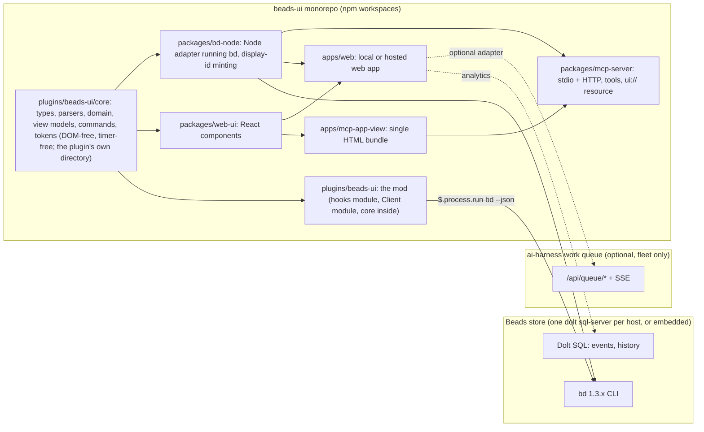
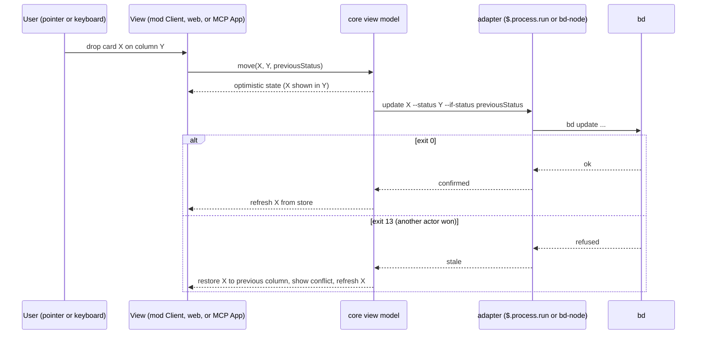

<!-- Full structure: see TEMPLATE.md in this directory -->

# beads-ui: a Beads task manager for the Claude Code TUI, an MCP UI app and a web app from one core

## Founding Ask Coverage

`founding_ask_ref`: {"blob_oid":"f5025e8233d0e9cf98d5247ca1b32fae6055072c","capture_commit":"862bb3185e4261c88bcb97da4fcd576c56f3da02","content_sha256":"2c141587e57f0b478ffe5af64d48d3162949575f0353f15075909b1194423eb3","entry_ids":["A001","A002","A003","A004"],"generation":4,"path":"docs/asks/BU-epic-beads-ui-beads-task-manager-mg2.md","previous_ref_sha256":"d54b1990f5a07db79320fd99f0a6c0a0a7a371d2618644fbbc5e3af2249c97ed","repository":"beads-ui","schema_version":1,"task_id":"BU-epic-beads-ui-beads-task-manager-mg2"}

`canonical_root_json`: {"blob_oid":"f5025e8233d0e9cf98d5247ca1b32fae6055072c","capture_commit":"862bb3185e4261c88bcb97da4fcd576c56f3da02","content_sha256":"2c141587e57f0b478ffe5af64d48d3162949575f0353f15075909b1194423eb3","entry_ids":["A001","A002","A003","A004"],"generation":4,"path":"docs/asks/BU-epic-beads-ui-beads-task-manager-mg2.md","previous_ref_sha256":"d54b1990f5a07db79320fd99f0a6c0a0a7a371d2618644fbbc5e3af2249c97ed","repository":"beads-ui","schema_version":1,"task_id":"BU-epic-beads-ui-beads-task-manager-mg2"}

`founding_ask_ref_sha256`: d7668b63750bbee3253a47d99a0b4106aede21e1952bdce105a15f6a01dde937

The raw record is `docs/asks/BU-epic-beads-ui-beads-task-manager-mg2.md` in this repository (capture commit `862bb31`, an ancestor of `main`). This index is non-authoritative; the raw FAR governs.

| Authoritative raw entry | Coverage and disposition |
|---|---|
| A001 | ORIGINAL-ASK, 2026-10-14T23:39:51Z. The Beads task manager in the Claude Code TUI as a mod with board, sprint, backlog, kanban, roadmap and timeline views, mouse drag, reorder and sort, create, update and delete behind an are-you-sure flow, burndown and productivity analytics, and a view of every Claude Code session's tasks: requirements R-1 to R-10, the Architecture and Mockups, phases 1 to 3 and decisions D-3, D-5, D-6, D-8, D-13, D-16, D-22, D-23. The retirement of the Claude Code task panel per machine profile after a backup: R-15, phase 5, D-12 and D-21. Phases starting with an MVP, decisions through the framework, open questions spiked first: the Implementation Phases, the Design Decisions and the Open Questions. Public, MIT, no secrets, Beads store committable: R-16 and phase 0's hygiene tasks. The doc viewer and web-browser epics named in the same entry are other epics and out of scope. |
| A002 | FOLLOW-UP, 2026-10-14T23:40:00Z. One repo `beads-ui` for the mod, the MCP UI app and the web app sharing components, with mobile and native desktop later: D-1, D-2 and R-11; sharing is narrowed to logic across three surfaces and React components across two, as the research measured. The alias `bv` and the npm name collide with existing tools: D-7 is escalated to Sergei with a recommendation. Mobile and native desktop: the "Later sub-epics" note. |
| A003 | FOLLOW-UP, 2026-10-14T23:40:01Z. "mainly the web app, claude web / desktop mcp UI app, and claude code TUI for now": the three surfaces this design covers, phases 1 to 4 and 6; iOS, macOS and Linux deferred to separate agents, in that order. "lmk what you reocmmend": the Executive Summary and the recommendations inside D-7, D-11 and D-12. |
| A004 | FOLLOW-UP, 2026-10-14T23:40:01Z. Incorporate the autonomous task queue and its dashboard with the queue left where it is: R-14, the Integration table, phase 3's queue adapter and D-11 (escalated, with the recommendation that the web app becomes the queue's unbuilt Phase 2 member app). Where the queue should live is Open Question 1, deferred as the entry asks. |

**Status:** DRAFT, waiting on Sergei's review (BU-mg2.2 stays in progress)

**Created:** 2026-10-15

**Task:** BU-mg2.2 (display id BU-doc-beads-ui-prd-fnzx), under epic BU-mg2

**Research:** `docs/research/beads-ui-task-manager-landscape.md`

<!-- doc:region name="overview" kind="replaceable" -->

## Table of Contents

- [Executive Summary](#executive-summary)
- [Problem Statement](#problem-statement)
- [Design Overview](#design-overview)
- [Product requirements](#product-requirements)
  - [Users and actors](#users-and-actors)
  - [Requirements](#requirements)
  - [Acceptance criteria](#acceptance-criteria)
- [Architecture](#architecture)
  - [Surfaces, packages and the store](#surfaces-packages-and-the-store)
  - [The Claude Code mod](#the-claude-code-mod)
  - [The web app](#the-web-app)
  - [The MCP App](#the-mcp-app)
  - [Mockups](#mockups)
  - [How a move is written](#how-a-move-is-written)
- [Data Model](#data-model)
  - [Core types](#core-types)
  - [Conventions on Beads](#conventions-on-beads)
  - [Configuration](#configuration)
- [Integration](#integration)
- [Implementation Phases](#implementation-phases)
  - [Phase 0: Monorepo bootstrap and the DOM-free core](#phase-0-monorepo-bootstrap-and-the-dom-free-core)
  - [Phase 1: The MVP, a read-mostly board in the Claude Code mod](#phase-1-the-mvp-a-read-mostly-board-in-the-claude-code-mod)
  - [Phase 2: Mod enhancements, pointer drag, sprints and sparklines](#phase-2-mod-enhancements-pointer-drag-sprints-and-sparklines)
  - [Phase 3: The web app, locally and as the queue dashboard's board](#phase-3-the-web-app-locally-and-as-the-queue-dashboards-board)
  - [Phase 4: The MCP App in Claude Desktop](#phase-4-the-mcp-app-in-claude-desktop)
  - [Phase 5: Retire the Claude Code task panel, per machine profile (lands in ai-harness)](#phase-5-retire-the-claude-code-task-panel-per-machine-profile-lands-in-ai-harness)
  - [Phase 6: Hosted web app and claude.ai MCP](#phase-6-hosted-web-app-and-claudeai-mcp)
  - [Later sub-epics (out of this doc's build scope)](#later-sub-epics-out-of-this-docs-build-scope)
- [Implementation Audit](#implementation-audit)
- [Risks and Mitigations](#risks-and-mitigations)
- [Open Questions](#open-questions)
- [Run Ledger](#run-ledger)
  - [Authority](#authority)
  - [Transition verdicts](#transition-verdicts)
- [Design Decisions](#design-decisions)
  - [Decision Summary](#decision-summary)
  - [Decision Details](#decision-details)
    - [D-1: Repository shape](#d-1)
    - [D-2: Package boundaries and the shared core's location](#d-2)
    - [D-3: MVP scope](#d-3)
    - [D-4: Beads access route](#d-4)
    - [D-5: Sprint modelling on Beads](#d-5)
    - [D-6: Board order](#d-6)
    - [D-7: The command alias, with the npm scope resolved](#d-7)
    - [D-8: Drag in the mod](#d-8)
    - [D-9: Display-id minting](#d-9)
    - [D-10: Web stack](#d-10)
    - [D-11: Relationship to the work-queue dashboard](#d-11)
    - [D-12: Task-panel backup destination](#d-12)
    - [D-13: Delete and close ladder](#d-13)
    - [D-14: MCP server topology](#d-14)
    - [D-15: Mod packaging and install](#d-15)
    - [D-16: Metrics data source](#d-16)
    - [D-17: Session identity on Beads](#d-17)
    - [D-18: Monorepo tooling](#d-18)
    - [D-19: Theme tokens](#d-19)
    - [D-20: Testing strategy](#d-20)
    - [D-21: Task-panel retirement switch](#d-21)
    - [D-22: WIP limits](#d-22)
    - [D-23: Quick-add grammar](#d-23)
- [Feedback Rounds](#feedback-rounds)
- [Approval Log](#approval-log)

## Executive Summary

beads-ui is a task manager for Beads issues that runs in three places from one code base: as a Claude Code mod drawn inside the terminal, as an MCP App rendered inside a Claude Desktop or claude.ai conversation, and as a web app run locally or hosted from a template. It gives Sergei the views a Jira-like product offers (board, backlog, sprints, roadmap, analytics) over the fleet's own task store, with mouse and keyboard control, create, edit and delete behind a confirmation, and one view of what every Claude Code session on a machine is working on. The MVP is the terminal mod, read-mostly first, because that is where the sessions already are. The design settles three facts the research established: the mod shares DOM-free logic with the other two surfaces and no React components, so the shared core is a TypeScript package with no DOM, Node or timer dependencies; Beads has no sprint, rank or story-point field, so sprints, board order and flow metrics are conventions this doc defines on Beads labels, metadata and its events table; and the fleet's autonomous work queue already has a board-shaped dashboard, so the web app's relationship to it is a decision put to Sergei before any board is built. Deferred: iOS, Android, macOS, Linux and Windows surfaces (later sub-epics), and the long-term home of the queue service (Sergei's own deferral). Three decisions are escalated to Sergei; every other decision is resolved here for his review.

## Problem Statement

The fleet tracks its work in Beads, but the only ways to see that work are the `bd` CLI, a few read-only mods and the Claude Code task panel, a one-way mirror that shows at most five rows per session and will be retired. Nothing shows a board, a backlog, a sprint or a roadmap over a Beads store; nothing lets Sergei move a card, reorder, or create and close issues from a UI; nothing shows which Claude Code session holds which task across a machine; and the flow metrics Beads already records in its events table are not drawn anywhere. Sergei asked for a Jira-like task manager on Beads, inside the Claude Code TUI first, and for the same product as an MCP UI app and a web app so the views follow him into Claude conversations and onto a phone, as one public, MIT-licensed monorepo.

## Design Overview

**Status:** stub; to be filled during and after implementation (dev workflow step 15). The sections below describe the design as decided, not as built.

## Product requirements

### Users and actors

Three actors use beads-ui. Sergei, the fleet owner, works in Claude Code sessions in tmux over AWS SSM on employer hosts and in Ghostty or kitty on personal machines, in Claude Desktop and claude.ai, and on a phone over a tailnet. A Claude Code session is an actor in its own right: it claims and closes Beads issues through `bd`, and the UI must show its work and never block its writes. An outside user of the public repository has a Beads store, no fleet tooling, and expects `npx`-style installation and a working board without the fleet's queue, display-id convention or app-portal shell.

### Requirements

Each row derives from the founding ask (entries A001 to A004 in `docs/asks/BU-epic-beads-ui-beads-task-manager-mg2.md`) and the research doc (`docs/research/beads-ui-task-manager-landscape.md`). The phase column names where the requirement first ships.

| # | Requirement | Source | First phase |
|---|---|---|---|
| R-1 | A kanban board over a Beads store, one column per status read from `bd statuses`, grouped by status category, with assignee swimlanes | A001; research 1.1 | 1 (mod), 3 (web), 4 (MCP) |
| R-2 | A backlog view sorted by priority then age, with filters by type, label, assignee, sprint and readiness | A001; research 1.1, 6.4 | 1 |
| R-3 | Sprint views: membership, current sprint board, sprint list with dates, carry-over of unfinished work | A001; research 1.1, 6.1 | 2 |
| R-4 | A roadmap or timeline view placing epics and milestones by date, with dependency lines | A001; research 1.1 | 3 |
| R-5 | Move a card between columns (status change) and across views (backlog to sprint) by keyboard and by mouse drag, with an optimistic update that rolls back on a stale write | A001; research 1.2, 3.2 | 1 (keyboard), 2 (drag) |
| R-6 | Reorder within a column by manual rank when enabled; sort by priority, created, updated, due or assignee | A001; research 1.2 | 1 (sort), 3 (rank) |
| R-7 | Create an issue from a one-line quick-add grammar; edit title, description, status, priority, type, labels, assignee, due date and estimate inline | A001; research 1.3 | 1 |
| R-8 | Delete behind an are-you-sure flow that shows `bd delete`'s own preview, offers close as the reversible alternative, and requires a typed id for a cascade | A001; research 1.3 | 1 |
| R-9 | Analytics: throughput, cycle time, cumulative flow, aging work in progress, a count-based sprint burndown, cost per closed issue where session cost data exists | A001; research 1.4 | 2 (mod sparklines), 3 (web charts) |
| R-10 | A cross-session view: every session's assigned, in-progress and done issues, with claim age against the lease, sourced from Beads assignees and, when configured, the queue's session registry | A001, A004; research 1.5, 6.2 | 1 (assignee swimlanes), 3 (registry) |
| R-11 | The three surfaces share one core; React components are shared by the web app and the MCP App | A002; research 5 | 0 |
| R-12 | The web app runs locally with one command and is hostable from infra-as-config templates with quick starts | A002; research 2.3 | 3, 6 |
| R-13 | The MCP App renders in Claude Desktop from a local stdio server and in claude.ai from a reachable server | A003; research 4 | 4, 6 |
| R-14 | The autonomous work queue and its dashboard are integrated, with the queue left where it is | A004; research 6.2 | 3 |
| R-15 | The Claude Code task panel is retired per machine profile by a config setting in ai-harness, after a backup of every panel's data | A001; research 6.3 | 5 |
| R-16 | Public and MIT: no secrets, credentials or private data in the repo; the Beads store and its ids may be committed | A001 | 0 |
| R-17 | Every write respects the Beads display-id convention when the store uses it, and never moves a published id | research 6.1 | 1 |

### Acceptance criteria

The phase sections carry the per-task EARS criteria. The product-level criteria that hold across every phase:

- When a surface renders a board, the system shall build its columns from the store's `bd statuses` output and shall decide "done" by the `done` category, never by column position.
- When a user moves a card, the system shall write the new status with `bd update --if-status <previous>` (or the equivalent guarded API call), and if the write exits 13 then the system shall restore the card and refresh it from the store.
- When a user deletes an issue, the system shall show `bd delete --dry-run` output for that issue before any `--force` or `--cascade` write, and if the issue has dependents outside the selection then the system shall require a typed confirmation of the issue id.
- When beads-ui creates an issue in a store whose existing issues carry `metadata.display_id`, the system shall mint a display id of the same shape and write both the metadata field and the `id:<display_id>` label.
- If a store has no queue service configured, then every surface shall still render boards, backlog, detail and analytics from `bd` alone.
- While a surface runs inside the Claude Code mod, the system shall offer a keyboard path for every pointer action.

## Architecture

### Surfaces, packages and the store



The diagram follows the layer table and package proposal in the research doc (section 5.5), amended by decisions D-2 and D-18 after the doc-editor sibling repo's evidence on how Claude Code installs plugins. The core is the one module every surface imports. It holds the issue and status types, the `bd --json` parsers and argument builders, the domain rules (column grouping by status category, sort, filter, sprint membership, rank, flow metrics, dependency graph), the view models (board, backlog, sprint, roadmap, detail, analytics) as pure reducers and selectors, the command catalog (every user action as data with a stable id, label and default keys), and the semantic design tokens. It has no runtime dependency, no DOM, Node or timer reference, and compiles under the tsconfig the Claude Code mods type file suggests. Through phase 2 its source lives inside the plugin directory, `plugins/beads-ui/core/`, because an installed plugin is a copy that cannot reach files above its root and the fleet's mods design wants no build step; the web and MCP packages import it through the TypeScript path alias `@beads-ui/core`. At phase 3, when the web app and the MCP server land, D-2 records the re-evaluation of a `packages/core` move with a copy build. `packages/bd-node` is the Node adapter that spawns `bd` for the web server and the MCP server and owns display-id minting. `packages/web-ui` is the React component set shared by the web app and the MCP App view. `plugins/beads-ui` is the mod: a hooks module, the phase 2 `Client` module, and the core, with no `package.json` runtime dependencies, listed by a root `.claude-plugin/marketplace.json`. `packages/mcp-server` serves the `ui://` resource and the Beads tools over stdio and HTTP. `apps/web` is the local or hosted web app; it also exposes the HTTP MCP endpoint in the hosted configuration. The repo uses npm workspaces (D-18) so that any package that ever ships inside a plugin with dependencies has a lockfile Claude Code's plugin install reads.

### The Claude Code mod

The mod registers one `/beads` command (D-7 settles the final name) that opens a pane, plus bands above the prompt for counts and the issue in progress, following the read-only Beads mods already in the ecosystem. The pane holds four tabs: Board, Backlog, Sprint and Detail, switched by digit hotkeys; a fifth, Charts, arrives in phase 2. Each tab is a `Box` tree built by core's view models and drawn with `Text`, `Button`, `Input`, `Select` and `Markdown`. Status moves use a "Move to" `Select` on the focused card; creation uses a quick-add `Input`; deletes open a confirmation pane with `holdToasts` that shows `bd delete --dry-run` output. Phase 2 adds a `Client` region for the Board tab that draws the columns and cards, captures pointer drag and posts "move card X to column Y" messages to the hooks module, which performs the guarded `bd update`; the keyboard path stays. Data access is `bd ... --json` through `$.process.run`, once per refresh, with a refresh on `/beads` commands, after a write, and on a `$.clock.every` timer of 10 seconds while the pane is open. View preferences (open tab, filters, column widths) persist in `$.store`; data never does.

### The web app

A Vite and React 19 single-page app served by a Node server in the same package. The server runs `bd` through `packages/bd-node`, exposes a small JSON API that mirrors core's view models, and pushes updates over Server-Sent Events by polling `bd` on a configurable interval. Views: Board, Backlog, Sprints, Roadmap, Analytics, Sessions and Issue detail, with a command palette and saved views. When a queue service is configured, the Sessions and Board views also read `/api/queue/sessions`, `/api/queue/tasks` and the queue's SSE stream; without one they read `bd` alone. The local run path is one command (`npx @<scope>/beads-ui` or `npm run dev`); the hosted path is Docker Compose with a volume for the checkout and Dolt state, behind Tailscale Serve or an OAuth proxy.

### The MCP App

The same React components as the web app, bundled into a single HTML resource served as `ui://beads-ui/board` by `packages/mcp-server`, requesting the `fullscreen` display mode and using Claude's style variables for colour, type and radius. The server exposes read tools for the model (`beads_list`, `beads_show`, `beads_ready`) and write tools (`beads_update_status`, `beads_create`, `beads_close`) that the app calls through `tools/call`; writes that the model may also call are confirmed in the app. Claude Desktop runs the server over stdio from `claude_desktop_config.json`; claude.ai reaches the hosted web app's HTTP MCP endpoint in phase 6.

### Mockups

Mockups are described as layout tables, because the design doc renders on GitHub and the mod has no pixel surface to screenshot before it exists. Each row is a region of the view and what it contains.

Board tab in the mod pane (120 columns by 30 rows, fullscreen rendering):

| Region | Content |
|---|---|
| Header row | Tab buttons `1 Board`, `2 Backlog`, `3 Sprint`, `4 Detail`; the store name and a freshness stamp (`as of 01:12:04`) |
| Filter row | `Input` for a filter expression (`type:task label:ui assignee:aih-3`), a `Select` for sprint, a `Select` for swimlane (none, assignee, epic) |
| Columns | One `Box` per status category group in order `active`, `wip`, `frozen`, `done`, each headed by status name and count, each a vertical list of cards; a count over a configured soft limit turns the header's colour key to `warning` |
| Card | Display id in `dimColor`, title truncated to the column width, priority badge `P1`, assignee, a `Select` labelled `Move to` with the other statuses, a `Button` `d` for detail |
| Footer | Hotkey hints: `n` new, `s` swimlane, `/` filter (an `Input`, since `/` is not a valid hotkey), `?` help (a `Button` with hotkey `h`) |

Detail tab: a two-column `Box` with the issue's fields (title, status, priority, type, assignee, labels, sprint, due, estimate, created, updated, started, closed) on the left as editable `Input` and `Select` controls, and the description, acceptance criteria and notes rendered with `Markdown` on the right; below, dependencies as a list of display ids with their status, and the last ten events from `bd history --events`.

Delete confirmation pane (opened with `holdToasts: true`, `focus: true`, `closeOnEscape: true`): the `bd delete --dry-run` output rendered with `Code`; a line naming the dependents that would be orphaned or cascaded; a `Button` `Close instead` (hotkey `c`) that runs `bd close`; a `Button` `Delete` (hotkey `x`); for a cascade, an `Input` whose `onSubmit` must equal the display id before `Delete` is enabled.

Web Board view: a left rail of saved views and sprints; a top bar with the command palette trigger, filter chips and a swimlane selector; the board as columns with drag handles on cards (Pragmatic drag and drop) and a "Move to" menu on each card for keyboard and touch; a right drawer for the selected issue's detail; an "as of" freshness stamp and a conflict toast when a guarded write is refused.

MCP App full-screen view: the web Board with menus replaced by segmented controls and the detail drawer replaced by a collapsible right panel, in Claude's style variables; an inline-card mode showing one issue (title, status, priority, assignee) with two actions, `Move to` and `Open board`.

### How a move is written



## Data Model

### Core types

```typescript
// plugins/beads-ui/core/src/model.ts (shape, not final code)
type StatusCategory = "active" | "wip" | "frozen" | "done";
interface Status { name: string; category: StatusCategory; builtin: boolean }
interface Issue {
  id: string;                // bd hash primary, hierarchical, e.g. "BU-mg2.1.3"
  displayId?: string;        // metadata.display_id when the store uses the convention
  title: string; description?: string; design?: string; acceptanceCriteria?: string; notes?: string;
  status: string; priority: 0 | 1 | 2 | 3 | 4; type: string;
  assignee?: string; owner?: string; labels: string[];
  parent?: string; dependencies: { type: string; id: string }[];
  estimatedMinutes?: number; dueAt?: string; deferUntil?: string;
  createdAt: string; updatedAt: string; startedAt?: string; closedAt?: string;
  leaseExpiresAt?: string; heartbeatAt?: string;
  metadata: Record<string, unknown>;
}
interface Sprint { name: string; milestoneId?: string; startsAt?: string; dueAt?: string }
interface Session { id: string; machine: string; name: string; state: "idle" | "busy" | "compacting" | "gone"; currentTask?: string; lastHeartbeatAt?: string }
```

### Conventions on Beads

| Concept | Representation | Rule |
|---|---|---|
| Board column | A Beads status; columns ordered by category `active`, `wip`, `frozen`, `done`, then by `bd statuses` order | Read from the store, never hard-coded (D-3) |
| Sprint membership | Label `sprint:<name>` | One active sprint label per issue; filterable with `bd list --label` (D-5) |
| Sprint dates | A `milestone` issue titled `Sprint <name>` with `due_at` and, in metadata, `sprint.starts_at` | Members link to it with `tracks`; `parent-child` stays for epics (D-5) |
| Manual rank | `metadata.rank`, a fractional-index string | Off by default; written only when a view enables rank ordering (D-6) |
| Human owner of a session's task | `metadata.owner` | `assignee` names the session; `owner` names the person (D-17) |
| Display id | `metadata.display_id` plus label `id:<display_id>` | Minted on create when the store uses the convention; never changed after publication (D-9) |
| Estimate | `estimated_minutes` | Native field; shown in minutes or hours |
| Flow metrics | `events` audit table (`bd history --events`) and Dolt history | Journal and HTTP stream only for live updates (D-16) |

### Configuration

A `beads-ui.toml` (read at call time, never an environment snapshot) in the user's config directory, with per-store overrides in the repo:

```toml
[stores.default]
path = "/data/projects/beads-ui"          # a repo with a .beads/ store
id_policy = "auto"                         # auto | fleet-slug | off
refresh_seconds = 10

[queue]
url = ""                                   # empty: no queue adapter; else http://127.0.0.1:8400
events = true

[views]
rank = false                                # manual rank off until enabled
soft_wip_limit = { in_progress = 5 }

[theme]
preset = "claude"                          # claude | plain | custom
```

The ai-harness switch for the task panel (phase 5) is a per-machine-profile key in ai-harness's machine configuration, declared where the renderer composes `env` and `permissions.deny`; the exact file and key come from the second design spike and are recorded in D-21.

## Integration

| System | How beads-ui integrates | Constraint it inherits |
|---|---|---|
| Beads (`bd` 1.3.x) | `bd ... --json` for reads and writes in every surface; `--if-status` and `--if-assignee` on status and assignee writes; `bd history --events` for metrics; `bd delete --dry-run` for previews | No sprint, rank or story-point field; hash ids only; one shared `dolt sql-server` per host on the fleet, embedded single-writer elsewhere |
| Fleet display-id convention | `id_policy = auto` detects `metadata.display_id` on existing issues and mints the same shape through core | A published id is immutable; the convention is a fleet rule, off for stores that do not use it |
| ai-harness work queue | Optional adapter: `/api/queue/tasks`, `/sessions`, `/review`, `/inbox`, `/events` (SSE) for the fleet-wide board, sessions and review views; status writes through the queue when a task is leased | Loopback-only, no auth, fleet-only; its session registry is the only source of session liveness; D-11 decides the dashboard relationship |
| app-portal | When D-11 resolves to the member-app option, `apps.yaml` entry `{id: beads-ui, path: /beads, kind: portal}`, `serve-sync`, the shell's PWA | The shell owns the root PWA and service worker |
| ai-harness install | The mod installs from the beads-ui marketplace through `install.sh` on fleet machines; the task-panel switch and backup ship in ai-harness (phase 5) | Install contract: plan, apply, doctor; one plugin per mod; `claude plugin validate --json` allow-list |
| Claude Code mods API | `ui.render` on `Pane` and `AbovePrompt`; `$.process.run`, `$.store`, `$.state`, `$.clock.every`, `$.ui.open` with `holdToasts`; `Client` for drag in phase 2 | Floor 2.1.299 (multi-file `$` passing); 10 s per hook; 4 MiB per file; 100,000 characters per tree; 10 redraws a second |
| MCP Apps | `@modelcontextprotocol/ext-apps` SDK, `registerAppTool` and `registerAppResource`, `ui://` resource, `fullscreen` mode, Claude style variables, CSP declared | Desktop: local stdio; claude.ai: internet-reachable server with auth; Claude Code is not a host |
| Docs in this repo | `docs/research/beads-ui-task-manager-landscape.md` and the packets under `docs/research/findings/` are this design's evidence; `README.md` planned-layout wording is corrected in this PR | None |

## Implementation Phases

Each phase carries its scope, deliverables, tasks with EARS acceptance criteria and a runnable exit gate. Nothing in this doc is built; the first build starts after Sergei's review. Test commands name the repo's declared gate (`npm test`, which runs Vitest; `claude plugin test` for the mod; `npm run lint` for Biome) once phase 0 declares them.

<!-- doc:ac-rules:mirror:begin -->
- Every AC is independently testable — a test can fail if only this AC is violated.
- Every AC is falsifiable — "works correctly" is not an AC.
- Use EARS as the default for textual behavioral ACs: `When <trigger>, the system shall <response>` (event-driven); `While <state>` / `Where <feature>` (state-driven / optional); `If <condition>, then the system shall <response>` (unwanted-behavior / failure path). When a decision table, state machine, formula, executable Gherkin, property, or contract expresses the behavior more clearly, wrap it in an `<!-- ac-format: <value> ... --> ... <!-- /ac-format -->` scope (`decision-table` / `state-machine` / `formula` / `gherkin` / `property` / `contract`; unmarked ACs default to `ears`). Full per-format `ac-format` schemas are normative at `task-authoring-standards.md` § Per-Format AC Schemas — **always check that live source directly for the current schemas before relying on this reminder; this mirrored block itself can drift out of date and must never be treated as authoritative on its own.**
- At least one failure-path AC per public function changed — EARS `If <condition>, then the system shall …`, or the marked format's own negative-path convention (a decision table's infeasible-combination row, a state machine's invalid-transition row, a formula's invalid-input row).
- Replacement/refactor tasks: inventory the existing behaviors, then a parity AC for each (preserved, or intentionally dropped + reason).
<!-- doc:ac-rules:mirror:end -->

### Phase 0: Monorepo bootstrap and the DOM-free core

- **Scope:** the repository skeleton, the shared core inside the plugin with its purity rules enforced, the mod with a hello pane, the CI gates. No user-facing feature.
- **Deliverables:**
  - Files created: root `package.json` with `workspaces`, `package-lock.json`, `turbo.json`, `biome.json`, `tsconfig.base.json` (path alias `@beads-ui/core` to `plugins/beads-ui/core/src`), `plugins/beads-ui/` (`.claude-plugin/plugin.json`, `hooks/hooks.json`, `hooks/register.ts`, `core/`), `packages/bd-node/`, `.claude-plugin/marketplace.json` listing `./plugins/beads-ui`, `CONTRIBUTING.md`, `SECURITY.md`, `CODE_OF_CONDUCT.md`. `.github/` is out of scope (CI is the local pre-commit and pre-push gates per the fleet's retired-Actions rule).
  - Files modified: `README.md`, `.gitignore` (ignore `.claude-plugin/types/` and a generated `tsconfig.json` inside the plugin), `.pre-commit-config.yaml` (add `npm run lint`, `npm test`, `claude plugin validate --json` allow-list diff).
  - Tests added: `plugins/beads-ui/core/test/purity.test.ts`, `plugins/beads-ui/core/test/parsers.test.ts`, `packages/bd-node/test/bd-adapter.test.ts`, `plugins/beads-ui/hooks/*.test.ts`.
- **Tasks + acceptance criteria:**
  - **T-0.1 Core module and purity gate**
    - [ ] `When plugins/beads-ui/core is built, the system shall compile under a tsconfig with "lib": ["es2023"] and "types": [] and shall emit no error.`
    - [ ] `If any file in plugins/beads-ui/core references setTimeout, setInterval, queueMicrotask, requestAnimationFrame, window, document, process or a Node built-in, then the lint gate shall fail naming the file and line.`
    - [ ] `When plugins/beads-ui/package.json is read, the system shall find no runtime dependencies.`
    - [ ] `When claude plugin test runs an import probe, a hooks module importing a core file by relative path and a Client module importing a sibling file shall both load; if either is refused, then the probe shall fail naming the import.`
  - **T-0.2 bd-node adapter**
    - [ ] `When the adapter runs bd list --json against a store, the system shall return Issue objects whose fields match the core's Issue model for every record.`
    - [ ] `If bd exits 13 on a guarded update, then the adapter shall return a typed StaleWrite result and shall not retry.`
    - [ ] `If bd is not on PATH, then the adapter shall fail with a message naming the binary and the install page, not a stack trace.`
  - **T-0.3 Mod plugin and marketplace**
    - [ ] `When claude plugin validate --json runs on plugins/beads-ui, the system shall list only the hooks and calls in the committed allow-list, every $ call shall sit in the hooks module's own files, and the pre-commit gate shall fail on any difference.`
    - [ ] `When claude plugin validate . runs on the repository root, the marketplace shall validate and shall list ./plugins/beads-ui.`
    - [ ] `When claude plugin test runs, the hello pane's render test shall pass on the terminal and desktop surfaces.`
    - [ ] `If any file in plugins/beads-ui exceeds 1 MB, then the pre-commit gate shall fail naming it.`
  - **T-0.4 Repository hygiene for a public repo**
    - [ ] `When a commit is attempted, the gitleaks pre-commit hook shall scan it, and if a secret pattern matches then the commit shall be refused.`
    - [ ] `When README.md describes the layout, it shall name the shared layers as data access, domain logic, view models, commands and design tokens, and shall not name layout.`
- **Exit gate:** `npm run lint && npm test` green; `claude plugin validate .` and `claude plugin validate --json plugins/beads-ui` match the allow-list; `claude plugin test plugins/beads-ui` green including the import probe; a fresh-context diff review against the ACs above.

### Phase 1: The MVP, a read-mostly board in the Claude Code mod

- **Scope:** the `/beads` pane with Board, Backlog and Detail tabs over the current repo's store; keyboard status moves with guarded writes; quick-add; the delete confirmation flow; bands above the prompt; display-id minting when the store uses it. No drag, no sprints, no charts.
- **Deliverables:**
  - Files created: `plugins/beads-ui/core/src/{model,parsers,columns,sort,filter,quickadd,commands,tokens}.ts`, `plugins/beads-ui/core/src/views/{board,backlog,detail}.ts`, `plugins/beads-ui/hooks/{register,pane,bands,confirm}.ts, `docs/procedures/mod-install.md`.
  - Tests added: `plugins/beads-ui/core/test/{columns,sort,filter,quickadd,views}.test.ts`, `plugins/beads-ui/hooks/{pane,confirm,bands}.test.ts`.
- **Tasks + acceptance criteria:**
  - **T-1.1 Board tab**
    - [ ] `When the pane opens, the system shall render one column per status returned by bd statuses, ordered by category active, wip, frozen, done, each with its issue count.`
    - [ ] `When the user picks a status in a card's Move to control, the system shall run bd update <id> --status <new> --if-status <shown>, and if bd exits 13 then the system shall restore the card to its shown column, show a conflict line and refresh that issue.`
    - [ ] `While the swimlane selector is set to assignee, the system shall render one row per distinct assignee plus an unassigned row.`
    - [ ] `If bd list fails or times out, then the system shall keep the last rendered board, show an error line with the exit code, and retry on the next refresh.`
  - **T-1.2 Backlog tab**
    - [ ] `When the Backlog tab renders, the system shall list open issues sorted by priority then created date and shall honour the filter expression's type, label, assignee and ready predicates.`
    - [ ] `When the user enters a filter with an unknown key, the system shall show the accepted keys and shall not change the list.`
  - **T-1.3 Detail tab and inline edit**
    - [ ] `When a card's detail is opened, the system shall show every field in the Data Model's Issue type that the store returned, the dependencies with their statuses, and the last ten events from bd history --events.`
    - [ ] `When a field is edited and submitted, the system shall write it with bd update and shall re-read the issue before redrawing.`
  - **T-1.4 Quick-add**
    - [ ] `When the user submits a quick-add line, the system shall parse title, p0 to p4, type:, @assignee, +label, due: and sprint: tokens and shall create the issue with the matching bd create flags.`
    - [ ] `While the store's existing issues carry metadata.display_id and id_policy is auto or fleet-slug, when an issue is created the system shall mint a display id of the form PREFIX-<title-slug>-<4 random lowercase alphanumerics> and shall write metadata.display_id and the id:<display_id> label.`
    - [ ] `If id_policy is off, then the system shall create the issue without touching metadata.display_id or labels.`
  - **T-1.5 Delete confirmation**
    - [ ] `When the user chooses delete, the system shall open a focused pane showing bd delete <id> --dry-run output and a Close instead action before any destructive write.`
    - [ ] `If the dry run lists dependents outside the selection, then the system shall require the display id typed into the confirmation Input before enabling Delete with --cascade.`
    - [ ] `When Close instead is chosen, the system shall run bd close <id> and shall not run bd delete.`
  - **T-1.6 Bands and command**
    - [ ] `When a session starts with the mod loaded, the system shall register /beads and shall draw a band with open, in-progress and blocked counts for the current repo's store, refreshed at most every 10 seconds.`
    - [ ] `If the pane cannot be placed because the terminal is narrower than 110 columns and the user did not open it, then the system shall show a toast naming the width needed and shall not draw the pane.`
- **Exit gate:** `npm test` and `claude plugin test` green; `claude plugin validate --json` matches the allow-list; a manual run in a 120-column tmux session on this host and in Ghostty or kitty locally confirms Board, Backlog, Detail, Move to, quick-add and the delete flow against the beads-ui store, recorded in the Approval Log; Sergei uses the MVP and records feedback (human step).

### Phase 2: Mod enhancements, pointer drag, sprints and sparklines

- **Scope:** a `Client` board region with drag between columns, the Sprint tab, the Charts tab with `Raster` sparklines, and the live refresh path.
- **Deliverables:**
  - Files created: `plugins/beads-ui/client/board.ts` (the `Client` module), `plugins/beads-ui/core/src/{sprint,metrics}.ts`, `plugins/beads-ui/core/src/views/{sprint,charts}.ts`.
  - Tests added: `plugins/beads-ui/core/test/{sprint,metrics}.test.ts`, `plugins/beads-ui/hooks/{client-board,sprint,charts}.test.ts`.
- **Tasks + acceptance criteria:**
  - **T-2.1 Pointer drag in a Client**
    - [ ] `While fullscreen rendering is active and a Client board is mounted, when the user presses on a card, moves and releases over another column, the Client shall post one move message naming the issue, the source and the target column, and the hooks module shall perform the guarded status write.`
    - [ ] `If the release lands outside any column, then the Client shall post nothing and shall redraw the card in place.`
    - [ ] `While the Client is mounted, the system shall keep the Move to keyboard control available on every card.`
    - [ ] `If the Client faults, then the hooks module shall handle ui.fault and redraw the Board tab without the Client on the next render.`
  - **T-2.2 Sprint tab**
    - [ ] `When the Sprint tab renders, the system shall list sprints from milestone issues titled Sprint <name> with their due dates and shall show the active sprint's board filtered by the sprint:<name> label.`
    - [ ] `When the user adds an issue to the active sprint, the system shall add the sprint:<name> label with bd update --add-label and shall remove any other sprint: label.`
    - [ ] `When a sprint is closed with unfinished issues, the system shall offer to move them to the next sprint and shall record the carry-over as a bd comment on the sprint milestone.`
  - **T-2.3 Charts tab**
    - [ ] `When the Charts tab renders in the terminal, the system shall draw throughput per week, cumulative flow by status category and aging work in progress as Raster sparklines computed from bd history --events, and on the Desktop surface it shall draw the same figures as Text tables.`
    - [ ] `If the events table returns no rows for the selected range, then the system shall show no data for <range> and shall not draw an empty chart.`
- **Exit gate:** `npm test` and `claude plugin test` green; the drag check recorded in the Approval Log for tmux over SSM with `set -g mouse on` and for one local terminal; Charts verified against a hand-computed throughput for one week.

### Phase 3: The web app, locally and as the queue dashboard's board

- **Scope:** the web app with Board, Backlog, Sprints, Roadmap, Analytics, Sessions and Issue detail; the local one-command run; Docker Compose; the queue adapter; and, if D-11 resolves to the member-app option, app-portal registration.
- **Deliverables:**
  - Files created: `packages/web-ui/`, `apps/web/` (server and client), `docker-compose.yml`, `docs/procedures/web-run.md`, core `src/{rank,roadmap,sessions}.ts`.
  - Tests added: `packages/web-ui/test/*.test.tsx` (Vitest), `apps/web/e2e/*.spec.ts` (Playwright at 390 px and 1280 px), core `test/{rank,roadmap}.test.ts`.
- **Tasks + acceptance criteria:**
  - **T-3.1 Board, backlog, detail and command palette**
    - [ ] `When the Board loads, the system shall render columns from bd statuses with Pragmatic drag and drop, and when a card is dropped on a column the system shall perform the guarded write and shall roll back on exit 13 showing a conflict toast.`
    - [ ] `When the user opens the command palette with Ctrl or Cmd K and runs Move to, the system shall move the selected card without a drag.`
    - [ ] `If the user is on a touch device, then every drag target shall also expose a Move to menu meeting WCAG 2.2 criterion 2.5.7.`
  - **T-3.2 Roadmap and manual rank**
    - [ ] `When the Roadmap renders, the system shall place epics and milestones by due date and shall draw blocks and parent-child dependencies as lines.`
    - [ ] `Where views.rank is enabled, when a card is reordered within a column the system shall write metadata.rank as a fractional-index key between its neighbours and shall not renumber other cards.`
  - **T-3.3 Analytics**
    - [ ] `When Analytics renders, the system shall draw throughput, cycle time with a rolling average, cumulative flow, a count-based sprint burndown and aging work in progress from bd history --events.`
    - [ ] `Where a Claude Code cost export is configured, when an issue closed with a session id the system shall show cost and tokens per closed issue.`
  - **T-3.4 Sessions and the queue adapter**
    - [ ] `Where queue.url is set, when the Sessions view renders the system shall read /api/queue/sessions and shall show state, current task, last heartbeat and claim age for every session.`
    - [ ] `If queue.url is empty, then the Sessions view shall render from Beads assignees alone and shall say that liveness is unavailable.`
    - [ ] `Where queue.url is set, when a status is changed on a task the queue holds a lease on, the system shall write through POST /api/queue/tasks/{repo}/{task_id}/status and shall show the 409 conflict if the expected status is stale.`
  - **T-3.6 Core location review (D-2)**
    - [ ] `When the web app and the MCP server both import @beads-ui/core, the team shall record in D-2 whether the core moves to packages/core with a copy build into the plugin or stays in the plugin; if it moves, then a pre-commit check shall fail when the plugin's copy differs from a fresh build.`
  - **T-3.5 Local run and Docker Compose**
    - [ ] `When a user runs the documented single command in a repo with a .beads store, the system shall serve the web app on a local port and open the Board within 10 seconds.`
    - [ ] `When docker compose up runs with the documented volume, the system shall persist the checkout and Dolt state across container restarts.`
- **Exit gate:** `npm test` green; Playwright smoke green at 390 px and 1280 px; the local run and the compose run recorded in the Approval Log; if D-11 chose the member-app option, `apps.yaml` entry present and the app reachable at `/beads` through the portal shell.

### Phase 4: The MCP App in Claude Desktop

- **Scope:** `packages/mcp-server` over stdio, the `ui://beads-ui/board` resource, the full-screen board and the inline card, Claude style variables.
- **Deliverables:** `packages/mcp-server/`, `apps/mcp-app-view/`, `docs/procedures/mcp-app-install.md`; tests `packages/mcp-server/test/*.test.ts`, Playwright against the ext-apps `basic-host` example.
- **Tasks + acceptance criteria:**
  - **T-4.1 Server and resource**
    - [ ] `When Claude Desktop starts the server over stdio, the system shall register beads_list, beads_show, beads_ready, beads_update_status, beads_create and beads_close tools and the ui://beads-ui/board resource with text/html;profile=mcp-app.`
    - [ ] `When the app initializes, it shall declare inline and fullscreen display modes and shall request fullscreen when the board is opened.`
    - [ ] `If the host does not support MCP Apps, then the tools shall still answer with text results and the server shall not fail.`
  - **T-4.2 View**
    - [ ] `When the view renders, it shall use the host's style variables for background, text, border and radius and shall render correctly in light and dark mode.`
    - [ ] `When a write tool is called from the app, the app shall confirm the action in its own UI before the call.`
- **Exit gate:** `npm test` green; the `basic-host` Playwright run green; a manual run in Claude Desktop recorded in the Approval Log.

### Phase 5: Retire the Claude Code task panel, per machine profile (lands in ai-harness)

- **Scope:** a backup of every machine's `~/.claude/tasks/` into the destination D-12 decides; a per-machine-profile switch in ai-harness that drops `CLAUDE_CODE_ENABLE_TODO_TOOLS` and adds bare-name deny rules; guards on the fleet surfaces that read the panel; retirement one profile at a time, starting with the profile that uses the mod daily.
- **Deliverables (ai-harness):** the per-profile key and its renderer change at the insertion points the second spike names; `scripts/task_panel_backup.py`; guards in `/load-task-panel`, `/curate-task-panel`, `/clean-task-panel` and the queue's `wq next` reconciliation; `docs/procedures/task-panel-retirement.md`; tests for the renderer and the backup.
- **Tasks + acceptance criteria:**
  - **T-5.1 Backup**
    - [ ] `When the backup runs on a machine, the system shall copy every list under ~/.claude/tasks/ to the configured destination as one JSON Lines file per list with a header record naming the host, list id, capture time and Claude Code version, preserving every optional field.`
    - [ ] `If the destination is the public beads-ui repository, then the backup shall refuse to run.`
  - **T-5.2 The switch**
    - [ ] `Where a machine profile sets the task-panel key to retired, when install.sh apply renders settings.json the system shall omit CLAUDE_CODE_ENABLE_TODO_TOOLS from env and shall add TaskCreate, TaskGet, TaskList, TaskUpdate and TodoWrite to permissions.deny.`
    - [ ] `When install.sh plan runs on a retired profile, it shall show the env and deny changes before apply, and doctor shall report the profile as retired.`
    - [ ] `If the key is absent, then the rendered settings shall be byte-identical to today's output.`
  - **T-5.3 Guards on panel readers**
    - [ ] `When /load-task-panel, /curate-task-panel or /clean-task-panel runs on a retired profile, the skill shall exit with a message naming the retirement and shall not call a Task tool.`
    - [ ] `When wq next runs on a retired profile, the queue's TaskList reconciliation shall be skipped with a logged reason and pool selection shall proceed.`
- **Exit gate:** ai-harness `pytest` green including the renderer and backup tests; one profile retired, its backup verified by record count against the file count, and its sessions confirmed working with the mod for one day, recorded in the Approval Log.

### Phase 6: Hosted web app and claude.ai MCP

- **Scope:** infra-as-config templates (Fly.io, Railway, Render), the HTTP MCP endpoint with auth, Tailscale Serve and OAuth-proxy recipes.
- **Deliverables:** `deploy/fly.toml`, `deploy/railway.json`, `deploy/render.yaml`, `docs/procedures/hosting.md`; the HTTP transport in `packages/mcp-server` with a token or OAuth guard.
- **Tasks + acceptance criteria:**
  - [ ] `When the hosted app starts without an auth layer configured and is bound beyond loopback, the system shall refuse to start and shall name the required setting.`
  - [ ] `When claude.ai connects to the hosted MCP endpoint, the system shall compute ui.domain from the server URL and shall render the board in fullscreen mode.`
  - [ ] `If the hosted checkout cannot reach its Dolt remote, then the app shall serve the last synced state with a stale stamp and shall not write.`
- **Exit gate:** one template deployed to a test target and torn down, recorded in the Approval Log; a claude.ai connector test recorded.

### Later sub-epics (out of this doc's build scope)

iOS and Android (shared or separate), macOS, Linux and Windows native apps follow as their own epics once the web app proves the interaction model; MCP Apps already reach the Claude mobile app through a native WebView after a connector is added on web or desktop, which is the cheapest mobile path and is noted for those epics.

## Implementation Audit

> **Step 14 gate**: complete before updating docs or presenting UAT.
> Verify every design section and decision against the actual implementation. Check each item off;
> any gap restarts from implementation (step 5), not from planning.
> For multi-phase designs, tag every row with the phase whose Exit gate it verifies, or `N/A` for
> a whole-doc item. Only rows for the phase(s) implemented so far need to reach PASS; an unimplemented
> future phase's rows stay unchecked and do not block an earlier phase's own merge gate.

| # | Phase | Section / Decision | Verified | Notes |
|---|-------|--------------------|---------|-------|
| 1 | N/A | **Design Overview filled**: confirm the `## Design Overview` section above is filled in with concrete implementation knowledge, not left as a stub | - [ ] | |
| 2 | 0 | D-2 package boundaries and the five core rules | - [ ] | |
| 3 | 0 | D-15 mod packaging and validate allow-list | - [ ] | |
| 4 | 1 | D-3 MVP scope; D-4 access route; D-9 display-id minting; D-13 delete ladder | - [ ] | |
| 5 | 2 | D-8 drag in a Client; D-5 sprint convention; D-16 metrics source | - [ ] | |
| 6 | 3 | D-10 web stack; D-6 rank; D-11 queue relationship; D-17 session identity | - [ ] | |
| 7 | 4 | D-14 MCP topology | - [ ] | |
| 8 | 5 | D-21 retirement switch; D-12 backup destination | - [ ] | |
| 9 | 6 | hosting templates and auth per Recommendation 3 of the research doc | - [ ] | |

**Audit completed:** <!-- YYYY-MM-DD; update when all items above are checked -->

## Risks and Mitigations

| # | Risk | Impact | Mitigation |
|---|------|--------|------------|
| 1 | Mods API churn: the surface changed twice on 2026-10-14 and the vendor states events and methods can change between releases | A mod that stops loading after an upgrade | Pin the floor at 2.1.299, run `claude plugin test` and `validate --json` in the gate, keep the mod thin over core, re-read the changelog per release |
| 2 | Drag in a `Client` is undocumented beyond the types file and untested live; tmux passes whole cells only | Phase 2's headline feature may degrade | Keyboard path in every phase; the live drag check is Phase 2's exit gate, and the design degrades to keyboard without a redesign |
| 3 | Two writers: the queue holds leases while beads-ui writes `bd` directly | A board edit on a leased task is overruled until the lease releases | Route status writes through the queue API when `queue.url` is set and the task is leased; show the lease on the card |
| 4 | `bd` latency under host load: a whole-store list timed out at HOLD on the largest store | A fleet-wide board that polls `bd` stalls | Per-repo stores read `bd` directly; the fleet-wide board reads the queue projection; refresh interval configurable; last board kept on failure |
| 5 | Display-id invariant: a create that skips minting reddens the fleet push gate | Broken fleet gate on the first create | Minting in core with `id_policy = auto`; a test that creates against a fixture store with display ids |
| 6 | Public repo hygiene: Beads store and ids committed by design, employer data must never be | Data classification breach | gitleaks hook; D-12 keeps panel backups out of the repo; no employer store is ever added |
| 7 | Name collisions: npm `beads-ui` and the `bv` binary are taken; Beads Viewer's licence rider excludes Anthropic | Publishing blocked; legal exposure | D-7 escalated with a recommendation; Beads Viewer treated as patterns-only, no code or API reuse |
| 8 | Sustainability: Focalboard unmaintained, Huly's hosting shut, Vibe Kanban sunsetting | A large UI the fleet cannot keep alive | MVP-first phasing, the mod kept thin, every surface fed by one core |
| 9 | `bd serve` skips hooks and exposes bulk delete on loopback | A future server route bypasses minting or deletes closed issues | `bd` subprocess for writes until hook parity exists; `bd serve` only behind token, TLS and an allowlist, never with `:sweep` reachable from a UI |

## Open Questions

1. Where should the autonomous task queue service live long term (ai-core, ai-harness, ai-chassis or its own package)? Sergei deferred this in his fourth follow-up. Recorded, not answered; D-11 is designed so either answer works.
2. Does a `Client` receive clicks and drags inside tmux over SSM with `set -g mouse on`, and does `ui.render` draw in an interactive Bedrock session on this host? Nothing was run live; Phase 1's exit gate measures the pane and Phase 2's measures the drag.
3. Does Claude Code hide MCP Apps' `visibility: ["app"]` tools from its model? Spike BU-mg2.2.1 is reading the specification and Claude Code's MCP docs; if not stated, the design keeps model-callable write tools confirmable in the app and names no app-only tools.
4. Does `bd serve`'s `events:watch` emit with the events journal off, and does `POST /v0/beads/issues` accept `metadata` at create? Spike BU-mg2.2.1 is reading the rest of the OpenAPI spec; the MVP does not depend on `bd serve`.
5. Does a `permissions.deny` bare tool name remove the Task tools in background and cloud sessions? Spike BU-mg2.2.1 is reading the permissions and cloud pages; Phase 5's exit gate includes one headless session check.
6. Which mouse tracking mode does Claude Code enable, and are sub-cell positions reported outside tmux? Phase 2's live check answers it; the board needs only cells.
7. Do the `mobile` and `vscode` render surfaces in the public types file mean mods will draw there? Vendor roadmap; re-check at each Claude Code release.
8. Will Claude Code become an MCP Apps host? Vendor roadmap; if yes, the mod narrows to terminal-only drawing and the MCP App view becomes the Desktop surface.
9. Can the vanilla cores of TanStack Query, Zustand or XState be copied into the mod, or does core need a hand-written store? Spike BU-mg2.2.2 is reading their source; D-10 names Zustand's vanilla store as the candidate pending that answer.

## Run Ledger

This design doc hosts the `/auto-flow` Run Ledger for the beads-ui epic's research and design stages, because the run has no audit stage and so no audit doc. Written by the aih-3 Fable coordinator.

| Field | Value |
|---|---|
| ledger-version | 1 |
| intent.tier | 3 |
| intent.canonical_root_json | byte-identical to the `canonical_root_json` in Founding Ask Coverage above |
| intent.founding_ask_ref_sha256 | d7668b63750bbee3253a47d99a0b4106aede21e1952bdce105a15f6a01dde937 |
| backend / source | prompt / flag |
| caller / source | direct / flag |
| resolve_decisions / source | true / default |
| stages | explicit, by the launcher's brief: `research`, `doc`; `doc-audit`, `implement` and `impl-audit` withheld (the run stops at the design stage for Sergei's review) |
| model-family | claude (employer-API-billed host; Claude is the delegation default; no per-task launch permission) |
| research route | claude / opus / high, three `researcher` leaves; synthesis by the Fable coordinator under the orchestrator authorship override |
| doc route | session: the Fable coordinator authors this doc under `/doc --kind design --mode automated`, through `flow_dispatch_doc.py --phase prepare` (lineage receipt `complete`, lineage root `docs/research/beads-ui-task-manager-landscape.md` at `f68067e`, no protected decisions) and `--phase complete` |
| decider | the Fable coordinator (`us.anthropic.claude-fable-5-1[1m]`, an allowlisted tier) through `/decision-framework`; two `researcher` opus spikes for open questions |
| max-agents | 3 concurrent children (launcher's cap); a host memory hold from 00:06Z to 00:35Z on 2026-10-15 paused launches |
| target commit (beads-ui) | `c9261f3` at research launch; `f68067e` at the design-stage prepare |
| worktree + branch | `/data/projects/beads-ui/.worktrees/aih-3-agents/fable-auto-flow` on `wt/aih-3/fable-auto-flow` |
| stage cursor | `doc` authored; awaiting the two spike packets, then `--phase complete` |
| last completed integration boundary | research landed on main at `f68067e` (PR #5); child PRs #2, #3, #4 |

### Authority

| Run ID | Contract | Decision classes | Push |
|---|---|---|---|
| `beads-ui-auto-flow-2026-10-14-aih-3` | `auto-flow/AIH-701#d-7` | `["adn:in-scope"]` | `true` |

The launcher granted integration ownership (land on `main` by PR, self-merge on green, sync, reap), so `push` is `true`. `adn:in-scope` records that design decisions are resolved through `/decision-framework` by default; what the Authority test escalates goes to the launcher for Sergei.

### Transition verdicts

| Transition | Round | Verdict | Basis | Items | Recorded by | Commit |
|---|---:|---|---|---|---|---|
| `entry->research` | 0 | `research-run` | `explicit` | Sergei's founding ask A001 names the stage: "the fable agent will /delegate /orchestrate /research-doc and then do the /doc --kind design stage"; the launcher's brief repeats it | `session` | `862bb31` |
| `research->doc` | 1 | `converged` | `rubric` | none open: G1 to G3, G5 and G6 clear; G4 classified (OQ-1 design choice deferred by Sergei; OQ-2, OQ-3, OQ-5, OQ-6 need a live measurement; OQ-4 and OQ-9 handed to the design-stage spikes; OQ-7 and OQ-8 depend on the vendor) | `session` | `842db74` (landed at `f68067e`) |

<!-- /doc:region name="overview" -->

<!-- doc:region name="decisions" kind="replaceable" -->

## Design Decisions

Every decision below ran through `/decision-framework` in its fresh-authoring context (the doc-stage boundary's lineage receipt is `complete` with no protected predecessor): the five criteria in order, then the scorer. An item is marked `✅ Resolved by aih-3 Fable coordinator` when the Authority test let the coordinator take it; the human-choice column stays empty for Sergei's later override. Three items are `⏳ PENDING (human)` because a gate fired: D-7 and D-11 change a requirement Sergei stated or another ratified design states (Gate C), and D-12 decides where employer data goes (a one-way, cross-boundary call with medium confidence, Gate D). Each pending item carries its options and the coordinator's recommendation.

### Decision Summary

| # | Decision | Options Considered | Recommended (AI) | Chosen (Sergei) | Diverged? | Rationale | Status |
|---|----------|-------------------|------------------|--------|-----------|-----------|--------|
| D-1 | Repository shape | (a) one monorepo for the three surfaces, later repos for mobile and native unless they reuse the web app; (b) one repo per surface with a published core; (c) everything in one repo including mobile | (a) | | | Sergei's stated lean; criterion 2: one core crosses three surfaces, so one repo keeps it one source of truth; two-way door while nothing is published | `✅ Resolved by aih-3 Fable coordinator` |
| D-2 | Package boundaries and the shared core's location | (a) a DOM-free, timer-free core with five checkable rules whose source lives inside the plugin directory through phase 2, imported by the DOM packages through a path alias, with a `packages/core` move re-evaluated at phase 3; (b) `packages/core` from day one with a copy build into the plugin; (c) per-surface apps with no shared core | (a) | | | Criterion 2: the core is the foundation three surfaces build on and an installed plugin is a copy that cannot reach `../packages`; aligns with the doc-editor sibling repo's D-9; the research's proposal (b) is the phase 3 candidate | `✅ Resolved by aih-3 Fable coordinator` |
| D-3 | MVP scope | (a) read-mostly mod: board, backlog, detail, quick-add, keyboard moves, delete flow; (b) drag-first mod; (c) web app first | (a) | | | Sergei named the mod first; criterion 3: drag rests on undocumented behaviour, so it ships second | `✅ Resolved by aih-3 Fable coordinator` |
| D-4 | Beads access route | (a) `bd --json` subprocess in every surface, `bd serve` later behind loopback or a token; (b) `bd serve` everywhere; (c) Dolt SQL for writes | (a) | | | `bd serve` skips hooks and exposes bulk delete; criterion 1: a subprocess adapter is a two-way door | `✅ Resolved by aih-3 Fable coordinator` |
| D-5 | Sprint modelling on Beads | (a) `sprint:<name>` label plus a `milestone` issue for dates, members linked by `tracks`; (b) `bd set-state sprint=<name>`; (c) a metadata key | (a) | | | Labels are indexed and filterable; `set-state` mints an event issue per change; criterion 4 weighted pass | `✅ Resolved by aih-3 Fable coordinator` |
| D-6 | Board order | (a) no manual rank in the MVP, sort by priority then created; (b) `metadata.rank` fractional index from the start; (c) rank as a sidecar file | (a) now, (b) as the phase 3 enhancement | | | Criterion 5: rank is a feature nobody has asked to use yet; a fractional index in metadata stays available with no migration | `✅ Resolved by aih-3 Fable coordinator` |
| D-7 | The command alias (the npm scope is resolved inside this decision) | (a) alias `bu`, with npm `@sergeiwallace/beads-ui` and command `beads-ui`; (b) keep `bv` and accept the shadow with Beads Viewer; (c) rename the project | (a) | | | The npm scope is self-resolved (no stated requirement, two-way door); the alias `bv` was Sergei's stated choice and is taken by Beads Viewer, so changing it fires Gate C | `⏳ PENDING (human)` for the alias only |
| D-8 | Drag in the mod | (a) keyboard "Move to" first, `Client` pointer drag in phase 2 behind fullscreen and tmux mouse mode; (b) `Client` drag in the MVP; (c) no pointer drag | (a) | | | Criterion 3: pointer capture is documented only in the types file and untested live | `✅ Resolved by aih-3 Fable coordinator` |
| D-9 | Display-id minting | (a) core mints fleet-style ids behind `id_policy = auto`, on when the store already uses them; (b) call `bd-new`; (c) never mint | (a) | | | A create without minting reddens the fleet gate; the convention is fleet-only so a public tool needs the switch; criterion 2 | `✅ Resolved by aih-3 Fable coordinator` |
| D-10 | Web stack | (a) React 19, Vite, TanStack Query, Table and Virtual, Zustand vanilla, shadcn/ui on Base UI, Pragmatic drag and drop, Recharts, cmdk; (b) Solid plus OpenTUI pattern; (c) lit-html as in mantoni's beads-ui | (a) | | | Research measured maintenance signals; app-portal already uses React 19 and shadcn-derived components; criterion 2 consistency | `✅ Resolved by aih-3 Fable coordinator` |
| D-11 | Relationship to the work-queue dashboard | (a) the beads-ui web app becomes the queue's unbuilt Phase 2 member app; (b) two separate boards that deep-link; (c) the queue SPA imports beads-ui packages | (a) | | | Gate C: option (a) changes a deliverable of another ratified design; the queue stays where it is under every option | `⏳ PENDING (human)` |
| D-12 | Task-panel backup destination | (a) a private repo per machine class (ai-harness for personal machines, the employer workspace repo for employer machines); (b) one private archive outside any repo; (c) ai-harness for every machine | (a) | | | Employer session data cannot enter a public repo; medium confidence on a cross-boundary data-classification call, Gate D | `⏳ PENDING (human)` |
| D-13 | Delete and close ladder | (a) undo for close, modal with `bd delete --dry-run` for delete, typed id for cascade; (b) modal for everything; (c) undo toast for everything | (a) | | | Sergei asked for a confirmation step; Beads delete is permanent and has no trash; criterion 1 | `✅ Resolved by aih-3 Fable coordinator` |
| D-14 | MCP server topology | (a) one server package: stdio under Claude Desktop in phase 4, HTTP with auth from the hosted web app in phase 6; (b) remote only; (c) stdio only | (a) | | | Desktop needs local stdio; claude.ai needs an internet-reachable server; criterion 3 phases the costly half | `✅ Resolved by aih-3 Fable coordinator` |
| D-15 | Mod packaging and install | (a) the plugin at `plugins/beads-ui` is the source of truth with core inside and no runtime dependencies, listed by a root marketplace, with `validate .`, `validate --json` allow-list and `claude plugin test` in the gate; (b) a generated plugin folder built by copying core from `packages/core`; (c) install from a third-party marketplace | (a) | | | No build step, as the fleet's mods design prefers; plugin code cannot import outside its folder; (b) becomes relevant only if D-2's phase 3 review moves the core | `✅ Resolved by aih-3 Fable coordinator` |
| D-16 | Metrics data source | (a) `bd history --events` (the events audit table) plus Dolt history; (b) the events journal; (c) the queue's event stream | (a) | | | The audit table keeps every transition indefinitely; the journal is off by default with 7-day retention; the queue is fleet-only | `✅ Resolved by aih-3 Fable coordinator` |
| D-17 | Session identity on Beads | (a) `assignee` = `<machine>/<session>` as the queue does, human in `metadata.owner`; (b) assignee = human, session in metadata; (c) a `delegate` convention in labels | (a) | | | Matches the queue's existing convention; no schema change; criterion 2 consistency | `✅ Resolved by aih-3 Fable coordinator` |
| D-18 | Monorepo tooling | (a) npm workspaces with Turborepo, Vite, tsdown, Vitest, Playwright, changesets, Biome; (b) pnpm workspaces with the same tools; (c) Nx or Bun workspaces as opencode | (a) | | | Claude Code's plugin dependency install reads `package-lock.json` and skips `pnpm-lock.yaml` and workspace links (doc-editor finding 2); the sibling repo chose npm; the research's pnpm pick is a two-way door | `✅ Resolved by aih-3 Fable coordinator` |
| D-19 | Theme tokens | (a) one semantic token set in core mapped per surface (CSS variables, Claude style variables, theme keys); (b) per-surface themes; (c) Claude's tokens everywhere | (a) | | | Only names are shareable across the mod; the MCP App must use host variables | `✅ Resolved by aih-3 Fable coordinator` |
| D-20 | Testing strategy | (a) Vitest for core and servers, `claude plugin test` for the mod, Playwright for the web app and the MCP view in `basic-host`; (b) Vitest only; (c) end-to-end only | (a) | | | A mod is not an Ink app so `ink-testing-library` does not apply; each surface has one runner | `✅ Resolved by aih-3 Fable coordinator` |
| D-21 | Task-panel retirement switch | (a) a per-machine-profile key in ai-harness that drops `CLAUDE_CODE_ENABLE_TODO_TOOLS` and adds bare-name deny rules, with guards on the panel readers, retired one profile at a time; (b) delete the panel data and the env key fleet-wide at once; (c) a Claude Code setting that hides the panel | (a) | | | No hide setting exists; the panel exists only because of one env line; the fleet's own tooling reads it; criterion 1 | `✅ Resolved by aih-3 Fable coordinator` |
| D-22 | WIP limits | (a) soft limits coloured in the UI, hard limits only at claim time in the queue; (b) hard limits in the UI; (c) none | (a) | | | Jira and GitHub use soft limits; a UI limit cannot stop an agent's claim | `✅ Resolved by aih-3 Fable coordinator` |
| D-23 | Quick-add grammar | (a) Todoist-shaped tokens `p0`..`p4`, `type:`, `@assignee`, `+label`, `due:`, `sprint:`, mapped to `bd create` flags; (b) a form only; (c) natural-language dates | (a) | | | Text-first creation is what the surveyed products praise; Beads flags map one to one | `✅ Resolved by aih-3 Fable coordinator` |

### Decision Details

<a id="d-1"></a>

#### D-1: Repository shape — `✅ Resolved by aih-3 Fable coordinator`

**Context.** Sergei asked for one public repo, `beads-ui`, for the TUI mod, the MCP UI app and the web app, with mobile and native desktop as later sub-epics or separate repos, and said he leans toward one repo "unless you have a reason not to do that". The research found that three surfaces share one DOM-free core and that the two DOM surfaces share React components.

##### (a) One monorepo for the three surfaces

**Pros:**
- One source of truth for the core, the components and the conventions on Beads.
- A change to core lands in all three surfaces in one PR.
- Later mobile or native repos can depend on published core packages.

**Cons:**
- Tooling is heavier than a single-package repo.
- The mod's plugin folder must be generated, because plugin code cannot import outside its folder.

##### (b) One repo per surface with a published core

**Pros:**
- Each surface releases on its own cadence.

**Cons:**
- Every core change needs a publish and three bumps.
- Conventions on Beads drift between repos.

##### (c) Everything in one repo, mobile included

**Pros:**
- One place for everything.

**Cons:**
- Mobile toolchains (Xcode, Android Studio) do not fit a Node monorepo's gates.
- Sergei asked for mobile to be separate.

##### Recommendation

> **Decision:** ✅ Resolved by aih-3 Fable coordinator (2026-10-15); confidence: high — (a) One monorepo for the three surfaces
<!-- decision-record: chosen-option=(a); ai-family=claude; ai-model=us.anthropic.claude-fable-5-1[1m]; ai-effort=high; ai-profile=architect -->
<!-- decision-lineage: decision-id=BU-mg2.2/D-1; decision-topic=repository shape for the three surfaces; governs=repo:beads-ui; normalized-proposition=one monorepo serves the TUI mod, the MCP App and the web app from one core; applicability=surfaces:tui,mcp,web; outcome-id=monorepo; relation=different-question; related-decision-id=; supersedes=; approval-log-decision-id=; approval-actor=; approval-date=; approval-commit= -->

Criterion 2 decides it: the core is a foundation three surfaces build on, and a single repo is the only shape that keeps it one source of truth without a publish step on every change. Criterion 1: while nothing is published the door is two-way; a later split is a `git subtree` move. Mitigations for the Cons: D-18 picks npm workspaces and Turborepo so the tooling stays standard and matches the doc-editor repo, and D-15 makes the plugin-folder generation a committed build step with its own gate.

---

<a id="d-2"></a>

#### D-2: Package boundaries and the shared core's location — `✅ Resolved by aih-3 Fable coordinator`

**Context.** A Claude Code mod renders a plain element tree drawn by Ink, with no React, DOM, Node or timers, and may import only its own files and `claude-code`. The MCP App and the web app are browser DOM. The research's layer table and leg B's package proposal give the measured boundary. The doc-editor sibling repo's evidence adds the install fact: a marketplace plugin is copied into Claude Code's cache and "Files outside the plugin directory aren't copied", so a plugin cannot import `../packages/core`; doc-editor's D-9 therefore keeps its core inside the plugin until its phase 3 and asks beads-ui to align layouts.

##### (a) A DOM-free, timer-free core with five checkable rules, its source inside the plugin directory through phase 2, imported by the DOM packages through a path alias, with a `packages/core` move re-evaluated at phase 3

**Pros:**
- No build step and no committed generated copy; the plugin folder is the source of truth, as the fleet's mods design prefers.
- The core compiles under the mods tsconfig and is testable under both Vitest and `claude plugin test`.
- The purity rules are enforced from day one regardless of where the files sit.
- One layout shared with the doc-editor repo.

**Cons:**
- A web package importing from inside a plugin directory is an unusual shape.
- A later move to `packages/core` touches every import path once.

##### (b) `packages/core` from day one with a copy build into the plugin

**Pros:**
- The conventional package boundary; publishable to npm without a move.

**Cons:**
- A build step and a committed generated folder with a drift gate (the baselane-sh/mods pattern committed 3,305 generated files).
- Diverges from doc-editor's layout.

##### (c) Per-surface apps with no shared core

**Pros:**
- No purity rules.

**Cons:**
- Three copies of the Beads model and the board rules; the ask's "shared core" is dropped.

##### Recommendation

> **Decision:** ✅ Resolved by aih-3 Fable coordinator (2026-10-15); confidence: medium — (a) A DOM-free core inside the plugin through phase 2, with the `packages/core` move re-evaluated at phase 3
<!-- decision-record: chosen-option=(a); ai-family=claude; ai-model=us.anthropic.claude-fable-5-1[1m]; ai-effort=high; ai-profile=architect -->
<!-- decision-lineage: decision-id=BU-mg2.2/D-2; decision-topic=package boundaries and location of the shared core; governs=repo:beads-ui/plugins,packages; normalized-proposition=a DOM-free, timer-free core is the only module every surface imports, and it lives inside the plugin until phase 3; applicability=surfaces:tui,mcp,web; outcome-id=dom-free-core-in-plugin; relation=different-question; related-decision-id=BU-mg2.2/D-1; supersedes=; approval-log-decision-id=; approval-actor=; approval-date=; approval-commit= -->

Criterion 2 decides the boundary: the core is the shared foundation and is a one-way door once three surfaces depend on it, so the five rules (es2023 lib with no types, no timer, Node or DOM references, no runtime dependency, tests under both runners, every `$` call in the hooks module's own files and no file over 1 MB) become phase 0's purity gate wherever the files sit. Criterion 1 decides the location: the plugin directory is where an installed copy can reach, and moving the source later is a one-time path change, so the move waits until the web app and MCP server exist to need it (T-3.6). The research's proposal (b) stays the phase 3 candidate. Confidence is medium because importing from inside a plugin directory has no exemplar in the surveyed repos; the phase 0 import probe is the test. Mitigations for the Cons: the `@beads-ui/core` path alias hides the location from the DOM packages so the later move changes one tsconfig line; view models that need scheduling take a clock function as an argument so the surface supplies it.

---

<a id="d-3"></a>

#### D-3: MVP scope — `✅ Resolved by aih-3 Fable coordinator`

**Context.** Sergei asked for phases starting with an MVP and named the TUI mod first. Pointer drag in a mod rests on the `Client` type contract, is untested live, and needs fullscreen rendering and tmux mouse mode on the fleet's hosts.

##### (a) A read-mostly mod: board, backlog, detail, quick-add, keyboard status moves, the delete flow

**Pros:**
- Every piece rests on documented API (elements, `Input`, `Select`, `$.process.run`, `$.store`).
- Usable in tmux over SSM without mouse mode.
- Exercises the core, the adapter and the display-id minting on real data.

**Cons:**
- No mouse drag on day one, which the ask names.

##### (b) A drag-first mod

**Pros:**
- Matches the ask's headline interaction at once.

**Cons:**
- Rests on types-file-only behaviour; a failure blocks the MVP.

##### (c) The web app first

**Pros:**
- The richest surface and the best-understood stack.

**Cons:**
- Not where the sessions are; Sergei named the mod first.

##### Recommendation

> **Decision:** ✅ Resolved by aih-3 Fable coordinator (2026-10-15); confidence: high — (a) A read-mostly mod first
<!-- decision-record: chosen-option=(a); ai-family=claude; ai-model=us.anthropic.claude-fable-5-1[1m]; ai-effort=high; ai-profile=architect -->
<!-- decision-lineage: decision-id=BU-mg2.2/D-3; decision-topic=scope of the first shippable increment; governs=phase:1; normalized-proposition=the MVP is a read-mostly Claude Code mod with keyboard moves and guarded writes; applicability=surface:tui; outcome-id=read-mostly-mod; relation=different-question; related-decision-id=BU-mg2.2/D-8; supersedes=; approval-log-decision-id=; approval-actor=; approval-date=; approval-commit= -->

Criterion 3: the MVP must stay usable for months, and the parts that rest on undocumented behaviour belong in the phase whose exit gate measures them. Mitigation for the Con: drag is phase 2, with keyboard moves shipping in phase 1 so every status change is possible from day one.

---

<a id="d-4"></a>

#### D-4: Beads access route — `✅ Resolved by aih-3 Fable coordinator`

**Context.** Six routes reach a Beads store. `bd ... --json` is the contract every fleet tool uses; `bd serve` is new, skips hooks, has no TLS and exposes bulk delete on loopback; Dolt SQL bypasses `bd`'s write paths; the JSONL mirror is not the source of truth.

##### (a) `bd --json` subprocess in every surface; `bd serve` later, behind loopback or a token

**Pros:**
- One contract, already proven by the fleet's tooling.
- Hooks fire, so the fleet's gates see every write.
- The mod can only shell out anyway.

**Cons:**
- One process per call; a fleet-wide board that polls `bd` stalls under load.

##### (b) `bd serve` everywhere

**Pros:**
- No process per call; SSE for live updates.

**Cons:**
- Hooks do not fire; `issues:sweep` is reachable by any local process; no TLS.

##### (c) Dolt SQL for writes

**Pros:**
- Fastest reads for analytics.

**Cons:**
- Bypasses `bd`'s write paths and the journal; the table layout is not a contract.

##### Recommendation

> **Decision:** ✅ Resolved by aih-3 Fable coordinator (2026-10-15); confidence: medium — (a) `bd --json` subprocess in every surface, `bd serve` later behind loopback or a token
<!-- decision-record: chosen-option=(a); ai-family=claude; ai-model=us.anthropic.claude-fable-5-1[1m]; ai-effort=high; ai-profile=architect -->
<!-- decision-lineage: decision-id=BU-mg2.2/D-4; decision-topic=how surfaces read and write the Beads store; governs=packages:core,bd-node,claude-mod; normalized-proposition=every surface reads and writes Beads through bd --json; applicability=phases:0-4; outcome-id=bd-subprocess; relation=different-question; related-decision-id=BU-mg2.2/D-16; supersedes=; approval-log-decision-id=; approval-actor=; approval-date=; approval-commit= -->

Criterion 1: the adapter is a two-way door; swapping its transport to `bd serve` later changes one package. Criterion 2 weighs against (b) now: hooks that do not fire break the fleet's display-id gate. Mitigations for the Con: per-repo boards read small stores directly (124 ms measured); the fleet-wide board in phase 3 reads the queue projection; `bd history --events` is read through Dolt SQL for analytics only (D-16). Revisit when `bd serve` runs hooks or when the first spike shows `:casMetadata` and the event stream are usable.

---

<a id="d-5"></a>

#### D-5: Sprint modelling on Beads — `✅ Resolved by aih-3 Fable coordinator`

**Context.** Beads has no sprint, iteration or rank field. The research costed four representations: a label, a milestone issue, a `set-state` dimension and a metadata key. The queue design measured that `set-state` mints an event issue per change and broke the display-id invariant until its bridge minted ids.

##### (a) `sprint:<name>` label plus a `milestone` issue for dates, members linked by `tracks`

**Pros:**
- Labels are indexed and filterable with `bd list --label`.
- The milestone carries `due_at` natively and a start date in metadata.
- No extra issues minted per membership change.

**Cons:**
- Two places to keep consistent (label and milestone).
- A `tracks` link per member is optional and may be skipped.

##### (b) `bd set-state sprint=<name>`

**Pros:**
- Atomic and audited.

**Cons:**
- One event issue per change, each needing a display id.

##### (c) A metadata key

**Pros:**
- One field.

**Cons:**
- Not filterable in `bd list`; no dates.

##### Recommendation

> **Decision:** ✅ Resolved by aih-3 Fable coordinator (2026-10-15); confidence: medium — (a) `sprint:<name>` label plus a `milestone` issue for dates
<!-- decision-record: chosen-option=(a); ai-family=claude; ai-model=us.anthropic.claude-fable-5-1[1m]; ai-effort=high; ai-profile=architect -->
<!-- decision-lineage: decision-id=BU-mg2.2/D-5; decision-topic=how sprints are represented on Beads; governs=convention:sprint; normalized-proposition=sprint membership is a sprint label and sprint dates live on a milestone issue; applicability=phases:2-3; outcome-id=label-plus-milestone; relation=different-question; related-decision-id=BU-mg2.2/D-6; supersedes=; approval-log-decision-id=; approval-actor=; approval-date=; approval-commit= -->

Criterion 4's weighted pass: (a) scores best on filterability and on avoiding minted issues; (b) loses on the measured event-issue cost; (c) loses on filtering. Reversibility is two-way: labels can be migrated by a script. Mitigations: core treats the label as the membership record and the milestone as derived display data, so an inconsistency shows as a missing date, never a missing member; the `tracks` link is written by the UI and never required.

---

<a id="d-6"></a>

#### D-6: Board order — `✅ Resolved by aih-3 Fable coordinator`

**Context.** Sergei asked to "reorder" and "sort". Beads has no rank field; Linear's single shared manual order is a documented complaint; a fractional index in metadata costs one Dolt commit per reorder.

##### (a) No manual rank in the MVP; sort by priority then created

**Pros:**
- No new convention until a view needs it.
- Deterministic order across sessions.

**Cons:**
- No drag-to-reorder within a column in phases 1 and 2.

##### (b) `metadata.rank` fractional index from the start

**Pros:**
- Reorder works on day one.

**Cons:**
- A commit per reorder on a store several sessions share; one person's drag reorders everyone's board.

##### (c) Rank in a sidecar file

**Pros:**
- No store churn.

**Cons:**
- Not shared across machines or surfaces.

##### Recommendation

> **Decision:** ✅ Resolved by aih-3 Fable coordinator (2026-10-15); confidence: medium — (a) No manual rank in the MVP, with (b) as the phase 3 enhancement behind `views.rank`
<!-- decision-record: chosen-option=(a); ai-family=claude; ai-model=us.anthropic.claude-fable-5-1[1m]; ai-effort=high; ai-profile=architect -->
<!-- decision-lineage: decision-id=BU-mg2.2/D-6; decision-topic=manual ordering of cards within a column; governs=convention:rank; normalized-proposition=sorting is by priority then age until a view enables a fractional-index rank in metadata; applicability=phases:1-3; outcome-id=sort-then-rank-later; relation=different-question; related-decision-id=BU-mg2.2/D-5; supersedes=; approval-log-decision-id=; approval-actor=; approval-date=; approval-commit= -->

Criterion 5: manual rank is a feature with no present user; sort covers "reorder" in the sense of ordering, and the fractional-index design keeps rank available without migration. Mitigation for the Con: phase 3 ships rank behind `views.rank` with the jittered `fractional-indexing` keys the research cites, so concurrent reorders rarely collide.

---

<a id="d-7"></a>

#### D-7: The command alias, with the npm scope resolved — `⏳ PENDING (human)` for the alias only

**Context.** Sergei's second follow-up stated "the shorthand alias / beads task / cc session alias will be `bv` / `BV`" and settled the repo name `beads-ui`. The research found both names taken: `beads-ui` is a 755-star MIT Beads web UI on npm whose command is `bdui`, and `bv` is Beads Viewer's Homebrew binary, whose licence rider excludes Anthropic. The GitHub repo name `sergeiwallace/beads-ui` is unaffected. Re-running the Authority test splits the decision. The npm package name was never stated, so publishing under the scope `@sergeiwallace/beads-ui` with the command `beads-ui` is a contained two-way door and is resolved here by the coordinator. The alias is different: `bv` is a requirement Sergei wrote down, and replacing it supplies a different intent, so Gate C fires on the alias and only the alias goes to Sergei.

##### (a) npm scope `@sergeiwallace/beads-ui`, command `beads-ui`, short alias `bu`

**Pros:**
- No collision on npm or on `PATH`.
- `bu` matches the repo's Beads prefix `BU`.

**Cons:**
- `bv` was Sergei's choice; muscle memory.

##### (b) Keep `bv` and accept the shadow

**Pros:**
- Honours the ask literally.

**Cons:**
- A machine with Beads Viewer installed gets whichever `bv` is first on `PATH`; confusing failure mode.

##### (c) Rename the project

**Pros:**
- A unique name everywhere.

**Cons:**
- The repo exists and is public; the ask settled on `beads-ui`.

##### Recommendation

> **Decision:** `PENDING (human)` for the alias — recommended (a) alias `bu`; the npm scope `@sergeiwallace/beads-ui` and the command `beads-ui` are resolved by aih-3 Fable coordinator (2026-10-15); confidence: high
<!-- decision-record: chosen-option=PENDING; ai-family=N/A; ai-model=N/A; ai-effort=N/A; ai-profile=N/A -->
<!-- decision-lineage: decision-id=BU-mg2.2/D-7; decision-topic=the command alias given the bv collision; governs=repo:beads-ui/naming; normalized-proposition=the command alias is bu and the npm name is scoped; applicability=phases:0-6; outcome-id=; relation=different-question; related-decision-id=; supersedes=; approval-log-decision-id=; approval-actor=; approval-date=; approval-commit= -->

The coordinator recommends (a). The repo name stays; the npm scope is the only way to publish under the chosen name and is settled here; `bu` avoids shadowing Beads Viewer, whose licence also rules out any code or API reuse, and it matches the store's Beads prefix. The alias alone is escalated: Gate C fires because `bv` is a requirement Sergei stated and the coordinator cannot supply a different one.

---

<a id="d-8"></a>

#### D-8: Drag in the mod — `✅ Resolved by aih-3 Fable coordinator`

**Context.** Pointer input exists only inside a `Client` element; its types file documents capture from `down` to `up`, fullscreen rendering adds mouse support, tmux passes whole cells only, and nothing was tested live.

##### (a) Keyboard "Move to" first; `Client` drag in phase 2 behind fullscreen and tmux mouse mode, keyboard path kept

**Pros:**
- Every status change possible from day one.
- The live check sits in the phase whose exit gate measures it.

**Cons:**
- Drag arrives a phase later.

##### (b) `Client` drag in the MVP

**Pros:**
- Headline interaction on day one.

**Cons:**
- Rests on types-file-only behaviour; a `Client` fault takes the board with it until `ui.fault` handling is done.

##### (c) No pointer drag

**Pros:**
- Simplest.

**Cons:**
- Drops a stated requirement.

##### Recommendation

> **Decision:** ✅ Resolved by aih-3 Fable coordinator (2026-10-15); confidence: high — (a) Keyboard first, `Client` drag in phase 2 with the keyboard path kept
<!-- decision-record: chosen-option=(a); ai-family=claude; ai-model=us.anthropic.claude-fable-5-1[1m]; ai-effort=high; ai-profile=architect -->
<!-- decision-lineage: decision-id=BU-mg2.2/D-8; decision-topic=pointer drag inside the Claude Code mod; governs=app:claude-mod; normalized-proposition=drag is a Client region that posts moves to the hooks module, after a keyboard-first MVP; applicability=phases:1-2; outcome-id=client-drag-phase-2; relation=different-question; related-decision-id=BU-mg2.2/D-3; supersedes=; approval-log-decision-id=; approval-actor=; approval-date=; approval-commit= -->

Criterion 3 decides it. Mitigation for the Con: phase 2 is the next increment, and its design (one `Client` drawing the whole board, drag state in `setState`, one posted move per drop, `ui.fault` handled) is already specified above.

---

<a id="d-9"></a>

#### D-9: Display-id minting — `✅ Resolved by aih-3 Fable coordinator`

**Context.** The fleet gives every issue a readable `metadata.display_id` with an `id:<slug>` label echo; `bd` resolves only hash ids; a published id is immutable; the sanctioned create path is `bd-new`. The queue's own creates once skipped minting and reddened the fleet push gate. The convention is fleet-only and must not bind a public tool's other users.

##### (a) Core mints fleet-style ids behind `id_policy = auto`, on when the store already uses them

**Pros:**
- Works in every surface, including the mod, which cannot call `bd-new` reliably.
- Off by default for a store without the convention.

**Cons:**
- Two implementations of the slug rule (core and `bd_new.py`) that must agree.

##### (b) Call `bd-new`

**Pros:**
- One implementation.

**Cons:**
- `bd-new` lives in ai-harness and is absent on an outside user's machine.

##### (c) Never mint

**Pros:**
- Simplest.

**Cons:**
- Every create on the fleet reddens the push gate.

##### Recommendation

> **Decision:** ✅ Resolved by aih-3 Fable coordinator (2026-10-15); confidence: high — (a) Core mints behind `id_policy = auto`
<!-- decision-record: chosen-option=(a); ai-family=claude; ai-model=us.anthropic.claude-fable-5-1[1m]; ai-effort=high; ai-profile=architect -->
<!-- decision-lineage: decision-id=BU-mg2.2/D-9; decision-topic=who mints the fleet display id on create; governs=packages:core,bd-node; normalized-proposition=beads-ui mints fleet-shaped display ids when the store already carries them and never changes a published one; applicability=phases:1-6; outcome-id=core-minting-auto; relation=different-question; related-decision-id=BU-mg2.2/D-4; supersedes=; approval-log-decision-id=; approval-actor=; approval-date=; approval-commit= -->

Criterion 2: a create path is foundation code every surface shares, and the fleet gate makes a wrong default costly. Mitigation for the Con: a fixture test in core asserts the slug shape against three ids minted by `bd-new` in this store, so the two implementations are pinned to the same rule; edits never touch `metadata.display_id`.

---

<a id="d-10"></a>

#### D-10: Web stack — `✅ Resolved by aih-3 Fable coordinator`

**Context.** The research measured maintenance signals on 2026-10-15: Pragmatic drag and drop and dnd-kit lead for drag; TanStack Query, Table and Virtual for data; shadcn/ui switched its default to Base UI in July 2026; react-beautiful-dnd and gantt-task-react are archived; Planby went all-rights-reserved; app-portal already uses React 19, Tailwind 4 and shadcn-derived components.

##### (a) React 19, Vite, TanStack Query, Table and Virtual, Zustand vanilla, shadcn/ui on Base UI, Pragmatic drag and drop, Recharts, cmdk, Frappe Gantt for the roadmap

**Pros:**
- Every library is active and permissive; app-portal consistency; the MCP App examples include React.
- Zustand's vanilla store is the candidate for the shared view-model state if the second spike finds it timer-free.

**Cons:**
- `cmdk` released last in March 2025.

##### (b) Solid with the OpenTUI pattern

**Pros:**
- opencode proves the shape.

**Cons:**
- No Solid in the fleet; the MCP App view and app-portal are React.

##### (c) lit-html and Express as in mantoni's beads-ui

**Pros:**
- A working Beads UI to fork.

**Cons:**
- No component sharing with a React MCP App; Sergei chose a new repo.

##### Recommendation

> **Decision:** ✅ Resolved by aih-3 Fable coordinator (2026-10-15); confidence: high — (a) The React 19 stack above
<!-- decision-record: chosen-option=(a); ai-family=claude; ai-model=us.anthropic.claude-fable-5-1[1m]; ai-effort=high; ai-profile=architect -->
<!-- decision-lineage: decision-id=BU-mg2.2/D-10; decision-topic=web and MCP App front-end stack; governs=packages:web-ui,apps:web,mcp-app-view; normalized-proposition=the DOM surfaces are React 19 with TanStack data, Base UI primitives and Pragmatic drag and drop; applicability=phases:3-4; outcome-id=react-stack; relation=different-question; related-decision-id=BU-mg2.2/D-2; supersedes=; approval-log-decision-id=; approval-actor=; approval-date=; approval-commit= -->

Criterion 2 (consistency with app-portal and the MCP App examples) and the measured signals decide it. Dependencies are not weighed as a cost. Mitigation for the Con: `cmdk` is isolated behind one component so a Base UI combobox can replace it. External adoption evidence is recorded in the research doc's section 2.1.

---

<a id="d-11"></a>

#### D-11: Relationship to the work-queue dashboard — `⏳ PENDING (human)`

**Context.** Sergei's fourth follow-up asks to incorporate the autonomous task queue and its dashboard with beads-ui while the queue stays where it is. The research found the queue live on this host with a React SPA in ai-core that already has Board, Epics, Review, Sessions, Inbox and Task-detail views, and that its Phase 2 (the dashboard member app) is unbuilt. Gate C fires: option (a) changes a deliverable of another ratified design.

##### (a) The beads-ui web app becomes the queue's Phase 2 member app

**Pros:**
- One board over the fleet's Beads, not two.
- The queue's read models give beads-ui the session liveness it cannot get from `bd`.
- The queue stays in ai-core; only its UI deliverable moves.

**Cons:**
- Changes the queue design's Phase 2 deliverable (`ai-core web/`), which Sergei ratified.
- beads-ui gains a fleet-only adapter and an app-portal dependency behind a switch.

##### (b) Two separate boards that deep-link

**Pros:**
- Smallest change; matches "keep it where it is" literally.

**Cons:**
- Two Jira-style boards over the same data, built and maintained twice.

##### (c) The queue SPA imports beads-ui packages

**Pros:**
- Shared components without moving the deliverable.

**Cons:**
- Two apps still; ai-core gains a dependency on a public package before it is stable.

##### Recommendation

> **Decision:** `PENDING (human)` — recommended (a) the beads-ui web app becomes the queue's Phase 2 member app, queue service unchanged
<!-- decision-record: chosen-option=PENDING; ai-family=N/A; ai-model=N/A; ai-effort=N/A; ai-profile=N/A -->
<!-- decision-lineage: decision-id=BU-mg2.2/D-11; decision-topic=whether beads-ui is the work queue's dashboard; governs=apps:web,integration:work-queue; normalized-proposition=the beads-ui web app is the queue's Phase 2 member app and consumes its read models; applicability=phase:3; outcome-id=; relation=different-question; related-decision-id=; supersedes=; approval-log-decision-id=; approval-actor=; approval-date=; approval-commit= -->

The coordinator recommends (a), with the queue adapter behind `queue.url` so the public project works without it, and with the queue service untouched. Phase 3 is written so that (b) needs only the removal of the app-portal registration task. Re-running the Authority test: Sergei's fourth follow-up asks to "merge the latter system / features or integrate / combine all that with beads UI", which every option satisfies, and it does not say which of the two boards survives. Choosing (a) supersedes the Phase 2 deliverable (`ai-core web/`) of a design Sergei ratified on 2026-09-15, in another repo, so Gate C fires on the decision itself and it goes to Sergei. The long-term home of the queue service is Open Question 1, deferred by Sergei.

---

<a id="d-12"></a>

#### D-12: Task-panel backup destination — `⏳ PENDING (human)`

**Context.** Sergei asked to back up every panel's data before retiring the panel. On this host the panel holds 625 task files in 86 lists, one of them an employer-workspace session's list. beads-ui is public; ai-harness is private; the employer workspace repo is private and employer-classified.

##### (a) A private repo per machine class: ai-harness for personal machines, the employer workspace repo for employer machines

**Pros:**
- Each backup lands under the classification of the data it holds.
- Tracked, reviewable, restorable.

**Cons:**
- Two destinations to maintain; the backup script needs the machine class.

##### (b) One private archive outside any repo

**Pros:**
- One destination; no repo churn.

**Cons:**
- Not reviewable or restorable through git; a reap or a host stop can lose it.

##### (c) ai-harness for every machine

**Pros:**
- One repo.

**Cons:**
- Employer session subjects land in a personal repo.

##### Recommendation

> **Decision:** `PENDING (human)` — recommended (a) a private repo per machine class
<!-- decision-record: chosen-option=PENDING; ai-family=N/A; ai-model=N/A; ai-effort=N/A; ai-profile=N/A -->
<!-- decision-lineage: decision-id=BU-mg2.2/D-12; decision-topic=where the task-panel backups are stored; governs=phase:5/backup; normalized-proposition=panel backups go to a private repository matching the data's classification; applicability=phase:5; outcome-id=; relation=different-question; related-decision-id=BU-mg2.2/D-21; supersedes=; approval-log-decision-id=; approval-actor=; approval-date=; approval-commit= -->

The coordinator recommends (a). Re-running the Authority test: no act is performed here (Gate A clear), no protected text is changed (Gate B clear), and the backup is a requirement Sergei stated (Gate C clear), so the gate that fires is Gate D: a push of employer session subjects into any repository is one-way, it crosses the personal-versus-employer boundary, and the coordinator's confidence is low because the employer repo's own rules on storing session data were not measured and cannot be from this host. It goes to Sergei.

---

<a id="d-13"></a>

#### D-13: Delete and close ladder — `✅ Resolved by aih-3 Fable coordinator`

**Context.** Sergei asked for an "are you sure?" step before delete. `bd delete` is permanent with no trash, previews by default, refuses dependents unless `--cascade` or `--force`. Linear keeps deletes 30 days with undo; GitHub requires a typed name for its irreversible delete; Nielsen Norman reserves confirmation dialogs for actions that cannot be undone.

##### (a) Undo for close, a modal with `bd delete --dry-run` for delete, a typed id for cascade

**Pros:**
- Matches the reversibility of each action.
- The preview is `bd`'s own, so the user sees exactly what will go.

**Cons:**
- Three flows to build and test.

##### (b) A modal for everything

**Pros:**
- One flow.

**Cons:**
- Users stop reading confirmations for routine actions.

##### (c) An undo toast for everything

**Pros:**
- Fastest.

**Cons:**
- `bd delete` cannot be undone.

##### Recommendation

> **Decision:** ✅ Resolved by aih-3 Fable coordinator (2026-10-15); confidence: high — (a) The three-step ladder
<!-- decision-record: chosen-option=(a); ai-family=claude; ai-model=us.anthropic.claude-fable-5-1[1m]; ai-effort=high; ai-profile=architect -->
<!-- decision-lineage: decision-id=BU-mg2.2/D-13; decision-topic=confirmation flow for close, delete and cascade; governs=feature:delete; normalized-proposition=close has undo, delete has a preview modal, cascade needs a typed id; applicability=phases:1-4; outcome-id=three-step-ladder; relation=different-question; related-decision-id=; supersedes=; approval-log-decision-id=; approval-actor=; approval-date=; approval-commit= -->

Criterion 1: deletion is a one-way door and the ladder matches each step's reversibility. Mitigation for the Con: the three flows share one confirmation component in core's view models and one `bd` adapter call each.

---

<a id="d-14"></a>

#### D-14: MCP server topology — `✅ Resolved by aih-3 Fable coordinator`

**Context.** Claude Desktop runs MCP App servers locally over stdio from its config file; claude.ai reaches only an internet-reachable server, with `ui.domain` derived from the server URL; Claude Code is not an MCP Apps host.

##### (a) One server package: stdio under Claude Desktop in phase 4, HTTP with auth from the hosted web app in phase 6

**Pros:**
- One code path for tools and the `ui://` resource; the SDK picks the transport.
- The costly half (auth, hosting) waits for the hosted web app it depends on.

**Cons:**
- claude.ai arrives late.

##### (b) Remote only

**Pros:**
- One deployment.

**Cons:**
- Desktop users need a tunnel for a local store.

##### (c) stdio only

**Pros:**
- Simplest.

**Cons:**
- No claude.ai or mobile.

##### Recommendation

> **Decision:** ✅ Resolved by aih-3 Fable coordinator (2026-10-15); confidence: high — (a) One server, stdio first, HTTP later
<!-- decision-record: chosen-option=(a); ai-family=claude; ai-model=us.anthropic.claude-fable-5-1[1m]; ai-effort=high; ai-profile=architect -->
<!-- decision-lineage: decision-id=BU-mg2.2/D-14; decision-topic=transports and hosting for the MCP App server; governs=packages:mcp-server; normalized-proposition=one server serves stdio to Claude Desktop and authenticated HTTP to claude.ai; applicability=phases:4,6; outcome-id=stdio-then-http; relation=different-question; related-decision-id=BU-mg2.2/D-10; supersedes=; approval-log-decision-id=; approval-actor=; approval-date=; approval-commit= -->

Criterion 3 phases the half that needs hosting and auth. Mitigation for the Con: phase 6 is scoped and its auth AC (refuse to start unauthenticated beyond loopback) is written now.

---

<a id="d-15"></a>

#### D-15: Mod packaging and install — `✅ Resolved by aih-3 Fable coordinator`

**Context.** Plugin code cannot import outside its folder and an installed plugin is a copy; a hooks module over 1 MB is not read; Claude Code installs a plugin's `package.json` dependencies only from registry packages with a `package-lock.json`, `npm-shrinkwrap.json` or `bun.lock`; `claude plugin validate --json` lists hooks and calls; the fleet's mods design mandates one plugin per mod, no build step at load time and `claude plugin test` in the gate.

##### (a) The plugin at `plugins/beads-ui` is the source of truth, with core inside and no runtime dependencies, listed by a root marketplace, with `validate .`, the `validate --json` allow-list and `claude plugin test` in the gate

**Pros:**
- No build step and nothing generated; the fleet installs from the repo's marketplace through `install.sh`.
- No `package.json` dependencies, so the lockfile rule cannot bite the installed mod.
- The same shape as hamzafer's mods and the doc-editor repo.

**Cons:**
- The core's files live under the plugin (D-2's trade).

##### (b) A generated plugin folder built by copying core from `packages/core`

**Pros:**
- A conventional package boundary.

**Cons:**
- A build script, a committed generated folder and a drift gate.

##### (c) Install from a third-party marketplace

**Pros:**
- Discoverability.

**Cons:**
- The fleet's rule is build, do not install.

##### Recommendation

> **Decision:** ✅ Resolved by aih-3 Fable coordinator (2026-10-15); confidence: high — (a) The plugin directory is the source of truth, no build step, gated by validate and test
<!-- decision-record: chosen-option=(a); ai-family=claude; ai-model=us.anthropic.claude-fable-5-1[1m]; ai-effort=high; ai-profile=architect -->
<!-- decision-lineage: decision-id=BU-mg2.2/D-15; decision-topic=how the mod is packaged and installed; governs=plugins:beads-ui; normalized-proposition=the plugin is source, carries core inside and no runtime dependencies, and is validated and tested in the gate; applicability=phases:0-2; outcome-id=source-plugin; relation=different-question; related-decision-id=BU-mg2.2/D-2; supersedes=; approval-log-decision-id=; approval-actor=; approval-date=; approval-commit= -->

Criterion 2: the install path and the gate are shared with the fleet's own mods design and with the doc-editor repo. Mitigation for the Con: D-2's path alias keeps the DOM packages indifferent to where the core sits, and T-3.6 revisits the location when a copy build would earn its cost.

---

<a id="d-16"></a>

#### D-16: Metrics data source — `✅ Resolved by aih-3 Fable coordinator`

**Context.** Beads keeps three history surfaces: Dolt commit snapshots, the `events` audit table (kept indefinitely, 58 rows in this store today) and the durable journal (off by default, 7-day retention, off here). The queue's event stream is fleet-only.

##### (a) `bd history --events` plus Dolt history

**Pros:**
- Every transition, kept indefinitely, on any store.

**Cons:**
- No live push; polled.

##### (b) The events journal

**Pros:**
- Streamable.

**Cons:**
- Off by default; 7-day retention; per-replica re-baselining.

##### (c) The queue's event stream

**Pros:**
- Live over SSE.

**Cons:**
- Fleet-only; lags Beads by an export cycle.

##### Recommendation

> **Decision:** ✅ Resolved by aih-3 Fable coordinator (2026-10-15); confidence: high — (a) The events audit table and Dolt history
<!-- decision-record: chosen-option=(a); ai-family=claude; ai-model=us.anthropic.claude-fable-5-1[1m]; ai-effort=high; ai-profile=architect -->
<!-- decision-lineage: decision-id=BU-mg2.2/D-16; decision-topic=data source for flow metrics; governs=packages:core/metrics; normalized-proposition=metrics read the events audit table and Dolt history; live updates use polling or the queue stream; applicability=phases:2-3; outcome-id=events-table; relation=different-question; related-decision-id=BU-mg2.2/D-4; supersedes=; approval-log-decision-id=; approval-actor=; approval-date=; approval-commit= -->

Criterion 3: metrics need the whole history, and only (a) keeps it. Mitigation for the Con: live updates come from the refresh timer in phase 2 and the queue stream where configured in phase 3.

---

<a id="d-17"></a>

#### D-17: Session identity on Beads — `✅ Resolved by aih-3 Fable coordinator`

**Context.** Beads has one `assignee` field; the queue already writes `assignee = <machine>/<session>`; Linear separates a human `assignee` from an agent `delegate`.

##### (a) `assignee` names the session; the human owner goes in `metadata.owner`

**Pros:**
- Matches the queue's convention and the fleet's `bd update --claim` usage.
- No schema change; `metadata.owner` is free-form.

**Cons:**
- `bd list --assignee <person>` no longer finds a person's work directly.

##### (b) `assignee` names the human; the session goes in metadata

**Pros:**
- Human-centric filters work.

**Cons:**
- Breaks the queue's claim and reclaim logic.

##### (c) A `delegate:<session>` label

**Pros:**
- Filterable.

**Cons:**
- A label per claim churns labels on every handoff.

##### Recommendation

> **Decision:** ✅ Resolved by aih-3 Fable coordinator (2026-10-15); confidence: high — (a) Session in `assignee`, human in `metadata.owner`
<!-- decision-record: chosen-option=(a); ai-family=claude; ai-model=us.anthropic.claude-fable-5-1[1m]; ai-effort=high; ai-profile=architect -->
<!-- decision-lineage: decision-id=BU-mg2.2/D-17; decision-topic=how a Claude Code session and its human owner are recorded on an issue; governs=convention:assignee; normalized-proposition=assignee is the session id and the human owner is metadata.owner; applicability=phases:1-3; outcome-id=session-assignee; relation=different-question; related-decision-id=BU-mg2.2/D-11; supersedes=; approval-log-decision-id=; approval-actor=; approval-date=; approval-commit= -->

Criterion 2: consistency with the queue, which already owns claims. Mitigation for the Con: the backlog filter accepts `owner:<person>` and core resolves it to `metadata.owner`.

---

<a id="d-18"></a>

#### D-18: Monorepo tooling — `✅ Resolved by aih-3 Fable coordinator`

**Context.** The research measured pnpm, Turborepo, Nx, Vite, tsdown, tsup (unmaintained), Vitest, Playwright, changesets, Biome, oxlint, ESLint and Prettier on 2026-10-15, and what opencode, ext-apps and mantoni's beads-ui use; it proposed pnpm. The doc-editor sibling repo's evidence (finding 2) then established that Claude Code's plugin dependency install "needs `bun.lock`, `npm-shrinkwrap.json` or `package-lock.json`, skips `yarn.lock` and `pnpm-lock.yaml`, and gives 'no install' to 'a git, GitHub, folder, workspace, or linked dependency'", and doc-editor's D-10 chose npm workspaces on that basis.

##### (a) npm workspaces with Turborepo, Vite, tsdown, Vitest, Playwright, changesets, Biome

**Pros:**
- A `package-lock.json` is the lockfile Claude Code's plugin install reads, so any package that ever ships inside a plugin with dependencies installs.
- Same layout and tooling as the doc-editor repo.
- Every other tool is active and widely downloaded; one lint-and-format tool; tsdown is tsup's named successor.

**Cons:**
- npm's workspace linking is slower and less strict than pnpm's.
- Biome's rule set is smaller than ESLint's.

##### (b) pnpm workspaces with the same tools

**Pros:**
- Faster, stricter installs; the research's measured pick.

**Cons:**
- `pnpm-lock.yaml` is skipped by Claude Code's plugin install, and `workspace:*` links never resolve in an installed plugin; a second layout to maintain beside doc-editor's.

##### (c) Nx, or Bun workspaces as opencode

**Pros:**
- Nx has generators and module-boundary rules; Bun is one runtime for install, test and build.

**Cons:**
- More machinery than a small repo needs; Bun is not in the fleet's toolchain and the host's gates are npm and uv.

##### Recommendation

> **Decision:** ✅ Resolved by aih-3 Fable coordinator (2026-10-15); confidence: high — (a) npm workspaces with Turborepo, Vite, tsdown, Vitest, Playwright, changesets, Biome
<!-- decision-record: chosen-option=(a); ai-family=claude; ai-model=us.anthropic.claude-fable-5-1[1m]; ai-effort=high; ai-profile=architect -->
<!-- decision-lineage: decision-id=BU-mg2.2/D-18; decision-topic=monorepo tooling; governs=repo:beads-ui/tooling; normalized-proposition=npm workspaces with Turborepo, Vite, tsdown, Vitest, Playwright, changesets and Biome; applicability=phases:0-6; outcome-id=npm-turbo-biome; relation=different-question; related-decision-id=BU-mg2.2/D-1; supersedes=; approval-log-decision-id=; approval-actor=; approval-date=; approval-commit= -->

This re-resolves the research doc's pnpm recommendation after the doc-editor evidence. Criterion 1: the lockfile choice is a two-way door, so the deciding factor is criterion 2, consistency with how Claude Code installs plugins and with the sibling repo. The beads-ui mod itself carries no runtime dependencies (D-15), so the rule guards future plugin-shipped packages and costs nothing today. Mitigations for the Cons: Turborepo caches the slower npm steps; the purity rule for core (D-2) is a small custom Biome or script check, which Biome supports through its restricted-globals rule.

---

<a id="d-19"></a>

#### D-19: Theme tokens — `✅ Resolved by aih-3 Fable coordinator`

**Context.** The mod colours `Text` by theme key or named colour and draws `Raster` cells in a reduced palette; the MCP App must use Claude's style variables and support light and dark; the web app owns its CSS.

##### (a) One semantic token set in core, mapped per surface

**Pros:**
- Names (`status.wip`, `priority.p0`, `surface.card`) are shared; values differ per surface by design.

**Cons:**
- Three mappings to keep complete.

##### (b) Per-surface themes

**Pros:**
- No indirection.

**Cons:**
- Nothing shared; inconsistent semantics.

##### (c) Claude's tokens everywhere

**Pros:**
- One palette.

**Cons:**
- The mod cannot use CSS variables; the web app would look like Claude.

##### Recommendation

> **Decision:** ✅ Resolved by aih-3 Fable coordinator (2026-10-15); confidence: high — (a) One semantic token set, mapped per surface
<!-- decision-record: chosen-option=(a); ai-family=claude; ai-model=us.anthropic.claude-fable-5-1[1m]; ai-effort=high; ai-profile=architect -->
<!-- decision-lineage: decision-id=BU-mg2.2/D-19; decision-topic=design tokens across surfaces; governs=packages:core/tokens; normalized-proposition=semantic token names live in core and each surface maps them to its colour system; applicability=phases:1-4; outcome-id=semantic-tokens; relation=different-question; related-decision-id=BU-mg2.2/D-2; supersedes=; approval-log-decision-id=; approval-actor=; approval-date=; approval-commit= -->

Criterion 2: tokens are shared foundation. Mitigation for the Con: a test asserts every token name has a value in each surface's map.

---

<a id="d-20"></a>

#### D-20: Testing strategy — `✅ Resolved by aih-3 Fable coordinator`

**Context.** A mod is not an Ink app, so `ink-testing-library` does not apply; `claude plugin test` runs hooks in an environment like the runtime with stubs for every `$` call; the MCP App can be driven in the ext-apps `basic-host`.

##### (a) Vitest for core and servers, `claude plugin test` for the mod, Playwright for the web app and the MCP view

**Pros:**
- Each surface tested by the runner that matches its runtime.

**Cons:**
- Three runners.

##### (b) Vitest only

**Pros:**
- One runner.

**Cons:**
- Cannot exercise the mod's hooks or the browser.

##### (c) End-to-end only

**Pros:**
- Behaviour-first.

**Cons:**
- No fast gate for core rules; the fleet's gate needs a unit layer.

##### Recommendation

> **Decision:** ✅ Resolved by aih-3 Fable coordinator (2026-10-15); confidence: high — (a) Three runners, one per runtime
<!-- decision-record: chosen-option=(a); ai-family=claude; ai-model=us.anthropic.claude-fable-5-1[1m]; ai-effort=high; ai-profile=architect -->
<!-- decision-lineage: decision-id=BU-mg2.2/D-20; decision-topic=test runners per surface; governs=repo:beads-ui/testing; normalized-proposition=Vitest, claude plugin test and Playwright each cover the runtime they match; applicability=phases:0-6; outcome-id=three-runners; relation=different-question; related-decision-id=BU-mg2.2/D-18; supersedes=; approval-log-decision-id=; approval-actor=; approval-date=; approval-commit= -->

Behaviour-first at each real entry point, per the fleet's test standard. Mitigation for the Con: Turborepo runs all three under `npm test`.

---

<a id="d-21"></a>

#### D-21: Task-panel retirement switch — `✅ Resolved by aih-3 Fable coordinator`

**Context.** The Task tools are off by default on models newer than Opus 4.7; the fleet turns them on with `CLAUDE_CODE_ENABLE_TODO_TOOLS=1` in `settings.template.json`; a bare-name `permissions.deny` removes a tool from the model's context; no setting hides the panel while keeping the tools; the fleet's own skills and the queue read the panel. The second spike names the renderer's insertion points.

##### (a) A per-machine-profile key in ai-harness that drops the env var and adds deny rules, guards on panel readers, retirement one profile at a time after backup

**Pros:**
- Uses the two mechanisms Claude Code documents.
- Reversible per profile by flipping the key.
- Matches Sergei's "per machine profile" instruction.

**Cons:**
- Background and cloud sessions may still see the tools; the second spike checks.

##### (b) Remove the env key and panel data fleet-wide at once

**Pros:**
- One change.

**Cons:**
- Breaks every panel reader at once; no rollback per machine.

##### (c) A Claude Code setting that hides the panel

**Pros:**
- Would keep the tools for the fleet's tooling.

**Cons:**
- No such setting exists.

##### Recommendation

> **Decision:** ✅ Resolved by aih-3 Fable coordinator (2026-10-15); confidence: medium — (a) A per-profile key with deny rules and reader guards
<!-- decision-record: chosen-option=(a); ai-family=claude; ai-model=us.anthropic.claude-fable-5-1[1m]; ai-effort=high; ai-profile=architect -->
<!-- decision-lineage: decision-id=BU-mg2.2/D-21; decision-topic=mechanism for retiring the Claude Code task panel per machine profile; governs=repo:ai-harness/settings-renderer; normalized-proposition=a per-profile key drops the Task-tools env opt-in and denies the Task tools, with guards on fleet readers; applicability=phase:5; outcome-id=per-profile-switch; relation=different-question; related-decision-id=BU-mg2.2/D-12; supersedes=; approval-log-decision-id=; approval-actor=; approval-date=; approval-commit= -->

Criterion 1: per-profile is a two-way door, fleet-wide is not. Confidence is medium because the exact key and insertion points come from the second spike and the background-session behaviour is unverified; both are phase 5 exit-gate checks. Mitigation for the Con: a headless session check is part of the exit gate, and the reader guards make a leftover tool harmless.

---

<a id="d-22"></a>

#### D-22: WIP limits — `✅ Resolved by aih-3 Fable coordinator`

**Context.** Jira and GitHub colour a column header past a soft limit and block nothing; for agents that claim work automatically a UI limit cannot stop a claim; the queue enforces capacity at claim time.

##### (a) Soft limits coloured in the UI; hard limits only at claim time in the queue

**Pros:**
- Honest about what a UI can enforce.

**Cons:**
- Two places to configure a limit.

##### (b) Hard limits in the UI

**Pros:**
- Feels enforced.

**Cons:**
- Enforces nothing against `bd update --claim` from a session.

##### (c) None

**Pros:**
- Simplest.

**Cons:**
- Drops a Jira pattern the research found useful.

##### Recommendation

> **Decision:** ✅ Resolved by aih-3 Fable coordinator (2026-10-15); confidence: high — (a) Soft in the UI, hard in the queue
<!-- decision-record: chosen-option=(a); ai-family=claude; ai-model=us.anthropic.claude-fable-5-1[1m]; ai-effort=high; ai-profile=architect -->
<!-- decision-lineage: decision-id=BU-mg2.2/D-22; decision-topic=work-in-progress limits; governs=feature:wip-limits; normalized-proposition=the UI shows soft limits and only the queue enforces hard ones; applicability=phases:1-3; outcome-id=soft-ui-hard-queue; relation=different-question; related-decision-id=BU-mg2.2/D-11; supersedes=; approval-log-decision-id=; approval-actor=; approval-date=; approval-commit= -->

Criterion 2: enforcement belongs where claims happen. Mitigation: the UI reads the queue's capacity when configured so the two limits display as one.

---

<a id="d-23"></a>

#### D-23: Quick-add grammar — `✅ Resolved by aih-3 Fable coordinator`

**Context.** Todoist's one-line grammar is the praised pattern; Beads create flags map one to one; Todoist's own sigil change shows a grammar is a public interface.

##### (a) Tokens `p0`..`p4`, `type:`, `@assignee`, `+label`, `due:`, `sprint:`, mapped to `bd create` flags

**Pros:**
- Fast; the same parser in every surface; no natural-language ambiguity.

**Cons:**
- A grammar to document and keep stable.

##### (b) A form only

**Pros:**
- No parsing.

**Cons:**
- Slower; the mod's `Input` is one line.

##### (c) Natural-language dates

**Pros:**
- Friendlier.

**Cons:**
- Ambiguous; a dependency with timers is unlikely to run in the mod.

##### Recommendation

> **Decision:** ✅ Resolved by aih-3 Fable coordinator (2026-10-15); confidence: high — (a) Explicit tokens mapped to `bd create` flags
<!-- decision-record: chosen-option=(a); ai-family=claude; ai-model=us.anthropic.claude-fable-5-1[1m]; ai-effort=high; ai-profile=architect -->
<!-- decision-lineage: decision-id=BU-mg2.2/D-23; decision-topic=quick-add grammar; governs=packages:core/quickadd; normalized-proposition=creation parses explicit tokens into bd create flags; applicability=phases:1-4; outcome-id=token-grammar; relation=different-question; related-decision-id=BU-mg2.2/D-9; supersedes=; approval-log-decision-id=; approval-actor=; approval-date=; approval-commit= -->

Criterion 3: the grammar lives for the product's life, so it is explicit and versioned in core. Mitigation: the grammar is documented in the pane's help and never changes a sigil without a deprecation period.

---

> **Feedback Round 1:** Your approval or feedback on each decision, D-1 to D-23 (D-7, D-11 and D-12 need your choice):
> - <enter feedback here>

<!-- /doc:region name="decisions" -->

<!-- doc:region name="feedback_rounds" kind="append_only" -->

## Feedback Rounds

(none yet; Sergei's first review opens Round 1. Prior rounds are frozen byte-for-byte.)

<!-- /doc:region name="feedback_rounds" -->

<!-- doc:region name="approval_log" kind="append_only" -->

## Approval Log

| Date | Decision | Notes |
|------|----------|-------|

<!-- /doc:region name="approval_log" -->
