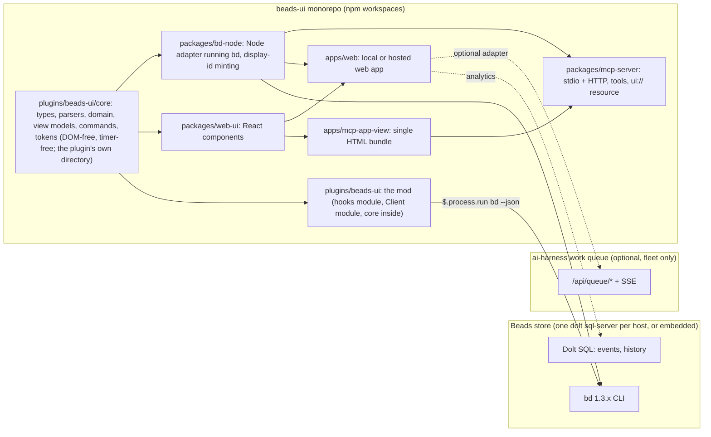
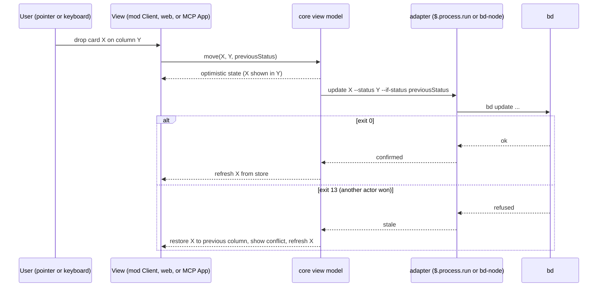

<!-- Full structure: see TEMPLATE.md in this directory -->

# beads-ui: a Beads task manager for the Claude Code TUI, an MCP UI app and a web app from one core

## Founding Ask Coverage

`founding_ask_ref`: {"blob_oid":"d3fde0e715f5a280374c624fede12b4a387b0d14","capture_commit":"d630f95d50bb5948399a91052bf1ce08c6750dcb","content_sha256":"ed0f188c59d248978b9de3439ccbff9100907055296df928f068ef0b05cca4ed","entry_ids":["A001","A002","A003","A004","A005"],"generation":5,"path":"docs/asks/BU-epic-beads-ui-beads-task-manager-mg2.md","previous_ref_sha256":"d7668b63750bbee3253a47d99a0b4106aede21e1952bdce105a15f6a01dde937","repository":"beads-ui","schema_version":1,"task_id":"BU-epic-beads-ui-beads-task-manager-mg2"}

`canonical_root_json`: {"blob_oid":"d3fde0e715f5a280374c624fede12b4a387b0d14","capture_commit":"d630f95d50bb5948399a91052bf1ce08c6750dcb","content_sha256":"ed0f188c59d248978b9de3439ccbff9100907055296df928f068ef0b05cca4ed","entry_ids":["A001","A002","A003","A004","A005"],"generation":5,"path":"docs/asks/BU-epic-beads-ui-beads-task-manager-mg2.md","previous_ref_sha256":"d7668b63750bbee3253a47d99a0b4106aede21e1952bdce105a15f6a01dde937","repository":"beads-ui","schema_version":1,"task_id":"BU-epic-beads-ui-beads-task-manager-mg2"}

`founding_ask_ref_sha256`: 8079161aeffc2726c849086951f4f52781ecd07c9478b294efc80c4164b8ee05

The raw record is `docs/asks/BU-epic-beads-ui-beads-task-manager-mg2.md` in this repository (generation 5, capture commit `d630f95`, kept reachable by the tag `far/BU-epic-beads-ui-beads-task-manager-mg2/g5` because PR #15 was squash-merged). This index is non-authoritative; the raw FAR governs.

| Authoritative raw entry | Coverage and disposition |
|---|---|
| A001 | ORIGINAL-ASK, 2026-10-14T23:39:51Z. The Beads task manager in the Claude Code TUI as a mod with board, sprint, backlog, kanban, roadmap and timeline views, mouse drag, reorder and sort, create, update and delete behind an are-you-sure flow, burndown and productivity analytics, and a view of every Claude Code session's tasks: requirements R-1 to R-10, the Architecture and Mockups, phases 1 to 3 and decisions D-3, D-5, D-6, D-8, D-13, D-16, D-22, D-23. The retirement of the Claude Code task panel per machine profile after a backup: R-15, phase 5, D-12 and D-21. Phases starting with an MVP, decisions through the framework, open questions spiked first: the Implementation Phases, the Design Decisions and the Open Questions. Public, MIT, no secrets, Beads store committable: R-16 and phase 0's hygiene tasks. The doc viewer and web-browser epics named in the same entry are other epics and out of scope. |
| A002 | FOLLOW-UP, 2026-10-14T23:40:00Z. One repo `beads-ui` for the mod, the MCP UI app and the web app sharing components, with mobile and native desktop later: D-1, D-2 and R-11; sharing is narrowed to logic across three surfaces and React components across two, as the research measured. The alias `bv` and the npm name collide with existing tools: D-7 is escalated to Sergei with a recommendation. Mobile and native desktop: the "Later sub-epics" note. |
| A003 | FOLLOW-UP, 2026-10-14T23:40:01Z. "mainly the web app, claude web / desktop mcp UI app, and claude code TUI for now": the three surfaces this design covers, phases 1 to 4 and 6; iOS, macOS and Linux deferred to separate agents, in that order. "lmk what you reocmmend": the Executive Summary and the recommendations inside D-7, D-11 and D-12. |
| A004 | FOLLOW-UP, 2026-10-14T23:40:01Z. Incorporate the autonomous task queue and its dashboard with the queue left where it is: R-14, the Integration table, phase 3's queue adapter and D-11 (escalated, with the recommendation that the web app becomes the queue's unbuilt Phase 2 member app). Where the queue should live is Open Question 1, deferred as the entry asks. |
| A005 | FOLLOW-UP, 2026-10-21T04:55:47Z. Sergei's review: D-7 option (a), D-11 option (a), and D-12 a new option (d), backups per launch repository with bms-semantic-knowledge-graph sessions going to sw-bms-workspace, recorded in those decisions, Feedback Round 1 and the Approval Log. "now /delegate opus 5.5 /orchestrate /auto-flow the rest as appropriate now": the build run in the Run Ledger (`entry->implement`), Phases 0 and 1 under run `beads-ui-build-2026-10-21-aih-ec2-3`. |
| ai-harness `docs/asks/BU-epic-agentic-ai-native-beads-ylx.md` A001 | ORIGINAL-ASK of epic BU-ylx, 2026-10-23T17:12:15Z, recorded in ai-harness. The band's counts by owning session, with a firstmate session's two labelled rows: T-1.8 (BU-mg2.3.12). The `/show-beads-ui` rename: T-1.7 (BU-mg2.3.13). Both in Feedback Round 2 and the Approval Log. The rest of that entry (an MCP-backed Beads plugin, exporting the ai-harness Beads setup, the fork) belongs to epic BU-ylx and is outside this design. |
| ai-harness `docs/asks/BU-epic-agentic-ai-native-beads-ylx.md` A002 | FOLLOW-UP, 2026-10-23T23:37:48Z. Only the firstmate session sees everything, with its own counts on a second line; every other session sees only what it owns: R-19, T-1.8 (unchanged) and T-1B.3, with D-25 explaining why kg-ec2-2's band read 1 in progress against 4 CC tasks (the bd assignee was never set on claim). "you don't need to show the 'as of ...' for every second ... I'm fine with every minute": D-26 and T-1B.5. "if it does add overhead ... ideally ... a single detached daemon (with self-healing and auto-restart etc as appropriate) or whatever makes sense that is shared across all cc sessions": the measurement in D-26's context, the host refresher in D-26 and T-1B.4. The task panel that replaces the CC task panel, with config for both or either and a later cutover, keyboard and mouse navigation, collapsed tasks, select to open details, edit fields, popup option menus and shortcuts for every capability, right and left click, a shortcut that moves the cursor from the prompt into the panel, auto-commit, push and sync of edits with formatted commits, a conflict fallback that tells the session to resolve it, and a root-cause loop for that automation, then kanban, sprint, backlog, timeline, a menu bar or side nav and settings views: R-20 to R-22, Phase 2B and Open Question 10. "if you need to ... /research-doc to see if / how that's possible": Open Question 10 and the research doc it names. |
| ai-harness `docs/asks/BU-epic-agentic-ai-native-beads-ylx.md` A003 | FOLLOW-UP, 2026-10-23. The `/show-beads-ui` name must be the one that loads, so `/beads-task` autocompletes again: T-1.7 built it; T-1B.2 makes it load, because six stale project-scope installs of 0.1.0 and 0.1.1 (four session worktrees and two agent worktrees, measured 2026-10-24T00:23Z) still loaded the build that registers `/beads`. |
| ai-harness `docs/asks/BU-epic-agentic-ai-native-beads-ylx.md` A004 | FOLLOW-UP, 2026-10-23T23:42:51Z. The pane fails with "no beads database found" in a kg-ec2-* session: D-24 and T-1B.1, with a regression test frozen first. Order: the `/show-beads-ui` fix first, then or with the pane bug, then research, design and the rest: the Phase 1B task order. |
| Sergei, 2026-10-23T23:44Z, relayed by aih-ec2-3 (how to enter, use, hide and close the pane; separate skills or shortcuts) | Answered in chat at 23:50Z, then D-27 and T-1B.6: the usage section in `docs/procedures/mod-install.md`, the README and the pane's help. |
| ai-harness ask record A006, 2026-10-24T00:36:40Z, and A007, 2026-10-24T00:39:54Z (a CORRECTION of A006's format) | The band reads `[bd] {N} tasks ({N} in progress, {N} blocked, {N} open, {N} done last 24h)`, in progress and blocked first (A007), with no session name and no store count: D-30 and T-1B.10. The read time only in a dev, test or debug mode: T-1B.5. The done window, and the order and set of the band's parts, set from the config file and from the pane: T-1B.11. "build the rest of our own version of the beads-ui task panel ... to replace the entire cc task panel. i'd prefer that": R-20, R-21 and Phase 2B. "what should we call this component": the band, Claude Code's `AbovePrompt` render site, as the Architecture section says; the side panel is a `Pane`. A002's firstmate second line is kept under the new format (D-30). |
| ai-harness ask record A008, 2026-10-24T01:03:49Z | The firstmate's lines: `[bd][all]` totals over an aligned `[fm]` line with the firstmate's own counts, both in A007's part order: D-34 (superseding D-30's `all repos:` label) and T-1B.10. A001's totals label is met by `[all]`. The sync-drift signal today's line 1 carries is kept as a short marker shown only while a store is out of step, recorded in D-34. |
| ai-harness ask record A005, 2026-10-23T23:51:05Z (on an ai-harness PR not yet merged at this writing) | Tab `3`: D-28 and T-1B.7. "performance and caching or loading fast", "by default actually show useful stuff": D-29 and T-1B.8, fed by D-26's snapshots. Reflow to the terminal and pane size with no overflow and compact labels: T-1B.9 now, and R-24 in Phase 2B. Buttons, dropdowns, side nav and menu bars, icons when space is short, a richer stack (TypeScript, JavaScript, CSS or a framework) if it is fast and light, and "i saw someone load an entire browser": R-24, R-25 and Open Question 10, whose research comes first. |

**Status:** Approved by Sergei on 2026-10-21 (Feedback Round 1); Phases 0 and 1 built under run `beads-ui-build-2026-10-21-aih-ec2-3`; Feedback Rounds 3 to 5 (D-24 to D-34, Phase 1B, Phase 2B) under run `beads-ui-band-pane-panel-2026-10-24-aih-ec2-3`

**Created:** 2026-10-15

**Task:** BU-mg2.2 (display id BU-doc-beads-ui-prd-fnzx), under epic BU-mg2

**Research:** `docs/research/beads-ui-task-manager-landscape.md`

<!-- doc:region name="overview" kind="replaceable" -->

## Table of Contents

- [Executive Summary](#executive-summary)
- [Problem Statement](#problem-statement)
- [Design Overview](#design-overview)
- [Product requirements](#product-requirements)
  - [Users and actors](#users-and-actors)
  - [Requirements](#requirements)
  - [Acceptance criteria](#acceptance-criteria)
- [Architecture](#architecture)
  - [Surfaces, packages and the store](#surfaces-packages-and-the-store)
  - [The Claude Code mod](#the-claude-code-mod)
  - [The web app](#the-web-app)
  - [The MCP App](#the-mcp-app)
  - [Mockups](#mockups)
  - [How a move is written](#how-a-move-is-written)
- [Data Model](#data-model)
  - [Core types](#core-types)
  - [Conventions on Beads](#conventions-on-beads)
  - [Configuration](#configuration)
- [Integration](#integration)
- [Implementation Phases](#implementation-phases)
  - [Phase 0: Monorepo bootstrap and the DOM-free core](#phase-0-monorepo-bootstrap-and-the-dom-free-core)
  - [Phase 1: The MVP, a read-mostly board in the Claude Code mod](#phase-1-the-mvp-a-read-mostly-board-in-the-claude-code-mod)
  - [Phase 1B: Feedback Round 3, the store a session reads, owned counts and a shared refresh](#phase-1b-feedback-round-3-the-store-a-session-reads-owned-counts-and-a-shared-refresh)
  - [Phase 2: Mod enhancements, pointer drag, sprints and sparklines](#phase-2-mod-enhancements-pointer-drag-sprints-and-sparklines)
  - [Phase 2B: The beads-ui task panel, beside and then in place of the CC task panel](#phase-2b-the-beads-ui-task-panel-beside-and-then-in-place-of-the-cc-task-panel)
  - [Phase 3: The web app, locally and as the queue dashboard's board](#phase-3-the-web-app-locally-and-as-the-queue-dashboards-board)
  - [Phase 4: The MCP App in Claude Desktop](#phase-4-the-mcp-app-in-claude-desktop)
  - [Phase 5: Retire the Claude Code task panel, per machine profile (lands in ai-harness)](#phase-5-retire-the-claude-code-task-panel-per-machine-profile-lands-in-ai-harness)
  - [Phase 6: Hosted web app and claude.ai MCP](#phase-6-hosted-web-app-and-claudeai-mcp)
  - [Later sub-epics (out of this doc's build scope)](#later-sub-epics-out-of-this-docs-build-scope)
- [Implementation Audit](#implementation-audit)
- [Risks and Mitigations](#risks-and-mitigations)
- [Open Questions](#open-questions)
- [Run Ledger](#run-ledger)
  - [Authority](#authority)
  - [Transition verdicts](#transition-verdicts)
- [Design Decisions](#design-decisions)
  - [Decision Summary](#decision-summary)
  - [Decision Details](#decision-details)
    - [D-1: Repository shape](#d-1)
    - [D-2: Package boundaries and the shared core's location](#d-2)
    - [D-3: MVP scope](#d-3)
    - [D-4: Beads access route](#d-4)
    - [D-5: Sprint modelling on Beads](#d-5)
    - [D-6: Board order](#d-6)
    - [D-7: The command alias, with the npm scope resolved](#d-7)
    - [D-8: Drag in the mod](#d-8)
    - [D-9: Display-id minting](#d-9)
    - [D-10: Web stack](#d-10)
    - [D-11: Relationship to the work-queue dashboard](#d-11)
    - [D-12: Task-panel backup destination](#d-12)
    - [D-13: Delete and close ladder](#d-13)
    - [D-14: MCP server topology](#d-14)
    - [D-15: Mod packaging and install](#d-15)
    - [D-16: Metrics data source](#d-16)
    - [D-17: Session identity on Beads](#d-17)
    - [D-18: Monorepo tooling](#d-18)
    - [D-19: Theme tokens](#d-19)
    - [D-20: Testing strategy](#d-20)
    - [D-21: Task-panel retirement switch](#d-21)
    - [D-22: WIP limits](#d-22)
    - [D-23: Quick-add grammar](#d-23)
    - [D-24: The store a session reads](#d-24)
    - [D-25: What "owned" means for the band](#d-25)
    - [D-26: How counts and boards are refreshed](#d-26)
    - [D-27: How focus enters and leaves the pane, and how it is shown and hidden](#d-27)
    - [D-28: Tab 3](#d-28)
    - [D-29: First paint and the default view](#d-29)
    - [D-30: The band's format and the firstmate's lines](#d-30)
    - [D-31: How the task panel is drawn](#d-31)
    - [D-32: Where the panel sits and how it lives beside the CC task panel](#d-32)
    - [D-33: How a panel edit is published, and what happens on failure](#d-33)
    - [D-34: The firstmate's two band lines and the sync-drift signal](#d-34)
- [Feedback Rounds](#feedback-rounds)
- [Approval Log](#approval-log)

## Executive Summary

beads-ui is a task manager for Beads issues that runs in three places from one code base: as a Claude Code mod drawn inside the terminal, as an MCP App rendered inside a Claude Desktop or claude.ai conversation, and as a web app run locally or hosted from a template. It gives Sergei the views a Jira-like product offers (board, backlog, sprints, roadmap, analytics) over the fleet's own task store, with mouse and keyboard control, create, edit and delete behind a confirmation, and one view of what every Claude Code session on a machine is working on. The MVP is the terminal mod, read-mostly first, because that is where the sessions already are. The design settles three facts the research established: the mod shares DOM-free logic with the other two surfaces and no React components, so the shared core is a TypeScript package with no DOM, Node or timer dependencies; Beads has no sprint, rank or story-point field, so sprints, board order and flow metrics are conventions this doc defines on Beads labels, metadata and its events table; and the fleet's autonomous work queue already has a board-shaped dashboard, so the web app's relationship to it is a decision put to Sergei before any board is built. Deferred: iOS, Android, macOS, Linux and Windows surfaces (later sub-epics), and the long-term home of the queue service (Sergei's own deferral). Three decisions are escalated to Sergei; every other decision is resolved here for his review.

## Problem Statement

The fleet tracks its work in Beads, but the only ways to see that work are the `bd` CLI, a few read-only mods and the Claude Code task panel, a one-way mirror that shows at most five rows per session and will be retired. Nothing shows a board, a backlog, a sprint or a roadmap over a Beads store; nothing lets Sergei move a card, reorder, or create and close issues from a UI; nothing shows which Claude Code session holds which task across a machine; and the flow metrics Beads already records in its events table are not drawn anywhere. Sergei asked for a Jira-like task manager on Beads, inside the Claude Code TUI first, and for the same product as an MCP UI app and a web app so the views follow him into Claude conversations and onto a phone, as one public, MIT-licensed monorepo.

## Design Overview

**Status:** filled for Phases 0 and 1 as built. The sections after this one describe the design as decided; this section describes what exists.

### Phase 0 as built

The repository is an npm-workspaces monorepo (`plugins/*`, `packages/*`) with Turborepo running `lint`, `typecheck` and `test`, Biome for lint and format, Vitest for the Node-side suites and TypeScript in strict mode. The root `tsconfig.base.json` maps `@beads-ui/core` to `plugins/beads-ui/core/src`, so a later DOM package imports the core by alias and never by path. All tooling is a root dev dependency; `plugins/beads-ui/package.json` has no `dependencies` key.

The shared core lives at `plugins/beads-ui/core/src`. `model.ts` holds the Data Model's types as written above. `parsers.ts` turns `bd list --json`, `bd show --json` and `bd statuses --json` into those types and returns a typed parse error naming the JSON path instead of throwing, so a surface can keep its last good state when `bd` returns something unexpected. The human owner comes from `metadata.owner` (D-17), not from Beads' own `owner` field, which names the repository owner. The core compiles under its own `tsconfig.json` with `"lib": ["es2023"]` and `"types": []`.

The purity rule is enforced twice. `scripts/check-core-purity.mjs`, run by `npm run lint`, lexes every source file under `core/` outside `core/test/`, blanks comments and string contents, and fails naming `file:line` for any timer, DOM or Node global (including `console`, `globalThis` and `self`), for code generation (`eval`, `Function`), for an import that leaves the core, and for a dynamic `import()` of anything but a string literal, matching the mod runtime, which refuses code generation; the type check under `"types": []` catches what a lexer cannot. `core/test/purity.test.ts` proves the gate fails on a fixture of banned references and passes on the real core. The rule binds `core/src`, not the Vitest suites in `core/test/`, which need Node to run; that scope is recorded as a wording repair on T-0.1.

`packages/bd-node` is the Node adapter the web app and MCP server will use. `createBdClient({ cwd })` runs `bd` with `execFile` (an argument list, never a shell) in the store's repo root, with a 10-second default timeout and a 64 MiB output bound, and returns a discriminated result (`ok`, `stale`, `notFound`, `timeout`, `failed`) instead of throwing. It offers `list`, `show`, `statuses`, `ready`, a guarded `update` that returns `stale` on exit 13 and never retries, `create` and `close`, all through the core's argv builders and parsers. A missing binary reports that `bd` is not on PATH and names the Beads install page, and a missing directory is told apart from it. Every write asks `bd` for `--json`, and a timeout that is not a positive number of milliseconds is refused as a typed failure. Its tests read this repository's own store, compare every Issue field against the raw record, and use a stub `bd` for every failure path, so `npm test` needs `bd` on PATH.

The mod is a plugin at `plugins/beads-ui`: `.claude-plugin/plugin.json`, `hooks/hooks.json` naming `./register.ts`, and a hooks module that registered `/beads` (renamed `/show-beads-ui` in Feedback Round 2) and drew a hello pane from a core value, plus a `client/` module drawn as a `Client` region. Every `$` call sits in `register.ts`; a helper in another file receives plain closures, never `$`, the pattern the `diff` mod in Claude Code's public mods folder uses. The root `.claude-plugin/marketplace.json` lists `./plugins/beads-ui`. Three pre-commit gates guard the plugin: `scripts/check-plugin-allowlist.mjs` compares what `claude plugin validate --strict --json` reports (hooks, calls, environment reads and writes, surface modules, gating hooks) with the committed `plugins/beads-ui/validate-allowlist.json` and also refuses, outside the declared hooks module, any `$.` call and any import of the engine's types from `claude-code`, and inside it any bare `$` passed as a call argument, because validate does not say which file a call sits in (an `any`-typed parameter is the one hand-off a static scan cannot see); `scripts/check-marketplace.mjs` runs `claude plugin validate .`; and `scripts/check-plugin-size.mjs` fails naming any file git tracks or stages under `plugins/beads-ui` that is over 1 MB, with no directory exempt. `npm test` runs Vitest and then `claude plugin test`, and the import probe in `hooks/imports.test.ts` fails naming the refused import. Claude Code's command spec has no alias field, so a short `/bu` is a second command.

The core's tests follow D-2's rule that they pass under both runners. A pure core suite is a `*.test.ts` written against `claude-code/testing`; `plugins/beads-ui/vitest.config.ts` maps that import to `vitest`, so both runners execute the same file. The mod environment loads only code files, so each fixture such a suite reads is a `fixtures/<name>.json.ts` module kept byte-equal to its `.json` by a check. A suite that needs Node, such as the purity suite, is a Vitest-only `*.spec.ts`, and the mod's own hooks tests are kit-only. The hooks module is not type-checked by `tsc`: Claude Code writes its mod types only through the interactive `/plugin-types` command, into the gitignored `.claude-plugin/types/`, so the gate cannot rely on them; `claude plugin test` and `validate` are the hooks module's checks.

The repository's public hygiene is a pinned gitleaks pre-commit hook, with a test that stages a fabricated AWS key in a throwaway repository and asserts gitleaks refuses it (the test fails, naming the binary, when gitleaks is not installed), a test that the README names the core's five layers, `CONTRIBUTING.md`, `SECURITY.md` and `CODE_OF_CONDUCT.md`, and pre-commit hooks that run `npm run lint` and `npm test` on every commit. Parser fixtures are real `bd` output from this repository's own Beads store.

### Phase 1 as built

The Phase 1 core sits beside the Phase 0 core in `plugins/beads-ui/core/src`, every module pure and runner-neutral. `argv.ts` builds every `bd` call as an argument list, puts free text in `--flag=value` form and refuses an id or status that starts with `-`; `parsers.ts` adds `bd ready`, `bd history --events`, `bd create` and the delete previews. `columns.ts` builds one column per status in category order with counts and soft WIP flags, and swimlanes by none, assignee (with an unassigned lane) or epic. `sort.ts` sorts stably, priority then created by default, with blanks last. `filter.ts` parses `type:`, `label:`, `assignee:`, `sprint:` and `ready:` terms and, on an unknown key, keeps the previous filter and reports the accepted keys. `quickadd.ts` parses the D-23 grammar into `bd create` flags. `mint.ts` ports bd-new's slug rule (stopwords, lead verbs, the digit-bearing lead, the 32- and 20-character budgets) and mints under `id_policy` `auto` or `fleet-slug` the id bd-new would give the issue (see the T-1.4 wording repair). `commands.ts` lists every MVP action with its key (`m` is Move to on the focused card), and `tokens.ts` holds the semantic tokens with their terminal theme map. The view models in `views/` are reducers and pure views: the Board applies a move optimistically and restores the card on exit 13 with a conflict and a refresh, and keeps the last good board on a failed load; the Backlog lists issues in the `active` category, a page at a time; the Detail builds one guarded `bd update` per edited field and re-reads the issue; the delete confirmation is a state machine from the dry-run preview through a typed display id for a cascade, with Close instead reachable before any write and never running `bd delete`.

The mod's hooks module draws those models. `hooks/register.ts` holds every `$` call and hands `pane.ts`, `confirm.ts` and `bands.ts` a `Host` of plain closures. It registers `/show-beads-ui` (named `/beads` until Feedback Round 2) and, because Claude Code's command spec has no alias field, `/bu` as a second command (D-7 (a)); both toggle one Pane, and `/beads` is no longer registered. The pane has three tabs, `1` Board, `2` Backlog and `4` Detail, with `3` kept for the Phase 2 Sprint tab. It reads `bd statuses`, `bd ready` and, for the open Detail, `bd show` and `bd history --events` through `$.process.run`, and `bd list` through `$.process.spawn`, in the session's directory, on open, after each write and every 10 seconds while open. It reads `beads-ui.toml` at call time from the repository root, then the user's config directory, falling back to the design's defaults, and keeps view preferences in `$.store`. Every card carries a Move to `Select`. A move shows at once, is written with `--if-status`, and on exit 13 the card goes back with a conflict line and a refresh. The board pages instead of cutting, so every card stays reachable with its Move to under the mods API's 100,000-character tree limit. The core's `BOARD_PAGE_LIMIT` estimates a drawing's size per card, pager, column header and lane, pricing each card by the status names its Move to lists. It groups the swimlanes into lane pages, splits a lane too wide for the budget into column windows (`l` steps both), and gives each cell a page of up to 25 cards with a back control, the range drawn and a `+N more` control, both wrapping; `p` and `b` step the focused card's column. A card's Move to always lists every other status, whichever window is drawn. Tests walk a 600-card store, in one lane, over 200 assignees and over 30 custom statuses of 40 characters, and reach all 600 Move to controls with every page under 100,000 characters. A new filter, swimlane or sort goes back to the first page. The Backlog pages the same way: 60 rows a page, with back and `+N more` controls, `p` and `b`, and a count line that counts every row the filter kept. Quick-add writes `bd create` and then, under `id_policy` `auto` or `fleet-slug`, the display id bd-new would mint: the hash primary's suffix for a top-level issue, four letters for a child. The slug budgets honour bd-new's `AIH_SLUG_BODY_MAX_CHARS` and `AIH_SLUG_BODY_MAX_CHARS_CHILD` overrides, which `register.ts` reads through `$.env.get` and the core takes as arguments. If the display-id write fails after a create, the issue and its minted id stay pending in `$.store` and the same write is retried after every successful refresh, across sessions, until it lands. Each retry re-reads that one issue with `bd show` just before writing, and drops the entry without writing if the issue now carries any display id or `id:` label. bd 1.3.1 has no compare-and-set on metadata, so a write landing between that read and the update is the one race left. A warning line stays up until the write lands, and a second id is never minted. Delete opens a separate focused pane, with `holdToasts`, showing the dry-run text and Close instead. It re-runs the preview just before a forced delete, and a cascade needs the display id typed first. After any close, `u` undoes it through the same guarded write. The band above the prompt shows open, in-progress and blocked counts of the issues the session owns, as T-1.8 below describes. Under 110 columns an automatic reopen is withdrawn with a toast naming the width. The Detail tab shows the description as Markdown and edits it in a one-line Input. A line break shows as `\n`, a tab as `\t`, a carriage return as `\r` and a backslash as `\\`, and the escapes are read back on submit, so an unchanged description writes nothing and round-trips byte for byte. A description whose one-line form is over 20,000 characters shows the `bd update` command instead of a control, because an Input carries its whole value in the tree; the longest in this store is 1,847. Detail labels draw beside their controls, so a narrow pane cannot split one. The delete re-check compares every field of the cascade preview, events and labels included. `docs/procedures/mod-install.md` covers loading the mod from a checkout and from the marketplace, its keys, the quick-add grammar and the configuration. A first live run in a 120-column tmux session found three bugs that the kit cannot see, all fixed: the confirmation opening behind the board, a tab switch dropping the keyboard to the prompt, and layouts overflowing a 48-column dock.

The board read streams because `$.process.run` keeps only the first 4,194,304 bytes of a child's standard output and sets `isStdoutTruncated` on the rest (Claude Code 2.1.309's `ProcessRunResult` declaration). On the ai-harness store on 2026-10-23, `bd list --json --all --brief --limit 0` wrote 7,141,443 bytes for 6964 issues, so the mod parsed a cut array and the board stayed at "loading…" with a JSON parse error at `$`. Three fixes were weighed. Paging the bd read was ruled out: bd 1.3.1 supports `--offset` only under `--proxied-server`, and splitting by status still leaves the closed issues alone above 4 MiB. Narrowing fields was ruled out too, because `--brief` already drops the free text and bd has no field selector. Streaming was chosen: `$.process.spawn` delivers the whole output, waiting on the reader past 1 MiB unread instead of dropping it. `hooks/stream.ts` reads the stream to its end under the same 8-second deadline the other reads have, through `$.clock.after`, and ending the loop kills the child. The paging rule is unchanged: a test loads a 6964-issue store of about 7 MB and reaches all 6964 Move to controls with every drawing under 100,000 characters. A read that does not finish shows `bd list did not finish:` and why (timed out, stopped by a signal, could not start). A read that finishes with output the mod cannot parse shows `bd list gave output beads-ui cannot read:` and the parse error. Any other `$.process.run` read cut at 4 MiB fails, naming the cut.

### Releases and versioning as built

An installed copy of the mod updates only when `version` in `plugins/beads-ui/.claude-plugin/plugin.json` rises: `claude plugin update` and marketplace auto-update both compare it, and installed nothing for the large-store fix until 0.1.1 raised it. Sergei, 2026-10-23: "you need to know to always do this, and if we can automate it for bug fixes (patches) and new features (minor upates) then that'd be ideal. i'll always manually say when to do major semver update." So the version is enforced, not remembered. `plugin-release.json` at the root names each plugin's manifest, its shipped paths (everything under `plugins/beads-ui/` but tests, fixtures and the Vitest config) and the major-approval trailer. `scripts/plugin-version.mjs` reads the branch's commits since `origin/main` that change a shipped file, so a `feat` to repository tooling never raises the mod (and a squash title when given): any `feat` requires a minor bump, anything else a patch, and a `type!:` subject or `BREAKING CHANGE:` footer a major, which it refuses unless a commit carries `Semver-major-approved-by: Sergei`. A hand-made major bump without that trailer is refused too. The pre-push hook `plugin-version` runs it against the pushed branch and, when the version falls short, commits the required one as `chore(release): beads-ui <version>` and fails the push once. ai-harness's `ghp pr merge` reads the same policy from the PR's base and refuses a merge whose head version does not beat the base's at merge time, which closes the race between two PRs that each raised the same version. `scripts/plugin-version.test.mjs` drives the CLI in throwaway repositories, one case per rule. Procedure: `docs/procedures/releasing.md`.

## Product requirements

### Users and actors

Three actors use beads-ui. Sergei, the fleet owner, works in Claude Code sessions in tmux over AWS SSM on employer hosts and in Ghostty or kitty on personal machines, in Claude Desktop and claude.ai, and on a phone over a tailnet. A Claude Code session is an actor in its own right: it claims and closes Beads issues through `bd`, and the UI must show its work and never block its writes. An outside user of the public repository has a Beads store, no fleet tooling, and expects `npx`-style installation and a working board without the fleet's queue, display-id convention or app-portal shell.

### Requirements

Each row derives from the founding ask (entries A001 to A004 in `docs/asks/BU-epic-beads-ui-beads-task-manager-mg2.md`) and the research doc (`docs/research/beads-ui-task-manager-landscape.md`). The phase column names where the requirement first ships.

| # | Requirement | Source | First phase |
|---|---|---|---|
| R-1 | A kanban board over a Beads store, one column per status read from `bd statuses`, grouped by status category, with assignee swimlanes | A001; research 1.1 | 1 (mod), 3 (web), 4 (MCP) |
| R-2 | A backlog view sorted by priority then age, with filters by type, label, assignee, sprint and readiness | A001; research 1.1, 6.4 | 1 |
| R-3 | Sprint views: membership, current sprint board, sprint list with dates, carry-over of unfinished work | A001; research 1.1, 6.1 | 2 |
| R-4 | A roadmap or timeline view placing epics and milestones by date, with dependency lines | A001; research 1.1 | 3 |
| R-5 | Move a card between columns (status change) and across views (backlog to sprint) by keyboard and by mouse drag, with an optimistic update that rolls back on a stale write | A001; research 1.2, 3.2 | 1 (keyboard), 2 (drag) |
| R-6 | Reorder within a column by manual rank when enabled; sort by priority, created, updated, due or assignee | A001; research 1.2 | 1 (sort), 3 (rank) |
| R-7 | Create an issue from a one-line quick-add grammar; edit title, description, status, priority, type, labels, assignee, due date and estimate inline | A001; research 1.3 | 1 |
| R-8 | Delete behind an are-you-sure flow that shows `bd delete`'s own preview, offers close as the reversible alternative, and requires a typed id for a cascade | A001; research 1.3 | 1 |
| R-9 | Analytics: throughput, cycle time, cumulative flow, aging work in progress, a count-based sprint burndown, cost per closed issue where session cost data exists | A001; research 1.4 | 2 (mod sparklines), 3 (web charts) |
| R-10 | A cross-session view: every session's assigned, in-progress and done issues, with claim age against the lease, sourced from Beads assignees and, when configured, the queue's session registry | A001, A004; research 1.5, 6.2 | 1 (assignee swimlanes), 3 (registry) |
| R-11 | The three surfaces share one core; React components are shared by the web app and the MCP App | A002; research 5 | 0 |
| R-12 | The web app runs locally with one command and is hostable from infra-as-config templates with quick starts | A002; research 2.3 | 3, 6 |
| R-13 | The MCP App renders in Claude Desktop from a local stdio server and in claude.ai from a reachable server | A003; research 4 | 4, 6 |
| R-14 | The autonomous work queue and its dashboard are integrated, with the queue left where it is | A004; research 6.2 | 3 |
| R-15 | The Claude Code task panel is retired per machine profile by a config setting in ai-harness, after a backup of every panel's data | A001; research 6.3 | 5 |
| R-16 | Public and MIT: no secrets, credentials or private data in the repo; the Beads store and its ids may be committed | A001 | 0 |
| R-17 | Every write respects the Beads display-id convention when the store uses it, and never moves a published id | research 6.1 | 1 |
| R-18 | Each session's pane and band read the store its work lives in, which can differ from the directory it runs in, and a session with no resolvable store gets an explanatory empty state | ylx A004 | 1B |
| R-19 | A non-firstmate session's band counts only the issues it owns, across every store; the firstmate's band adds the host pair's totals on a first line; the counts agree with what the session owns in its task panel; one refresh about a minute with the least machine overhead, shared across the host's sessions | ylx A001, A002 | 1 (counts), 1B (ownership, shared refresh) |
| R-20 | A beads-ui task panel in the CC task panel's place: a configurable number of shown and collapsed tasks, set in a config file and from the panel; navigation up and down through every task, collapsed ones included; select to open details; edit fields; every capability reachable from both a popup option menu and a shortcut, by keyboard and by mouse with left and right click; a shortcut that moves focus from the prompt into the panel and back | ylx A002 | 2B |
| R-21 | Config flags let the beads-ui panel and the CC task panel co-exist, or run either alone, until a full cutover (R-15 is the cutover's last step) | ylx A002 | 2B, 5 |
| R-22 | An edit made in the panel is committed, pushed and synced on its own with a formatted commit; a conflict falls back to an alert, hook or context injection that tells the session to resolve it; failures in that automation get a root-cause and fix loop run by a delegate or, with no free slot, the driving session | ylx A002 | 2B |
| R-23 | The pane opens fast and shows useful content by default, from a cache, never a bare "loading" line | ylx A005 | 1B |
| R-24 | The pane and panel reflow to the terminal's and the pane's size with no text overflow; labels shorten, and become icons or glyphs, when space is short; controls look like buttons, dropdowns, a side nav and menu bars; later views (kanban, sprint, backlog, timeline, settings) sit behind a nav bar | ylx A002, A005 | 1B (reflow), 2B |
| R-25 | A richer rendering stack (TypeScript, JavaScript, CSS or a framework) is allowed where it is fast, light and low-latency | ylx A005 | 2B |

### Acceptance criteria

The phase sections carry the per-task EARS criteria. The product-level criteria that hold across every phase:

- When a surface renders a board, the system shall build its columns from the store's `bd statuses` output and shall decide "done" by the `done` category, never by column position.
- When a user moves a card, the system shall write the new status with `bd update --if-status <previous>` (or the equivalent guarded API call), and if the write exits 13 then the system shall restore the card and refresh it from the store.
- When a user deletes an issue, the system shall show `bd delete --dry-run` output for that issue before any `--force` or `--cascade` write, and if the issue has dependents outside the selection then the system shall require a typed confirmation of the issue id.
- When beads-ui creates an issue in a store whose existing issues carry `metadata.display_id`, the system shall mint a display id of the same shape and write both the metadata field and the `id:<display_id>` label.
- If a store has no queue service configured, then every surface shall still render boards, backlog, detail and analytics from `bd` alone.
- While a surface runs inside the Claude Code mod, the system shall offer a keyboard path for every pointer action.

## Architecture

### Surfaces, packages and the store



The diagram follows the layer table and package proposal in the research doc (section 5.5), amended by decisions D-2 and D-18 after the doc-editor sibling repo's evidence on how Claude Code installs plugins. The core is the one module every surface imports. It holds the issue and status types, the `bd --json` parsers and argument builders, the domain rules (column grouping by status category, sort, filter, sprint membership, rank, flow metrics, dependency graph), the view models (board, backlog, sprint, roadmap, detail, analytics) as pure reducers and selectors, the command catalog (every user action as data with a stable id, label and default keys), and the semantic design tokens. It has no runtime dependency, no DOM, Node or timer reference, and compiles under the tsconfig the Claude Code mods type file suggests. Through phase 2 its source lives inside the plugin directory, `plugins/beads-ui/core/`, because an installed plugin is a copy that cannot reach files above its root and the fleet's mods design wants no build step; the web and MCP packages import it through the TypeScript path alias `@beads-ui/core`. At phase 3, when the web app and the MCP server land, D-2 records the re-evaluation of a `packages/core` move with a copy build. `packages/bd-node` is the Node adapter that spawns `bd` for the web server and the MCP server and owns display-id minting. `packages/web-ui` is the React component set shared by the web app and the MCP App view. `plugins/beads-ui` is the mod: a hooks module, the phase 2 `Client` module, and the core, with no `package.json` runtime dependencies, listed by a root `.claude-plugin/marketplace.json`. `packages/mcp-server` serves the `ui://` resource and the Beads tools over stdio and HTTP. `apps/web` is the local or hosted web app; it also exposes the HTTP MCP endpoint in the hosted configuration. The repo uses npm workspaces (D-18) so that any package that ever ships inside a plugin with dependencies has a lockfile Claude Code's plugin install reads.

### The Claude Code mod

The mod registers one `/show-beads-ui` command (D-7 and Feedback Round 2 settle the name) that opens a pane, plus bands above the prompt for counts and the issue in progress, following the read-only Beads mods already in the ecosystem. The pane holds four tabs: Board, Backlog, Sprint and Detail, switched by digit hotkeys; a fifth, Charts, arrives in phase 2. Each tab is a `Box` tree built by core's view models and drawn with `Text`, `Button`, `Input`, `Select` and `Markdown`. Status moves use a "Move to" `Select` on the focused card; creation uses a quick-add `Input`; deletes open a confirmation pane with `holdToasts` that shows `bd delete --dry-run` output. Phase 2 adds a `Client` region for the Board tab that draws the columns and cards, captures pointer drag and posts "move card X to column Y" messages to the hooks module, which performs the guarded `bd update`; the keyboard path stays. Data access is `bd ... --json` through `$.process.run`, once per refresh, with a refresh on `/show-beads-ui` commands, after a write, and on a `$.clock.every` timer of 10 seconds while the pane is open. View preferences (open tab, filters, column widths) persist in `$.store`; data never does.

### The web app

A Vite and React 19 single-page app served by a Node server in the same package. The server runs `bd` through `packages/bd-node`, exposes a small JSON API that mirrors core's view models, and pushes updates over Server-Sent Events by polling `bd` on a configurable interval. Views: Board, Backlog, Sprints, Roadmap, Analytics, Sessions and Issue detail, with a command palette and saved views. When a queue service is configured, the Sessions and Board views also read `/api/queue/sessions`, `/api/queue/tasks` and the queue's SSE stream; without one they read `bd` alone. The local run path is one command (`npx @<scope>/beads-ui` or `npm run dev`); the hosted path is Docker Compose with a volume for the checkout and Dolt state, behind Tailscale Serve or an OAuth proxy.

### The MCP App

The same React components as the web app, bundled into a single HTML resource served as `ui://beads-ui/board` by `packages/mcp-server`, requesting the `fullscreen` display mode and using Claude's style variables for colour, type and radius. The server exposes read tools for the model (`beads_list`, `beads_show`, `beads_ready`) and write tools (`beads_update_status`, `beads_create`, `beads_close`) that the app calls through `tools/call`; writes that the model may also call are confirmed in the app. Claude Desktop runs the server over stdio from `claude_desktop_config.json`; claude.ai reaches the hosted web app's HTTP MCP endpoint in phase 6.

### Mockups

Mockups are described as layout tables, because the design doc renders on GitHub and the mod has no pixel surface to screenshot before it exists. Each row is a region of the view and what it contains.

Board tab in the mod pane (120 columns by 30 rows, fullscreen rendering):

| Region | Content |
|---|---|
| Header row | Tab buttons `1 Board`, `2 Backlog`, `3 Sprint`, `4 Detail`; the store name and a freshness stamp (`as of 01:12:04`) |
| Filter row | `Input` for a filter expression (`type:task label:ui assignee:aih-3`), a `Select` for sprint, a `Select` for swimlane (none, assignee, epic) |
| Columns | One `Box` per status category group in order `active`, `wip`, `frozen`, `done`, each headed by status name and count, each a vertical list of cards; a count over a configured soft limit turns the header's colour key to `warning` |
| Card | Display id in `dimColor`, title truncated to the column width, priority badge `P1`, assignee, a `Select` labelled `Move to` with the other statuses, a `Button` `d` for detail |
| Footer | Hotkey hints: `n` new, `s` swimlane, `/` filter (an `Input`, since `/` is not a valid hotkey), `?` help (a `Button` with hotkey `h`) |

Detail tab: a two-column `Box` with the issue's fields (title, status, priority, type, assignee, labels, sprint, due, estimate, created, updated, started, closed) on the left as editable `Input` and `Select` controls, and the description, acceptance criteria and notes rendered with `Markdown` on the right; below, dependencies as a list of display ids with their status, and the last ten events from `bd history --events`.

Delete confirmation pane (opened with `holdToasts: true`, `focus: true`, `closeOnEscape: true`): the `bd delete --dry-run` output rendered with `Code`; a line naming the dependents that would be orphaned or cascaded; a `Button` `Close instead` (hotkey `c`) that runs `bd close`; a `Button` `Delete` (hotkey `x`); for a cascade, an `Input` whose `onSubmit` must equal the display id before `Delete` is enabled.

Web Board view: a left rail of saved views and sprints; a top bar with the command palette trigger, filter chips and a swimlane selector; the board as columns with drag handles on cards (Pragmatic drag and drop) and a "Move to" menu on each card for keyboard and touch; a right drawer for the selected issue's detail; an "as of" freshness stamp and a conflict toast when a guarded write is refused.

MCP App full-screen view: the web Board with menus replaced by segmented controls and the detail drawer replaced by a collapsible right panel, in Claude's style variables; an inline-card mode showing one issue (title, status, priority, assignee) with two actions, `Move to` and `Open board`.

### How a move is written



## Data Model

### Core types

```typescript
// plugins/beads-ui/core/src/model.ts (shape, not final code)
type StatusCategory = "active" | "wip" | "frozen" | "done";
interface Status { name: string; category: StatusCategory; builtin: boolean }
interface Issue {
  id: string;                // bd hash primary, hierarchical, e.g. "BU-mg2.1.3"
  displayId?: string;        // metadata.display_id when the store uses the convention
  title: string; description?: string; design?: string; acceptanceCriteria?: string; notes?: string;
  status: string; priority: 0 | 1 | 2 | 3 | 4; type: string;
  assignee?: string; owner?: string; labels: string[];
  parent?: string; dependencies: { type: string; id: string }[];
  estimatedMinutes?: number; dueAt?: string; deferUntil?: string;
  createdAt: string; updatedAt: string; startedAt?: string; closedAt?: string;
  leaseExpiresAt?: string; heartbeatAt?: string;
  metadata: Record<string, unknown>;
}
interface Sprint { name: string; milestoneId?: string; startsAt?: string; dueAt?: string }
interface Session { id: string; machine: string; name: string; state: "idle" | "busy" | "compacting" | "gone"; currentTask?: string; lastHeartbeatAt?: string }
```

### Conventions on Beads

| Concept | Representation | Rule |
|---|---|---|
| Board column | A Beads status; columns ordered by category `active`, `wip`, `frozen`, `done`, then by `bd statuses` order | Read from the store, never hard-coded (D-3) |
| Sprint membership | Label `sprint:<name>` | One active sprint label per issue; filterable with `bd list --label` (D-5) |
| Sprint dates | A `milestone` issue titled `Sprint <name>` with `due_at` and, in metadata, `sprint.starts_at` | Members link to it with `tracks`; `parent-child` stays for epics (D-5) |
| Manual rank | `metadata.rank`, a fractional-index string | Off by default; written only when a view enables rank ordering (D-6). Written as a quoted string, because `bd update --set-metadata rank=0.5` types the value from its spelling and would store a number; `bd update --metadata` merges top-level keys, and the only reserved metadata prefixes are `bd:` and `_` (spike 1) |
| Human owner of a session's task | `metadata.owner` | `assignee` names the session; `owner` names the person (D-17) |
| Display id | `metadata.display_id` plus label `id:<display_id>` | Minted on create when the store uses the convention; never changed after publication (D-9) |
| Estimate | `estimated_minutes` | Native field; shown in minutes or hours |
| Flow metrics | `events` audit table (`bd history --events`) and Dolt history | Journal and HTTP stream only for live updates (D-16) |

### Configuration

A `beads-ui.toml` (read at call time, never an environment snapshot) in the user's config directory, with per-store overrides in the repo:

```toml
[stores.default]
path = "/data/projects/beads-ui"          # a repo with a .beads/ store
id_policy = "auto"                         # auto | fleet-slug | off
refresh_seconds = 10

[queue]
url = ""                                   # empty: no queue adapter; else http://127.0.0.1:8400
events = true

[views]
rank = false                                # manual rank off until enabled
soft_wip_limit = { in_progress = 5 }

[theme]
preset = "claude"                          # claude | plain | custom
```

The ai-harness switch for the task panel (phase 5) is a per-machine-profile key in ai-harness's machine configuration, declared where the renderer composes `env` and `permissions.deny`; the exact file and key come from the second design spike and are recorded in D-21.

## Integration

| System | How beads-ui integrates | Constraint it inherits |
|---|---|---|
| Beads (`bd` 1.3.x) | `bd ... --json` for reads and writes in every surface; `--if-status` and `--if-assignee` on status and assignee writes; `bd history --events` for metrics; `bd delete --dry-run` for previews | No sprint, rank or story-point field; hash ids only; one shared `dolt sql-server` per host on the fleet, embedded single-writer elsewhere |
| Fleet display-id convention | `id_policy = auto` detects `metadata.display_id` on existing issues and mints the same shape through core | A published id is immutable; the convention is a fleet rule, off for stores that do not use it |
| ai-harness work queue | Optional adapter: `/api/queue/tasks`, `/sessions`, `/review`, `/inbox`, `/events` (SSE) for the fleet-wide board, sessions and review views; status writes through the queue when a task is leased | Loopback-only, no auth, fleet-only; its session registry is the only source of session liveness; D-11 decides the dashboard relationship |
| app-portal | When D-11 resolves to the member-app option, `apps.yaml` entry `{id: beads-ui, path: /beads, kind: portal}`, `serve-sync`, the shell's PWA | The shell owns the root PWA and service worker |
| ai-harness install | The mod installs from the beads-ui marketplace through `install.sh` on fleet machines; the task-panel switch and backup ship in ai-harness (phase 5) | Install contract: plan, apply, doctor; one plugin per mod; `claude plugin validate --json` allow-list |
| Claude Code mods API | `ui.render` on `Pane` and `AbovePrompt`; `$.process.run`, `$.process.spawn` for `bd list`, `$.store`, `$.state`, `$.clock.every`, `$.clock.after`, `$.ui.open` with `holdToasts`; `Client` for drag in phase 2 | Floor 2.1.299 (multi-file `$` passing); 10 s per hook; 4 MiB per file; 4 MiB of each pipe from `$.process.run`; 100,000 characters per tree; 10 redraws a second |
| MCP Apps | `@modelcontextprotocol/ext-apps` SDK, `registerAppTool` and `registerAppResource`, `ui://` resource, `fullscreen` mode, Claude style variables, CSP declared | Desktop: local stdio; claude.ai: internet-reachable server with auth; Claude Code is not a host |
| Docs in this repo | `docs/research/beads-ui-task-manager-landscape.md`, the three research packets and the two design-spike packets under `docs/research/findings/` are this design's evidence; `README.md`'s planned-layout wording was corrected on main in PR #7 | None |

## Implementation Phases

Each phase carries its scope, deliverables, tasks with EARS acceptance criteria and a runnable exit gate. Nothing in this doc is built; the first build starts after Sergei's review. Test commands name the repo's declared gate (`npm test`, which runs Vitest; `claude plugin test` for the mod; `npm run lint` for Biome) once phase 0 declares them.

<!-- doc:ac-rules:mirror:begin -->
- Every AC is independently testable — a test can fail if only this AC is violated.
- Every AC is falsifiable — "works correctly" is not an AC.
- Use EARS as the default for textual behavioral ACs: `When <trigger>, the system shall <response>` (event-driven); `While <state>` / `Where <feature>` (state-driven / optional); `If <condition>, then the system shall <response>` (unwanted-behavior / failure path). When a decision table, state machine, formula, executable Gherkin, property, or contract expresses the behavior more clearly, wrap it in an `<!-- ac-format: <value> ... --> ... <!-- /ac-format -->` scope (`decision-table` / `state-machine` / `formula` / `gherkin` / `property` / `contract`; unmarked ACs default to `ears`). Full per-format `ac-format` schemas are normative at `task-authoring-standards.md` § Per-Format AC Schemas — **always check that live source directly for the current schemas before relying on this reminder; this mirrored block itself can drift out of date and must never be treated as authoritative on its own.**
- At least one failure-path AC per public function changed — EARS `If <condition>, then the system shall …`, or the marked format's own negative-path convention (a decision table's infeasible-combination row, a state machine's invalid-transition row, a formula's invalid-input row).
- Replacement/refactor tasks: inventory the existing behaviors, then a parity AC for each (preserved, or intentionally dropped + reason).
<!-- doc:ac-rules:mirror:end -->

### Phase 0: Monorepo bootstrap and the DOM-free core

- **Scope:** the repository skeleton, the shared core inside the plugin with its purity rules enforced, the mod with a hello pane, the CI gates. No user-facing feature.
- **Deliverables:**
  - Files created: root `package.json` with `workspaces`, `package-lock.json`, `turbo.json`, `biome.json`, `tsconfig.base.json` (path alias `@beads-ui/core` to `plugins/beads-ui/core/src`), `plugins/beads-ui/` (`.claude-plugin/plugin.json`, `hooks/hooks.json`, `hooks/register.ts`, `core/`), `packages/bd-node/`, `.claude-plugin/marketplace.json` listing `./plugins/beads-ui`, `CONTRIBUTING.md`, `SECURITY.md`, `CODE_OF_CONDUCT.md`. `.github/` is out of scope (CI is the local pre-commit and pre-push gates per the fleet's retired-Actions rule).
  - Files modified: `README.md`, `.gitignore` (ignore `.claude-plugin/types/` and a generated `tsconfig.json` inside the plugin), `.pre-commit-config.yaml` (add `npm run lint`, `npm test`, `claude plugin validate --json` allow-list diff).
  - Tests added: `plugins/beads-ui/core/test/purity.spec.ts`, `plugins/beads-ui/core/test/parsers.test.ts`, `packages/bd-node/test/bd-adapter.test.ts`, `plugins/beads-ui/hooks/*.test.ts`.
    - File-name repair (Authority test Gate C, Opus build coordinator, 2026-10-21, from the T-0.3 build). Before: `core/test/purity.test.ts`. `claude plugin test` runs every `*.test.ts` under the plugin in the mod environment, which refuses `vitest`, Node built-ins and JSON imports. Ratified intent: D-2's rule that the core's tests pass under both runners. So a pure core suite is a `*.test.ts` written against `claude-code/testing`, which Vitest also runs through an alias in `plugins/beads-ui/vitest.config.ts`, with its fixtures as `fixtures/*.json.ts` modules; a suite that needs Node, such as the purity suite that spawns the gate, is a Vitest-only `*.spec.ts`. Not changed: the suites, their place under `core/test/`, and `*.test.ts` for the mod's own tests.
- **Tasks + acceptance criteria:**
  - **T-0.1 Core module and purity gate**
    - [x] `When plugins/beads-ui/core is built, the system shall compile under a tsconfig with "lib": ["es2023"] and "types": [] and shall emit no error.`
    - [x] `If any source file in plugins/beads-ui/core/src references setTimeout, setInterval, queueMicrotask, requestAnimationFrame, window, document, process or a Node built-in, then the lint gate shall fail naming the file and line.`
      - Wording repair (Authority test Gate C, Opus build coordinator, 2026-10-21). Before: "If any file in plugins/beads-ui/core references". Ratified intent: this phase's own Deliverables put the Vitest suites `plugins/beads-ui/core/test/purity.test.ts` and `parsers.test.ts` inside `core/`, and those suites must import Vitest and Node built-ins to run the gate, so the rule binds the module every surface imports (D-2: "the core is the one module every surface imports"), its `src/`. Not changed: the banned identifiers, the file-and-line failure, and the gate's place in `npm run lint`.
    - [x] `When plugins/beads-ui/package.json is read, the system shall find no runtime dependencies.`
    - [x] `When claude plugin test runs an import probe, a hooks module importing a core file by relative path and a Client module importing a sibling file shall both load; if either is refused, then the probe shall fail naming the import.`
  - **T-0.2 bd-node adapter**
    - [x] `When the adapter runs bd list --json against a store, the system shall return Issue objects whose fields match the core's Issue model for every record.`
    - [x] `If bd exits 13 on a guarded update, then the adapter shall return a typed StaleWrite result and shall not retry.`
    - [x] `If bd is not on PATH, then the adapter shall fail with a message naming the binary and the install page, not a stack trace.`
  - **T-0.3 Mod plugin and marketplace**
    - [x] `When claude plugin validate --json runs on plugins/beads-ui, the system shall list only the hooks and calls in the committed allow-list, every $ call shall sit in the hooks module's own files, and the pre-commit gate shall fail on any difference.`
    - [x] `When claude plugin validate . runs on the repository root, the marketplace shall validate and shall list ./plugins/beads-ui.`
    - [x] `When claude plugin test runs, the hello pane's render test shall pass on the terminal and desktop surfaces.`
    - [x] `If any file in plugins/beads-ui exceeds 1 MB, then the pre-commit gate shall fail naming it.`
  - **T-0.4 Repository hygiene for a public repo**
    - [x] `When a commit is attempted, the gitleaks pre-commit hook shall scan it, and if a secret pattern matches then the commit shall be refused.`
    - [x] `When README.md describes the layout, it shall name the shared layers as data access, domain logic, view models, commands and design tokens, and shall not name layout.`
- **Exit gate:** `npm run lint && npm test` green; `claude plugin validate .` and `claude plugin validate --json plugins/beads-ui` match the allow-list; `claude plugin test plugins/beads-ui` green including the import probe; a fresh-context diff review against the ACs above.

### Phase 1: The MVP, a read-mostly board in the Claude Code mod

- **Scope:** the `/show-beads-ui` pane with Board, Backlog and Detail tabs over the current repo's store; keyboard status moves with guarded writes; quick-add; the delete confirmation flow; bands above the prompt; display-id minting when the store uses it. No drag, no sprints, no charts.
- **Deliverables:**
  - Files created: `plugins/beads-ui/core/src/{model,parsers,columns,sort,filter,quickadd,commands,tokens}.ts`, `plugins/beads-ui/core/src/views/{board,backlog,detail}.ts`, `plugins/beads-ui/hooks/{register,pane,bands,confirm}.ts, `docs/procedures/mod-install.md`.
  - Tests added: `plugins/beads-ui/core/test/{columns,sort,filter,quickadd,views}.test.ts`, `plugins/beads-ui/hooks/{pane,confirm,bands}.test.ts`.
- **Tasks + acceptance criteria:**
  - **T-1.1 Board tab**
    - [x] `When the pane opens, the system shall render one column per status returned by bd statuses, ordered by category active, wip, frozen, done, each with its issue count.`
    - [x] `When the user picks a status in a card's Move to control, the system shall run bd update <id> --status <new> --if-status <shown>, and if bd exits 13 then the system shall restore the card to its shown column, show a conflict line and refresh that issue.`
    - [x] `While the swimlane selector is set to assignee, the system shall render one row per distinct assignee plus an unassigned row.`
    - [x] `If bd list fails or times out, then the system shall keep the last rendered board, show an error line with the exit code, and retry on the next refresh.`
  - **T-1.2 Backlog tab**
    - [x] `When the Backlog tab renders, the system shall list open issues sorted by priority then created date and shall honour the filter expression's type, label, assignee and ready predicates.`
    - [x] `When the user enters a filter with an unknown key, the system shall show the accepted keys and shall not change the list.`
  - **T-1.3 Detail tab and inline edit**
    - [x] `When a card's detail is opened, the system shall show every field in the Data Model's Issue type that the store returned, the dependencies with their statuses, and the last ten events from bd history --events.`
    - [x] `When a field is edited and submitted, the system shall write it with bd update and shall re-read the issue before redrawing.`
  - **T-1.4 Quick-add**
    - [x] `When the user submits a quick-add line, the system shall parse title, p0 to p4, type:, @assignee, +label, due: and sprint: tokens and shall create the issue with the matching bd create flags.`
    - [x] `While the store's existing issues carry metadata.display_id and id_policy is auto or fleet-slug, when an issue is created the system shall mint a display id of the form bd-new mints, PREFIX-<title-slug>-<suffix>, where the suffix is the new issue's hash-primary suffix for a top-level issue and 4 random letters from bd-new's alphabet for a child issue or a suffix the fleet's task-id rule would refuse, and shall write metadata.display_id and the id:<display_id> label.`
      - Wording repair (Authority test Gate C, Opus build coordinator, 2026-10-21). Before: "of the form PREFIX-<title-slug>-<4 random lowercase alphanumerics>". Ratified intent: D-9's Con and its mitigation, "Two implementations of the slug rule (core and `bd_new.py`) that must agree" and "the two implementations are pinned to the same rule", and the Conventions table's "Minted on create when the store uses the convention". bd-new's `display_id_from_primary` copies the hash-primary suffix for a top-level create and draws 4 letters only for a child or a gate-tripping suffix, so the old wording described a shape bd-new does not mint for top-level issues. Not changed: the slug body, the policy switch, the metadata field and the `id:` label.
    - [x] `If id_policy is off, then the system shall create the issue without touching metadata.display_id or labels.`
  - **T-1.5 Delete confirmation**
    - [x] `When the user chooses delete, the system shall open a focused pane showing bd delete <id> --dry-run output and a Close instead action before any destructive write.`
    - [x] `If the dry run lists dependents outside the selection, then the system shall require the display id typed into the confirmation Input before enabling Delete with --cascade.`
    - [x] `When Close instead is chosen, the system shall run bd close <id> and shall not run bd delete.`
  - **T-1.6 Bands and command**
    - [x] `When a session starts with the mod loaded, the system shall register /beads and shall draw a band with open, in-progress and blocked counts for the current repo's store, refreshed at most every 10 seconds.`
    - [x] `If the pane cannot be placed because the terminal is narrower than 110 columns and the user did not open it, then the system shall show a toast naming the width needed and shall not draw the pane.`
    - Superseded in part by Feedback Round 2: T-1.7 renames the command to `/show-beads-ui`, and T-1.8 has the band count the session's own issues, not the whole store.
  - **T-1.7 The command renamed to `/show-beads-ui`** (BU-mg2.3.13, Feedback Round 2)
    - [x] `When a session starts with the mod loaded, the system shall register /show-beads-ui and /bu, both toggling the pane, and shall not register /beads.`
  - **T-1.8 Band counts by owner** (BU-mg2.3.12, Feedback Round 2)
    - [x] `When a session whose name is known starts, the system shall draw a band row with open, in-progress and blocked counts of only the issues whose assignee is that name (D-17), summed over every store in the machine's store inventory, or over the session directory's store when there is no inventory, and the row's label shall name that scope.`
    - [x] `When a firstmate session starts, the system shall draw a second row, labelled as the host pair's totals over all the inventory's stores, above its own row, and shall name in that label any store not in step with the pair.`
    - [x] `When the session's name cannot be determined, the system shall label the band's counts as every owner's, never as the session's own.`
    - [x] `If a store cannot be read, then the system shall name it on that row and shall still draw the other rows.`
    - Superseded in part by Feedback Round 4: T-1B.10 replaces the row labels (no session name, no store count) with the `[bd]` format; the firstmate keeps both rows.
    - How it is built. `register.ts` reads the session's name from `CLAUDE_CODE_TASK_LIST_ID`, which `ai c` pins to the session's name, and hands `hooks/tally.ts` a `runIn` closure that runs `$.process.run` in another store's directory. The tally reads the inventory at `~/.beads/shared-server/publish-sweep.json`, which ai-harness's `bd_publish_sweep.py` writes on each sweep and which lists every repository store on the machine, and runs `bd count [--assignee=<name>] --by-status --json` in each store, at session start and every 30 seconds. The core's `bandReads` picks the rows and `bandRow` sums and labels each one. The inventory is this host's. Each store in it is published to the shared remote both hosts of the pair pull, and the sweep attests `sync_state: converged` when the two match, so the totals hold the other host's issues as of the last sync. A store that exists only on the other host is not in the inventory and is not counted: the label says `all <N> stores`, never more. The 30-second beat exists because a firstmate session makes two `bd count` calls a store (about 0.15 s each on this host's ai-harness store of 7,021 issues, measured 2026-10-23), and every session on a busy host runs its own.
- **Exit gate:** `npm test` and `claude plugin test` green; `claude plugin validate --json` matches the allow-list; a manual run in a 120-column tmux session on this host and in Ghostty or kitty locally confirms Board, Backlog, Detail, Move to, quick-add and the delete flow against the beads-ui store, recorded in the Approval Log; Sergei uses the MVP and records feedback (human step).

### Phase 1B: Feedback Round 3, the store a session reads, owned counts and a shared refresh

- **Scope:** the fixes and changes Feedback Round 3 asks for in the mod as it stands: the store resolution (D-24), the install fix that makes `/show-beads-ui` the build every session loads, ownership recorded on claim (D-25), one host refresher with a minute cadence (D-26), the focus shortcut and usage help (D-27), tab `3` (D-28), a fast and useful first paint (D-29), the band's `[bd]` format and its configurable parts (D-30, Feedback Round 4) and reflow without overflow. Two tasks land in ai-harness (T-1B.2, T-1B.3); the rest land here. Order, as Sergei set it: T-1B.2 first, T-1B.1 with or right after it, then the rest.
- **Deliverables:**
  - Files created: `plugins/beads-ui/core/src/resolve.ts` (or the name the build picks inside core), `plugins/beads-ui/refresher/` (the host refresher, no runtime dependencies), `plugins/beads-ui/core/src/snapshot.ts`.
  - Files changed: `plugins/beads-ui/hooks/{register,pane,bands,tally}.ts`, `plugins/beads-ui/core/src/{config,argv}.ts`, `docs/procedures/mod-install.md`, `README.md`; in ai-harness, `src/ai_harness/plugins.py`, `scripts/bd_new.py` and `skills/beads-task/SKILL.md`.
  - Tests added: regression tests frozen RED at base for T-1B.1 and T-1B.2; tests for every AC below.
- **Tasks + acceptance criteria:**
  - **T-1B.1 The store a session reads** (D-24)
    - [x] `When a session's directory has no Beads store and beads-ui.toml maps the directory's name to a store directory, the pane shall read that store, and the band shall include it in its sum over the inventory's stores when the inventory does not already list it.`
    - [x] `When no mapping applies and the session's directory has a store, the system shall read it as before.`
    - [x] `When neither applies and the session name's prefix, upper-cased with hyphens turned to underscores, is a store prefix in the store inventory, the system shall read that store; kg-ec2-3 shall read the KG store.`
    - [x] `If no store resolves, then the pane shall draw an empty state naming the directory, the mapping file and the inventory it checked, and how to add a mapping, and shall schedule no bd retry.`
    - [x] `When the pane draws, its header shall name the store it reads.`
  - **T-1B.2 The build that loads is the installed one** (ai-harness)
    - [x] `When the ai-harness plugins step runs on any machine profile and claude plugin list shows a local-scope row of a plugin the step installs at user scope, the step shall remove that row through the claude plugin CLI, whatever its version, and shall print one fixed line per row.`
    - [x] `When the step runs again, it shall find no such row and change nothing.`
    - [x] `If the CLI cannot remove a row, then the step shall print a named warning for it and shall not fail the install.`
    - [x] `Where a machine profile disables the plugin, the step shall leave its rows alone.`
  - **T-1B.3 Ownership is recorded when work is claimed** (D-25, ai-harness)
    - Moved 2026-10-24 to the ai-harness epic AIH-0u8srz (display id AIH-epic-beads-assignee-matches-0u8srz), which Sergei asked for at 02:36:36Z: a fleet-wide fix making the Beads assignee match every session's task panel, enforced by hooks and automation, with the data cleaned on both hosts. That run owns these criteria; the assignee stays the bare session name, so the band's D-17 filter does not change.
    - [ ] `When bd-new creates an in_progress issue in a session whose name CLAUDE_CODE_TASK_LIST_ID carries and the caller names no assignee, the system shall set the assignee to that name; when the caller names one, that assignee is the owner, as when a session files work for another.`
    - [ ] `When /beads-task or the fleet's claim path moves an issue to in_progress for a session, the system shall set the assignee to that session's name in every case, first copying any assignee that is not a session name to metadata.owner.`
    - [ ] `When the ownership reconcile runs, it shall list, and with --apply set, the empty assignee of each in-progress issue that exactly one session's task panel holds in progress, and shall leave issues held by two sessions or by none untouched and named.`
    - [ ] `When a restarted non-firstmate session's band draws, its in-progress count shall equal the number of distinct in-progress issues that session's task panel mirrors, after the reconcile.`
  - **T-1B.4 One refresher for the host** (D-26)
    - [x] `While at least one session with the mod loaded is open, at most one refresher process per host shall run, it shall read every inventory store's counts, by session and in total, once a minute (no sooner than every 50 seconds and no later than every 90), and shall write them to the host snapshot with a read time; after a refresher stops, a new one shall be running within two minutes.`
    - [x] `When a store's head has not changed since the last board read, the refresher shall not re-read that store's issues.`
    - As built (PR #41, d5c8e7e): the refresher (`plugins/beads-ui/refresher/refresher.mjs`) runs detached in its own session, holds a file lease in the state directory, writes counts once a minute (36 `bd count` calls a beat over 9 stores, whatever the number of sessions), and exits when no session has registered for its idle window. Sessions register in the state directory rather than `$.store`, because the refresher is a separate process with no mods API. Board snapshots, the lease-heartbeat restart and the prompt redraw after a write followed in PR #43 (a19033f, plugin 0.4.0): a board file per store a pane reads, re-read only when `bd vc status` reports a new Dolt head (0.46 to 0.65 s a store a minute); a session restarts a refresher whose lease heartbeat is 50 seconds old (a killed one was replaced 100.3 s after the kill, live); a session's write drops a wake marker and shows within 9 s. The lease is race-free: each refresher renews only its own `lease-<token>.json`, `lease.json` is a hard link that changes holder only by atomic rename, and release checks the inode first. Residual, accepted: an ousted refresher that stalls just after a passing check can still write one stale `counts.json`, which the holder overwrites at its next beat; it can no longer touch the lease (Risk 11).
    - [x] `When a session's minute check finds the refresher's lease heartbeat older than 90 seconds, it shall take the lease and start a refresher; a second session finding a live lease shall start nothing; the band shall mark the counts stale once the snapshot is older than three minutes.`
      - Wording repair (Gate C, aih-ec2-3 Opus coordinator, 2026-10-24). Before: "When a session's minute check finds the snapshot older than three minutes and no live lease, it shall start the refresher and take the lease". The ratified intent is this task's first criterion, "after a refresher stops, a new one shall be running within two minutes", which a three-minute trigger cannot meet for a refresher that is killed; band v2 (PR #41) measured exactly that. Not changed: one refresher per host, the lease, the three-minute stale mark.
    - [x] `If the snapshot is older than three minutes and the refresher cannot be started, then the session shall read its own counts directly and the band shall mark the counts as read by this session.`
  - **T-1B.5 The band's cadence and stamp** (D-26, D-30)
    - [x] `While the session is open, the band shall redraw from the newest counts at least once every 90 seconds and at most once a minute, plus once after any write the session makes.`
    - [x] `Where beads-ui.toml sets debug mode on, the band shall append the read time to the second; otherwise it shall show no read time.`
  - **T-1B.6 Focus, show and hide** (D-27)
    - [x] `When the user runs /show-beads-ui or /bu, or presses a chord bound to command:bu in keybindings.json, the system shall open the pane focused if it is closed and close it if it is open.`
    - [x] `When the user presses the band's beads button, by click or Enter, the system shall open the pane focused if it is closed and move focus into it with $.ui.focus if it is open.`
    - [x] `When the user presses h in the pane, the help shall list how focus enters (Ctrl+X then Tab, a click, the band's beads button), how it leaves (Esc), how to close (Esc, Ctrl+X then X, /bu) and how to reopen (/bu, a command:bu chord), with a ready keybindings.json block.`
    - [x] `When README.md and docs/procedures/mod-install.md are read, each shall carry the same usage section.`
      - Wording repair (Gate C, aih-ec2-3 Opus coordinator, 2026-10-24). Before: "When the user presses h or ? in the pane". Claude Code 2.1.310 accepts a button hotkey only of the form `^[0-9a-z]$`, so `?` cannot be bound; the ratified intent, D-27's "help (`h`, `?`) and the same usage section", is help reachable by a key the pane names, which `h` meets. Not changed: what the help lists, or the usage section.
  - **T-1B.7 Tab 3** (D-28)
    - [x] `When the pane draws its tabs, it shall draw 3 Sprint dimmed, and pressing it shall show that the Sprint view is planned and not built, without leaving the current tab.`
  - **T-1B.8 First paint and default view** (D-29)
    - [x] `When the pane opens and a snapshot of its store exists, the system shall draw the board from the snapshot in the same render, with its read time, and shall then refresh.`
    - [x] `When a non-firstmate session opens the pane, the default board shall show the session's own open issues, with one key switching to all issues; the firstmate's default shall be all issues; the choice shall persist in $.store.`
    - [x] `When the board reads a store, it shall read the open issues and the most recent closed ones up to the done column's page, never every closed issue.`
  - **T-1B.9 Reflow without overflow** (R-24, first step)
    - [x] `When the pane's bodyColumns is below each layout tier the design names, the system shall shorten button and shortcut labels to their key and a short word or glyph, and no drawn line shall exceed bodyColumns at 40, 48, 64, 80 and 120 columns.`
    - [x] `When the pane sits above the prompt (placement inline) or its bodyRows is below 12, the system shall drop the help and hint lines first and keep the tabs, the board's header and at least one card visible.`
  - **T-1B.10 The band's format** (D-30, ylx A006 and A007)
    - [x] `When a non-firstmate session's band draws, it shall read [bd] {T} tasks ({P} in progress, {B} blocked, {O} open, {D} done last {W}), where P, B and O count the session's own issues by status, D counts its issues closed within the done window W (24h unless configured), and T is their sum, and it shall show neither the session's name nor a store count.`
    - [x] `When the firstmate session's band draws, its first line shall read [bd][all] followed by the same counts over every inventory store and every owner, and its second line shall read [fm] followed by the firstmate's own counts, with [fm] right-aligned under [all] so both lines' counts start in the same column (D-34).`
    - [x] `While one or more inventory stores are not in step with the pair, the firstmate's first line shall end with a short drift marker naming the count, such as 1 unsynced, and shall show no marker when every store is in step; the pane's header shall name each such store.`
    - [x] `If a store cannot be read, then the line shall still draw from the stores that answered and shall mark the count as partial with one short glyph that the help explains.`
  - **T-1B.11 The band's parts are configurable** (D-30)
    - [x] `When beads-ui.toml sets the done window, the order of the band's parts, adds a part from the part list or removes one, the band shall draw the result at its next redraw without a restart.`
    - [x] `When the user changes the done window, reorders the parts, adds a part from the part list or removes one in the pane's band settings, the system shall apply the change at once, keep it in $.store, and write it to beads-ui.toml when the user chooses Save to file.`
    - [x] `When the part list is read, it shall offer at least the four counts, the total, the done count and window, the unpublished-edit count of T-2B.6 and the drift marker of D-34, each addable and removable.`
- **Exit gate:** `npm run lint` and `npm test` green in beads-ui; ai-harness `pytest` green for T-1B.2 and T-1B.3; on sem-kg-ec2, after the chief's install, `installed_plugins.json` holds no local beads-ui row, a restarted kg session's pane lists the KG store, a restarted non-firstmate session's band equals a hand `bd count --assignee=<session> --by-status` summed across its stores, the firstmate's band shows both lines, and `ps -eo pid,etime,args` shows one refresher; each recorded in the Approval Log.

### Phase 2: Mod enhancements, pointer drag, sprints and sparklines

- **Scope:** a `Client` board region with drag between columns, the Sprint tab, the Charts tab with `Raster` sparklines, and the live refresh path.
- **Deliverables:**
  - Files created: `plugins/beads-ui/client/board.ts` (the `Client` module), `plugins/beads-ui/core/src/{sprint,metrics}.ts`, `plugins/beads-ui/core/src/views/{sprint,charts}.ts`.
  - Tests added: `plugins/beads-ui/core/test/{sprint,metrics}.test.ts`, `plugins/beads-ui/hooks/{client-board,sprint,charts}.test.ts`.
- **Tasks + acceptance criteria:**
  - **T-2.1 Pointer drag in a Client**
    - [ ] `While fullscreen rendering is active and a Client board is mounted, when the user presses on a card, moves and releases over another column, the Client shall post one move message naming the issue, the source and the target column, and the hooks module shall perform the guarded status write.`
    - [ ] `If the release lands outside any column, then the Client shall post nothing and shall redraw the card in place.`
    - [ ] `While the Client is mounted, the system shall keep the Move to keyboard control available on every card.`
    - [ ] `If the Client faults, then the hooks module shall handle ui.fault and redraw the Board tab without the Client on the next render.`
  - **T-2.2 Sprint tab**
    - [ ] `When the Sprint tab renders, the system shall list sprints from milestone issues titled Sprint <name> with their due dates and shall show the active sprint's board filtered by the sprint:<name> label.`
    - [ ] `When the user adds an issue to the active sprint, the system shall add the sprint:<name> label with bd update --add-label and shall remove any other sprint: label.`
    - [ ] `When a sprint is closed with unfinished issues, the system shall offer to move them to the next sprint and shall record the carry-over as a bd comment on the sprint milestone.`
  - **T-2.3 Charts tab**
    - [ ] `When the Charts tab renders in the terminal, the system shall draw throughput per week, cumulative flow by status category and aging work in progress as Raster sparklines computed from bd history --events, and on the Desktop surface it shall draw the same figures as Text tables.`
    - [ ] `If the events table returns no rows for the selected range, then the system shall show no data for <range> and shall not draw an empty chart.`
- **Exit gate:** `npm test` and `claude plugin test` green; the drag check recorded in the Approval Log for tmux over SSM with `set -g mouse on` and for one local terminal; Charts verified against a hand-computed throughput for one week.

### Phase 2B: The beads-ui task panel, beside and then in place of the CC task panel

- **Scope:** R-20 to R-22, R-24 and R-25 in full, built on the research in `docs/research/claude-code-mod-panel-rendering-and-focus.md` (Open Question 10) and decisions D-31 to D-33: the task panel with configurable shown and collapsed counts (config file and in-panel), navigation through every task, select to open, detail and field edits, popup option menus and shortcuts for every capability, keyboard and mouse with left and right click, the prompt-to-panel focus shortcut, co-existence with the CC task panel and the cutover, edits that publish themselves with a conflict fallback and a root-cause loop, reflow with compact and glyph labels, real-looking controls, and a nav bar leading to the board, backlog, sprint, timeline and settings views. Builds after Phase 1B, whose refresher snapshots (D-26) and store resolution (D-24) it reads.
- **Deliverables:**
  - Files created: `plugins/beads-ui/core/src/views/{panel,nav,menu,settings,timeline}.ts`, `plugins/beads-ui/core/src/layout.ts` (the width tiers), `plugins/beads-ui/core/src/sync.ts`, `plugins/beads-ui/client/tasks.ts` (the `Client` task list), `plugins/beads-ui/hooks/panel.ts`.
  - Files changed: `plugins/beads-ui/hooks/{register,pane,bands}.ts`, `plugins/beads-ui/core/src/config.ts`, `docs/procedures/mod-install.md`, `README.md`.
  - Tests added: core suites for layout, menu parity, settings, sync and timeline; hooks suites for the panel, the menu and sync under `claude plugin test`.
- **Tasks + acceptance criteria:**
  - **T-2B.1 Frame, nav bar and width tiers** (D-31, R-24)
    - [ ] `When the panel draws with bodyColumns of 72 or more, it shall draw a side nav with Tasks, Board, Backlog, Sprint, Timeline and Settings; from 48 to 71, a top menu bar with short labels; below 48, a bar of key and glyph labels; and no drawn line shall exceed bodyColumns at 40, 48, 64, 72, 80 and 120 columns.`
    - [ ] `When the terminal or the pane is resized, the panel shall redraw in the tier its new bodyColumns selects without losing the open view or the focused task.`
    - [ ] `When the panel sits above the prompt or its bodyRows is below 12, the side nav shall become the top bar and the task list shall keep the focused task in view.`
  - **T-2B.2 The task list, shown and collapsed** (R-20)
    - [ ] `When the Tasks view draws, it shall list the session's own tasks in progress first, then blocked, then open, showing the first N (panel.shown, default 10) and a "+M more" control for the rest; pressing it shall expand the rest in place, and Up, Down and Tab shall reach every listed task.`
    - [ ] `When the user changes the shown count or the collapse rule in Settings, the system shall apply it at once, keep it in $.store, and write it to beads-ui.toml when the user chooses Save to file; a beads-ui.toml change shall apply at the next redraw.`
  - **T-2B.3 Open, read and edit a task** (R-20)
    - [ ] `When the user presses Enter on a task or clicks it, the panel shall open its detail with every field the store returned, and each of title, status, priority, type, labels, assignee, due date and description shall have an edit control.`
    - [ ] `When an edit is submitted, the system shall write it with bd update (a status with --if-status), re-read the issue, redraw it, and hand the write to T-2B.6's sync.`
  - **T-2B.4 Every action by menu and by key** (R-20)
    - [ ] `When the user presses the menu key or right-clicks a task, the panel shall open an options menu listing every action for that task with its hotkey, and every hotkey the panel draws shall appear in a menu; a test shall enumerate the actions and fail on one reachable only one way.`
  - **T-2B.5 The mouse** (D-31, R-20)
    - [ ] `While the Client task list is mounted, a left click shall select a task, a second left click or Enter shall open it, a right click shall open its options menu at the pointer, and hover shall highlight the row under the pointer.`
    - [ ] `If the Client faults or the surface has no Client, then the panel shall draw the same list with the element tree, every action still reachable by key and by menu, and each row shall carry a menu button a left click presses.`
  - **T-2B.6 Edits that publish themselves** (D-33, R-22)
    - [ ] `When a write succeeds and no other write follows within 10 seconds, the system shall run the configured sync.command once, with no shell, and on exit 0 shall show a short synced notice.`
    - [ ] `If sync.command exits non-zero or cannot start, then the system shall send a terminal notification and start a turn in the session with $.prompt.submit using a fixed template: the configured command's name, the exit code, the step from a fixed list, and the tool's detail truncated to 500 characters inside a fenced block marked as untrusted output, then an instruction to resolve the conflict or failure and to file a bug against the sync automation with that output and fix it with /bug-fix by a delegate or inline.`
    - [ ] `When the same store, step and exit code fail again within 10 minutes, the system shall not submit a second turn; a refused or dropped submit shall be retried from turn.complete at most 3 times, after which the band shall show the failure until the next successful publish.`
    - [ ] `While an edit is not yet published, the band shall show the count of unpublished edits.`
  - **T-2B.7 Beside the CC task panel, then in its place** (D-32, R-21)
    - [ ] `Where panel.mode is both (the default) or beads, when a session starts, the system shall open the panel docked where Claude Code places an unasked pane, and otherwise keep the band.`
    - [ ] `Where panel.mode is native, the system shall open no panel unasked and shall draw no Tasks view, so the Claude Code task panel is the only task panel; the band and the /bu board pane stay available on request.`
    - [ ] `When a machine profile's task-panel key is retired (T-5.2) and panel.mode is beads, the session shall show the beads-ui panel and no Claude Code task panel.`
  - **T-2B.8 Settings view** (R-20, R-24, D-30)
    - [ ] `When the Settings view draws, it shall offer the panel's shown count, the collapse rule, panel.mode, the band's parts and order, the done window and debug mode, each applied at once and saved to beads-ui.toml on Save to file.`
  - **T-2B.9 Timeline view** (R-24)
    - [ ] `When the Timeline view draws, it shall place the store's epics and milestone issues by due date, as Raster bars in the terminal and as Text rows elsewhere, and an issue with no due date shall be listed apart.`
- **Exit gate:** `npm run lint` and `npm test` green; a live run on sem-kg-ec2 in tmux over SSM and in one local terminal covering T-2B.1 to T-2B.9, including left and right clicks reaching the `Client` in the local terminal and, inside tmux, either the `Client` or each row's menu button answering a left click (Open Question 2), recorded in the Approval Log; one profile run with panel.mode beads and the CC task panel retired for one day.

### Phase 3: The web app, locally and as the queue dashboard's board

- **Scope:** the web app with Board, Backlog, Sprints, Roadmap, Analytics, Sessions and Issue detail; the local one-command run; Docker Compose; the queue adapter; and, if D-11 resolves to the member-app option, app-portal registration.
- **Deliverables:**
  - Files created: `packages/web-ui/`, `apps/web/` (server and client), `docker-compose.yml`, `docs/procedures/web-run.md`, core `src/{rank,roadmap,sessions}.ts`.
  - Tests added: `packages/web-ui/test/*.test.tsx` (Vitest), `apps/web/e2e/*.spec.ts` (Playwright at 390 px and 1280 px), core `test/{rank,roadmap}.test.ts`.
- **Tasks + acceptance criteria:**
  - **T-3.1 Board, backlog, detail and command palette**
    - [ ] `When the Board loads, the system shall render columns from bd statuses with Pragmatic drag and drop, and when a card is dropped on a column the system shall perform the guarded write and shall roll back on exit 13 showing a conflict toast.`
    - [ ] `When the user opens the command palette with Ctrl or Cmd K and runs Move to, the system shall move the selected card without a drag.`
    - [ ] `If the user is on a touch device, then every drag target shall also expose a Move to menu meeting WCAG 2.2 criterion 2.5.7.`
  - **T-3.2 Roadmap and manual rank**
    - [ ] `When the Roadmap renders, the system shall place epics and milestones by due date and shall draw blocks and parent-child dependencies as lines.`
    - [ ] `Where views.rank is enabled, when a card is reordered within a column the system shall write metadata.rank as a fractional-index key between its neighbours and shall not renumber other cards.`
  - **T-3.3 Analytics**
    - [ ] `When Analytics renders, the system shall draw throughput, cycle time with a rolling average, cumulative flow, a count-based sprint burndown and aging work in progress from bd history --events.`
    - [ ] `Where a Claude Code cost export is configured, when an issue closed with a session id the system shall show cost and tokens per closed issue.`
  - **T-3.4 Sessions and the queue adapter**
    - [ ] `Where queue.url is set, when the Sessions view renders the system shall read /api/queue/sessions and shall show state, current task, last heartbeat and claim age for every session.`
    - [ ] `If queue.url is empty, then the Sessions view shall render from Beads assignees alone and shall say that liveness is unavailable.`
    - [ ] `Where queue.url is set, when a status is changed on a task the queue holds a lease on, the system shall write through POST /api/queue/tasks/{repo}/{task_id}/status and shall show the 409 conflict if the expected status is stale.`
  - **T-3.6 Core location review (D-2)**
    - [ ] `When the web app and the MCP server both import @beads-ui/core, the team shall record in D-2 whether the core moves to packages/core with a copy build into the plugin or stays in the plugin; if it moves, then a pre-commit check shall fail when the plugin's copy differs from a fresh build.`
  - **T-3.5 Local run and Docker Compose**
    - [ ] `When a user runs the documented single command in a repo with a .beads store, the system shall serve the web app on a local port and open the Board within 10 seconds.`
    - [ ] `When docker compose up runs with the documented volume, the system shall persist the checkout and Dolt state across container restarts.`
- **Exit gate:** `npm test` green; Playwright smoke green at 390 px and 1280 px; the local run and the compose run recorded in the Approval Log; if D-11 chose the member-app option, `apps.yaml` entry present and the app reachable at `/beads` through the portal shell.

### Phase 4: The MCP App in Claude Desktop

- **Scope:** `packages/mcp-server` over stdio, the `ui://beads-ui/board` resource, the full-screen board and the inline card, Claude style variables.
- **Deliverables:** `packages/mcp-server/`, `apps/mcp-app-view/`, `docs/procedures/mcp-app-install.md`; tests `packages/mcp-server/test/*.test.ts`, Playwright against the ext-apps `basic-host` example.
- **Tasks + acceptance criteria:**
  - **T-4.1 Server and resource**
    - [ ] `When Claude Desktop starts the server over stdio, the system shall register beads_list, beads_show, beads_ready, beads_update_status, beads_create and beads_close tools and the ui://beads-ui/board resource with text/html;profile=mcp-app.`
    - [ ] `When the app initializes, it shall declare inline and fullscreen display modes and shall request fullscreen when the board is opened.`
    - [ ] `If the host does not advertise the io.modelcontextprotocol/ui capability, then the server shall register no app-only tool, every tool shall still answer with text results, and the server shall not fail.`
    - [ ] `When the server is connected to Claude Code, the exit gate shall record whether Claude Code advertised the io.modelcontextprotocol/ui capability and which tools it listed.`
  - **T-4.2 View**
    - [ ] `When the view renders, it shall use the host's style variables for background, text, border and radius and shall render correctly in light and dark mode.`
    - [ ] `When a write tool is called from the app, the app shall confirm the action in its own UI before the call.`
- **Exit gate:** `npm test` green; the `basic-host` Playwright run green; a manual run in Claude Desktop recorded in the Approval Log.

### Phase 5: Retire the Claude Code task panel, per machine profile (lands in ai-harness)

- **Scope:** a backup of every machine's `~/.claude/tasks/` into the destination D-12 decides; a per-machine-profile switch in ai-harness that drops `CLAUDE_CODE_ENABLE_TODO_TOOLS` and adds bare-name deny rules; guards on the fleet surfaces that read the panel; retirement one profile at a time, starting with the profile that uses the mod daily.
- **Deliverables (ai-harness):** the per-profile key and its renderer change at the insertion points the second spike names; `scripts/task_panel_backup.py`; guards in `/load-task-panel`, `/curate-task-panel`, `/clean-task-panel` and the queue's `wq next` reconciliation; `docs/procedures/task-panel-retirement.md`; tests for the renderer and the backup.
- **Tasks + acceptance criteria:**
  - **T-5.1 Backup**
    - [ ] `When the backup runs on a machine, the system shall copy every list under ~/.claude/tasks/ to the configured destination as one JSON Lines file per list with a header record naming the host, list id, capture time and Claude Code version, preserving every optional field.`
    - [ ] `If the destination is the public beads-ui repository, then the backup shall refuse to run.`
  - **T-5.2 The switch**
    - [ ] `Where a machine profile sets the task-panel key to retired, when install.sh apply renders settings.json the system shall omit CLAUDE_CODE_ENABLE_TODO_TOOLS from env and shall add TaskCreate, TaskGet, TaskList, TaskUpdate and TodoWrite to permissions.deny.`
    - [ ] `When install.sh plan runs on a retired profile, it shall show the env and deny changes before apply, and doctor shall report the profile as retired.`
    - [ ] `If the key is absent, then the rendered settings shall be byte-identical to today's output.`
  - **T-5.3 Guards on panel readers**
    - [ ] `When /load-task-panel, /curate-task-panel or /clean-task-panel runs on a retired profile, the skill shall exit with a message naming the retirement and shall not call a Task tool.`
    - [ ] `When wq next runs on a retired profile, the queue's TaskList reconciliation shall be skipped with a logged reason and pool selection shall proceed.`
- **Exit gate:** ai-harness `pytest` green including the renderer and backup tests; one profile retired, its backup verified by record count against the file count, and its sessions confirmed working with the mod for one day, recorded in the Approval Log.

### Phase 6: Hosted web app and claude.ai MCP

- **Scope:** infra-as-config templates (Fly.io, Railway, Render), the HTTP MCP endpoint with auth, Tailscale Serve and OAuth-proxy recipes.
- **Deliverables:** `deploy/fly.toml`, `deploy/railway.json`, `deploy/render.yaml`, `docs/procedures/hosting.md`; the HTTP transport in `packages/mcp-server` with a token or OAuth guard.
- **Tasks + acceptance criteria:**
  - [ ] `When the hosted app starts without an auth layer configured and is bound beyond loopback, the system shall refuse to start and shall name the required setting.`
  - [ ] `When claude.ai connects to the hosted MCP endpoint, the system shall compute ui.domain from the server URL and shall render the board in fullscreen mode.`
  - [ ] `If the hosted checkout cannot reach its Dolt remote, then the app shall serve the last synced state with a stale stamp and shall not write.`
- **Exit gate:** one template deployed to a test target and torn down, recorded in the Approval Log; a claude.ai connector test recorded.

### Later sub-epics (out of this doc's build scope)

iOS and Android (shared or separate), macOS, Linux and Windows native apps follow as their own epics once the web app proves the interaction model; MCP Apps already reach the Claude mobile app through a native WebView after a connector is added on web or desktop, which is the cheapest mobile path and is noted for those epics.

## Implementation Audit

> **Step 14 gate**: complete before updating docs or presenting UAT.
> Verify every design section and decision against the actual implementation. Check each item off;
> any gap restarts from implementation (step 5), not from planning.
> For multi-phase designs, tag every row with the phase whose Exit gate it verifies, or `N/A` for
> a whole-doc item. Only rows for the phase(s) implemented so far need to reach PASS; an unimplemented
> future phase's rows stay unchecked and do not block an earlier phase's own merge gate.

| # | Phase | Section / Decision | Verified | Notes |
|---|-------|--------------------|---------|-------|
| 1 | N/A | **Design Overview filled**: confirm the `## Design Overview` section above is filled in with concrete implementation knowledge, not left as a stub | - [x] | Filled 2026-10-21 for Phases 0 and 1 as built, at the Phase 1 landing; later phases add their own paragraphs |
| 2 | 0 | D-2 package boundaries and the five core rules | - [x] | Verified 2026-10-21 on wt/aih-ec2-3/bu-build at dad9a35 by two fresh-context verifiers and a Codex review: core compiles under es2023 with no ambient types; the purity gate names file and line (code generation and computed imports included); no runtime dependency; pure core suites run under Vitest and `claude plugin test`; `$` calls only in the hooks module. Core sits in the plugin as decided; the T-3.6 review stays open |
| 3 | 0 | D-15 mod packaging and validate allow-list | - [x] | Verified 2026-10-21 at dad9a35: plugin at `plugins/beads-ui` with no runtime dependencies, root marketplace listing it, `claude plugin validate .` passes, the `validate --strict --json` allow-list gate, the 1 MB gate over tracked and staged files, `claude plugin test` in `npm test` and pre-commit. Codex findings on the gates fixed in PR #20 |
| 4 | 1 | D-3 MVP scope; D-4 access route; D-9 display-id minting; D-13 delete ladder | - [x] | Verified 2026-10-21 on wt/aih-ec2-3/bu-build by two Codex reviews, a fresh-context Opus verifier and the coordinator. D-3: a read-mostly mod with Board, Backlog and Detail, no drag, sprints or charts. D-4: every read and write is a `bd` argument list through `$.process.run`, with no `bd serve` or HTTP route in core or hooks. D-9: core mints bd-new's id under `id_policy`, honours its budget overrides with parity tests against `bd_new.py`, and retries a failed attach with the same id after a fresh re-read. D-13: Close instead, a forced delete only after bd's dry-run preview and a full re-check, a typed id for a cascade, and undo after a close. Gate at the landing tip: lint 3/3, Vitest 279 and 37 passed, `claude plugin test` 287 pass 0 fail, tsc 0, allow-list matches |
| 5 | 2 | D-8 drag in a Client; D-5 sprint convention; D-16 metrics source | - [ ] | |
| 5a | 1B | D-24 store resolution; D-25 ownership on claim; D-26 host refresher; D-27 focus and visibility; D-28 tab 3; D-29 first paint and default view; D-30 band format; D-34 firstmate lines and drift marker | - [ ] | |
| 5b | 2B | D-31 panel drawing; D-32 placement and co-existence; D-33 edit publishing; R-20 to R-22, R-24, R-25 | - [ ] | |
| 6 | 3 | D-10 web stack; D-6 rank; D-11 queue relationship; D-17 session identity | - [ ] | |
| 7 | 4 | D-14 MCP topology | - [ ] | |
| 8 | 5 | D-21 retirement switch; D-12 backup destination | - [ ] | |
| 9 | 6 | hosting templates and auth per Recommendation 3 of the research doc | - [ ] | |

**Audit completed:** <!-- YYYY-MM-DD; update when all items above are checked -->

## Risks and Mitigations

| # | Risk | Impact | Mitigation |
|---|------|--------|------------|
| 1 | Mods API churn: the surface changed twice on 2026-10-14 and the vendor states events and methods can change between releases | A mod that stops loading after an upgrade | Pin the floor at 2.1.299, run `claude plugin test` and `validate --json` in the gate, keep the mod thin over core, re-read the changelog per release |
| 2 | Drag in a `Client` is undocumented beyond the types file and untested live; tmux passes whole cells only | Phase 2's headline feature may degrade | Keyboard path in every phase; the live drag check is Phase 2's exit gate, and the design degrades to keyboard without a redesign |
| 3 | Two writers: the queue holds leases while beads-ui writes `bd` directly | A board edit on a leased task is overruled until the lease releases | Route status writes through the queue API when `queue.url` is set and the task is leased; show the lease on the card |
| 4 | `bd` latency under host load: a whole-store list timed out at HOLD on the largest store | A fleet-wide board that polls `bd` stalls | Per-repo stores read `bd` directly; the fleet-wide board reads the queue projection; refresh interval configurable; last board kept on failure |
| 5 | Display-id invariant: a create that skips minting reddens the fleet push gate | Broken fleet gate on the first create | Minting in core with `id_policy = auto`; a test that creates against a fixture store with display ids |
| 6 | Public repo hygiene: Beads store and ids committed by design, employer data must never be | Data classification breach | gitleaks hook; D-12 keeps panel backups out of the repo; no employer store is ever added |
| 7 | Name collisions: npm `beads-ui` and the `bv` binary are taken; Beads Viewer's licence rider excludes Anthropic | Publishing blocked; legal exposure | D-7 escalated with a recommendation; Beads Viewer treated as patterns-only, no code or API reuse |
| 8 | Sustainability: Focalboard unmaintained, Huly's hosting shut, Vibe Kanban sunsetting | A large UI the fleet cannot keep alive | MVP-first phasing, the mod kept thin, every surface fed by one core |
| 9 | `bd serve` skips hooks and exposes bulk delete on loopback | A future server route bypasses minting or deletes closed issues | `bd` subprocess for writes until hook parity exists; `bd serve` only behind token, TLS and an allowlist, never with `:sweep` reachable from a UI |
| 10 | A child started with `$.process.spawn` may end with the session that started it | The host refresher stops when its starting session closes | The lease and heartbeat in D-26 let the next session's minute check restart it within about a minute; the first build step measures survival and the Approval Log records it |
| 11 | Two refreshers race when two sessions take the lease in the same second, or a stalled refresher wakes after another took over | Duplicate reads, the cost D-26 removes; a clobbered lease | Built (PR #43): per-token lease files with `lease.json` as a hard link moved only by atomic rename and released only after an inode check, tested by pausing a holder across a takeover; residual: one stale `counts.json` write from a stalled ousted refresher, overwritten at the holder's next beat |
| 12 | Setting the assignee on claim overwrites a human assignee | A human's name on an issue is replaced by a session name | D-17 already keeps the human in `metadata.owner`; the claim path copies a non-session assignee there before writing; the reconcile only fills empty assignees |

## Open Questions

1. Where should the autonomous task queue service live long term (ai-core, ai-harness, ai-chassis or its own package)? Sergei deferred this in his fourth follow-up. Recorded, not answered; D-11 is designed so either answer works.
2. Does a `Client` receive clicks and drags inside tmux over SSM with `set -g mouse on`, and does `ui.render` draw in an interactive Bedrock session on this host? Nothing was run live; Phase 1's exit gate measures the pane and Phase 2's measures the drag.
3. **[RESOLVED]** Does Claude Code hide MCP Apps' `visibility: ["app"]` tools from its model?
   - **Resolution:** by spike (`docs/research/findings/beads-ui-spike-bd-serve-and-tool-visibility.md`): no Claude Code page or changelog entry says what it does with such a tool, and the MCP Apps specification tells a server to check the client's `io.modelcontextprotocol/ui` capability before registering UI tools. The server therefore registers app-only tools only for hosts that advertise the extension and never relies on Claude Code filtering them; whether Claude Code advertises the capability is a live probe in phase 4's exit gate.
4. **[RESOLVED]** Does `bd serve`'s `events:watch` emit with the events journal off, and does `POST /v0/beads/issues` accept `metadata` at create?
   - **Resolution:** by spike (same packet, from the v1.3.0 spec read in full): `events:watch` answers `409 events_journal_disabled` while the journal is off, which it is in this store, so a live stream needs `bd events` enabled; create accepts `metadata`, `labels`, `assignee`, `parent_id` and `dependencies` in one transaction, while `:batchCreate` carries no `metadata` and `:batchApply` does. The upstream `main` spec (44 operations) differs from the v1.3.0 and v1.3.1 file (41); the design cites the tag.
5. **[RESOLVED]** Does a `permissions.deny` bare tool name remove the Task tools in background and cloud sessions?
   - **Resolution:** by spike (same packet): not stated anywhere for background sessions, and cloud sessions never read `~/.claude/settings.json`, so the per-machine switch cannot reach them by construction. D-21 scopes the retirement to terminal and Desktop sessions, and phase 5's exit gate keeps the headless check.
6. Which mouse tracking mode does Claude Code enable, and are sub-cell positions reported outside tmux? Phase 2's live check answers it; the board needs only cells.
7. Do the `mobile` and `vscode` render surfaces in the public types file mean mods will draw there? Vendor roadmap; re-check at each Claude Code release.
8. Will Claude Code become an MCP Apps host? Vendor roadmap; if yes, the mod narrows to terminal-only drawing and the MCP App view becomes the Desktop surface.
9. **[RESOLVED]** Can the vanilla cores of TanStack Query, Zustand or XState be copied into the mod, or does core need a hand-written store?
   - **Resolution:** by spike (`docs/research/findings/beads-ui-spike-harness-switch-and-core-libs.md`): `zustand/vanilla` 5.0.15 is a 25-line file with no timer, host global or import and runs in a mod unmodified; `@tanstack/query-core` 5.104.2 loads but throws on an unguarded `process.env.NODE_ENV` at its first timer or fetch, so it runs only as a build output with a define, a scheduler and a timeout provider over `$.clock`; `xstate` 5.33.2 cannot load in a hooks module because `createActor.ts:70` reads `console` at import. D-10 therefore fixes Zustand's vanilla store as the shared view-model store, keeps TanStack Query on the DOM surfaces only, and excludes XState. The phase 0 import probe confirms it under `claude plugin test`.

10. **[RESOLVED]** What should the task panel and the richer pane be drawn with, and how should panel edits commit and sync? The candidates measured so far (mods docs and the public types file, read 2026-10-24T00:32Z): the element tree (`Box`, `Text`, `Button`, `Select` as the dropdown, `Input`, `Markdown`, with `hover` styles on `Box` and `Button`); a `Client` region, a component module drawn with `h` on Claude Code's drawing thread, which gets pointer events with `left`, `middle` and `right` buttons, keys after a click gives it focus, a frame-clock timer and `post` to the hooks; `Raster` cell grids, which draw inside tmux; and `Image`, which draws only in kitty, Ghostty or iTerm2 and shows its alt text inside tmux, where the fleet's sessions run, so a browser rendered to an image would not show there. Resolved by the research doc this run writes before Phase 2B's tasks; the decisions it leads to are added here.
   - **Resolution:** by research (`docs/research/claude-code-mod-panel-rendering-and-focus.md`, 2026-10-24): the element tree for the frame, nav bar, menus, forms and detail; a `Client` for the task list and board, where right-click menus, hover and drag live, with the element tree as its fallback; three layout tiers from `bodyColumns` with glyph labels when narrow; no browser or `Image`, which shows only alt text in tmux; focus by a `command:bu` chord and Ctrl+X Tab; edits synced by the configured publish command after each write, with a conflict sent to the session through `$.prompt.submit` and an alert through `$.ui.notify`. Phase 2B's decisions and tasks are written from it.
11. **[RESOLVED]** Does a process started by a mod's `$.process.spawn` outlive the session that started it? D-26 works either way; the first Phase 1B build step measures it.
   - **Resolution:** by probe (band v2 build, 2026-10-24T02:34Z, Claude Code 2.1.310): a directly spawned child ended when its session exited; a grandchild started detached, in its own session, survived. The refresher therefore starts its run loop detached and exits its launcher at once.

## Run Ledger

This design doc hosts the `/auto-flow` Run Ledger for the beads-ui epic's research and design stages, because the run has no audit stage and so no audit doc. Written by the aih-3 Fable coordinator.

| Field | Value |
|---|---|
| ledger-version | 1 |
| intent.tier | 3 |
| intent.canonical_root_json | byte-identical to the `canonical_root_json` in Founding Ask Coverage above |
| intent.founding_ask_ref_sha256 | d7668b63750bbee3253a47d99a0b4106aede21e1952bdce105a15f6a01dde937 |
| backend / source | prompt / flag |
| caller / source | direct / flag |
| resolve_decisions / source | true / default |
| stages | explicit, by the launcher's brief: `research`, `doc`; `doc-audit`, `implement` and `impl-audit` withheld (the run stops at the design stage for Sergei's review) |
| model-family | claude (employer-API-billed host; Claude is the delegation default; no per-task launch permission) |
| research route | claude / opus / high, three `researcher` leaves; synthesis by the Fable coordinator under the orchestrator authorship override |
| doc route | session: the Fable coordinator authors this doc under `/doc --kind design --mode automated`, through `flow_dispatch_doc.py --phase prepare` and `--phase complete`. First prepare pinned the integration snapshot at `f68067e` (lineage receipt `complete`, lineage root `docs/research/beads-ui-task-manager-landscape.md`, no protected decisions). The first `--phase complete` was refused: `integration snapshot changed after doc-stage preparation` (main had moved to `17bf08c` through PRs #7, #8 and #9, all merged into this branch). Remedy: a second `--phase prepare` against `origin/main` at `17bf08c` (fresh boundary state, the authored document moved aside for the scaffold and restored byte-identical, tree clean), then `--phase complete` passed on 2026-10-14 (lineage receipt `complete`, verdict `complete`). Tooling note: `--phase complete` with a relative `--path` fails in `verify_document` (`parse_document` calls `path.relative_to(root)` on the unresolved path); an absolute `--path` works. Filed as ai-harness `AIH-me0be` |
| decider | the Fable coordinator (`us.anthropic.claude-fable-5-1[1m]`, an allowlisted tier) through `/decision-framework`; two `researcher` opus spikes for open questions |
| max-agents | 3 concurrent children (launcher's cap); a host memory hold from 00:06Z to 00:35Z on 2026-10-15 paused launches |
| target commit (beads-ui) | `c9261f3` at research launch; `f68067e` at the first design-stage prepare; `17bf08c` at the re-prepare and `doc done` |
| worktree + branch | `/data/projects/beads-ui/.worktrees/aih-3-agents/fable-auto-flow` on `wt/aih-3/fable-auto-flow` |
| stage cursor | `doc done` (`flow_dispatch_doc.py --phase complete` passed on this document against `17bf08c`); both spike packets folded in (PRs #8 and #9); the run stops here for Sergei's review |
| last completed integration boundary | research landed on main at `f68067e` (PR #5); child PRs #2, #3, #4; spike PRs #8 (`9a43c80`) and #9 (`17bf08c`); README fix PR #7 (`9929009`) merged into this branch |

### Authority

| Run ID | Contract | Decision classes | Push |
|---|---|---|---|
| `beads-ui-auto-flow-2026-10-14-aih-3` | `auto-flow/AIH-701#d-7` | `["adn:in-scope"]` | `true` |
| `beads-ui-build-2026-10-21-aih-ec2-3` | `auto-flow/AIH-701#d-7` | `["adn:in-scope"]` | `true` |
| `beads-ui-band-pane-panel-2026-10-24-aih-ec2-3` | `auto-flow/AIH-701#d-7` | `["adn:in-scope"]` | `true` |

The launcher granted integration ownership (land on `main` by PR, self-merge on green, sync, reap), so `push` is `true`. `adn:in-scope` records that design decisions are resolved through `/decision-framework` by default; what the Authority test escalates goes to the launcher for Sergei.

### Transition verdicts

| Transition | Round | Verdict | Basis | Items | Recorded by | Commit |
|---|---:|---|---|---|---|---|
| `entry->research` | 0 | `research-run` | `explicit` | Sergei's founding ask A001 names the stage: "the fable agent will /delegate /orchestrate /research-doc and then do the /doc --kind design stage"; the launcher's brief repeats it | `session` | `862bb31` |
| `research->doc` | 1 | `converged` | `rubric` | none open: G1 to G3, G5 and G6 clear; G4 classified (OQ-1 design choice deferred by Sergei; OQ-2, OQ-3, OQ-5, OQ-6 need a live measurement; OQ-4 and OQ-9 handed to the design-stage spikes; OQ-7 and OQ-8 depend on the vendor) | `session` | `842db74` (landed at `f68067e`) |
| `entry->implement` | 0 | `implement-run` | `explicit` | Sergei approved the design and ruled D-7 (a), D-11 (a) and D-12 (d) in entry A005, closing with "now /delegate opus 5.5 /orchestrate /auto-flow the rest as appropriate now"; the launcher's brief (`docs/prompts/orchestrator/bu-mg2-build-run.md`) names the stages implement and impl-audit for Phases 0 and 1 only. Run `beads-ui-build-2026-10-21-aih-ec2-3`, Opus coordinator, worktree `.worktrees/aih-ec2-3-agents/bu-build` | `session` | `12a870f` |
| `impl-audit` (Phase 0) | 1 | `converged` | `findings-closed` | Codex review of 12a870f..cad816b (5 major, 2 minor) and of packages/bd-node 155981f..8d3e524 (4 major); every finding fixed in PR #20 or justified (the leaf delete preview stays text because the confirm pane shows it verbatim); a fresh-context verifier passed every Phase 0 AC and every fix at dad9a35 | `session` | `dad9a35` |
| `impl-audit` (Phase 1) | 2 | `converged` | `findings-closed` | Round 1: Codex review and a fresh-context Opus verifier of the Phase 1 branch at f6c71ec. Eight findings fixed in PR #23 (board and Backlog paging, so Move to reaches every card; inline description edit; slug budget overrides; display-id retry; full cascade re-check; doc labels; a positive filter test). Justified: the 15-second process timeout (time inside `$` calls is outside the hook budget), analytics (Phases 2 and 3), the band's `blocked` count, and the human steps. The employer-infrastructure-name finding was escalated to the launcher and closed by option (b) in 9e21420. Round 2: Codex review of the fixes at 032a5de, plus the coordinator's tmux run. Five findings fixed in PR #24 (status-priced card cost with column windows, re-read before a retry write, Unicode-digit budget parity, whole Detail labels, the stale hint). The residual metadata race is justified: bd 1.3.1 has no compare-and-set | `session` | `9d7148c` |
| `entry->doc` (Feedback Round 3) | 0 | `doc-run` | `explicit` | Sergei's ylx entries A002 and A004 name the stages: "/research-doc --refine ... and updates to /doc --kind design and all the rest of /auto-flow ... end-to-end, all phases". Run `beads-ui-band-pane-panel-2026-10-24-aih-ec2-3`, Opus coordinator for aih-ec2-3; this doc's D-24 to D-33, Phase 1B and Phase 2B; Open Question 10's research (`docs/research/claude-code-mod-panel-rendering-and-focus.md`) came first, and a Codex review of the changes returned eleven findings, each fixed in the same PR | `session` | pending (this change) |

<!-- /doc:region name="overview" -->

<!-- doc:region name="decisions" kind="replaceable" -->

## Design Decisions

Every decision below ran through `/decision-framework` in its fresh-authoring context (the doc-stage boundary's lineage receipt is `complete` with no protected predecessor): the five criteria in order, then the scorer. An item is marked `✅ Resolved by aih-3 Fable coordinator` when the Authority test let the coordinator take it; the human-choice column stays empty for Sergei's later override. Three items are `⏳ PENDING (human)` because a gate fired: D-7 and D-11 change a requirement Sergei stated or another ratified design states (Gate C), and D-12 decides where employer data goes (a one-way, cross-boundary call with medium confidence, Gate D). Each pending item carries its options and the coordinator's recommendation.

### Decision Summary

| # | Decision | Options Considered | Recommended (AI) | Chosen (Sergei) | Diverged? | Rationale | Status |
|---|----------|-------------------|------------------|--------|-----------|-----------|--------|
| D-1 | Repository shape | (a) one monorepo for the three surfaces, later repos for mobile and native unless they reuse the web app; (b) one repo per surface with a published core; (c) everything in one repo including mobile | (a) | | | Sergei's stated lean; criterion 2: one core crosses three surfaces, so one repo keeps it one source of truth; two-way door while nothing is published | `✅ Resolved by aih-3 Fable coordinator` |
| D-2 | Package boundaries and the shared core's location | (a) a DOM-free, timer-free core with five checkable rules whose source lives inside the plugin directory through phase 2, imported by the DOM packages through a path alias, with a `packages/core` move re-evaluated at phase 3; (b) `packages/core` from day one with a copy build into the plugin; (c) per-surface apps with no shared core | (a) | | | Criterion 2: the core is the foundation three surfaces build on and an installed plugin is a copy that cannot reach `../packages`; aligns with the doc-editor sibling repo's D-9; the research's proposal (b) is the phase 3 candidate | `✅ Resolved by aih-3 Fable coordinator` |
| D-3 | MVP scope | (a) read-mostly mod: board, backlog, detail, quick-add, keyboard moves, delete flow; (b) drag-first mod; (c) web app first | (a) | | | Sergei named the mod first; criterion 3: drag rests on undocumented behaviour, so it ships second | `✅ Resolved by aih-3 Fable coordinator` |
| D-4 | Beads access route | (a) `bd --json` subprocess in every surface, `bd serve` later behind loopback or a token; (b) `bd serve` everywhere; (c) Dolt SQL for writes | (a) | | | `bd serve` skips hooks and exposes bulk delete; criterion 1: a subprocess adapter is a two-way door | `✅ Resolved by aih-3 Fable coordinator` |
| D-5 | Sprint modelling on Beads | (a) `sprint:<name>` label plus a `milestone` issue for dates, members linked by `tracks`; (b) `bd set-state sprint=<name>`; (c) a metadata key | (a) | | | Labels are indexed and filterable; `set-state` mints an event issue per change; criterion 4 weighted pass | `✅ Resolved by aih-3 Fable coordinator` |
| D-6 | Board order | (a) no manual rank in the MVP, sort by priority then created; (b) `metadata.rank` fractional index from the start; (c) rank as a sidecar file | (a) now, (b) as the phase 3 enhancement | | | Criterion 5: rank is a feature nobody has asked to use yet; a fractional index in metadata stays available with no migration | `✅ Resolved by aih-3 Fable coordinator` |
| D-7 | The command alias (the npm scope is resolved inside this decision) | (a) alias `bu`, with npm `@sergeiwallace/beads-ui` and command `beads-ui`; (b) keep `bv` and accept the shadow with Beads Viewer; (c) rename the project | (a) | (a) | no | The npm scope is self-resolved (no stated requirement, two-way door); the alias `bv` was Sergei's stated choice and is taken by Beads Viewer, so changing it fires Gate C | `✅ Approved by Sergei (human)` |
| D-8 | Drag in the mod | (a) keyboard "Move to" first, `Client` pointer drag in phase 2 behind fullscreen and tmux mouse mode; (b) `Client` drag in the MVP; (c) no pointer drag | (a) | | | Criterion 3: pointer capture is documented only in the types file and untested live | `✅ Resolved by aih-3 Fable coordinator` |
| D-9 | Display-id minting | (a) core mints fleet-style ids behind `id_policy = auto`, on when the store already uses them; (b) call `bd-new`; (c) never mint | (a) | | | A create without minting reddens the fleet gate; the convention is fleet-only so a public tool needs the switch; criterion 2 | `✅ Resolved by aih-3 Fable coordinator` |
| D-10 | Web stack | (a) React 19, Vite, TanStack Query, Table and Virtual, Zustand vanilla, shadcn/ui on Base UI, Pragmatic drag and drop, Recharts, cmdk; (b) Solid plus OpenTUI pattern; (c) lit-html as in mantoni's beads-ui | (a) | | | Research measured maintenance signals; app-portal already uses React 19 and shadcn-derived components; criterion 2 consistency | `✅ Resolved by aih-3 Fable coordinator` |
| D-11 | Relationship to the work-queue dashboard | (a) the beads-ui web app becomes the queue's unbuilt Phase 2 member app; (b) two separate boards that deep-link; (c) the queue SPA imports beads-ui packages | (a) | (a) | no | Gate C: option (a) changes a deliverable of another ratified design; the queue stays where it is under every option | `✅ Approved by Sergei (human)` |
| D-12 | Task-panel backup destination | (a) a private repo per machine class (ai-harness for personal machines, the employer workspace repo for employer machines); (b) one private archive outside any repo; (c) ai-harness for every machine | (a) | (d) | yes | Employer session data cannot enter a public repo; medium confidence on a cross-boundary data-classification call, Gate D | `✅ Approved by Sergei (human)` |
| D-13 | Delete and close ladder | (a) undo for close, modal with `bd delete --dry-run` for delete, typed id for cascade; (b) modal for everything; (c) undo toast for everything | (a) | | | Sergei asked for a confirmation step; Beads delete is permanent and has no trash; criterion 1 | `✅ Resolved by aih-3 Fable coordinator` |
| D-14 | MCP server topology | (a) one server package: stdio under Claude Desktop in phase 4, HTTP with auth from the hosted web app in phase 6; (b) remote only; (c) stdio only | (a) | | | Desktop needs local stdio; claude.ai needs an internet-reachable server; criterion 3 phases the costly half | `✅ Resolved by aih-3 Fable coordinator` |
| D-15 | Mod packaging and install | (a) the plugin at `plugins/beads-ui` is the source of truth with core inside and no runtime dependencies, listed by a root marketplace, with `validate .`, `validate --json` allow-list and `claude plugin test` in the gate; (b) a generated plugin folder built by copying core from `packages/core`; (c) install from a third-party marketplace | (a) | | | No build step, as the fleet's mods design prefers; plugin code cannot import outside its folder; (b) becomes relevant only if D-2's phase 3 review moves the core | `✅ Resolved by aih-3 Fable coordinator` |
| D-16 | Metrics data source | (a) `bd history --events` (the events audit table) plus Dolt history; (b) the events journal; (c) the queue's event stream | (a) | | | The audit table keeps every transition indefinitely; the journal is off by default with 7-day retention; the queue is fleet-only | `✅ Resolved by aih-3 Fable coordinator` |
| D-17 | Session identity on Beads | (a) `assignee` = `<machine>/<session>` as the queue does, human in `metadata.owner`; (b) assignee = human, session in metadata; (c) a `delegate` convention in labels | (a) | | | Matches the queue's existing convention; no schema change; criterion 2 consistency | `✅ Resolved by aih-3 Fable coordinator` |
| D-18 | Monorepo tooling | (a) npm workspaces with Turborepo, Vite, tsdown, Vitest, Playwright, changesets, Biome; (b) pnpm workspaces with the same tools; (c) Nx or Bun workspaces as opencode | (a) | | | Claude Code's plugin dependency install reads `package-lock.json` and skips `pnpm-lock.yaml` and workspace links (doc-editor finding 2); the sibling repo chose npm; the research's pnpm pick is a two-way door | `✅ Resolved by aih-3 Fable coordinator` |
| D-19 | Theme tokens | (a) one semantic token set in core mapped per surface (CSS variables, Claude style variables, theme keys); (b) per-surface themes; (c) Claude's tokens everywhere | (a) | | | Only names are shareable across the mod; the MCP App must use host variables | `✅ Resolved by aih-3 Fable coordinator` |
| D-20 | Testing strategy | (a) Vitest for core and servers, `claude plugin test` for the mod, Playwright for the web app and the MCP view in `basic-host`; (b) Vitest only; (c) end-to-end only | (a) | | | A mod is not an Ink app so `ink-testing-library` does not apply; each surface has one runner | `✅ Resolved by aih-3 Fable coordinator` |
| D-21 | Task-panel retirement switch | (a) a per-machine-profile key in ai-harness that drops `CLAUDE_CODE_ENABLE_TODO_TOOLS` and adds bare-name deny rules, with guards on the panel readers, retired one profile at a time; (b) delete the panel data and the env key fleet-wide at once; (c) a Claude Code setting that hides the panel | (a) | | | No hide setting exists; the panel exists only because of one env line; the fleet's own tooling reads it; criterion 1 | `✅ Resolved by aih-3 Fable coordinator` |
| D-22 | WIP limits | (a) soft limits coloured in the UI, hard limits only at claim time in the queue; (b) hard limits in the UI; (c) none | (a) | | | Jira and GitHub use soft limits; a UI limit cannot stop an agent's claim | `✅ Resolved by aih-3 Fable coordinator` |
| D-23 | Quick-add grammar | (a) Todoist-shaped tokens `p0`..`p4`, `type:`, `@assignee`, `+label`, `due:`, `sprint:`, mapped to `bd create` flags; (b) a form only; (c) natural-language dates | (a) | | | Text-first creation is what the surveyed products praise; Beads flags map one to one | `✅ Resolved by aih-3 Fable coordinator` |
| D-24 | The store a session reads | (a) a `beads-ui.toml` mapping, then the session's directory, then the session name's prefix against the store inventory, then an explanatory empty state; (b) a mapping only; (c) the directory, or `BEADS_DIR` | (a) | | | Criterion 2: the band and the pane share one rule; the inventory already names every store; works with no fleet config for an outside user | `✅ Resolved by aih-ec2-3 Opus coordinator` |
| D-25 | What "owned" means for the band | (a) the bd assignee is the session's name (D-17), set by every claim, with a one-time reconcile from the task panels; (b) count the CC task panel's in-progress rows; (c) the union of both | (a) | | | Criterion 2: Beads is the record and the panel a mirror that is being retired (R-15); measured cause of kg-ec2-2's mismatch | `✅ Resolved by aih-ec2-3 Opus coordinator` |
| D-26 | How counts and boards are refreshed | (a) one host refresher shipped in the plugin, started and supervised by sessions through a lease, writing snapshots once a minute with change detection, with a per-session fallback; (b) each session reads every store once a minute; (c) one session elected through `$.store` reads for all, inside its Claude Code process | (a) | | | Criterion 2 and the measured cost: about 75 `bd` processes every 30 s across 8 sessions and a 7.2 MB list every 10 s per open pane; one reader for the host is what Sergei asked for | `✅ Resolved by aih-ec2-3 Opus coordinator` |
| D-27 | How focus enters and leaves the pane, and how it is shown and hidden | (a) keep `/bu` and Esc as they are, document a `command:bu` chord and Claude Code's own Ctrl+X Tab, and add a band button that opens or focuses the pane; (b) separate show, hide and focus commands; (c) Esc only returns focus and the pane stays open | (a) | | | Criterion 1, two-way door; Sergei uses Esc to close (ylx A005); Claude Code has no hide-without-close, and its keybindings already run a command from a chord | `✅ Resolved by aih-ec2-3 Opus coordinator` |
| D-28 | Tab 3 | (a) draw `3 Sprint` dimmed with a planned notice until Phase 2 builds it; (b) renumber Detail to 3; (c) build the Sprint tab now | (a) | | | Criterion 1: keeps the digits stable for the Phase 2 tab; answers "why is there no 3" on screen | `✅ Resolved by aih-ec2-3 Opus coordinator` |
| D-29 | First paint and the default view | (a) draw from the refresher's snapshot at once, default to the session's own open issues (the firstmate's to all), one key to all, and read open issues plus recent closed ones; (b) keep the whole-store board and add a cache only; (c) open on the Backlog | (a) | | | Criterion 5: "by default actually show useful stuff" is a definite requirement; the measured 7.2 MB whole-store read is mostly closed issues | `✅ Resolved by aih-ec2-3 Opus coordinator` |
| D-30 | The band's format and the firstmate's lines | (a) `[bd] {N} tasks ({N} in progress, {N} blocked, {N} open, {N} done last 24h)` on every line, the firstmate's first line prefixed `all repos:`, its own line second; (b) the format on non-firstmate sessions only, the firstmate keeping today's labels; (c) one line for the firstmate, its own counts dropped | (a) | | | Sergei's format (ylx A006, A007) applied everywhere, and A002's firstmate second line kept with the A001 label it needs | `✅ Resolved by aih-ec2-3 Opus coordinator` |
| D-31 | How the task panel is drawn | (a) the element tree for frame, nav, menus, forms and detail, a `Client` for the task list and board, the element tree as fallback; (b) the element tree only; (c) a `Client` for everything | (a) | | | Research (Open Question 10): right-click, hover and drag exist only in a `Client`, which VS Code does not draw; `Image` shows alt text in tmux | `✅ Resolved by aih-ec2-3 Opus coordinator` |
| D-32 | Where the panel sits and how it lives beside the CC task panel | (a) a docked pane opened at session start under `panel.mode` (`both` by default, `beads`, `native`), the cutover being D-21's per-profile switch plus `beads`; (b) open only on `/bu`; (c) replace the CC task panel on every profile at once | (a) | | | Sergei asked for co-existence by config and a later cutover (ylx A002) and prefers the full replacement (A006); a requested feature ships enabled | `✅ Resolved by aih-ec2-3 Opus coordinator` |
| D-33 | How a panel edit is published, and what happens on failure | (a) the mod runs a configured `sync.command` after a 10-second quiet, and hands any failure to the session with `$.prompt.submit` and a notification; (b) the host refresher publishes on its minute beat; (c) leave publishing to the session's own hooks | (a) | | | The failure must reach the session that made the edit, and only the mod can start a turn there; the fleet's publish tool already serializes per store | `✅ Resolved by aih-ec2-3 Opus coordinator` |
| D-34 | The firstmate's two band lines and the sync-drift signal | (a) `[bd][all]` then an indented `[fm]` line, as Sergei wrote them, with a short drift marker on line 1 only while a store is out of step and the stores named in the pane; (b) the same lines with drift moved to the pane only; (c) keep D-30's `all repos:` label | (a) | | | Sergei's format (ylx A008); A001's totals label is met by `[all]`; the drift signal stays on the band because an unsynced store makes the totals wrong | `✅ Resolved by aih-ec2-3 Opus coordinator` |

### Decision Details

<a id="d-1"></a>

#### D-1: Repository shape — `✅ Resolved by aih-3 Fable coordinator`

**Context.** Sergei asked for one public repo, `beads-ui`, for the TUI mod, the MCP UI app and the web app, with mobile and native desktop as later sub-epics or separate repos, and said he leans toward one repo "unless you have a reason not to do that". The research found that three surfaces share one DOM-free core and that the two DOM surfaces share React components.

##### (a) One monorepo for the three surfaces

**Pros:**
- One source of truth for the core, the components and the conventions on Beads.
- A change to core lands in all three surfaces in one PR.
- Later mobile or native repos can depend on published core packages.

**Cons:**
- Tooling is heavier than a single-package repo.
- The mod's plugin folder must be generated, because plugin code cannot import outside its folder.

##### (b) One repo per surface with a published core

**Pros:**
- Each surface releases on its own cadence.

**Cons:**
- Every core change needs a publish and three bumps.
- Conventions on Beads drift between repos.

##### (c) Everything in one repo, mobile included

**Pros:**
- One place for everything.

**Cons:**
- Mobile toolchains (Xcode, Android Studio) do not fit a Node monorepo's gates.
- Sergei asked for mobile to be separate.

##### Recommendation

> **Decision:** ✅ Resolved by aih-3 Fable coordinator (2026-10-15); confidence: high — (a) One monorepo for the three surfaces
<!-- decision-record: chosen-option=(a); ai-family=claude; ai-model=us.anthropic.claude-fable-5-1[1m]; ai-effort=high; ai-profile=architect -->
<!-- decision-lineage: decision-id=BU-mg2.2/D-1; decision-topic=repository shape for the three surfaces; governs=repo:beads-ui; normalized-proposition=one monorepo serves the TUI mod, the MCP App and the web app from one core; applicability=surfaces:tui,mcp,web; outcome-id=monorepo; relation=different-question; related-decision-id=; supersedes=; approval-log-decision-id=; approval-actor=; approval-date=; approval-commit= -->

Criterion 2 decides it: the core is a foundation three surfaces build on, and a single repo is the only shape that keeps it one source of truth without a publish step on every change. Criterion 1: while nothing is published the door is two-way; a later split is a `git subtree` move. Mitigations for the Cons: D-18 picks npm workspaces and Turborepo so the tooling stays standard and matches the doc-editor repo, and D-15 makes the plugin-folder generation a committed build step with its own gate.

---

<a id="d-2"></a>

#### D-2: Package boundaries and the shared core's location — `✅ Resolved by aih-3 Fable coordinator`

**Context.** A Claude Code mod renders a plain element tree drawn by Ink, with no React, DOM, Node or timers, and may import only its own files and `claude-code`. The MCP App and the web app are browser DOM. The research's layer table and leg B's package proposal give the measured boundary. The doc-editor sibling repo's evidence adds the install fact: a marketplace plugin is copied into Claude Code's cache and "Files outside the plugin directory aren't copied", so a plugin cannot import `../packages/core`; doc-editor's D-9 therefore keeps its core inside the plugin until its phase 3 and asks beads-ui to align layouts.

##### (a) A DOM-free, timer-free core with five checkable rules, its source inside the plugin directory through phase 2, imported by the DOM packages through a path alias, with a `packages/core` move re-evaluated at phase 3

**Pros:**
- No build step and no committed generated copy; the plugin folder is the source of truth, as the fleet's mods design prefers.
- The core compiles under the mods tsconfig and is testable under both Vitest and `claude plugin test`.
- The purity rules are enforced from day one regardless of where the files sit.
- One layout shared with the doc-editor repo.

**Cons:**
- A web package importing from inside a plugin directory is an unusual shape.
- A later move to `packages/core` touches every import path once.

##### (b) `packages/core` from day one with a copy build into the plugin

**Pros:**
- The conventional package boundary; publishable to npm without a move.

**Cons:**
- A build step and a committed generated folder with a drift gate (the baselane-sh/mods pattern committed 3,305 generated files).
- Diverges from doc-editor's layout.

##### (c) Per-surface apps with no shared core

**Pros:**
- No purity rules.

**Cons:**
- Three copies of the Beads model and the board rules; the ask's "shared core" is dropped.

##### Recommendation

> **Decision:** ✅ Resolved by aih-3 Fable coordinator (2026-10-15); confidence: medium — (a) A DOM-free core inside the plugin through phase 2, with the `packages/core` move re-evaluated at phase 3
<!-- decision-record: chosen-option=(a); ai-family=claude; ai-model=us.anthropic.claude-fable-5-1[1m]; ai-effort=high; ai-profile=architect -->
<!-- decision-lineage: decision-id=BU-mg2.2/D-2; decision-topic=package boundaries and location of the shared core; governs=repo:beads-ui/plugins,packages; normalized-proposition=a DOM-free, timer-free core is the only module every surface imports, and it lives inside the plugin until phase 3; applicability=surfaces:tui,mcp,web; outcome-id=dom-free-core-in-plugin; relation=different-question; related-decision-id=BU-mg2.2/D-1; supersedes=; approval-log-decision-id=; approval-actor=; approval-date=; approval-commit= -->

Criterion 2 decides the boundary: the core is the shared foundation and is a one-way door once three surfaces depend on it, so the five rules (es2023 lib with no types, no timer, Node or DOM references, no runtime dependency, tests under both runners, every `$` call in the hooks module's own files and no file over 1 MB) become phase 0's purity gate wherever the files sit. Criterion 1 decides the location: the plugin directory is where an installed copy can reach, and moving the source later is a one-time path change, so the move waits until the web app and MCP server exist to need it (T-3.6). The research's proposal (b) stays the phase 3 candidate. Confidence is medium because importing from inside a plugin directory has no exemplar in the surveyed repos; the phase 0 import probe is the test. Mitigations for the Cons: the `@beads-ui/core` path alias hides the location from the DOM packages so the later move changes one tsconfig line; view models that need scheduling take a clock function as an argument so the surface supplies it.

---

<a id="d-3"></a>

#### D-3: MVP scope — `✅ Resolved by aih-3 Fable coordinator`

**Context.** Sergei asked for phases starting with an MVP and named the TUI mod first. Pointer drag in a mod rests on the `Client` type contract, is untested live, and needs fullscreen rendering and tmux mouse mode on the fleet's hosts.

##### (a) A read-mostly mod: board, backlog, detail, quick-add, keyboard status moves, the delete flow

**Pros:**
- Every piece rests on documented API (elements, `Input`, `Select`, `$.process.run`, `$.store`).
- Usable in tmux over SSM without mouse mode.
- Exercises the core, the adapter and the display-id minting on real data.

**Cons:**
- No mouse drag on day one, which the ask names.

##### (b) A drag-first mod

**Pros:**
- Matches the ask's headline interaction at once.

**Cons:**
- Rests on types-file-only behaviour; a failure blocks the MVP.

##### (c) The web app first

**Pros:**
- The richest surface and the best-understood stack.

**Cons:**
- Not where the sessions are; Sergei named the mod first.

##### Recommendation

> **Decision:** ✅ Resolved by aih-3 Fable coordinator (2026-10-15); confidence: high — (a) A read-mostly mod first
<!-- decision-record: chosen-option=(a); ai-family=claude; ai-model=us.anthropic.claude-fable-5-1[1m]; ai-effort=high; ai-profile=architect -->
<!-- decision-lineage: decision-id=BU-mg2.2/D-3; decision-topic=scope of the first shippable increment; governs=phase:1; normalized-proposition=the MVP is a read-mostly Claude Code mod with keyboard moves and guarded writes; applicability=surface:tui; outcome-id=read-mostly-mod; relation=different-question; related-decision-id=BU-mg2.2/D-8; supersedes=; approval-log-decision-id=; approval-actor=; approval-date=; approval-commit= -->

Criterion 3: the MVP must stay usable for months, and the parts that rest on undocumented behaviour belong in the phase whose exit gate measures them. Mitigation for the Con: drag is phase 2, with keyboard moves shipping in phase 1 so every status change is possible from day one.

---

<a id="d-4"></a>

#### D-4: Beads access route — `✅ Resolved by aih-3 Fable coordinator`

**Context.** Six routes reach a Beads store. `bd ... --json` is the contract every fleet tool uses; `bd serve` is new, skips hooks, has no TLS and exposes bulk delete on loopback; Dolt SQL bypasses `bd`'s write paths; the JSONL mirror is not the source of truth.

##### (a) `bd --json` subprocess in every surface; `bd serve` later, behind loopback or a token

**Pros:**
- One contract, already proven by the fleet's tooling.
- Hooks fire, so the fleet's gates see every write.
- The mod can only shell out anyway.

**Cons:**
- One process per call; a fleet-wide board that polls `bd` stalls under load.

##### (b) `bd serve` everywhere

**Pros:**
- No process per call; SSE for live updates.

**Cons:**
- Hooks do not fire; `issues:sweep` is reachable by any local process; no TLS.

##### (c) Dolt SQL for writes

**Pros:**
- Fastest reads for analytics.

**Cons:**
- Bypasses `bd`'s write paths and the journal; the table layout is not a contract.

##### Recommendation

> **Decision:** ✅ Resolved by aih-3 Fable coordinator (2026-10-15); confidence: medium — (a) `bd --json` subprocess in every surface, `bd serve` later behind loopback or a token
<!-- decision-record: chosen-option=(a); ai-family=claude; ai-model=us.anthropic.claude-fable-5-1[1m]; ai-effort=high; ai-profile=architect -->
<!-- decision-lineage: decision-id=BU-mg2.2/D-4; decision-topic=how surfaces read and write the Beads store; governs=packages:core,bd-node,claude-mod; normalized-proposition=every surface reads and writes Beads through bd --json; applicability=phases:0-4; outcome-id=bd-subprocess; relation=different-question; related-decision-id=BU-mg2.2/D-16; supersedes=; approval-log-decision-id=; approval-actor=; approval-date=; approval-commit= -->

Criterion 1: the adapter is a two-way door; swapping its transport to `bd serve` later changes one package. Criterion 2 weighs against (b) now: hooks that do not fire break the fleet's display-id gate. Mitigations for the Con: per-repo boards read small stores directly (124 ms measured); the fleet-wide board in phase 3 reads the queue projection; `bd history --events` is read through Dolt SQL for analytics only (D-16). The first design spike (`docs/research/findings/beads-ui-spike-bd-serve-and-tool-visibility.md`) read the v1.3.0 spec in full and settled what a later `bd serve` route would need: `POST /v0/beads/issues` accepts `metadata`, `labels`, `assignee`, `parent_id` and `dependencies` in one transaction, so a server-side create can carry `metadata.display_id`; `:casMetadata` swaps one top-level key and reports a lost race as `200` with `swapped: false`; and `GET /v0/beads/events:watch` answers `409 events_journal_disabled` while the Beads events journal is off, which it is in this store. Revisit (b) for the web server in phase 3 only if the journal is turned on and hooks parity is no longer needed for minting (D-9 mints in core, so it is not).

---

<a id="d-5"></a>

#### D-5: Sprint modelling on Beads — `✅ Resolved by aih-3 Fable coordinator`

**Context.** Beads has no sprint, iteration or rank field. The research costed four representations: a label, a milestone issue, a `set-state` dimension and a metadata key. The queue design measured that `set-state` mints an event issue per change and broke the display-id invariant until its bridge minted ids.

##### (a) `sprint:<name>` label plus a `milestone` issue for dates, members linked by `tracks`

**Pros:**
- Labels are indexed and filterable with `bd list --label`.
- The milestone carries `due_at` natively and a start date in metadata.
- No extra issues minted per membership change.

**Cons:**
- Two places to keep consistent (label and milestone).
- A `tracks` link per member is optional and may be skipped.

##### (b) `bd set-state sprint=<name>`

**Pros:**
- Atomic and audited.

**Cons:**
- One event issue per change, each needing a display id.

##### (c) A metadata key

**Pros:**
- One field.

**Cons:**
- Not filterable in `bd list`; no dates.

##### Recommendation

> **Decision:** ✅ Resolved by aih-3 Fable coordinator (2026-10-15); confidence: medium — (a) `sprint:<name>` label plus a `milestone` issue for dates
<!-- decision-record: chosen-option=(a); ai-family=claude; ai-model=us.anthropic.claude-fable-5-1[1m]; ai-effort=high; ai-profile=architect -->
<!-- decision-lineage: decision-id=BU-mg2.2/D-5; decision-topic=how sprints are represented on Beads; governs=convention:sprint; normalized-proposition=sprint membership is a sprint label and sprint dates live on a milestone issue; applicability=phases:2-3; outcome-id=label-plus-milestone; relation=different-question; related-decision-id=BU-mg2.2/D-6; supersedes=; approval-log-decision-id=; approval-actor=; approval-date=; approval-commit= -->

Criterion 4's weighted pass: (a) scores best on filterability and on avoiding minted issues; (b) loses on the measured event-issue cost; (c) loses on filtering. Reversibility is two-way: labels can be migrated by a script. Mitigations: core treats the label as the membership record and the milestone as derived display data, so an inconsistency shows as a missing date, never a missing member; the `tracks` link is written by the UI and never required.

---

<a id="d-6"></a>

#### D-6: Board order — `✅ Resolved by aih-3 Fable coordinator`

**Context.** Sergei asked to "reorder" and "sort". Beads has no rank field; Linear's single shared manual order is a documented complaint; a fractional index in metadata costs one Dolt commit per reorder.

##### (a) No manual rank in the MVP; sort by priority then created

**Pros:**
- No new convention until a view needs it.
- Deterministic order across sessions.

**Cons:**
- No drag-to-reorder within a column in phases 1 and 2.

##### (b) `metadata.rank` fractional index from the start

**Pros:**
- Reorder works on day one.

**Cons:**
- A commit per reorder on a store several sessions share; one person's drag reorders everyone's board.

##### (c) Rank in a sidecar file

**Pros:**
- No store churn.

**Cons:**
- Not shared across machines or surfaces.

##### Recommendation

> **Decision:** ✅ Resolved by aih-3 Fable coordinator (2026-10-15); confidence: medium — (a) No manual rank in the MVP, with (b) as the phase 3 enhancement behind `views.rank`
<!-- decision-record: chosen-option=(a); ai-family=claude; ai-model=us.anthropic.claude-fable-5-1[1m]; ai-effort=high; ai-profile=architect -->
<!-- decision-lineage: decision-id=BU-mg2.2/D-6; decision-topic=manual ordering of cards within a column; governs=convention:rank; normalized-proposition=sorting is by priority then age until a view enables a fractional-index rank in metadata; applicability=phases:1-3; outcome-id=sort-then-rank-later; relation=different-question; related-decision-id=BU-mg2.2/D-5; supersedes=; approval-log-decision-id=; approval-actor=; approval-date=; approval-commit= -->

Criterion 5: manual rank is a feature with no present user; sort covers "reorder" in the sense of ordering, and the fractional-index design keeps rank available without migration. Mitigation for the Con: phase 3 ships rank behind `views.rank` with the jittered `fractional-indexing` keys the research cites, so concurrent reorders rarely collide.

---

<a id="d-7"></a>

#### D-7: The command alias, with the npm scope resolved — `✅ Approved by Sergei (human)`

**Context.** Sergei's second follow-up stated "the shorthand alias / beads task / cc session alias will be `bv` / `BV`" and settled the repo name `beads-ui`. The research found both names taken: `beads-ui` is a 755-star MIT Beads web UI on npm whose command is `bdui`, and `bv` is Beads Viewer's Homebrew binary, whose licence rider excludes Anthropic. The GitHub repo name `sergeiwallace/beads-ui` is unaffected. Re-running the Authority test splits the decision. The npm package name was never stated, so publishing under the scope `@sergeiwallace/beads-ui` with the command `beads-ui` is a contained two-way door and is resolved here by the coordinator. The alias is different: `bv` is a requirement Sergei wrote down, and replacing it supplies a different intent, so Gate C fires on the alias and only the alias goes to Sergei.

##### (a) npm scope `@sergeiwallace/beads-ui`, command `beads-ui`, short alias `bu`

**Pros:**
- No collision on npm or on `PATH`.
- `bu` matches the repo's Beads prefix `BU`.

**Cons:**
- `bv` was Sergei's choice; muscle memory.

##### (b) Keep `bv` and accept the shadow

**Pros:**
- Honours the ask literally.

**Cons:**
- A machine with Beads Viewer installed gets whichever `bv` is first on `PATH`; confusing failure mode.

##### (c) Rename the project

**Pros:**
- A unique name everywhere.

**Cons:**
- The repo exists and is public; the ask settled on `beads-ui`.

##### Recommendation

> **Decision:** `✅ Approved by Sergei (human)` (a), 2026-10-21: alias `bu`, npm scope `@sergeiwallace/beads-ui`, command `beads-ui`. Sergei: "`bv` was just something i threw out before i went with beads-ui. it wasn't some meaningful decision."
<!-- decision-record: chosen-option=a; ai-family=N/A; ai-model=N/A; ai-effort=N/A; ai-profile=N/A -->
<!-- decision-lineage: decision-id=BU-mg2.2/D-7; decision-topic=the command alias given the bv collision; governs=repo:beads-ui/naming; normalized-proposition=the command alias is bu and the npm name is scoped; applicability=phases:0-6; outcome-id=; relation=different-question; related-decision-id=; supersedes=; approval-log-decision-id=BU-mg2.2/D-7; approval-actor=Sergei; approval-date=2026-10-21; approval-commit= -->

The coordinator recommends (a). The repo name stays; the npm scope is the only way to publish under the chosen name and is settled here; `bu` avoids shadowing Beads Viewer, whose licence also rules out any code or API reuse, and it matches the store's Beads prefix. The alias alone is escalated: Gate C fires because `bv` is a requirement Sergei stated and the coordinator cannot supply a different one.

**Later change (Feedback Round 2, 2026-10-23).** Sergei renamed the long command from `/beads` to `/show-beads-ui`, because `/beads` blocked autocompletion to `/beads-task`. The alias `/bu` and the npm name are unchanged.

---

<a id="d-8"></a>

#### D-8: Drag in the mod — `✅ Resolved by aih-3 Fable coordinator`

**Context.** Pointer input exists only inside a `Client` element; its types file documents capture from `down` to `up`, fullscreen rendering adds mouse support, tmux passes whole cells only, and nothing was tested live.

##### (a) Keyboard "Move to" first; `Client` drag in phase 2 behind fullscreen and tmux mouse mode, keyboard path kept

**Pros:**
- Every status change possible from day one.
- The live check sits in the phase whose exit gate measures it.

**Cons:**
- Drag arrives a phase later.

##### (b) `Client` drag in the MVP

**Pros:**
- Headline interaction on day one.

**Cons:**
- Rests on types-file-only behaviour; a `Client` fault takes the board with it until `ui.fault` handling is done.

##### (c) No pointer drag

**Pros:**
- Simplest.

**Cons:**
- Drops a stated requirement.

##### Recommendation

> **Decision:** ✅ Resolved by aih-3 Fable coordinator (2026-10-15); confidence: high — (a) Keyboard first, `Client` drag in phase 2 with the keyboard path kept
<!-- decision-record: chosen-option=(a); ai-family=claude; ai-model=us.anthropic.claude-fable-5-1[1m]; ai-effort=high; ai-profile=architect -->
<!-- decision-lineage: decision-id=BU-mg2.2/D-8; decision-topic=pointer drag inside the Claude Code mod; governs=app:claude-mod; normalized-proposition=drag is a Client region that posts moves to the hooks module, after a keyboard-first MVP; applicability=phases:1-2; outcome-id=client-drag-phase-2; relation=different-question; related-decision-id=BU-mg2.2/D-3; supersedes=; approval-log-decision-id=; approval-actor=; approval-date=; approval-commit= -->

Criterion 3 decides it. Mitigation for the Con: phase 2 is the next increment, and its design (one `Client` drawing the whole board, drag state in `setState`, one posted move per drop, `ui.fault` handled) is already specified above.

---

<a id="d-9"></a>

#### D-9: Display-id minting — `✅ Resolved by aih-3 Fable coordinator`

**Context.** The fleet gives every issue a readable `metadata.display_id` with an `id:<slug>` label echo; `bd` resolves only hash ids; a published id is immutable; the sanctioned create path is `bd-new`. The queue's own creates once skipped minting and reddened the fleet push gate. The convention is fleet-only and must not bind a public tool's other users.

##### (a) Core mints fleet-style ids behind `id_policy = auto`, on when the store already uses them

**Pros:**
- Works in every surface, including the mod, which cannot call `bd-new` reliably.
- Off by default for a store without the convention.

**Cons:**
- Two implementations of the slug rule (core and `bd_new.py`) that must agree.

##### (b) Call `bd-new`

**Pros:**
- One implementation.

**Cons:**
- `bd-new` lives in ai-harness and is absent on an outside user's machine.

##### (c) Never mint

**Pros:**
- Simplest.

**Cons:**
- Every create on the fleet reddens the push gate.

##### Recommendation

> **Decision:** ✅ Resolved by aih-3 Fable coordinator (2026-10-15); confidence: high — (a) Core mints behind `id_policy = auto`
<!-- decision-record: chosen-option=(a); ai-family=claude; ai-model=us.anthropic.claude-fable-5-1[1m]; ai-effort=high; ai-profile=architect -->
<!-- decision-lineage: decision-id=BU-mg2.2/D-9; decision-topic=who mints the fleet display id on create; governs=packages:core,bd-node; normalized-proposition=beads-ui mints fleet-shaped display ids when the store already carries them and never changes a published one; applicability=phases:1-6; outcome-id=core-minting-auto; relation=different-question; related-decision-id=BU-mg2.2/D-4; supersedes=; approval-log-decision-id=; approval-actor=; approval-date=; approval-commit= -->

Criterion 2: a create path is foundation code every surface shares, and the fleet gate makes a wrong default costly. Mitigation for the Con: a fixture test in core asserts the slug shape against three ids minted by `bd-new` in this store, so the two implementations are pinned to the same rule; edits never touch `metadata.display_id`.

---

<a id="d-10"></a>

#### D-10: Web stack — `✅ Resolved by aih-3 Fable coordinator`

**Context.** The research measured maintenance signals on 2026-10-15: Pragmatic drag and drop and dnd-kit lead for drag; TanStack Query, Table and Virtual for data; shadcn/ui switched its default to Base UI in July 2026; react-beautiful-dnd and gantt-task-react are archived; Planby went all-rights-reserved; app-portal already uses React 19, Tailwind 4 and shadcn-derived components.

##### (a) React 19, Vite, TanStack Query, Table and Virtual, Zustand vanilla, shadcn/ui on Base UI, Pragmatic drag and drop, Recharts, cmdk, Frappe Gantt for the roadmap

**Pros:**
- Every library is active and permissive; app-portal consistency; the MCP App examples include React.
- Zustand's vanilla store is the candidate for the shared view-model state if the second spike finds it timer-free.

**Cons:**
- `cmdk` released last in March 2025.

##### (b) Solid with the OpenTUI pattern

**Pros:**
- opencode proves the shape.

**Cons:**
- No Solid in the fleet; the MCP App view and app-portal are React.

##### (c) lit-html and Express as in mantoni's beads-ui

**Pros:**
- A working Beads UI to fork.

**Cons:**
- No component sharing with a React MCP App; Sergei chose a new repo.

##### Recommendation

> **Decision:** ✅ Resolved by aih-3 Fable coordinator (2026-10-15); confidence: high — (a) The React 19 stack above
<!-- decision-record: chosen-option=(a); ai-family=claude; ai-model=us.anthropic.claude-fable-5-1[1m]; ai-effort=high; ai-profile=architect -->
<!-- decision-lineage: decision-id=BU-mg2.2/D-10; decision-topic=web and MCP App front-end stack; governs=packages:web-ui,apps:web,mcp-app-view; normalized-proposition=the DOM surfaces are React 19 with TanStack data, Base UI primitives and Pragmatic drag and drop; applicability=phases:3-4; outcome-id=react-stack; relation=different-question; related-decision-id=BU-mg2.2/D-2; supersedes=; approval-log-decision-id=; approval-actor=; approval-date=; approval-commit= -->

Criterion 2 (consistency with app-portal and the MCP App examples) and the measured signals decide it. Dependencies are not weighed as a cost. The second design spike (`docs/research/findings/beads-ui-spike-harness-switch-and-core-libs.md`) settled the shared-store question: `zustand/vanilla` runs in a mod unmodified and is the view-model store copied into the core; `@tanstack/query-core` stays on the DOM surfaces, where its `process.env` guard and timers exist; `xstate` is excluded because it reads `console` at import. Mitigation for the Con: `cmdk` is isolated behind one component so a Base UI combobox can replace it. External adoption evidence is recorded in the research doc's section 2.1.

---

<a id="d-11"></a>

#### D-11: Relationship to the work-queue dashboard — `✅ Approved by Sergei (human)`

**Context.** Sergei's fourth follow-up asks to incorporate the autonomous task queue and its dashboard with beads-ui while the queue stays where it is. The research found the queue live on this host with a React SPA in ai-core that already has Board, Epics, Review, Sessions, Inbox and Task-detail views, and that its Phase 2 (the dashboard member app) is unbuilt. Gate C fires: option (a) changes a deliverable of another ratified design.

##### (a) The beads-ui web app becomes the queue's Phase 2 member app

**Pros:**
- One board over the fleet's Beads, not two.
- The queue's read models give beads-ui the session liveness it cannot get from `bd`.
- The queue stays in ai-core; only its UI deliverable moves.

**Cons:**
- Changes the queue design's Phase 2 deliverable (`ai-core web/`), which Sergei ratified.
- beads-ui gains a fleet-only adapter and an app-portal dependency behind a switch.

##### (b) Two separate boards that deep-link

**Pros:**
- Smallest change; matches "keep it where it is" literally.

**Cons:**
- Two Jira-style boards over the same data, built and maintained twice.

##### (c) The queue SPA imports beads-ui packages

**Pros:**
- Shared components without moving the deliverable.

**Cons:**
- Two apps still; ai-core gains a dependency on a public package before it is stable.

##### Recommendation

> **Decision:** `✅ Approved by Sergei (human)` (a), 2026-10-21: the beads-ui web app becomes the queue's Phase 2 member app, queue service unchanged. Sergei: "should have been automatic decision", as his fourth follow-up already asked for it.
<!-- decision-record: chosen-option=a; ai-family=N/A; ai-model=N/A; ai-effort=N/A; ai-profile=N/A -->
<!-- decision-lineage: decision-id=BU-mg2.2/D-11; decision-topic=whether beads-ui is the work queue's dashboard; governs=apps:web,integration:work-queue; normalized-proposition=the beads-ui web app is the queue's Phase 2 member app and consumes its read models; applicability=phase:3; outcome-id=; relation=different-question; related-decision-id=; supersedes=; approval-log-decision-id=BU-mg2.2/D-11; approval-actor=Sergei; approval-date=2026-10-21; approval-commit= -->

The coordinator recommends (a), with the queue adapter behind `queue.url` so the public project works without it, and with the queue service untouched. Phase 3 is written so that (b) needs only the removal of the app-portal registration task. Re-running the Authority test: Sergei's fourth follow-up asks to "merge the latter system / features or integrate / combine all that with beads UI", which every option satisfies, and it does not say which of the two boards survives. Choosing (a) supersedes the Phase 2 deliverable (`ai-core web/`) of a design Sergei ratified on 2026-09-15, in another repo, so Gate C fires on the decision itself and it goes to Sergei. The long-term home of the queue service is Open Question 1, deferred by Sergei.

---

<a id="d-12"></a>

#### D-12: Task-panel backup destination — `✅ Approved by Sergei (human)`

**Context.** Sergei asked to back up every panel's data before retiring the panel. On this host the panel holds 625 task files in 86 lists, one of them an employer-workspace session's list. beads-ui is public; ai-harness is private; the employer workspace repo is private and employer-classified.

##### (a) A private repo per machine class: ai-harness for personal machines, the employer workspace repo for employer machines

**Pros:**
- Each backup lands under the classification of the data it holds.
- Tracked, reviewable, restorable.

**Cons:**
- Two destinations to maintain; the backup script needs the machine class.

##### (b) One private archive outside any repo

**Pros:**
- One destination; no repo churn.

**Cons:**
- Not reviewable or restorable through git; a reap or a host stop can lose it.

##### (c) ai-harness for every machine

**Pros:**
- One repo.

**Cons:**
- Employer session subjects land in a personal repo.

##### (d) The repository each session was launched for, with bms-semantic-knowledge-graph sessions going to sw-bms-workspace (Sergei, 2026-10-21)

**Pros:**
- Each list is backed up beside the work it describes, so its classification follows its repository.
- bms-semantic-knowledge-graph carries no `.beads/` and must never get one, so its sessions' lists land in the employer workspace repo that already holds its Beads work.

**Cons:**
- The backup script needs each list's launch repository, not only the machine class.
- A list whose launch repository cannot be resolved needs a stated fallback, decided in Phase 5.

##### Recommendation

> **Decision:** `✅ Approved by Sergei (human)` (d), 2026-10-21, an option Sergei added: back up each session's task list into the repository that session was launched for; bms-semantic-knowledge-graph sessions go to sw-bms-workspace instead.
<!-- decision-record: chosen-option=d; ai-family=N/A; ai-model=N/A; ai-effort=N/A; ai-profile=N/A -->
<!-- decision-lineage: decision-id=BU-mg2.2/D-12; decision-topic=where the task-panel backups are stored; governs=phase:5/backup; normalized-proposition=panel backups go to a private repository matching the data's classification; applicability=phase:5; outcome-id=; relation=different-question; related-decision-id=BU-mg2.2/D-21; supersedes=; approval-log-decision-id=BU-mg2.2/D-12; approval-actor=Sergei; approval-date=2026-10-21; approval-commit= -->

The coordinator recommends (a). Re-running the Authority test: no act is performed here (Gate A clear), no protected text is changed (Gate B clear), and the backup is a requirement Sergei stated (Gate C clear), so the gate that fires is Gate D: a push of employer session subjects into any repository is one-way, it crosses the personal-versus-employer boundary, and the coordinator's confidence is low because the employer repo's own rules on storing session data were not measured and cannot be from this host. It goes to Sergei.

---

<a id="d-13"></a>

#### D-13: Delete and close ladder — `✅ Resolved by aih-3 Fable coordinator`

**Context.** Sergei asked for an "are you sure?" step before delete. `bd delete` is permanent with no trash, previews by default, refuses dependents unless `--cascade` or `--force`. Linear keeps deletes 30 days with undo; GitHub requires a typed name for its irreversible delete; Nielsen Norman reserves confirmation dialogs for actions that cannot be undone.

##### (a) Undo for close, a modal with `bd delete --dry-run` for delete, a typed id for cascade

**Pros:**
- Matches the reversibility of each action.
- The preview is `bd`'s own, so the user sees exactly what will go.

**Cons:**
- Three flows to build and test.

##### (b) A modal for everything

**Pros:**
- One flow.

**Cons:**
- Users stop reading confirmations for routine actions.

##### (c) An undo toast for everything

**Pros:**
- Fastest.

**Cons:**
- `bd delete` cannot be undone.

##### Recommendation

> **Decision:** ✅ Resolved by aih-3 Fable coordinator (2026-10-15); confidence: high — (a) The three-step ladder
<!-- decision-record: chosen-option=(a); ai-family=claude; ai-model=us.anthropic.claude-fable-5-1[1m]; ai-effort=high; ai-profile=architect -->
<!-- decision-lineage: decision-id=BU-mg2.2/D-13; decision-topic=confirmation flow for close, delete and cascade; governs=feature:delete; normalized-proposition=close has undo, delete has a preview modal, cascade needs a typed id; applicability=phases:1-4; outcome-id=three-step-ladder; relation=different-question; related-decision-id=; supersedes=; approval-log-decision-id=; approval-actor=; approval-date=; approval-commit= -->

Criterion 1: deletion is a one-way door and the ladder matches each step's reversibility. Mitigation for the Con: the three flows share one confirmation component in core's view models and one `bd` adapter call each.

---

<a id="d-14"></a>

#### D-14: MCP server topology — `✅ Resolved by aih-3 Fable coordinator`

**Context.** Claude Desktop runs MCP App servers locally over stdio from its config file; claude.ai reaches only an internet-reachable server, with `ui.domain` derived from the server URL; Claude Code is not an MCP Apps host.

##### (a) One server package: stdio under Claude Desktop in phase 4, HTTP with auth from the hosted web app in phase 6

**Pros:**
- One code path for tools and the `ui://` resource; the SDK picks the transport.
- The costly half (auth, hosting) waits for the hosted web app it depends on.

**Cons:**
- claude.ai arrives late.

##### (b) Remote only

**Pros:**
- One deployment.

**Cons:**
- Desktop users need a tunnel for a local store.

##### (c) stdio only

**Pros:**
- Simplest.

**Cons:**
- No claude.ai or mobile.

##### Recommendation

> **Decision:** ✅ Resolved by aih-3 Fable coordinator (2026-10-15); confidence: high — (a) One server, stdio first, HTTP later
<!-- decision-record: chosen-option=(a); ai-family=claude; ai-model=us.anthropic.claude-fable-5-1[1m]; ai-effort=high; ai-profile=architect -->
<!-- decision-lineage: decision-id=BU-mg2.2/D-14; decision-topic=transports and hosting for the MCP App server; governs=packages:mcp-server; normalized-proposition=one server serves stdio to Claude Desktop and authenticated HTTP to claude.ai; applicability=phases:4,6; outcome-id=stdio-then-http; relation=different-question; related-decision-id=BU-mg2.2/D-10; supersedes=; approval-log-decision-id=; approval-actor=; approval-date=; approval-commit= -->

Criterion 3 phases the half that needs hosting and auth. Mitigation for the Con: phase 6 is scoped and its auth AC (refuse to start unauthenticated beyond loopback) is written now.

---

<a id="d-15"></a>

#### D-15: Mod packaging and install — `✅ Resolved by aih-3 Fable coordinator`

**Context.** Plugin code cannot import outside its folder and an installed plugin is a copy; a hooks module over 1 MB is not read; Claude Code installs a plugin's `package.json` dependencies only from registry packages with a `package-lock.json`, `npm-shrinkwrap.json` or `bun.lock`; `claude plugin validate --json` lists hooks and calls; the fleet's mods design mandates one plugin per mod, no build step at load time and `claude plugin test` in the gate.

##### (a) The plugin at `plugins/beads-ui` is the source of truth, with core inside and no runtime dependencies, listed by a root marketplace, with `validate .`, the `validate --json` allow-list and `claude plugin test` in the gate

**Pros:**
- No build step and nothing generated; the fleet installs from the repo's marketplace through `install.sh`.
- No `package.json` dependencies, so the lockfile rule cannot bite the installed mod.
- The same shape as hamzafer's mods and the doc-editor repo.

**Cons:**
- The core's files live under the plugin (D-2's trade).

##### (b) A generated plugin folder built by copying core from `packages/core`

**Pros:**
- A conventional package boundary.

**Cons:**
- A build script, a committed generated folder and a drift gate.

##### (c) Install from a third-party marketplace

**Pros:**
- Discoverability.

**Cons:**
- The fleet's rule is build, do not install.

##### Recommendation

> **Decision:** ✅ Resolved by aih-3 Fable coordinator (2026-10-15); confidence: high — (a) The plugin directory is the source of truth, no build step, gated by validate and test
<!-- decision-record: chosen-option=(a); ai-family=claude; ai-model=us.anthropic.claude-fable-5-1[1m]; ai-effort=high; ai-profile=architect -->
<!-- decision-lineage: decision-id=BU-mg2.2/D-15; decision-topic=how the mod is packaged and installed; governs=plugins:beads-ui; normalized-proposition=the plugin is source, carries core inside and no runtime dependencies, and is validated and tested in the gate; applicability=phases:0-2; outcome-id=source-plugin; relation=different-question; related-decision-id=BU-mg2.2/D-2; supersedes=; approval-log-decision-id=; approval-actor=; approval-date=; approval-commit= -->

Criterion 2: the install path and the gate are shared with the fleet's own mods design and with the doc-editor repo. Mitigation for the Con: D-2's path alias keeps the DOM packages indifferent to where the core sits, and T-3.6 revisits the location when a copy build would earn its cost.

---

<a id="d-16"></a>

#### D-16: Metrics data source — `✅ Resolved by aih-3 Fable coordinator`

**Context.** Beads keeps three history surfaces: Dolt commit snapshots, the `events` audit table (kept indefinitely, 58 rows in this store today) and the durable journal (off by default, 7-day retention, off here). The queue's event stream is fleet-only.

##### (a) `bd history --events` plus Dolt history

**Pros:**
- Every transition, kept indefinitely, on any store.

**Cons:**
- No live push; polled.

##### (b) The events journal

**Pros:**
- Streamable.

**Cons:**
- Off by default; 7-day retention; per-replica re-baselining.

##### (c) The queue's event stream

**Pros:**
- Live over SSE.

**Cons:**
- Fleet-only; lags Beads by an export cycle.

##### Recommendation

> **Decision:** ✅ Resolved by aih-3 Fable coordinator (2026-10-15); confidence: high — (a) The events audit table and Dolt history
<!-- decision-record: chosen-option=(a); ai-family=claude; ai-model=us.anthropic.claude-fable-5-1[1m]; ai-effort=high; ai-profile=architect -->
<!-- decision-lineage: decision-id=BU-mg2.2/D-16; decision-topic=data source for flow metrics; governs=packages:core/metrics; normalized-proposition=metrics read the events audit table and Dolt history; live updates use polling or the queue stream; applicability=phases:2-3; outcome-id=events-table; relation=different-question; related-decision-id=BU-mg2.2/D-4; supersedes=; approval-log-decision-id=; approval-actor=; approval-date=; approval-commit= -->

Criterion 3: metrics need the whole history, and only (a) keeps it. Mitigation for the Con: live updates come from the refresh timer in phase 2 and the queue stream where configured in phase 3.

---

<a id="d-17"></a>

#### D-17: Session identity on Beads — `✅ Resolved by aih-3 Fable coordinator`

**Context.** Beads has one `assignee` field; the queue already writes `assignee = <machine>/<session>`; Linear separates a human `assignee` from an agent `delegate`.

##### (a) `assignee` names the session; the human owner goes in `metadata.owner`

**Pros:**
- Matches the queue's convention and the fleet's `bd update --claim` usage.
- No schema change; `metadata.owner` is free-form.

**Cons:**
- `bd list --assignee <person>` no longer finds a person's work directly.

##### (b) `assignee` names the human; the session goes in metadata

**Pros:**
- Human-centric filters work.

**Cons:**
- Breaks the queue's claim and reclaim logic.

##### (c) A `delegate:<session>` label

**Pros:**
- Filterable.

**Cons:**
- A label per claim churns labels on every handoff.

##### Recommendation

> **Decision:** ✅ Resolved by aih-3 Fable coordinator (2026-10-15); confidence: high — (a) Session in `assignee`, human in `metadata.owner`
<!-- decision-record: chosen-option=(a); ai-family=claude; ai-model=us.anthropic.claude-fable-5-1[1m]; ai-effort=high; ai-profile=architect -->
<!-- decision-lineage: decision-id=BU-mg2.2/D-17; decision-topic=how a Claude Code session and its human owner are recorded on an issue; governs=convention:assignee; normalized-proposition=assignee is the session id and the human owner is metadata.owner; applicability=phases:1-3; outcome-id=session-assignee; relation=different-question; related-decision-id=BU-mg2.2/D-11; supersedes=; approval-log-decision-id=; approval-actor=; approval-date=; approval-commit= -->

Criterion 2: consistency with the queue, which already owns claims. Mitigation for the Con: the backlog filter accepts `owner:<person>` and core resolves it to `metadata.owner`.

---

<a id="d-18"></a>

#### D-18: Monorepo tooling — `✅ Resolved by aih-3 Fable coordinator`

**Context.** The research measured pnpm, Turborepo, Nx, Vite, tsdown, tsup (unmaintained), Vitest, Playwright, changesets, Biome, oxlint, ESLint and Prettier on 2026-10-15, and what opencode, ext-apps and mantoni's beads-ui use; it proposed pnpm. The doc-editor sibling repo's evidence (finding 2) then established that Claude Code's plugin dependency install "needs `bun.lock`, `npm-shrinkwrap.json` or `package-lock.json`, skips `yarn.lock` and `pnpm-lock.yaml`, and gives 'no install' to 'a git, GitHub, folder, workspace, or linked dependency'", and doc-editor's D-10 chose npm workspaces on that basis.

##### (a) npm workspaces with Turborepo, Vite, tsdown, Vitest, Playwright, changesets, Biome

**Pros:**
- A `package-lock.json` is the lockfile Claude Code's plugin install reads, so any package that ever ships inside a plugin with dependencies installs.
- Same layout and tooling as the doc-editor repo.
- Every other tool is active and widely downloaded; one lint-and-format tool; tsdown is tsup's named successor.

**Cons:**
- npm's workspace linking is slower and less strict than pnpm's.
- Biome's rule set is smaller than ESLint's.

##### (b) pnpm workspaces with the same tools

**Pros:**
- Faster, stricter installs; the research's measured pick.

**Cons:**
- `pnpm-lock.yaml` is skipped by Claude Code's plugin install, and `workspace:*` links never resolve in an installed plugin; a second layout to maintain beside doc-editor's.

##### (c) Nx, or Bun workspaces as opencode

**Pros:**
- Nx has generators and module-boundary rules; Bun is one runtime for install, test and build.

**Cons:**
- More machinery than a small repo needs; Bun is not in the fleet's toolchain and the host's gates are npm and uv.

##### Recommendation

> **Decision:** ✅ Resolved by aih-3 Fable coordinator (2026-10-15); confidence: high — (a) npm workspaces with Turborepo, Vite, tsdown, Vitest, Playwright, changesets, Biome
<!-- decision-record: chosen-option=(a); ai-family=claude; ai-model=us.anthropic.claude-fable-5-1[1m]; ai-effort=high; ai-profile=architect -->
<!-- decision-lineage: decision-id=BU-mg2.2/D-18; decision-topic=monorepo tooling; governs=repo:beads-ui/tooling; normalized-proposition=npm workspaces with Turborepo, Vite, tsdown, Vitest, Playwright, changesets and Biome; applicability=phases:0-6; outcome-id=npm-turbo-biome; relation=different-question; related-decision-id=BU-mg2.2/D-1; supersedes=; approval-log-decision-id=; approval-actor=; approval-date=; approval-commit= -->

This re-resolves the research doc's pnpm recommendation after the doc-editor evidence. Criterion 1: the lockfile choice is a two-way door, so the deciding factor is criterion 2, consistency with how Claude Code installs plugins and with the sibling repo. The beads-ui mod itself carries no runtime dependencies (D-15), so the rule guards future plugin-shipped packages and costs nothing today. Mitigations for the Cons: Turborepo caches the slower npm steps; the purity rule for core (D-2) is a small custom Biome or script check, which Biome supports through its restricted-globals rule.

---

<a id="d-19"></a>

#### D-19: Theme tokens — `✅ Resolved by aih-3 Fable coordinator`

**Context.** The mod colours `Text` by theme key or named colour and draws `Raster` cells in a reduced palette; the MCP App must use Claude's style variables and support light and dark; the web app owns its CSS.

##### (a) One semantic token set in core, mapped per surface

**Pros:**
- Names (`status.wip`, `priority.p0`, `surface.card`) are shared; values differ per surface by design.

**Cons:**
- Three mappings to keep complete.

##### (b) Per-surface themes

**Pros:**
- No indirection.

**Cons:**
- Nothing shared; inconsistent semantics.

##### (c) Claude's tokens everywhere

**Pros:**
- One palette.

**Cons:**
- The mod cannot use CSS variables; the web app would look like Claude.

##### Recommendation

> **Decision:** ✅ Resolved by aih-3 Fable coordinator (2026-10-15); confidence: high — (a) One semantic token set, mapped per surface
<!-- decision-record: chosen-option=(a); ai-family=claude; ai-model=us.anthropic.claude-fable-5-1[1m]; ai-effort=high; ai-profile=architect -->
<!-- decision-lineage: decision-id=BU-mg2.2/D-19; decision-topic=design tokens across surfaces; governs=packages:core/tokens; normalized-proposition=semantic token names live in core and each surface maps them to its colour system; applicability=phases:1-4; outcome-id=semantic-tokens; relation=different-question; related-decision-id=BU-mg2.2/D-2; supersedes=; approval-log-decision-id=; approval-actor=; approval-date=; approval-commit= -->

Criterion 2: tokens are shared foundation. Mitigation for the Con: a test asserts every token name has a value in each surface's map.

---

<a id="d-20"></a>

#### D-20: Testing strategy — `✅ Resolved by aih-3 Fable coordinator`

**Context.** A mod is not an Ink app, so `ink-testing-library` does not apply; `claude plugin test` runs hooks in an environment like the runtime with stubs for every `$` call; the MCP App can be driven in the ext-apps `basic-host`.

##### (a) Vitest for core and servers, `claude plugin test` for the mod, Playwright for the web app and the MCP view

**Pros:**
- Each surface tested by the runner that matches its runtime.

**Cons:**
- Three runners.

##### (b) Vitest only

**Pros:**
- One runner.

**Cons:**
- Cannot exercise the mod's hooks or the browser.

##### (c) End-to-end only

**Pros:**
- Behaviour-first.

**Cons:**
- No fast gate for core rules; the fleet's gate needs a unit layer.

##### Recommendation

> **Decision:** ✅ Resolved by aih-3 Fable coordinator (2026-10-15); confidence: high — (a) Three runners, one per runtime
<!-- decision-record: chosen-option=(a); ai-family=claude; ai-model=us.anthropic.claude-fable-5-1[1m]; ai-effort=high; ai-profile=architect -->
<!-- decision-lineage: decision-id=BU-mg2.2/D-20; decision-topic=test runners per surface; governs=repo:beads-ui/testing; normalized-proposition=Vitest, claude plugin test and Playwright each cover the runtime they match; applicability=phases:0-6; outcome-id=three-runners; relation=different-question; related-decision-id=BU-mg2.2/D-18; supersedes=; approval-log-decision-id=; approval-actor=; approval-date=; approval-commit= -->

Behaviour-first at each real entry point, per the fleet's test standard. Mitigation for the Con: Turborepo runs all three under `npm test`.

---

<a id="d-21"></a>

#### D-21: Task-panel retirement switch — `✅ Resolved by aih-3 Fable coordinator`

**Context.** The Task tools are off by default on models newer than Opus 4.7; the fleet turns them on with `CLAUDE_CODE_ENABLE_TODO_TOOLS=1` in `settings.template.json`; a bare-name `permissions.deny` removes a tool from the model's context; no setting hides the panel while keeping the tools; the fleet's own skills and the queue read the panel. The second spike names the renderer's insertion points.

##### (a) A per-machine-profile key in ai-harness that drops the env var and adds deny rules, guards on panel readers, retirement one profile at a time after backup

**Pros:**
- Uses the two mechanisms Claude Code documents.
- Reversible per profile by flipping the key.
- Matches Sergei's "per machine profile" instruction.

**Cons:**
- Background and cloud sessions may still see the tools; the second spike checks.

##### (b) Remove the env key and panel data fleet-wide at once

**Pros:**
- One change.

**Cons:**
- Breaks every panel reader at once; no rollback per machine.

##### (c) A Claude Code setting that hides the panel

**Pros:**
- Would keep the tools for the fleet's tooling.

**Cons:**
- No such setting exists.

##### Recommendation

> **Decision:** ✅ Resolved by aih-3 Fable coordinator (2026-10-15); confidence: medium — (a) A per-profile key with deny rules and reader guards
<!-- decision-record: chosen-option=(a); ai-family=claude; ai-model=us.anthropic.claude-fable-5-1[1m]; ai-effort=high; ai-profile=architect -->
<!-- decision-lineage: decision-id=BU-mg2.2/D-21; decision-topic=mechanism for retiring the Claude Code task panel per machine profile; governs=repo:ai-harness/settings-renderer; normalized-proposition=a per-profile key drops the Task-tools env opt-in and denies the Task tools, with guards on fleet readers; applicability=phase:5; outcome-id=per-profile-switch; relation=different-question; related-decision-id=BU-mg2.2/D-12; supersedes=; approval-log-decision-id=; approval-actor=; approval-date=; approval-commit= -->

Criterion 1: per-profile is a two-way door, fleet-wide is not. The second design spike (`docs/research/findings/beads-ui-spike-harness-switch-and-core-libs.md`) fixed the insertion points: ai-harness renders `~/.claude/settings.json` in `settings_merge.merge_settings_template`, where the existing user file wins every leaf, so the opt-in key can only be removed by the `scrub_env_keys` argument of `_merge_settings` (`cli.py:755-763`), the same mechanism `_MOUSE_CAPTURE_MACHINES` (`cli.py:743-763`) uses for two env keys today; a machine fragment cannot carry the switch because `install.sh` Step 4b keeps an existing deny list whole; so the switch is a `task_panel` attribute on the `[machine.<name>]` registry entry (exported to `machines.json`), read by `_merge_settings` to scrub the key and append the deny rules, with a new `plan` line and a new `doctor` check, since neither verb prints anything about settings today. The spike's inventory names 92 ai-harness files that use a Task symbol (28 break, 23 degrade, 40 unaffected) and 28 that use `CLAUDE_CODE_TASK_LIST_ID` as the session identity key, so the launcher keeps setting that variable after retirement and the 28 breaking readers are the guard list for T-5.3. Confidence is medium because nothing was run. The first spike settled the reach of the switch: cloud sessions never read `~/.claude/settings.json`, so a per-machine deny rendered there cannot reach them, and no document says whether a deny removes the Task tools in a background session or whether `permissions.allow: ["TaskCreate"]` opts a session back in. The switch therefore retires the panel for terminal and Desktop sessions on the profile, which are the sessions the panel is shown in; cloud sessions are out of its reach by construction. Mitigation for the Con: a headless (`claude -p`) session check is part of the exit gate, and the reader guards make a leftover tool harmless.

---

<a id="d-22"></a>

#### D-22: WIP limits — `✅ Resolved by aih-3 Fable coordinator`

**Context.** Jira and GitHub colour a column header past a soft limit and block nothing; for agents that claim work automatically a UI limit cannot stop a claim; the queue enforces capacity at claim time.

##### (a) Soft limits coloured in the UI; hard limits only at claim time in the queue

**Pros:**
- Honest about what a UI can enforce.

**Cons:**
- Two places to configure a limit.

##### (b) Hard limits in the UI

**Pros:**
- Feels enforced.

**Cons:**
- Enforces nothing against `bd update --claim` from a session.

##### (c) None

**Pros:**
- Simplest.

**Cons:**
- Drops a Jira pattern the research found useful.

##### Recommendation

> **Decision:** ✅ Resolved by aih-3 Fable coordinator (2026-10-15); confidence: high — (a) Soft in the UI, hard in the queue
<!-- decision-record: chosen-option=(a); ai-family=claude; ai-model=us.anthropic.claude-fable-5-1[1m]; ai-effort=high; ai-profile=architect -->
<!-- decision-lineage: decision-id=BU-mg2.2/D-22; decision-topic=work-in-progress limits; governs=feature:wip-limits; normalized-proposition=the UI shows soft limits and only the queue enforces hard ones; applicability=phases:1-3; outcome-id=soft-ui-hard-queue; relation=different-question; related-decision-id=BU-mg2.2/D-11; supersedes=; approval-log-decision-id=; approval-actor=; approval-date=; approval-commit= -->

Criterion 2: enforcement belongs where claims happen. Mitigation: the UI reads the queue's capacity when configured so the two limits display as one.

---

<a id="d-23"></a>

#### D-23: Quick-add grammar — `✅ Resolved by aih-3 Fable coordinator`

**Context.** Todoist's one-line grammar is the praised pattern; Beads create flags map one to one; Todoist's own sigil change shows a grammar is a public interface.

##### (a) Tokens `p0`..`p4`, `type:`, `@assignee`, `+label`, `due:`, `sprint:`, mapped to `bd create` flags

**Pros:**
- Fast; the same parser in every surface; no natural-language ambiguity.

**Cons:**
- A grammar to document and keep stable.

##### (b) A form only

**Pros:**
- No parsing.

**Cons:**
- Slower; the mod's `Input` is one line.

##### (c) Natural-language dates

**Pros:**
- Friendlier.

**Cons:**
- Ambiguous; a dependency with timers is unlikely to run in the mod.

##### Recommendation

> **Decision:** ✅ Resolved by aih-3 Fable coordinator (2026-10-15); confidence: high — (a) Explicit tokens mapped to `bd create` flags
<!-- decision-record: chosen-option=(a); ai-family=claude; ai-model=us.anthropic.claude-fable-5-1[1m]; ai-effort=high; ai-profile=architect -->
<!-- decision-lineage: decision-id=BU-mg2.2/D-23; decision-topic=quick-add grammar; governs=packages:core/quickadd; normalized-proposition=creation parses explicit tokens into bd create flags; applicability=phases:1-4; outcome-id=token-grammar; relation=different-question; related-decision-id=BU-mg2.2/D-9; supersedes=; approval-log-decision-id=; approval-actor=; approval-date=; approval-commit= -->

Criterion 3: the grammar lives for the product's life, so it is explicit and versioned in core. Mitigation: the grammar is documented in the pane's help and never changes a sigil without a deprecation period.

---

<a id="d-24"></a>

#### D-24: The store a session reads — `✅ Resolved by aih-ec2-3 Opus coordinator`

**Context.** The pane runs every `bd` read in the session's directory (`hooks/register.ts`, `cwd: e.cwd`). A kg-ec2-* session runs in bms-semantic-knowledge-graph, which has no `.beads` and must never get one; its work lives in the sw-bms-workspace store, prefix `KG`. Sergei's screen showed `bd list failed (exit 1): Error: no beads database found ... retrying on the next refresh` (ylx A004). The store inventory at `~/.beads/shared-server/publish-sweep.json` maps every prefix to its repository (`KG` to sw-bms-workspace, measured 2026-10-24T00:27Z) and the band already reads it (T-1.8); it has no row for bms-semantic-knowledge-graph, because that repository has no store.

##### (a) A mapping, then the directory, then the session name's prefix, then an empty state

**Pros:**
- One pure function in core serves the pane and the band, and its prefix step needs no configuration on the fleet: `kg-ec2-3` gives `KG`, `aih-ec2-3` gives `AIH`, `ai-cli-ec2-1` gives `AI_CLI`.
- An outside user with no inventory still gets the directory's store, or a mapping line.

**Cons:**
- The prefix rule assumes the fleet's session naming.
- Three sources can disagree, and the user must see which one won.

##### (b) A mapping only

**Pros:**
- Explicit and simple.

**Cons:**
- Every machine needs a hand-kept file before a kg session works.

##### (c) The directory, or `BEADS_DIR`

**Pros:**
- bd's own convention.

**Cons:**
- `BEADS_DIR` is a launch-time variable, frozen for the session, which the fleet's config-over-code rule avoids; and it would point bd in every subprocess of the session, not only the mod's.

##### Recommendation

> **Decision:** ✅ Resolved by aih-ec2-3 Opus coordinator (2026-10-24); confidence: high — (a) A mapping, then the directory, then the session name's prefix, then an explanatory empty state
<!-- decision-record: chosen-option=(a); ai-family=claude; ai-model=us.anthropic.claude-opus-5-5[1m]; ai-effort=high; ai-profile=architect -->
<!-- decision-lineage: decision-id=BU-mg2.2/D-24; decision-topic=which Beads store a session's pane and band read; governs=packages:core/resolve,claude-mod; normalized-proposition=the store is resolved by an explicit mapping, then the session directory, then the session-name prefix against the store inventory, else an explanatory empty state; applicability=surface:tui; outcome-id=mapping-dir-prefix-empty; relation=different-question; related-decision-id=BU-mg2.2/D-17; supersedes=; approval-log-decision-id=; approval-actor=; approval-date=; approval-commit= -->

Criterion 2: the band and the pane must agree on a session's store, so the rule lives once in core. Mitigations: the prefix step accepts only an exact inventory key and is the last automatic step, so a mapping or a real store always wins; the pane header names the store it resolved, so a disagreement is visible; the empty state names each source it checked. Two-way door: the order is one function.

---

<a id="d-25"></a>

#### D-25: What "owned" means for the band — `✅ Resolved by aih-ec2-3 Opus coordinator`

**Context.** T-1.8 counts issues whose bd assignee is the session's name (D-17). Sergei saw kg-ec2-2's band at 1 in progress against 4 in-progress CC tasks (ylx A002). Measured 2026-10-24T00:30Z: 11 of the 15 in-progress KG issues have no assignee; kg-ec2-1's panel holds 4 in progress while bd assigns it 2; kg-ec2-3's panel holds 9 while bd assigns it 0. The fleet's filing path (`bd-new`, the `/beads-task` skill) never sets an assignee, so the band is right about bd and wrong about what the session owns.

##### (a) The assignee is the session's name, set by every claim, with a one-time reconcile

**Pros:**
- Beads stays the record; every surface (band, board swimlanes, web app, queue) reads the same field.
- No dependency on the task panel, which R-15 retires.

**Cons:**
- Changes ai-harness's filing and claim path, a second repository, and existing in-progress issues need a backfill.
- A claim could overwrite a human assignee.

##### (b) Count the CC task panel's in-progress rows

**Pros:**
- Matches the panel exactly, today.

**Cons:**
- Reads a mirror the design is retiring; rows repeat an issue and include agent rows, so a count is not an issue count; an outside user has no panel.

##### (c) The union of both

**Pros:**
- Covers both sources during the transition.

**Cons:**
- Two rules to explain, and the panel's duplicates leak into the count.

##### Recommendation

> **Decision:** ✅ Resolved by aih-ec2-3 Opus coordinator (2026-10-24); confidence: high — (a) The assignee is the session's name, set by every claim, with a one-time reconcile
<!-- decision-record: chosen-option=(a); ai-family=claude; ai-model=us.anthropic.claude-opus-5-5[1m]; ai-effort=high; ai-profile=architect -->
<!-- decision-lineage: decision-id=BU-mg2.2/D-25; decision-topic=what makes an issue owned by a session for its counts; governs=convention:assignee,repo:ai-harness/bd-new; normalized-proposition=an issue is owned by the session named in its bd assignee, which every claim sets; applicability=surfaces:tui,web; outcome-id=assignee-set-on-claim; relation=refines; related-decision-id=BU-mg2.2/D-17; supersedes=; approval-log-decision-id=; approval-actor=; approval-date=; approval-commit= -->

Moved 2026-10-24: the implementation of this decision (T-1B.3) belongs to the ai-harness epic AIH-0u8srz, which Sergei opened for a fleet-wide fix; the decision itself, the assignee as the ownership record, stands and is what that run implements.

Criterion 2: the assignee is the shared record every surface reads, and D-17 already chose it. Mitigations: the ai-harness change is T-1B.3 with its own tests and lands through that repository's PR path; the reconcile is dry-run by default, fills only empty assignees, and leaves an issue two panels hold untouched and named; a non-session assignee is copied to `metadata.owner` before a claim writes, as D-17 keeps the human there.

---

<a id="d-26"></a>

#### D-26: How counts and boards are refreshed — `✅ Resolved by aih-ec2-3 Opus coordinator`

**Context.** Sergei asked whether the band's "as of" stamp costs process calls, said once a minute is fine, and asked for one shared, self-healing host daemon if the per-session refresh has real overhead (ylx A002). Measured on sem-kg-ec2, 2026-10-24T00:27Z, under a HOLD reading: one `bd count --assignee=<s> --by-status --json` takes 0.22 to 0.28 s wall, 0.09 s CPU and 88 MB peak memory, before the Dolt server's own work; the band runs one per store per session every 30 s (two for the firstmate) over 9 stores, so about 75 `bd` processes every 30 s across 8 sessions. The stamp itself redraws only when a read lands; it does not tick every second and starts no process. The open pane runs `bd list --json --all --brief --limit 0` every 10 s: 7,225,735 bytes from the ai-harness store, 0.45 to 0.58 s and 143 MB, then a JSON parse inside Claude Code; open issues alone are 2,066,109 bytes. The cost is real and grows with every session.

##### (a) One host refresher, supervised by the sessions

A small Node process with no dependencies, shipped inside the plugin so it reaches every machine the mod does, reads every inventory store's counts (by session and in total) once a minute, re-reads a store's open issues only when the store's head changed, and writes one snapshot file per store plus a counts file, each by write-then-rename. Each session's mod reads the files with `$.fs.read` once a minute; its minute check starts the refresher when the snapshot is older than three minutes and no live lease is held, so any session restarts it.

**Pros:**
- One set of `bd` reads for the host, whatever the number of sessions, self-healing without a service manager, so it works on every machine profile and for an outside user.
- Board snapshots give the pane an instant first paint (D-29).

**Cons:**
- A new process type to supervise: whether a spawned child outlives its session is not documented (Open Question 11), and two sessions could start two refreshers.
- `$.fs.read` reads at most 4 MiB a file, below the ai-harness store's full list.

##### (b) Each session reads every store once a minute

**Pros:**
- No new process; halves today's cost.

**Cons:**
- Cost still grows with sessions; no shared snapshot for the pane.

##### (c) One session elected through `$.store` reads for all

**Pros:**
- No new process; `$.store` is shared by every session on the machine.

**Cons:**
- The leader parses multi-megabyte lists inside its own Claude Code process, which can stall that session's interface; `$.store` holds 4 MiB in total, too little for board snapshots.

##### Recommendation

> **Decision:** ✅ Resolved by aih-ec2-3 Opus coordinator (2026-10-24); confidence: medium — (a) One host refresher, supervised by the sessions, with a per-session fallback
<!-- decision-record: chosen-option=(a); ai-family=claude; ai-model=us.anthropic.claude-opus-5-5[1m]; ai-effort=high; ai-profile=architect -->
<!-- decision-lineage: decision-id=BU-mg2.2/D-26; decision-topic=how band counts and board data are refreshed across sessions on a host; governs=plugins:beads-ui/refresher,claude-mod; normalized-proposition=one supervised host refresher reads every store once a minute with change detection and writes snapshots every session reads; applicability=surface:tui; outcome-id=host-refresher; relation=different-question; related-decision-id=BU-mg2.2/D-4; supersedes=; approval-log-decision-id=; approval-actor=; approval-date=; approval-commit= -->

Criterion 2 and Sergei's stated preference: the reads are shared infrastructure, so one reader serves the host. Medium confidence because Open Question 11 is unmeasured; the design works under either answer. Mitigations: the first build step measures whether a spawned child survives its session and records it; if it does not, the next session's minute check restarts it, and T-1B.4 bounds the gap at two minutes, during which the band reads the last snapshot and marks it stale past three; the lease is a compare step in `$.store` re-checked by the refresher at start, and a loser exits (Risk 11, with a two-session test); a snapshot carries only the fields the board draws and is split per store, and a store whose snapshot would pass 4 MiB falls back to the session's own read for that store, named on the pane; a stale snapshot falls back to direct reads and the band says so. The stamp shows minutes, never seconds (T-1B.5). Two-way door: the refresher sits behind one read function, and (b) is the fallback path already.

---

<a id="d-27"></a>

#### D-27: How focus enters and leaves the pane, and how it is shown and hidden — `✅ Resolved by aih-ec2-3 Opus coordinator`

**Context.** Sergei asked how to enter the pane and use its keys, how to hide and show it, and whether separate skills or shortcuts are better (2026-10-23T23:44Z), then found he can click in and that Esc closes it (ylx A005). Claude Code's mods docs (read 2026-10-23T23:48Z, `plugins/mods/interface.md` § Keyboard focus and hotkeys, and `reference.md` § Elements): a pane gets focus when the mod opens it with `focus: true` (granted only while the prompt is empty and nothing else holds focus), when the user presses Ctrl+X then Tab, or on a click under fullscreen rendering; Esc returns focus to the prompt and, with `closeOnEscape`, closes the pane; Ctrl+X then X closes it; no API hides a pane without closing it; a mod cannot own a global shortcut, but a band button's digit hotkey fires from an empty prompt, and a button's `action` names one of Claude Code's keybinding actions so the user's chord for it presses the button. Claude Code's keybindings page (read 2026-10-24T00:45Z, `keybindings.md`) adds two routes: `command:<name>` in the `Chat` context runs a command from a chord, and `abovePrompt:focus` (Ctrl+X Tab) moves focus into the band, then each open pane, then back to the prompt.

##### (a) Keep `/bu` and Esc, document a `command:bu` chord and Ctrl+X Tab, and add a band button that opens or focuses the pane

**Pros:**
- Keeps what Sergei has learned; a one-chord open and close from the prompt with no digit taken from the prompt.
- No command that would only duplicate `/bu`.

**Cons:**
- The chord needs the user to add a line to `keybindings.json`.
- A `command:bu` chord toggles, so it cannot move focus into a pane that is already open.

##### (b) Separate show, hide and focus commands

**Pros:**
- Explicit names.

**Cons:**
- Hide can only close, so it duplicates `/bu`; each command costs a slash-menu entry and typing.

##### (c) Esc only returns focus, the pane stays open

**Pros:**
- Leaving and re-entering keeps the pane on screen.

**Cons:**
- Changes the Esc Sergei now uses to close it.

##### Recommendation

> **Decision:** ✅ Resolved by aih-ec2-3 Opus coordinator (2026-10-24); confidence: high — (a) Keep `/bu` and Esc as they are, document a `command:bu` chord and Ctrl+X Tab, and add a band button that opens or focuses the pane
<!-- decision-record: chosen-option=(a); ai-family=claude; ai-model=us.anthropic.claude-opus-5-5[1m]; ai-effort=high; ai-profile=architect -->
<!-- decision-lineage: decision-id=BU-mg2.2/D-27; decision-topic=how keyboard focus reaches the pane and how it is shown and hidden; governs=claude-mod:band,pane; normalized-proposition=the pane is toggled by /bu or a command:bu chord and closed by Esc, focus enters by Ctrl+X Tab, a click or a band button that opens or focuses it; applicability=surface:tui; outcome-id=band-focus-button; relation=different-question; related-decision-id=BU-mg2.2/D-7; supersedes=; approval-log-decision-id=; approval-actor=; approval-date=; approval-commit= -->

Criterion 1: a two-way door with no dependents. Mitigations: the README, `docs/procedures/mod-install.md` and the pane's help carry a ready `keybindings.json` block for the chord, and `/bu` works without it; Ctrl+X Tab and the band button cover the already-open case the chord cannot. The prompt-to-panel shortcut R-20 asks for is this pair, carried into Phase 2B.

Revised 2026-10-24T00:50Z, before any build: the first wording used a band digit hotkey as the shortcut. The keybindings page's `command:<name>` action gives a chord that takes no digit from the prompt, so the digit was dropped. Not changed: `/bu`, Esc, and the band button.

---

<a id="d-28"></a>

#### D-28: Tab 3 — `✅ Resolved by aih-ec2-3 Opus coordinator`

**Context.** The pane's tabs are `1` Board, `2` Backlog and `4` Detail; `3` is held for the Sprint tab Phase 2 builds (T-2.2). Sergei asked "why is there no `3` option?" (ylx A005).

##### (a) Draw `3 Sprint` dimmed, with a planned notice

**Pros:**
- Answers the question on screen; digits stay stable when Sprint ships.

**Cons:**
- A control that does not do its job yet.

##### (b) Renumber Detail to 3

**Pros:**
- No gap.

**Cons:**
- Detail moves again when Sprint arrives.

##### (c) Build the Sprint tab now

**Pros:**
- The real answer.

**Cons:**
- Phase 2 work ahead of the fixes Sergei ordered first.

##### Recommendation

> **Decision:** ✅ Resolved by aih-ec2-3 Opus coordinator (2026-10-24); confidence: high — (a) Draw `3 Sprint` dimmed with a planned notice until Phase 2 builds it
<!-- decision-record: chosen-option=(a); ai-family=claude; ai-model=us.anthropic.claude-opus-5-5[1m]; ai-effort=high; ai-profile=architect -->
<!-- decision-lineage: decision-id=BU-mg2.2/D-28; decision-topic=what the pane shows for tab 3 before the Sprint view exists; governs=claude-mod:pane; normalized-proposition=tab 3 is drawn as a dimmed Sprint tab that says it is planned; applicability=surface:tui; outcome-id=dim-sprint-tab; relation=different-question; related-decision-id=BU-mg2.2/D-5; supersedes=; approval-log-decision-id=; approval-actor=; approval-date=; approval-commit= -->

Criterion 1: a two-way door. Mitigation: the notice names the Sprint view as planned, and T-2.2 replaces the notice with the view under the same digit.

---

<a id="d-29"></a>

#### D-29: First paint and the default view — `✅ Resolved by aih-ec2-3 Opus coordinator`

**Context.** "its not really loading anything. we need it to by default actually show useful stuff" (ylx A005). The pane draws "loading…" until a 7.2 MB whole-store list (closed issues included) returns and is parsed, every 10 s while open (D-26's context).

##### (a) Snapshot first, the session's own open work by default, a bounded read

**Pros:**
- The first render has content, from D-26's snapshot.
- The default answers "what am I working on", one key shows everything, and the read shrinks to open issues plus a page of recent closed ones.

**Cons:**
- A session's default hides other sessions' work.
- A snapshot can be up to a minute old.

##### (b) Keep the whole-store board and add a cache only

**Pros:**
- Nothing about the view changes.

**Cons:**
- The default still opens on thousands of issues the session does not own.

##### (c) Open on the Backlog

**Pros:**
- A sorted list draws quickly.

**Cons:**
- Still every open issue, and not the session's own.

##### Recommendation

> **Decision:** ✅ Resolved by aih-ec2-3 Opus coordinator (2026-10-24); confidence: high — (a) Draw from the snapshot at once, default to the session's own open issues (the firstmate's to all), and read open issues plus recent closed ones
<!-- decision-record: chosen-option=(a); ai-family=claude; ai-model=us.anthropic.claude-opus-5-5[1m]; ai-effort=high; ai-profile=architect -->
<!-- decision-lineage: decision-id=BU-mg2.2/D-29; decision-topic=what the pane draws first and by default; governs=claude-mod:pane,packages:core/views; normalized-proposition=the pane paints from the host snapshot and defaults to the session's own open issues, with one key to all; applicability=surface:tui; outcome-id=snapshot-mine-default; relation=different-question; related-decision-id=BU-mg2.2/D-26; supersedes=; approval-log-decision-id=; approval-actor=; approval-date=; approval-commit= -->

Criterion 5: useful-by-default is a definite requirement, so the structure for it is built now. Mitigations: the Mine and All toggle is one key, labelled on the board, remembered in `$.store`, and the firstmate defaults to All as its band does; the snapshot's read time is drawn beside the board and a fresh read starts on open, so a stale paint is replaced within one read.

---

<a id="d-30"></a>

#### D-30: The band's format and the firstmate's lines — `✅ Resolved by aih-ec2-3 Opus coordinator`

**Context.** Sergei asked for a short band: "we don't even needs to show aih-ec2-3 cc session. we know its the aih-ec2-3 cc sessino from the cc statusline", no "all 9 stores", and a label that matches the native panel's `52 tasks (0 done, 6 in progress, 46 open)` with `[bd]` as the differentiator (ylx A006), then corrected the order to `[bd] {N} tasks ({N} in progress, {N} blocked, {N} open, {N} done last 24h)`, "in progress and blocked first as those are most important" (A007). A006 and A007 do not mention the firstmate. A001 asks that the firstmate see "both total counts in a row (labeled to indicate its totals across all repo beads stores on that machine host pair set) and also the aggregate task counts for the firstmate cc sesion specifically", and A002 repeats it.

##### (a) The format on every line; the firstmate's first line prefixed `all repos:`, its own line second

**Pros:**
- One format everywhere; A001's label and A002's second line both survive.

**Cons:**
- The firstmate's first line is a few characters longer than the rest.

##### (b) The format on non-firstmate sessions only; the firstmate keeps today's labels

**Pros:**
- Nothing changes for the firstmate.

**Cons:**
- Two formats to read, and the firstmate keeps the session name and store count Sergei asked to remove.

##### (c) One line for the firstmate, its own counts dropped

**Pros:**
- Shortest.

**Cons:**
- Drops A002's second line, which Gate 0 forbids.

##### Recommendation

> **Decision:** ✅ Resolved by aih-ec2-3 Opus coordinator (2026-10-24); confidence: high — (a) The `[bd]` format on every line, the firstmate's first line prefixed `all repos:`, its own line second
<!-- decision-record: chosen-option=(a); ai-family=claude; ai-model=us.anthropic.claude-opus-5-5[1m]; ai-effort=high; ai-profile=architect -->
<!-- decision-lineage: decision-id=BU-mg2.2/D-30; decision-topic=the band's text and the firstmate's two lines; governs=claude-mod:band,packages:core/views/band; normalized-proposition=every band line reads [bd] N tasks (in progress, blocked, open, done in window), and the firstmate adds an all-repos line above its own; applicability=surface:tui; outcome-id=bd-format-everywhere; relation=refines; related-decision-id=BU-mg2.2/D-25; supersedes=; approval-log-decision-id=; approval-actor=; approval-date=; approval-commit= -->

Gate 0 keeps A001's label and A002's second line; A006 and A007 set the format. Mitigation: `all repos:` is the shortest label that still says the line covers every store, and T-1B.11 lets the user reorder, add or remove parts from the config file or the pane, so a longer line can be trimmed without a code change. The total counts the parts drawn, including done within the window, as the native panel's total includes its done. A total of one reads `1 task`, the grammatical form of Sergei's `{N} tasks` (resolved by aih-ec2-3 Opus coordinator, 2026-10-24, after band v2 drew `1 tasks`).

Later change (Feedback Round 5, 2026-10-24): Sergei set the firstmate's labels himself (ylx A008), so the `all repos:` prefix of option (a) is superseded by D-34. The format on every line and the firstmate's second line stand.

---

<a id="d-31"></a>

#### D-31: How the task panel is drawn — `✅ Resolved by aih-ec2-3 Opus coordinator`

**Context.** Sergei asked for real-looking controls, a side nav and menu bars, icons when space is short, mouse control with left and right click, and a richer stack if it is fast and light (ylx A002, A005). The research doc (`docs/research/claude-code-mod-panel-rendering-and-focus.md`) found that the element tree draws on every surface with buttons, a dropdown `Select`, inputs, borders and hover styles; that only a `Client` region receives pointer events with a `right` button, and VS Code does not draw one; and that `Image` shows its alt text inside tmux, where the fleet's sessions run.

##### (a) The element tree for the frame, a `Client` for the task list and board, the element tree as fallback

**Pros:**
- Right-click menus, hover rows and drag where the mouse works, and a complete keyboard path everywhere.

**Cons:**
- Two drawing paths for the list and board to keep in step.
- Clicks into a `Client` inside tmux over SSM are unmeasured (Open Question 2).

##### (b) The element tree only

**Pros:**
- One path, fully covered by `claude plugin test`.

**Cons:**
- No right-click and no drag, both of which Sergei asked for.

##### (c) A `Client` for everything

**Pros:**
- The most control over the drawing.

**Cons:**
- Nothing draws in VS Code; forms and focus order must be rebuilt by hand.

##### Recommendation

> **Decision:** ✅ Resolved by aih-ec2-3 Opus coordinator (2026-10-24); confidence: medium — (a) The element tree for the frame, nav, menus, forms and detail, a `Client` for the task list and board, the element tree as fallback
<!-- decision-record: chosen-option=(a); ai-family=claude; ai-model=us.anthropic.claude-opus-5-5[1m]; ai-effort=high; ai-profile=architect -->
<!-- decision-lineage: decision-id=BU-mg2.2/D-31; decision-topic=what the beads-ui task panel is drawn with; governs=claude-mod:panel,plugins:beads-ui/client; normalized-proposition=the panel's frame and forms are element trees and its task list and board are a Client region with an element-tree fallback; applicability=surface:tui; outcome-id=elements-plus-client; relation=refines; related-decision-id=BU-mg2.2/D-8; supersedes=; approval-log-decision-id=; approval-actor=; approval-date=; approval-commit= -->

Criterion 5: right-click and drag are definite requirements, so the structure for them is built now. Medium confidence until Open Question 2 is measured. Mitigations: both paths draw from one core view model, so they differ only in the last step, and a test renders both from the same model and compares the actions they expose; the element-tree path is the tested baseline and the `Client` is added behind `ui.fault`; Phase 2B's exit gate measures clicks inside tmux. If clicks reach element-tree buttons but not a `Client`, every row keeps a menu button that a left click presses, so the mouse still reaches every action (T-2B.4); if no click arrives inside tmux at all, that is a terminal setting (`set -g mouse on`, fullscreen rendering) the exit gate records and the procedure names, and the keyboard and menu path is complete meanwhile.

---

<a id="d-32"></a>

#### D-32: Where the panel sits and how it lives beside the CC task panel — `✅ Resolved by aih-ec2-3 Opus coordinator`

**Context.** "we need to create our own tui claude code mod task panel ... that will sit in that same space as the cc task panel and we can have config file flags / settings to have both of them co-exist, or one or the other ... and eventually we'll do full cutover" (ylx A002); "build the rest of our own version of the beads-ui task panel / pane ui to replace the entire cc task panel. i'd prefer that" (A006). A mod cannot draw inside Claude Code's own panel; it draws in a pane, and an unasked pane appears only from 144 columns, or 110 once the user has opened it (research section 4). D-21 already retires the CC task panel per machine profile.

##### (a) A docked pane opened at session start under `panel.mode`, the cutover through D-21

**Pros:**
- Both, either or one by a config value; the cutover is a per-profile switch that already exists in the design.

**Cons:**
- Opening at session start takes width from the transcript.

##### (b) Open only on `/bu`

**Pros:**
- Never in the way.

**Cons:**
- Not "in that same space"; nothing replaces the CC panel until the user asks each time.

##### (c) Replace the CC task panel on every profile at once

**Pros:**
- The end state at once.

**Cons:**
- Skips the co-existence period Sergei asked for, and the fleet's panel readers are not guarded yet (T-5.3).

##### Recommendation

> **Decision:** ✅ Resolved by aih-ec2-3 Opus coordinator (2026-10-24); confidence: high — (a) A docked pane opened at session start under `panel.mode`, `both` by default, the cutover being D-21's per-profile switch plus `panel.mode = beads`
<!-- decision-record: chosen-option=(a); ai-family=claude; ai-model=us.anthropic.claude-opus-5-5[1m]; ai-effort=high; ai-profile=architect -->
<!-- decision-lineage: decision-id=BU-mg2.2/D-32; decision-topic=placement of the beads-ui task panel and its co-existence with the Claude Code task panel; governs=claude-mod:panel,config:panel.mode,repo:ai-harness/task-panel-switch; normalized-proposition=the panel opens docked at session start under panel.mode and the cutover is the per-profile retirement switch; applicability=surface:tui; outcome-id=docked-panel-mode; relation=refines; related-decision-id=BU-mg2.2/D-21; supersedes=; approval-log-decision-id=; approval-actor=; approval-date=; approval-commit= -->

Sergei's ask decides it; the default ships enabled. Mitigation: Claude Code itself withholds an unasked pane below its width floor, and the mod then keeps the band with a toast, as it does today; the pane's width is the user's to change and Claude Code remembers it; `panel.mode = native` turns the automatic open off for anyone who wants that.

---

<a id="d-33"></a>

#### D-33: How a panel edit is published, and what happens on failure — `✅ Resolved by aih-ec2-3 Opus coordinator`

**Context.** "edit the fields and ideally the get auto-committed / pushed / /sync-git if possible with formatted commits and automation to handle all that; and maybe fallback alert / hook / context injection to tell the cc session to handle any git conflict resolution ... and also /delegate opus 5.5 (or just do inline in driving cc session if no agent slots are available) to investigate root cause and /bug-fix any issues" (ylx A002). Every write is a `bd` call (D-4). On the fleet, publishing is `bd_dolt_publish.py --repo <repo> --attest --json`, whose exit codes separate published, unverified, refused, pull failed, conflict aborted and push failed, and which locks per store. `$.prompt.submit` starts a turn in the session once it is idle (research section 5).

##### (a) The mod runs `sync.command` after a quiet period and hands failures to the session

**Pros:**
- The failure reaches the session that made the edit, through the context injection Sergei named, and an outside user sets their own command or none.

**Cons:**
- Each editing session publishes on its own, so two sessions can publish the same store close together.
- A publish costs seconds of process time per burst of edits.

##### (b) The host refresher publishes on its minute beat

**Pros:**
- One publisher per host.

**Cons:**
- The refresher has no mods API, so a failure needs a second hop back to the session; edits wait up to a minute.

##### (c) Leave publishing to the session's own hooks

**Pros:**
- Nothing new in the mod.

**Cons:**
- Nothing publishes an edit made in the panel until the session happens to run a hook; no conflict reaches the session.

##### Recommendation

> **Decision:** ✅ Resolved by aih-ec2-3 Opus coordinator (2026-10-24); confidence: high — (a) The mod runs a configured `sync.command` after a 10-second quiet and hands any failure to the session with `$.prompt.submit` and a notification
<!-- decision-record: chosen-option=(a); ai-family=claude; ai-model=us.anthropic.claude-opus-5-5[1m]; ai-effort=high; ai-profile=architect -->
<!-- decision-lineage: decision-id=BU-mg2.2/D-33; decision-topic=publishing panel edits and the failure path; governs=claude-mod:sync,config:sync.command; normalized-proposition=the mod publishes edits through a configured command after a quiet period and starts a turn in the session on any failure; applicability=surface:tui; outcome-id=mod-publishes-session-resolves; relation=different-question; related-decision-id=BU-mg2.2/D-4; supersedes=; approval-log-decision-id=; approval-actor=; approval-date=; approval-commit= -->

Criterion 2: the failure path must end in the session, and only the mod can start a turn there. Mitigations: the fleet's publish tool already takes a per-store lock, so two sessions' publishes serialize instead of colliding, and a session keeps at most one publish in flight; the 10-second quiet turns a burst of edits into one publish; the band counts unpublished edits (T-2B.6) so a slow or failed publish is visible. The fleet sets `sync.command` to its publish tool in the user's `beads-ui.toml`; the mod ships with the setting read at call time, so it is on wherever it is set.

---

<a id="d-34"></a>

#### D-34: The firstmate's two band lines and the sync-drift signal — `✅ Resolved by aih-ec2-3 Opus coordinator`

**Context.** Sergei wrote the firstmate's lines himself (ylx A008, 2026-10-24T01:03:49Z): `[bd][all] {N} tasks ({N} in progress, {N} blocked, {N} open, {N} done last 24h)` over `     [fm] {N} tasks (...)`, replacing today's `beads host pair, all 9 stores, 1 not synced with the pair ... as of 21:00:18` and `beads aih-ec2-firstmate-1, all 9 stores ...`. A001 asks that the totals line be "labeled to indicate its totals across all repo beads stores on that machine host pair set", which `[all]` now does. Today's first line also carries "1 not synced with the pair", the only place the band says the totals may be wrong because a store has not converged with the other host; A008 does not mention it.

##### (a) Sergei's two lines, with a short drift marker on line 1 only while a store is out of step

**Pros:**
- His format exactly in the normal case, and the totals never look right when they are not.

**Cons:**
- One extra word on line 1 while a store is out of step.

##### (b) Sergei's two lines, with drift shown only in the pane

**Pros:**
- The band never grows.

**Cons:**
- Wrong totals look right on the band until someone opens the pane.

##### (c) Keep D-30's `all repos:` label

**Pros:**
- No change to work already designed.

**Cons:**
- Contradicts the format Sergei wrote.

##### Recommendation

> **Decision:** ✅ Resolved by aih-ec2-3 Opus coordinator (2026-10-24); confidence: high — (a) `[bd][all]` then `[fm]` right-aligned under it, with a short drift marker such as `1 unsynced` on line 1 only while a store is out of step, and each such store named in the pane's header
<!-- decision-record: chosen-option=(a); ai-family=claude; ai-model=us.anthropic.claude-opus-5-5[1m]; ai-effort=high; ai-profile=architect -->
<!-- decision-lineage: decision-id=BU-mg2.2/D-34; decision-topic=the firstmate's band labels and where sync drift is shown; governs=claude-mod:band,packages:core/views/band; normalized-proposition=the firstmate's band reads [bd][all] totals over an aligned [fm] line, and an out-of-step store adds a short count marker to the totals line; applicability=surface:tui; outcome-id=bd-all-fm-drift-marker; relation=supersedes; related-decision-id=BU-mg2.2/D-30; supersedes=BU-mg2.2/D-30; approval-log-decision-id=; approval-actor=; approval-date=; approval-commit= -->

Gate 0: A008 sets the labels, A001's totals label is met by `[all]`, and A002's second line stays. The drift signal is kept rather than dropped because without it the totals line can be wrong with nothing on screen to say so. Mitigation for the extra word: it appears only while a store is out of step (normally never), it is one count and one word, and the part list of T-1B.11 includes it, so a user who wants it gone removes it from the config file or the pane. Supersedes only D-30's `all repos:` prefix; D-30's format and second line stand.

---

> **Feedback Round 1:** Your approval or feedback on each decision, D-1 to D-23 (D-7, D-11 and D-12 need your choice):
> - <enter feedback here>

<!-- /doc:region name="decisions" -->

<!-- doc:region name="feedback_rounds" kind="append_only" -->

## Feedback Rounds

### Feedback Round 1 (Sergei, 2026-10-21, in chat)

> D-7: option A. dv was just something i threw out before i went with beads-ui. it wasn't some meaningful decision. there's no muscle memory for bv. we haven't even built this yet.
>
> D-11: option A approved. should have been automatic decision. pretty sure i already said this in so many weres so should have been easily inferred.
>
> D-12: back them up for whichever repo that cc session is launched for. and for bms-semantic-knowledge-graph repo cc sessions, they should should instead go in sw-bms-workspace repo. so i guess a new option D.
>
> now /delegate opus 5.5 /orchestrate /auto-flow the rest as appropriate now.

Resolution: D-7 (a), D-11 (a) and D-12 a new option (d) are recorded above. The closing instruction to build the rest is read as approval of the design with these answers (option (a) of the held design-approval item).

### Feedback Round 2 (Sergei, 2026-10-23, in chat)

Recorded in ai-harness as `docs/asks/BU-epic-agentic-ai-native-beads-ylx.md`, entry A001 (2026-10-23T17:12:15Z). The part that concerns this design:

> for the beads-ui tui aggregate task counter line, can you change it so that it only shows the counts for the /beads-task(s) that are owned by that cc session. for the firstmate cc session, you can show both total counts in a row (labeled to indicate its totals across all repo beads stores on that machine host pair set) and also the aggregate task counts for the firstmate cc sesion specifically. all other individual repo-specific cc sessions like kg- cc sessions and aih- and ai-cli- cc sessions should only see their counts for beads tasks they own. also, can you change the skill to `/show-beads-ui`. i don't like it starting with `/beads` because it prevents me from auto-completing to `/beads-task` which i invoke a lot.

Resolution: the command is `/show-beads-ui` (T-1.7, BU-mg2.3.13); `/bu` stays because it does not collide, and `/beads` is gone with no alias left behind. The band change is T-1.8 (BU-mg2.3.12).

### Feedback Round 3 (Sergei, 2026-10-23, in chat)

Recorded in ai-harness as `docs/asks/BU-epic-agentic-ai-native-beads-ylx.md`, entries A002 (23:37:48Z), A003, A004 (23:42:51Z) and A005 (23:51:05Z), plus a question at 23:44Z relayed by aih-ec2-3. The raw entries govern; the lines that concern this design:

> why do i still see: > beads aih-ec2-3  2408 open  165 in progress  113 blocked  as of 1… [-] i only want the firstmate cc session to see everythign. and also see on a second line their own owned /beads-task(s) that are open, in progress, and blocked.

> kg-ec2-2 cc session has 4 in progress cc tasks in their cc task panel but only 1 in progress in the beads-ui tui component. also, you don't need to show the "as of ..." for every second.

> also, the `/beads` beads-ui tui pane is still broken: [...] bd list failed (exit 1): Error: no beads database found

> how do i enter the beads tui side-pane component and actually invoke those shortcut options [...] and how do i hide the beads-ui tui pane and show it again. should we have separate skills for each or are there shortcuts i can do for this?

> why is there no `3` option? [...] we need to work on performance and caching or loading fast and efficiently or soemthing. its not really loading anything. we need it to by default actually show useful stuff. also, it should dynamically render based on the size of the claude code tui terminal pane and the cc mod beads-ui pane [...] it needs to look more like an actual ui

A002 also asks for the task panel that replaces the CC task panel, with its config, navigation, detail and edit, menus and shortcuts, mouse control, a focus shortcut, auto-commit and sync of edits, and later kanban, sprint, backlog, timeline and nav views.

Resolution: the 2408-open band was the 0.1.x build, still loaded through stale project-scope installs; T-1B.2 removes them so the T-1.8 band (own counts, the firstmate's two lines) is what sessions see. kg-ec2-2's mismatch is the never-set assignee: D-25 and T-1B.3. The refresh: D-26 and T-1B.4, T-1B.5. The pane bug: D-24 and T-1B.1. Focus, show and hide: D-27 and T-1B.6, answered in chat at 23:50Z. Tab 3: D-28. Speed and a useful default: D-29 and T-1B.8. Reflow: T-1B.9, with the rest of A005 and the task panel in Phase 2B behind Open Question 10's research.

### Feedback Round 4 (Sergei, 2026-10-24, in chat)

Recorded in ai-harness as `docs/asks/BU-epic-agentic-ai-native-beads-ylx.md`, entries A006 (00:36:40Z) and A007 (00:39:54Z, a CORRECTION of A006's format). The lines that concern this design:

> why does it say "all 9 stores"? idk if we need to have that shown for the beads-ui claude code mods display text bar above the cc tui prompt box. i want this to be short and concise. also, we don't even needs to show aih-ec2-3 cc session. [...] and then we should build the rest of our own version of the beads-ui task panel / pane ui to replace the entire cc task panel. i'd prefer that. and only include the following ` as of 20:35:21` in dev / test / debug mode or whatever to make sure its rendering the latest.

> `[bd] {N} tasks ({N} in progress, {N} blocked, {N} open, {N} done last 24h)` [...] i want to see in progress and blocked first as those are most important. also, we can change via config file / the beads-ui claude code mod tui pane what the time range is for `{N} done last 24h` and perhaps also even configure via config / tui editor how to arrange them / rearrange them / add new components to the overview headline bar. what should we call this component btw?

Resolution: the format, the firstmate's two lines under it, the debug-only read time and the configurable parts are D-30, T-1B.5, T-1B.10 and T-1B.11. Replacing the whole CC task panel is R-20, R-21 and Phase 2B. The component is the band, Claude Code's `AbovePrompt` render site, which every mod shares; the side panel is a `Pane`.

### Feedback Round 5 (Sergei, 2026-10-24, in chat)

Recorded in ai-harness as `docs/asks/BU-epic-agentic-ai-native-beads-ylx.md`, entry A008 (01:03:49Z):

> also, for firstmate headline task overview panels / rows for beads-ui: [...] just have it something like:
>
> `[bd][all] {N} tasks ({N} in progress, {N} blocked, {N} open, {N} done last 24h)`
>
> `     [fm] {N} tasks ({N} in progress, {N} blocked, {N} open, {N} done last 24h)`

Resolution: D-34 and T-1B.10. Line 1 is `[bd][all]` over every store, line 2 the firstmate's own counts under `[fm]`, aligned; both follow A007's part order and T-1B.11's configurable parts; no store count, no session name; the read time only in debug mode. The sync-drift signal today's line 1 carries is kept as a short marker shown only while a store is out of step, with the stores named in the pane.

<!-- /doc:region name="feedback_rounds" -->

<!-- doc:region name="approval_log" kind="append_only" -->

## Approval Log

| Date | Decision | Notes |
|------|----------|-------|
| 2026-10-21 | Design approved; D-7 (a), D-11 (a), D-12 (d) | Sergei, Feedback Round 1. D-12 (d) is his added option: per launch repository, bms-semantic-knowledge-graph sessions to sw-bms-workspace. Build proceeds through /delegate opus /orchestrate /auto-flow |
| 2026-10-21 | Phase 1 manual check, 120-column tmux on sem-kg-ec2 (first run) | The hooks child ran the mod with `claude --plugin-dir plugins/beads-ui` on Claude Code 2.1.306 in a 120-column tmux session against the beads-ui store, using one throwaway issue, BU-2r4, which it moved once with Move to and closed through the delete pane's Close instead; no other issue changed. It found three bugs the test kit cannot see, all fixed before merge: the confirmation pane opened behind the board, a tab switch dropped the keyboard to the prompt, and layouts overflowed a 48-column dock |
| 2026-10-21 | Phase 1 manual check, 120-column tmux on sem-kg-ec2 (coordinator, at 9e21420) | The Opus build coordinator ran the same command at 9e21420. The band read `beads bu-build 17 open 2 in progress 0 blocked`, `/beads` opened the pane, `1` drew the Board with status columns and a Move to control on each card, `2` drew the Backlog as "17 of 17 open issues, priority order", and Esc closed the pane. No issue was written |
| 2026-10-21 | Phase 1 manual check, 120-column tmux on sem-kg-ec2 (after the round-1 fixes) | The fixes child ran the mod with a read-only `bd` stub serving 600 synthetic issues. The open column stepped through 9 pages and wrapped, the Backlog reached its last page, and the Description control showed its escaped text. The run found a focus bug the test kit cannot see, fixed in 950aa58. The coordinator then ran the real store at 032a5de. Tab and Enter on a card opened the Detail with every field, the Backlog listed 17 of 17, and `x` opened the delete pane with bd's dry-run text verbatim and Close instead, Delete and Esc; Esc wrote nothing. It found a split Description label and a stale hint, both fixed in PR #24 |
| 2026-10-21 | Phase 1 manual check, 120-column tmux on sem-kg-ec2 (after the round-2 fixes) | The round-2 child ran a stub serving 30 custom statuses of 40 characters: the board drew column windows, with "columns 1-6 of 39". Detail labels drew whole at 120 columns and at the 48-column dock. The coordinator rechecked the real store on the merged branch: `Description:` drew whole, and the focus hint cleared once a card opened. BU-mg2.3.5 kept updated_at 05:48:41Z throughout. The Ghostty or kitty run and Sergei's use of the MVP remain, as his steps |
| 2026-10-23 | Command renamed to `/show-beads-ui`; band counts by owner | Sergei, Feedback Round 2: "also, can you change the skill to `/show-beads-ui`. i don't like it starting with `/beads` because it prevents me from auto-completing to `/beads-task` which i invoke a lot." The band change is T-1.8 |
| 2026-10-24 | Install fix live on sem-kg-ec2 | ai-harness #5768 (67c521cd) merged on the chief's go and installed; `installed_plugins.json` then held one beads-ui row, user scope, no project path, and all 7 local rows were gone; `claude plugin update beads-ui@beads-ui --scope user` moved it to 0.2.1. Read by the chief after the install |
| 2026-10-24 | Open Question 11 probe | Band v2 build, 02:34:28Z to 02:34:43Z, in a throwaway tmux session: a directly spawned child ended with its session, a detached grandchild survived and was stopped by its pgid |
| 2026-10-24 | Phase 1B built | beads-ui #40 (store resolution, 0.2.1), #41 (band v2 and refresher, 0.3.0) and #43 (pane first paint, default view, focus and help, reflow, board snapshots, restart bound, prompt write redraw, race-free lease, 0.4.0); coordinator gate on #43's head: lint 3/3, Vitest 37 and 313 passed, `claude plugin test` 380 pass 0 fail. Live checks outstanding: a kg session's pane on the KG store, the focus ring, and a non-firstmate band against a hand count |

<!-- /doc:region name="approval_log" -->
