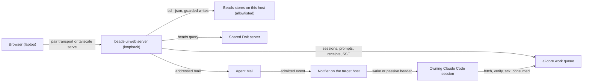
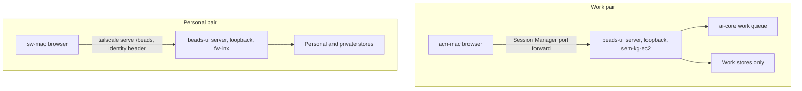

<!-- Full structure: see TEMPLATE.md in this directory -->

# beads-ui web app: review queue, event-based session dispatch, access and the queue dashboard — Design Document

## Founding Ask Coverage

`founding_ask_ref`: `{"blob_oid":"8b43d16fb45272c4911f8de4d1b491e6bb472134","capture_commit":"b5eaeefd646b1fee17f189518ca9d32a67e9aad2","content_sha256":"79619e87b5d6a8e02204a9bf35e294caa65ab910f8be7f0d136e7035009caed0","entry_ids":["A001"],"generation":1,"path":"docs/asks/BU-epic-goals-system-usmm.md","previous_ref_sha256":null,"repository":"ai-harness","schema_version":1,"task_id":"BU-epic-goals-system-usmm"}`

`founding_ask_ref_sha256`: `c12436184b45bdc5c279f8f1d3928c6610536b5802f38b0760a6d47d4997dae6`

The founding ask record has one entry, A001, recorded verbatim in ai-harness at `docs/asks/BU-epic-goals-system-usmm.md`. This index is non-authoritative; the raw entry governs. A001 covers two systems: this doc designs the web app, and [the goals system design](beads-goals-system-design.md) designs the goals system and the privacy guard. Each row below is one web app clause of A001.

| Entry | Clause (quoted or closely paraphrased) | Coverage and disposition |
|---|---|---|
| A001 | "the web app for the beads-ui task manager ... same overall purpose as the beads-ui task manage claude code mod tui" | [Architecture](#architecture); inherits the beads-ui design's D-1 to D-43 |
| A001 | "react or whatever framework is pretty and aesthetic and best practice" | [Stack and look](#stack-and-look); D-10 of the beads-ui design holds |
| A001 | kanban, sprint and backlog, rearrange, quick edits of priority, status and owner, details, Jira, Todoist, Asana and Linear interactions | Phase 3 of the beads-ui design (T-3.1 to T-3.4) plus [Board and views](#board-and-views), [D-21](#d-21) and T-W1.0 of [Phase W1](#phase-w1-the-views-the-ask-names-the-review-queue-and-the-composer) |
| A001 | "view the held doc blockers / decisions / open questions / details" | [The Review queue](#the-review-queue); [D-1](#d-1), [D-2](#d-2), [D-3](#d-3); detail views (T-W1.7) |
| A001 | type and enter a prompt per task for the owning session, notified "via event-based system" built on aih-fw-1's event-driven wake | [Composer and dispatch](#composer-and-dispatch); [D-4](#d-4) to [D-8](#d-8) |
| A001 | "agent-mail or hook context injection (should be event-based) and/or prompt injection via shared prompt injection library or configurable combination of them with fallback options" | [D-6](#d-6): all three named routes are rungs of one configurable ladder with fallbacks |
| A001 | "i can change the owning cc session too and it should trigger the automatic /handoff" | [D-9](#d-9) |
| A001 | "auto-triggers them to `/start-goal` if they're not in a current goal mode state" | [D-10](#d-10) |
| A001 | the auto-work queue in priority order, filtered to blocked tasks (by epic and other filters); review by priority, impact, type and size; unblock and prompt next steps | [The Review queue](#the-review-queue); [D-1](#d-1); the Queue view (T-W1.5) and unblock (T-W1.6) in Phase W1; the queue read model in [Backend](#backend-and-live-updates) |
| A001 | "fit within the app-portal system ... as a modular web app" | [D-15](#d-15) |
| A001 | shared code with the Claude Code mod and the Claude Desktop and claude.ai MCP App, "if its too limiting, then they can be separate builds" | [Shared code](#shared-code); D-1 and D-2 of the beads-ui design hold |
| A001 | "built on our backend of beads tasks dolt db store ... and whatever else from ai-core"; open to changing backend or frontend | [Backend and live updates](#backend-and-live-updates); [D-13](#d-13), [D-14](#d-14) |
| A001 | local hosting for now; sem-kg-ec2 with acn-mac via SSM or SSH; fw-lnx with sw-mac via Tailscale; cloud hosting from infra-as-config templates later | [Access for each machine pair](#access-for-each-machine-pair); [D-16](#d-16), [D-17](#d-17); Phase 6 of the beads-ui design (its Railway format finding is filed as BU-isu) |
| A001 | the goals system, goal views and the privacy guard | Out of this doc by split; [the goals system design](beads-goals-system-design.md). This doc carries the privacy guard's web app consequence as [D-18](#d-18) |
| A001 | the process clauses (orchestrate, research, wait for the prior-work compile, merge, sync, reap, design through /auto-flow, Sergei's review) | Process, not content: the [Run Ledger](#run-ledger) |

**Status:** DRAFT, held for Sergei's review

**Created:** 2026-10-28

**Task:** BU-mg2.5.3 (design), parent BU-mg2.5 (the web app epic); build: BU-mg2.5.4

**Research:** [docs/research/beads-ui-web-app.md](../research/beads-ui-web-app.md) and its findings under [docs/research/findings/](../research/findings/)

**Parent design:** [docs/designs/beads-ui-design.md](beads-ui-design.md). This doc extends it and never restates it; where it says "D-N of the beads-ui design", that decision stands as recorded there.

<!-- doc:region name="overview" kind="replaceable" -->

## Table of Contents

- [Founding Ask Coverage](#founding-ask-coverage)
- [Executive Summary](#executive-summary)
- [Summary for a wide audience](#summary-for-a-wide-audience)
- [Problem Statement](#problem-statement)
- [Design Overview](#design-overview)
- [Architecture](#architecture)
  - [Scope and what is inherited](#scope-and-what-is-inherited)
  - [The Review queue](#the-review-queue)
  - [Composer and dispatch](#composer-and-dispatch)
  - [Owner change and goal arming](#owner-change-and-goal-arming)
  - [Board and views](#board-and-views)
  - [Backend and live updates](#backend-and-live-updates)
  - [Access for each machine pair](#access-for-each-machine-pair)
  - [Stack and look](#stack-and-look)
  - [Shared code](#shared-code)
- [Data Model](#data-model)
  - [Dispatch record](#dispatch-record)
  - [Configuration](#configuration)
- [Integration](#integration)
- [Implementation Phases](#implementation-phases)
  - [Phase W0: Security foundation, receiver and dispatch store](#phase-w0-security-foundation-receiver-and-dispatch-store)
  - [Phase W1: The views the ask names, the Review queue and the composer](#phase-w1-the-views-the-ask-names-the-review-queue-and-the-composer)
  - [Phase W2: Event-based dispatch, handoff and goal arming](#phase-w2-event-based-dispatch-handoff-and-goal-arming)
  - [Phase W3: Live updates, access and app-portal](#phase-w3-live-updates-access-and-app-portal)
  - [Phase W4: MCP App parity](#phase-w4-mcp-app-parity)
- [Implementation Audit](#implementation-audit)
- [Risks and Mitigations](#risks-and-mitigations)
- [Open Questions](#open-questions)
- [Run Ledger](#run-ledger)
  - [Transition verdicts](#transition-verdicts)
  - [Doc-audit rounds](#doc-audit-rounds)
- [Design Decisions](#design-decisions)
  - [Decision Summary](#decision-summary)
  - [Decision Details](#decision-details)
- [Feedback Rounds](#feedback-rounds)
- [Approval Log](#approval-log)

## Executive Summary

This design turns the beads-ui web app, already planned as Phase 3 of the beads-ui design, into the place where Sergei steers his Claude Code sessions. It adds a keyboard-first Review queue that lists every blocked task, held decision and open question in priority order and lets him answer each with one key or a short reply, and a per-task composer that sends a prompt to the session owning the task. That prompt reaches the session by event: the server records it in the ai-core work queue and sends addressed Agent Mail, which the fleet's event-driven wake turns into a model turn only when there is something to do, with the shared prompt-injection library, the mod and the queue's turn-end pull as fallbacks under one kill switch. Changing a task's owner sends a receiver-first handoff, and a dispatch can ask the receiving session to arm `/start-goal`. Each machine pair reaches a loopback-bound server through the transport it already runs, with the server's own authentication in front, and a per-host repository allowlist keeps personal stores off the work host. The two most consequential calls are the dispatch ladder ([D-6](#d-6)) and the signed dispatch envelope ([D-8](#d-8)); three decisions are left for Sergei: whether app-portal's member contract takes a Node server ([D-15](#d-15)), whether the web app turns manual rank on by default ([D-21](#d-21)), and the ai-harness changes the build needs ([D-22](#d-22)).

## Summary for a wide audience

The web app gets a review inbox and a way to message the Claude Code session working on any task. A message wakes that session only when it arrives, so idle sessions cost nothing. Changing a task's owner hands the work over properly, and sessions can be asked to start working toward a goal. The app runs on each work machine and is opened from the paired laptop through the tunnel that pair already uses. Nothing changes for anyone until it is built; the build waits for Sergei's review of this design.

## Problem Statement

The beads-ui design already plans a web board (Phase 3), but the founding ask adds three things it does not cover: a fast way to work through blockers, decisions and open questions across every session's tasks, a way to send each owning session a prompt that starts its work without keeping sessions awake to poll, and access from both machine pairs. Today Sergei answers held items one at a time in chat, and the fleet's idle wake fires on schedules that measurement showed to be mostly no-ops ([research § 3](../research/beads-ui-web-app.md#3-per-task-prompts-and-event-based-dispatch)).

## Design Overview

**Status:** stub; to be filled during and after implementation.

## Architecture

### Scope and what is inherited

The web app is the `apps/web` surface of the beads-ui monorepo: a Vite and React 19 single-page app served by a Node server in the same package, built on the DOM-free core and the `packages/web-ui` components (D-1, D-2, D-10 of the beads-ui design). Board, Backlog, Sprints, Roadmap, Analytics, Sessions and Issue detail are Phase 3 of the beads-ui design and are not redesigned here. Under D-11 of the beads-ui design, which Sergei approved, the web app is the work queue's Phase 2 member app. This doc adds the Review queue, the composer and dispatch path, owner change and goal arming, the backend's live-update and read-model choices, app-portal integration, access, and the privacy rule for what a host may show.



Legend: solid arrows are calls the web server or the fleet makes; the server never writes a store outside its host's allowlist.

### The Review queue

A split list and detail view, keyboard first, that lists every item needing Sergei: held decisions, held open questions, blocked tasks and tasks awaiting a prompt, drawn from the held store's review items (D-37 of the beads-ui design) and the task stores. Sections group items by next action (answer, unblock, prompt); within a section, items sort by priority, then impact, then age, where impact and size are the curation `value` and `effort` the fleet's curation scorer writes on each issue (a held item takes them from its joined issue); filters cover epic, goal, type, size, owner and repository, and every filtered view is a shareable URL ([D-1](#d-1)). A held decision is drawn as an option card from structured data a held command prints ([D-2](#d-2)): number keys pick an option, Enter on the recommended option approves it, and the full rendered body sits below the card. Answers follow [D-3](#d-3). Bulk selection lets Sergei approve every recommendation in a filtered set in one action, with a confirm that lists them. Beside it, the Queue view lists every open task in the work queue's order, with a blocked filter, and an unblock action writes the resolution and the stamped unblock transition on the owning host (T-W1.5, T-W1.6).

### Composer and dispatch

Each task's detail and each Review item carries a composer, ported from the ai-core dashboard's approved composer ([D-4](#d-4)). Sending a prompt writes a dispatch record and emits an event; the owning session receives it through the ladder in [D-6](#d-6), verifies its envelope ([D-8](#d-8)), and reports back. The composer shows three separate indicators: session liveness, delivery state and the session's response ([D-5](#d-5)).

```mermaid
sequenceDiagram
    autonumber
    actor S as Sergei
    participant W as Web server
    participant Q as Work queue (dispatch record)
    participant M as Agent Mail
    participant N as Notifier (target host)
    participant C as Owning session
    S->>W: Prompt on task T
    W->>W: Authenticate, sign envelope
    W->>Q: Write dispatch (queued); mirror a bd comment on T
    W->>M: Addressed mail to session@host (pointer to the dispatch)
    N->>M: Poll
    alt Idle and automatic wakes on
        N->>C: Wake (hook exits 2), header names the dispatch
    else Busy, or automatic wakes off
        C->>N: Next tool call or turn end
        N-->>C: Passive header names the dispatch
    end
    C->>Q: Fetch, verify envelope, ack (taken)
    C->>C: Work T; arm /start-goal if asked and no goal is active
    C->>Q: Consumed; comment on T
    Q-->>W: Server-Sent Event per state change
    W-->>S: queued, shown, taken, acted on, or failed
```

### Owner change and goal arming

Changing the owner field on a task with a live claim sends a handoff request to the current owner instead of reassigning the claim ([D-9](#d-9)). Every prompt, and every answer or unblock that carries next-step text, asks the receiver to "arm a goal if none is active", unless Sergei clears that for one dispatch; the receiving session reads its own goal state and arms `/start-goal` before it acts. A dispatch to a session whose goal is paused for a usage or rate limit waits and is released automatically when the pause clears, with a "deliver now" control beside it ([D-10](#d-10)).

### Board and views

Board, Backlog, Sprints, Roadmap, Analytics, Sessions and Issue detail are as Phase 3 of the beads-ui design specifies, with additions. Phase 3's criteria do not cover everything the ask names, so Phase W1 adds a Sprint view, manual rank on by default in the web app so cards and backlog rows can be rearranged ([D-21](#d-21)), and inline edits of priority, status and owner. From the research come filtered views as shareable URLs (as in Linear's 2026 changes) and a setting to turn off or remap single-key shortcuts ([D-12](#d-12)).

### Backend and live updates

The server reads task fields through the host refresher's snapshots and `bd --json`, and writes through guarded `bd` calls (D-4 and D-26 of the beads-ui design). It detects change across every allowed store with one Dolt heads query and pushes Server-Sent Events to open tabs ([D-13](#d-13)). Sessions, prompts, receipts and review items come from the ai-core work queue where it runs; elsewhere a local append-only store holds dispatch records ([D-14](#d-14)). Receiving sessions fetch a dispatch and post its receipts through the server's receiver API, over the same access route as the browser, through the host's notifier, which holds a per-host receiver token and fetches only for the session a dispatch is addressed to (T-W0.3). Every store and queue read is filtered through the host's repository allowlist ([D-18](#d-18)).

### Access for each machine pair

On the work pair, the server binds to loopback on sem-kg-ec2 and acn-mac reaches it through one more entry in the pair transport's supervised Session Manager port forward, with an SSH local forward as the fallback ([D-16](#d-16)). On the personal pair, the server binds to loopback on fw-lnx and is published to sw-mac with `tailscale serve` at `/beads`, standalone ([D-16](#d-16)); it is registered in app-portal's `apps.yaml` only if Sergei rules [D-15](#d-15) for option (a). The server adds its own authentication on both pairs: a per-host token on every request, with the tailnet identity recorded but never trusted on its own ([D-17](#d-17)).



Legend: both servers check Host, Origin and Fetch Metadata on every write and require the per-host token on every request; the personal pair's server also records the tailnet identity Tailscale Serve adds and never trusts it without the token.

### Stack and look

D-10 of the beads-ui design holds as of 2026-10-28; research found every library maintained except `cmdk`, whose replacement path (Base UI Autocomplete) D-10 already names. Three record corrections apply: Base UI's package is `@base-ui/react`, Frappe Gantt released 1.2.2 on 2026-02-25, and Vite 8 bundles with Rolldown. The build enables React Compiler 1.0 for the dense board, and expresses D-19's semantic tokens as oklch CSS variables in light and dark with a contrast setting.

### Shared code

The repository and package split of D-1 and D-2 of the beads-ui design holds: core reducers, view models and commands are shared by all three surfaces; React components by the web app and the MCP App. This design adds four shared core modules: the review-queue reducer, the decision-option model, the composer's delivery-state machine and the key map. The MCP App cannot post into a Claude Code session (MCP Apps' `ui/message` posts into the Claude conversation), so it sends a session prompt through an MCP server tool that writes the same dispatch record the web server writes.

> **Feedback Round 1:** Does this approach feel right? What's missing?
> - <enter feedback here>

## Data Model

### Dispatch record

```text
Dispatch {
  id: string              # ULID, the idempotency key for every consumer
  task: { repo, id }      # the task the prompt is about
  target: { session, host }
  kind: "prompt" | "answer" | "unblock" | "handoff-request"   # an answer carries the exact answer bytes for the target host's held store
  body_ref: string        # where the text lives: the queue's prompt store, or the task's own store
  body_digest: sha256     # the envelope signs the digest, never a copy of a private body
  arm_goal: bool          # ask the receiver to arm /start-goal if no goal is active
  created_by: "sergei"    # the only author the server accepts
  created_at: timestamp
  expires_at: timestamp   # the receiver refuses an expired dispatch
  state: queued | shown | taken | acted | failed | expired | waiting
  state_source: per state, the record that proves it (queue receipt, mail shown receipt, bd comment)
  envelope: { version: 1, signature }   # Ed25519 (D-20) over the canonical JSON of id, task, target, kind,
                                        # body_ref, body_digest, arm_goal, created_by, created_at, expires_at
}
```

The receiver verifies the signature, hashes the bytes it fetches from `body_ref` and acts only when they match `body_digest`; it refuses an expired dispatch, one addressed to another session, and an id it has already consumed.

### Configuration

Read at call time from `beads-ui.toml` (the web server) and from the receiving host's dispatch policy:

```toml
[dispatch]
record = "queue"                 # "queue" where queue.url is set, else "local"
mirror_bd_comment = true
coalesce_window_s = 20           # several dispatches to one session become one turn
max_per_session_per_hour = 30
shown_within_s = 60              # fall back to the next rung after this

[dispatch.carriers]              # cross-host carriage, in order
order = ["agent-mail", "buzz", "git-inbox"]
git_inbox_payload = "pointer"    # never a body

[dispatch.local]                 # delivery on the target host, in order
order = ["notifier", "prompt-injection", "mod-submit", "turn-end"]

[hosts]
allow_repos = ["..."]            # the per-host repository allowlist (D-18)

[auth]
hosts = ["localhost", "127.0.0.1"]   # Host values accepted
origins = ["http://localhost:<port>"] # exact Origin values accepted when Sec-Fetch-Site is absent
dispatch_identities = ["..."]       # tailnet identities allowed to dispatch on the personal pair
browser_secret = "state:browser-secret"   # references to generated credentials, never values
receiver_token = "state:receiver-token"
mcp_token = "state:mcp-token"
configured_user = "sergei"            # the one person whose dispatches the server signs
signing_key = "secret-store:dispatch-signing-key"
signing_key_id = "<host>-<yyyymmdd>"   # carried in every envelope
trusted_keys = "state:trusted-dispatch-keys.json"   # receiver side: key id to public key, with not_before and not_after
```

Credential files live in the server's state directory, owned by the server's user with mode 0600. The server validates the whole `[auth]` table at start and refuses to start if a key is missing, empty or malformed, or a referenced credential is unreadable (T-W0.1).

The kill switch is the event-driven wake's own call-time policy file. With automatic wakes off, the addressed Agent Mail is still sent and stays pending; only the model wake and the active rungs 3 and 4 are suppressed, and the notifier's passive header delivers the dispatch at the session's next tool call or turn end.

## Integration

| System | What the web app uses | State on 2026-10-28 | If it is late |
|---|---|---|---|
| Event-driven idle wake (ai-harness, owner aih-fw-1) | Admission of addressed mail as a wake; the call-time kill switch | Phases 1 to 3 merged; the installer seeds the policy file create-only with automatic wakes off (ai-harness main `94de1f6b640`), so each host delivers at turn end until its policy is switched on, which the wake design's own rollout owns | Delivery at the next turn end; the composer says "waiting: automatic wakes off" |
| Agent Mail | The primary carrier, cross-host | Live | Buzz, then git-inbox carry a pointer |
| Shared prompt-injection library (ai-harness) | Rung 3, a one-line pointer typed on the target host | Built | Skip the rung |
| ai-core work queue | Sessions, dispatch records, receipts, review items, SSE | Live on the work pair; its dashboard code is built but not mounted, and is the port source for the views this app shares with it ([D-11](#d-11)) | Local append-only dispatch store; poll for receipts |
| Held store (ai-harness `held_cli.py`) | `review` items (D-37), `answer` (D-39), a new structured-options command ([D-2](#d-2)) | `review` and `answer` built | Render the Markdown body only and answer through the composer |
| Pair transport (ai-harness) | One more `forwards` entry for the web port | Live | SSH local forward |
| app-portal | `apps.yaml` registration on the personal pair | Live there; not on the work pair; whether its member contract takes a Node server is [D-15](#d-15), left for Sergei | Run standalone |
| beads-ui mod | Rung 4 (`$.prompt.submit`) | Built | Skip the rung |

<!-- dependency edges: the build issue BU-mg2.5.4 depends on the structured-options held command and on each host's wake policy being switched on; wired as bd edges in the same pass as this doc -->

## Implementation Phases

Phase W0 comes first, because nothing that can make a session act may ship without authentication, the allowlist and a verified envelope. The phases below extend Phase 3 of the beads-ui design, which they assume built first or alongside; each lands in beads-ui unless it says ai-harness. Every phase ships enabled once merged and live-verified.

### Phase W0: Security foundation, receiver and dispatch store

Nothing that can make a session act ships before this phase: every later phase depends on it.

- **Scope:** request authentication and write authorization; the per-host repository allowlist; the receiver API and the receiving-side client; the signed envelope and its verification; the dispatch store with its queue-backed and local implementations.
- **Deliverables:**
  - Files created: `apps/web/server/auth.ts`, `apps/web/server/allowlist.ts`, `apps/web/server/receiver-api.ts`, `apps/web/server/envelope.ts`; `plugins/beads-ui/core/src/dispatch-store.ts` (the `DispatchStore` interface, exported from the core package's index), `apps/web/server/dispatch-store/queue.ts`, `apps/web/server/dispatch-store/local.ts`.
  - Files created (ai-harness, subject to [D-22](#d-22)): the receiving-side client that fetches a dispatch through the receiver API at each natural boundary and verifies its envelope, key id and body digest, with the shared golden vectors; the installer step that writes each receiver's trusted-keys map.
  - Tests added: `apps/web/test/auth.test.ts`, `apps/web/test/allowlist.test.ts`, `apps/web/test/receiver-api.test.ts`, `apps/web/test/envelope.test.ts`, `apps/web/test/dispatch-store.contract.test.ts`, `apps/web/e2e/auth.spec.ts`; ai-harness tests for the receiver client and the verifier.
- **Tasks + acceptance criteria:**
  - **T-W0.1 Authentication**
    - [ ] `When a request arrives, the system shall reject it unless its Host is on the allowlist.`
    - [ ] `When a browser write arrives without the X-Beads-UI header, the system shall reject it.`
    - [ ] `When a browser write arrives with Sec-Fetch-Site set to same-origin, the system shall accept it on that check.`
    - [ ] `When a browser write arrives with Sec-Fetch-Site set to cross-site, same-site or none, the system shall reject it.`
    - [ ] `When a browser write arrives with no Sec-Fetch-Site header, the system shall accept it on that check only if its Origin exactly equals an allowed origin.`
    - [ ] `When a request reaches the receiver API, the system shall authorise it by the receiver token and the host and session match of T-W0.3, and shall not apply the browser checks.`
    - [ ] `When any browser request arrives on either pair, the system shall require the browser session, and shall reject the request without it whatever identity headers it carries.`
    - [ ] `Where the server runs behind Tailscale Serve, the system shall record the Tailscale-User-Login identity on each write and shall refuse a dispatch whose recorded identity is not on the host's dispatch list, in addition to the token.`
    - [ ] `If a request reaches the loopback listener directly with Tailscale identity headers and no valid token, then the system shall reject it.`
    - [ ] `If the server is bound beyond loopback without the auth layer configured, then the system shall refuse to start and shall name the required setting.`
    - [ ] `If any [auth] key is missing, empty or malformed, or a referenced credential file is unreadable or not mode 0600, then the server shall refuse to start and name the key, on loopback too.`
    - [ ] `When the launch command prints a one-time link, its code shall expire after five minutes, and the server shall exchange it once for a session cookie marked HttpOnly and SameSite=Strict and scoped to the app's base path.`
    - [ ] `If a one-time code is presented a second time or after it expires, then the server shall refuse it and set no cookie.`
    - [ ] `When the browser opens the SSE stream, the server shall authenticate it by the session cookie, and no token shall appear in a URL after the exchange or in browser storage.`
    - [ ] `When a session is 12 hours old, or idle for 2 hours, the server shall end it and the cookie shall stop working.`
    - [ ] `When the user logs out, the server shall revoke that session on the server and clear its cookie.`
    - [ ] `When the host's revoke command names one session, the server shall end that session only.`
    - [ ] `When the per-host secret is rotated, every existing session cookie shall stop working.`
    - [ ] `When a request reaches a browser route, the server shall require the browser session cookie; a receiver route, the receiver token; an MCP route, the MCP token; and shall refuse a request carrying only another route's credential.`
    - [ ] `When the server starts, it shall read the MCP token and the host's configured user from [auth] and refuse to start if either is missing.`
  - **T-W0.2 Allowlist**
    - [ ] `When the server starts, the system shall open only the stores whose repositories are on the host's allowlist.`
    - [ ] `When the server reads the work queue, the system shall filter every row to the allowlisted repositories.`
    - [ ] `If a store or queue row from a repository not on the allowlist is encountered, then the system shall drop it, count it in a health line without naming it, and shall not render it.`
    - [ ] `If the allowlist is unreadable, then the server shall open no store and shall show why.`
    - [ ] `When a dispatch is created, the server shall refuse it if the task's repository is not on the target host's allowlist, read from that host's published allowlist.`
    - [ ] `When the receiver API returns a dispatch body, it shall first check the task's repository against the requesting host's allowlist and refuse without the body if it is not listed.`
  - **T-W0.3 Receiver API**
    - [ ] `When the target host's notifier, which holds that host's receiver token, requests a dispatch for a session it has confirmed is running on that host, the server shall return the dispatch record and its body only if both the host and the session match the dispatch's target.`
    - [ ] `If the receiver token is missing, unknown or belongs to another host, or the named session is not the dispatch's target, then the server shall refuse the request without revealing whether the dispatch exists.`
    - [ ] `When a receipt (taken, acted, failed) is posted for a dispatch, the server shall record it only if its host and session match the dispatch's target, and shall refuse any other.`
    - [ ] `When a dispatch is consumed or expires, the server shall delete its body from the body store and append a tombstone record, keeping the record and its receipts; backups shall exclude bodies.`
    - [ ] `Where the work queue is configured, the receiver API shall serve the queue's prompt store through the same endpoints.`
    - [ ] `When a session reaches a natural boundary (a tool call or its turn end), the receiving-side client shall ask the receiver API for dispatches addressed to that session and deliver any it finds, so delivery needs no mail or wake.`
  - **T-W0.4 Envelope**
    - [ ] `When the server writes a dispatch, the system shall sign the RFC 8785 canonical JSON of its id, task, target, kind, body_ref, body_digest, arm_goal, created_by, created_at and expires_at, with timestamps as UTC RFC 3339 strings to the millisecond, using the serving host's Ed25519 key (D-20).`
    - [ ] `When the Node signer and the Python verifier run the shared golden vectors, each shall produce and accept the same bytes, and each shall reject the malformed vectors.`
    - [ ] `When the receiving host fetches a dispatch, it shall verify the signature, then hash the fetched body and compare it with body_digest, before the session acts.`
    - [ ] `If the signature fails, any signed field differs from the record, or the body's hash differs from body_digest, then the receiving host shall mark the dispatch failed with the reason, and the session shall treat its text as unverified coordination only.`
    - [ ] `If a dispatch has passed its expires_at, or names a target other than the receiving session, or carries an id the receiver has already consumed, then the receiving host shall refuse it and record why.`
    - [ ] `When the server signs an envelope, it shall include its signing_key_id inside the signed bytes.`
    - [ ] `When a receiver verifies an envelope, it shall look up the key id in its trusted-keys map and accept only a key inside its not_before and not_after window.`
    - [ ] `If the key id is unknown, expired or revoked, then the receiver shall refuse the dispatch and name the key id.`
    - [ ] `When the signing key is rotated, the installer shall add the new public key to every receiver's map before the server signs with it, and keep the old key valid for 24 hours.`
  - **T-W0.5 Dispatch store**
    - [ ] `When a dispatch is created, read, given a receipt, expired or consumed, the queue-backed and the local DispatchStore shall behave identically, and one shared contract suite shall run against both.`
    - [ ] `When the server restarts, the local store shall recover every outstanding dispatch and its receipts.`
    - [ ] `If the same dispatch id is written twice, then the store shall keep one record.`
    - [ ] `When a dispatch is consumed or expires, the local store shall delete its body, append a tombstone, and compaction shall drop tombstoned bodies; backups shall exclude bodies.`
    - [ ] `If the local store's file cannot be written, then the server shall refuse new dispatches and say why, and shall not report a dispatch as queued.`
- **Exit gate:** beads-ui gate green; ai-harness `pytest` green for the receiver client and verifier; a live run on each pair recorded in the Approval Log: a cross-origin write, a forged-header request, a forged dispatch and a body-tampered dispatch each refused; an unlisted repository dropped; a local-store server restarted with a dispatch outstanding and recovered.

### Phase W1: The views the ask names, the Review queue and the composer

- **Scope:** the Sprint view, manual rank and inline field edits that Phase 3 of the beads-ui design does not specify; the Review view, option cards, answers, the composer and its status indicators, the shortcut setting, shareable view URLs. Dispatch writes its record and mirrors a bd comment but delivers only at the next turn end (rung 5) until Phase W2.
- **Deliverables:**
  - Files created: `plugins/beads-ui/core/src/review-queue.ts`, `plugins/beads-ui/core/src/decision-options.ts`, `plugins/beads-ui/core/src/delivery-state.ts`, `plugins/beads-ui/core/src/keymap.ts`, `plugins/beads-ui/core/src/sprint-view.ts`, each exported from the core package's index; `packages/web-ui/src/review/*`, `packages/web-ui/src/composer/*` (ported from ai-core `web/src/components/Composer.tsx`), `packages/web-ui/src/sprint/*`, `packages/web-ui/src/inline-edit/*`, `packages/web-ui/src/queue/*`, `packages/web-ui/src/detail/*`; `apps/web/server/dispatch.ts`.
  - Files created (ai-harness): the held store's structured-options command beside `review` (D-2), the dispatch receiver's `answer` handler, which writes an answer's exact bytes to a file on the target host and runs the closed `answer` verb there, and its `unblock` handler, which writes the resolution comment and runs `bd-unblock`, with their tests.
  - Tests added: `plugins/beads-ui/core/test/review-queue.test.ts`, `plugins/beads-ui/core/test/decision-options.test.ts`, `plugins/beads-ui/core/test/delivery-state.test.ts`, `plugins/beads-ui/core/test/keymap.test.ts`, `plugins/beads-ui/core/test/sprint-view.test.ts`, `packages/web-ui/test/review/*.test.tsx`, `packages/web-ui/test/composer/*.test.tsx`, `packages/web-ui/test/inline-edit/*.test.tsx`, `packages/web-ui/test/queue/*.test.tsx`, `packages/web-ui/test/detail/*.test.tsx`, `apps/web/e2e/review.spec.ts`, `apps/web/e2e/views.spec.ts`, `apps/web/e2e/detail.spec.ts`.
- **Tasks + acceptance criteria:**
  - **T-W1.0 Sprint, backlog order and quick edits**
    - [ ] `When the Sprint view loads, the system shall list the selected sprint's issues (D-5 of the beads-ui design) as a board and as a list, and shall offer every open sprint and the backlog in a sprint picker.`
    - [ ] `When the user moves an issue between the backlog and a sprint, by drag, by the command palette or by the Move to menu, the system shall write the sprint membership through a guarded bd write.`
    - [ ] `When the user reorders a card in a column or a row in the backlog, by drag or by the keyboard's move up and move down commands, the system shall write metadata.rank as a fractional-index key between its neighbours (D-21).`
    - [ ] `When the user changes an issue's priority or status inline on a card or a list row, the system shall perform the guarded write and show the new value.`
    - [ ] `When the user opens the owner picker on a card, a list row or an issue's detail, by pointer, keyboard or touch, the system shall offer the sessions the fleet's handoff rules allow, and shall apply the choice through T-W2.2.`
    - [ ] `If an inline edit's guarded write returns a conflict, then the system shall roll back to the stored value and show a conflict notice naming the field.`
    - [ ] `If the user is on a touch device, then every reorder and inline edit shall also be reachable without a drag or a hover.`
  - **T-W1.1 Review queue**
    - [ ] `When the Review view loads, the system shall list every held decision, held open question, blocked task and task awaiting a prompt that the host's allowlist permits, grouped by next action.`
    - [ ] `When the Review view sorts a section, the system shall order items by priority, then by impact, then by age, then by id, where impact is the issue's curation value and size its curation effort, both read from the issue's metadata as ai-harness's curation scorer writes them, a held item takes them from its joined issue, and an item with no value sorts after every item that has one.`
    - [ ] `When the user applies filters for epic, goal, type, size, owner or repository, the system shall encode them in the URL.`
    - [ ] `When a Review URL carrying filters is opened, the system shall show the same filtered list.`
    - [ ] `If the held store's review command fails, then the system shall show the task-store items, name the failed read and its exit code, and shall not show an empty queue as "nothing to review".`
    - [ ] `If the review-queue reducer receives an item with no priority, then it shall sort that item after every prioritised item and shall not throw.`
  - **T-W1.2 Option cards and answers**
    - [ ] `When a held decision is shown, the system shall draw each option from the structured-options command with its label and recommendation.`
    - [ ] `When a held decision is shown, the system shall preselect its recommended option and give the card keyboard focus.`
    - [ ] `When the user presses Enter on a shown decision, or an option's number key, the system shall choose that option with that one key and start a five-second undo window.`
    - [ ] `When the user presses Escape or Undo inside the undo window, the system shall cancel the answer and write nothing.`
    - [ ] `If focus is in a text field, then Enter and the number keys shall type into the field and choose no option.`
    - [ ] `When the undo window closes without a cancel, the system shall write a dispatch of kind answer to the session owning the held item, carrying the exact answer bytes: the option letter and a statement that it was chosen with a control (D-3).`
    - [ ] `When the target host's dispatch receiver takes an answer dispatch, it shall write the answer's bytes to a file and run the held store's answer verb on that host, and the answer recorded shall be byte-identical to the bytes the server sent.`
    - [ ] `If the held item's landing pad on the target host is not clean, then the receiver shall refuse the answer, mark the dispatch failed with the reason, and the Review view shall show that reason.`
    - [ ] `If an answer dispatch is delivered twice, then the receiver shall record the answer once, keyed by the dispatch id.`
    - [ ] `If the structured-options command is unavailable or returns no options, then the system shall render the decision's Markdown body and accept a typed answer only.`
    - [ ] `If the decision-options model receives malformed command output, then it shall return no options and an error naming the field, and shall not draw a partial card.`
    - [ ] `When the user selects several decisions and chooses "approve recommendations", the system shall list each decision and its recommended option for confirmation before writing any answer.`
  - **T-W1.3 Composer and status**
    - [ ] `When the user sends a prompt from a task, the system shall write one dispatch record with a new id and show the state "queued".`
    - [ ] `When a dispatch record is written, the system shall mirror a bd comment on the task naming the dispatch id.`
    - [ ] `While a dispatch is outstanding, the system shall show session liveness, delivery state and the session's response as three separate indicators, each naming its source.`
    - [ ] `If the delivery-state machine receives a transition its state does not allow, then it shall keep the current state and record the rejected transition.`
    - [ ] `If the composer text matches the secret guard's patterns, then the system shall refuse to send and shall name the rule that matched without echoing the text.`
    - [ ] `When the ported composer replaces the ai-core dashboard's, it shall keep each behaviour in the parity inventory below, and a test per behaviour shall pass against both.`
    - Parity inventory for the composer port (D-4): kept are the secret refusal before send, the multi-line editor with its submit and newline keys, the skill typeahead, the submit state and its error display, and the editor's accessible name and keyboard focus order. Dropped is nothing; a behaviour found during the port that is not listed is added here before the port merges.
  - **T-W1.5 The work queue view**
    - [ ] `When the Queue view loads, the system shall list every open task the host's allowlist permits, in the work queue's order where the queue is configured and otherwise by priority, then rank, then age.`
    - [ ] `When the user turns on the blocked filter, the system shall show only blocked tasks, in the same order, each with its blocker.`
    - [ ] `When the user filters the Queue view by epic, goal, type, size, owner or repository, the system shall apply the filter and encode it in the URL.`
    - [ ] `If the work queue's order cannot be read, then the system shall order by priority and say which order it shows.`
  - **T-W1.6 Unblock**
    - [ ] `When the user unblocks a task from the Review queue with a resolution text, the system shall write a dispatch of kind unblock to the task's owning session carrying that text.`
    - [ ] `When the target host's receiver takes an unblock dispatch, it shall write the resolution as a bd comment in the form D-40 of the beads-ui design reads, then run bd-unblock on the task, which writes the stamped transition comment the hooks check.`
    - [ ] `If bd-unblock refuses, because the task is not blocked or its store cannot be reached, then the receiver shall mark the dispatch failed with the reason, and the Review item shall stay.`
    - [ ] `If an unblock dispatch is delivered twice, then the receiver shall unblock once, keyed by the dispatch id.`
    - [ ] `If the task has no owning session, then the server shall run the same comment and bd-unblock itself when the task's store is on its host, and otherwise shall refuse and name the reason.`
    - [ ] `When an unblock succeeds and the user also typed a next-step prompt, the system shall deliver that prompt to the same session as a follow-up dispatch.`
  - **T-W1.7 Detail views**
    - [ ] `When an issue's detail opens, the system shall show its title, type, status, priority, owner, labels, parent, dates, description, comments and links, each read from the issue's store.`
    - [ ] `If a field of an issue's detail cannot be read, then the system shall show the read error and the store it came from, and shall not show the field as empty.`
    - [ ] `When a held item's detail opens, the system shall render its full Markdown body for every held kind (decision, open question, blocker and other), with the option card above the body when structured options exist.`
    - [ ] `If a held item's body cannot be read, then the system shall show the read error and its source and shall not show an empty detail.`
    - [ ] `When the app renders Markdown from a task or held item, it shall render no raw HTML, allow only http, https and mailto links, and strip every other URL scheme.`
    - [ ] `When the server serves the app, it shall send a Content Security Policy with no inline script and enforce Trusted Types for DOM sinks.`
    - [ ] `When a test renders Markdown carrying script tags, event-handler attributes and javascript: links, nothing shall execute and the links shall be inert.`
  - **T-W1.4 Shortcuts**
    - [ ] `Where single-key shortcuts are enabled, when the user presses a mapped key outside a text field, the system shall run its command.`
    - [ ] `While the single-key shortcut setting is off, the system shall ignore single-key presses and keep modified shortcuts.`
    - [ ] `If a remap assigns one key to two commands, then the key map shall refuse the remap and name both commands.`
- **Exit gate:** `npx tsc --noEmit && npx vitest run` green in beads-ui; ai-harness `pytest` green for the structured-options command and the answer and unblock handlers; Playwright views, Review and composer specs green at 390 px and 1280 px; a live run on the work pair recorded in the Approval Log: one card reordered, one priority edited inline and one owner changed from a card, the Queue view filtered to blocked tasks, one decision answered by key and recorded on its owning host byte for byte, one task unblocked with a follow-up prompt, one prompt delivered at a turn end.

### Phase W2: Event-based dispatch, handoff and goal arming

- **Scope:** the dispatch ladder with its kill switch, coalescing and rate cap; owner change as a handoff request; goal arming. The receiver API and envelope are Phase W0's.
- **Deliverables:**
  - Files created: `apps/web/server/dispatch-ladder.ts`; `plugins/beads-ui/core/src/dispatch-policy.ts`, exported from the core package's index.
  - Files created (ai-harness): a dispatch typed source in the notifier's admission (so web dispatches are counted and reasoned as their own kind), and the receiver instructions that act on `arm_goal` (subject to [D-22](#d-22)).
  - Tests added: `apps/web/test/dispatch-ladder.test.ts`, `plugins/beads-ui/core/test/dispatch-policy.test.ts`; ai-harness tests for the typed source.
- **Tasks + acceptance criteria:**
  - **T-W2.1 Ladder**
    - [ ] `When a dispatch is written and automatic wakes are on, the system shall send addressed Agent Mail to the target session at its host naming the dispatch id.`
    - [ ] `When the mail's shown receipt arrives, the system shall record the state "shown" with the receipt as its source.`
    - [ ] `If no shown receipt arrives within shown_within_s and the target session has a pane the prompt-injection library can resolve, then the system shall request the library's one-line pointer under the same claim and record which rung delivered.`
    - [ ] `While the target host's wake policy reports automatic wakes off, the system shall still send the addressed Agent Mail, shall not create a model wake or use rungs 3 or 4, and shall show "waiting: automatic wakes off".`
    - [ ] `While the target host's automatic wakes are off, the notifier shall deliver the dispatch's passive header at the session's next tool call or turn end, and a cross-host canary shall show no idle turn created and the header delivered.`
    - [ ] `If addressed Agent Mail cannot be delivered, then the system shall carry the dispatch by Buzz and record that rung.`
    - [ ] `If Buzz cannot carry it either, then the system shall send a git-inbox action carrying a pointer only, and record that rung.`
    - [ ] `If the prompt-injection library cannot resolve the target's pane, then the system shall try the mod's submit on that host, and record that rung.`
    - [ ] `If every active rung fails, then the system shall leave the dispatch for turn-end pickup and show which rungs failed and why.`
    - [ ] `When two or more dispatches to one session are written within coalesce_window_s, the system shall deliver them as one event.`
    - [ ] `If a session exceeds max_per_session_per_hour, then the system shall hold further dispatches to it and say so in the composer.`
    - [ ] `If the dispatch policy is unreadable, then the system shall deliver at the next turn end only and show the reason.`
  - **T-W2.2 Owner change**
    - [ ] `When the user picks a new owner, the system shall refuse a receiver the fleet's handoff rules do not allow, naming the rule, before anything is sent.`
    - [ ] `When the user changes the owner of an unclaimed task, the system shall write the assignee through a guarded bd write, and when the user also typed a prompt, dispatch it to the new owner.`
    - [ ] `When the user changes the owner of a task claimed by a live session, the system shall send that session a dispatch of kind handoff-request naming the selected receiver, and shall not write the assignee itself.`
    - [ ] `When the current owner runs /handoff for the request, it shall reassign the claim to the receiver and publish the store, and the system shall show "handoff sent" with that publication as its source.`
    - [ ] `When the receiver takes the work, assigning itself, setting it in progress, publishing and mirroring its rows, and replies taken, the system shall show "taken" with the reply as its source.`
    - [ ] `When the sender's verify step exits 0 and it drops its rows, the system shall show the handoff complete with the verify receipt as its source.`
    - [ ] `If the current owner is proved gone by the fleet's liveness check, then the server shall release the abandoned claim through the documented force path, send the selected receiver a git-inbox action carrying a pointer only, and show "owner not running" until git-inbox confirm records the take.`
    - [ ] `If the current owner's liveness cannot be established, then the system shall not reassign, shall show "owner state unknown" and shall offer a retry.`
  - **T-W2.3 Goal arming**
    - [ ] `When the composer writes a prompt dispatch, or an answer or unblock carries next-step text, the system shall set arm_goal on that dispatch.`
    - [ ] `When the user clears the composer's arm-goal control for one dispatch, the system shall send that dispatch without arm_goal and record that the user cleared it.`
    - [ ] `When a dispatch carries arm_goal and the receiving session has no active goal, the session shall run /start-goal for the dispatched task before acting on the prompt.`
    - [ ] `When a dispatch carries arm_goal and the receiving session's goal is active, the session shall act on the prompt within that goal and shall not start a second one.`
    - [ ] `If the receiving session's goal is paused for a usage or rate limit, then the system shall show "waiting: goal paused" and shall release the dispatch automatically when the receiver reports the goal active or the recorded pause window ends.`
    - [ ] `When the user presses "deliver now" on a dispatch waiting on a paused goal, the system shall deliver it at once.`
- **Exit gate:** beads-ui gate green; ai-harness `pytest` green including the typed-source, receiver-client and verifier tests; a live run on each pair, with automatic wakes switched on for the test session's host, recorded in the Approval Log: an idle session woken by a dispatch, every rung exercised in tests and one cross-host carrier failover exercised live, a wakes-off canary, a session on the paired machine fetching a dispatch through the receiver API, a forged and a body-tampered dispatch each refused, one owner change completed receiver-first.

### Phase W3: Live updates, access and app-portal

- **Scope:** the heads-query change feed and SSE shared across tabs; the work pair's forward entry and SSH fallback; Tailscale Serve and, subject to [D-15](#d-15), app-portal registration on the personal pair. Authentication and the allowlist are Phase W0's.
- **Deliverables:**
  - Files created: `apps/web/server/heads-feed.ts`, `apps/web/server/portal.ts` (the app-portal member duties); `apps/web/src/live/shared-feed.ts` (one SSE connection per browser, shared by its tabs); `docs/procedures/web-access.md`.
  - Files modified (ai-harness, subject to [D-22](#d-22)): the pair transport's `forwards` map gains the web port entry for the work pair.
  - Files modified (app-portal, once D-15 is ruled): `apps.yaml` gains the `beads` member on the personal pair.
  - Tests added: `apps/web/test/heads-feed.test.ts`, `apps/web/test/portal.test.ts`, `apps/web/e2e/tabs.spec.ts`.
- **Tasks + acceptance criteria:**
  - **T-W3.1 Change feed**
    - [ ] `When any allowed store's Dolt head changes, the system shall re-read that store only and push one Server-Sent Event within the configured poll interval.`
    - [ ] `While several tabs of the app are open in one browser, the system shall hold one SSE connection for them and deliver each event to every tab.`
    - [ ] `If the tab holding the shared connection closes, then another open tab shall take it over within the poll interval.`
    - [ ] `If the heads query fails, then the system shall keep the last state with a stale stamp, retry with backoff, and shall not report the stores as unchanged.`
  - **T-W3.2 Access and app-portal duties**
    - [ ] `When the pair transport starts on the work pair's laptop, it shall forward the web port from the work host to a local port.`
    - [ ] `When the forward drops, the pair transport shall restore it under its existing supervision.`
    - [ ] `When the server is mounted under a base path such as /beads, it shall serve every asset and API route under that path and shall serve the app shell for any other path below it without shadowing /api.`
    - [ ] `When /healthz is requested, the server shall answer 200 while its stores and allowlist are readable and 503 otherwise.`
    - [ ] `When the server serves the app shell, it shall send the header set app-portal's member helper sends, including no-store on the shell and its referrer policy.`
    - [ ] `When the app is built, it shall emit a web app manifest and shall register no service worker.`
    - [ ] `Where D-15 is ruled for (a), when app-portal serve-sync runs on the personal pair's server host with the beads member registered, the system shall publish the app at /beads on the tailnet, and a test shall load it both directly and through the portal shell.`
- **Exit gate:** beads-ui gate green; ai-harness and app-portal gates green for their changes; the app opened from the work pair's laptop through the forward and from the personal pair's laptop through the tailnet, each recorded in the Approval Log.

### Phase W4: MCP App parity

- **Scope:** the MCP App's dispatch tool writing the same record.
- **Deliverables:** `packages/mcp-server/src/tools/dispatch.ts`; tests `packages/mcp-server/test/dispatch.test.ts`.
- **Tasks + acceptance criteria:**
  - [ ] `When the MCP App's user sends a prompt for a task, the MCP server shall submit it to the web server's dispatch API with its per-host MCP token, and the web server shall sign it; the MCP server shall hold no signing key.`
  - [ ] `When a dispatch request comes from a model's tool call rather than the user's own control in the MCP App, the system shall create a draft and send nothing until the user confirms it in the app.`
  - [ ] `If an MCP dispatch request has no valid MCP token, names a user other than the host's configured user, or repeats a dispatch id, then the web server shall refuse it.`
  - [ ] `When the MCP server writes a dispatch, delivery shall follow the same ladder as a web dispatch.`
  - [ ] `If the MCP host does not advertise the app capability, then the dispatch tool shall accept a text call only as a draft, return the draft id, and send nothing until the user confirms it in the web app or the MCP App.`
  - [ ] `If the dispatch tool is called for a task outside the host's allowlist, then it shall refuse the call without naming the repository.`
- **Exit gate:** beads-ui gate green; an MCP App dispatch delivered on the work pair recorded in the Approval Log.

> **Feedback Round 1:** Does the phasing feel right: too big, too small? Should anything move earlier or later?
> - <enter feedback here>

## Implementation Audit

| # | Phase | Section / Decision | Verified | Notes |
|---|-------|--------------------|---------|-------|
| 1 | N/A | Design Overview filled with implementation knowledge, not a stub | - [ ] | |
| 2 | W0 | D-8, D-14, D-17, D-18, D-20 | - [ ] | |
| 3 | W1 | D-1 to D-5, D-11, D-12, D-21 | - [ ] | |
| 4 | W2 | D-6, D-7, D-9, D-10, D-22 | - [ ] | |
| 5 | W3 | D-13, D-15, D-16 | - [ ] | |
| 6 | W4 | MCP App parity | - [ ] | |

**Audit completed:** not yet

## Risks and Mitigations

| # | Risk | Impact | Mitigation |
|---|------|--------|------------|
| 1 | Automatic wakes stay off because no host's wake policy is switched on | Prompts land only at a session's next turn end; the auto-trigger the ask wants is slow | The composer states the delivery mode plainly; a bd dependency edge ties the build's ladder phase to each host's policy being switched on, and Phase W2's exit gate proves it switched on for every host it tests; turn-end delivery means nothing is lost |
| 2 | A web page or local process on the laptop sends a forged prompt through the forwarded port | An agent runs instructions Sergei never typed | D-17's Host, Origin and Fetch Metadata checks and per-host token; D-8's envelope verified on the receiving host; prompts never carry shell commands the session runs without its own judgment |
| 3 | A private store is read on the work host | Personal content shown on an employer machine | D-18's per-host allowlist, enforced in the server's store registry and its queue reads, fail closed on an unlisted repository; the goals design's host-startup guard |
| 4 | One-key approval records an answer Sergei did not mean | A decision moves on a mis-key | D-3's answer names the option and says it came from a control; a five-second undo; the held store keeps the record |
| 5 | Bulk review floods sessions with turns | Token spend spikes | D-6's coalescing window and per-session rate cap |
| 6 | The queue dashboard and this web app diverge | Two dashboards to maintain | D-11: the built dashboard is the port source, and ai-core's owner retires it after parity |
| 7 | Dispatch to a paused goal resumes it | A rate-limited session restarts into the limit | D-10 waits until the pause clears and then releases the dispatch automatically; "deliver now" overrides |
| 8 | A local process forges Tailscale identity headers on the loopback listener | A forged request is taken as Sergei's | D-17 requires the per-host token on every request; identity headers are never trusted alone; a forged-header test |
| 9 | A stored dispatch is altered after signing | A session acts on text Sergei did not send | The envelope signs `body_ref` and `created_by` with the rest; the receiver checks the body's hash (T-W0.4) |

## Open Questions

The research doc's seven open questions are each answered by a decision here: the wake-policy interim by [D-6](#d-6), the ai-core dashboard by [D-11](#d-11), a paused goal by [D-10](#d-10), a control-chosen answer by [D-3](#d-3), app-portal by [D-15](#d-15) (left for Sergei), the envelope by [D-8](#d-8) and [D-20](#d-20), and the queue's home by [D-14](#d-14). Three questions arose while designing:

1. **[RESOLVED]** What key format and distribution should the signed dispatch envelope use?
   - **Resolution:** framed as a choice and decided in [D-20](#d-20): Ed25519, with the signing key only on the serving host and its public key installed on receivers.
2. **[RESOLVED]** Should the ai-core work queue run on fw-lnx too, so the personal pair gets the same prompt store and receipts as the work pair?
   - **Resolution:** not for this design. [D-14](#d-14) (a) records dispatches in a local append-only store wherever no queue is configured, so the personal pair works without it, and a later queue on fw-lnx changes only that host's store setting. Moving the queue is ai-core's call and is not needed by any phase here.
3. **[RESOLVED]** When will the event-driven idle wake seed its wake policy on each host, so web prompts can wake an idle session rather than wait for its next turn end?
   - **Resolution:** by reading ai-harness main at `94de1f6b640` (2026-10-28): the installer now seeds the policy file create-only with automatic wakes off, so the open part is when each host is switched on, which the event-driven wake design's rollout owns. An earlier reading in this run, at `6c4b1bb68b8`, found no seeder; the reviewer's newer read corrected it. This design does not wait: Phase W2's ladder delivers at the next turn end on a host whose wakes are off, the composer says so, the build issue carries a dependency edge on the switch, and Phase W2's live exit test runs with automatic wakes switched on for the test session's host.

> **Feedback Round 1:** Your thoughts on the open questions:
> - <enter feedback here>

## Run Ledger

This design doc hosts the `/auto-flow` Run Ledger for the web app's design stage. Written by the Opus coordinator for aih-ec2-3. The run's authority record is in [the beads-ui design's Run Ledger](beads-ui-design.md#run-ledger), run id `beads-ui-webapp-goals-2026-10-28-aih-ec2-3`.

`ledger-version`: `1`

| Field | Value |
|---|---|
| ledger-version | 1 |
| intent.tier | 3 |
| intent.canonical_root_json | byte-identical to the `canonical_root_json` in Founding Ask Coverage above |
| intent.founding_ask_ref_sha256 | c12436184b45bdc5c279f8f1d3928c6610536b5802f38b0760a6d47d4997dae6 |
| backend / source | prompt / flag |
| caller / source | auto-flow / flag |
| resolve_decisions / source | true / default |
| require_doc_approval / source | true / flag (Sergei's review is his explicit gate) |
| stages | explicit, by the launcher's brief: `research`, `doc`, `doc-audit`; `implement` and `impl-audit` withheld until Sergei approves this doc |
| model-family | claude (employer-API-billed host; Claude is the delegation default) |
| research route | claude / opus, three `researcher` leaves and one `auditor` verifier; synthesis by the Opus coordinator under the orchestrator authorship override |
| doc route | claude / opus / n/a: the Opus coordinator authors this doc under `/doc --kind design --mode automated` through `flow_dispatch_doc.py --phase prepare` and `--phase complete`. Prepare pinned the integration snapshot at `4a3a17c` (lineage root `docs/research/beads-ui-web-app.md`, lineage receipt `complete`, no protected decisions); `--phase complete` passed on 2026-10-28 against the same snapshot (verdict `complete`) |
| doc-audit route | codex / audit / high, cross-family: read-only review rounds through `cx audit`, each writing one evidence file, with the fixes made by the Opus coordinator. The audit loop's fix stage would have Codex write doc text, which this host's rule that Codex only reviews rules out |
| decider | the Opus coordinator (`us.anthropic.claude-opus-5-5`) through `/decision-framework`; three decisions left for Sergei ([D-15](#d-15), [D-21](#d-21), [D-22](#d-22)) |
| max-agents | 3 concurrent children (launcher's cap); one at a time under the host's load holds of 2026-10-28 |
| target commit (beads-ui) | `4a3a17c` at the design-stage prepare |
| worktree + branch | `/data/projects/beads-ui/.worktrees/aih-ec2-3-agents/bu-goals-webapp-coordinator` on `wt/aih-ec2-3/bu-goals-webapp-coordinator` |
| stage cursor | `doc-audit` stopped after round 6, after `doc done` (`flow_dispatch_doc.py --phase complete` passed against `4a3a17c`) with rounds 1 to 6 applied. Round sizes were 12, 11, 6, 5, 5 and 5 MUST-FIX; each round's earlier fixes held, except one renumbering slip round 5 found. The launcher stopped the rounds here because the doc goes to Sergei's review next; round 6's fixes are unaudited |
| last completed integration boundary | research landed on main at `4a3a17c` (PRs #78, #79, #80, #81) |

### Transition verdicts

| Transition | Round | Verdict | Basis | Items | Recorded by | Commit |
|---|---:|---|---|---|---|---|
| `entry->research` | 0 | `research-run` | `explicit` | A001 names the stage: "/orchestrate /research-doc best web app / ui frameworks and how to make this have shared code"; the launcher's brief repeats it | `session` | `c07cb3c` |
| `research->doc` | 1 | `converged` | `rubric` | none open: G1 to G6 clear after the verifier's pass (`docs/research/findings/evidence/beads-ui-web-app-verification-2026-10-28.md`); every MUST-FIX applied except M14, a low-severity template layout item left as the stub scaffolds it | `session` | `4a3a17c` |

### Doc-audit rounds

| Round | Reviewer | Evidence | Findings | Disposition |
|---:|---|---|---|---|
| 1 | codex / audit / high (cross-family), leaf BU-mg2.5.3.1 | [round 1 findings](../research/findings/evidence/beads-ui-web-app-design-audit-r1-2026-10-28.md) | 12 MUST-FIX, 2 WORTH-CONSIDERING | Fixed: D-11 applies the approved decision instead of reopening it (M1); Sprint view, manual rank on by default (D-21) and inline edits added as T-W1.0 (M2); answers run on the owning host through an answer dispatch (M3); the receiver API (M4); the envelope signs every authorization field and the receiver checks the body hash, expiry, target and replay (M5); the token is required on both pairs and identity headers are never trusted alone (M6); the portal duties are tested in T-W3.2 (M7); D-15 returned to Sergei and D-19 withdrawn to BU-isu (M8); goal arming before acting, with automatic release after a limit pause (M9); core paths normalized (M10); compound criteria split, failure-path criteria added and the composer's parity inventory written (M12); shared SSE across tabs and the impact sort key defined (both WORTH-CONSIDERING items). Partly conceded (M11): the work host's network posture sentence is removed; machine names, beads-ui's own `BU-` ids and the worktree path stay, because the approved parent design and the founding ask use the same names and the public-repository rule for this run covers counts, ports, command lines, the queue's auth posture and private-store ids, none of which the doc carries |
| 2 | codex / audit / high (cross-family), leaf BU-mg2.5.3.1 | [round 2 findings](../research/findings/evidence/beads-ui-web-app-design-audit-r2-2026-10-28.md) | 11 MUST-FIX, 2 WORTH-CONSIDERING; round 1 closure: 10 PASS, 2 PARTIAL, 1 FAIL | Fixed: the receiver API matches host and session and refuses wrong-session fetches and receipts (M1); impact and size are the curation value and effort (M2, and round 1's impact item); the Queue view lists every open task in queue order with a blocked filter (M3); unblock runs the resolution comment and `bd-unblock` on the owning host (M4); issue and held-item detail criteria (M5); the full receiver-first handoff with live, gone, unknown and unclaimed cases (M6); the wake policy is now seeded off, so the dependency is each host's switch and W2's live test runs with wakes on (M7); the SSH fact reconciled in D-20 (M8); the event-wake design is referred to without its file name (M9); the cursor updated (M10); the browser session lifecycle specified and tested (M11); D-1 and D-2 cited for shared code; body deletion as a tombstone in an append-only log |
| 3 | codex / audit / high (cross-family), leaf BU-mg2.5.3.1 | [round 3 findings](../research/findings/evidence/beads-ui-web-app-design-audit-r3-2026-10-28.md) | 6 MUST-FIX, 2 WORTH-CONSIDERING; rounds 1 and 2 closure: all PASS except round 2's M11 (PARTIAL) | Fixed: every actionable web dispatch sets `arm_goal` by default (M1); the owner picker on cards, rows and detail (M2); with wakes off the mail is still sent and only the wake and rungs 3 and 4 are suppressed (M3); a criterion per fallback rung (M4); the browser write rule stated exactly (M5); session expiry, logout and single-session revoke (M6); the seeding wording in Risk 1; RFC 8785 bytes with shared golden vectors |
| 4 | codex / audit / high (cross-family), leaf BU-mg2.5.3.1 | [round 4 findings](../research/findings/evidence/beads-ui-web-app-design-audit-r4-2026-10-28.md) | 5 MUST-FIX, 2 WORTH-CONSIDERING; all round 3 fixes PASS | Fixed: Phase W0 lands authentication, the allowlist, the receiver API and client, the envelope and the dispatch store before anything can make a session act (M1, M2); the `DispatchStore` interface, both implementations and one contract suite (M3); standalone is the baseline and portal registration follows D-15 (M4); D-21 returned to Sergei and the ai-harness changes gathered into D-22 for him (M5); stale D-12 and D-6 references (W1). Build-issue edge receipt, read on 2026-10-28: BU-mg2.5.4 is blocked by BU-mg2.5.3 and is a child of BU-mg2.5; BU-ylx.11.3 relates to BU-mg2.5.4 (W2) |
| 5 | codex / audit / high (cross-family), leaf BU-mg2.5.3.1 | [round 5 findings](../research/findings/evidence/beads-ui-web-app-design-audit-r5-2026-10-28.md) | 5 MUST-FIX, 1 WORTH-CONSIDERING | Fixed: every cross-repository part of D-2, D-6, D-8, D-10, D-16 and D-20 is contingent on D-22 (M1); MCP dispatch goes through the web server's API with a token and the user's confirmation, and the MCP server holds no key (M2); the `[auth]` configuration contract and its fail-closed start (M3); one-key answers with a preselected recommendation and an undo window (M4); the receiver reference in T-W0.1 (M5). Successor brief: the build issue BU-mg2.5.4's description, sha256 `958e6e20c75820ce5123a252e8a96c2d0f96d9d72aabe11de0251c5b21ef2406` (10,182 bytes), read on 2026-10-28 (W1) |
| 6 | codex / audit / high (cross-family), leaf BU-mg2.5.3.1 | [round 6 findings](../research/findings/evidence/beads-ui-web-app-design-audit-r6-2026-10-28.md) | 5 MUST-FIX, 2 WORTH-CONSIDERING | Fixed: the target host's allowlist governs dispatch creation and body return (M1); a Markdown rendering contract with no raw HTML, a scheme allowlist, CSP and Trusted Types (M2); one credential per route, with the MCP token and configured user in `[auth]` (M3); a signed key id, the receivers' trusted-keys map and rotation with overlap (M4); turn-end discovery through the receiver client at each natural boundary, so Phase W1 delivers without mail (M5); decision lineage set to W0 (W1). Open for Sergei's review: the build brief's body is recorded by digest only (W2). These round 6 fixes have not been re-audited |

<!-- /doc:region name="overview" -->

<!-- doc:region name="decisions" kind="replaceable" -->

## Design Decisions

Every decision below was taken through the decision framework (`ai-harness/docs/procedures/decision-framework.md`): Gate 0 first, then the Authority test, then the five criteria, and each chosen option's Cons carry a mitigation. A decision marked `✅ Resolved by Opus orchestrator` is final for this run and goes to Sergei's review with the rest of the doc, as he asked; three are left `⏳ PENDING (human)`: D-15 and D-22 because they change another repository's contracts (app-portal's and ai-harness's), and D-21 because it changes a default of the parent design Sergei approved.

### Decision Summary

| # | Decision | Options Considered | Recommended (AI) | Chosen | Diverged? | Rationale | Status |
|---|----------|-------------------|------------------|--------|-----------|-----------|--------|
| D-1 | Review queue layout | (a) split list and detail, keyboard first, sections by next action; (b) one card at a time; (c) a table with bulk actions | (a), with (c)'s bulk selection | | | The ask's "quickly go through and review"; triage queues are the closest proven pattern | `✅ Resolved by Opus orchestrator` |
| D-2 | Where a decision's options come from | (a) a held-store command printing options as JSON; (b) a TypeScript Markdown parser in core; (c) rendered Markdown only | (a) | | | One parser, the one the held store already ships; the ai-harness part is contingent on D-22 | `✅ Resolved by Opus orchestrator` |
| D-3 | How a one-key answer is recorded | (a) an answer naming the option and stating a control chose it; (b) fill the composer and require Send; (c) both, per setting | (a) | | | Faithful record of what Sergei chose, at the speed the ask asks for | `✅ Resolved by Opus orchestrator` |
| D-4 | The composer | (a) port the ai-core dashboard's approved composer; (b) a new textarea with a skill autocomplete | (a) | | | Keeps an interaction Sergei approved, under D-11 | `✅ Resolved by Opus orchestrator` |
| D-5 | Status shown beside the composer | (a) three indicators: liveness, delivery, response; (b) one combined chip | (a) | | | Connection status says nothing about delivery or work | `✅ Resolved by Opus orchestrator` |
| D-6 | The dispatch ladder | (a) Agent Mail through the notifier first, then prompt-injection pointer, mod submit and turn-end pull, one kill switch; (b) prompt injection first; (c) turn-end pull only | (a) | | | Event-based, cross-host, one admission point; keeps all three named routes; the ai-harness part is contingent on D-22 | `✅ Resolved by Opus orchestrator` |
| D-7 | Cross-host carriage | (a) Agent Mail, then Buzz, then git-inbox with a pointer only; (b) git-inbox first | (a) | | | Agent Mail is the fleet's primary cross-host rung; git-inbox commits to a shared repo | `✅ Resolved by Opus orchestrator` |
| D-8 | Authority of a web prompt | (a) a signed envelope verified on the receiving host; (b) trust the transport; (c) treat web prompts as unverified coordination | (a) | | | Without it every web prompt reads unverified; the ask wants it to start work; the ai-harness part is contingent on D-22 | `✅ Resolved by Opus orchestrator` |
| D-9 | Owner change | (a) a receiver-first handoff request, git-inbox action when the owner is gone; (b) a forced reassignment | (a) | | | The fleet's handoff contract; bd refuses a claimed reassignment without force | `✅ Resolved by Opus orchestrator` |
| D-10 | Arming /start-goal | (a) the receiver arms before acting; a limit pause delays delivery and releases it automatically, with "deliver now"; (b) always deliver and resume; (c) the server types /start-goal | (a) | | | Only the receiver can read its goal state; every dispatch still triggers work; the ai-harness part is contingent on D-22 | `✅ Resolved by Opus orchestrator` |
| D-11 | The ai-core dashboard code under the approved D-11 | (a) port source now, retirement after parity by ai-core's owner; (b) rebuild without it | (a) | | | Applies Sergei's approved D-11; reopens nothing | `✅ Resolved by Opus orchestrator` |
| D-12 | Single-key shortcuts | (a) on by default with an off and remap setting; (b) off by default | (a) | | | WCAG 2.1.4 needs an off switch, not an off default; speed is the ask | `✅ Resolved by Opus orchestrator` |
| D-13 | Live updates | (a) poll every store's Dolt head in one query, then SSE; (b) the events journal; (c) Dolt binlog replication | (a) | | | Sees synced changes; one cheap query | `✅ Resolved by Opus orchestrator` |
| D-14 | Where dispatch records live | (a) the queue's prompt store where configured, a local append-only store otherwise; (b) local on both pairs; (c) run the queue on fw-lnx too | (a) | | | Reuses what runs on each pair; one record shape | `✅ Resolved by Opus orchestrator` |
| D-15 | app-portal integration | (a) beads-ui's Node server as a `kind: portal` upstream; (b) a static bundle served by ai-core; (c) both | (a) | | | (a) changes app-portal's member contract in another repository | `⏳ PENDING (human)` |
| D-16 | Access routes | (a) pair transport forward on the work pair, `tailscale serve` on the personal pair; (b) SSH forwards on both; (c) a public origin behind OAuth | (a) | | | Each pair's existing supervised transport; zero inbound ports; the ai-harness part is contingent on D-22 | `✅ Resolved by Opus orchestrator` |
| D-17 | Authentication | (a) Host, Origin and Fetch Metadata checks and a per-host token on both pairs, tailnet identity as an extra check; (b) trust tailnet headers on the personal pair; (c) an OAuth proxy | (a) | | | Identity headers can be forged on the loopback listener | `✅ Resolved by Opus orchestrator` |
| D-18 | What a host may show | (a) a per-host repository allowlist on every store and queue read, fail closed; (b) a denylist of personal repositories; (c) rely on what the queue ingests | (a) | | | The privacy requirement; a denylist would have to name private repositories | `✅ Resolved by Opus orchestrator` |
| D-19 | Phase 6 Railway template | withdrawn: outside this doc, filed as BU-isu | | | | Changes a deliverable of the parent design's Phase 6 | withdrawn |
| D-20 | The dispatch envelope's signature | (a) Ed25519, signing key on the serving host only; (b) HMAC with a shared per-pair key; (c) SSH signatures | (a) | | | Receivers verify but cannot forge; both runtimes support it natively; the ai-harness part is contingent on D-22 | `✅ Resolved by Opus orchestrator` |
| D-21 | Manual rank in the web app | (a) on by default with the parent design's D-6 keys; (b) off by default | (a) | | | The ask names rearranging; the parent design was approved as a whole | `⏳ PENDING (human)` |
| D-22 | The ai-harness changes this design needs | (a) build them, one ai-harness PR each; (b) beads-ui only, with what ai-harness ships | (a) | | | (b) drops ask requirements; (a) changes another repository's contracts | `⏳ PENDING (human)` |

### Decision Details

<a id="d-1"></a>

#### D-1: Review queue layout — `✅ Resolved by Opus orchestrator`

**Context.** The ask wants Sergei to "quickly go through and review blockers and decisions based on priority / impact / task type, size" and unblock and prompt them. No product has a queue built for answering decisions; triage queues (Linear Triage, Gmail and GitHub keyboard triage) are the nearest proven pattern ([research § 1](../research/beads-ui-web-app.md#1-review-and-triage-of-blockers-decisions-and-open-questions)).

##### (a) Split list and detail, keyboard first, sections by next action

**Pros:**
- Matches the triage products Sergei names in spirit: list on the left, the item and its answer controls on the right, J and K to move.
- Sections by next action keep answering, unblocking and prompting distinct, so each key does one thing.

**Cons:**
- Dense on a phone at 390 px.
- Bulk answers need an extra selection mode.

##### (b) One card at a time, focus mode

**Pros:**
- Least distraction; works on a phone.

**Cons:**
- Hides the queue's size and order, so Sergei cannot pick by priority or impact at a glance.

##### (c) A table with bulk actions

**Pros:**
- Fast for "approve every recommendation in this epic".

**Cons:**
- Poor for reading a decision's options and pros and cons before answering.

##### Recommendation

> **Decision:** `✅ Resolved by Opus orchestrator` — (a) Split list and detail, keyboard first, sections by next action, with (c)'s bulk selection on the list.
<!-- decision-record: chosen-option=(a)+(c); ai-family=claude; ai-model=us.anthropic.claude-opus-5-5; ai-effort=high; ai-profile=architect -->
<!-- decision-lineage: decision-id=BU-mg2.5.3/D-1; decision-topic=layout of the web app's Review queue; governs=apps:web,view:review; normalized-proposition=the Review queue is a keyboard-first split list and detail grouped by next action with bulk selection; applicability=phase:W1; outcome-id=; relation=different-question; related-decision-id=BU-mg2.2/D-40; supersedes=; approval-log-decision-id=; approval-actor=; approval-date=; approval-commit= -->

Criterion 2 (blast radius) is contained and criterion 5 settles it: the ask names fast review by priority and impact, which (a) serves and (b) hides. Mitigations: below 600 px the view collapses to (b)'s single card with the list one key away; bulk selection is a list mode with a confirm that names every item (T-W1.2). Confidence: high.

---

<a id="d-2"></a>

#### D-2: Where a decision's options come from — `✅ Resolved by Opus orchestrator`

**Context.** Held decisions already carry structured options and a recommended letter, and ai-harness's `format_decision` module parses that shape. Option cards need the options as data.

##### (a) A held-store command printing each decision's options, recommendation and anchors as JSON

**Pros:**
- One parser, the one the held store already ships and tests.
- The same command serves the mod's pane and the MCP App.

**Cons:**
- An ai-harness change, landing under that repository's merge rules.

##### (b) A TypeScript Markdown parser in core

**Pros:**
- No cross-repository change.

**Cons:**
- A second parser of one format, which drifts from the first.

##### (c) Rendered Markdown only

**Pros:**
- Nothing new to build.

**Cons:**
- No option keys and no one-key approval, so it fails the ask's efficient review.

##### Recommendation

> **Decision:** `✅ Resolved by Opus orchestrator` — (a) A held-store command printing options as JSON.
<!-- decision-record: chosen-option=(a); ai-family=claude; ai-model=us.anthropic.claude-opus-5-5; ai-effort=high; ai-profile=architect -->
<!-- decision-lineage: decision-id=BU-mg2.5.3/D-2; decision-topic=source of a held decision's options for option cards; governs=held:review,apps:web; normalized-proposition=option cards read a held-store command's JSON rather than parsing Markdown; applicability=phase:W1; outcome-id=; relation=different-question; related-decision-id=BU-mg2.2/D-37; supersedes=; approval-log-decision-id=; approval-actor=; approval-date=; approval-commit= -->

Criterion 1 (reversibility decays as two parsers gain dependents) favours one parser. The cross-repository cost is mitigated the way D-37 of the beads-ui design handled its `review` command: the command ships as its own ai-harness PR with tests, the web app falls back to (c) when it is absent (T-W1.2's failure path), and the build issue carries a dependency edge on it. Confidence: high.

---

<a id="d-3"></a>

#### D-3: How a one-key answer is recorded — `✅ Resolved by Opus orchestrator`

**Context.** D-39 of the beads-ui design records Sergei's answer "exactly as typed", and the held README transcribes chat replies verbatim. A one-key approval writes text Sergei did not type. Gate 0: the ask's "respond to them quickly with efficient UI / UX" is explicit, so the fast path must exist; the question is only how its answer is recorded.

##### (a) An answer that names the chosen option and states a control chose it

**Pros:**
- One key, as the ask wants.
- The record is literally true: it says which option Sergei picked and how, so nothing is attributed to him that he did not do.

**Cons:**
- Departs from D-39's "exactly as typed" for this one path.
- A mis-key records a wrong choice.

##### (b) Fill the composer with the option and require Send

**Pros:**
- Keeps D-39's rule unchanged.

**Cons:**
- Two actions per decision, which halves the speed of bulk review.

##### (c) Both, chosen by a setting

**Pros:**
- Lets Sergei pick.

**Cons:**
- Two behaviours to test and explain for one action.

##### Recommendation

> **Decision:** `✅ Resolved by Opus orchestrator` — (a) An answer that names the chosen option and states a control chose it.
<!-- decision-record: chosen-option=(a); ai-family=claude; ai-model=us.anthropic.claude-opus-5-5; ai-effort=high; ai-profile=architect -->
<!-- decision-lineage: decision-id=BU-mg2.5.3/D-3; decision-topic=recording an answer chosen with a control; governs=held:answer,apps:web; normalized-proposition=a control-chosen answer is recorded as the option letter plus a statement that a control chose it; applicability=phase:W1; outcome-id=; relation=different-question; related-decision-id=BU-mg2.2/D-39; supersedes=; approval-log-decision-id=; approval-actor=; approval-date=; approval-commit= -->

D-39 is an AI-resolved decision, so refining it is within this run's authority (Gate B does not fire), and its purpose, a faithful record of Sergei's answer, is kept: the recorded line is a true statement of what he did. Typed answers still follow D-39 exactly. Mitigations: a five-second undo before the write, the option's label shown in the confirm toast, and bulk approval behind a confirm listing every item (T-W1.2). Confidence: medium-high; Sergei's review can switch it to (c) without other changes.

---

<a id="d-4"></a>

#### D-4: The composer — `✅ Resolved by Opus orchestrator`

**Context.** ai-core's queue dashboard already has a composer Sergei approved: Lexical rich text, a `/skill` typeahead, Enter as a newline, an explicit "Queue prompt" button and a secret-guard refusal line. Under D-11 of the beads-ui design the web app replaces that dashboard.

##### (a) Port the ai-core composer into `packages/web-ui`

**Pros:**
- Keeps an approved interaction and its secret guard.

**Cons:**
- Lexical adds bundle weight.

##### (b) A Base UI textarea with a `/skill` autocomplete

**Pros:**
- Smaller and on D-10's primitives.

**Cons:**
- Redesigns something already approved, and loses rich text.

##### Recommendation

> **Decision:** `✅ Resolved by Opus orchestrator` — (a) Port the ai-core composer.
<!-- decision-record: chosen-option=(a); ai-family=claude; ai-model=us.anthropic.claude-opus-5-5; ai-effort=high; ai-profile=architect -->
<!-- decision-lineage: decision-id=BU-mg2.5.3/D-4; decision-topic=the web app's per-task prompt composer; governs=apps:web,component:composer; normalized-proposition=the web app ports the ai-core dashboard's approved composer; applicability=phase:W1; outcome-id=; relation=different-question; related-decision-id=BU-mg2.2/D-11; supersedes=; approval-log-decision-id=; approval-actor=; approval-date=; approval-commit= -->

Criterion 5: the composer is definitely being built, and keeping the approved one avoids a redesign. Mitigation for bundle weight: the composer is code-split and loads on first focus. Confidence: high.

---

<a id="d-5"></a>

#### D-5: Status shown beside the composer — `✅ Resolved by Opus orchestrator`

**Context.** Every agent-delegation product surveyed shows a per-session state; Linear names six. Claude Code's Remote Control docs warn that a connection banner says nothing about whether work continues.

##### (a) Three indicators: session liveness, delivery state, the session's response

**Pros:**
- Each answers a different question, with its own source of truth.

**Cons:**
- More visual weight on narrow layouts.

##### (b) One combined chip

**Pros:**
- Compact.

**Cons:**
- Conflates "the session is live" with "it got my prompt" with "it is working on it".

##### Recommendation

> **Decision:** `✅ Resolved by Opus orchestrator` — (a) Three indicators.
<!-- decision-record: chosen-option=(a); ai-family=claude; ai-model=us.anthropic.claude-opus-5-5; ai-effort=high; ai-profile=architect -->
<!-- decision-lineage: decision-id=BU-mg2.5.3/D-5; decision-topic=status shown beside the composer; governs=apps:web,component:composer; normalized-proposition=liveness, delivery and response are three separate indicators; applicability=phase:W1; outcome-id=; relation=different-question; related-decision-id=; supersedes=; approval-log-decision-id=; approval-actor=; approval-date=; approval-commit= -->

Mitigation: below 600 px the three draw as one segmented chip with each segment labelled. Confidence: high.

---

<a id="d-6"></a>

#### D-6: The dispatch ladder — `✅ Resolved by Opus orchestrator`

**Context.** The ask requires the owning session to be "notified via event-based system", never by a scheduled wake, and names three routes: "agent-mail or hook context injection (should be event-based) and/or prompt injection via shared prompt injection library or configurable combination of them with fallback options". Gate 0: all three named routes stay; the decision is their order and triggers.

##### (a) Agent Mail admitted by the notifier first, then the prompt-injection pointer, then the mod's submit, then the turn-end pull, all under one kill switch

**Pros:**
- Rung 1 is the fleet's single admission point, which the event-driven wake design chose so busy and idle delivery share one classifier and one kill switch; it reaches the paired host.
- Zero model tokens while nothing is pending; each rung waits outside the model.
- Every named route is used: hook context injection is how rung 1 lands, the library is rung 3, Agent Mail carries rung 1.

**Cons:**
- On a host whose wake policy is off, which the installer seeds by default, rung 1's mail still arrives but wakes no idle session, and rungs 3 and 4 are not used.
- More moving parts than a single route.

##### (b) Prompt injection first

**Pros:**
- Delivers into a pane immediately.

**Cons:**
- Local to the target host, bypasses the admission policy, and types into a session that may be mid-turn.

##### (c) Turn-end pull only

**Pros:**
- Simplest; already built.

**Cons:**
- Never wakes an idle session, so the ask's auto-trigger fails.

##### Recommendation

> **Decision:** `✅ Resolved by Opus orchestrator` — (a) Agent Mail through the notifier first, then the prompt-injection pointer, the mod's submit and the turn-end pull, under one kill switch.
<!-- decision-record: chosen-option=(a); ai-family=claude; ai-model=us.anthropic.claude-opus-5-5; ai-effort=high; ai-profile=architect -->
<!-- decision-lineage: decision-id=BU-mg2.5.3/D-6; decision-topic=how a web prompt reaches the owning session; governs=apps:web,dispatch:ladder; normalized-proposition=dispatch is event-based through the notifier's admission with ordered fallbacks under one call-time kill switch; applicability=phase:W2; outcome-id=; relation=different-question; related-decision-id=; supersedes=; approval-log-decision-id=; approval-actor=; approval-date=; approval-commit= -->

Criterion 2 (a cross-boundary foundation) favours the one admission point the fleet already chose. Mitigations: the wakes-off-by-default Con is met by the turn-end floor, an honest "waiting: automatic wakes off" state (T-W2.1) and a dependency edge from the build to each host's wake policy being switched on; the moving-parts Con by one policy module in core, a per-rung receipt recorded on the dispatch, and a test per fallback trigger. A coalescing window and a per-session rate cap bound token spend during bulk review. Confidence: high.

---

<a id="d-7"></a>

#### D-7: Cross-host carriage — `✅ Resolved by Opus orchestrator`

**Context.** A dispatch from the web server may target a session on the paired machine. The fleet's messaging ladder puts Agent Mail first; git-inbox commits its messages to refs of the ai-harness repository, which is a shared repository under the privacy requirement.

##### (a) Agent Mail, then Buzz, then git-inbox carrying a pointer only

**Pros:**
- The fleet's ladder order; git-inbox never carries a body.

**Cons:**
- Three carriers to configure.

##### (b) git-inbox first

**Pros:**
- Durable, ordered, with taken and confirmed receipts.

**Cons:**
- Commits to a shared repository, so a body would breach the privacy rule.

##### Recommendation

> **Decision:** `✅ Resolved by Opus orchestrator` — (a) Agent Mail, then Buzz, then git-inbox with a pointer only.
<!-- decision-record: chosen-option=(a); ai-family=claude; ai-model=us.anthropic.claude-opus-5-5; ai-effort=high; ai-profile=architect -->
<!-- decision-lineage: decision-id=BU-mg2.5.3/D-7; decision-topic=cross-host carriage of a dispatch; governs=dispatch:carriers; normalized-proposition=dispatches cross hosts by Agent Mail first and git-inbox only as a pointer; applicability=phase:W2; outcome-id=; relation=different-question; related-decision-id=; supersedes=; approval-log-decision-id=; approval-actor=; approval-date=; approval-commit= -->

Mitigation: the carriers' order lives in the call-time config (Data Model), and a test asserts that a git-inbox dispatch carries only the id and digest. Confidence: high.

---

<a id="d-8"></a>

#### D-8: Authority of a web prompt — `✅ Resolved by Opus orchestrator`

**Context.** The fleet's peer-relay check marks a message `VERIFIED` by reading the sending session's transcript for Sergei's typed turn. A web app has no transcript, so its prompts would read `UNVERIFIED`, and a receiving session treats those as coordination only, which defeats the ask's auto-trigger.

##### (a) A signed envelope: the server signs each dispatch after authenticating Sergei, and the receiving host verifies it before the session acts

**Pros:**
- Gives a web prompt the same standing as a typed one, with a check a forged message cannot pass.

**Cons:**
- Key distribution to both hosts of each pair.
- A new verifier in ai-harness.

##### (b) Trust the transport

**Pros:**
- Nothing to build.

**Cons:**
- Any local process that reaches the port can send instructions an agent will act on.

##### (c) Treat web prompts as unverified coordination

**Pros:**
- Safe by default.

**Cons:**
- Sessions would not act on them, so the ask's auto-trigger fails (a Gate 0 drop).

##### Recommendation

> **Decision:** `✅ Resolved by Opus orchestrator` — (a) A signed envelope verified on the receiving host.
<!-- decision-record: chosen-option=(a); ai-family=claude; ai-model=us.anthropic.claude-opus-5-5; ai-effort=high; ai-profile=architect -->
<!-- decision-lineage: decision-id=BU-mg2.5.3/D-8; decision-topic=authority of a prompt sent from the web app; governs=dispatch:envelope; normalized-proposition=web dispatches carry a signature the receiving host verifies before the session acts; applicability=phase:W0; outcome-id=; relation=different-question; related-decision-id=; supersedes=; approval-log-decision-id=; approval-actor=; approval-date=; approval-commit= -->

Criterion 1 (a one-way door once sessions act on web prompts) favours the robust option. Mitigations: one signing key on each serving host, held in its existing secret store and read at call time, with its public key installed on receivers ([D-20](#d-20)); the verifier ships as its own ai-harness PR with forged and tampered dispatch tests (T-W0.4); the envelope signs a digest, never a private body. The key format is [D-20](#d-20). Confidence: high on the need, medium on the format.

---

<a id="d-9"></a>

#### D-9: Owner change — `✅ Resolved by Opus orchestrator`

**Context.** The ask says changing the owning session "should trigger the automatic /handoff". `bd` refuses to reassign another session's claim without `--force`, and `/handoff` is receiver-first: the sender drops its rows only after the receiver says taken.

##### (a) The fleet's receiver-first handoff, end to end: a handoff request to a live owner, a git-inbox action to the receiver when the owner is proved gone, nothing when liveness is unknown

**Pros:**
- Follows the fleet's handoff contract; no claim is stolen.

**Cons:**
- The new owner is not set until the receiver takes it.

##### (b) A forced reassignment

**Pros:**
- Immediate.

**Cons:**
- Breaks a live session's claim mid-work and skips the handoff the ask names.

##### Recommendation

> **Decision:** `✅ Resolved by Opus orchestrator` — (a) A receiver-first handoff request.
<!-- decision-record: chosen-option=(a); ai-family=claude; ai-model=us.anthropic.claude-opus-5-5; ai-effort=high; ai-profile=architect -->
<!-- decision-lineage: decision-id=BU-mg2.5.3/D-9; decision-topic=what an owner change in the web app does; governs=apps:web,dispatch:handoff; normalized-proposition=an owner change sends a receiver-first handoff request rather than a forced reassignment; applicability=phase:W2; outcome-id=; relation=different-question; related-decision-id=BU-mg2.2/D-17; supersedes=; approval-log-decision-id=; approval-actor=; approval-date=; approval-commit= -->

The full protocol is in T-W2.2: the selected receiver is checked against the fleet's handoff rules first, the sender reassigns and publishes, the receiver takes and replies, and the sender verifies before dropping its rows, with each state shown from its own receipt. Mitigation for the delay: the owner field shows "handoff pending to <session>" with the current state, and a task with no claim takes a plain assignee write at once (T-W2.2). Confidence: high.

---

<a id="d-10"></a>

#### D-10: Arming /start-goal — `✅ Resolved by Opus orchestrator`

**Context.** The ask wants sessions auto-triggered "to `/start-goal` if they're not in a current goal mode state", and auto-triggered to start the work. Only the receiving host can read a session's goal state, and native `/goal` resumes a paused goal on any new prompt, which restarts a session paused for a usage or rate limit into the same limit. Revised in audit round 1: the first version armed the goal after the work and held a dispatch to a paused goal with no release condition, which narrowed the auto-trigger.

##### (a) A flag on the dispatch; the receiver arms /start-goal before acting; a dispatch to a goal paused for a limit waits and is released automatically when the pause clears, with "deliver now"

**Pros:**
- The decision is made where the state is known, and the goal tracks the work from its first step.
- Every dispatch still triggers work without the user acting again; only its timing waits on a limit.

**Cons:**
- Depends on the receiver's instructions handling the flag and reporting the pause window.

##### (b) Always deliver, and let the receiver resume the paused goal

**Pros:**
- No waiting state.

**Cons:**
- Resumes a goal paused for a limit straight into the same limit.

##### (c) The server types /start-goal into the session

**Pros:**
- No receiver change.

**Cons:**
- The server cannot see goal state, so it would replace an active goal or resume a paused one.

##### Recommendation

> **Decision:** `✅ Resolved by Opus orchestrator` — (a) The receiver arms before acting; a limit pause delays delivery and releases it automatically.
<!-- decision-record: chosen-option=(a); ai-family=claude; ai-model=us.anthropic.claude-opus-5-5; ai-effort=high; ai-profile=architect -->
<!-- decision-lineage: decision-id=BU-mg2.5.3/D-10; decision-topic=arming /start-goal from a web dispatch; governs=dispatch:goal; normalized-proposition=the receiver arms /start-goal before acting and a dispatch to a goal paused for a limit is released automatically when the pause clears; applicability=phase:W2; outcome-id=; relation=different-question; related-decision-id=; supersedes=; approval-log-decision-id=; approval-actor=; approval-date=; approval-commit= -->

Gate 0: every actionable web dispatch sets the flag by default (T-W2.3), so the ask's auto-trigger is kept; a limit pause changes when it fires, not whether, and "deliver now" lets Sergei override. Mitigation: the receiver-side handling ships in ai-harness with tests for no goal, an active goal and a paused goal, and the release condition is testable: the receiver reports the goal active, or the pause window it recorded ends (T-W2.3). Confidence: high.

---

<a id="d-11"></a>

#### D-11: The ai-core dashboard code under the approved D-11 — `✅ Resolved by Opus orchestrator`

**Context.** Sergei approved D-11 of the beads-ui design on 2026-10-21: the beads-ui web app becomes the work queue's Phase 2 member app, queue service unchanged. That decision already knew the queue's React dashboard in ai-core `web/` existed. The research found the code has since grown (Decisions and the composer among its views) and is not mounted on the work host. The first version of this decision treated that as new evidence and left it for Sergei; audit round 1 showed the approved decision already covers it, so it is applied here, not reopened.

##### (a) Treat the ai-core dashboard as the port source, and retire it after the web app reaches parity, filed for ai-core's owner

**Pros:**
- Applies the approved end state, one board, and reuses the built views and composer.

**Cons:**
- A retirement in another repository, which ai-core's owner carries out.

##### (b) Rebuild the shared views without reference to the ai-core code

**Pros:**
- No dependency on another repository's code.

**Cons:**
- Discards views and a composer Sergei has used, and loses their parity record.

##### Recommendation

> **Decision:** `✅ Resolved by Opus orchestrator` — (a) Port source now; retirement after parity, by ai-core's owner.
<!-- decision-record: chosen-option=(a); ai-family=claude; ai-model=us.anthropic.claude-opus-5-5; ai-effort=high; ai-profile=architect -->
<!-- decision-lineage: decision-id=BU-mg2.5.3/D-11; decision-topic=use of the built ai-core dashboard code; governs=integration:work-queue; normalized-proposition=the ai-core dashboard is the port source for the beads-ui web app's shared views and retires after parity under the approved D-11; applicability=phase:W1; outcome-id=; relation=refines; related-decision-id=BU-mg2.2/D-11; supersedes=; approval-log-decision-id=; approval-actor=; approval-date=; approval-commit= -->

This applies an approved decision and changes nothing it decided, so the Authority test does not escalate it. Mitigation for the Con: Phase W1 ports with a parity inventory (T-W1.3), and the retirement is filed in ai-core's store for its owner once the web app's Phase 3 views and W1 pass their exit gates; nothing here removes or edits ai-core code. Confidence: high.

---

<a id="d-12"></a>

#### D-12: Single-key shortcuts — `✅ Resolved by Opus orchestrator`

**Context.** Gmail- and Linear-style single-letter shortcuts must be possible to turn off or remap to meet WCAG 2.1.4 at Level A; Gmail ships them off by default. No decision of the beads-ui design covers this.

##### (a) On by default, with a setting to turn them off or remap them

**Pros:**
- Speed from the first use, which the ask asks for; meets 2.1.4.

**Cons:**
- A screen-reader user must find the setting once.

##### (b) Off by default

**Pros:**
- Safest for assistive technology.

**Cons:**
- Hides the fast path the ask is about from its one main user.

##### Recommendation

> **Decision:** `✅ Resolved by Opus orchestrator` — (a) On by default, with an off and remap setting.
<!-- decision-record: chosen-option=(a); ai-family=claude; ai-model=us.anthropic.claude-opus-5-5; ai-effort=high; ai-profile=architect -->
<!-- decision-lineage: decision-id=BU-mg2.5.3/D-12; decision-topic=default for single-key shortcuts; governs=apps:web,keymap; normalized-proposition=single-key shortcuts are on by default with an off and remap setting; applicability=phase:W1; outcome-id=; relation=different-question; related-decision-id=; supersedes=; approval-log-decision-id=; approval-actor=; approval-date=; approval-commit= -->

WCAG 2.1.4 requires the off or remap mechanism, not an off default. Mitigation: the setting is in the command palette and the help overlay, and shortcuts never fire inside a text field (T-W1.4). Confidence: high.

---

<a id="d-13"></a>

#### D-13: Live updates — `✅ Resolved by Opus orchestrator`

**Context.** The beads-ui design's server pushes updates over SSE by polling `bd`. Research measured that the shared Dolt server answers every store's head in one query, and that the events journal is off and does not see synced rows.

##### (a) Poll every allowed store's head in one query, re-read only the stores that moved, push SSE

**Pros:**
- Sees changes that arrived by sync; one cheap query.

**Cons:**
- Polling, at a configured interval.

##### (b) The events journal

**Pros:**
- Push rather than poll.

**Cons:**
- Off by default and blind to synced rows.

##### (c) Dolt binlog replication into a change reader

**Pros:**
- True push.

**Cons:**
- New infrastructure for one app.

##### Recommendation

> **Decision:** `✅ Resolved by Opus orchestrator` — (a) One heads query, then SSE.
<!-- decision-record: chosen-option=(a); ai-family=claude; ai-model=us.anthropic.claude-opus-5-5; ai-effort=high; ai-profile=architect -->
<!-- decision-lineage: decision-id=BU-mg2.5.3/D-13; decision-topic=how the web server learns a store changed; governs=apps:web,backend:feed; normalized-proposition=the server polls all stores' Dolt heads in one query and pushes SSE; applicability=phase:W3; outcome-id=; relation=different-question; related-decision-id=BU-mg2.2/D-26; supersedes=; approval-log-decision-id=; approval-actor=; approval-date=; approval-commit= -->

The poll is on the server, outside any model, so it costs no tokens; the interval is call-time config. Confidence: high.

---

<a id="d-14"></a>

#### D-14: Where dispatch records live — `✅ Resolved by Opus orchestrator`

**Context.** The ai-core queue already models prompts from `queued` to `consumed` with receipts and SSE, and runs on the work pair; it does not run on the personal pair.

##### (a) The queue's prompt store where `queue.url` is set, a local append-only store otherwise

**Pros:**
- Reuses what runs on each pair; one record shape for both.

**Cons:**
- Two storage back ends to test.

##### (b) A local store on both pairs

**Pros:**
- One back end.

**Cons:**
- Duplicates the queue's receipts and SSE on the work pair.

##### (c) Run the queue on fw-lnx too

**Pros:**
- One back end, the queue's.

**Cons:**
- New infrastructure on the personal pair for this app alone.

##### Recommendation

> **Decision:** `✅ Resolved by Opus orchestrator` — (a) The queue's prompt store where configured, a local append-only store otherwise.
<!-- decision-record: chosen-option=(a); ai-family=claude; ai-model=us.anthropic.claude-opus-5-5; ai-effort=high; ai-profile=architect -->
<!-- decision-lineage: decision-id=BU-mg2.5.3/D-14; decision-topic=storage of dispatch records; governs=dispatch:record; normalized-proposition=dispatch records use the queue's prompt store where configured and a local append-only store otherwise; applicability=phase:W0; outcome-id=; relation=different-question; related-decision-id=; supersedes=; approval-log-decision-id=; approval-actor=; approval-date=; approval-commit= -->

Mitigation: one `DispatchStore` interface in core with both implementations run through the same test suite. Whether the queue should later run on fw-lnx is Open Question 2. Confidence: medium-high.

---

<a id="d-15"></a>

#### D-15: app-portal integration — `⏳ PENDING (human)`

**Context.** The ask: the app should "fit within the app-portal system ... as a modular web app". app-portal's member contract assumes a FastAPI process serving a static app under a `tailscale serve` path, with no Node at runtime; its `apps.yaml` accepts any loopback upstream, and a `kind: portal` row must name a health route. D-10 of the beads-ui design chose a Node server for the web app. Option (a) would make app-portal accept a Node member, which changes its member contract in another repository, so audit round 1 returned this to Sergei.

##### (a) beads-ui's own Node server as a `kind: portal` upstream, performing the member duties itself

**Pros:**
- D-10 already chose a Node server; the public project runs without the portal.

**Cons:**
- Amends app-portal's member contract to admit a Node member.
- Re-implements in Node the duties the portal's Python helper performs for its members.

##### (b) A static bundle served by ai-core with a Python `bd` adapter

**Pros:**
- Fits the portal's contract exactly.

**Cons:**
- A second server implementation of beads-ui's API, in another language and repository.

##### (c) Both

**Pros:**
- Each mode native.

**Cons:**
- Two servers to keep in step.

##### Recommendation

> **Decision:** `PENDING` — recommended (a) beads-ui's Node server as a `kind: portal` upstream.
<!-- decision-record: chosen-option=PENDING; ai-family=N/A; ai-model=N/A; ai-effort=N/A; ai-profile=N/A -->
<!-- decision-lineage: decision-id=BU-mg2.5.3/D-15; decision-topic=how the web app joins app-portal; governs=apps:web,integration:app-portal; normalized-proposition=the beads-ui Node server registers as a kind: portal upstream; applicability=phase:W3; outcome-id=; relation=different-question; related-decision-id=BU-mg2.2/D-11; supersedes=; approval-log-decision-id=; approval-actor=; approval-date=; approval-commit= -->

Every option keeps the ask's portal fit, so Gate 0 holds whichever is chosen. Recommended (a): it keeps one server, and its Cons are bounded by the duties being few and listed. If (a) is approved, the duties (base path, SPA fallback that never shadows `/api`, `/healthz`, the shell header set, a manifest and no service worker) are built and tested in T-W3.2, and app-portal's contract gains the Node member in its own repository. Until the ruling, the app runs standalone on both pairs, and only the `apps.yaml` registration waits.

---

<a id="d-16"></a>

#### D-16: Access routes — `✅ Resolved by Opus orchestrator`

**Context.** The ask: "whatever allows both acn-mac + sem-kg-ec2 cc sessions to access it safely and securely", SSM or SSH on that pair, Tailscale on fw-lnx and sw-mac. The work host is reached only through the pair transport; the fleet already runs a supervised Session Manager port forward with a `forwards` map.

##### (a) One more `forwards` entry on the work pair; `tailscale serve` on the personal pair

**Pros:**
- Each pair's existing, supervised transport; no inbound port opens anywhere.

**Cons:**
- Two access shapes to document.

##### (b) SSH local forwards on both pairs

**Pros:**
- One shape.

**Cons:**
- Unsupervised; the personal pair already has a better route.

##### (c) A public origin behind an OAuth proxy

**Pros:**
- Reachable from any device.

**Cons:**
- Opens an internet path to a server that can make agents act; not "local hosted for now".

##### Recommendation

> **Decision:** `✅ Resolved by Opus orchestrator` — (a) The pair transport's forward on the work pair; `tailscale serve` on the personal pair.
<!-- decision-record: chosen-option=(a); ai-family=claude; ai-model=us.anthropic.claude-opus-5-5; ai-effort=high; ai-profile=architect -->
<!-- decision-lineage: decision-id=BU-mg2.5.3/D-16; decision-topic=how each machine pair reaches the web app; governs=apps:web,access; normalized-proposition=the work pair uses the pair transport's forward and the personal pair uses tailscale serve; applicability=phase:W3; outcome-id=; relation=different-question; related-decision-id=; supersedes=; approval-log-decision-id=; approval-actor=; approval-date=; approval-commit= -->

Mitigation: one procedure doc covers both shapes, and the SSH local forward over the existing Session Manager alias is documented as the work pair's fallback (T-W3.2). Confidence: high.

---

<a id="d-17"></a>

#### D-17: Authentication — `✅ Resolved by Opus orchestrator`

**Context.** Neither transport authenticates a request: any web page or local process on the laptop can reach the forwarded `localhost` port, and the server can make shell-capable agents act. Tailscale Serve adds identity headers, but the server also listens on loopback, where a local caller can send the same headers itself. Revised in audit round 1, which found the first version trusted those headers on their own.

##### (a) A Host allowlist and Origin and Fetch Metadata checks on every write, and a per-host token on every request on both pairs, with the tailnet identity recorded and checked as an extra condition for dispatch, never alone

**Pros:**
- Closes cross-site and DNS-rebinding requests, and a forged identity header gains nothing without the token.
- One rule on both pairs.

**Cons:**
- A token to provision per host, and on the personal pair a one-time step Tailscale identity alone would have spared.

##### (b) Trust Tailscale identity headers on the personal pair, a token on the work pair

**Pros:**
- No token step on the personal pair.

**Cons:**
- A local process can forge the headers on the loopback listener.

##### (c) An OAuth proxy in front

**Pros:**
- Strong identity.

**Cons:**
- A new hosted dependency for a loopback app.

##### Recommendation

> **Decision:** `✅ Resolved by Opus orchestrator` — (a) Host, Origin and Fetch Metadata checks and a per-host token on both pairs; tailnet identity as an extra check only.
<!-- decision-record: chosen-option=(a); ai-family=claude; ai-model=us.anthropic.claude-opus-5-5; ai-effort=high; ai-profile=architect -->
<!-- decision-lineage: decision-id=BU-mg2.5.3/D-17; decision-topic=authentication of requests to the web server; governs=apps:web,security:auth; normalized-proposition=the web server requires Host, Origin and Fetch Metadata checks and a per-host token on both pairs and never trusts identity headers alone; applicability=phase:W0; outcome-id=; relation=different-question; related-decision-id=BU-mg2.2/D-14; supersedes=; approval-log-decision-id=; approval-actor=; approval-date=; approval-commit= -->

Mitigation: the per-host secret is generated at first start into the host's state directory. A launch command on the host prints a one-time link whose code expires in five minutes; the server exchanges the code once for an `HttpOnly`, `SameSite=Strict` session cookie scoped to the base path, which the browser sends on every request and on the SSE stream, so no token appears in a URL after the exchange or in browser storage. Every write also needs the `X-Beads-UI` header. A session ends after 12 hours, or 2 idle hours; logout revokes it on the server; a host command revokes one session; rotating the secret ends every session. The receiver token for sessions (T-W0.3) is separate. The server refuses to start beyond loopback without the auth layer, and tests pin replay, storage, CSRF, SSE, revocation and forged headers (T-W0.1). Confidence: high.

---

<a id="d-18"></a>

#### D-18: What a host may show — `✅ Resolved by Opus orchestrator`

**Context.** The privacy requirement: personal, private or sensitive goals and their tasks never reach a shared core repository, and live only in repositories on the personal pair. A data-scope issue in the ai-core queue on the work host is tracked privately and shows that a reader cannot rely on what the queue has ingested.

##### (a) A per-host repository allowlist applied to every store and queue read, failing closed on an unlisted repository

**Pros:**
- A store the host should not hold is never rendered, whatever the queue ingested.
- The list names only what is allowed, so it holds no private names.

**Cons:**
- A new repository is invisible until it is added.

##### (b) A denylist of personal repositories

**Pros:**
- New work repositories appear at once.

**Cons:**
- The denylist must name the private repositories, on the employer host.

##### (c) Rely on what the queue ingests

**Pros:**
- Nothing to build.

**Cons:**
- Already shown not to hold.

##### Recommendation

> **Decision:** `✅ Resolved by Opus orchestrator` — (a) A per-host repository allowlist, fail closed.
<!-- decision-record: chosen-option=(a); ai-family=claude; ai-model=us.anthropic.claude-opus-5-5; ai-effort=high; ai-profile=architect -->
<!-- decision-lineage: decision-id=BU-mg2.5.3/D-18; decision-topic=which repositories a web app host may show; governs=apps:web,privacy:host-scope; normalized-proposition=every store and queue read is filtered through a per-host repository allowlist that fails closed; applicability=phase:W0; outcome-id=; relation=different-question; related-decision-id=; supersedes=; approval-log-decision-id=; approval-actor=; approval-date=; approval-commit= -->

Gate 0 keeps the privacy requirement whole. Mitigation for the invisible-new-repository Con: the health line counts dropped rows without naming them, so a missing work repository is noticed, and the allowlist is call-time config read from the machine profile. Confidence: high.

---

<a id="d-19"></a>

#### D-19: Phase 6 Railway template — withdrawn

Withdrawn in audit round 1. The Railway template is a deliverable of Phase 6 of the beads-ui design, outside this doc's scope, and changing it would amend an approved phase. The finding behind it, that Railway stops reading `railway.json` on 2026-12-01 in favour of `.railway/railway.ts`, is filed as beads-ui issue BU-isu against that phase, to be decided when Phase 6 is built.

---

<a id="d-20"></a>

#### D-20: The dispatch envelope's signature — `✅ Resolved by Opus orchestrator`

**Context.** D-8 requires every web prompt to carry a signed envelope that the receiving host verifies before a session acts on it. Envelopes cross from the host serving the web app to its paired machine. The signer is the beads-ui server (Node); the verifier is an ai-harness hook (Python). Measured on 2026-10-28: Node's built-in `crypto` signs and verifies Ed25519, and the ai-harness environment already resolves the `cryptography` package (version 50.0.1) as a dependency of another package, so both ends need no new runtime.

##### (a) Ed25519: the signing key only on the serving host, its public key on every receiver

**Pros:**
- A receiving host can verify but never forge, so a compromised receiver cannot mint prompts for other sessions.
- Both runtimes support it natively, and keys are small enough to publish through config.

**Cons:**
- The verifier must declare `cryptography` itself rather than rely on a transitive copy.
- A second key file to rotate.

##### (b) HMAC-SHA256 with one shared key per pair

**Pros:**
- Standard library on both sides.

**Cons:**
- Every host that verifies can also sign, so one compromised host forges for the pair.

##### (c) SSH signatures with the existing SSH keys

**Pros:**
- Reuses keys the hosts already hold.

**Cons:**
- The hosts' SSH keys are login credentials with other uses, so signing with them couples prompt authority to login access; and the signature tool is a subprocess per verification.

##### Recommendation

> **Decision:** `✅ Resolved by Opus orchestrator` — (a) Ed25519, signing key on the serving host only.
<!-- decision-record: chosen-option=(a); ai-family=claude; ai-model=us.anthropic.claude-opus-5-5; ai-effort=high; ai-profile=architect -->
<!-- decision-lineage: decision-id=BU-mg2.5.3/D-20; decision-topic=dispatch envelope signature format; governs=apps:web,harness:dispatch-verifier; normalized-proposition=web dispatch envelopes are signed with Ed25519 on the serving host and verified with its public key on receivers; applicability=phase:W0; outcome-id=; relation=refines; related-decision-id=BU-mg2.5.3/D-8; supersedes=; approval-log-decision-id=; approval-actor=; approval-date=; approval-commit= -->

Criterion 1 favours (a): a one-way door once sessions act on web prompts, and only (a) keeps forging power on one host. Mitigations for its Cons: the verifier's pull request declares `cryptography` in its own dependencies and pins a forged-envelope test (T-W0.4); the signing key lives in the serving host's existing secret store, read at call time, and the public key ships through the installer, so rotation is one key write plus one install. Confidence: high.

---

<a id="d-21"></a>

#### D-21: Manual rank in the web app — `⏳ PENDING (human)`

**Context.** The ask names "rearrange them" among the web app's interactions. D-6 of the beads-ui design (resolved by the AI, not approved separately by Sergei) kept the MVP without manual rank and put rank behind `views.rank` in Phase 3, off unless set. A switch that is off by default would leave the web app unable to rearrange cards as shipped.

##### (a) `views.rank` on by default in the web app, with the fractional-index keys D-6 chose

**Pros:**
- Rearranging works as shipped, which the ask requires.
- Uses the parent design's D-6 keys, so nothing migrates.

**Cons:**
- Amends an AI-resolved decision of the parent design.

##### (b) Keep rank off by default

**Pros:**
- No change to D-6.

**Cons:**
- Ships the web app without the rearranging the ask names.

##### Recommendation

> **Decision:** `PENDING` — recommended (a) Manual rank on by default in the web app.
<!-- decision-record: chosen-option=PENDING; ai-family=N/A; ai-model=N/A; ai-effort=N/A; ai-profile=N/A -->
<!-- decision-lineage: decision-id=BU-mg2.5.3/D-21; decision-topic=manual rank in the web app; governs=apps:web,views:rank; normalized-proposition=the web app ships with manual rank on by default using the fractional-index keys of D-6; applicability=phase:W1; outcome-id=; relation=refines; related-decision-id=BU-mg2.2/D-6; supersedes=; approval-log-decision-id=; approval-actor=; approval-date=; approval-commit= -->

Gate 0 favours (a): the ask names rearranging, and (b) would ship without it. But the parent design, D-6 included, was approved by Sergei as a whole, so changing its default is his call (Gate B); audit round 4 returned it. Mitigation: the switch stays, so a store that wants sort-only views can turn rank off; the mod is unchanged; jittered keys keep concurrent reorders from colliding, as D-6 planned. Confidence: high.

---

<a id="d-22"></a>

#### D-22: The ai-harness changes this design needs — `⏳ PENDING (human)`

**Context.** Several resolved decisions here are buildable only with changes in ai-harness: the held store's structured-options command ([D-2](#d-2)), a dispatch typed source in the notifier's admission ([D-6](#d-6)), the receiving-side client and envelope verifier ([D-8](#d-8), [D-20](#d-20)), the receiver's answer and unblock handlers (T-W1.2, T-W1.6), the receiver instructions that act on `arm_goal` ([D-10](#d-10)), the pair transport's `forwards` entry ([D-16](#d-16)), and the installer step that distributes the trusted dispatch keys ([D-20](#d-20)). Each design choice is contained, but together they change ai-harness's contracts, which audit round 4 found is a cross-repository change the decision framework returns to Sergei. D-16 adds one more: a `forwards` entry in ai-harness's pair transport. Until Sergei rules this decision, the cross-repository part of each of D-2, D-6, D-8, D-10, D-16 and D-20 is contingent on it; only their beads-ui parts are resolved.

##### (a) Build the ai-harness changes as part of this build, each as its own ai-harness pull request with its tests

**Pros:**
- Every requirement the ask names is met: verified prompts, event-based delivery, answers and unblocks on the owning host, goal arming.

**Cons:**
- The build spans two repositories and lands in ai-harness under that repository's own gates.

##### (b) Keep the build inside beads-ui and use only what ai-harness already ships

**Pros:**
- One repository.

**Cons:**
- No envelope verification, no answer or unblock on the owning host and no typed admission, so web prompts could not be verified and the ask's answer and unblock flows would be lost.

##### Recommendation

> **Decision:** `PENDING` — recommended (a) Build the ai-harness changes, one pull request each.
<!-- decision-record: chosen-option=PENDING; ai-family=N/A; ai-model=N/A; ai-effort=N/A; ai-profile=N/A -->
<!-- decision-lineage: decision-id=BU-mg2.5.3/D-22; decision-topic=the ai-harness changes the web app needs; governs=repo:ai-harness,dispatch:receiver; normalized-proposition=the web app build lands the held options command, the dispatch typed source, the receiver client and verifier, the answer and unblock handlers and the arming instructions in ai-harness; applicability=phase:W0,phase:W1,phase:W2; outcome-id=; relation=different-question; related-decision-id=; supersedes=; approval-log-decision-id=; approval-actor=; approval-date=; approval-commit= -->

Option (b) drops ask requirements, so Gate 0 leaves (a) as the only way to keep them; the ruling Sergei gives is about the cross-repository work, not whether the requirements stand. Mitigation for (a)'s Con: each change is additive, lands as a separate ai-harness pull request with red-arm tests, and nothing in beads-ui's phases ships its acting path until that pull request is merged and installed.

---

> **Feedback Round 1:** Your approval/feedback on each decision:
> 1. D-1: <approval or feedback>
> 2. D-11: <approval or feedback>
> - <enter feedback here>

<!-- /doc:region name="decisions" -->

<!-- doc:region name="feedback_rounds" kind="append_only" -->

## Feedback Rounds

(none yet)

<!-- /doc:region name="feedback_rounds" -->

<!-- doc:region name="approval_log" kind="append_only" -->

## Approval Log

| Date | Decision | Actor | Notes |
|------|----------|-------|-------|

<!-- /doc:region name="approval_log" -->
