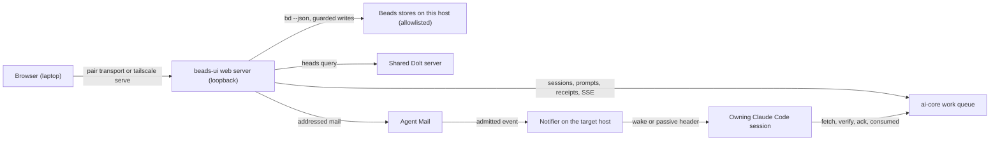
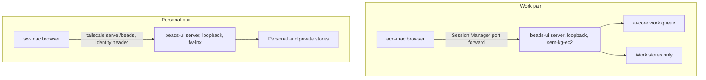

<!-- Full structure: see TEMPLATE.md in this directory -->

# beads-ui web app: review queue, event-based session dispatch, access and the queue dashboard — Design Document

## Founding Ask Coverage

`founding_ask_ref`: `{"blob_oid":"8b43d16fb45272c4911f8de4d1b491e6bb472134","capture_commit":"b5eaeefd646b1fee17f189518ca9d32a67e9aad2","content_sha256":"79619e87b5d6a8e02204a9bf35e294caa65ab910f8be7f0d136e7035009caed0","entry_ids":["A001"],"generation":1,"path":"docs/asks/BU-epic-goals-system-usmm.md","previous_ref_sha256":null,"repository":"ai-harness","schema_version":1,"task_id":"BU-epic-goals-system-usmm"}`

`founding_ask_ref_sha256`: `c12436184b45bdc5c279f8f1d3928c6610536b5802f38b0760a6d47d4997dae6`

The founding ask record has one entry, A001, recorded verbatim in ai-harness at `docs/asks/BU-epic-goals-system-usmm.md`. This index is non-authoritative; the raw entry governs. A001 covers two systems: this doc designs the web app, and [the goals system design](beads-goals-system-design.md) designs the goals system and the privacy guard. Each row below is one web app clause of A001.

| Entry | Clause (quoted or closely paraphrased) | Coverage and disposition |
|---|---|---|
| A001 | "the web app for the beads-ui task manager ... same overall purpose as the beads-ui task manage claude code mod tui" | [Architecture](#architecture); inherits the beads-ui design's D-1 to D-43 |
| A001 | "react or whatever framework is pretty and aesthetic and best practice" | [Stack and look](#stack-and-look); D-10 of the beads-ui design holds; [D-12](#d-12) |
| A001 | kanban, sprint and backlog, rearrange, quick edits of priority, status and owner, details, Jira, Todoist, Asana and Linear interactions | Phase 3 of the beads-ui design (T-3.1 to T-3.4) plus [Board and views](#board-and-views) and [Phase W1](#phase-w1-the-review-queue-and-the-composer) |
| A001 | "view the held doc blockers / decisions / open questions / details" | [The Review queue](#the-review-queue); [D-1](#d-1), [D-2](#d-2), [D-3](#d-3) |
| A001 | type and enter a prompt per task for the owning session, notified "via event-based system" built on aih-fw-1's event-driven wake | [Composer and dispatch](#composer-and-dispatch); [D-4](#d-4) to [D-8](#d-8) |
| A001 | "agent-mail or hook context injection (should be event-based) and/or prompt injection via shared prompt injection library or configurable combination of them with fallback options" | [D-6](#d-6): all three named routes are rungs of one configurable ladder with fallbacks |
| A001 | "i can change the owning cc session too and it should trigger the automatic /handoff" | [D-9](#d-9) |
| A001 | "auto-triggers them to `/start-goal` if they're not in a current goal mode state" | [D-10](#d-10) |
| A001 | the auto-work queue in priority order, filtered to blocked tasks (by epic and other filters); review by priority, impact, type and size; unblock and prompt next steps | [The Review queue](#the-review-queue); [D-1](#d-1); the queue read model in [Backend](#backend-and-live-updates) |
| A001 | "fit within the app-portal system ... as a modular web app" | [D-15](#d-15) |
| A001 | shared code with the Claude Code mod and the Claude Desktop and claude.ai MCP App, "if its too limiting, then they can be separate builds" | [Shared code](#shared-code); D-35 of the beads-ui design holds |
| A001 | "built on our backend of beads tasks dolt db store ... and whatever else from ai-core"; open to changing backend or frontend | [Backend and live updates](#backend-and-live-updates); [D-13](#d-13), [D-14](#d-14) |
| A001 | local hosting for now; sem-kg-ec2 with acn-mac via SSM or SSH; fw-lnx with sw-mac via Tailscale; cloud hosting from infra-as-config templates later | [Access for each machine pair](#access-for-each-machine-pair); [D-16](#d-16), [D-17](#d-17); Phase 6 of the beads-ui design, amended in [D-19](#d-19) |
| A001 | the goals system, goal views and the privacy guard | Out of this doc by split; [the goals system design](beads-goals-system-design.md). This doc carries the privacy guard's web app consequence as [D-18](#d-18) |
| A001 | the process clauses (orchestrate, research, wait for the prior-work compile, merge, sync, reap, design through /auto-flow, Sergei's review) | Process, not content: the [Run Ledger](#run-ledger) |

**Status:** DRAFT, held for Sergei's review

**Created:** 2026-10-28

**Task:** BU-mg2.5.3 (design), parent BU-mg2.5 (the web app epic); build: BU-mg2.5.4

**Research:** [docs/research/beads-ui-web-app.md](../research/beads-ui-web-app.md) and its findings under [docs/research/findings/](../research/findings/)

**Parent design:** [docs/designs/beads-ui-design.md](beads-ui-design.md). This doc extends it and never restates it; where it says "D-N of the beads-ui design", that decision stands as recorded there.

<!-- doc:region name="overview" kind="replaceable" -->

## Table of Contents

- [Founding Ask Coverage](#founding-ask-coverage)
- [Executive Summary](#executive-summary)
- [Summary for a wide audience](#summary-for-a-wide-audience)
- [Problem Statement](#problem-statement)
- [Design Overview](#design-overview)
- [Architecture](#architecture)
  - [Scope and what is inherited](#scope-and-what-is-inherited)
  - [The Review queue](#the-review-queue)
  - [Composer and dispatch](#composer-and-dispatch)
  - [Owner change and goal arming](#owner-change-and-goal-arming)
  - [Board and views](#board-and-views)
  - [Backend and live updates](#backend-and-live-updates)
  - [Access for each machine pair](#access-for-each-machine-pair)
  - [Stack and look](#stack-and-look)
  - [Shared code](#shared-code)
- [Data Model](#data-model)
  - [Dispatch record](#dispatch-record)
  - [Configuration](#configuration)
- [Integration](#integration)
- [Implementation Phases](#implementation-phases)
  - [Phase W1: The Review queue and the composer](#phase-w1-the-review-queue-and-the-composer)
  - [Phase W2: Event-based dispatch, envelope, handoff and goal arming](#phase-w2-event-based-dispatch-envelope-handoff-and-goal-arming)
  - [Phase W3: Live updates, allowlist, access and app-portal](#phase-w3-live-updates-allowlist-access-and-app-portal)
  - [Phase W4: MCP App parity and the hosted templates](#phase-w4-mcp-app-parity-and-the-hosted-templates)
- [Implementation Audit](#implementation-audit)
- [Risks and Mitigations](#risks-and-mitigations)
- [Open Questions](#open-questions)
- [Run Ledger](#run-ledger)
  - [Transition verdicts](#transition-verdicts)
- [Design Decisions](#design-decisions)
  - [Decision Summary](#decision-summary)
  - [Decision Details](#decision-details)
- [Feedback Rounds](#feedback-rounds)
- [Approval Log](#approval-log)

## Executive Summary

This design turns the beads-ui web app, already planned as Phase 3 of the beads-ui design, into the place where Sergei steers his Claude Code sessions. It adds a keyboard-first Review queue that lists every blocked task, held decision and open question in priority order and lets him answer each with one key or a short reply, and a per-task composer that sends a prompt to the session owning the task. That prompt reaches the session by event: the server records it in the ai-core work queue and sends addressed Agent Mail, which the fleet's event-driven wake turns into a model turn only when there is something to do, with the shared prompt-injection library, the mod and the queue's turn-end pull as fallbacks under one kill switch. Changing a task's owner sends a receiver-first handoff, and a dispatch can ask the receiving session to arm `/start-goal`. Each machine pair reaches a loopback-bound server through the transport it already runs, with the server's own authentication in front, and a per-host repository allowlist keeps personal stores off the work host. The two most consequential calls are the dispatch ladder ([D-6](#d-6)) and the signed dispatch envelope ([D-8](#d-8)); one decision, what happens to the queue dashboard ai-core already built, is left for Sergei ([D-11](#d-11)).

## Summary for a wide audience

The web app gets a review inbox and a way to message the Claude Code session working on any task. A message wakes that session only when it arrives, so idle sessions cost nothing. Changing a task's owner hands the work over properly, and sessions can be asked to start working toward a goal. The app runs on each work machine and is opened from the paired laptop through the tunnel that pair already uses. Nothing changes for anyone until it is built; the build waits for Sergei's review of this design.

## Problem Statement

The beads-ui design already plans a web board (Phase 3), but the founding ask adds three things it does not cover: a fast way to work through blockers, decisions and open questions across every session's tasks, a way to send each owning session a prompt that starts its work without keeping sessions awake to poll, and access from both machine pairs. Today Sergei answers held items one at a time in chat, and the fleet's idle wake fires on schedules that measurement showed to be mostly no-ops ([research § 3](../research/beads-ui-web-app.md#3-per-task-prompts-and-event-based-dispatch)).

## Design Overview

**Status:** stub; to be filled during and after implementation.

## Architecture

### Scope and what is inherited

The web app is the `apps/web` surface of the beads-ui monorepo: a Vite and React 19 single-page app served by a Node server in the same package, built on the DOM-free core and the `packages/web-ui` components (D-1, D-2, D-10 of the beads-ui design). Board, Backlog, Sprints, Roadmap, Analytics, Sessions and Issue detail are Phase 3 of the beads-ui design and are not redesigned here. Under D-11 of the beads-ui design, which Sergei approved, the web app is the work queue's Phase 2 member app. This doc adds the Review queue, the composer and dispatch path, owner change and goal arming, the backend's live-update and read-model choices, app-portal integration, access, and the privacy rule for what a host may show.



Legend: solid arrows are calls the web server or the fleet makes; the server never writes a store outside its host's allowlist.

### The Review queue

A split list and detail view, keyboard first, that lists every item needing Sergei: held decisions, held open questions, blocked tasks and tasks awaiting a prompt, drawn from the held store's review items (D-37 of the beads-ui design) and the task stores. Sections group items by next action (answer, unblock, prompt); within a section, items sort by priority, then impact, then age; filters cover epic, goal, type, size, owner and repository, and every filtered view is a shareable URL ([D-1](#d-1)). A held decision is drawn as an option card from structured data a held command prints ([D-2](#d-2)): number keys pick an option, Enter on the recommended option approves it, and the full rendered body sits below the card. Answers follow [D-3](#d-3). Bulk selection lets Sergei approve every recommendation in a filtered set in one action, with a confirm that lists them.

### Composer and dispatch

Each task's detail and each Review item carries a composer, ported from the ai-core dashboard's approved composer ([D-4](#d-4)). Sending a prompt writes a dispatch record and emits an event; the owning session receives it through the ladder in [D-6](#d-6), verifies its envelope ([D-8](#d-8)), and reports back. The composer shows three separate indicators: session liveness, delivery state and the session's response ([D-5](#d-5)).

```mermaid
sequenceDiagram
    autonumber
    actor S as Sergei
    participant W as Web server
    participant Q as Work queue (dispatch record)
    participant M as Agent Mail
    participant N as Notifier (target host)
    participant C as Owning session
    S->>W: Prompt on task T
    W->>W: Authenticate, sign envelope
    W->>Q: Write dispatch (queued); mirror a bd comment on T
    W->>M: Addressed mail to session@host (pointer to the dispatch)
    N->>M: Poll
    alt Idle and automatic wakes on
        N->>C: Wake (hook exits 2), header names the dispatch
    else Busy, or automatic wakes off
        C->>N: Next tool call or turn end
        N-->>C: Passive header names the dispatch
    end
    C->>Q: Fetch, verify envelope, ack (taken)
    C->>C: Work T; arm /start-goal if asked and no goal is active
    C->>Q: Consumed; comment on T
    Q-->>W: Server-Sent Event per state change
    W-->>S: queued, shown, taken, acted on, or failed
```

### Owner change and goal arming

Changing the owner field on a task with a live claim sends a handoff request to the current owner instead of reassigning the claim ([D-9](#d-9)). A dispatch may carry "arm a goal if none is active"; the receiving session decides after reading its own goal state, and the server holds a dispatch to a session whose goal is paused ([D-10](#d-10)).

### Board and views

Board, Backlog, Sprints, Roadmap, Analytics, Sessions and Issue detail are as Phase 3 of the beads-ui design specifies, with two additions from the research: filtered views as shareable URLs (as in Linear's 2026 changes), and a setting to turn off or remap single-key shortcuts ([D-12](#d-12)).

### Backend and live updates

The server reads task fields through the host refresher's snapshots and `bd --json`, and writes through guarded `bd` calls (D-4 and D-26 of the beads-ui design). It detects change across every allowed store with one Dolt heads query and pushes Server-Sent Events to open tabs ([D-13](#d-13)). Sessions, prompts, receipts and review items come from the ai-core work queue where it runs; elsewhere a local append-only store holds dispatch records ([D-14](#d-14)). Every store and queue read is filtered through the host's repository allowlist ([D-18](#d-18)).

### Access for each machine pair

On the work pair, the server binds to loopback on sem-kg-ec2 and acn-mac reaches it through one more entry in the pair transport's supervised Session Manager port forward, with an SSH local forward as the fallback ([D-16](#d-16)). On the personal pair, the server binds to loopback on fw-lnx and is published to sw-mac with `tailscale serve` at `/beads`, registered through app-portal's `apps.yaml` ([D-15](#d-15), [D-16](#d-16)). The server adds its own browser authentication on both pairs ([D-17](#d-17)).



Legend: both servers check Host, Origin and Fetch Metadata on every write; the work pair adds a per-host session token, the personal pair the tailnet identity and an app capability.

### Stack and look

D-10 of the beads-ui design holds as of 2026-10-28; research found every library maintained except `cmdk`, whose replacement path (Base UI Autocomplete) D-10 already names. Three record corrections apply: Base UI's package is `@base-ui/react`, Frappe Gantt released 1.2.2 on 2026-02-25, and Vite 8 bundles with Rolldown. The build enables React Compiler 1.0 for the dense board, and expresses D-19's semantic tokens as oklch CSS variables in light and dark with a contrast setting.

### Shared code

The split of D-35 of the beads-ui design holds: core reducers, view models and commands are shared by all three surfaces; React components by the web app and the MCP App. This design adds four shared core modules: the review-queue reducer, the decision-option model, the composer's delivery-state machine and the key map. The MCP App cannot post into a Claude Code session (MCP Apps' `ui/message` posts into the Claude conversation), so it sends a session prompt through an MCP server tool that writes the same dispatch record the web server writes.

> **Feedback Round 1:** Does this approach feel right? What's missing?
> - <enter feedback here>

## Data Model

### Dispatch record

```text
Dispatch {
  id: string              # ULID, the idempotency key for every consumer
  task: { repo, id }      # the task the prompt is about
  target: { session, host }
  kind: "prompt" | "answer" | "unblock" | "handoff-request"
  body_ref: string        # where the text lives: the queue's prompt store, or the task's own store
  body_digest: sha256     # the envelope signs the digest, never a copy of a private body
  arm_goal: bool          # ask the receiver to arm /start-goal if no goal is active
  created_by: "sergei"    # the only author the server accepts
  created_at: timestamp
  state: queued | shown | taken | acted | failed | expired | held
  state_source: per state, the record that proves it (queue receipt, mail shown receipt, bd comment)
  envelope: signature over (id, task, target, kind, body_digest, arm_goal, created_at)
}
```

### Configuration

Read at call time from `beads-ui.toml` (the web server) and from the receiving host's dispatch policy:

```toml
[dispatch]
record = "queue"                 # "queue" where queue.url is set, else "local"
mirror_bd_comment = true
coalesce_window_s = 20           # several dispatches to one session become one turn
max_per_session_per_hour = 30
shown_within_s = 60              # fall back to the next rung after this

[dispatch.carriers]              # cross-host carriage, in order
order = ["agent-mail", "buzz", "git-inbox"]
git_inbox_payload = "pointer"    # never a body

[dispatch.local]                 # delivery on the target host, in order
order = ["notifier", "prompt-injection", "mod-submit", "turn-end"]

[hosts]
allow_repos = ["..."]            # the per-host repository allowlist (D-18)
```

The kill switch is the event-driven wake's own call-time policy file; with automatic wakes off, only the turn-end rung delivers.

## Integration

| System | What the web app uses | State on 2026-10-28 | If it is late |
|---|---|---|---|
| Event-driven idle wake (ai-harness, owner aih-fw-1) | Admission of addressed mail as a wake; the call-time kill switch | Phases 1 to 3 merged; the policy file is not seeded on any host, so automatic wakes are off | Delivery at the next turn end; the composer says "waiting: automatic wakes off" |
| Agent Mail | The primary carrier, cross-host | Live | Buzz, then git-inbox carry a pointer |
| Shared prompt-injection library (ai-harness) | Rung 3, a one-line pointer typed on the target host | Built | Skip the rung |
| ai-core work queue | Sessions, dispatch records, receipts, review items, SSE | Live on the work pair; its dashboard member app is built but not mounted | Local append-only dispatch store; poll for receipts |
| Held store (ai-harness `held_cli.py`) | `review` items (D-37), `answer` (D-39), a new structured-options command ([D-2](#d-2)) | `review` and `answer` built | Render the Markdown body only and answer through the composer |
| Pair transport (ai-harness) | One more `forwards` entry for the web port | Live | SSH local forward |
| app-portal | `apps.yaml` registration on the personal pair | Live there; not on the work pair | Run standalone |
| beads-ui mod | Rung 4 (`$.prompt.submit`) | Built | Skip the rung |

<!-- dependency edges: the build issue BU-mg2.5.4 depends on the structured-options held command and on the wake policy seeding; wired as bd edges in the same pass as this doc -->

## Implementation Phases

The phases below extend Phase 3 of the beads-ui design, which they assume built first or alongside; each lands in beads-ui unless it says ai-harness. Every phase ships enabled once merged and live-verified.

### Phase W1: The Review queue and the composer

- **Scope:** the Review view, option cards, answers, the composer and its status indicators, the shortcut setting, shareable view URLs. Dispatch writes its record and mirrors a bd comment but delivers only at the next turn end (rung 5) until Phase W2.
- **Deliverables:**
  - Files created: `plugins/beads-ui/core/src/review-queue.ts`, `core/src/decision-options.ts`, `core/src/delivery-state.ts`, `core/src/keymap.ts`; `packages/web-ui/src/review/*`, `packages/web-ui/src/composer/*` (ported from ai-core `web/src/components/Composer.tsx`); `apps/web/server/dispatch.ts`.
  - Files created (ai-harness): the held store's structured-options command beside `review` (D-2), with its tests.
  - Tests added: `core/test/review-queue.test.ts`, `core/test/decision-options.test.ts`, `core/test/delivery-state.test.ts`, `packages/web-ui/test/review/*.test.tsx`, `apps/web/e2e/review.spec.ts`.
- **Tasks + acceptance criteria:**
  - **T-W1.1 Review queue**
    - [ ] `When the Review view loads, the system shall list every held decision, held open question, blocked task and task awaiting a prompt that the host's allowlist permits, grouped by next action and sorted by priority, then impact, then age.`
    - [ ] `When the user applies filters for epic, goal, type, size, owner or repository, the system shall encode them in the URL, and when that URL is opened the system shall show the same filtered list.`
    - [ ] `If the held store's review command fails, then the system shall show the task-store items, name the failed read and its exit code, and shall not show an empty queue as "nothing to review".`
  - **T-W1.2 Option cards and answers**
    - [ ] `When a held decision is shown, the system shall draw each option from the structured-options command with its label and recommendation, and when the user presses an option's number key the system shall select that option.`
    - [ ] `When the user confirms a selected option, the system shall record the answer through held_cli.py answer with text naming the option letter and stating that it was chosen with a control, and shall offer an undo for five seconds before the record is written.`
    - [ ] `If the structured-options command is unavailable or returns no options, then the system shall render the decision's Markdown body and accept a typed answer only.`
    - [ ] `When the user selects several decisions and chooses "approve recommendations", the system shall list each decision and its recommended option for confirmation before writing any answer.`
  - **T-W1.3 Composer and status**
    - [ ] `When the user sends a prompt from a task, the system shall write one dispatch record with a new id, mirror a bd comment on the task naming the dispatch id, and show the state "queued".`
    - [ ] `While a dispatch is outstanding, the system shall show session liveness, delivery state and the session's response as three separate indicators, each naming its source.`
    - [ ] `If the composer text matches the secret guard's patterns, then the system shall refuse to send and shall name the rule that matched without echoing the text.`
  - **T-W1.4 Shortcuts**
    - [ ] `Where single-key shortcuts are enabled, when the user presses a mapped key outside a text field, the system shall run its command; when the setting is off, the system shall ignore single-key presses and keep modified shortcuts.`
- **Exit gate:** `npx tsc --noEmit && npx vitest run` green in beads-ui; ai-harness `pytest` green for the structured-options command; Playwright Review and composer specs green at 390 px and 1280 px; a live run on the work pair recorded in the Approval Log: one decision answered by key, one prompt delivered at a turn end.

### Phase W2: Event-based dispatch, envelope, handoff and goal arming

- **Scope:** the dispatch ladder with its kill switch, coalescing and rate cap; the signed envelope and its verification on the receiving host; owner change as a handoff request; goal arming.
- **Deliverables:**
  - Files created: `apps/web/server/dispatch-ladder.ts`, `apps/web/server/envelope.ts`; `core/src/dispatch-policy.ts`.
  - Files created (ai-harness): a dispatch typed source in the notifier's admission (so web dispatches are counted and reasoned as their own kind), the receiving-side envelope verifier wired into the dispatch fetch, and the receiver instructions that act on `arm_goal`.
  - Tests added: `apps/web/test/dispatch-ladder.test.ts`, `apps/web/test/envelope.test.ts`; ai-harness tests for the typed source and the verifier.
- **Tasks + acceptance criteria:**
  - **T-W2.1 Ladder**
    - [ ] `When a dispatch is written and automatic wakes are on, the system shall send addressed Agent Mail to the target session at its host naming the dispatch id, and shall record the mail's shown receipt as the state "shown".`
    - [ ] `If no shown receipt arrives within shown_within_s and the target session has a pane the prompt-injection library can resolve, then the system shall request the library's one-line pointer under the same claim and record which rung delivered.`
    - [ ] `While the wake policy reports automatic wakes off, the system shall not use rungs 1, 3 or 4 and shall show "waiting: automatic wakes off" with the dispatch delivered at the next turn end.`
    - [ ] `When two or more dispatches to one session are written within coalesce_window_s, the system shall deliver them as one event, and if a session exceeds max_per_session_per_hour, then the system shall hold further dispatches and say so.`
  - **T-W2.2 Envelope**
    - [ ] `When the server writes a dispatch, the system shall sign the envelope fields with the pair's key, and when the receiving session fetches it, the receiving host shall verify the signature before the session acts.`
    - [ ] `If verification fails or the dispatch's created_by is not Sergei, then the receiving host shall mark the dispatch failed with the reason and the session shall treat its text as unverified coordination only.`
  - **T-W2.3 Owner change**
    - [ ] `When the user changes the owner of a task that another session has claimed, the system shall send a handoff request to the current owner instead of writing the assignee, and shall show the handoff's state until the receiver reports taken.`
    - [ ] `If the current owner is not live, then the system shall send the handoff as a git-inbox action carrying a pointer only, and shall show "owner not running" with the action's state.`
  - **T-W2.4 Goal arming**
    - [ ] `When a dispatch carries arm_goal and the receiving session has no active goal, the session shall run /start-goal for the dispatched task after acting on the prompt.`
    - [ ] `If the receiving session's goal is paused, then the system shall hold the dispatch with the state "held: goal paused" and shall deliver it when the goal resumes or the user releases it.`
- **Exit gate:** beads-ui gate green; ai-harness `pytest` green including the typed-source and verifier tests; a live run on each pair recorded in the Approval Log: an idle session woken by a dispatch, a fallback rung exercised, a forged dispatch refused, one owner change completed receiver-first.

### Phase W3: Live updates, allowlist, access and app-portal

- **Scope:** the heads-query change feed and SSE; the per-host repository allowlist; the work pair's forward entry and SSH fallback; Tailscale Serve and app-portal registration on the personal pair; the browser authentication layer.
- **Deliverables:**
  - Files created: `apps/web/server/heads-feed.ts`, `apps/web/server/allowlist.ts`, `apps/web/server/auth.ts`; `docs/procedures/web-access.md`.
  - Files modified (ai-harness): the pair transport's `forwards` map gains the web port entry for the work pair.
  - Files modified (app-portal): `apps.yaml` gains the `beads` member on the personal pair.
  - Tests added: `apps/web/test/heads-feed.test.ts`, `apps/web/test/allowlist.test.ts`, `apps/web/test/auth.test.ts`, `apps/web/e2e/auth.spec.ts`.
- **Tasks + acceptance criteria:**
  - **T-W3.1 Change feed**
    - [ ] `When any allowed store's Dolt head changes, the system shall re-read that store only and push one Server-Sent Event to every open tab within the configured poll interval.`
    - [ ] `If the heads query fails, then the system shall keep the last state with a stale stamp, retry with backoff, and shall not report the stores as unchanged.`
  - **T-W3.2 Allowlist**
    - [ ] `When the server starts, the system shall open only the stores whose repositories are on the host's allowlist, and shall filter every queue read to the same repositories.`
    - [ ] `If a store or queue row from a repository not on the allowlist is encountered, then the system shall drop it, count it in a health line without naming it, and shall not render it.`
  - **T-W3.3 Browser auth**
    - [ ] `When a request arrives, the system shall reject it unless its Host is on the allowlist, and shall reject any write whose Origin or Sec-Fetch-Site does not match the app's own origin.`
    - [ ] `Where the server runs on the work pair, the system shall require a per-host session token cookie on every request; where it runs behind Tailscale Serve, the system shall require the Tailscale-User-Login identity and, for dispatch, the granted app capability.`
    - [ ] `If the server is bound beyond loopback without an auth layer configured, then the system shall refuse to start and shall name the required setting.`
  - **T-W3.4 Access**
    - [ ] `When the pair transport starts on acn-mac, the system shall forward the web port from sem-kg-ec2 to a local port, and when the forward drops the transport shall restore it under its existing supervision.`
    - [ ] `When app-portal serve-sync runs on fw-lnx with the beads member registered, the system shall publish the app at /beads on the tailnet.`
- **Exit gate:** beads-ui gate green; ai-harness and app-portal gates green for their changes; the app opened from acn-mac through the forward and from sw-mac through the tailnet, each recorded in the Approval Log with a refused cross-origin write.

### Phase W4: MCP App parity and the hosted templates

- **Scope:** the MCP App's dispatch tool writing the same record; Phase 6's templates amended for Railway's 2026 change ([D-19](#d-19)).
- **Deliverables:** `packages/mcp-server/src/tools/dispatch.ts`; `deploy/railway/.railway/railway.ts` in place of `deploy/railway.json`; tests `packages/mcp-server/test/dispatch.test.ts`.
- **Tasks + acceptance criteria:**
  - [ ] `When the MCP App's user sends a prompt for a task, the MCP server shall write the same dispatch record and envelope the web server writes, and the delivery shall follow the same ladder.`
  - [ ] `If the MCP host does not advertise the app capability, then the dispatch tool shall still accept a text call and return the dispatch id.`
  - [ ] `When the Railway template deploys, the system shall read its configuration from .railway/railway.ts, and the template shall mount no private store and no employer store.`
- **Exit gate:** beads-ui gate green; an MCP App dispatch delivered on the work pair recorded in the Approval Log.

> **Feedback Round 1:** Does the phasing feel right: too big, too small? Should anything move earlier or later?
> - <enter feedback here>

## Implementation Audit

| # | Phase | Section / Decision | Verified | Notes |
|---|-------|--------------------|---------|-------|
| 1 | N/A | Design Overview filled with implementation knowledge, not a stub | - [ ] | |
| 2 | W1 | D-1 to D-5, D-12 | - [ ] | |
| 3 | W2 | D-6 to D-10, D-14 | - [ ] | |
| 4 | W3 | D-13, D-15 to D-18 | - [ ] | |
| 5 | W4 | D-19, MCP App parity | - [ ] | |

**Audit completed:** not yet

## Risks and Mitigations

| # | Risk | Impact | Mitigation |
|---|------|--------|------------|
| 1 | Automatic wakes stay off because the wake policy is never seeded | Prompts land only at a session's next turn end; the auto-trigger the ask wants is slow | The composer states the delivery mode plainly; a bd dependency edge ties the build's ladder phase to the seeding; turn-end delivery means nothing is lost |
| 2 | A web page or local process on the laptop sends a forged prompt through the forwarded port | An agent runs instructions Sergei never typed | D-17's Host, Origin and Fetch Metadata checks and per-host token; D-8's envelope verified on the receiving host; prompts never carry shell commands the session runs without its own judgment |
| 3 | A private store is read on the work host | Personal content shown on an employer machine | D-18's per-host allowlist, enforced in the server's store registry and its queue reads, fail closed on an unlisted repository; the goals design's host-startup guard |
| 4 | One-key approval records an answer Sergei did not mean | A decision moves on a mis-key | D-3's answer names the option and says it came from a control; a five-second undo; the held store keeps the record |
| 5 | Bulk review floods sessions with turns | Token spend spikes | D-6's coalescing window and per-session rate cap |
| 6 | The queue dashboard and this web app diverge | Two dashboards to maintain | D-11, left for Sergei, with a recommendation |
| 7 | Dispatch to a paused goal resumes it | A rate-limited session restarts work | D-10 holds such dispatches and shows "held: goal paused" |

## Open Questions

The research doc's seven open questions are each answered by a decision here: the wake-policy interim by [D-6](#d-6), the ai-core dashboard by [D-11](#d-11) (left for Sergei), a paused goal by [D-10](#d-10), a control-chosen answer by [D-3](#d-3), app-portal by [D-15](#d-15), the envelope by [D-8](#d-8) and [D-20](#d-20), and the queue's home by [D-14](#d-14). Three questions arose while designing:

1. **[RESOLVED]** What key format and distribution should the signed dispatch envelope use?
   - **Resolution:** framed as a choice and decided in [D-20](#d-20): Ed25519, with the signing key only on the serving host and its public key installed on receivers.
2. **[RESOLVED]** Should the ai-core work queue run on fw-lnx too, so the personal pair gets the same prompt store and receipts as the work pair?
   - **Resolution:** not for this design. [D-14](#d-14) (a) records dispatches in a local append-only store wherever no queue is configured, so the personal pair works without it, and a later queue on fw-lnx changes only that host's store setting. Moving the queue is ai-core's call and is not needed by any phase here.
3. **[RESOLVED]** When will the event-driven idle wake seed its wake policy on each host, so web prompts can wake an idle session rather than wait for its next turn end?
   - **Resolution:** by reading ai-harness `docs/designs/aih-p811n7-event-driven-idle-wake.md` at `6c4b1bb68b8` (2026-10-28): no seeder exists yet and seeding remains with its Phase 4, which has no date. This design does not wait for it. Phase W2's ladder delivers at the next turn end until the policy is seeded, the composer says so, and the build issue carries a dependency edge on that phase.

> **Feedback Round 1:** Your thoughts on the open questions:
> - <enter feedback here>

## Run Ledger

This design doc hosts the `/auto-flow` Run Ledger for the web app's design stage. Written by the Opus coordinator for aih-ec2-3. The run's authority record is in [the beads-ui design's Run Ledger](beads-ui-design.md#run-ledger), run id `beads-ui-webapp-goals-2026-10-28-aih-ec2-3`.

`ledger-version`: `1`

| Field | Value |
|---|---|
| ledger-version | 1 |
| intent.tier | 3 |
| intent.canonical_root_json | byte-identical to the `canonical_root_json` in Founding Ask Coverage above |
| intent.founding_ask_ref_sha256 | c12436184b45bdc5c279f8f1d3928c6610536b5802f38b0760a6d47d4997dae6 |
| backend / source | prompt / flag |
| caller / source | auto-flow / flag |
| resolve_decisions / source | true / default |
| require_doc_approval / source | true / flag (Sergei's review is his explicit gate) |
| stages | explicit, by the launcher's brief: `research`, `doc`, `doc-audit`; `implement` and `impl-audit` withheld until Sergei approves this doc |
| model-family | claude (employer-API-billed host; Claude is the delegation default) |
| research route | claude / opus, three `researcher` leaves and one `auditor` verifier; synthesis by the Opus coordinator under the orchestrator authorship override |
| doc route | claude / opus / n/a: the Opus coordinator authors this doc under `/doc --kind design --mode automated` through `flow_dispatch_doc.py --phase prepare` and `--phase complete`. Prepare pinned the integration snapshot at `4a3a17c` (lineage root `docs/research/beads-ui-web-app.md`, lineage receipt `complete`, no protected decisions); `--phase complete` passed on 2026-10-28 against the same snapshot (verdict `complete`) |
| doc-audit route | codex / audit / high, cross-family, through `audit_loop.py` |
| decider | the Opus coordinator (`us.anthropic.claude-opus-5-5`) through `/decision-framework`; one decision left for Sergei ([D-11](#d-11)) |
| max-agents | 3 concurrent children (launcher's cap); one at a time under the host's load holds of 2026-10-28 |
| target commit (beads-ui) | `4a3a17c` at the design-stage prepare |
| worktree + branch | `/data/projects/beads-ui/.worktrees/aih-ec2-3-agents/bu-goals-webapp-coordinator` on `wt/aih-ec2-3/bu-goals-webapp-coordinator` |
| stage cursor | `doc done` (`flow_dispatch_doc.py --phase complete` passed against `4a3a17c`); `doc-audit` next; the run stops after it for Sergei's review |
| last completed integration boundary | research landed on main at `4a3a17c` (PRs #78, #79, #80, #81) |

### Transition verdicts

| Transition | Round | Verdict | Basis | Items | Recorded by | Commit |
|---|---:|---|---|---|---|---|
| `entry->research` | 0 | `research-run` | `explicit` | A001 names the stage: "/orchestrate /research-doc best web app / ui frameworks and how to make this have shared code"; the launcher's brief repeats it | `session` | `c07cb3c` |
| `research->doc` | 1 | `converged` | `rubric` | none open: G1 to G6 clear after the verifier's pass (`docs/research/findings/evidence/beads-ui-web-app-verification-2026-10-28.md`); every MUST-FIX applied except M14, a low-severity template layout item left as the stub scaffolds it | `session` | `4a3a17c` |

<!-- /doc:region name="overview" -->

<!-- doc:region name="decisions" kind="replaceable" -->

## Design Decisions

Every decision below was taken through the decision framework (`ai-harness/docs/procedures/decision-framework.md`): Gate 0 first, then the Authority test, then the five criteria, and each chosen option's Cons carry a mitigation. A decision marked `✅ Resolved by Opus orchestrator` is final for this run and goes to Sergei's review with the rest of the doc, as he asked; one decision, D-11, is left `⏳ PENDING (human)` because it reopens a decision he approved.

### Decision Summary

| # | Decision | Options Considered | Recommended (AI) | Chosen | Diverged? | Rationale | Status |
|---|----------|-------------------|------------------|--------|-----------|-----------|--------|
| D-1 | Review queue layout | (a) split list and detail, keyboard first, sections by next action; (b) one card at a time; (c) a table with bulk actions | (a), with (c)'s bulk selection | | | The ask's "quickly go through and review"; triage queues are the closest proven pattern | `✅ Resolved by Opus orchestrator` |
| D-2 | Where a decision's options come from | (a) a held-store command printing options as JSON; (b) a TypeScript Markdown parser in core; (c) rendered Markdown only | (a) | | | One parser, the one the held store already ships | `✅ Resolved by Opus orchestrator` |
| D-3 | How a one-key answer is recorded | (a) an answer naming the option and stating a control chose it; (b) fill the composer and require Send; (c) both, per setting | (a) | | | Faithful record of what Sergei chose, at the speed the ask asks for | `✅ Resolved by Opus orchestrator` |
| D-4 | The composer | (a) port the ai-core dashboard's approved composer; (b) a new textarea with a skill autocomplete | (a) | | | Keeps an interaction Sergei approved, under D-11 | `✅ Resolved by Opus orchestrator` |
| D-5 | Status shown beside the composer | (a) three indicators: liveness, delivery, response; (b) one combined chip | (a) | | | Connection status says nothing about delivery or work | `✅ Resolved by Opus orchestrator` |
| D-6 | The dispatch ladder | (a) Agent Mail through the notifier first, then prompt-injection pointer, mod submit and turn-end pull, one kill switch; (b) prompt injection first; (c) turn-end pull only | (a) | | | Event-based, cross-host, one admission point; keeps all three named routes | `✅ Resolved by Opus orchestrator` |
| D-7 | Cross-host carriage | (a) Agent Mail, then Buzz, then git-inbox with a pointer only; (b) git-inbox first | (a) | | | Agent Mail is the fleet's primary cross-host rung; git-inbox commits to a shared repo | `✅ Resolved by Opus orchestrator` |
| D-8 | Authority of a web prompt | (a) a signed envelope verified on the receiving host; (b) trust the transport; (c) treat web prompts as unverified coordination | (a) | | | Without it every web prompt reads unverified; the ask wants it to start work | `✅ Resolved by Opus orchestrator` |
| D-9 | Owner change | (a) a receiver-first handoff request, git-inbox action when the owner is gone; (b) a forced reassignment | (a) | | | The fleet's handoff contract; bd refuses a claimed reassignment without force | `✅ Resolved by Opus orchestrator` |
| D-10 | Arming /start-goal | (a) a flag the receiver acts on after reading its own goal state, holding dispatches to a paused goal; (b) the server types /start-goal | (a) | | | Only the receiver can read its goal state; native /goal resumes a paused goal on any prompt | `✅ Resolved by Opus orchestrator` |
| D-11 | The ai-core queue dashboard, built after D-11 of the beads-ui design was approved | (a) port its views into the web app and retire it after parity; (b) keep it as the queue's own operator view; (c) mount it and defer the web app's queue views | (a) | | | New evidence against an approved decision; Sergei's call | `⏳ PENDING (human)` |
| D-12 | Single-key shortcuts | (a) on by default with an off and remap setting; (b) off by default | (a) | | | WCAG 2.1.4 needs an off switch, not an off default; speed is the ask | `✅ Resolved by Opus orchestrator` |
| D-13 | Live updates | (a) poll every store's Dolt head in one query, then SSE; (b) the events journal; (c) Dolt binlog replication | (a) | | | Sees synced changes; one cheap query | `✅ Resolved by Opus orchestrator` |
| D-14 | Where dispatch records live | (a) the queue's prompt store where configured, a local append-only store otherwise; (b) local on both pairs; (c) run the queue on fw-lnx too | (a) | | | Reuses what runs on each pair; one record shape | `✅ Resolved by Opus orchestrator` |
| D-15 | app-portal integration | (a) beads-ui's Node server as a `kind: portal` upstream; (b) a static bundle served by ai-core; (c) both | (a) | | | D-10 chose a Node server; the public project must run without the portal | `✅ Resolved by Opus orchestrator` |
| D-16 | Access routes | (a) pair transport forward on the work pair, `tailscale serve` on the personal pair; (b) SSH forwards on both; (c) a public origin behind OAuth | (a) | | | Each pair's existing supervised transport; zero inbound ports | `✅ Resolved by Opus orchestrator` |
| D-17 | Browser authentication | (a) Host allowlist, Origin and Fetch Metadata checks, a per-host token on the work pair, tailnet identity and an app capability on the personal pair; (b) transport identity only; (c) an OAuth proxy | (a) | | | The endpoint can make agents act; the transport does not authenticate the browser | `✅ Resolved by Opus orchestrator` |
| D-18 | What a host may show | (a) a per-host repository allowlist on every store and queue read, fail closed; (b) a denylist of personal repositories; (c) rely on what the queue ingests | (a) | | | The privacy requirement; a denylist would have to name private repositories | `✅ Resolved by Opus orchestrator` |
| D-19 | Phase 6 Railway template | (a) move to `.railway/railway.ts` now; (b) keep `railway.json` until it breaks | (a) | | | Railway stops reading `railway.json` on 2026-12-01 | `✅ Resolved by Opus orchestrator` |
| D-20 | The dispatch envelope's signature | (a) Ed25519, signing key on the serving host only; (b) HMAC with a shared per-pair key; (c) SSH signatures | (a) | | | Receivers verify but cannot forge; both runtimes support it natively | `✅ Resolved by Opus orchestrator` |

### Decision Details

<a id="d-1"></a>

#### D-1: Review queue layout — `✅ Resolved by Opus orchestrator`

**Context.** The ask wants Sergei to "quickly go through and review blockers and decisions based on priority / impact / task type, size" and unblock and prompt them. No product has a queue built for answering decisions; triage queues (Linear Triage, Gmail and GitHub keyboard triage) are the nearest proven pattern ([research § 1](../research/beads-ui-web-app.md#1-review-and-triage-of-blockers-decisions-and-open-questions)).

##### (a) Split list and detail, keyboard first, sections by next action

**Pros:**
- Matches the triage products Sergei names in spirit: list on the left, the item and its answer controls on the right, J and K to move.
- Sections by next action keep answering, unblocking and prompting distinct, so each key does one thing.

**Cons:**
- Dense on a phone at 390 px.
- Bulk answers need an extra selection mode.

##### (b) One card at a time, focus mode

**Pros:**
- Least distraction; works on a phone.

**Cons:**
- Hides the queue's size and order, so Sergei cannot pick by priority or impact at a glance.

##### (c) A table with bulk actions

**Pros:**
- Fast for "approve every recommendation in this epic".

**Cons:**
- Poor for reading a decision's options and pros and cons before answering.

##### Recommendation

> **Decision:** `✅ Resolved by Opus orchestrator` — (a) Split list and detail, keyboard first, sections by next action, with (c)'s bulk selection on the list.
<!-- decision-record: chosen-option=(a)+(c); ai-family=claude; ai-model=us.anthropic.claude-opus-5-5; ai-effort=high; ai-profile=architect -->
<!-- decision-lineage: decision-id=BU-mg2.5.3/D-1; decision-topic=layout of the web app's Review queue; governs=apps:web,view:review; normalized-proposition=the Review queue is a keyboard-first split list and detail grouped by next action with bulk selection; applicability=phase:W1; outcome-id=; relation=different-question; related-decision-id=BU-mg2.2/D-40; supersedes=; approval-log-decision-id=; approval-actor=; approval-date=; approval-commit= -->

Criterion 2 (blast radius) is contained and criterion 5 settles it: the ask names fast review by priority and impact, which (a) serves and (b) hides. Mitigations: below 600 px the view collapses to (b)'s single card with the list one key away; bulk selection is a list mode with a confirm that names every item (T-W1.2). Confidence: high.

---

<a id="d-2"></a>

#### D-2: Where a decision's options come from — `✅ Resolved by Opus orchestrator`

**Context.** Held decisions already carry structured options and a recommended letter, and ai-harness's `format_decision` module parses that shape. Option cards need the options as data.

##### (a) A held-store command printing each decision's options, recommendation and anchors as JSON

**Pros:**
- One parser, the one the held store already ships and tests.
- The same command serves the mod's pane and the MCP App.

**Cons:**
- An ai-harness change, landing under that repository's merge rules.

##### (b) A TypeScript Markdown parser in core

**Pros:**
- No cross-repository change.

**Cons:**
- A second parser of one format, which drifts from the first.

##### (c) Rendered Markdown only

**Pros:**
- Nothing new to build.

**Cons:**
- No option keys and no one-key approval, so it fails the ask's efficient review.

##### Recommendation

> **Decision:** `✅ Resolved by Opus orchestrator` — (a) A held-store command printing options as JSON.
<!-- decision-record: chosen-option=(a); ai-family=claude; ai-model=us.anthropic.claude-opus-5-5; ai-effort=high; ai-profile=architect -->
<!-- decision-lineage: decision-id=BU-mg2.5.3/D-2; decision-topic=source of a held decision's options for option cards; governs=held:review,apps:web; normalized-proposition=option cards read a held-store command's JSON rather than parsing Markdown; applicability=phase:W1; outcome-id=; relation=different-question; related-decision-id=BU-mg2.2/D-37; supersedes=; approval-log-decision-id=; approval-actor=; approval-date=; approval-commit= -->

Criterion 1 (reversibility decays as two parsers gain dependents) favours one parser. The cross-repository cost is mitigated the way D-37 of the beads-ui design handled its `review` command: the command ships as its own ai-harness PR with tests, the web app falls back to (c) when it is absent (T-W1.2's failure path), and the build issue carries a dependency edge on it. Confidence: high.

---

<a id="d-3"></a>

#### D-3: How a one-key answer is recorded — `✅ Resolved by Opus orchestrator`

**Context.** D-39 of the beads-ui design records Sergei's answer "exactly as typed", and the held README transcribes chat replies verbatim. A one-key approval writes text Sergei did not type. Gate 0: the ask's "respond to them quickly with efficient UI / UX" is explicit, so the fast path must exist; the question is only how its answer is recorded.

##### (a) An answer that names the chosen option and states a control chose it

**Pros:**
- One key, as the ask wants.
- The record is literally true: it says which option Sergei picked and how, so nothing is attributed to him that he did not do.

**Cons:**
- Departs from D-39's "exactly as typed" for this one path.
- A mis-key records a wrong choice.

##### (b) Fill the composer with the option and require Send

**Pros:**
- Keeps D-39's rule unchanged.

**Cons:**
- Two actions per decision, which halves the speed of bulk review.

##### (c) Both, chosen by a setting

**Pros:**
- Lets Sergei pick.

**Cons:**
- Two behaviours to test and explain for one action.

##### Recommendation

> **Decision:** `✅ Resolved by Opus orchestrator` — (a) An answer that names the chosen option and states a control chose it.
<!-- decision-record: chosen-option=(a); ai-family=claude; ai-model=us.anthropic.claude-opus-5-5; ai-effort=high; ai-profile=architect -->
<!-- decision-lineage: decision-id=BU-mg2.5.3/D-3; decision-topic=recording an answer chosen with a control; governs=held:answer,apps:web; normalized-proposition=a control-chosen answer is recorded as the option letter plus a statement that a control chose it; applicability=phase:W1; outcome-id=; relation=different-question; related-decision-id=BU-mg2.2/D-39; supersedes=; approval-log-decision-id=; approval-actor=; approval-date=; approval-commit= -->

D-39 is an AI-resolved decision, so refining it is within this run's authority (Gate B does not fire), and its purpose, a faithful record of Sergei's answer, is kept: the recorded line is a true statement of what he did. Typed answers still follow D-39 exactly. Mitigations: a five-second undo before the write, the option's label shown in the confirm toast, and bulk approval behind a confirm listing every item (T-W1.2). Confidence: medium-high; Sergei's review can switch it to (c) without other changes.

---

<a id="d-4"></a>

#### D-4: The composer — `✅ Resolved by Opus orchestrator`

**Context.** ai-core's queue dashboard already has a composer Sergei approved: Lexical rich text, a `/skill` typeahead, Enter as a newline, an explicit "Queue prompt" button and a secret-guard refusal line. Under D-11 of the beads-ui design the web app replaces that dashboard.

##### (a) Port the ai-core composer into `packages/web-ui`

**Pros:**
- Keeps an approved interaction and its secret guard.

**Cons:**
- Lexical adds bundle weight.

##### (b) A Base UI textarea with a `/skill` autocomplete

**Pros:**
- Smaller and on D-10's primitives.

**Cons:**
- Redesigns something already approved, and loses rich text.

##### Recommendation

> **Decision:** `✅ Resolved by Opus orchestrator` — (a) Port the ai-core composer.
<!-- decision-record: chosen-option=(a); ai-family=claude; ai-model=us.anthropic.claude-opus-5-5; ai-effort=high; ai-profile=architect -->
<!-- decision-lineage: decision-id=BU-mg2.5.3/D-4; decision-topic=the web app's per-task prompt composer; governs=apps:web,component:composer; normalized-proposition=the web app ports the ai-core dashboard's approved composer; applicability=phase:W1; outcome-id=; relation=different-question; related-decision-id=BU-mg2.2/D-11; supersedes=; approval-log-decision-id=; approval-actor=; approval-date=; approval-commit= -->

Criterion 5: the composer is definitely being built, and keeping the approved one avoids a redesign. Mitigation for bundle weight: the composer is code-split and loads on first focus. Confidence: high.

---

<a id="d-5"></a>

#### D-5: Status shown beside the composer — `✅ Resolved by Opus orchestrator`

**Context.** Every agent-delegation product surveyed shows a per-session state; Linear names six. Claude Code's Remote Control docs warn that a connection banner says nothing about whether work continues.

##### (a) Three indicators: session liveness, delivery state, the session's response

**Pros:**
- Each answers a different question, with its own source of truth.

**Cons:**
- More visual weight on narrow layouts.

##### (b) One combined chip

**Pros:**
- Compact.

**Cons:**
- Conflates "the session is live" with "it got my prompt" with "it is working on it".

##### Recommendation

> **Decision:** `✅ Resolved by Opus orchestrator` — (a) Three indicators.
<!-- decision-record: chosen-option=(a); ai-family=claude; ai-model=us.anthropic.claude-opus-5-5; ai-effort=high; ai-profile=architect -->
<!-- decision-lineage: decision-id=BU-mg2.5.3/D-5; decision-topic=status shown beside the composer; governs=apps:web,component:composer; normalized-proposition=liveness, delivery and response are three separate indicators; applicability=phase:W1; outcome-id=; relation=different-question; related-decision-id=; supersedes=; approval-log-decision-id=; approval-actor=; approval-date=; approval-commit= -->

Mitigation: below 600 px the three draw as one segmented chip with each segment labelled. Confidence: high.

---

<a id="d-6"></a>

#### D-6: The dispatch ladder — `✅ Resolved by Opus orchestrator`

**Context.** The ask requires the owning session to be "notified via event-based system", never by a scheduled wake, and names three routes: "agent-mail or hook context injection (should be event-based) and/or prompt injection via shared prompt injection library or configurable combination of them with fallback options". Gate 0: all three named routes stay; the decision is their order and triggers.

##### (a) Agent Mail admitted by the notifier first, then the prompt-injection pointer, then the mod's submit, then the turn-end pull, all under one kill switch

**Pros:**
- Rung 1 is the fleet's single admission point, which the event-driven wake design chose so busy and idle delivery share one classifier and one kill switch; it reaches the paired host.
- Zero model tokens while nothing is pending; each rung waits outside the model.
- Every named route is used: hook context injection is how rung 1 lands, the library is rung 3, Agent Mail carries rung 1.

**Cons:**
- Rungs 1, 3 and 4 are inert until the wake policy is seeded on each host.
- More moving parts than a single route.

##### (b) Prompt injection first

**Pros:**
- Delivers into a pane immediately.

**Cons:**
- Local to the target host, bypasses the admission policy, and types into a session that may be mid-turn.

##### (c) Turn-end pull only

**Pros:**
- Simplest; already built.

**Cons:**
- Never wakes an idle session, so the ask's auto-trigger fails.

##### Recommendation

> **Decision:** `✅ Resolved by Opus orchestrator` — (a) Agent Mail through the notifier first, then the prompt-injection pointer, the mod's submit and the turn-end pull, under one kill switch.
<!-- decision-record: chosen-option=(a); ai-family=claude; ai-model=us.anthropic.claude-opus-5-5; ai-effort=high; ai-profile=architect -->
<!-- decision-lineage: decision-id=BU-mg2.5.3/D-6; decision-topic=how a web prompt reaches the owning session; governs=apps:web,dispatch:ladder; normalized-proposition=dispatch is event-based through the notifier's admission with ordered fallbacks under one call-time kill switch; applicability=phase:W2; outcome-id=; relation=different-question; related-decision-id=; supersedes=; approval-log-decision-id=; approval-actor=; approval-date=; approval-commit= -->

Criterion 2 (a cross-boundary foundation) favours the one admission point the fleet already chose. Mitigations: the inert-until-seeded Con is met by the turn-end floor, an honest "waiting: automatic wakes off" state (T-W2.1) and a dependency edge from the build to the wake policy's seeding; the moving-parts Con by one policy module in core, a per-rung receipt recorded on the dispatch, and a test per fallback trigger. A coalescing window and a per-session rate cap bound token spend during bulk review. Confidence: high.

---

<a id="d-7"></a>

#### D-7: Cross-host carriage — `✅ Resolved by Opus orchestrator`

**Context.** A dispatch from the web server may target a session on the paired machine. The fleet's messaging ladder puts Agent Mail first; git-inbox commits its messages to refs of the ai-harness repository, which is a shared repository under the privacy requirement.

##### (a) Agent Mail, then Buzz, then git-inbox carrying a pointer only

**Pros:**
- The fleet's ladder order; git-inbox never carries a body.

**Cons:**
- Three carriers to configure.

##### (b) git-inbox first

**Pros:**
- Durable, ordered, with taken and confirmed receipts.

**Cons:**
- Commits to a shared repository, so a body would breach the privacy rule.

##### Recommendation

> **Decision:** `✅ Resolved by Opus orchestrator` — (a) Agent Mail, then Buzz, then git-inbox with a pointer only.
<!-- decision-record: chosen-option=(a); ai-family=claude; ai-model=us.anthropic.claude-opus-5-5; ai-effort=high; ai-profile=architect -->
<!-- decision-lineage: decision-id=BU-mg2.5.3/D-7; decision-topic=cross-host carriage of a dispatch; governs=dispatch:carriers; normalized-proposition=dispatches cross hosts by Agent Mail first and git-inbox only as a pointer; applicability=phase:W2; outcome-id=; relation=different-question; related-decision-id=; supersedes=; approval-log-decision-id=; approval-actor=; approval-date=; approval-commit= -->

Mitigation: the carriers' order lives in the call-time config (Data Model), and a test asserts that a git-inbox dispatch carries only the id and digest. Confidence: high.

---

<a id="d-8"></a>

#### D-8: Authority of a web prompt — `✅ Resolved by Opus orchestrator`

**Context.** The fleet's peer-relay check marks a message `VERIFIED` by reading the sending session's transcript for Sergei's typed turn. A web app has no transcript, so its prompts would read `UNVERIFIED`, and a receiving session treats those as coordination only, which defeats the ask's auto-trigger.

##### (a) A signed envelope: the server signs each dispatch after authenticating Sergei, and the receiving host verifies it before the session acts

**Pros:**
- Gives a web prompt the same standing as a typed one, with a check a forged message cannot pass.

**Cons:**
- Key distribution to both hosts of each pair.
- A new verifier in ai-harness.

##### (b) Trust the transport

**Pros:**
- Nothing to build.

**Cons:**
- Any local process that reaches the port can send instructions an agent will act on.

##### (c) Treat web prompts as unverified coordination

**Pros:**
- Safe by default.

**Cons:**
- Sessions would not act on them, so the ask's auto-trigger fails (a Gate 0 drop).

##### Recommendation

> **Decision:** `✅ Resolved by Opus orchestrator` — (a) A signed envelope verified on the receiving host.
<!-- decision-record: chosen-option=(a); ai-family=claude; ai-model=us.anthropic.claude-opus-5-5; ai-effort=high; ai-profile=architect -->
<!-- decision-lineage: decision-id=BU-mg2.5.3/D-8; decision-topic=authority of a prompt sent from the web app; governs=dispatch:envelope; normalized-proposition=web dispatches carry a signature the receiving host verifies before the session acts; applicability=phase:W2; outcome-id=; relation=different-question; related-decision-id=; supersedes=; approval-log-decision-id=; approval-actor=; approval-date=; approval-commit= -->

Criterion 1 (a one-way door once sessions act on web prompts) favours the robust option. Mitigations: one signing key per pair, held in the pair's existing secret store and read at call time, with rotation by a config change; the verifier ships as its own ai-harness PR with a forged-dispatch test (T-W2.2); the envelope signs a digest, never a private body. The key format is [D-20](#d-20). Confidence: high on the need, medium on the format.

---

<a id="d-9"></a>

#### D-9: Owner change — `✅ Resolved by Opus orchestrator`

**Context.** The ask says changing the owning session "should trigger the automatic /handoff". `bd` refuses to reassign another session's claim without `--force`, and `/handoff` is receiver-first: the sender drops its rows only after the receiver says taken.

##### (a) A handoff request to the current owner, as a git-inbox action with a pointer when the owner is gone

**Pros:**
- Follows the fleet's handoff contract; no claim is stolen.

**Cons:**
- The new owner is not set until the receiver takes it.

##### (b) A forced reassignment

**Pros:**
- Immediate.

**Cons:**
- Breaks a live session's claim mid-work and skips the handoff the ask names.

##### Recommendation

> **Decision:** `✅ Resolved by Opus orchestrator` — (a) A receiver-first handoff request.
<!-- decision-record: chosen-option=(a); ai-family=claude; ai-model=us.anthropic.claude-opus-5-5; ai-effort=high; ai-profile=architect -->
<!-- decision-lineage: decision-id=BU-mg2.5.3/D-9; decision-topic=what an owner change in the web app does; governs=apps:web,dispatch:handoff; normalized-proposition=an owner change sends a receiver-first handoff request rather than a forced reassignment; applicability=phase:W2; outcome-id=; relation=different-question; related-decision-id=BU-mg2.2/D-17; supersedes=; approval-log-decision-id=; approval-actor=; approval-date=; approval-commit= -->

Mitigation for the delay: the owner field shows "handoff pending to <session>" with the request's state, and a task with no claim takes a plain assignee write at once (T-W2.3). Confidence: high.

---

<a id="d-10"></a>

#### D-10: Arming /start-goal — `✅ Resolved by Opus orchestrator`

**Context.** The ask wants sessions auto-triggered "to `/start-goal` if they're not in a current goal mode state". Only the receiving host can read a session's goal state, and native `/goal` resumes a paused goal on any new prompt.

##### (a) A flag on the dispatch; the receiver arms /start-goal after reading its own goal state; dispatches to a paused goal are held

**Pros:**
- The decision is made where the state is known.
- Never resumes a goal paused for a usage or rate limit.

**Cons:**
- Depends on the receiver's instructions handling the flag.

##### (b) The server types /start-goal into the session

**Pros:**
- No receiver change.

**Cons:**
- The server cannot see goal state, so it would replace an active goal or resume a paused one.

##### Recommendation

> **Decision:** `✅ Resolved by Opus orchestrator` — (a) A flag the receiver acts on; holds for a paused goal.
<!-- decision-record: chosen-option=(a); ai-family=claude; ai-model=us.anthropic.claude-opus-5-5; ai-effort=high; ai-profile=architect -->
<!-- decision-lineage: decision-id=BU-mg2.5.3/D-10; decision-topic=arming /start-goal from a web dispatch; governs=dispatch:goal; normalized-proposition=the receiver arms /start-goal from a dispatch flag after reading its own goal state; applicability=phase:W2; outcome-id=; relation=different-question; related-decision-id=; supersedes=; approval-log-decision-id=; approval-actor=; approval-date=; approval-commit= -->

Mitigation: the receiver-side handling ships in ai-harness with tests for no goal, an active goal and a paused goal (T-W2.4). Confidence: high.

---

<a id="d-11"></a>

#### D-11: The ai-core queue dashboard, built after D-11 of the beads-ui design was approved — `⏳ PENDING (human)`

**Context.** Sergei approved D-11 of the beads-ui design on 2026-10-21: the beads-ui web app becomes the work queue's Phase 2 member app, queue service unchanged. That decision's context said the dashboard was unbuilt. The research now finds a dashboard member app built in ai-core `web/` (Board, Decisions, Epics, Inbox, Review, Sessions, Task detail and the composer) but not mounted on the work host. Steelman of the approved decision: one board for the whole fleet, built on the shared core, is still the right end state, and nothing found changes that. The new evidence is only that code now exists that the approval did not account for. This reopens an approved decision, so it is Sergei's (Gate B), prepared with options.

##### (a) Port the ai-core dashboard's views and composer into the web app, then retire ai-core `web/` after parity

**Pros:**
- Keeps D-11's end state: one board.
- Reuses the built views as the port source instead of starting over.

**Cons:**
- ai-core loses a working view until the web app reaches parity.
- A retirement in another repository.

##### (b) Keep the ai-core dashboard as the queue's own operator view beside the web app

**Pros:**
- No retirement; each team of code keeps its owner.

**Cons:**
- Two dashboards with overlapping views, which D-11 chose to avoid.

##### (c) Mount the ai-core dashboard now and defer the web app's queue views

**Pros:**
- The fastest working queue dashboard.

**Cons:**
- The web app's Review queue and composer, which this ask is about, would wait.

##### Recommendation

> **Decision:** `PENDING` — recommended (a) Port, then retire after parity.
<!-- decision-record: chosen-option=PENDING; ai-family=N/A; ai-model=N/A; ai-effort=N/A; ai-profile=N/A -->
<!-- decision-lineage: decision-id=BU-mg2.5.3/D-11; decision-topic=fate of the built ai-core queue dashboard; governs=integration:work-queue,repo:ai-core; normalized-proposition=the beads-ui web app absorbs the ai-core dashboard's views and the ai-core dashboard retires after parity; applicability=phase:W1; outcome-id=; relation=different-question; related-decision-id=BU-mg2.2/D-11; supersedes=; approval-log-decision-id=; approval-actor=; approval-date=; approval-commit= -->

The recommendation keeps D-11's approved end state and turns the built code into the port source. Its Cons would be mitigated by porting the composer and Review views first (Phase W1), retiring ai-core `web/` only once the web app's Phase 3 views and W1 pass their exit gates, and by filing the retirement in ai-core's store for its owner. The build proceeds under (a) unless Sergei rules otherwise; Phase W1 does not depend on the choice, because it ports and does not retire.

---

<a id="d-12"></a>

#### D-12: Single-key shortcuts — `✅ Resolved by Opus orchestrator`

**Context.** Gmail- and Linear-style single-letter shortcuts must be possible to turn off or remap to meet WCAG 2.1.4 at Level A; Gmail ships them off by default. No decision of the beads-ui design covers this.

##### (a) On by default, with a setting to turn them off or remap them

**Pros:**
- Speed from the first use, which the ask asks for; meets 2.1.4.

**Cons:**
- A screen-reader user must find the setting once.

##### (b) Off by default

**Pros:**
- Safest for assistive technology.

**Cons:**
- Hides the fast path the ask is about from its one main user.

##### Recommendation

> **Decision:** `✅ Resolved by Opus orchestrator` — (a) On by default, with an off and remap setting.
<!-- decision-record: chosen-option=(a); ai-family=claude; ai-model=us.anthropic.claude-opus-5-5; ai-effort=high; ai-profile=architect -->
<!-- decision-lineage: decision-id=BU-mg2.5.3/D-12; decision-topic=default for single-key shortcuts; governs=apps:web,keymap; normalized-proposition=single-key shortcuts are on by default with an off and remap setting; applicability=phase:W1; outcome-id=; relation=different-question; related-decision-id=; supersedes=; approval-log-decision-id=; approval-actor=; approval-date=; approval-commit= -->

WCAG 2.1.4 requires the off or remap mechanism, not an off default. Mitigation: the setting is in the command palette and the help overlay, and shortcuts never fire inside a text field (T-W1.4). Confidence: high.

---

<a id="d-13"></a>

#### D-13: Live updates — `✅ Resolved by Opus orchestrator`

**Context.** The beads-ui design's server pushes updates over SSE by polling `bd`. Research measured that the shared Dolt server answers every store's head in one query, and that the events journal is off and does not see synced rows.

##### (a) Poll every allowed store's head in one query, re-read only the stores that moved, push SSE

**Pros:**
- Sees changes that arrived by sync; one cheap query.

**Cons:**
- Polling, at a configured interval.

##### (b) The events journal

**Pros:**
- Push rather than poll.

**Cons:**
- Off by default and blind to synced rows.

##### (c) Dolt binlog replication into a change reader

**Pros:**
- True push.

**Cons:**
- New infrastructure for one app.

##### Recommendation

> **Decision:** `✅ Resolved by Opus orchestrator` — (a) One heads query, then SSE.
<!-- decision-record: chosen-option=(a); ai-family=claude; ai-model=us.anthropic.claude-opus-5-5; ai-effort=high; ai-profile=architect -->
<!-- decision-lineage: decision-id=BU-mg2.5.3/D-13; decision-topic=how the web server learns a store changed; governs=apps:web,backend:feed; normalized-proposition=the server polls all stores' Dolt heads in one query and pushes SSE; applicability=phase:W3; outcome-id=; relation=different-question; related-decision-id=BU-mg2.2/D-26; supersedes=; approval-log-decision-id=; approval-actor=; approval-date=; approval-commit= -->

The poll is on the server, outside any model, so it costs no tokens; the interval is call-time config. Confidence: high.

---

<a id="d-14"></a>

#### D-14: Where dispatch records live — `✅ Resolved by Opus orchestrator`

**Context.** The ai-core queue already models prompts from `queued` to `consumed` with receipts and SSE, and runs on the work pair; it does not run on the personal pair.

##### (a) The queue's prompt store where `queue.url` is set, a local append-only store otherwise

**Pros:**
- Reuses what runs on each pair; one record shape for both.

**Cons:**
- Two storage back ends to test.

##### (b) A local store on both pairs

**Pros:**
- One back end.

**Cons:**
- Duplicates the queue's receipts and SSE on the work pair.

##### (c) Run the queue on fw-lnx too

**Pros:**
- One back end, the queue's.

**Cons:**
- New infrastructure on the personal pair for this app alone.

##### Recommendation

> **Decision:** `✅ Resolved by Opus orchestrator` — (a) The queue's prompt store where configured, a local append-only store otherwise.
<!-- decision-record: chosen-option=(a); ai-family=claude; ai-model=us.anthropic.claude-opus-5-5; ai-effort=high; ai-profile=architect -->
<!-- decision-lineage: decision-id=BU-mg2.5.3/D-14; decision-topic=storage of dispatch records; governs=dispatch:record; normalized-proposition=dispatch records use the queue's prompt store where configured and a local append-only store otherwise; applicability=phase:W2; outcome-id=; relation=different-question; related-decision-id=; supersedes=; approval-log-decision-id=; approval-actor=; approval-date=; approval-commit= -->

Mitigation: one `DispatchStore` interface in core with both implementations run through the same test suite. Whether the queue should later run on fw-lnx is Open Question 2. Confidence: medium-high.

---

<a id="d-15"></a>

#### D-15: app-portal integration — `✅ Resolved by Opus orchestrator`

**Context.** app-portal's member contract assumes a FastAPI process serving a static app under a `tailscale serve` path, with no Node at runtime; `apps.yaml` accepts any loopback upstream. The work pair has no portal origin, because the work host runs no Tailscale.

##### (a) beads-ui's own Node server as a `kind: portal` upstream

**Pros:**
- D-10 already chose a Node server; the public project runs without the portal.

**Cons:**
- Re-implements in Node the duties the portal's Python helper performs for its members.

##### (b) A static bundle served by ai-core with a Python `bd` adapter

**Pros:**
- Fits the portal's contract exactly.

**Cons:**
- A second server implementation of beads-ui's API, in another language and repository.

##### (c) Both

**Pros:**
- Each mode native.

**Cons:**
- Two servers to keep in step.

##### Recommendation

> **Decision:** `✅ Resolved by Opus orchestrator` — (a) beads-ui's Node server as a `kind: portal` upstream.
<!-- decision-record: chosen-option=(a); ai-family=claude; ai-model=us.anthropic.claude-opus-5-5; ai-effort=high; ai-profile=architect -->
<!-- decision-lineage: decision-id=BU-mg2.5.3/D-15; decision-topic=how the web app joins app-portal; governs=apps:web,integration:app-portal; normalized-proposition=the beads-ui Node server registers as a kind: portal upstream; applicability=phase:W3; outcome-id=; relation=different-question; related-decision-id=BU-mg2.2/D-11; supersedes=; approval-log-decision-id=; approval-actor=; approval-date=; approval-commit= -->

Mitigation: the portal duties the Node server must perform (health route, base path, shell tokens) are listed and tested in T-W3.4; on the work pair the app runs standalone through its forward. Confidence: high.

---

<a id="d-16"></a>

#### D-16: Access routes — `✅ Resolved by Opus orchestrator`

**Context.** The ask: "whatever allows both acn-mac + sem-kg-ec2 cc sessions to access it safely and securely", SSM or SSH on that pair, Tailscale on fw-lnx and sw-mac. The work host has zero inbound rules and is reached only through Session Manager; the fleet already runs a supervised Session Manager port forward with a `forwards` map.

##### (a) One more `forwards` entry on the work pair; `tailscale serve` on the personal pair

**Pros:**
- Each pair's existing, supervised transport; no inbound port opens anywhere.

**Cons:**
- Two access shapes to document.

##### (b) SSH local forwards on both pairs

**Pros:**
- One shape.

**Cons:**
- Unsupervised; the personal pair already has a better route.

##### (c) A public origin behind an OAuth proxy

**Pros:**
- Reachable from any device.

**Cons:**
- Opens an internet path to a server that can make agents act; not "local hosted for now".

##### Recommendation

> **Decision:** `✅ Resolved by Opus orchestrator` — (a) The pair transport's forward on the work pair; `tailscale serve` on the personal pair.
<!-- decision-record: chosen-option=(a); ai-family=claude; ai-model=us.anthropic.claude-opus-5-5; ai-effort=high; ai-profile=architect -->
<!-- decision-lineage: decision-id=BU-mg2.5.3/D-16; decision-topic=how each machine pair reaches the web app; governs=apps:web,access; normalized-proposition=the work pair uses the pair transport's forward and the personal pair uses tailscale serve; applicability=phase:W3; outcome-id=; relation=different-question; related-decision-id=; supersedes=; approval-log-decision-id=; approval-actor=; approval-date=; approval-commit= -->

Mitigation: one procedure doc covers both shapes, and the SSH local forward over the existing Session Manager alias is documented as the work pair's fallback (T-W3.4). Confidence: high.

---

<a id="d-17"></a>

#### D-17: Browser authentication — `✅ Resolved by Opus orchestrator`

**Context.** Neither transport authenticates the browser request: any web page or local process on the laptop can reach the forwarded `localhost` port, and the server can make shell-capable agents act.

##### (a) A Host allowlist, Origin and Fetch Metadata checks on every write, a per-host token on the work pair, the tailnet identity header and an app capability on the personal pair

**Pros:**
- Closes cross-site and DNS-rebinding requests; on the tailnet, uses identity Tailscale already provides.

**Cons:**
- A token to provision per host.

##### (b) Transport identity only

**Pros:**
- Nothing to build.

**Cons:**
- Leaves the forwarded port open to any page in the laptop's browser.

##### (c) An OAuth proxy in front

**Pros:**
- Strong identity.

**Cons:**
- A new hosted dependency for a loopback app.

##### Recommendation

> **Decision:** `✅ Resolved by Opus orchestrator` — (a) Host, Origin and Fetch Metadata checks, a per-host token on the work pair, tailnet identity and capability on the personal pair.
<!-- decision-record: chosen-option=(a); ai-family=claude; ai-model=us.anthropic.claude-opus-5-5; ai-effort=high; ai-profile=architect -->
<!-- decision-lineage: decision-id=BU-mg2.5.3/D-17; decision-topic=authentication of browser requests to the web server; governs=apps:web,security:auth; normalized-proposition=the web server enforces Host, Origin and Fetch Metadata checks plus a per-host token or tailnet identity; applicability=phase:W3; outcome-id=; relation=different-question; related-decision-id=BU-mg2.2/D-14; supersedes=; approval-log-decision-id=; approval-actor=; approval-date=; approval-commit= -->

Mitigation: the token is generated at first start into the host's state directory and handed to the browser through a one-time link printed on the host, and the server refuses to start beyond loopback without an auth layer (T-W3.3). Confidence: high.

---

<a id="d-18"></a>

#### D-18: What a host may show — `✅ Resolved by Opus orchestrator`

**Context.** The privacy requirement: personal, private or sensitive goals and their tasks never reach a shared core repository, and live only in repositories on the personal pair. A data-scope issue in the ai-core queue on the work host is tracked privately and shows that a reader cannot rely on what the queue has ingested.

##### (a) A per-host repository allowlist applied to every store and queue read, failing closed on an unlisted repository

**Pros:**
- A store the host should not hold is never rendered, whatever the queue ingested.
- The list names only what is allowed, so it holds no private names.

**Cons:**
- A new repository is invisible until it is added.

##### (b) A denylist of personal repositories

**Pros:**
- New work repositories appear at once.

**Cons:**
- The denylist must name the private repositories, on the employer host.

##### (c) Rely on what the queue ingests

**Pros:**
- Nothing to build.

**Cons:**
- Already shown not to hold.

##### Recommendation

> **Decision:** `✅ Resolved by Opus orchestrator` — (a) A per-host repository allowlist, fail closed.
<!-- decision-record: chosen-option=(a); ai-family=claude; ai-model=us.anthropic.claude-opus-5-5; ai-effort=high; ai-profile=architect -->
<!-- decision-lineage: decision-id=BU-mg2.5.3/D-18; decision-topic=which repositories a web app host may show; governs=apps:web,privacy:host-scope; normalized-proposition=every store and queue read is filtered through a per-host repository allowlist that fails closed; applicability=phase:W3; outcome-id=; relation=different-question; related-decision-id=; supersedes=; approval-log-decision-id=; approval-actor=; approval-date=; approval-commit= -->

Gate 0 keeps the privacy requirement whole. Mitigation for the invisible-new-repository Con: the health line counts dropped rows without naming them, so a missing work repository is noticed, and the allowlist is call-time config read from the machine profile. Confidence: high.

---

<a id="d-19"></a>

#### D-19: Phase 6 Railway template — `✅ Resolved by Opus orchestrator`

**Context.** Phase 6 of the beads-ui design lists `deploy/railway.json`. Railway's config-as-code file is deprecated and Railway stops reading it on 2026-12-01 in favour of `.railway/railway.ts`; Fly.io's and Render's formats are current.

##### (a) Move the Railway template to `.railway/railway.ts` now

**Pros:**
- The template works when Phase 6 ships.

**Cons:**
- Changes a deliverable of an approved phase.

##### (b) Keep `railway.json` until it breaks

**Pros:**
- No change now.

**Cons:**
- Ships a template that stops working within weeks.

##### Recommendation

> **Decision:** `✅ Resolved by Opus orchestrator` — (a) Move to `.railway/railway.ts`.
<!-- decision-record: chosen-option=(a); ai-family=claude; ai-model=us.anthropic.claude-opus-5-5; ai-effort=high; ai-profile=architect -->
<!-- decision-lineage: decision-id=BU-mg2.5.3/D-19; decision-topic=format of the Railway hosting template; governs=deploy:railway; normalized-proposition=the Railway template uses .railway/railway.ts; applicability=phase:W4; outcome-id=; relation=different-question; related-decision-id=BU-mg2.2/D-14; supersedes=; approval-log-decision-id=; approval-actor=; approval-date=; approval-commit= -->

This changes how a Phase 6 deliverable is expressed, not what is required (Gate C): a working Railway template. Confidence: high.

---

<a id="d-20"></a>

#### D-20: The dispatch envelope's signature — `✅ Resolved by Opus orchestrator`

**Context.** D-8 requires every web prompt to carry a signed envelope that the receiving host verifies before a session acts on it. Envelopes cross from the host serving the web app to its paired machine. The signer is the beads-ui server (Node); the verifier is an ai-harness hook (Python). Measured on 2026-10-28: Node's built-in `crypto` signs and verifies Ed25519, and the ai-harness environment already resolves the `cryptography` package (version 50.0.1) as a dependency of another package, so both ends need no new runtime.

##### (a) Ed25519: the signing key only on the serving host, its public key on every receiver

**Pros:**
- A receiving host can verify but never forge, so a compromised receiver cannot mint prompts for other sessions.
- Both runtimes support it natively, and keys are small enough to publish through config.

**Cons:**
- The verifier must declare `cryptography` itself rather than rely on a transitive copy.
- A second key file to rotate.

##### (b) HMAC-SHA256 with one shared key per pair

**Pros:**
- Standard library on both sides.

**Cons:**
- Every host that verifies can also sign, so one compromised host forges for the pair.

##### (c) SSH signatures with the existing SSH keys

**Pros:**
- Reuses keys the hosts already hold.

**Cons:**
- The work pair has no SSH route (access is through the pair transport only), and the signature tool is a subprocess per verification.

##### Recommendation

> **Decision:** `✅ Resolved by Opus orchestrator` — (a) Ed25519, signing key on the serving host only.
<!-- decision-record: chosen-option=(a); ai-family=claude; ai-model=us.anthropic.claude-opus-5-5; ai-effort=high; ai-profile=architect -->
<!-- decision-lineage: decision-id=BU-mg2.5.3/D-20; decision-topic=dispatch envelope signature format; governs=apps:web,harness:dispatch-verifier; normalized-proposition=web dispatch envelopes are signed with Ed25519 on the serving host and verified with its public key on receivers; applicability=phase:W2; outcome-id=; relation=refines; related-decision-id=BU-mg2.5.3/D-8; supersedes=; approval-log-decision-id=; approval-actor=; approval-date=; approval-commit= -->

Criterion 1 favours (a): a one-way door once sessions act on web prompts, and only (a) keeps forging power on one host. Mitigations for its Cons: the verifier's pull request declares `cryptography` in its own dependencies and pins a forged-envelope test (T-W2.2); the signing key lives in the serving host's existing secret store, read at call time, and the public key ships through the installer, so rotation is one key write plus one install. Confidence: high.

---

> **Feedback Round 1:** Your approval/feedback on each decision:
> 1. D-1: <approval or feedback>
> 2. D-11: <approval or feedback>
> - <enter feedback here>

<!-- /doc:region name="decisions" -->

<!-- doc:region name="feedback_rounds" kind="append_only" -->

## Feedback Rounds

(none yet)

<!-- /doc:region name="feedback_rounds" -->

<!-- doc:region name="approval_log" kind="append_only" -->

## Approval Log

| Date | Decision | Actor | Notes |
|------|----------|-------|-------|

<!-- /doc:region name="approval_log" -->
