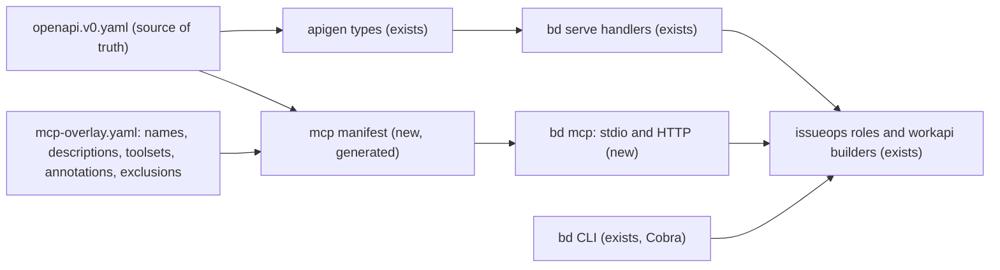

# Beads beside bd: when an MCP server or plugin is worth it, and one core for both surfaces

## Founding Ask Coverage

`canonical_root_json`: {"blob_oid":"66af21d3eb6840c3551bc547aa15c19b12d383ce","capture_commit":"8862c2570993a60c7492599cb4f762fc7b70dece","content_sha256":"061c246d34d310dddf697cd3502a8e5943d9c9f4566e5e3be6e7baf7acb4bfbe","entry_ids":["A001"],"generation":1,"path":"docs/asks/BU-epic-agentic-ai-native-beads-ylx.md","previous_ref_sha256":null,"repository":"ai-harness","schema_version":1,"task_id":"BU-epic-agentic-ai-native-beads-ylx"}

`founding_ask_ref_sha256`: d669898b4dc8a8a75f8791637da4f88d1f517b29ef5f9025c186d997debe04a7

The raw record lives in ai-harness at `docs/asks/BU-epic-agentic-ai-native-beads-ylx.md`, capture commit `8862c25`. This run read the blob `66af21d` from the object store and re-hashed the file at 2026-10-23 17:16Z; the sha256 matched `content_sha256`. This index is non-authoritative; the raw record governs.

| Authoritative raw entry | Coverage and disposition |
|---|---|
| A001, paragraph 2 (the research question this doc owns) | "should we consider creating general beads plugin on top of the beads repo with mcp server / mcp tooling in addition to the bd cli": sections 1 and 4, the Recommendation and open decision OD-1. "what's best practice design pattern for plugin mcp server / mcp tooling + cli tooling dual surfaces": sections 2 and 3. "when its worth creating a claude (or codex or ai session cli client in general ...) plugin / mcp server / mcp tooling vs just have a cli tooling": section 4. "if there's a standard for ai session cli client plugins across claude / claude code and codex gpt and gemini / antigravity": section 5. "one backend / underlying core", "primitives", "generative scripts to auto-generate / update ... mcp tools / cli primitive commands", "so we don't have to maintain two surfaces with manual custom edits": sections 2 and 3, kept in every build option of OD-1 and OD-2. "see if we have any relevant /research-doc": the Context section names the six prior docs this refines. "lmk what the findings are": the Executive Summary. "a linked ... task for me to review those findings and decide": this doc writes the decision as OD-1 to OD-3 and decides none of them. |
| A001, paragraph 1 (the `/show-beads-ui` rename and per-session counts) | Out of scope: other tasks own it. |
| A001, paragraph 3 (fork, upstream PR, packaging, package managers, installers, the parent epic) | Out of scope: other tasks own it. Two facts this run measured bear on it and are recorded under "Gaps, blindspots and emergent findings": upstream already ships a Claude, Codex and Copilot plugin, and the fork is 0 ahead and 11 behind. |
| A001, paragraph 4 (public registries and publicity) | Out of scope: a separate research task owns it. |

**Status:** complete

**Created:** 2026-10-23

**Task:** BU-ylx.1 (display id BU-research-beads-mcp-fzgw), under epic BU-ylx. The review task is BU-ylx.2.

## Table of Contents

- [Founding Ask Coverage](#founding-ask-coverage)
- [Context](#context)
- [Temporal Scope](#temporal-scope)
- [Executive Summary](#executive-summary)
- [1. What Beads ships today](#1-what-beads-ships-today)
  - [1.1 Upstream ships four surfaces](#11-upstream-ships-four-surfaces)
  - [1.2 The hand-written MCP server drifts](#12-the-hand-written-mcp-server-drifts)
  - [1.3 bd already has one core behind two front doors](#13-bd-already-has-one-core-behind-two-front-doors)
  - [1.4 Community Beads MCP servers](#14-community-beads-mcp-servers)
- [2. Patterns for one core with two surfaces](#2-patterns-for-one-core-with-two-surfaces)
  - [2.1 What the prior research settled](#21-what-the-prior-research-settled)
  - [2.2 Four generation sources](#22-four-generation-sources)
  - [2.3 Curation on top of generation](#23-curation-on-top-of-generation)
- [3. Concrete designs for Beads](#3-concrete-designs-for-beads)
  - [3.1 Design A: generate MCP tools from the bd serve OpenAPI spec](#31-design-a-generate-mcp-tools-from-the-bd-serve-openapi-spec)
  - [3.2 Design B: reflect the Cobra command tree](#32-design-b-reflect-the-cobra-command-tree)
  - [3.3 Design C: a Go operation registry above Cobra and MCP](#33-design-c-a-go-operation-registry-above-cobra-and-mcp)
  - [3.4 Design D: one pass-through or code tool](#34-design-d-one-pass-through-or-code-tool)
  - [3.5 When to use each design](#35-when-to-use-each-design)
- [4. When a plugin, an MCP server or a CLI alone is worth it](#4-when-a-plugin-an-mcp-server-or-a-cli-alone-is-worth-it)
  - [4.1 What decides it](#41-what-decides-it)
  - [4.2 Token cost under tool search](#42-token-cost-under-tool-search)
  - [4.3 Decision table](#43-decision-table)
- [5. Is there a cross-client plugin standard?](#5-is-there-a-cross-client-plugin-standard)
  - [5.1 Each client's plugin format](#51-each-clients-plugin-format)
  - [5.2 The standards that do cross clients](#52-the-standards-that-do-cross-clients)
  - [5.3 What upstream Beads already does about it](#53-what-upstream-beads-already-does-about-it)
- [6. Adversarial critical review of the recommendation](#6-adversarial-critical-review-of-the-recommendation)
  - [6.1 The case against](#61-the-case-against)
  - [6.2 Five-perspective critic pass](#62-five-perspective-critic-pass)
- [Comparison](#comparison)
- [Recommendation](#recommendation)
- [Open Decisions for Sergei](#open-decisions-for-sergei)
  - [OD-1: Build a generated Beads MCP surface, and where](#od-1-build-a-generated-beads-mcp-surface-and-where)
  - [OD-2: The generation source](#od-2-the-generation-source)
  - [OD-3: What the Beads plugin bundles](#od-3-what-the-beads-plugin-bundles)
- [Gaps, blindspots and emergent findings](#gaps-blindspots-and-emergent-findings)
- [Open Questions](#open-questions)
- [Sources](#sources)
- [Ambiguous Items from Auto-Remediation (Post-Run Review)](#ambiguous-items-from-auto-remediation-post-run-review)
- [Appendix: Research Prompt](#appendix-research-prompt)
- [Appendix: Measurements](#appendix-measurements)
- [Appendix: Provenance Ledger](#appendix-provenance-ledger)
- [Run History](#run-history)

<!-- doc:region name="context" kind="immutable" -->

## Context

Sergei asked whether a general Beads plugin should add an MCP server beside the `bd` CLI. He asked what the best-practice design is for a tool with both an MCP surface and a CLI surface. He asked when a plugin, an MCP server or MCP tooling is worth building over a CLI alone, for Claude Code and for other AI session clients, and whether a cross-client plugin standard exists. He added a design wish: one backend so that an update reaches both surfaces at once, with primitives and generative scripts that create and update MCP tools and CLI commands together, so the two surfaces never need matching hand edits.

This is a `--refine`. Six prior docs are its base and are not re-derived:

- ai-harness `docs/research/ai-core-mcp-vs-cli-tool-design.md` (2026-07-19): selective semantic parity through a typed operation registry above both adapters, with behavioural conformance tests [^50].
- ai-harness `docs/research/cli-mcp-agent-process-control-authority-design.md` (2026-09-02): one mutation gate, with the CLI as a client of it [^51].
- ai-harness `docs/research/cc-plugin-harness-landscape-survey.md` (refined 2026-09-07): Claude Code plugin mechanics and Agent Plugins 1.0 [^52].
- ai-harness `docs/research/cc-ecosystem-adoption-survey-2026-08.md`: plugin `bin/` and the fleet's MCP posture [^53].
- beads-ui `docs/research/findings/beads-ui-mods-and-shared-core.md` and `docs/research/findings/beads-ui-spike-bd-serve-and-tool-visibility.md`: MCP Apps hosts and the `bd serve` v0 contract [^54][^55].
- beads-ui `docs/designs/beads-ui-design.md`: the planned `packages/mcp-server` and decision D-4, `bd --json` in every surface [^56].

**Primary period:** 2026, current through 2026-10-23
**Source weighting:** 2026 primary, late 2025 secondary, earlier work as background. Upstream Beads source at `gastownhall/beads` main `e88d9c0` and vendor documentation above all; practitioner posts as contrarian evidence.

<!-- /doc:region name="context" -->

<!-- doc:region name="body" kind="replaceable" -->

## Temporal Scope

Every repository fact was read on 2026-10-23 between 17:15Z and 17:30Z. Upstream Beads files were read from `main`, whose head was `e88d9c025818a48c219d11ebf685807f09ddaec1` (committed 2026-10-23 16:24Z). Vendor pages were fetched the same day. The installed `bd` on this host reports `1.3.1 (c1c4b642a)`.

The weighting matters most for two moving targets. Claude Code's tool search changed the token cost of MCP schemas, so older claims about schema cost are checked against the current page. The MCP `2026-07-28` revision retired protocol sessions and tells stateful servers to "mint an explicit handle from a tool", which bears on any long-lived server design [VERIFIABLE][^32].

Cross-client plugin formats: no single format adopted by Claude Code, Codex, Gemini CLI and Antigravity was found; the pages read are listed in section 5.

## Executive Summary

1. Beads already has an MCP server and a cross-client plugin. Upstream publishes `beads-mcp`, a hand-written Python FastMCP server released in lockstep with `bd` (1.3.1 on PyPI), and recommends it only where no shell exists. Its `plugins/beads` package is CLI-first: skills plus `bd prime` hooks, with separate Claude, Codex and Copilot manifests over one skill tree. So the open questions are how the MCP surface should be produced and which clients should use it [VERIFIABLE][^1][^2][^3][^4][^13].

2. The hand-written server shows the cost Sergei wants to avoid. Its parameter help is a third, hand-kept copy of each tool's contract, and open upstream issues report silently dropped labels, dropped fields on reopen and text parsed as CLI options. Each is drift between the wrapper and `bd` [VERIFIABLE][^7][^8][^9][^10].

3. The one-core design Sergei describes already half-exists inside `bd`. `bd serve` is spec-first: the OpenAPI v0 document is the source of truth, Go types are generated from it, a test pins the route table to it in both directions, and handlers reach the same roles the CLI reaches. The recommended design generates the MCP tools from that same spec, with a small curation overlay and a regenerate-and-diff gate. One spec change then reaches HTTP and MCP at once, and a role change reaches the CLI too [VERIFIABLE][^5][^6] [INFERENCE].

4. For shell-capable agent clients (Claude Code, Codex CLI, Gemini CLI, Antigravity CLI, Copilot CLI) a CLI with skills and hooks stays the better primary surface. Anthropic's own plugin guidance says a plugin can leave the MCP connector out when Claude can use an existing CLI. MCP is needed where there is no shell: claude.ai, Claude Desktop chat, mobile, and beads-ui's planned MCP App [VERIFIABLE][^1][^16][^39] [INFERENCE].

5. No single plugin manifest spans Claude Code, Codex, Gemini CLI and Antigravity. Each has its own. Two component standards do cross all of them: MCP for tools and Agent Skills for `SKILL.md`. Agent Plugins 1.0 packages exactly those two and is implemented by Cursor and VS Code; no evidence was found that the other four implement it. The practical pattern is one source tree with per-client manifests generated from it, which upstream Beads already does by hand [VERIFIABLE][^26][^27][^28][^29] [NO SOURCE].

## 1. What Beads ships today

### 1.1 Upstream ships four surfaces

The brief's snapshot said Beads "ships only the bd CLI". Measured upstream, that is not so. Upstream ships four surfaces [VERIFIABLE][^1][^2][^5].

| Surface | Where | Shape |
|---|---|---|
| `bd` CLI | `cmd/bd`, Go with Cobra | About 120 top-level commands in `bd --help` (measured, Appendix: Measurements) |
| `bd serve` | `internal/httpapi`, Go | HTTP `/v0` API described by `openapi.v0.yaml`, 41 operations at v1.3.0 per the beads-ui spike [^55] |
| `beads-mcp` | `integrations/beads-mcp`, Python, FastMCP 4.0.5 | 16 working tools plus `discover_tools` and `get_tool_info`; each tool runs `bd ... --json` as a subprocess |
| `plugins/beads` | Claude, Codex and Copilot manifests | Skills, a task agent and `bd prime` hooks; no MCP server |

The MCP server's README states the upstream position: "For environments with shell access (Claude Code, Cursor, Windsurf), the **CLI + hooks approach is recommended** over MCP. It uses ~1-2k tokens vs 10-50k for MCP schemas". It directs the server to "MCP-only environments like Claude Desktop where CLI access is unavailable" [VERIFIABLE][^1].

The server is actively maintained. PyPI lists 117 releases, and 1.3.0 and 1.3.1 shipped on the same days as the `bd` releases [VERIFIABLE][^13]. Upstream's setup guide repeats the trade-off: MCP "Works in MCP-only environments" at a "Higher context overhead (10-50k tokens for tool schemas)" [VERIFIABLE][^12].

The plugin is CLI-first by design. Its README says "Claude and Codex use separate manifest files, but they share the same skill tree", and the Codex manifest describes "CLI-first workflow guidance" [VERIFIABLE][^2][^3]. The Claude manifest wires `SessionStart` and `PreCompact` to `bd prime` and declares no `mcpServers` [VERIFIABLE][^4].

### 1.2 The hand-written MCP server drifts

`beads-mcp` holds each tool's contract three times: the Python function signature, a hand-written `_TOOL_CATALOG` of one-line descriptions, and a hand-written `get_tool_info` dictionary of parameter help [VERIFIABLE][^7]. A fourth copy is `bd`'s own flag set, which the wrapper must track by hand.

Open upstream reports show the copies disagreeing:

| Report | What drifted |
|---|---|
| #6873, open | `update` has no `labels` parameter and "unknown parameters are dropped without an error"; `get_tool_info("update")` also omits parameters the code accepts [VERIFIABLE][^8] |
| #7317, open | "Text that looks like an option is parsed by bd instead of being preserved as text", in comment and note bodies [VERIFIABLE][^9] |
| #6872, open | `update(status="open")` routes to reopen, and "All other fields of the same call are dropped" [VERIFIABLE][^10] |
| #7779, open | The server "declared no annotations, so a client had to treat every tool as possibly writing" [VERIFIABLE][^11] |

The README also lists tools named `init` and `set_context`, while the server registers `context`, `admin` and `claim` instead (measured, Appendix: Measurements). That is the documentation copy drifting too [INFERENCE].

Each class follows from the architecture. A subprocess wrapper rebuilds argv from typed input, so every flag rename, new flag and argument-boundary rule in `bd` needs a matching hand edit in Python [INFERENCE]. This is the maintenance shape the founding ask names: "two surfaces with manual custom edits to both".

### 1.3 bd already has one core behind two front doors

`bd serve` is the strongest local precedent for Sergei's design wish. Its generated-types package says it is "spec-first: internal/httpapi/spec/openapi.v0.yaml is the source of truth, this package is its output", and "`make api-check` regenerates, fails on any diff, and runs the spec tests" [VERIFIABLE][^6]. The types come from `oapi-codegen`; handlers stay hand-written [VERIFIABLE][^6].

The HTTP package's own doc comment describes the sharing. Handlers hold no query logic and hand each request to a role, "the same roles, reached the same way, the CLI reaches on a store". The route table, the spec and a server's capability list are kept equal: "TestSpecRouteParity welds it to the document by exact set equality in both directions" [VERIFIABLE][^5].

The same comment is precise about the limits. `bd show --json` is on the shared reader role; `bd list` and `bd ready` share request builders and a page epilogue but not the role. Lint rules (`depguard`, `forbidigo`) stop the HTTP package from writing filters of its own [VERIFIABLE][^5].

So Beads has the pattern the ai-core research recommended: one behavioural core, two front doors, a machine-checked contract [^50]. What it lacks is the third front door. MCP today sits outside the core, as a separate Python process that shells out to the CLI [INFERENCE from §1.1 and §1.2].

`bd`'s module already depends on `github.com/invopop/jsonschema` and `github.com/spf13/cobra`, and declares `oapi-codegen` as a tool [VERIFIABLE][^49]. A Go MCP projection would add the official Go SDK, which infers tool schemas from Go structs with `jsonschema` tags [VERIFIABLE][^43].

### 1.4 Community Beads MCP servers

A GitHub repository search for "beads mcp" returned 27 results. The largest have 4 stars or fewer, among them `nickytonline/beads-mcp` ("A remote MCP for Steve Yegge's Beads", 3 stars, pushed 2026-10-17) and `misogare/BeadsMCP` (2 stars) [VERIFIABLE][^47]. By the source-vetting rule they are exploratory. None is a candidate to adopt [INFERENCE].

## 2. Patterns for one core with two surfaces

### 2.1 What the prior research settled

These points are established by the prior docs and are not re-derived here [^50][^51]:

- Share the behavioural core below both adapters: validation, authorization, effects, idempotency. Shared function bodies alone are not enough if one adapter adds effects.
- Parity means equal business results and effects, not equal names, prose or bytes. Classify each operation as same-core, adapted, or excluded with a reason.
- Test parity by running the same cases through both adapters and comparing results and effects.
- For a live-process controller, keep one mutation gate and make the CLI a client of it.

### 2.2 Four generation sources

The design wish asks where the "primitives" live, so that a generator can produce both surfaces. Four sources have real precedents.

| Source of truth | Precedent | What it generates | Execution path |
|---|---|---|---|
| An HTTP API spec (OpenAPI) | FastMCP `from_openapi` with route maps [VERIFIABLE][^35]; Speakeasy with the `x-speakeasy-mcp` extension [VERIFIABLE][^38]; Stainless, whose MCP server is "published at the same time as your TypeScript SDK and with the same version" [VERIFIABLE][^37]; `bd serve`'s own `apigen` [VERIFIABLE][^6] | MCP tools, SDKs, sometimes a CLI | Calls the HTTP API, or the same handlers in process |
| The CLI command tree | Ophis for Cobra, which "Creates JSON schemas from command flags and arguments" [VERIFIABLE][^36]; PyCLI MCP for Click, Typer and argparse [^50] | MCP tools | "Spawns your CLI as a subprocess and captures output" [VERIFIABLE][^36] |
| Typed code (a registry of operations) | The official MCP Go SDK, which builds a tool's schema from a Go struct's `jsonschema` tags [VERIFIABLE][^43]; the ai-core recommendation [^50] | MCP tools and CLI commands from one declaration | In process |
| A declarative config file | Google's MCP Toolbox: "The primary way to configure Toolbox is through the `tools.yaml` file" [VERIFIABLE][^45] | MCP tools and toolsets | The tool's own runtime |

A fifth pattern runs the other way. `mcpc` "maps every MCP operation to an intuitive shell command", so a CLI is generated from an MCP server [VERIFIABLE][^46]. FastMCP can also generate a CLI from MCP schemas, but that CLI reconnects to the server on every call [^50]. Both make the MCP server the authority. That suits a server-first product; for Beads the CLI is the product [INFERENCE].

### 2.3 Curation on top of generation

Generation alone does not make a good agent surface. FastMCP's docs warn that "LLMs achieve significantly better performance with well-designed and curated MCP servers" than with auto-converted ones, "especially true for complex APIs with many endpoints and parameters" [VERIFIABLE][^35]. Anthropic's tool-writing guidance warns against "tools that merely wrap existing software functionality or API endpoints", and recommends consolidating operations, namespacing and returning "only high signal information" [VERIFIABLE][^34].

Every OpenAPI generator found therefore ships a curation layer. FastMCP has route maps that rename, reshape or exclude operations [VERIFIABLE][^35]. Speakeasy uses an OpenAPI extension to set tool names, descriptions and scopes [VERIFIABLE][^38]. GitHub's MCP server groups tools into toolsets and says "Enabling only the toolsets that you need can help the LLM with tool choice and reduce the context size" [VERIFIABLE][^44].

The design consequence: generate the schema and the dispatch, hand-write only names, descriptions, grouping, annotations and exclusions in one overlay file, and fail CI when the overlay names an operation the spec lacks or the spec gains an operation the overlay does not classify [INFERENCE]. That keeps the hand-edited part to prose and policy, never to parameter lists.

## 3. Concrete designs for Beads

Designs A to C keep Sergei's requirement as stated: one core, primitives, and a generator that updates both surfaces. They differ in where the primitives live. Design D meets the same goal by leaving nothing to generate.

### 3.1 Design A: generate MCP tools from the bd serve OpenAPI spec

The OpenAPI v0 document stays the source of truth. A new generator step, `make mcp-gen`, reads it plus an overlay (`mcp-overlay.yaml`) and emits a tool manifest. A `bd mcp` subcommand serves that manifest over stdio (and later Streamable HTTP), dispatching each call to the same handler roles `bd serve` uses, in process. `make mcp-check` regenerates, fails on any diff, and fails on unclassified operations, the same shape as `make api-check` [INFERENCE from section 1.3].



What it gives: one spec edit updates HTTP and MCP; one role edit updates CLI, HTTP and MCP. MCP outputs are typed from the spec's response schemas, so `structuredContent` and `outputSchema` come for free. Annotations live in the overlay, closing the #7779 gap by construction [INFERENCE].

What it does not give: the CLI's flags and help are not generated. The spec covers 41 operations against about 120 CLI commands, so `bd prime`, memories, setup recipes and Dolt operations have no MCP tool unless the spec grows. Writes through `bd serve`'s path skip hooks: the spec says "Hooks do not fire and the per-command auto-commit machinery does not run" [VERIFIABLE][^55]. A `bd mcp` on the same roles inherits that.

Precedents: `bd serve`'s own `apigen` [^6], FastMCP route maps [^35], Speakeasy [^38], Stainless [^37].

### 3.2 Design B: reflect the Cobra command tree

Ophis walks `bd`'s Cobra tree, builds a JSON schema per command from its flags and arguments, and exposes selected commands as tools. Selection uses allow and exclude selectors; "By default, all commands and flags are exposed (except hidden/deprecated)" [VERIFIABLE][^36].

What it gives: every CLI command can become a tool with no spec work, including `bd prime` and the setup recipes. Flag changes in `bd` reach MCP on the next build with no hand edit [INFERENCE].

What it does not give: Ophis runs the command as a subprocess and captures output [VERIFIABLE][^36]. Results are CLI text or `--json` output with no declared output schema. Argument boundaries are rebuilt from input, the class behind #7317. Cobra flag help is written for humans, so tool descriptions inherit CLI prose. Ophis has 93 stars and its latest release is v1.1.4 (2026-02-18), so it is exploratory by the source-vetting rule [VERIFIABLE][^36].

### 3.3 Design C: a Go operation registry above Cobra and MCP

Each operation is declared once in Go: a request struct with `jsonschema` tags, a response struct, a handler that calls the role, and projection metadata for Cobra (command path, positional arguments, flag aliases) and for MCP (tool name, annotations). A generator, or registration at start-up, builds the Cobra command, the MCP tool and the OpenAPI path from that one declaration [INFERENCE from section 2.2].

What it gives: the closest fit to the ask's "primitives ... auto-generate / update ... mcp tools / cli primitive commands". CLI flags, MCP schemas and the HTTP spec all derive from one declaration [INFERENCE].

What it does not give: it reverses upstream's spec-first direction for `bd serve`, where the YAML document is the authority and Go types are its output [VERIFIABLE][^6]. Moving about 120 commands onto a registry is a rewrite of the CLI's command layer. An upstream PR of that size is unlikely to land, so the fork would carry it alone [INFERENCE].

### 3.4 Design D: one pass-through or code tool

One MCP tool, for example `bd_run(args: string[])`, runs `bd` with `--json` and returns its output; or one code tool runs agent-written code against a typed client. Stainless generates exactly the second shape and says it "is more accurate and token-efficient than architectures that expose one tool per API method" [VERIFIABLE][^37]. Anthropic reports code execution cutting one workflow "from 150,000 tokens to 2,000 tokens" [VERIFIABLE][^33]. Armin Ronacher argues for "MCP servers exposing a single tool, that accepts programming code as tool inputs" [VERIFIABLE][^41].

What it gives: zero drift, because there is nothing to keep in sync. The CLI is the whole contract [INFERENCE].

What it does not give: no per-tool schema, no per-tool annotations, so a host cannot tell reads from writes or require approval per operation. A pass-through to `bd` from an MCP host is a remote shell over the store. A code tool needs a sandbox and a typed client to exist first [INFERENCE].

### 3.5 When to use each design

- Design A fits when the operations an MCP client needs are already in, or belong in, the HTTP spec. For a board, a backlog and issue edits (the beads-ui MCP App), they are [INFERENCE from the beads-ui design's MCP App tool list].
- Design B fits a quick prototype, or a tool whose CLI is the only contract and whose outputs are already JSON.
- Design C fits a greenfield tool, or a fork that has decided to diverge from upstream's command layer.
- Design D fits a trusted local host where the agent already has a shell, which is the case where MCP adds least.

## 4. When a plugin, an MCP server or a CLI alone is worth it

### 4.1 What decides it

The deciding fact is whether the client can run a shell command. Anthropic's plugin guidance says: "If you already have a public API or CLI that Claude can use directly, the plugin can leave the connector out: its skills teach Claude to use that API or CLI instead" [VERIFIABLE][^16]. Playwright, which ships both, says its CLI "is best for coding agents" and its MCP server "is best for specialized agentic loops that benefit from persistent state" [VERIFIABLE][^39]. Atlassian's decision guide calls its CLI and MCP "complementary, not interchangeable", and puts MCP where agents run "without shell access" [VERIFIABLE][^42].

Where the client has no shell, MCP is the only route. A remote MCP server reaches claude.ai, Desktop, mobile, Cowork and Claude Code; a local server runs "in Claude Code and in a Cowork session that runs on the user's computer in the desktop app, not in chat" [VERIFIABLE][^16]. claude.ai reaches only servers "reachable over the internet" [VERIFIABLE][^17].

MCP also offers host-side controls a CLI cannot. Claude Code can force a prompt on every call of a tool marked `anthropic/requiresUserInteraction`, even in `bypassPermissions` mode [VERIFIABLE][^14]. A `readOnlyHint` lets Claude Code run read-only calls in parallel and retry them [VERIFIABLE][^14]. The prior research found the matching CLI control, a `--yes` flag, is not a boundary because the agent can pass it [^50].

A plugin is the packaging layer over the surfaces. Claude Code plugins bundle skills, hooks, agents, MCP servers and a `bin/` directory whose "Files here are on the Bash tool's `PATH` while the plugin is enabled" [VERIFIABLE][^15]. That makes a plugin the natural carrier for a CLI-first tool: skills to teach it, hooks for `bd prime`, and `bin/` for a pinned binary. One caveat from the same page: "claude.ai and Cowork don't install a plugin that has this directory" [VERIFIABLE][^15]. The August adoption survey had already flagged `bin/` as a capability with no fleet equivalent [^53].

### 4.2 Token cost under tool search

Upstream Beads' "10-50k tokens for MCP schemas" figure assumes a client that loads every schema at start [^1][^12]. Current Claude Code does not, on supported models: "Only tool names and server instructions load at session start", and tool search "is enabled by default" on Opus 4, Sonnet 4, Haiku 4.5 and later [VERIFIABLE][^14]. For Claude Code the cost of 18 Beads tools at rest is their names and the server instructions [INFERENCE].

The figure still holds for clients that eager-load, and Mario Zechner measured eager catalogs: "Playwright MCP has 21 tools using 13.7k tokens (6.8% of Claude's context)" [VERIFIABLE][^40]. Results still cost tokens on every client; the prior research found results, not schemas, dominate after deferral [^50]. `beads-mcp` already compacts large lists to a preview, which addresses that side [VERIFIABLE][^7].

So the token case for CLI over MCP in Claude Code is now weak. The remaining reasons for CLI-first there are composability (pipes, files, `--json` into `jq`), one primary surface per session, and no second route to the same writes [VERIFIABLE][^40][^42] [INFERENCE].

### 4.3 Decision table

| # | Situation | Build | Why |
|---|---|---|---|
| 1 | Shell-capable agent CLI (Claude Code, Codex CLI, Gemini or Antigravity CLI, Copilot CLI) | CLI plus skills plus `bd prime` hooks, packaged as a plugin | Upstream's recommendation and Anthropic's own plugin rule [^1][^16] |
| 2 | Chat with no shell (claude.ai, Claude Desktop chat, mobile, ChatGPT) | Remote MCP server, with auth | The only route; remote reaches every Claude surface [^16][^17] |
| 3 | Claude Desktop with a local store | Local stdio MCP server, or an MCPB bundle | Local servers run in Desktop and Cowork, not in web chat [^16]; Claude Code plugins accept `.mcpb` bundles in `mcpServers` [^15] |
| 4 | An interactive board in a conversation | MCP server with an MCP App | MCP Apps render in Claude Desktop and claude.ai, not Claude Code [^54] |
| 5 | A write that must reach a human every time | MCP tool with `requiresUserInteraction`, and no CLI route to the same write in that session | Host-enforced, unlike a CLI flag [^14][^50] |
| 6 | Scripts, CI, recovery, pipelines | CLI | Deterministic and composable [^50] |
| 7 | Distribution of several components with versions | Plugin | Packaging, per-client manifests [^15][^18] |

## 5. Is there a cross-client plugin standard?

### 5.1 Each client's plugin format

Each client the ask names has its own plugin or extension format:

| Client | Package | Manifest | Bundles |
|---|---|---|---|
| Claude Code | Plugin | `.claude-plugin/plugin.json` | Skills, commands, agents, hooks, MCP and LSP servers, `bin/`, monitors, workflows [VERIFIABLE][^15] |
| OpenAI Codex | Plugin | `.codex-plugin/plugin.json` in upstream Beads' Codex package [VERIFIABLE][^3] | "Skills", "MCP servers", "Browser extensions", "Hooks" [VERIFIABLE][^18] |
| Gemini CLI | Extension | "Each extension must have a `gemini-extension.json` file in its root directory" [VERIFIABLE][^21] | MCP servers, custom commands, themes, hooks, sub-agents and agent skills [VERIFIABLE][^20] |
| Google Antigravity | Plugin | "Every plugin requires a `plugin.json` file at its root" [VERIFIABLE][^25] | Skills, rules, `mcp_config.json`, `hooks.json` [VERIFIABLE][^25] |
| GitHub Copilot CLI | Plugin | `.copilot-plugin/plugin.json` in upstream Beads [VERIFIABLE][^2] | Hooks in Beads' manifest [^2] |
| Cursor | Plugin | `.cursor-plugin/plugin.json`, or an Agent Plugins `plugin.json` [VERIFIABLE][^27] | Skills, MCP servers, rules, hooks [VERIFIABLE][^27] |

Gemini CLI is in transition for some users: its docs say "Unpaid tier and Google One users: Gemini CLI was replaced by Antigravity CLI on June 18th, 2026" [VERIFIABLE][^23]. For a Beads plugin this means Antigravity's format matters at least as much as Gemini's [INFERENCE].

Agent Plugins 1.0 is the one cross-client package format found. It "defines exactly two component types: skills and MCP servers", with a root `plugin.json` and client data under reverse-domain `extensions` [VERIFIABLE][^26]. Cursor says it "supports the Agent Plugins open standard alongside its own plugin format" [VERIFIABLE][^27]. VS Code calls it "an open standard for packaging skills and MCP servers across compatible clients" and also reads "existing Copilot, Claude, and legacy OpenPlugin formats" [VERIFIABLE][^28]. The spec page names no implementing client [^26]. The plugin landscape survey reached the same reading of Agent Plugins on 2026-09-07 [^52]. No page read in this run says Claude Code, Codex, Gemini CLI or Antigravity implements it [NO SOURCE].

### 5.2 The standards that do cross clients

Two component standards are supported by every client checked.

MCP is the tool protocol all of them speak. Codex configures servers in `config.toml` with `[mcp_servers.<server-name>]` tables and supports stdio and Streamable HTTP [VERIFIABLE][^19]. Gemini CLI uses "the `mcpServers` configuration in your `settings.json`" and supports include and exclude lists per server [VERIFIABLE][^22]. "Antigravity supports the Model Context Protocol (MCP)", and its remote servers "must use the Streamable HTTP transport" [VERIFIABLE][^24]. Claude Code plugins start their MCP servers when enabled [VERIFIABLE][^14].

Agent Skills is the instruction format they share. It is "a lightweight, open format", originally developed by Anthropic and released as an open standard, loaded by "progressive disclosure" [VERIFIABLE][^29]. Codex plugins, Gemini extensions, Antigravity plugins, Cursor and Agent Plugins all carry `SKILL.md` skills [^18][^20][^25][^26][^27].

A third standard joins the two. The MCP Skills extension (`io.modelcontextprotocol/skills`, SEP-2640, Final) lets an MCP server serve Agent Skills through `skills/list`, `skills/get` and `resources/read`, with digest-checked manifests [VERIFIABLE][^30]. The extension says "SDK and host support is still being implemented"; the client matrix shows partial support in ChatGPT, fast-agent and MCP Inspector, and no Claude or Cursor entry [VERIFIABLE][^30][^31]. If hosts adopt it, one MCP server could ship both the tools and the skill that teaches them, on every client, with no per-client manifest [INFERENCE].

### 5.3 What upstream Beads already does about it

Upstream already solves the cross-client problem with generation of a sort. `bd setup` uses "a recipe-based architecture" that writes each client's files: `.claude/settings.json`, `.cursor/rules/beads.mdc`, `~/.gemini/settings.json`, `.copilot-plugin/plugin.json`, `.agents/skills/beads/` for Codex, and more [VERIFIABLE][^12]. It names `bd prime` "the single source of truth for operational workflow commands" [VERIFIABLE][^12].

The plugin directory is the same idea packaged: one skill tree, three hand-written manifests [VERIFIABLE][^2]. The hand-written part is small (metadata and hooks), so generating the manifests is a minor gain. Generating them from one `plugin-source.yaml` would still remove the version string from three places, where today all three read `1.3.0` while `bd` is at 1.3.1 [INFERENCE from Appendix: Measurements M-7].

## 6. Adversarial critical review of the recommendation

### 6.1 The case against

The recommendation is CLI-first for agent clients, plus an MCP surface generated from the OpenAPI spec for no-shell clients. The strongest arguments against it follow.

Fixing `beads-mcp` is cheaper than replacing it. The three open drift reports and the annotation PR each have a small fix, and upstream works on `beads-mcp` regularly (PR #7779 opened on 2026-10-22). A generator is new machinery that upstream has not asked for. If the only goal is a working MCP server, patching is the shortest path [INFERENCE from section 1.2].

Generated tools may be worse tools. 41 operations is close to the size where FastMCP warns that curated servers outperform conversions [^35]. The overlay that makes them good is hand-written, so drift moves into the overlay. The answer in section 2.3 limits the overlay to prose and policy and gates it in CI; that narrows the drift, it does not remove it.

The spec does not cover the CLI. About 120 commands against 41 operations means an MCP client sees part of Beads. Sergei's wish was that "both have primitives" and update together; Design A delivers that for HTTP and MCP and leaves CLI flags hand-written. Only Design C meets the wish in full, and it is the costliest.

HTTP-path writes skip hooks. The fleet relies on hooks for its display-id convention and commit gates. A `bd mcp` on `bd serve`'s roles would write without them, unless the role layer gains the hook calls [^55]. beads-ui's D-4 chose `bd --json` partly for this reason [^56].

Two routes to one write defeat host approval. If a session has an MCP write tool marked `requiresUserInteraction` and also a shell with `bd`, the agent can take the CLI route and skip the prompt [^50]. Bundling both in one plugin by default creates that pair.

The demand is not yet real. The one named consumer with no shell is beads-ui's MCP App, Phase 4 of an epic whose Phase 1 is still being built [^56]. Building a general MCP generator ahead of that consumer is speculative.

Code mode may win outright. Stainless and Anthropic both report one code tool beats one tool per operation on accuracy and tokens [^33][^37]. If hosts move that way, per-operation generation is the wrong investment.

### 6.2 Five-perspective critic pass

| Perspective | Severity | Challenge | Disposition |
|---|---|---|---|
| Conventional | Medium | Spec-first generation is mainstream (FastMCP, Speakeasy, Stainless) and matches `bd serve`'s own direction | Agrees with the recommendation; kept |
| Contrarian | High | Patch the existing server instead of generating one | Conceded as the cheapest path. OD-1 option (a) states it, with its cost: the drift class stays |
| Historical | Medium | Spec-generated SDKs and CLIs have long histories of stale generated code checked in | Mitigated by the regenerate-and-diff gate that `make api-check` already runs upstream [^6] |
| Adjacent | High | Hooks do not fire on the HTTP path; approval can be bypassed through the CLI | Recorded as constraints on Design A and OD-3; not resolved by research |
| Skeptic | High | No measured token or accuracy comparison exists for Beads tools specifically | Conceded. Open Question 1 names the measurement. The token claim rests on the Claude Code docs; no Beads benchmark exists |

The model that wrote this doc also ran this pass. A different model family should review it before BU-ylx.2 relies on it.

## Comparison

Scores are a synthesis for Beads from the evidence above; 5 is best [INFERENCE].

| # | Criterion | Patch beads-mcp | A: OpenAPI-generated `bd mcp` | B: Cobra reflection | C: Go registry | D: one pass-through tool |
|---|---|---:|---:|---:|---:|---:|
| 1 | Few hand edits per new operation | 1 | 3 | 5 | 4 | 5 |
| 2 | Typed inputs and outputs | 3 | 5 | 2 | 5 | 1 |
| 3 | Per-tool annotations and approval | 3 | 5 | 2 | 5 | 1 |
| 4 | Coverage of CLI-only commands | 2 | 2 | 5 | 5 | 5 |
| 5 | Low argument-injection exposure | 2 | 5 | 2 | 5 | 1 |
| 6 | Hooks fire on writes | 5 | 2 | 5 | 3 | 5 |
| 7 | Fit with upstream's direction | 5 | 4 | 2 | 1 | 3 |
| 8 | Low build cost | 5 | 3 | 4 | 1 | 5 |
| | Total | 26 | 29 | 27 | 29 | 26 |

A and C tie on the total. A is recommended because the two rows where they differ most, upstream fit and build cost, decide whether the work lands upstream at all; C wins on CLI coverage and hooks, which A answers with a conformance test and a hook question for the build task [INFERENCE].

Source-vetting: FastMCP, Speakeasy, Stainless and the MCP Go SDK are maintained vendor or project tools; Ophis (93 stars) and every community Beads MCP server (4 stars or fewer) are exploratory [^36][^43][^47].

## Recommendation

Keep `bd` with skills and hooks as the primary surface for every shell-capable agent client. That is upstream's position, Anthropic's plugin rule, and the beads-ui design's D-4 [^1][^16][^56].

Build an MCP surface only for a consumer with no shell, and generate it. When beads-ui's MCP App or a claude.ai connector needs Beads tools, produce them with Design A: the `bd serve` OpenAPI v0 document as the source, one overlay file for names, descriptions, toolsets, annotations and exclusions, and a regenerate-and-diff gate modelled on `make api-check`. Dispatch in process to the same roles the CLI and `bd serve` use. Target upstream with it as `bd mcp`, so that it can replace the hand-written `beads-mcp` once its tool set matches.

Before that build, two constraints need answers: how HTTP-path writes run the hooks the fleet relies on, and how a plugin avoids giving one session two routes to the same write. Both are design questions for the build task.

Meanwhile, patching the open `beads-mcp` drift bugs upstream is worth doing for its own users and does not conflict with this path.

The three decisions below are Sergei's. Nothing above decides them.

## Open Decisions for Sergei

### OD-1: Build a generated Beads MCP surface, and where

Context: Upstream ships a hand-written MCP server that drifts (section 1.2). beads-ui plans an MCP server in Phase 4 (D-14). The ask wants one core with generated surfaces.

(a) Do not build; use upstream `beads-mcp`, and send fixes upstream.
- Pros: no new code; upstream users benefit.
- Cons: the three-copy drift class stays; no shared core with beads-ui; the design wish is not met.

(b) Generated `bd mcp` in the fork (Design A), proposed upstream.
- Pros: meets the design wish for HTTP and MCP; one gate catches drift; can replace `beads-mcp`.
- Cons: Go work in the fork; upstream may decline; hooks on the HTTP path need solving.

(c) Generated tools inside beads-ui's `packages/mcp-server` only, from the same spec, in TypeScript.
- Pros: serves the one real consumer first; no upstream dependency.
- Cons: a third implementation of Beads tools; Beads users outside beads-ui gain nothing.

(d) A new hand-written server.
- Pros: full control of tool shape.
- Cons: repeats the drift problem the ask exists to avoid.

Recommendation: (b), started when beads-ui Phase 4 begins, with beads-ui's server as its first client. Before Phase 4, take (a)'s upstream fixes only.

### OD-2: The generation source

Context: Section 3 compares four sources. The ask names "primitives" and "generative scripts".

(a) The `bd serve` OpenAPI v0 spec plus an overlay (Design A).
- Pros: already the source of truth for HTTP, with a gate; typed outputs.
- Cons: 41 of about 120 operations; CLI flags stay hand-written.

(b) The Cobra command tree (Design B).
- Pros: full CLI coverage at once.
- Cons: subprocess execution, untyped outputs, argv-injection class.

(c) A Go operation registry above Cobra and MCP (Design C).
- Pros: the only option where CLI commands are generated too.
- Cons: rewrites the command layer; against upstream's spec-first direction.

(d) One pass-through or code tool (Design D).
- Pros: zero drift.
- Cons: no per-tool schema or approval.

Recommendation: (a), with a CLI-to-spec conformance test that runs each spec operation's CLI twin and compares results, so CLI drift is caught even though it is not generated.

### OD-3: What the Beads plugin bundles

Context: Upstream's plugin is skills and hooks only. Claude Code plugins can also carry MCP servers and `bin/` (section 4.1).

(a) Skills and hooks only, as upstream does.
- Pros: one primary surface per session; no approval bypass pair.
- Cons: no-shell clients need a separate install.

(b) Skills, hooks and the MCP server, enabled by default.
- Pros: one install covers every Claude surface.
- Cons: two routes to every write in Claude Code; `bin/` blocks claude.ai and Cowork installs if added.

(c) Skills and hooks in the main plugin; the MCP server as a second plugin or a connector, off by default, that users enable for the surfaces with no shell. It is not a declared dependency, because Claude Code starts a dependency of an enabled plugin enabled regardless [^15].
- Pros: users opt in per surface; the main plugin stays CLI-first.
- Cons: two listings to maintain; the link between them is documentation, not a manifest field.

Recommendation: (c).

## Gaps, blindspots and emergent findings

Emergent: the brief's snapshot was wrong. Upstream ships `beads-mcp` on PyPI and a Claude, Codex and Copilot plugin, so "beads ships only the bd CLI" does not hold [^1][^2][^13]. The ask's question "should we consider creating general beads plugin ... with mcp server" is partly answered by upstream already: the plugin exists and leaves MCP out on purpose.

Emergent: the fork measured 0 ahead and 11 behind `gastownhall/beads` at 17:20Z, matching the brief [VERIFIABLE][^48]. Any OD-1 (b) work starts with a fork sync, which another task owns.

Emergent: upstream's three plugin manifests all read version `1.3.0` while `bd` and `beads-mcp` are 1.3.1 [^3][^4][^13]. That is the same hand-maintained drift, at the packaging layer.

Correction to prior research: the ai-core doc described Ophis as an "in-process Cobra-to-MCP projection" [^50]. Its current README says it "Spawns your CLI as a subprocess and captures output" [^36]. Design B inherits the subprocess weaknesses for that reason.

Emergent: the MCP Skills extension is Final and would let one MCP server carry both tools and skills to any host [^30]. Host support is thin today [^31]. It is the closest thing found to a cross-client plugin standard at the protocol level.

Blindspot: the Codex plugin developer guide at `learn.chatgpt.com/docs/plugins/build` returned 404. The `.codex-plugin/plugin.json` path is evidenced only by upstream Beads' working Codex plugin and its README, not by an OpenAI page [^2][^3].

Blindspot: whether Claude Code, Codex, Gemini CLI or Antigravity read Agent Plugins 1.0 packages was not found in any page read [NO SOURCE]. VS Code reads Claude's format; whether any of the four reads Agent Plugins without documenting it was not tested.

Blindspot: no token or accuracy measurement exists for Beads tools in Claude Code under tool search. The cost claims here rest on Claude Code's documentation and on upstream's own figure.

Blindspot: the agentskills.io client showcase renders in JavaScript and returned no list, so the client list in section 5.2 comes from each client's own docs.

Blindspot: nothing was run. No MCP server was started, no tool list measured, no `bd serve` call made. This run was read-only under a host HOLD for most of its length.

Anchor-bias counter: the ask framed the choice as "plugin with MCP" against "CLI alone". The evidence added a third axis, where the MCP surface comes from (four sources), and showed the plugin question is mostly answered upstream already.

## Open Questions

1. What do 18 `beads-mcp` tools cost in Claude Code under tool search, at start and on first use, against `bd prime`'s output? A ten-minute live probe answers it.
2. How should a `bd mcp` write path run the hooks that the fleet's display-id and commit gates rely on? Through the role layer, or by keeping writes on the CLI path?
3. Will upstream accept a generated `bd mcp` that replaces `beads-mcp`? Ask in an issue before building.
4. Which `bd` commands outside the spec does a no-shell client need? `bd prime` and memories are the likely ones.
5. When do Claude Code and Codex adopt the MCP Skills extension or Agent Plugins 1.0, if at all?

## Sources

[^1]: Beads contributors. (2026). [beads-mcp README](https://github.com/gastownhall/beads/blob/e88d9c025818a48c219d11ebf685807f09ddaec1/integrations/beads-mcp/README.md). gastownhall/beads, GitHub. Read via the GitHub REST API (HTTP 200) 2026-10-23. (CLI-plus-hooks recommendation, token figure, tool list.)

[^2]: Beads contributors. (2026). [plugins/beads README](https://github.com/gastownhall/beads/blob/e88d9c025818a48c219d11ebf685807f09ddaec1/plugins/beads/README.md). gastownhall/beads, GitHub. Read via the GitHub REST API (HTTP 200) 2026-10-23. (Shared Claude and Codex package, shared skill tree, Codex hooks; directory listing also shows `.copilot-plugin/plugin.json`.)

[^3]: Beads contributors. (2026). [plugins/beads/.codex-plugin/plugin.json](https://github.com/gastownhall/beads/blob/e88d9c025818a48c219d11ebf685807f09ddaec1/plugins/beads/.codex-plugin/plugin.json). gastownhall/beads, GitHub. Read via the GitHub REST API (HTTP 200) 2026-10-23. (Codex manifest, version 1.3.0, CLI-first description.)

[^4]: Beads contributors. (2026). [plugins/beads/.claude-plugin/plugin.json](https://github.com/gastownhall/beads/blob/e88d9c025818a48c219d11ebf685807f09ddaec1/plugins/beads/.claude-plugin/plugin.json). gastownhall/beads, GitHub. Read via the GitHub REST API (HTTP 200) 2026-10-23. (Claude manifest: skills, `bd prime` hooks, no `mcpServers`.)

[^5]: Beads contributors. (2026). [internal/httpapi/doc.go](https://github.com/gastownhall/beads/blob/e88d9c025818a48c219d11ebf685807f09ddaec1/internal/httpapi/doc.go). gastownhall/beads, GitHub. Read via the GitHub REST API (HTTP 200) 2026-10-23. (Handlers reach the CLI's roles; route-spec parity test; limits of sharing.)

[^6]: Beads contributors. (2026). [internal/httpapi/apigen/doc.go](https://github.com/gastownhall/beads/blob/e88d9c025818a48c219d11ebf685807f09ddaec1/internal/httpapi/apigen/doc.go). gastownhall/beads, GitHub. Read via the GitHub REST API (HTTP 200) 2026-10-23. (Spec-first OpenAPI, `oapi-codegen`, `make api-check`.)

[^7]: Beads contributors. (2026). [integrations/beads-mcp/src/beads_mcp/server.py](https://github.com/gastownhall/beads/blob/e88d9c025818a48c219d11ebf685807f09ddaec1/integrations/beads-mcp/src/beads_mcp/server.py). gastownhall/beads, GitHub. Read via the GitHub REST API (HTTP 200) 2026-10-23. (Hand-written `_TOOL_CATALOG` and `get_tool_info` dictionaries; registered tool names; compaction.)

[^8]: Beads contributor. (2026, September 28). [beads-mcp: `update` silently ignores `labels`, and reports success (#6873)](https://github.com/gastownhall/beads/issues/6873). GitHub issue, open. Read via the GitHub REST API (HTTP 200) 2026-10-23.

[^9]: Beads contributor. (2026, October 6). [bug(beads-mcp): comment and note text can be parsed as CLI options (#7317)](https://github.com/gastownhall/beads/issues/7317). GitHub issue, open. Read via the GitHub REST API (HTTP 200) 2026-10-23.

[^10]: Beads contributor. (2026, September 28). [beads-mcp: `update(status="open")` drops every other field (#6872)](https://github.com/gastownhall/beads/issues/6872). GitHub issue, open. Read via the GitHub REST API (HTTP 200) 2026-10-23.

[^11]: Beads contributor. (2026, October 22). [feat(beads-mcp): declare readOnlyHint on the tools that only read (#7779)](https://github.com/gastownhall/beads/pull/7779). GitHub pull request, open. Read via the GitHub REST API (HTTP 200) 2026-10-23.

[^12]: Beads contributors. (2026). [IDE Setup](https://github.com/gastownhall/beads/blob/e88d9c025818a48c219d11ebf685807f09ddaec1/docs/getting-started/ide-setup.md). gastownhall/beads documentation, "Last reviewed: 2026-10-05". Read via the GitHub REST API (HTTP 200) 2026-10-23. (Recipe-based `bd setup`, `bd prime`, MCP trade-offs.)

[^13]: Python Package Index. (2026). [beads-mcp project JSON](https://pypi.org/pypi/beads-mcp/json). PyPI. Verified accessible (HTTP 200) 2026-10-23. (Version 1.3.1, 117 releases, 1.3.0 on 2026-09-15 and 1.3.1 on 2026-10-01.)

[^14]: Anthropic. (2026). [Connect Claude Code to tools via MCP](https://code.claude.com/docs/en/mcp). Claude Code Documentation. Verified accessible (HTTP 200, WebFetch, two reads covering all 146,282 characters) 2026-10-23. (Plugin MCP servers, tool search, output limits, `requiresUserInteraction`, `readOnlyHint`.)

[^15]: Anthropic. (2026). [Plugin manifest reference](https://code.claude.com/docs/en/plugins-reference). Claude Code Documentation. Verified accessible (HTTP 200, WebFetch) 2026-10-23. (Fields, `mcpServers` shapes including `.mcpb`, standard layout, `bin/` on PATH, claude.ai and Cowork caveat.)

[^16]: Anthropic. (2026). [Decide what to include in your plugin](https://claude.com/docs/connectors/building/what-to-build). Claude Documentation. Verified accessible (HTTP 200, WebFetch) 2026-10-23. (When a plugin needs a connector; remote versus local reach.)

[^17]: Anthropic. (2026). [Build an MCP server for Claude](https://claude.com/docs/connectors/building/index). Claude Documentation. Verified accessible (HTTP 200, WebFetch) 2026-10-23. (Remote versus local servers, limits per surface.)

[^18]: OpenAI. (2026). [Plugins](https://learn.chatgpt.com/docs/plugins). ChatGPT and Codex documentation (redirected from developers.openai.com/codex/plugins, 308). Verified accessible (HTTP 200, WebFetch) 2026-10-23. (Plugin components and distribution.)

[^19]: OpenAI. (2026). [Model Context Protocol in Codex](https://learn.chatgpt.com/docs/extend/mcp?surface=cli). Codex documentation (redirected from developers.openai.com/codex/mcp, 308). Verified accessible (HTTP 200, WebFetch) 2026-10-23. (Transports and `config.toml` tables.)

[^20]: Google. (2026). [Gemini CLI extensions](https://geminicli.com/docs/extensions/). Gemini CLI Documentation. Verified accessible (HTTP 200, WebFetch) 2026-10-23. (What an extension bundles; install from GitHub.)

[^21]: Google. (2026). [Extension reference](https://geminicli.com/docs/extensions/reference/). Gemini CLI Documentation. Verified accessible (HTTP 200, WebFetch) 2026-10-23. (`gemini-extension.json`, `mcpServers`, `contextFileName`, `excludeTools`, `skills/`.)

[^22]: Google. (2026). [MCP servers with Gemini CLI](https://geminicli.com/docs/tools/mcp-server/). Gemini CLI Documentation. Verified accessible (HTTP 200, WebFetch) 2026-10-23. (Transports, `mcpServers`, include and exclude lists.)

[^23]: Google. (2026). [Gemini CLI documentation](https://geminicli.com/docs/). Gemini CLI Documentation. Verified accessible (HTTP 200, WebFetch) 2026-10-23. (Replacement notice for unpaid-tier and Google One users.)

[^24]: Google. (2026). [MCP](https://antigravity.google/docs/mcp). Google Antigravity Documentation. Verified accessible (HTTP 200, WebFetch) 2026-10-23. (MCP support, Streamable HTTP, `mcp_config.json`, plugins can add servers.)

[^25]: Google. (2026). [Plugins](https://antigravity.google/docs/plugins). Google Antigravity Documentation. Verified accessible (HTTP 200, WebFetch) 2026-10-23. (Plugin components and root `plugin.json`.)

[^26]: Agent Plugins contributors. (2026). [Agent Plugins Specification 1.0.0](https://agent-plugins.org/specification). agent-plugins.org. Verified accessible (HTTP 200, WebFetch) 2026-10-23. (Two component types, manifest, `extensions`.)

[^27]: Cursor. (2026). [Plugins](https://cursor.com/docs/plugins). Cursor Docs. Verified accessible (HTTP 200, WebFetch) 2026-10-23. (Agent Plugins support beside the Cursor format.)

[^28]: Microsoft. (2026). [Agent plugins in VS Code](https://code.visualstudio.com/docs/agent-customization/agent-plugins). Visual Studio Code Docs. Verified accessible (HTTP 200, WebFetch) 2026-10-23. (Agent Plugins, Claude and Copilot formats.)

[^29]: Agent Skills. (2026). [Agent Skills Overview](https://agentskills.io/home). agentskills.io. Verified accessible (HTTP 200, WebFetch) 2026-10-23. (Open format, progressive disclosure, origin.)

[^30]: Model Context Protocol. (2026). [Skills extension](https://modelcontextprotocol.io/extensions/skills/overview). modelcontextprotocol.io. Verified accessible (HTTP 200, WebFetch) 2026-10-23. (SEP-2640 Final; `skills/list`, `skills/get`; implementation status.)

[^31]: Model Context Protocol. (2026). [Extension Support Matrix](https://modelcontextprotocol.io/extensions/client-matrix). modelcontextprotocol.io. Verified accessible (HTTP 200, WebFetch) 2026-10-23. (Skills support partial in ChatGPT, fast-agent, MCP Inspector.)

[^32]: Model Context Protocol. (2026, July 28). [The 2026-07-28 Specification](https://blog.modelcontextprotocol.io/posts/2026-07-28/). MCP Blog. Verified accessible (HTTP 200, WebFetch) 2026-10-23. (Stateless core, sessions retired, explicit handles, Tasks extension.)

[^33]: Anthropic. (2025, November 4). [Code execution with MCP](https://www.anthropic.com/engineering/code-execution-with-mcp). Anthropic Engineering. Verified accessible (HTTP 200, WebFetch) 2026-10-23. (Tool definitions and intermediate results; 150,000 to 2,000 tokens.)

[^34]: Anthropic. (2025, September 11). [Writing effective tools for agents](https://www.anthropic.com/engineering/writing-tools-for-agents). Anthropic Engineering. Verified accessible (HTTP 200, WebFetch) 2026-10-23. (Do not merely wrap endpoints; consolidate; namespace; return high-signal results.)

[^35]: FastMCP. (2026). [OpenAPI integration](https://gofastmcp.com/integrations/openapi). FastMCP Documentation. Verified accessible (HTTP 200, WebFetch) 2026-10-23. (Curated-server warning, `from_openapi`, route maps.)

[^36]: njayp. (2026). [Ophis: Transform any Cobra CLI into an MCP server](https://github.com/njayp/ophis). GitHub. README read via the GitHub REST API (HTTP 200) 2026-10-23; 93 stars, Apache-2.0, latest release v1.1.4 on 2026-02-18. (Schema from flags, selectors, subprocess execution.)

[^37]: Stainless. (2026). [MCP servers](https://www.stainless.com/docs/mcp). Stainless Documentation. Verified accessible (HTTP 200, WebFetch) 2026-10-23. (Code tool architecture; published with the TypeScript SDK at the same version.)

[^38]: Speakeasy. (2026). [Build an MCP server](https://www.speakeasy.com/docs/standalone-mcp/build-server). Speakeasy Documentation. Verified accessible (HTTP 200, WebFetch) 2026-10-23. (Generation from OpenAPI, `x-speakeasy-mcp`, MCPB output.)

[^39]: Microsoft. (2026). [Coding agents: playwright-cli vs Playwright MCP](https://playwright.dev/docs/getting-started-cli). Playwright Documentation. Verified accessible (HTTP 200, WebFetch) 2026-10-23.

[^40]: Zechner, M. (2025, November 2). [What if you don't need MCP at all?](https://mariozechner.at/posts/2025-11-02-what-if-you-dont-need-mcp/). mariozechner.at. Verified accessible (HTTP 200, WebFetch) 2026-10-23. (Measured eager tool costs; CLI plus README alternative.)

[^41]: Ronacher, A. (2025, August 18). [Your MCP Doesn't Need 30 Tools: It Needs Code](https://lucumr.pocoo.org/2025/8/18/code-mcps/). lucumr.pocoo.org. Verified accessible (HTTP 200, WebFetch) 2026-10-23.

[^42]: Atlassian. (2026). [Teamwork Graph CLI and Rovo MCP decision guide](https://support.atlassian.com/rovo/docs/teamwork-graph-cli-and-rovo-mcp-decision-guide/). Atlassian Support. Verified accessible (HTTP 200, WebFetch) 2026-10-23.

[^43]: Model Context Protocol. (2026). [Go SDK README](https://github.com/modelcontextprotocol/go-sdk). GitHub. Read via the GitHub REST API (HTTP 200) 2026-10-23; 5,264 stars, latest release v1.8.0 on 2026-09-14. (Schema inference from `jsonschema` struct tags; `mcp.AddTool`.)

[^44]: GitHub. (2026). [GitHub MCP Server README](https://github.com/github/github-mcp-server). GitHub. Read via the GitHub REST API (HTTP 200) 2026-10-23; 33,893 stars. (Toolsets and their effect on tool choice and context.)

[^45]: Google. (2026). [MCP Toolbox README](https://github.com/googleapis/mcp-toolbox). GitHub (formerly genai-toolbox). Read via the GitHub REST API (HTTP 200) 2026-10-23; 16,713 stars, Apache-2.0. (`tools.yaml` configuration.)

[^46]: Apify. (2026). [mcpc](https://github.com/apify/mcpc). GitHub. Verified accessible (HTTP 200, WebFetch) 2026-10-23; about 1.1k stars. (A universal MCP CLI client.)

[^47]: GitHub. (2026). [Repository search: beads mcp](https://api.github.com/search/repositories?q=beads+mcp+in:name,description&sort=stars&per_page=10). GitHub REST API (HTTP 200) 2026-10-23; `total_count` 27. (Community Beads MCP servers and their stars.)

[^48]: GitHub. (2026). [Compare gastownhall/beads main with sergeiwallace/beads main](https://api.github.com/repos/gastownhall/beads/compare/main...sergeiwallace:beads:main). GitHub REST API (HTTP 200) 2026-10-23 17:20Z. (`status` behind, `ahead_by` 0, `behind_by` 11.)

[^49]: Beads contributors. (2026). [go.mod](https://github.com/gastownhall/beads/blob/e88d9c025818a48c219d11ebf685807f09ddaec1/go.mod). gastownhall/beads, GitHub. Read via the GitHub REST API (HTTP 200) 2026-10-23. (Cobra, invopop/jsonschema, oapi-codegen tool.)

[^50]: ai-harness. (2026). [ai-core MCP vs CLI Tool-Exposure Design](https://github.com/sergeiwallace/ai-harness/blob/main/docs/research/ai-core-mcp-vs-cli-tool-design.md). ai-harness `docs/research/`, 1,464 lines. Read in full from the local main tree 2026-10-23. (Prior research this doc refines.)

[^51]: ai-harness. (2026). [CLI-vs-MCP Authority for Agent-Process-Control Tooling](https://github.com/sergeiwallace/ai-harness/blob/main/docs/research/cli-mcp-agent-process-control-authority-design.md). ai-harness `docs/research/`, 539 lines. Read in full from the local main tree 2026-10-23.

[^52]: ai-harness. (2026). [Claude Code Plugin & Harness Ecosystem Landscape Survey](https://github.com/sergeiwallace/ai-harness/blob/main/docs/research/cc-plugin-harness-landscape-survey.md). ai-harness `docs/research/`, 1,695 lines. Read from the local main tree 2026-10-23 (body in full; prompt appendix and ledger scanned).

[^53]: ai-harness. (2026). [Claude Code / agent-harness ecosystem adoption survey, August 2026](https://github.com/sergeiwallace/ai-harness/blob/main/docs/research/cc-ecosystem-adoption-survey-2026-08.md). ai-harness `docs/research/`, 534 lines. Read from the local main tree 2026-10-23 (through its Open Questions).

[^54]: beads-ui. (2026). [beads-ui research leg B: Claude Code mods, MCP Apps and the shared core](https://github.com/sergeiwallace/beads-ui/blob/main/docs/research/findings/beads-ui-mods-and-shared-core.md). beads-ui, tracked on main. Read in full from this worktree 2026-10-23.

[^55]: beads-ui. (2026). [beads-ui design spike: bd serve request schemas, MCP app-only tool visibility and Task-tool deny rules](https://github.com/sergeiwallace/beads-ui/blob/main/docs/research/findings/beads-ui-spike-bd-serve-and-tool-visibility.md). beads-ui, tracked on main. Read in full from this worktree 2026-10-23. (41 operations at v1.3.0; HTTP writes skip hooks.)

[^56]: beads-ui. (2026). [beads-ui design](https://github.com/sergeiwallace/beads-ui/blob/main/docs/designs/beads-ui-design.md). beads-ui, tracked on main. Read from this worktree 2026-10-23 (overview, architecture, data model, integration, D-4, D-14, D-15). (Planned `packages/mcp-server`; D-4 `bd --json` everywhere.)

<!-- /doc:region name="body" -->

<!-- doc:region name="ambiguous_items" kind="replaceable" -->

## Ambiguous Items from Auto-Remediation (Post-Run Review)

(none yet; no auto-remediation pass was run)

<!-- /doc:region name="ambiguous_items" -->

<!-- doc:region name="appendix_research_prompt" kind="immutable" -->

## Appendix: Research Prompt

**Registry ID:** unregistered (ad hoc researcher leaf of session ops-vm-3)
**Method:** Claude ad-hoc web (research-doc skill), WebFetch plus the GitHub REST API through `ghp api`; no native WebSearch on this host
**Model:** `us.anthropic.claude-opus-5-5[1m]`, effort high
**Date:** 2026-10-23

````text
<grounding_instructions>
You are a principal developer-tools architect who has shipped CLIs, MCP servers and agent
plugins for issue trackers, and who has maintained a tool whose CLI and API drifted apart. You
have strong opinions backed by evidence. When you cannot find a source, you say so explicitly.

Temporal scope: Weight sources by recency — 2026 (primary) → 2025 → 2024.
Pre-2024 sources are background context only unless foundational to the topic.
If post-2024 literature is genuinely sparse for a subtopic, state
"[subtopic]: no significant post-2024 developments found" rather than
backfilling with older sources. Backfilling is a failure mode, not a hedge.

Before generating your final output, execute a Chain-of-Verification (CoVe)
to ensure factual fidelity over compliance.

Inside your thought process:
1. Isolate the core facts required.
2. Draft a tentative response.
3. Hostile Cross-Examination: flag any claim where you are citing a source because
   the prompt implied you should, rather than because you verified it.
4. Strip away any claim that cannot be empirically verified.

When generating your final output, classify every major claim. Write your rationale
before appending the tag — writing the tag first causes post-hoc rationalization.
Rationale → evidence check → tag.

- [VERIFIABLE]: backed by documentation, peer-reviewed research, or official
  tech blogs (2024–2026). Carry an inline footnote ref to the source: [VERIFIABLE][^N].
- [HEURISTIC]: widely accepted best practice without a specific citation.
- [INFERENCE]: a logical conclusion drawn from context. Provide your reasoning
  in-text. Do not fabricate a source. Tier tag only — NO footnote ref.
- [NO SOURCE]: explicitly state when you cannot find verifiable data. Tier tag
  only — NO footnote ref.

Citation format (mandatory for every externally-sourced claim):
- Inline: append the GFM footnote ref directly after the tier tag — [VERIFIABLE][^N].
  A claim citing multiple sources carries ascending separate refs — [VERIFIABLE][^3][^7]
  (never grouped [^3,^7]; never out of order).
- Footnote definitions live once, under ## Sources, in APA form with a clickable
  URL or DOI and an access-verification stamp. Worked example:
    [^1]: LangChain. (2026). [Threads](https://docs.langchain.com/langsmith/threads).
    LangSmith Documentation. Verified accessible (HTTP 200) 2026-06-03. (Scope note.)
- URL-or-DOI ALWAYS: every source entry carries a clickable URL or a doi.org link —
  paywalled/gated is fine (link it anyway; stamp the access status). Only the
  truly-irreducible case (no online catalog presence anywhere) gets an explicit
  [no online source located] marker with a one-line justification.
- Integrity: footnote refs are contiguous from [^1], every [^N] ref has a matching
  definition, and every definition is referenced — no gaps, no orphans.
- [INFERENCE] / [NO SOURCE] claims carry the tier tag with NO footnote ref.

Hard constraint (overrides all formatting preferences): never invent a citation
to satisfy a formatting instruction. Accuracy > completeness.

When evaluating an externally sourced idea, feature, repository, package, tool, or pattern for
adoption, apply `docs/procedures/source-vetting-and-corroboration.md`: record concrete
adoption/maintenance signals or independently corroborate the underlying pattern. If neither
route passes, call it exploratory rather than an established best practice.

Format architecture, workflow, sequence, data-flow, and lifecycle/state diagrams with the
`archify` skill by default. Named Mermaid exception: a teammate-visible document reviewed on GitHub
uses a Mermaid fence for an inline, reviewable diagram because GitHub displays Archify HTML as
source; it may additionally link the Archify HTML for exploration. An architecture diagram instead embeds its `archify_print` SVG, which GitHub renders.
Everything else uses Archify.
Format math using LaTeX. Never use ASCII diagrams.
NEVER generate binary images.

<!-- doc:writing-rules:mirror:begin -->
Writing rules: answer first, no preamble. Plain sentences. No em dashes, snappy or punchy lines,
rule-of-three padding, bolded verdict openers or hedging words. No private dev-tracking ids in
anything others see. Opus 5.5: no bold lead-in labels, no three-part lists, no hedges.
Fable 5.1: one idea per paragraph, no sentence over 25 words, no metaphor for a plain statement.
Also for Fable 5.1: define every label once, no arrow chains, quote or cite every borrowed passage.
Before you report, run the pre-ship pass in `docs/procedures/ai-writing-anti-patterns.md` over what
you wrote. A model that did not write a passage reviews it.
<!-- doc:writing-rules:mirror:end -->
</grounding_instructions>

## Background
Assume all Background points are established and do not re-derive them.
- ai-core MCP vs CLI research (2026-07-19): selective semantic parity through a typed operation
  registry above both adapters; behavioural conformance tests; parity is results and effects.
- CLI-vs-MCP authority research (2026-09-02): one mutation gate, CLI as a client of it.
- Plugin landscape survey (refined 2026-09-07): Claude Code plugin mechanics; Agent Plugins 1.0.
- beads-ui leg B and the bd serve spike (2026-10-15): MCP Apps render in Claude Desktop and
  claude.ai, not Claude Code; bd serve's v0 contract has 41 operations at v1.3.0.
- beads-ui design D-4: bd --json in every surface; D-14: one MCP server, stdio then HTTP.

## Scope note — questions, examples, and named references are a starting point, not a checklist
The questions, topics, and named examples below are illustrative anchors and a FLOOR for this
research — not an exhaustive list to answer only or evaluate only. Reason independently: survey the
landscape broadly, follow the evidence where it leads, expand scope where warranted, and surface
relevant work, factors, and failure modes not named here. Actively resist answering only the listed
questions or evaluating only the named approaches — an output that merely fills in the listed items
has NOT met the research goal.

## Independent exploration (gaps, blindspots, emergent threads) — required
Treat the question list as a FLOOR, not a ceiling. As you research, actively surface what this
framing may be missing and pursue each promising thread to a logical conclusion:
- Adjacent or upstream factors the questions don't capture.
- Contrarian / disconfirming evidence — report it even when it challenges the premise.
- Emerging 2025–2026 practices, tools, or research not anchored by the named examples.
- Known failure modes and second-order effects.
Whenever a load-bearing thread surfaces mid-research, follow it to its conclusion and report it in a
dedicated "Gaps, blindspots & emergent findings" subsection. Explicitly NAME any blindspot you
suspect but cannot resolve (and why) rather than omitting it. Anchor bias — over-fitting to the
listed questions and example approaches — is a known failure mode; counter it deliberately and say
where you did.

## Retrieval enforcement
- For each load-bearing claim, make at least one web_search or web_fetch call; do not return
  [VERIFIABLE] without a URL actually fetched in this session.
- Do not stop after one round. If no source is found for a sub-question, run additional searches
  across alternate framings before tagging it [NO SOURCE]; that tag is reserved for genuine
  evidence absence, not retrieval avoidance.
- This is a --refine: re-fetch any claim you intend to upgrade from [INFERENCE] to [VERIFIABLE];
  cached prior URLs are not sufficient evidence on their own.

## Founding ask (verbatim excerpt, the part this research owns)
also, should we consider creating general beads plugin on top of the beads repo with mcp server /
mcp tooling in addition to the bd cli? idk what's best practice design pattern for plugin mcp
server / mcp tooling + cli tooling dual surfaces (see if we have any relevant /research-doc on this
and if not, /delegate opus 5.5 /research-doc --refine on this as appropriate), and research to see
when its worth creating a claude ( or codex or ai session cli client in general if there's a
standard for ai session cli client plugins across claude / claude code and codex gpt and gemini /
antigravity etc) plugin / mcp server / mcp tooling vs just have a cli tooling like how beads has
just bd now. and then lmk what the findings are. [...] (ideally it should be designed such that
they should a backend / underlying core so you can update both of them easily at the same time
without having to update both services, and they both have primitives and can be configured and
updated with generative scripts to auto-generate / update to create / update any additional mcp
tools / cli primitive commands etc so that we can update them easily and simultaneously and keep
them in sync, or whatever makes sense for that. something like that at least, so we don't have to
maintain two surfaces with manual custom edits to both to keep them in sync.

## Task
Write one research doc answering, for Beads: (1) should a general Beads plugin add an MCP server
beside bd; (2) what is the best-practice design for a tool with both surfaces over one shared core,
with at least two concrete designs for one core with generated MCP tools and CLI commands, naming
real precedents, and recommend one; (3) when is a plugin, MCP server or MCP tooling worth building
over a CLI alone, for Claude Code and other AI session clients; (4) does a cross-client plugin
standard exist across Claude Code, Codex, Gemini CLI, Antigravity and others. Check upstream Beads'
current state yourself (does it ship or plan an MCP server; does a community Beads MCP exist).
Include an adversarial critical review that argues against the recommendation. Write Sergei's
decisions as open decisions with options, pros, cons and a recommendation; decide none.

## Required Appendix Format
Every research results document must include this appendix. The prompt lives in a fenced `text`
block; use a four-backtick outer fence when the prompt itself contains a code fence.

```markdown
## Appendix: Research Prompt

**Registry ID:** R-N
**Model:** [model used]
**Date:** YYYY-MM-DD

```text
[Full prompt text here]
```
```
````

<!-- /doc:region name="appendix_research_prompt" -->

## Appendix: Measurements

Each line is a read-only measurement taken in this run, 2026-10-23, from this host (`host-c`).

| # | Measurement | Result |
|---|---|---|
| M-1 | `sha256sum` of `docs/asks/BU-epic-agentic-ai-native-beads-ylx.md` in the ops-vm-3 worktree, and `git cat-file -p 66af21d` | `061c246d…bfbe`, matching `content_sha256`; blob content read in full |
| M-2 | `ghp api repos/gastownhall/beads/contents/integrations` | `beads-mcp`, `claude-code`, `junie` |
| M-3 | `ghp api repos/gastownhall/beads/contents/plugins/beads` | `.claude-plugin`, `.codex-plugin`, `.copilot-plugin`, `skills`, `agents`, `README.md` |
| M-4 | Registered `@mcp.tool` names in `server.py` | `admin blocked claim close comment comments context create dep discover_tools get_tool_info list note ready reopen show stats update` (18) |
| M-5 | Tool names in the `beads-mcp` README feature list | Includes `init` and `set_context`, which are not registered; omits `claim`, `context`, `admin` |
| M-6 | `bd version` and top-level commands in `bd --help` (lines before `Flags:` matching two-space indent and a lowercase name) | `1.3.1 (c1c4b642a)`; 120 commands |
| M-7 | `version` in the three upstream plugin manifests and `pyproject.toml` | Plugins `1.3.0`; `beads-mcp` `1.3.0` in the tree, `1.3.1` on PyPI |
| M-8 | `ghp api repos/gastownhall/beads/commits/main` | `e88d9c025818a48c219d11ebf685807f09ddaec1`, 2026-10-23T16:24:52Z |
| M-9 | Fork compare API | `behind`, ahead 0, behind 11 |
| M-10 | `ghp api "search/issues?q=repo:gastownhall/beads+mcp+in:title"` | 134 results; open drift reports #6873, #6872, #7317, #7395, #6877, #6878 among them |

<!-- doc:region name="appendix_provenance" kind="replaceable" -->

## Appendix: Provenance Ledger

Quotes from files read as raw text through the GitHub REST API were checked as whitespace-normalised substrings of the downloaded copies (25 of 25 passed; for Go files the `//` comment markers were stripped first, since the quoted sentences span comment lines). Quotes from WebFetch pages came from this run's fetch output and were compared by eye; the Verdict column says which.

| # | Claim | Source URL | Verbatim quote | Verdict | Live? |
|---|---|---|---|---|---|
| 1 | Upstream recommends CLI plus hooks over MCP where a shell exists | https://github.com/gastownhall/beads/blob/e88d9c025818a48c219d11ebf685807f09ddaec1/integrations/beads-mcp/README.md | "It uses ~1-2k tokens vs 10-50k for MCP schemas, resulting in lower compute cost and latency." | SUPPORTED (substring) | Yes, HTTP 200, 2026-10-23 |
| 2 | The MCP server targets MCP-only environments | same | "for MCP-only environments like Claude Desktop where CLI access is unavailable" | SUPPORTED (substring) | Yes |
| 3 | One skill tree, separate manifests | https://github.com/gastownhall/beads/blob/e88d9c025818a48c219d11ebf685807f09ddaec1/plugins/beads/README.md | "Claude and Codex use separate manifest files, but they share the same skill tree." | SUPPORTED (substring) | Yes |
| 4 | The Codex plugin is CLI-first | https://github.com/gastownhall/beads/blob/e88d9c025818a48c219d11ebf685807f09ddaec1/plugins/beads/.codex-plugin/plugin.json | "Use Beads from Codex with CLI-first workflow guidance for durable project task tracking." | SUPPORTED (substring) | Yes |
| 5 | The Claude plugin's hooks run `bd prime` | https://github.com/gastownhall/beads/blob/e88d9c025818a48c219d11ebf685807f09ddaec1/plugins/beads/.claude-plugin/plugin.json | "\"command\": \"bd prime\"" | SUPPORTED (substring) | Yes |
| 6 | HTTP handlers reach the CLI's roles | https://github.com/gastownhall/beads/blob/e88d9c025818a48c219d11ebf685807f09ddaec1/internal/httpapi/doc.go | "the same roles, reached the same way, the CLI reaches on a store" | SUPPORTED (substring) | Yes |
| 7 | Route table and spec are pinned both ways | same | "TestSpecRouteParity welds it to the document by exact set equality in both directions" | SUPPORTED (substring) | Yes |
| 8 | bd serve is spec-first | https://github.com/gastownhall/beads/blob/e88d9c025818a48c219d11ebf685807f09ddaec1/internal/httpapi/apigen/doc.go | "spec-first: internal/httpapi/spec/openapi.v0.yaml is the source of truth, this package is its output" | SUPPORTED (substring) | Yes |
| 9 | A regenerate-and-diff gate exists | same | "`make api-check` regenerates, fails on any diff, and runs the spec tests" | SUPPORTED (substring) | Yes |
| 10 | The MCP server hand-keeps a tool catalog | https://github.com/gastownhall/beads/blob/e88d9c025818a48c219d11ebf685807f09ddaec1/integrations/beads-mcp/src/beads_mcp/server.py | "_TOOL_CATALOG = {" | SUPPORTED (substring) | Yes |
| 11 | Unknown parameters are dropped silently | https://github.com/gastownhall/beads/issues/6873 | "unknown parameters are dropped without an error" | SUPPORTED (substring) | Yes |
| 12 | Text is parsed as CLI options | https://github.com/gastownhall/beads/issues/7317 | "Text that looks like an option is parsed by bd instead of being preserved as text." | SUPPORTED (substring) | Yes |
| 13 | Reopen drops other fields | https://github.com/gastownhall/beads/issues/6872 | "All other fields of the same call are dropped." | SUPPORTED (substring) | Yes |
| 14 | No annotations were declared | https://github.com/gastownhall/beads/pull/7779 | "beads-mcp declared no annotations, so a client had to treat every tool as possibly writing" | SUPPORTED (substring) | Yes |
| 15 | Upstream's MCP trade-off and `bd prime` as source of truth | https://github.com/gastownhall/beads/blob/e88d9c025818a48c219d11ebf685807f09ddaec1/docs/getting-started/ide-setup.md | "Higher context overhead (10-50k tokens for tool schemas)" / "`bd prime` is the single source of truth for operational workflow commands." | SUPPORTED (substring) | Yes |
| 16 | beads-mcp releases with bd | https://pypi.org/pypi/beads-mcp/json | "\"version\": \"1.3.1\"" | SUPPORTED (parsed JSON field) | Yes, HTTP 200 |
| 17 | Claude Code defers MCP schemas | https://code.claude.com/docs/en/mcp | "Only tool names and server instructions load at session start" | SUPPORTED (WebFetch, compared by eye) | Yes, HTTP 200 |
| 18 | Claude Code can force per-call approval | same | "Claude Code shows that tool's permission prompt on every call, even in `acceptEdits`, `auto`, and `bypassPermissions`" | SUPPORTED (WebFetch) | Yes |
| 19 | `readOnlyHint` enables parallel calls | same | "Claude Code also runs the tool's calls in parallel with other read-only calls." | SUPPORTED (WebFetch) | Yes |
| 20 | Plugin `bin/` is on PATH, with a caveat | https://code.claude.com/docs/en/plugins-reference | "Files here are on the Bash tool's `PATH` while the plugin is enabled" / "claude.ai and Cowork don't install a plugin that has this directory" | SUPPORTED (WebFetch) | Yes |
| 21 | Plugins accept MCPB bundles | same | "`.json` MCP config files, `.mcpb` or `.dxt` bundles, or inline server configs keyed by name" | SUPPORTED (WebFetch) | Yes |
| 22 | A plugin may skip the connector when a CLI exists | https://claude.com/docs/connectors/building/what-to-build | "If you already have a public API or CLI that Claude can use directly, the plugin can leave the connector out" | SUPPORTED (WebFetch) | Yes |
| 23 | Local servers do not run in chat | same | "A local one runs in Claude Code and in a Cowork session that runs on the user's computer in the desktop app, not in chat" | SUPPORTED (WebFetch) | Yes |
| 24 | claude.ai needs an internet-reachable server | https://claude.com/docs/connectors/building/index | "A remote server runs on infrastructure you host and is reachable over the internet." | SUPPORTED (WebFetch) | Yes |
| 25 | Codex plugin components | https://learn.chatgpt.com/docs/plugins | "Plugins bundle capabilities into reusable workflows in ChatGPT and Codex." | SUPPORTED (WebFetch) | Yes |
| 26 | Codex MCP configuration | https://learn.chatgpt.com/docs/extend/mcp?surface=cli | "Configure each MCP server with a `[mcp_servers.<server-name>]` table in the configuration file." | SUPPORTED (WebFetch) | Yes |
| 27 | Gemini extension manifest | https://geminicli.com/docs/extensions/reference/ | "Each extension must have a `gemini-extension.json` file in its root directory." | SUPPORTED (WebFetch) | Yes |
| 28 | Gemini extension contents | https://geminicli.com/docs/extensions/ | "MCP servers, custom commands, themes, hooks, sub-agents, and agent skills" | SUPPORTED (WebFetch) | Yes |
| 29 | Gemini CLI MCP configuration | https://geminicli.com/docs/tools/mcp-server/ | "Gemini CLI uses the `mcpServers` configuration in your `settings.json` file to locate and connect to MCP servers." | SUPPORTED (WebFetch) | Yes |
| 30 | Gemini CLI replaced for some users | https://geminicli.com/docs/ | "Unpaid tier and Google One users: Gemini CLI was replaced by Antigravity CLI on June 18th, 2026." | SUPPORTED (WebFetch) | Yes |
| 31 | Antigravity supports MCP | https://antigravity.google/docs/mcp | "Antigravity supports the Model Context Protocol (MCP)" / "Remote MCP servers must use the Streamable HTTP transport." | SUPPORTED (WebFetch) | Yes |
| 32 | Antigravity plugin manifest | https://antigravity.google/docs/plugins | "Every plugin requires a `plugin.json` file at its root to identify the directory as a plugin" | SUPPORTED (WebFetch) | Yes |
| 33 | Agent Plugins has two component types | https://agent-plugins.org/specification | "Agent Plugins v1 defines exactly two component types: skills and MCP servers." | SUPPORTED (WebFetch) | Yes |
| 34 | Cursor implements Agent Plugins | https://cursor.com/docs/plugins | "Cursor supports the Agent Plugins open standard alongside its own plugin format." | SUPPORTED (WebFetch) | Yes |
| 35 | VS Code implements Agent Plugins and reads Claude's format | https://code.visualstudio.com/docs/agent-customization/agent-plugins | "is an open standard for packaging skills and MCP servers across compatible clients" / "VS Code also supports existing Copilot, Claude, and legacy OpenPlugin formats." | SUPPORTED (WebFetch) | Yes |
| 36 | Agent Skills is an open format | https://agentskills.io/home | "Agent Skills are a lightweight, open format for extending AI agent capabilities with specialized knowledge and workflows." | SUPPORTED (WebFetch raw page) | Yes |
| 37 | The MCP Skills extension is Final, support thin | https://modelcontextprotocol.io/extensions/skills/overview | "[SEP-2640](/seps/2640-skills-extension.md) is Final." / "SDK and host support is still being implemented" | SUPPORTED (WebFetch raw page) | Yes |
| 38 | Skills support in the matrix | https://modelcontextprotocol.io/extensions/client-matrix | "[Partial](https://developers.openai.com/plugins/build/mcp-server#import-skills-from-the-mcp-server)" | SUPPORTED (WebFetch raw page; the ChatGPT row) | Yes |
| 39 | MCP retired sessions | https://blog.modelcontextprotocol.io/posts/2026-07-28/ | "mint an explicit handle from a tool and have the model pass it back as an argument" | SUPPORTED (WebFetch) | Yes |
| 40 | Code execution cuts tokens | https://www.anthropic.com/engineering/code-execution-with-mcp | "reduces the token usage from 150,000 tokens to 2,000 tokens" | SUPPORTED (WebFetch) | Yes |
| 41 | Do not merely wrap endpoints | https://www.anthropic.com/engineering/writing-tools-for-agents | "tools that merely wrap existing software functionality or API endpoints" | SUPPORTED (WebFetch) | Yes |
| 42 | Curated servers outperform auto-converted ones | https://gofastmcp.com/integrations/openapi | "LLMs achieve significantly better performance with well-designed and curated MCP servers" | SUPPORTED (WebFetch) | Yes |
| 43 | Ophis derives schemas from flags and spawns the CLI | https://github.com/njayp/ophis | "Creates JSON schemas from command flags and arguments" / "Spawns your CLI as a subprocess and captures output" | SUPPORTED (substring) | Yes |
| 44 | Ophis exposes everything by default | same | "By default, all commands and flags are exposed (except hidden/deprecated)." | SUPPORTED (WebFetch) | Yes |
| 45 | Stainless MCP is a code tool, versioned with the SDK | https://www.stainless.com/docs/mcp | "This architecture is more accurate and token-efficient than architectures that expose one tool per API method." / "The MCP server is published at the same time as your TypeScript SDK and with the same version." | SUPPORTED (WebFetch) | Yes |
| 46 | Speakeasy curates through an OpenAPI extension | https://www.speakeasy.com/docs/standalone-mcp/build-server | "Customize your generated tools using the `x-speakeasy-mcp` OpenAPI extension." | SUPPORTED (WebFetch) | Yes |
| 47 | Playwright's split | https://playwright.dev/docs/getting-started-cli | "is best for coding agents (Claude Code, GitHub Copilot, etc.) that favor token-efficient, skill-based workflows" | SUPPORTED (WebFetch) | Yes |
| 48 | Eager MCP catalogs cost tokens | https://mariozechner.at/posts/2025-11-02-what-if-you-dont-need-mcp/ | "Playwright MCP has 21 tools using 13.7k tokens (6.8% of Claude's context)." | SUPPORTED (WebFetch) | Yes |
| 49 | One code tool instead of many | https://lucumr.pocoo.org/2025/8/18/code-mcps/ | "using MCP servers exposing a single tool, that accepts programming code as tool inputs" | SUPPORTED (WebFetch) | Yes |
| 50 | CLI and MCP are complementary | https://support.atlassian.com/rovo/docs/teamwork-graph-cli-and-rovo-mcp-decision-guide/ | "They are complementary, not interchangeable:" | SUPPORTED (WebFetch) | Yes |
| 51 | Go SDK infers schemas from struct tags | https://github.com/modelcontextprotocol/go-sdk | "jsonschema:\"the name of the person to greet\"" | SUPPORTED (substring) | Yes |
| 52 | Toolsets aid tool choice | https://github.com/github/github-mcp-server | "Enabling only the toolsets that you need can help the LLM with tool choice and reduce the context size." | SUPPORTED (substring) | Yes |
| 53 | Toolbox is configured by `tools.yaml` | https://github.com/googleapis/mcp-toolbox | "The primary way to configure Toolbox is through the `tools.yaml` file." | SUPPORTED (substring) | Yes |
| 54 | mcpc maps MCP to shell commands | https://github.com/apify/mcpc | "maps every MCP operation to an intuitive shell command" | SUPPORTED (WebFetch) | Yes |
| 55 | Community Beads MCP servers are small | https://api.github.com/search/repositories?q=beads+mcp+in:name,description&sort=stars&per_page=10 | "\"total_count\": 27" | SUPPORTED (parsed JSON field) | Yes |
| 56 | Fork is 11 behind | https://api.github.com/repos/gastownhall/beads/compare/main...sergeiwallace:beads:main | "\"behind_by\": 11" | SUPPORTED (parsed JSON field) | Yes |
| 57 | bd depends on Cobra and invopop/jsonschema | https://github.com/gastownhall/beads/blob/e88d9c025818a48c219d11ebf685807f09ddaec1/go.mod | "github.com/spf13/cobra v1.10.2" / "github.com/invopop/jsonschema v0.14.0" | SUPPORTED (substring) | Yes |
| 58 | A dependency of an enabled plugin starts enabled | https://code.claude.com/docs/en/plugins-reference | "A plugin that an enabled plugin depends on starts enabled regardless." | SUPPORTED (WebFetch) | Yes |

<!-- /doc:region name="appendix_provenance" -->

<!-- doc:region name="run_history" kind="append_only" -->

## Run History

- 2026-10-23, `us.anthropic.claude-opus-5-5[1m]`, effort high, researcher leaf of ops-vm-3, no sub-agents. Read the research-doc skill, both research templates, the canonical prompt template, the writing anti-patterns procedure, the six prior docs and the founding ask record. Read upstream Beads through the GitHub REST API (`ghp api`, read-only): the `beads-mcp` package, the plugin directory and its three manifests, the HTTP package docs, `go.mod`, setup docs and seven issues and PRs. Fetched 31 vendor and practitioner pages with WebFetch; two returned 404 (the Codex plugin build guide and one Stainless guide path, replaced by the Stainless MCP page), one returned truncated content (Fern's CLI generator post, dropped), and three redirected (followed). One read-only `curl` GET to the PyPI JSON API was made; later reads used WebFetch and `ghp`. A host HOLD arrived early; the run kept to light reads and writing after it. No build, test, server or model call was run. 56 sources cited, all fetched or read in this run. Spot check: the 25 raw-file quotes in the ledger were re-opened from the downloaded copies and substring-checked (25 passed); five WebFetch claims (tool search, `bin/`, the plugin connector rule, Agent Plugins' two components, the Gemini CLI notice) were read twice in the fetch output and each supports its claim.

<!-- /doc:region name="run_history" -->
