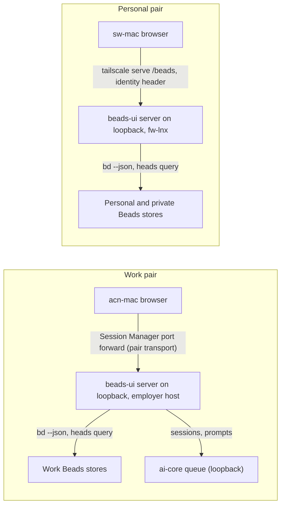

# beads-ui web app: review and triage UX, event-based prompt dispatch, stack, shared code, backend and access

## Founding Ask Coverage

`canonical_root_json`: `{"blob_oid":"8b43d16fb45272c4911f8de4d1b491e6bb472134","capture_commit":"b5eaeefd646b1fee17f189518ca9d32a67e9aad2","content_sha256":"79619e87b5d6a8e02204a9bf35e294caa65ab910f8be7f0d136e7035009caed0","entry_ids":["A001"],"generation":1,"path":"docs/asks/BU-epic-goals-system-usmm.md","previous_ref_sha256":null,"repository":"ai-harness","schema_version":1,"task_id":"BU-epic-goals-system-usmm"}`

`founding_ask_ref_sha256`: `c12436184b45bdc5c279f8f1d3928c6610536b5802f38b0760a6d47d4997dae6`

The founding ask record has one entry, A001, recorded verbatim in ai-harness at `docs/asks/BU-epic-goals-system-usmm.md`. This index is non-authoritative; the raw entry governs. A001 covers two systems. This doc covers the web app clauses; the goals clauses and the privacy guard are covered by [the goals system research](goals-system.md). Each row below is one web app clause of A001.

| A001 clause (quoted or closely paraphrased) | Coverage and disposition |
|---|---|
| A001: "the web app for the beads-ui task manager ... same overall purpose as the beads-ui task manage claude code mod tui" | Covered: Context; [§5](#5-front-end-stack-recheck); [§6](#6-shared-code-across-the-web-app-the-mcp-app-and-the-mod) |
| A001: "react or whatever framework is pretty and aesthetic and best practice" | Covered: [§5](#5-front-end-stack-recheck) |
| A001: "best practice UI / UX interactions from jira / todoist / asana / linear"; kanban, sprint and backlog, rearrange, quick edits of priority, status and owner, view details | Covered: [§2](#2-board-backlog-and-sprint-the-2025-2026-delta), building on the prior beads-ui landscape research |
| A001: "view the held doc blockers / decisions / open questions / details" | Covered: [§1](#1-review-and-triage-of-blockers-decisions-and-open-questions) |
| A001: type and enter prompt responses per task for the owning session; the session "should get automatically notified via event-based system" built on aih-fw-1's event-driven wake | Covered: [§3](#3-per-task-prompts-and-event-based-dispatch) |
| A001: "it can work via either agent-mail or hook context injection (should be event-based) and/or prompt injection via shared prompt injection library or configurable combination of them with fallback options" | Covered: [§3](#3-per-task-prompts-and-event-based-dispatch). All three named routes stay in the design space; the section recommends how they combine |
| A001: "i can change the owning cc session too and it should trigger the automatic /handoff" | Covered: [§4](#4-owner-change-handoff-and-start-goal) |
| A001: "auto-triggers them to `/start-goal` if they're not in a current goal mode state" | Covered: [§4](#4-owner-change-handoff-and-start-goal) |
| A001: "use the auto-work queue system to see all the tasks in priority order and filter them to see all blocked tasks in priority order (can filter by ... epic etc)"; review blockers and decisions by priority, impact, type and size; unblock and prompt next steps | Covered: [§1](#1-review-and-triage-of-blockers-decisions-and-open-questions); [§7](#7-backend-over-beads-and-ai-core) for the queue data |
| A001: "fit within the app-portal system ... as a modular web app" | Covered on the personal pair; pending on the work pair, which has no portal origin: [§8](#8-app-portal-fit) and Open Question 5 |
| A001: "shared code ... for beads-ui claude code mod tui, claude desktop / claude.ai webapp UI MCP app ... (if its too limiting, then they can be separate builds)" | Covered: [§6](#6-shared-code-across-the-web-app-the-mcp-app-and-the-mod) |
| A001: "built on our backend of beads tasks dolt db store etc and whatever else from ai-core"; open to changing backend or frontend | Covered: [§7](#7-backend-over-beads-and-ai-core) |
| A001: local hosting for now; sem-kg-ec2 with acn-mac via SSM or SSH; fw-lnx with sw-mac via Tailscale; cloud hosting from infra-as-config templates later | Covered: [§9](#9-hosting-and-access-for-each-machine-pair) |
| A001: goals system, goal views, goal research and the privacy guard | Out of this doc by split, covered in full by [the goals system research](goals-system.md) |
| A001: the process clauses (orchestrate, research, wait for aih-fw-2's compile, merge, sync, reap, then design through /auto-flow, then Sergei's review) | Process, not content. Recorded in the Run History of this doc and the coordinator's report |

**Status:** complete

**Created:** 2026-10-27

<!-- doc:region name="context" kind="immutable" -->

## Table of Contents

<!-- FILL THIS IN as you write. The entries below are this stub's own placeholder sections, so
     they already resolve; as you add, rename, or remove a heading, update this list in the same
     edit. A ToC that lists headings the doc does not have, or omits ones it does, is worse than
     no ToC because it looks like working navigation.
     The doc's D5 (c) decision: list EVERY `## ` and EVERY `### ` heading in the real doc, with
     GitHub-style anchors (lowercase, spaces→hyphens, punctuation stripped) so they navigate
     in-window (incl. VS Code Remote-SSH). If all-`###` proves too noisy, fall back to D5 (a)
     "meaningful `###`" — a deterministic OR-rule: include a `###` when it (1) has child `####`,
     (2) its body ≥ ~8-10 lines, (3) its parent `##` is allowlisted, or (4) matches a pattern.
     Hand-maintained: the not-yet-shipped `aido toc check` tool. Verify with
     `scripts/check_doc_toc.py <this-doc>`, which fails on an anchor that does not resolve.
     Manual `<!-- toc:skip -->` / `<!-- toc:include -->` override. -->

- [Founding Ask Coverage](#founding-ask-coverage)
- [Context](#context)
- [Temporal Scope](#temporal-scope)
- [Executive Summary](#executive-summary)
- [1. Review and triage of blockers, decisions and open questions](#1-review-and-triage-of-blockers-decisions-and-open-questions)
  - [When to use](#when-to-use)
- [2. Board, backlog and sprint: the 2025-2026 delta](#2-board-backlog-and-sprint-the-2025-2026-delta)
- [3. Per-task prompts and event-based dispatch](#3-per-task-prompts-and-event-based-dispatch)
  - [When to use](#when-to-use-1)
- [4. Owner change, /handoff and /start-goal](#4-owner-change-handoff-and-start-goal)
  - [When to use](#when-to-use-2)
- [5. Front-end stack recheck](#5-front-end-stack-recheck)
  - [When to use](#when-to-use-3)
- [6. Shared code across the web app, the MCP App and the mod](#6-shared-code-across-the-web-app-the-mcp-app-and-the-mod)
  - [When to use](#when-to-use-4)
- [7. Backend over Beads and ai-core](#7-backend-over-beads-and-ai-core)
  - [When to use](#when-to-use-5)
- [8. app-portal fit](#8-app-portal-fit)
  - [When to use](#when-to-use-6)
- [9. Hosting and access for each machine pair](#9-hosting-and-access-for-each-machine-pair)
  - [When to use](#when-to-use-7)
- [Comparison](#comparison)
- [Recommendation](#recommendation)
- [Open Questions](#open-questions)
- [Sources](#sources)
- [Ambiguous Items from Auto-Remediation (Post-Run Review)](#ambiguous-items-from-auto-remediation-post-run-review)
- [Appendix: Research Prompt](#appendix-research-prompt)
- [Appendix: Provenance Ledger](#appendix-provenance-ledger)
- [Run History](#run-history)
  - [2026-10-27 to 2026-10-28: orchestrated research run (coordinator BU-agent-coordinator-nmva)](#2026-10-27-to-2026-10-28-orchestrated-research-run-coordinator-bu-agent-coordinator-nmva)

## Context

Sergei asked on 2026-10-27 for a web app version of the beads-ui task manager: the same purpose as the Claude Code mod, with Jira, Todoist, Asana and Linear quality interactions, and a way to steer the Claude Code session that owns each task from the browser. A prompt, a decision answer or an unblock entered on a task must reach that session by event, never by a scheduled wake, and start its work; changing the owner runs `/handoff`, and a session with no goal armed gets `/start-goal`. The app fits app-portal as a member app, shares code with the mod and the MCP App where that is sound, runs on the Beads Dolt stores, and is reachable from both machine pairs: sem-kg-ec2 with acn-mac, and fw-lnx with sw-mac.

The beads-ui design doc already decides the web stack (D-10), the queue member-app role (D-11), the MCP topology (D-14) and the Phase 3 to 6 scope. This research covers what the 2026-10-27 ask adds on top of that, and rechecks the stack.

**Primary period:** 2024–2026
**Source weighting:** 2026 primary, 2025 secondary, 2024 tertiary; earlier sources only where foundational. Fleet sources (ai-harness and beads-ui designs, code and Beads issues) are read at the commits each finding names.

<!-- /doc:region name="context" -->

<!-- doc:region name="body" kind="replaceable" -->

## Temporal Scope

Product, library and platform claims weight 2026 first, then 2025, then 2024; earlier sources appear only as background. Fleet claims (the event-driven wake, Agent Mail, the work queue, the prompt-injection library, the held-doc store, the beads-ui design) are read from ai-harness, ai-core and beads-ui at the commits each findings file names, measured on 2026-10-27 and 2026-10-28 UTC. Each research leg's full evidence, with its footnoted sources, is in its findings file under [findings/](findings/); this doc synthesizes them and cites the findings file for detail.

## Executive Summary

1. The web app's new core is a keyboard-first triage queue for blockers, held decisions and open questions, sorted by priority and grouped by next action, with option cards whose number keys pick a decision's option. No product has a queue built for answering decisions; Linear Triage and Gmail's keyboard triage are the patterns to copy ([§1](#1-review-and-triage-of-blockers-decisions-and-open-questions)).
2. A prompt typed on a task reaches its owning session by event: the server writes a durable dispatch record to the ai-core queue, then sends addressed Agent Mail that the target host's notifier admits as a wake. The shared prompt-injection library, the mod's `$.prompt.submit` and the queue's turn-end pull are fallbacks, all under one kill switch, and nothing costs tokens while nothing is pending ([§3](#3-per-task-prompts-and-event-based-dispatch)).
3. The auto-trigger depends on fleet work not yet done: every automatic idle wake is off on sem-kg-ec2 until Phase 4 of the event-driven wake seeds its policy file, and web-app prompts need a signed dispatch envelope or receiving sessions treat them as unverified ([§3](#3-per-task-prompts-and-event-based-dispatch)).
4. D-4, D-10 and D-11 hold. The server reads Beads through `bd --json` and the host refresher, detects change across every store with one Dolt heads query, uses the ai-core queue for sessions and prompts, and registers with app-portal as a Node upstream ([§5](#5-front-end-stack-recheck), [§7](#7-backend-over-beads-and-ai-core), [§8](#8-app-portal-fit)).
5. Each pair reaches a loopback-bound server through its existing transport: a Session Manager port forward from acn-mac to the employer host, and `tailscale serve` on fw-lnx for sw-mac. The server adds its own Host, Origin and token checks, and a per-host repository allowlist keeps personal stores off the employer host ([§7](#7-backend-over-beads-and-ai-core), [§9](#9-hosting-and-access-for-each-machine-pair)).

## 1. Review and triage of blockers, decisions and open questions

No product in the survey has a queue built for answering decisions. The nearest pattern is the triage queue, and it transfers well. Linear Triage binds Accept, Decline and Duplicate to the keys 1, 2 and 3 and snooze to H [VERIFIABLE][^1][^3]. Gmail marks an item done with E and undoes with Z [VERIFIABLE][^4]; GitHub's notification inbox marks an item done with E and offers saved filters and bulk actions [VERIFIABLE][^5][^45]. Linear added a Priority tab to its inbox in September 2026 and groups agent replies in their own inbox section [VERIFIABLE][^9].

The fleet's held decisions are already structured for this. Each held decision carries `format-decision` markers, `##### (a)` option headings with Pros and Cons, and a Recommendation naming a letter, and ai-harness's `format_decision` module already parses that shape [INFERENCE] (the UX leg read the module and the held README; see [^1] § 1). A web app can therefore show each decision as an option card whose number keys pick an option, with the rendered Markdown body below for context.

The recommended Review view is a split list and detail queue, keyboard first, grouped by next action (answer a decision, unblock, answer an open question, prompt), sorted by priority, impact (Beads' `value` metadata) and age, and filterable by epic, goal, type, size (`effort` metadata), owner and repository, with bulk selection for cases such as approving every recommendation in one epic [INFERENCE] (UX findings § 1.3). Two points need design calls. First, beads-ui D-39 records Sergei's answer "exactly as typed", so a one-key "approve the recommendation" writes text Sergei did not type; the design must either record such an answer as chosen by a control, naming the option, or fill the composer and require Send [VERIFIABLE][^1][^25]. Second, structured option data needs a new held-store command that prints each decision's options and recommendation as JSON, which is an ai-harness change beside D-37's `review` verb [INFERENCE].

Single-letter shortcuts in the Gmail and Linear style must be possible to turn off or remap to meet WCAG 2.1.4 at Level A, and Gmail gives its users a setting to turn them on or off [VERIFIABLE][^4][^8]. No decided beads-ui decision covers this, so the web app design needs one.

Answers and unblocks must reach the right host. `held_cli.py answer` writes an answer verbatim in the owning session's landing pad, which lives on that session's host, so a web app on sem-kg-ec2 cannot run it for an item held on acn-mac [VERIFIABLE][^2] (dispatch findings Q6). The dispatch leg's proposal: the dispatch carries the answer bytes, and the target host's receiver writes them to a file and runs the closed verb `held_cli.py answer <path> --text-file <file>` itself, so no session retypes the bytes, which the held README forbids [INFERENCE] (dispatch findings Q6). A bd blocker's write path is a bd comment in the form D-40's Review section reads, plus `bd-unblock`, which writes the stamped transition comment the hooks check [VERIFIABLE][^2]. The closed verb is an ai-harness change (Open Question 4).

### When to use

The triage queue is the web app's home for Sergei's review work: blocked tasks, held decisions and open questions in priority order. The Board stays the home for moving work between statuses.

## 2. Board, backlog and sprint: the 2025-2026 delta

The prior beads-ui landscape research covers Jira, Linear, Todoist and Asana board, backlog, sprint and drag interactions in depth, and the beads-ui design already decides the board (Phase 3, D-5, D-6, D-13, D-22, D-23). The 2026 delta is small and concentrated in Linear: drag-to-reorder groups and swimlanes in May 2026, shareable filtered-view URLs in July 2026, and the Priority inbox in September 2026 [VERIFIABLE][^9]. Asana's fall 2026 release adds AI Teammates and a "Work Graph" [VERIFIABLE][^1] (§ 4). Huly's repository is now frozen and its hosted service discontinued, so it drops out as a reference [VERIFIABLE][^1] (§ 4). Superhuman, Asana Inbox, Height and Jira's 2025-2026 changes could not be verified in this run [NO SOURCE].

Shareable view URLs are the one delta worth adopting: a filtered Review or Board view should be a URL so a session or a note can link straight to "blocked P0 and P1 in epic X" [INFERENCE].

## 3. Per-task prompts and event-based dispatch

The fleet already has an event-driven admission system for idle sessions, and the web app should enter it as one more typed event source rather than build a second wake path. The notifier daemon polls outside the model, classifies typed events, and an async `FileChanged` hook exits 2 to create a model turn only for an admitted event; direct mail and explicit pokes wake their recipient, and passive items ride the next `PreToolUse` or `UserPromptSubmit` [VERIFIABLE][^14][^26]. Phases 1 to 3 of that design are on ai-harness main; Phases 4 and 5 are not [VERIFIABLE][^2][^16].

Every automatic idle wake is switched off on sem-kg-ec2 today. The live policy file `~/.config/ai-harness/idle-wake.json` does not exist, which the loader reads as `automatic_wakes = false`, and since Phase 3 the git-inbox prompt-injection wake checks the same switch [VERIFIABLE][^15][^16]. Until the switch is on, a dispatched prompt reaches a session only at its next natural turn boundary. Seeding the file belongs to Phase 4 of the event-driven wake, which the aih-fw-1 session owns; it is the dependency most likely to block the web app's auto-trigger [VERIFIABLE][^2] (§ Dependencies).

The recommended dispatch path follows the transactional outbox pattern: write the dispatch durably, then publish an event, and make every consumer idempotent on the dispatch id because a relay may deliver twice [VERIFIABLE][^23]. The dispatch leg's ladder, with each rung honouring one call-time kill switch [INFERENCE]:

| Rung | Route | When it is used |
|---|---|---|
| 0 | Record: the dispatch goes to the ai-core work queue (`POST /api/queue/prompts`, which already models `queued` to `consumed`), mirrored as a bd comment on the task | Always, first |
| 1 | Agent Mail addressed to `<session>@<host>`, admitted by the target host's notifier: an idle session wakes through the hook, a busy one sees a header at its next tool call | Primary |
| 2 | Buzz, then git-inbox, as cross-host carriers when Agent Mail is unavailable; git-inbox carries a pointer only | Agent Mail unavailable |
| 3 | The shared prompt-injection library types a one-line, harness-authored pointer to the dispatch on the target host | Rung 1 published but no shown receipt within a bound (proposed 60 s), and the session has a tmux pane |
| 4 | The beads-ui mod's `$.prompt.submit`, when the mod is loaded in the target session; the mods API documents it with timers and refused-call results [VERIFIABLE][^24] | No pane the library can resolve |
| 5 | The work queue's `Stop`-hook pull and the passive header at the next turn end | Floor: nothing is lost when every wake rung is off |

Dispatch content follows the privacy rule. A private task's prompt text stays in its private store; the queue record, the Agent Mail body and any git-inbox message carry only the dispatch id and a digest of the text. Git-inbox in particular carries a pointer only, because it commits its messages to refs of a shared harness repository [VERIFIABLE][^2] (dispatch findings, Gaps 2 and F-5).

The prompt-injection library is built: it types a harness-authored line into a session's pane under a claim and records it [VERIFIABLE][^18]. This keeps all three routes the founding ask names. Agent Mail admitted by the notifier is the "hook context injection ... event-based" route through aih-fw-1's work, the shared prompt-injection library is rung 3, and git-inbox and Buzz carry Agent Mail's role across hosts [INFERENCE]. Claude Code's native channels and remote control stay out of the ladder: channels are a research preview with provider limits, and Remote Control requires a subscription login that excludes the Bedrock route this host uses [VERIFIABLE][^7][^27].

Every rung costs zero model tokens while nothing is pending, because the waiting runs in a daemon, a hook watcher or a mod timer. Each delivery costs one model turn over the session's cached context, measured at a median of 365,551 cache-read tokens per response window, so coalescing several dispatches to one session into one turn is the main cost lever during bulk review [VERIFIABLE][^14][^2].

Authority is the open design problem. The fleet's peer-relay `VERIFIED` check reads the sending session's transcript for Sergei's typed turn; a web app has no transcript, so its prompts would arrive `UNVERIFIED` and a receiving session would treat them as coordination only [VERIFIABLE][^17]. The web app needs a dispatch envelope signed by the server after it authenticates Sergei and verified on the receiving host [INFERENCE]. The web app's own browser auth layer (§9) therefore matters as much as the envelope [INFERENCE].

The composer itself should be ported, not redesigned. The work queue's dashboard in ai-core already has a Sergei-approved composer (Lexical rich text, a `/skill` typeahead, an explicit "Queue prompt" button and a secret-guard refusal), and under D-11 the beads-ui web app replaces that dashboard [INFERENCE]. Every agent-delegation product surveyed shows a per-session state beside a follow-up box; Linear's agent sessions have six states (`pending`, `active`, `error`, `awaitingInput`, `complete`, `stale`), and Claude Code's Remote Control docs warn that a disconnected banner says nothing about whether work continues [VERIFIABLE][^6][^7]. The composer should therefore show three separate indicators: session liveness, delivery state (queued, shown, taken, acted on, failed, each with its source of truth in the queue record) and the session's response [INFERENCE].

### When to use

Agent Mail is the route for every dispatch. The fallbacks exist for a session that does not show the mail within the bound, and the floor guarantees delivery at the next turn end when automatic wakes are off.

## 4. Owner change, /handoff and /start-goal

An owner edit must not simply reassign an in-progress claim. `bd` refuses to reassign another session's claim without `--force`, and the fleet's `/handoff` is receiver-first: the sender drops its rows only after the receiver says taken [VERIFIABLE][^20]. The web app should therefore send a handoff request to the current owner, and use the git-inbox action route, with its `taken` and `confirmed` receipts, when the current owner is gone [INFERENCE]. The UI side is an inline owner select with a confirmation popover that names both sessions and their liveness [INFERENCE].

Arming `/start-goal` needs the target session's goal state, which is read on the target host from that session's transcript by the goal waker [VERIFIABLE][^22]. Claude Code's native `/goal` replaces an active goal and resumes a paused one on any new prompt [VERIFIABLE][^21]. Holding a dispatch to a session whose goal is paused for a usage or rate limit would narrow the ask's auto-trigger, so the design must choose among holding it with a "resume anyway" control, delivering it always, or delivering it once the pause's cause clears (Open Question 3, from dispatch findings F-4). The dispatch carries an "arm a goal if none is active" flag; the receiving session, not the web app, decides whether to run `/start-goal` after reading its own state [INFERENCE].

### When to use

Use the handoff request whenever the owner field changes on a task that has a live claim. A task with no claim takes a plain assignee write.

## 5. Front-end stack recheck

D-10's stack holds as of 2026-10-28: React 19, Vite, TanStack Query, Table and Virtual, Zustand, shadcn/ui on Base UI, Pragmatic drag and drop and Recharts are all maintained [VERIFIABLE][^10]. The exception is `cmdk`, whose last release is 2025-03-14 and last push 2025-10-29; shadcn's Command still wraps it, and Base UI's Autocomplete now covers filtering, groups, keyboard movement and virtualization, so the replacement path D-10 planned exists [VERIFIABLE][^10]. Three facts in the prior stack record have moved: Base UI's package is now `@base-ui/react` (1.0.0 on 2025-12-11), Frappe Gantt released 1.2.2 on 2026-02-25, and Vite 8 (2026-03-12) bundles with Rolldown [VERIFIABLE][^10][^12]. React Compiler reached 1.0 on 2025-10-07 and is worth enabling for a dense board [VERIFIABLE][^11].

The ask also says "whatever is the best web app UI/UX frontend framework". D-10 already weighed the alternatives (a Solid-based stack and lit-html among them) and chose React for its component ecosystem and the MCP App's fit; nothing measured in 2026 reopens that, and React 19 with the compiler removes the main performance argument against it [INFERENCE]. D-10's app-portal consistency argument is weaker now that app-portal is on Radix and Vite 7, but a member app ships its own bundle, so only the token set needs sharing [INFERENCE] (UX findings, Flagged 3).

For an attractive Linear-grade look, the recommendation is D-19's semantic token names expressed as shadcn-style oklch CSS variables in light and dark, with a contrast setting, keeping the token file small enough to swap for a generated theme later [INFERENCE]. app-portal itself uses Radix and Vite 7, which does not reopen D-10 because a member app ships its own bundle [VERIFIABLE][^1].

### When to use

Keep D-10 as decided. Revisit `cmdk` only when it breaks on a React or Base UI upgrade, and then move the palette to Base UI's Autocomplete behind the same component.

## 6. Shared code across the web app, the MCP App and the mod

The prior shared-code split stands. Core reducers, view models and commands are shared by all three surfaces; React components are shared by the web app and the MCP App, while the mod draws its own element tree [VERIFIABLE][^1][^25]. This ask adds four shared candidates: the review-queue reducer, the decision-option model, the composer's delivery-state machine and the key map, the last held as data in core's command catalog and bound by a small DOM listener in the web package [INFERENCE].

One limit matters for the MCP App. MCP Apps' `ui/message` posts into the Claude conversation, not into a Claude Code session, so the MCP App must send a session prompt through a server tool that writes the same dispatch record the web app writes [VERIFIABLE][^13]. Separate builds are needed only for drawing (DOM against the mod's element tree), never for the domain, so the founding ask's fallback of separate builds applies to the view layer alone [INFERENCE].

### When to use

Put anything that decides what to show or what a key does in core. Put anything that draws in the surface package.

## 7. Backend over Beads and ai-core

D-4 holds for the web server. Reads come from the host refresher's snapshots (D-26) plus `bd ... --json` for detail, and writes stay guarded `bd` calls (`--if-status`, exit 13 on a stale write) [VERIFIABLE][^28][^25]. `bd serve` 1.3.2 now has bearer tokens with live rotation and a DNS-rebinding Host check, but it still runs one process per store, fires no hooks and has no TLS, so nothing measured reopens D-4 [VERIFIABLE][^28][^29].

A change feed across every store on a host costs one query. The shared Dolt server answers `SELECT @@AIH_head, @@BU_head, ...` for all stores in one call, measured at 0.42 s as a `bd sql` process; that is the cheapest live-update trigger, and it sees changes that arrived by sync, which the events journal does not (the journal is off on every store checked) [VERIFIABLE][^29][^30]. The server polls the heads, re-reads only the stores that moved and pushes Server-Sent Events to the browser [INFERENCE]. Because the work pair's forward carries HTTP/1.1, which caps a browser's connections per origin, the app shares one multiplexed event stream across its tabs (backend findings § 6.3 and R7) [INFERENCE].

The ai-core work-queue API is the fleet's only cross-store read model and the only home of sessions, leases and durable prompts. It served the full task projection in 0.27 to 1.04 s [VERIFIABLE][^29][^43]. Under D-11 the web app should read sessions, prompts, review items and events from it on the pair where it runs, keep `bd` as the source of truth for task fields, and write each dispatch to the queue's prompt store (§3, rung 0); where the queue is not configured, a local append-only store takes its place [INFERENCE]. The queue's design already models a prompt from queued to consumed, with receipts and an event stream [VERIFIABLE][^19].

A data-scope issue in the ai-core queue on the work host is tracked privately and constrains the backend design: the web app's backend must filter every store and queue read through a per-host repository allowlist, so a host never shows a store its class does not allow [INFERENCE]. The allowlist is a requirement for the design (see [the goals research § 8](goals-system.md#8-privacy-and-access-control-for-personal-goals)).

### When to use

Use `bd` for every task field and every write. Use the queue for sessions, prompts and cross-store lists where it runs. Use the heads query to decide when to refresh.

## 8. app-portal fit

app-portal's member contract assumes a FastAPI process serving a static single-page app under a `tailscale serve` path, with no Node at runtime (its D-5) [VERIFIABLE][^41][^42]. beads-ui's Node server (D-10) can still join through `apps.yaml`, which accepts any loopback upstream, but it must re-implement in Node the duties app-portal's `attach_portal()` performs for a Python member [VERIFIABLE][^28][^42]. The recommendation is beads-ui's own Node server registered as a `kind: portal` upstream, because D-10 already chose a Node server and the public project must run without the portal [INFERENCE].

Two facts bound this. The ai-core queue dashboard member app (Board, Decisions, Epics, Inbox, Review, Sessions, Task detail and the Lexical composer) is already built in ai-core `web/` but is not mounted on the employer host; under D-11 it is the port source for the beads-ui web app, and under D-11 (a) the open part is which of its components are ported first and when it retires (Open Question 2) [VERIFIABLE][^29][^43]. And the work pair has no portal origin at all, because the employer host runs no Tailscale [VERIFIABLE][^29]. Standalone through the tunnel (§9) is the interim there; the path to the ask's portal fit on that pair is app-portal's loopback router serving the shell on the employer host, a cross-repository change (Open Question 5) [INFERENCE] (backend findings F-3). Registering a Node member also departs from app-portal's D-5 ("no Node at runtime") for this one member, which needs the app-portal owner's agreement or a recorded amendment (Open Question 5) [VERIFIABLE][^41].

app-portal uses Radix and Vite 7 while D-10 picks Base UI and Vite 8; a member app ships its own bundle, so this costs only a shared token set, not a shared component library [VERIFIABLE][^1][^42].

### When to use

Register the web app in `apps.yaml` on the personal pair, where the portal runs. Run it standalone on the work pair until the portal can serve there.

## 9. Hosting and access for each machine pair

On the work pair, the server binds to loopback on the employer-provisioned host, and acn-mac reaches it through one more entry in the pair transport's `forwards` map: the supervised AWS Systems Manager Session Manager port forward the fleet already runs [VERIFIABLE][^31][^44]. An SSH `LocalForward` over the existing SSH-over-Session-Manager alias is the measured fallback (`ssh -L` returned exit 0 from acn-mac) [VERIFIABLE][^29][^44]. No inbound port opens on the host, which keeps its zero-inbound design [VERIFIABLE][^31].

On the personal pair, the server binds to loopback on fw-lnx and is published with `tailscale serve --bg --set-path /beads` from `apps.yaml`. The app reads the `Tailscale-User-Login` header for identity, and can read an app capability granted in the tailnet policy (`--accept-app-caps`, Tailscale 1.92 or later) to decide who may dispatch prompts [VERIFIABLE][^32][^33][^34]. The fleet's pair configuration names the personal laptop's profile `mac`, not `sw-mac`, so any config naming the personal pair uses `mac` [VERIFIABLE][^44].

Neither transport authenticates the browser request. Any web page or local process on the laptop can reach `localhost:<port>` through the forward, and a server that sends prompts to shell-capable agents is a target for cross-site requests. The server therefore needs its own layer: a Host allowlist, an Origin and `Sec-Fetch-Site` check on every write, and on the work pair a per-host session token in a cookie [VERIFIABLE][^35][^36] for the mechanisms; the combination is [INFERENCE].

For cloud hosting later, Phase 6's templates need one change. Fly.io's `fly.toml` and Render's `render.yaml` are current, but Railway's `railway.json` config-as-code is deprecated and Railway stops reading it on 2026-12-01 in favour of `.railway/railway.ts` infrastructure as code [VERIFIABLE][^37][^38][^39][^40]. A hosted copy must never mount a private store or an employer store, and should join the tailnet before it gets a public origin [INFERENCE].



Legend: each server binds to loopback only; the browser layer on both pairs adds a Host allowlist and Origin checks, and the work pair adds a per-host session token.

### When to use

Use the pair transport's forward on the work pair and `tailscale serve` on the personal pair. Use the SSH forward only when the pair transport is down.

## Comparison

The dispatch routes, compared on the criteria the founding ask sets (event-based, no wasted tokens, works across the pair, auto-triggers work) [INFERENCE]:

| # | Criterion | Agent Mail via the notifier (rung 1) | Prompt-injection library pointer (rung 3) | Mod `$.prompt.submit` (rung 4) | Queue turn-end pull (rung 5) | Claude Code channels |
|---|---|---|---|---|---|---|
| 1 | Idle token cost | Zero until delivery | Zero until delivery | Zero until delivery | Zero | Zero until delivery |
| 2 | Wakes an idle session | Yes, once the policy switch is on | Yes, through the same switch | Yes, while the mod is loaded | No, waits for a turn end | Yes |
| 3 | Reaches the paired machine | Yes, Agent Mail is cross-host | No, local to the target host | No, local to the session | No | No |
| 4 | Built today | Yes (Phases 1 to 3 of the wake design) | Yes | Yes | Yes | Research preview; Bedrock route excluded |
| 5 | Delivery receipt | Shown receipt | Prompt record | Mod result | Queue `consumed` | None |
| 6 | Role in the ladder | Primary | Fallback when unshown past the bound | Fallback without a pane | Floor | Excluded for now |

## Recommendation

Build the web app on the decided beads-ui stack and data path, and spend the new design effort on four things.

- The Review triage queue and the per-task composer, ported from the ai-core dashboard's composer, with three separate status indicators and a WCAG-compliant shortcut setting (§1, §3).
- The dispatch path: a durable record in the ai-core queue, Agent Mail as the primary event, the ladder of fallbacks under one call-time kill switch, coalescing per session, and a signed dispatch envelope verified on the receiving host (§3).
- Owner change as a receiver-first handoff request, and `/start-goal` armed by a flag the receiving session acts on, holding dispatches to a paused goal (§4).
- Access through each pair's existing transport, a server-side browser auth layer, and a per-host repository allowlist on every store and queue read (§7, §9).

The source-vetting rule is met for every external pattern adopted here: Linear and Gmail triage, the transactional outbox, Tailscale Serve and Session Manager port forwarding are each documented by their vendors and in production use, and the libraries carry the maintenance signals recorded in the UX leg's evidence file [VERIFIABLE][^1][^10].

## Open Questions

1. (Researchable, a fleet fact.) When will Phase 4 of the event-driven idle wake seed the wake policy file on each host? (Design choice, for the design.) Until it does, is turn-end delivery the web app's interim, shown to the user as such?
2. (Design choice: D-11 of the beads-ui design already chose the end state.) Under D-11 (a), which of ai-core `web/`'s views and components are ported first, and when does that dashboard retire?
3. (Design choice: it trades the ask's auto-trigger against a rate-limited goal.) How is a dispatch to a session whose goal is paused handled: held with a "resume anyway" control, always delivered, or delivered once the pause's cause clears?
4. (Design choice, plus an ai-harness change.) How is a control-chosen answer recorded given D-39's "exactly as typed", and does the receiving host's closed `answer` verb ship with the web app's first phase?
5. (Design choice, cross-repository.) Does app-portal serve its shell on the employer host through its loopback router, and does its owner amend its D-5 for a Node member?
6. (Design choice.) What format and key distribution should the signed dispatch envelope use so that a session on the paired machine can verify it?
7. (Design choice.) Should the ai-core queue run on fw-lnx too, so the personal pair gets the same prompt store and receipts as the work pair?

## Sources

[^1]: beads-ui. (2026). [beads-ui web app research leg 1: UX, stack recheck and shared code](findings/beads-ui-web-app-ux-stack-and-shared-code.md) (`docs/research/findings/beads-ui-web-app-ux-stack-and-shared-code.md`, with `findings/evidence/beads-ui-web-app-stack-signals-2026-10-28.md`). Tracked in this repository; merged in PR #78 (cdcda0b), 2026-10-28. (Section numbers cited in the text refer to that file.) Online: [beads-ui-web-app-ux-stack-and-shared-code.md](https://github.com/sergeiwallace/beads-ui/blob/main/docs/research/findings/beads-ui-web-app-ux-stack-and-shared-code.md).
[^2]: beads-ui. (2026). [beads-ui web app research leg 2: event-driven dispatch of per-task prompts](findings/beads-ui-web-app-event-dispatch.md) (`docs/research/findings/beads-ui-web-app-event-dispatch.md`). Tracked in this repository; merged in PR #78 (cdcda0b), 2026-10-28. Online: [beads-ui-web-app-event-dispatch.md](https://github.com/sergeiwallace/beads-ui/blob/main/docs/research/findings/beads-ui-web-app-event-dispatch.md).
[^3]: Linear. (2026). [Triage](https://linear.app/docs/triage). Linear Docs. Verified accessible (fetched) 2026-10-28 by research leg 1. (Accept, Decline, Duplicate keys; snooze.)
[^4]: Google. (2026). [Keyboard shortcuts for Gmail](https://support.google.com/mail/answer/6594). Gmail Help. Verified accessible (fetched) 2026-10-28 by research leg 1. (Done, undo; shortcuts off by default.)
[^5]: GitHub. (2026). [Managing notifications from your inbox](https://docs.github.com/en/subscriptions-and-notifications/how-tos/viewing-and-triaging-notifications/managing-notifications-from-your-inbox). GitHub Docs. Verified accessible (fetched) 2026-10-28 by research leg 1. (Done, saved filters, bulk actions.)
[^6]: Linear. (2026). [Agent interaction](https://linear.app/developers/agent-interaction). Linear Developers. Verified accessible (fetched) 2026-10-28 by research leg 1. (Six agent session states.)
[^7]: Anthropic. (2026). [Continue local sessions from any device with Remote Control](https://code.claude.com/docs/en/remote-control). Claude Code Docs. Verified accessible (HTTP 200) 2026-10-27 and 2026-10-28 by research legs 1 and 2. (Connection status; subscription login required.)
[^8]: W3C. (2023). [Understanding SC 2.1.4: Character Key Shortcuts](https://www.w3.org/WAI/WCAG22/Understanding/character-key-shortcuts.html). WAI. Verified accessible (fetched) 2026-10-28 by research leg 1. (Level A, current in WCAG 2.2.)
[^9]: Linear. (2026). [Changelog](https://linear.app/changelog), [Changelog, page 2](https://linear.app/changelog/page/2) and [Priority inbox](https://linear.app/changelog/2026-09-03-priority-inbox). Linear. Verified accessible (fetched) 2026-10-28 by research leg 1. (Entries April to October 2026.)
[^10]: npm, Inc. (2026). [npm public registry](https://registry.npmjs.org/), queried per package; raw output in [findings/evidence/beads-ui-web-app-stack-signals-2026-10-28.md](findings/evidence/beads-ui-web-app-stack-signals-2026-10-28.md). Verified accessible 2026-10-28 by research leg 1. (Versions and release dates of the D-10 stack.)
[^11]: Tan, L., Savona, J., & Zhang, M. (2025, October 7). [React Compiler v1.0](https://react.dev/blog/2025/10/07/react-compiler-1). React Blog. Verified accessible (fetched) 2026-10-28 by research leg 1.
[^12]: Vite. (2026, March 12). [Vite 8 is out](https://vite.dev/blog/announcing-vite8). Vite Blog. Verified accessible (fetched) 2026-10-28 by research leg 1.
[^13]: Model Context Protocol. (2026). [MCP Apps specification 2026-01-26](https://github.com/modelcontextprotocol/ext-apps/blob/main/specification/2026-01-26/apps.mdx) and [MCP Apps overview](https://modelcontextprotocol.io/extensions/apps/overview). Verified accessible (fetched) 2026-10-28 by research leg 1. (`ui/message` posts into the conversation.)
[^14]: ai-harness. (2026). *Event-driven admission for idle session wakes* (`docs/designs/aih-p811n7-event-driven-idle-wake.md`, lines 89-200, 506-514, 535-552). Read at ai-harness `23ece1e92b6` by research leg 2 and at `1e67f5e9c37` by the coordinator, 2026-10-27. [Gated link, repository access required](https://github.com/sergeiwallace/ai-harness/blob/main/docs/designs/aih-p811n7-event-driven-idle-wake.md); path and commit given.
[^15]: ai-harness. (2026). `src/ai_harness/idle_wake.py` (lines 30-63, 86-124, 257-298). Read at `23ece1e92b6` by research leg 2. [Gated link, repository access required](https://github.com/sergeiwallace/ai-harness/blob/main/src/ai_harness/idle_wake.py).
[^16]: beads-ui. (2026). [Evidence: host and history probes behind the event-dispatch findings](findings/evidence/beads-ui-web-app-event-dispatch-host-probe.md). Tracked in this repository; measured 2026-10-27T23:58Z to 2026-10-28T00:06Z by research leg 2. Online: [beads-ui-web-app-event-dispatch-host-probe.md](https://github.com/sergeiwallace/beads-ui/blob/main/docs/research/findings/evidence/beads-ui-web-app-event-dispatch-host-probe.md).
[^17]: ai-harness. (2026). *Fleet messaging ladder* (`docs/procedures/fleet-messaging-ladder.md`, lines 34-262). Read at `23ece1e92b6` by research leg 2. [Gated link, repository access required](https://github.com/sergeiwallace/ai-harness/blob/main/docs/procedures/fleet-messaging-ladder.md). (Ladder order; VERIFIED and UNVERIFIED peer relays.)
[^18]: ai-harness. (2026). *Prompt injection and auto-submission library* (`docs/designs/aih-59eza-prompt-injection-library.md`, lines 218-800). Read at `23ece1e92b6` by research leg 2. [Gated link, repository access required](https://github.com/sergeiwallace/ai-harness/blob/main/docs/designs/aih-59eza-prompt-injection-library.md).
[^19]: ai-harness. (2026). *Autonomous work-queue coordinator and PWA dashboard* (`docs/designs/autonomous-work-queue-coordinator-and-pwa-dashboard.md`, lines 175-600). Read at `23ece1e92b6` by research leg 2. [Gated link, repository access required](https://github.com/sergeiwallace/ai-harness/blob/main/docs/designs/autonomous-work-queue-coordinator-and-pwa-dashboard.md).
[^20]: ai-harness. (2026). *Session handoff* (`docs/procedures/session-handoff.md`, lines 63-180) and the `/handoff` skill (`skills/handoff/SKILL.md`). Read at `23ece1e92b6` by research leg 2. [Gated link, repository access required](https://github.com/sergeiwallace/ai-harness/blob/main/docs/procedures/session-handoff.md). (Receiver-first handoff; `--force` reassignment.)
[^21]: Anthropic. (2026). [Keep Claude working toward a goal](https://code.claude.com/docs/en/goal.md). Claude Code Docs. Verified accessible (HTTP 200) 2026-10-27 by research leg 2. (Replacement, pause, resume on a new prompt.)
[^22]: ai-harness. (2026). `/start-goal` skill (`skills/start-goal/SKILL.md`, lines 1-135), `src/ai_harness/goal_waker.py` and the *Goal waker* design (`docs/designs/aih-wmd2v-goal-waker.md`). Read at `23ece1e92b6` by research leg 2. [Gated link, repository access required](https://github.com/sergeiwallace/ai-harness/blob/main/skills/start-goal/SKILL.md).
[^23]: Richardson, C. (2026). [Pattern: Transactional outbox](https://microservices.io/patterns/data/transactional-outbox.html). microservices.io. Verified accessible (HTTP 200) 2026-10-27 by research leg 2. (Idempotent consumers.)
[^24]: Anthropic. (2026). [Use the mods API](https://code.claude.com/docs/en/plugins/mods/api.md). Claude Code Docs. Verified accessible (HTTP 200) 2026-10-27 by research leg 2. (Timers, `$.prompt.submit`, refused-call results.)
[^25]: beads-ui. (2026). [beads-ui design](../designs/beads-ui-design.md) (`docs/designs/beads-ui-design.md`, D-10, D-11, D-17, D-37, D-39). Tracked in this repository; read at `c5f6e57`, 2026-10-27. Online: [beads-ui-design.md](https://github.com/sergeiwallace/beads-ui/blob/main/docs/designs/beads-ui-design.md).
[^26]: Anthropic. (2026). [Hooks reference](https://code.claude.com/docs/en/hooks.md). Claude Code Docs. Verified accessible (HTTP 200) 2026-10-27 by research leg 2. (`asyncRewake`, `additionalContext`.)
[^27]: Anthropic. (2026). [Push events into a running session with channels](https://code.claude.com/docs/en/channels.md). Claude Code Docs. Verified accessible (HTTP 200) 2026-10-27 by research leg 2. (Research preview; provider availability.)
[^28]: beads-ui. (2026). [beads-ui web app research leg 3: backend, app-portal fit and access](findings/beads-ui-web-app-backend-portal-and-access.md) (`docs/research/findings/beads-ui-web-app-backend-portal-and-access.md`). Tracked in this repository; merged in this run's third research landing, 2026-10-28. Online: [beads-ui-web-app-backend-portal-and-access.md](https://github.com/sergeiwallace/beads-ui/blob/main/docs/research/findings/beads-ui-web-app-backend-portal-and-access.md).
[^29]: beads-ui. (2026). [Evidence: read-only host probes for the backend, portal and access leg](findings/evidence/beads-ui-web-app-backend-access-probes-2026-10-28.md). Tracked in this repository; measured 2026-10-28 by research leg 3. (Listeners, queue routes and timings, the heads query, store row counts.) Online: [beads-ui-web-app-backend-access-probes-2026-10-28.md](https://github.com/sergeiwallace/beads-ui/blob/main/docs/research/findings/evidence/beads-ui-web-app-backend-access-probes-2026-10-28.md).
[^30]: DoltHub. (2026). [Dolt system variables](https://www.dolthub.com/docs/sql-reference/version-control/dolt-sysvars). Dolt Documentation. Verified accessible (HTTP 200) 2026-10-28 by research leg 3. (`@@<db>_head`.)
[^31]: Amazon Web Services. (2026). [Start a session](https://docs.aws.amazon.com/systems-manager/latest/userguide/session-manager-working-with-sessions-start.html). AWS Systems Manager User Guide. Verified accessible (HTTP 200) 2026-10-28 by research leg 3. (Port forwarding sessions.)
[^32]: Tailscale. (2026). [Tailscale Serve](https://tailscale.com/kb/1312/serve). Tailscale Docs. Verified accessible (HTTP 200) 2026-10-28 by research leg 3. (Identity headers; HTTPS.)
[^33]: Tailscale. (2026). [tailscale serve command](https://tailscale.com/kb/1242/tailscale-serve). Tailscale Docs, last validated 2026-01-26. Verified accessible (HTTP 200) 2026-10-28 by research leg 3. (`--set-path`, `--bg`, `--accept-app-caps`.)
[^34]: Tailscale. (2026). [Grants](https://tailscale.com/kb/1324/grants). Tailscale Docs. Verified accessible (HTTP 200) 2026-10-28 by research leg 3.
[^35]: Google Chrome. (2025). [New permission prompt for Local Network Access](https://developer.chrome.com/blog/local-network-access). Chrome for Developers, updated 2025-09-29. Verified accessible (HTTP 200) 2026-10-28 by research leg 3.
[^36]: OWASP Foundation. (2026). [Cross-Site Request Forgery Prevention Cheat Sheet](https://cheatsheetseries.owasp.org/cheatsheets/Cross-Site_Request_Forgery_Prevention_Cheat_Sheet.html). OWASP Cheat Sheet Series. Verified accessible (HTTP 200) 2026-10-28 by research leg 3. (Origin checks, Fetch Metadata.)
[^37]: Fly.io. (2026). [App configuration (fly.toml)](https://docs.fly.io/reference/configuration). Fly Docs. Verified accessible (HTTP 200) 2026-10-28 by research leg 3.
[^38]: Railway. (2026). [Config as code](https://docs.railway.com/reference/config-as-code). Railway Docs. Verified accessible (HTTP 200) 2026-10-28 by research leg 3. (Deprecation and the 2026-12-01 cutoff.)
[^39]: Railway. (2026). [Infrastructure as Code](https://docs.railway.com/infrastructure-as-code). Railway Docs. Verified accessible (HTTP 200) 2026-10-28 by research leg 3.
[^40]: Render. (2026). [Blueprint YAML reference](https://render.com/docs/blueprint-spec). Render Docs. Verified accessible (HTTP 200) 2026-10-28 by research leg 3.
[^41]: app-portal. (2026). *App portal architecture* (`docs/designs/eve-15f-app-portal-architecture.md`). Private repository file at `b73683e`, read 2026-10-28 by research leg 3. [Gated link, repository access required](https://github.com/sergeiwallace/app-portal/blob/main/docs/designs/eve-15f-app-portal-architecture.md); path and commit given. (Member contract, D-5.)
[^42]: app-portal. (2026). `apps.yaml`, `src/app_portal/`, `src/vite.ts`, `src/shell.tsx`, `package.json`. Private repository files at `b73683e`, read 2026-10-28 by research leg 3. [Gated link, repository access required](https://github.com/sergeiwallace/app-portal/blob/main/apps.yaml).
[^43]: ai-core. (2026). `src/ai_core/queue/router.py`, `src/ai_core/main.py`, `web/README.md`. Private repository files at `f40fa2bd`, read 2026-10-28 by research leg 3. [Gated link, repository access required](https://github.com/sergeiwallace/ai-core/blob/main/src/ai_core/queue/router.py). (Queue routes; the built dashboard member app.)
[^44]: ai-harness. (2026). `scripts/pair_transport.py`, `scripts/wq_tunnel.py`, `config/message-transports.json`, and the remote-access procedure for the employer host under `docs/procedures/`. Read at `23ece1e92b6` by research leg 3. [Gated link, repository access required](https://github.com/sergeiwallace/ai-harness/blob/main/scripts/pair_transport.py). (The supervised port-forward map.)
[^45]: GitHub. (2026). [Keyboard shortcuts](https://docs.github.com/en/get-started/accessibility/keyboard-shortcuts). GitHub Docs. Verified accessible (fetched) 2026-10-28 by research leg 1. (Notification keys, including E to mark done.)

<!-- /doc:region name="body" -->

<!-- doc:region name="ambiguous_items" kind="replaceable" -->

## Ambiguous Items from Auto-Remediation (Post-Run Review)

(none yet — auto-populated by verify_and_remediate node)

<!-- /doc:region name="ambiguous_items" -->

<!-- doc:region name="appendix_research_prompt" kind="immutable" -->

## Appendix: Research Prompt

**Registry ID:** none (no ai-core prompt registry on this host); the prompts below were assembled by the Opus coordinator from `ai-harness/docs/research/prompts/TEMPLATE.md`
**Model:** `us.anthropic.claude-opus-5-5` for the three research leaves (persona `researcher`, effort high) and for the coordinator's synthesis (persona `architect`, effort high)
**Date:** 2026-10-27 (legs 1 and 2 launched 23:57 UTC) to 2026-10-28 (leg 3 launched 01:16 UTC)

Each leaf's brief opened with the Tier 3 founding-ask carrier (the canonical root JSON and digest recorded in Founding Ask Coverage above, the resolved record path, and the full verbatim text of entry A001), then a stage framing naming its leg and issue, an alignment obligation, and the destructive-operation floor. It then carried the research prompt below with its leg's fills, an output contract (one findings file under `docs/research/findings/`, at most 9,000 words, with Summary, one section per question, Recommendations with options and pros and cons, Gaps, Flagged items, Files read and Sources), the tools and scope fence (one writable beads-ui worktree, every other repo read-only, no pushes, no messages), the sub-agent completion contract and the fix-what-you-find rule. Legs 1 and 2 were told afterwards, and leg 3 in its brief, that beads-ui is a public repository whose hook refuses employer infrastructure names.

````text
## RESEARCH PROMPT (canonical research-prompt template blocks, reproduced verbatim with fills)

<grounding_instructions>
[Role identity, per leg:
 Leg 1 (UX, stack and shared code): "You are a principal product designer and front-end architect who has shipped keyboard-first issue trackers and review queues used daily by engineering teams, and who has built React design systems in production."
 Leg 2 (event-based dispatch): "You are a principal engineer who has built event-driven notification and job-dispatch systems for long-running agent processes, with production experience in pub/sub delivery semantics, idempotent receipts and token-cost accounting for LLM agents."
 Leg 3 (backend, app-portal and access): "You are a principal platform engineer who has shipped internal developer web apps behind zero-trust access (cloud session tunnels, tailnets, identity-aware proxies) and built Node backends over git-backed and SQL data stores."
 Each leg continued: "You have strong opinions backed by evidence. When you cannot find a source, you say so explicitly."]

Temporal scope: Weight sources by recency — 2026 (primary) → 2025 → 2024.
Pre-2024 sources are background context only unless foundational to the topic.
If post-2024 literature is genuinely sparse for a subtopic, state
"[subtopic]: no significant post-2024 developments found" rather than
backfilling with older sources. Backfilling is a failure mode, not a hedge.

[The remainder of the canonical <grounding_instructions> block followed verbatim: the
Chain-of-Verification four-step inner process, the four claim tags with rationale-before-tag,
the citation format and integrity rules, the never-invent-a-citation hard constraint, the
source-vetting rule, the diagram rule and the writing-rules mirror, closing with
</grounding_instructions>. The block is in ai-harness docs/research/prompts/TEMPLATE.md.]

## Scope note — questions, examples, and named references are a starting point, not a checklist
[verbatim from the canonical template]

## Independent exploration (gaps, blindspots, emergent threads) — required
[verbatim from the canonical template]

Retrieval: for each load-bearing claim, make at least one web search or web fetch call; never
return [VERIFIABLE] without a URL you fetched in this session. Do not stop after one round. [Legs
1 and 2 were pointed at a web-search tool that turned out not to reach sub-agents; leg 3 was told
to plan for web fetch only, with a public search results page for discovery.] For internal fleet
claims (legs 2 and 3), cite the repo file and line read, with its commit.

## Leg 1 research questions
1. Triage and review queues: which products and patterns let one person clear a queue of
   blockers, decisions and open questions fastest (Linear Triage and Inbox, GitHub notifications
   and review queue, Superhuman and Gmail keyboard triage, Jira, Asana Inbox, Height, Plane, Huly,
   code-review tools): keyboard-first navigation, split list and detail, a decision card that
   picks the recommended option in one action, an answer composer, snooze, bulk actions, undo,
   sorting and grouping by priority, impact, type, size, epic and goal, saved filters, progress.
2. The per-task prompt composer: typing a prompt for the owning session, seeing its liveness and
   delivery state, changing the owner so a handoff runs; analogues in Linear's agent delegation,
   GitHub Copilot coding agent, Devin and Cursor background agents, Claude Code remote control and
   web, OpenAI Codex cloud, Jules.
3. Rendering held-doc decision blocks, open questions and blockers inside a task detail.
4. The 2025-2026 board delta beyond the prior beads-ui findings.
5. A recheck of D-10's stack as of late 2026, and any better choice for a Linear-quality look.
6. Which layers the web app, the MCP App and the mod can share given D-35's view registry.

## Leg 2 research questions
1. The delivery contract the event-driven wake gives a producer outside the harness: event
   kinds, wake versus passive, latency bounds, receipts, dedupe identity, the kill switch, and
   what is built versus designed.
2. The candidate routes (Agent Mail, explicit poke, hook context injection, the shared
   prompt-injection library, the mod's $.prompt.submit, the work queue's claim and lease API,
   Claude Code native primitives), each with mechanism, idle token cost, latency, cross-host
   reach and failure modes; a configurable ladder with fallbacks.
3. Cross-host reach between the paired machines and its authentication.
4. Owner change and the receiver-first /handoff.
5. Arming /start-goal without resuming a paused or human-gated goal.
6. The write path for answers to held decisions and blockers, and the event that follows.
7. Authority and safety: who may prompt a session, verified versus unverified instructions,
   audit trail, rate limits.
8. The delivery states the UI can show and the source of truth for each.

## Leg 3 research questions
1. Backend over Beads: bd --json, bd serve, Dolt SQL directly or the ai-core queue service; many
   stores on one host, guarded writes, change feeds, performance; whether D-4 should change.
2. Which ai-core services the web app should use, and how D-11 divides beads-ui from ai-core.
3. app-portal fit: registration, routing, authentication, the shell, the bundle, tokens.
4. Access for sem-kg-ec2 and acn-mac: Session Manager port forwarding, SSH over Session Manager,
   VS Code forwarding, the existing fleet helper; latency, reconnects, user authentication.
5. Access for fw-lnx and sw-mac: Tailscale Serve and Funnel, ACLs, MagicDNS, certificates,
   identity headers; one config shape for both pairs.
6. Security: loopback binding, auth layers, CSRF and origin checks, the queue API's auth
   boundary, the signed dispatch envelope. [Wording redacted for this public file.]
7. Whether D-14 and Phase 6's cloud templates still hold in 2026, and what a privacy-safe hosted
   option must exclude.
````

<!-- /doc:region name="appendix_research_prompt" -->

<!-- doc:region name="appendix_provenance" kind="replaceable" -->

## Appendix: Provenance Ledger

Built by the fresh-context verifier from pages it fetched on 2026-10-28; copied verbatim from [its evidence file](findings/evidence/beads-ui-web-app-verification-2026-10-28.md), section D. 38 rows: 34 SUPPORTED, 3 PLAUSIBLE, 1 UNVERIFIABLE, 0 CONTRADICTED. Claims the verifier marked other than SUPPORTED were reworded or retagged in this doc's verification fixes.

| Claim | Source URL | Verbatim quote | Verdict | Live? |
|---|---|---|---|---|
| Linear Triage keys 1, 2, 3 and H | https://linear.app/docs/triage | "The shortcut `MM` also triggers the mark as duplicate action." | SUPPORTED (the page also maps accept to `1`, decline to 2, duplicate to 3 and snooze to `H`) | Yes |
| Gmail archive with E, undo with Z | https://support.google.com/mail/answer/6594 | "Undo last action" | SUPPORTED (row key `z`; "Archive" row key `e`) | Yes |
| Gmail ships shortcuts off by default | https://support.google.com/mail/answer/6594 | "These shortcuts won't work unless keyboard shortcuts are turned on." | PLAUSIBLE | Yes |
| GitHub notification inbox has saved filters | https://docs.github.com/en/subscriptions-and-notifications/how-tos/viewing-and-triaging-notifications/managing-notifications-from-your-inbox | "You can add up to 15 of your own custom filters." | SUPPORTED | Yes |
| GitHub inbox has bulk actions | same as above | "To triage multiple notifications at once, select the relevant notifications" | SUPPORTED | Yes |
| GitHub marks done with E and undoes with Z | https://docs.github.com/en/get-started/accessibility/keyboard-shortcuts (not cited by the doc) | "Mark as done" | UNVERIFIABLE for undo (E is on an uncited page; no Z in the Notifications table; the cited page names neither) | Yes |
| Linear agent sessions have six states | https://linear.app/developers/agent-interaction | "Agent sessions can have one of 6 states: `pending`, `active`, `error`, `awaitingInput`, `complete`, `stale`." | SUPPORTED | Yes |
| Remote Control disconnected banner says nothing about work continuing | https://code.claude.com/docs/en/remote-control | "Neither message tells you whether Claude or a subagent you were watching is still working on your computer." | SUPPORTED | Yes |
| Remote Control needs a subscription login, excluding cloud-provider routes | https://code.claude.com/docs/en/remote-control | "Remote Control requires a claude.ai subscription." | SUPPORTED | Yes |
| WCAG 2.1.4 is Level A and allows turn off or remap | https://www.w3.org/WAI/WCAG22/Understanding/character-key-shortcuts.html | "A mechanism is available to turn the shortcut off;" | SUPPORTED | Yes |
| Linear Priority inbox in September 2026 | https://linear.app/changelog/2026-09-03-priority-inbox | "An active workspace can create a significant amount of notifications each day" | SUPPORTED (post dated September 3, 2026) | Yes |
| Linear reorder groups (May 2026) and shared filtered views (July 2026) | https://linear.app/changelog/page/2 (not cited by the doc) | "Share filtered views" | PLAUSIBLE (true on page 2; the cited `[^9]` URLs do not carry it) | Yes |
| Linear groups agent replies in their own inbox section | https://linear.app/changelog/page/2 (not cited by the doc) | "Grouped agent-authored inbox replies into a dedicated Agents section in focus inbox grouping" | PLAUSIBLE (same citation gap) | Yes |
| cmdk last release 2025-03-14 | https://registry.npmjs.org/cmdk | "1.1.1":"2025-03-14T19:21:16.194Z" | SUPPORTED (`latest` is 1.1.1) | Yes |
| React Compiler 1.0 on 2025-10-07 | https://react.dev/blog/2025/10/07/react-compiler-1 | "We are releasing the compiler's first stable release today." | SUPPORTED | Yes |
| Vite 8 (2026-03-12) bundles with Rolldown | https://vite.dev/blog/announcing-vite8 | "Vite 8 ships with Rolldown as its single, unified, Rust-based bundler." | SUPPORTED | Yes |
| MCP Apps `ui/message` posts into the conversation | https://github.com/modelcontextprotocol/ext-apps/blob/main/specification/2026-01-26/apps.mdx | "Send message content to the host's chat interface" | SUPPORTED | Yes |
| MCP Apps fit review and triage workflows | https://modelcontextprotocol.io/extensions/apps/overview | "Approving expense reports, reviewing code changes, or triaging issues involves examining items one by one." | SUPPORTED (leg 1 claim the doc inherits in §6) | Yes |
| Native `/goal` replaces an active goal | https://code.claude.com/docs/en/goal.md | "If a goal is already active, the new one replaces it." | SUPPORTED | Yes |
| Native `/goal` resumes a paused goal on any new prompt | https://code.claude.com/docs/en/goal.md | "Send a message at any time to start the next turn immediately." | SUPPORTED (in the pause paragraph that opens "a notice starting with `Goal paused` names the cause") | Yes |
| Outbox consumers must be idempotent | https://microservices.io/patterns/data/transactional-outbox.html | "The Message relay might publish a message more than once." | SUPPORTED | Yes |
| Mods API `$.prompt.submit` and timers | https://code.claude.com/docs/en/plugins/mods/api.md | "The call waits until the session is idle and then starts a new turn." | SUPPORTED (refused-call results are in "What refused calls return") | Yes |
| `asyncRewake` hook wakes on exit 2 | https://code.claude.com/docs/en/hooks.md | "If `true`, runs in the background and wakes Claude on exit code 2." | SUPPORTED | Yes |
| Channels are a research preview with provider limits | https://code.claude.com/docs/en/channels.md | "Channels are a research preview feature." | SUPPORTED | Yes |
| Dolt `@@<db>_head` gives a store's head | https://www.dolthub.com/docs/sql-reference/version-control/dolt-sysvars | "This system variable reflects the current HEAD commit's hash." | SUPPORTED | Yes |
| Asana fall 2026 adds AI Teammates and a Work Graph | https://asana.com/whats-new | "powered by the Asana Work Graph." | SUPPORTED (doc cites only the findings file) | Yes |
| Huly repository frozen, hosted service discontinued | https://github.com/hcengineering/platform | "The hosted Huly service has been discontinued because its hosting is no longer funded." | SUPPORTED (doc cites only the findings file) | Yes |
| Session Manager port forwarding exists for the work pair | https://docs.aws.amazon.com/systems-manager/latest/userguide/session-manager-working-with-sessions-start.html | "`localPortNumber` is the port on your local computer where traffic starts" | SUPPORTED | Yes |
| Tailscale Serve sets an identity header | https://tailscale.com/kb/1312/serve | "Filled with the requester's login name" | SUPPORTED (`Tailscale-User-Login`) | Yes |
| App capabilities need Tailscale 1.92 or later | https://tailscale.com/kb/1312/serve | "This feature is available in Tailscale v1.92 or later." | SUPPORTED | Yes |
| `tailscale serve --set-path` mounts under a path | https://tailscale.com/kb/1242/tailscale-serve | "Appends the specified path to the base URL for accessing the underlying service." | SUPPORTED | Yes |
| Grants carry app capabilities | https://tailscale.com/kb/1324/grants | "The recommended best practice is to favor grants for most use cases." | SUPPORTED | Yes |
| Chrome gates public-to-loopback requests | https://developer.chrome.com/blog/local-network-access | "The Local Network Access permission prompt is launching in Chrome 142." | SUPPORTED | Yes |
| Origin and Fetch Metadata checks against CSRF | https://cheatsheetseries.owasp.org/cheatsheets/Cross-Site_Request_Forgery_Prevention_Cheat_Sheet.html | "If the Origin header is present, verify that its value matches the target origin." | SUPPORTED | Yes |
| Railway config-as-code deprecated, cutoff 2026-12-01 | https://docs.railway.com/reference/config-as-code | "Existing files keep working for legacy services until 2026-12-01" | SUPPORTED (scope is "legacy services") | Yes |
| Railway's replacement is `.railway/railway.ts` | https://docs.railway.com/infrastructure-as-code | "Railway creates `.railway/README.md` and, by default, `.railway/railway.ts`." | SUPPORTED | Yes |
| `fly.toml` is current | https://docs.fly.io/reference/configuration | "Configuration of builds, environment variables, internet-exposed services, disk mounts, and release commands go here." | SUPPORTED | Yes |
| `render.yaml` is current | https://render.com/docs/blueprint-spec | "By default, this file has the name `render.yaml`" | SUPPORTED | Yes |

<!-- /doc:region name="appendix_provenance" -->

<!-- doc:region name="run_history" kind="append_only" -->

## Run History

### 2026-10-27 to 2026-10-28: orchestrated research run (coordinator BU-agent-coordinator-nmva)

- Method: `/research-doc` under an Opus 5.5 orchestrator, synthesis by the coordinator; three Opus 5.5 `researcher` leaves, each writing one findings file (UX, stack and shared code; event-based dispatch; backend, app-portal and access), launched 2026-10-27 23:57 UTC and 2026-10-28 01:16 UTC.
- Landed on beads-ui main through PRs #78 (cdcda0b), #79 (0d07e7b) and #80 (3cb5987); the verifier fixes land in the next PR.
- Verification: one fresh-context pass by an Opus 5.5 `auditor` leaf (same family as the author, recorded as such): G1 to G6, a five-perspective critic pass, live checks of every public citation (all live), and a 38-row provenance ledger. Its 14 MUST-FIX items were applied in this doc except M14, the table of contents inside the stub's context region, which is left as the stub generator emits it.
- Public-repository rule: a data-scope issue on the work host is named only as tracked privately; host ports, command lines, counts and private issue ids were removed from this doc and its findings files without rewriting history.
- The goals research ([goals-system.md](goals-system.md)) waited for the prior-work compile from aih-fw-2, which arrived 2026-10-28 01:33 UTC; this doc does not depend on it.

<!-- /doc:region name="run_history" -->
