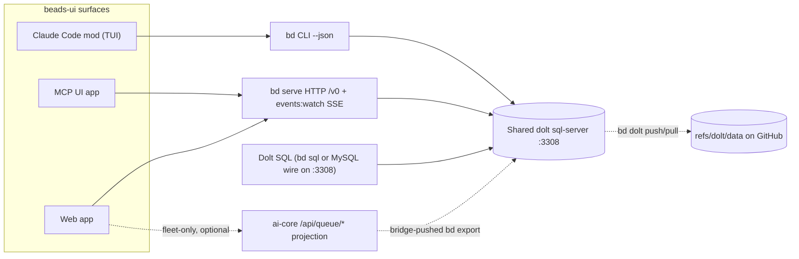

# beads-ui research leg C: Beads, the work queue and the task panel

This packet measures the substrate beads-ui sits on. It feeds the coordinator's research doc for
the beads-ui epic (BU-mg2). It records options and evidence; it makes no design decision.

Founding ask record: `docs/asks/BU-epic-beads-ui-beads-task-manager-mg2.md` (entries A001 to
A004), read in full at 2026-10-15T00:04Z. Its sha256 matched the root's `content_sha256`
(`2c141587…eb3`). The coverage table for this leg is in
[Gaps, blindspots and emergent findings](#gaps-blindspots-and-emergent-findings).

Measured facts carry the tag `[MEASURED M-n]`. It points at section M-n of the tracked evidence
file `docs/research/findings/evidence/beads-ui-beads-queue-and-panel-measurements.md`, which
holds the command, the UTC time and the result. Every other claim carries one of the four
canonical tiers.

## Summary

1. bd 1.3.0 ships an HTTP API, `bd serve`, with an OpenAPI v0 contract, a server-sent events
   stream and compare-and-set writes. It is the most direct read and write route for the web app
   and the MCP UI app. Hooks do not fire under it, so a create through it skips the fleet's
   display-id minting. [VERIFIABLE][^1][^2]
2. The Beads issue schema has no sprint, no manual rank and no story points. It does have
   `estimated_minutes`, `due_at`, `defer_until`, a `milestone` type, labels, free-form metadata,
   19 dependency types and an audit table of whole-issue before and after snapshots. Sprints,
   board order and burndown are conventions beads-ui must define on top. [MEASURED M-3]
3. The ai-harness work queue is live on this host. ai-core serves 26 `/api/queue/*` routes on
   loopback, and its task projection returned all 11,388 tasks from 10 repos in 1.97 s, beads-ui's
   17 included. ai-core also has a queue SPA with Board, Epics, Review, Sessions, Inbox and Task
   detail views. That SPA overlaps beads-ui's board and dashboard directly. [MEASURED M-7]
4. On models newer than Opus 4.7, Claude Code leaves the Task tools out unless
   `CLAUDE_CODE_ENABLE_TODO_TOOLS=1` is set. The fleet sets it for every machine in
   `settings.template.json`. The per-machine retirement switch is therefore that one env key,
   plus bare-name deny rules for older models. [VERIFIABLE][^9][^10][^12] [MEASURED M-9]
5. The task panel's data is 625 small JSON files in 86 named lists under `~/.claude/tasks/` on
   this host. A file copy is a complete backup. The lists include an employer-session list, so the
   backup cannot go in the public beads-ui repo. [MEASURED M-8]
6. bd resolves only hash ids. The fleet's readable display id lives in `metadata.display_id` plus
   an `id:<slug>` label echo, and a published display id is immutable. Every beads-ui create path
   must mint it, and every edit path must leave it alone. [MEASURED M-5]
7. The names `beads-ui` and `bv` are already taken in the Beads ecosystem. `mantoni/beads-ui` is
   an upstream-listed web UI published to npm as `beads-ui` 0.12.6. `bv` is the binary of
   beads_viewer. The GitHub repo name is unaffected; an npm package name and a CLI alias are not.
   [VERIFIABLE][^5][^6][^7][^8]

## 1. The Beads data model and its access routes

### What runs on this host

The host runs bd 1.3.0 and Dolt 2.3.4. Upstream's latest stable release is v1.3.1 (30 September),
with v1.3.2-rc.2 dated 10 October. [MEASURED M-1] [VERIFIABLE][^4]

The beads-ui store runs in Dolt server mode against one shared `dolt sql-server` per host, on
`127.0.0.1:3308`, as database `BU`. Every fleet repo on the host is a database on that same server
(the ai-harness store is `AIH`). A worktree resolves to the main tree's `.beads/` directory.
[MEASURED M-2]

Upstream describes the two modes plainly. Embedded mode is "single writer". Server mode "Connects
to an external `dolt sql-server` for multiple concurrent writers". [VERIFIABLE][^3]

Dolt's own server queues clients past `max_connections`: "Connections over the limit queue until
an existing connection is terminated." [VERIFIABLE][^14]

### Issue fields

`bd schema` publishes a JSON Schema reflected from the Go structs bd serializes, so a consumer can
generate typed models from it. Upstream added it in v1.3.0. [VERIFIABLE][^1] [MEASURED M-3]

The `issue` record has 56 properties. The ones a task manager needs:

| Concern | Fields (as `bd schema` names them) |
|---|---|
| Identity | `id` (hash primary, hierarchical: `BU-mg2.1.3`), `metadata.display_id` (fleet convention), `external_ref`, `source_system` |
| Content | `title`, `description`, `design`, `acceptance_criteria`, `notes`, `spec_id`, `comments` |
| Workflow | `status`, `is_blocked`, `close_reason`, `closed_by_session`, `pinned`, `defer_until` |
| People | `assignee`, `owner`, `created_by`, `actor` |
| Planning | `priority` (0 to 4), `issue_type`, `estimated_minutes`, `due_at`, `labels` |
| Time | `created_at`, `updated_at`, `started_at`, `closed_at`, `lease_expires_at`, `heartbeat_at` |
| Structure | `dependencies` (typed edges, including `parent-child`), and `parent` in list output |

The status enum is `open`, `in_progress`, `blocked`, `deferred`, `closed`, `pinned`, `hooked`. This
store adds the custom statuses `review` and `uat`, both of category `wip`, and the custom types
`research` and `follow_up`. The schema enum does not list custom values, so a UI must read
`bd statuses` and `bd types` (or the `custom_statuses` and `custom_types` tables) rather than the
schema to build its columns. [MEASURED M-3]

The issue-type enum is `bug`, `feature`, `task`, `epic`, `chore`, `decision`, `message`,
`molecule`, `gate`, `spike`, `story`, `milestone`. [MEASURED M-3]

The dependency `type` enum has 19 values. Four matter to `bd ready`: `blocks`, `parent-child`,
`conditional-blocks` and `waits-for`. The rest are graph links such as `related`, `duplicates`,
`supersedes`, `tracks` and `caused-by`. Upstream's README names `blocks`, `related` and
`parent-child` for task links and `relates-to`, `duplicates`, `supersedes` and `replies-to` for
knowledge graphs. [MEASURED M-3] [VERIFIABLE][^3]

Which four types gate readiness is my reading of the help text and the `ready_issues` table, not a
measured query. [INFERENCE]

### What the model lacks for a Jira-style UI

No field names a sprint, an iteration, a rank, a board position or story points. `bd list --sort`
orders only by `priority`, `created`, `updated`, `closed`, `status`, `id`, `title`, `type` or
`assignee`. [MEASURED M-3]

The fleet already uses bd primitives as building blocks for missing concepts. The work queue
models its state as a `bd set-state` dimension (an event bead plus a `queue:<value>` label) and
models a human blocker as a `bd gate`. Both choices are recorded in ai-harness
`docs/designs/autonomous-work-queue-coordinator-and-pwa-dashboard.md` (D-7, D-8). That design also
measured a cost: `set-state` and `gate create` mint issues with no display id, which broke the
fleet invariant on every queue cycle until D-26 made the bridge mint them. [MEASURED M-7]

The candidate representations for each missing concept, with what each costs:

| Concept | Candidate representation | Cost or risk |
|---|---|---|
| Sprint membership | label `sprint:<name>` | Cheap, indexed, filterable with `--label`; no sprint dates |
| Sprint as an object | a `milestone` issue with `due_at`, members linked by `tracks` or `parent-child` | Native fields; a task can have one parent, so `parent-child` conflicts with epic membership |
| Sprint as a state | `bd set-state <id> sprint=<name>` | Atomic and audited; mints one event issue per change (the D-26 cost) |
| Board order | `metadata.rank` as a fractional index, written with HTTP `:casMetadata` | Survives reorders without renumbering; needs a convention every client honours |
| Estimate | `estimated_minutes` | Native; minutes, not points |
| Due date | `due_at` | Native |

The table is my synthesis from the measured schema; no upstream document prescribes any row of it.
[INFERENCE]

### History, events and burndown inputs

Beads keeps three history surfaces, and they differ in coverage. [MEASURED M-4]

- `bd history <id>` returns Dolt commit snapshots: commit hash, committer, date and the whole
  issue at that commit.
- `bd history <id> --events` reads the `events` audit table. Each row carries `event_type`,
  `actor`, `old_value` and `new_value`, where the values are whole-issue JSON. The BU store holds
  58 such rows today: `created` 17, `label_added` 17, `updated` 17, `status_changed` 6, `closed` 1.
- `bd events` reads the durable events journal (`bd_events_journal`). It is off by default and
  off in this store (`events-journal` reads `false`).

The journal's own help text sets limits a dashboard must respect. Raw DML through `bd sql` "is NOT
journaled". The journal is per branch and per replica, so a consumer of a synced workspace "must
re-baseline" after a `bd dolt pull`. Default retention is 7 days or 100,000 rows. [MEASURED M-4]

Upstream describes the journal the same way: "Off by default; opt in per workspace". [VERIFIABLE][^1]

A sprint burndown needs status-change timestamps over the sprint's whole span. The `events` table
and Dolt history keep them indefinitely; the journal keeps them for 7 days by default. So burndown
and cycle-time analytics should read `events` or Dolt history, and live updates should read the
journal or the HTTP stream. [INFERENCE]

### Every programmatic route a UI could use

The diagram shows which routes reach the store. Which surface uses which route is the
coordinator's design decision. [INFERENCE]

| Route | Reads | Writes | Live updates | Fit and limits |
|---|---|---|---|---|
| `bd ... --json` | Every command; `bd list -n 0 --all --json` for the whole store | Every verb; `--if-status`/`--if-assignee` exit 13 on mismatch | None | One process per call; the contract every fleet tool already uses [MEASURED M-3] |
| `bd serve` | `GET /v0/beads/issues` with `sort` and cursors, `issues:query`, `ready`, `stats`, `dependencies/tree` | `POST /v0/beads/issues`, `PATCH /issues/{id}`, `:batchCreate`, `:delete`, `:casMetadata`, claims | `GET /v0/beads/events:watch`, `text/event-stream` | No TLS; no hooks; refuses `--readonly`; auth off on loopback [VERIFIABLE][^1][^2] |
| Dolt SQL | Any table, joins, aggregates | Raw DML | None | Bypasses bd's write paths and the journal; table layout is not a published contract [MEASURED M-4] |
| `.beads/issues.jsonl` | Whole store as lines | `bd import` | File watch | Upstream calls it "an export for viewers and interchange, not the source of truth or a backup"; off and gitignored in beads-ui [VERIFIABLE][^3] [MEASURED M-2] | <!-- gitignored-path-ok: names the export file bd writes, not cited as evidence -->
| ai-core `/api/queue/tasks` | Cross-repo projection, 16 fields | Status only, via the bridge | `GET /api/queue/events` SSE with `Last-Event-ID` | Fleet-only, loopback, no auth, lags Beads by up to one export cycle [MEASURED M-7] |
| `refs/dolt/data` | A clone of the whole Dolt database | `bd dolt push` | None | Already public for beads-ui; a hosted demo could clone it [MEASURED M-2] |

`bd serve` deserves the detail because it is new and fits two of the three surfaces. Its help text
says it is "the same work surface the CLI answers, for automation clients that would otherwise fork
a bd subprocess per call". Concurrent serves are "data-safe either way; claims are arbitrated in the
SQL server". Its `/healthz` is liveness only; readiness is `GET /v0/beads/ready?limit=1`.
[MEASURED M-3]

The help text also lists what `bd serve` does not do. "Hooks do not fire." "No TLS." "It does not
run under --readonly". An HTTP `actor` "is caller-asserted provenance for the audit trail, not
authenticated identity". `POST /v0/beads/issues:sweep` "deletes closed beads in bulk" and anyone who
can reach the address can call it. [MEASURED M-3]

Upstream's release notes add the scale: "41 OpenAPI-specified operations across 35 paths", with a
hand-written spec checked against generated Go wire types. [VERIFIABLE][^1]

The spec states that the one streaming operation "answers `text/event-stream; charset=utf-8`", and
that single-issue create "publishes the whole create vocabulary". [VERIFIABLE][^2]

Whether `events:watch` needs the events journal enabled is not stated in the parts of the spec I
read. The journal is off in this store, so the stream may emit nothing here until it is enabled.
[NO SOURCE]

Whether `POST /v0/beads/issues` accepts `metadata` at create is implied by the spec's note that
batch create omits it, but I did not read the request schema. [INFERENCE]

### Concurrency and read latency

The fleet's earlier measurements were of embedded mode. ai-harness
`docs/designs/aih-g925e-bd-concurrent-access.md` measured that embedded mode takes an exclusive
lock on open, so "two `bd list` calls serialize exactly as two `bd update` calls do" (bd 1.1.0,
2026-08-15). The fleet has since moved to server mode, so that lock no longer applies on this host.
[MEASURED M-2]

Server mode is not free under load. With the host at contention verdict HOLD, a whole-store
`bd list` on the 5,918-issue AIH store failed after 34.7 s with `i/o timeout` and `invalid
connection`. `bd count` answered in 4.4 s. A five-row `bd list` took 26.9 s. The 17-issue BU
store answered a whole-store list in 124 ms. [MEASURED M-6]

The queue's projection served 11,388 rows in 1.97 s over the same window. [MEASURED M-7]

Two consequences follow for beads-ui. A per-repo board on a small store can read bd directly. A
fleet-wide board that calls bd per request will stall when the host is loaded, which is exactly
why the queue design projects Beads into Postgres (its D-1). [INFERENCE]

### The fleet wrappers and the display-id rules

The fleet layers a readable display id over bd's hash id. The rules a UI must respect:

1. The display id lives in `metadata.display_id`, and an `id:<display_id>` label echoes it. Both
   were present on all 17 BU records. [MEASURED M-3]
2. bd resolves only the hash id. `bd show BU-research-leg-c-beads-hrme` fails; `bd show
   BU-mg2.1.3` works. ai-harness `scripts/bdx.py` resolves a display id with one
   `--metadata-field display_id=<X>` query and hands bd the hash. [MEASURED M-5]
3. The sanctioned create path is `~/.claude/bin/bd-new` (ai-harness `scripts/bd_new.py`). It
   creates the issue, then mints a slug display id `PREFIX-<title body>-<suffix>` and writes it to
   both places. A bare `bd create` from an agent shell is blocked by the fleet's create guard.
4. A published display id is immutable. ai-harness `docs/procedures/landing-the-plane.md` states
   that once an id is published, moving it "silently re-points" every reference at an unrelated
   issue. `scripts/bd_repair_duplicate_ids.py` repairs a duplicate by renumbering the unpublished
   side only, computed from mirror history.
5. `bd export` emits no `metadata` key, per the `bd_new.py` docstring, which is why the label echo
   exists. A JSONL-based reader sees display ids only through labels.

Rules 3 to 5 come from reading the ai-harness sources named, not from a run. [INFERENCE]

For beads-ui these rules have two direct consequences. A create through `bd serve` or the queue
does not run `bd-new`, so beads-ui must mint the display id itself or call a minting service.
The display-id convention is a fleet convention, not an upstream one, so in a public tool it
belongs behind a configurable hook that is on for the fleet and off by default. [INFERENCE]

### Publication of the store

beads-ui publishes its store through Dolt, not JSONL. `sync.remote` points at the GitHub repo,
`export.auto` is off, `issues.jsonl` is gitignored, and the remote carries `refs/dolt/data`.
Anyone who clones the public repo can fetch the Beads database. Sergei allowed this in A001.
[MEASURED M-2]

ai-harness `scripts/bd_dolt_publish.py` is the fleet's serialized pull-then-push publisher. Its
docstring records two outages it guards against: a conflicted merge left in a shared store that
blocked every write and push on the host, and a push against an unrelated lineage. A beads-ui
write path that also pushes must go through it or an equivalent guard. [INFERENCE]

### Hand-offs

- Board interaction design (drag to reorder, the confirm-before-delete flow, sprint views): leg A.
- Whether the TUI mod shells out to `bd` or talks to `bd serve`, and how the shared core wraps
  either: leg B.
- Choosing the sprint, rank and burndown conventions from the table above: the coordinator's
  design stage.
- Whether beads-ui mints display ids itself, calls `bd-new`, or exposes a hook: the coordinator's
  design stage, with the public-repo constraint.

## 2. The ai-harness autonomous work queue and its dashboard

### Sources read

I read ai-harness `docs/designs/autonomous-work-queue-coordinator-and-pwa-dashboard.md` (3,806
lines, status `approved`) at lines 1 to 2,250 and 3,426 to 3,806 in full. For lines 2,250 to
3,426 (the detail of D-7 to D-23) I read the Decision Summary rows instead of each decision's
pros and cons. I read the Executive Summary and Q4 of
`docs/research/autonomous-work-queue-coordinator-prior-art.md` (790 lines).

### Architecture

The queue keeps Beads as the only system of record for tasks. A queue service inside ai-core owns
what Beads does not model: sessions, leases, queued prompts, deliveries, briefings, links, review
items and an event outbox. Its storage is Postgres, its bus is NATS JetStream (`queue.>`
subjects) and its live channel is SSE. [MEASURED M-7]

The session side lives in ai-harness: five hooks (`.claude/hooks/wq-*.sh` calling
`scripts/wq_hooks.py`), the `wq` CLI, a stdlib transport (`scripts/wq_client.py`), the serialized
bd writer (`scripts/queue_bridge.py`) and the idle-session waker (`scripts/queue_waker.py`). All
are present in the ai-harness tree, about 5,750 lines of Python. [MEASURED M-7]

The queue's repo home was decided as ai-core (its D-5), against the prior analysis's
recommendation of a new repo. The design records that a later extraction should be "a move, not a
rewrite" because the queue is one self-contained `ai_core.queue` package. Sergei's A004 says the
queue stays where it is for now. [INFERENCE]

### Queue lifecycle and status model

Beads statuses stay unchanged. The queue adds one `queue` state dimension, written with
`bd set-state`, and an owner written with `bd assign`. The state machine (AC-SM-1) has eight
states: `backlog`, `ready`, `queued`, `assigned`, `active`, `blocked`, `review`, `done`.
`backlog` is the absence of a `queue:` label, so no existing issue needed migration.

The bridge maps queue states back to Beads statuses: `assigned` and `active` to `in_progress`,
`blocked` to `blocked`, `done` to `closed`. A change made outside the queue (a session running
`bd close`) wins, and the projection re-derives the queue state on its next refresh.

A claim must pass an ordered conjunction, and a refusal names the first failing predicate:
`goal_active`, `capacity_full`, `status_not_open`, `deps_open`, `gate_open`, `not_eligible`.
`autonomous_eligible` and `requires_approval` come from Beads metadata.

Blocking is a saga of bridge commands, not a transaction: `bd update --status blocked`,
`bd set-state queue=blocked`, then `bd gate create --type human --blocks <task>` for a human,
decision, credential or external need, or `bd dep add` for a dependency.

These four paragraphs restate the design doc's § Queue lifecycle and § Blocked-work behavior.
[INFERENCE]

### Session registry, ownership and bandwidth

A session is `<machine>/<session-name>`. `SessionStart` registers its harness, repo, worktree,
tmux target, pid, `CLAUDE_CODE_TASK_LIST_ID` and transcript path. Ownership is a fenced lease: a
partial unique index on `(repo, task_id) WHERE released_at IS NULL` lets exactly one of two
concurrent claims land. Every worker call presents the lease generation; a stale one gets `409
stale_lease`.

Bandwidth is computed, not self-reported: idle at `Stop`, context below a band, and not inside a
`/save-state` freeze. A lease expires only after three missed heartbeat windows and a waker probe
that finds the process or pane gone.

The live `SessionOut` schema carries exactly these fields, `task_list_id` among them. [MEASURED M-7]

### Event delivery and the prompt model

Work reaches a session on two lanes. Lane A: the `Stop` hook pulls `GET /api/queue/next` and
injects a returned prompt as a `{"decision":"block"}` re-entry. Lane B: the waker types the fixed
nudge `/wq next` into an idle pane. Delivery is at-least-once with an idempotent ledger.

A queued prompt is advisory markdown text with a kind (`start`, `next`, `unblock`, `review`,
`custom`), a target (a session or a repo and harness pool) and an autonomy flag. A playbook holds
a task's default start and blocked prompts.

The 2026-10-10 correction in the design records that no `wq` skill ever shipped for Claude Code, so
Lane B types nothing into Claude panes and Lane A serves them. No `wq` skill exists under
ai-harness `skills/` today. [MEASURED M-7]

### Dashboard information architecture

The design specifies six views: Board, Task detail, Sessions, Review queue, Epics and Inbox. The
ai-core SPA on disk has those six plus a `Decisions` view. It is Vite, React 19, Lexical 0.52 for
the prompt composer and `@app-portal/ui` for the shell. [MEASURED M-7]

The running ai-core process answered 404 at `/queue/`, so the SPA is built but not served by the
live process on this host. Whether it is served elsewhere, for example by the app-portal shell, I
did not measure. [MEASURED M-7]

### app-portal member-app integration

The design joins the dashboard to app-portal as a `kind: portal` member app. It adds one
`apps.yaml` entry (`id: queue`, `path: /queue`, `upstream: http://127.0.0.1:8400`, `health:
/healthz`). `app-portal serve-sync` generates the `tailscale serve --set-path /queue` rule. The SPA
mounts as a FastAPI sub-application with `root_path="/queue"`, and `openapi-typescript` types are
committed and checked.

The Phase 3 notes add that the portal shell owns the root PWA and its service worker, pinned by
app-portal PR #14, and the member app registers none. On a zero-inbound host such as this one, the
route is AWS SSM port forwarding instead of `tailscale serve` (D-16's 2026-09-27 amendment).

Both paragraphs restate the design doc's § app-portal integration and its Phase 3 notes.
[INFERENCE]

For beads-ui this matters in two ways. A beads-ui web app joining the same portal would follow the
same `apps.yaml` contract and inherit the shell's PWA and design system. A beads-ui web app hosted
outside the fleet cannot assume either. [INFERENCE]

### Data model and API surface as shipped

The Postgres tables are `session` (an extension of ai-core's `agent_sessions`), `lease`,
`bridge_command`, `block_record`, `task_projection`, `playbook`, `queued_prompt`,
`child_dispatch`, `delivery`, `briefing`, `task_link`, `review_item` and `queue_event` (the
outbox). This list is the design doc's § Data Model. [INFERENCE]

The live OpenAPI document lists 26 `/api/queue/*` routes. The ones beads-ui would read or call:
[MEASURED M-7]

| Route | What it gives a UI |
|---|---|
| `GET /api/queue/tasks?repo=&queue_state=` | The cross-repo projection, 16 fields per task |
| `GET /api/queue/tasks/{repo}/{task_id}` | `task`, `briefing`, `links`, `playbook`, `prompts`, `events` |
| `POST /api/queue/tasks/{repo}/{task_id}/status` | A status change: 202 when requested, 409 when `expected_status` is stale |
| `GET /api/queue/sessions` | Every registered session with its state, harness, task list id and goal state |
| `GET /api/queue/review`, `POST /api/queue/review/{id}/accept` | The human review queue |
| `GET /api/queue/inbox` | Notification-worthy events with deep links |
| `GET /api/queue/events` | SSE with `Last-Event-ID` replay |
| `POST /api/queue/prompts` | Queue a prompt for a task, a session or a pool |

`TaskOut` has no `description`, `assignee`, `created_at`, `updated_at`, `closed_at`,
`estimated_minutes` or `due_at`. A board can render from it, but a task detail page, a burndown or
a timeline cannot. [MEASURED M-7]

The status route is the only Beads write the queue exposes to a UI. It has no create, edit,
delete, reparent or label route. [MEASURED M-7]

### What has shipped, per Beads

The epic `AIH-swgb4` is `blocked`. Its kickoff child `AIH-swgb4.7` is `blocked`. Phase 2's child
`AIH-swgb4.8` is `open`. The other 17 children are closed: the research, design, audit,
ratification and summary tasks, and the Phase 1 follow-ups (D-20 to D-24, the comment sync, two
config and enum fixes). [MEASURED M-7]

The design's Approval Log reads the same way. Phase 0 landed 2026-09-26. Phase 1's exit gate
executed on this host on 2026-10-04 with one real session. Phase 3 landed in ai-core on
2026-10-08, and Phase 4's code half landed in ai-harness the same day. The open items are D-27
(a real-iPhone checklist and a second-machine join, pending Sergei) and OQ-7. [INFERENCE]

### The integration contract beads-ui could consume or expose

These are options for the coordinator, with the evidence each rests on.

Option C-1 is to consume the queue's read model as an optional adapter. beads-ui's web app reads
`/api/queue/tasks`, `/sessions`, `/review` and `/events` when a queue service is configured, and
falls back to bd when it is not. This serves A001's "view all cc session tasks that are assigned
and in progress and done" from the session registry and leases, which already exist. It cannot be
the only route, because the queue is loopback-only with no auth (its D-16) and exists only on
fleet machines. [INFERENCE]

Option C-2 is for beads-ui to expose its own task API, the queue to become one more client, and
the ai-core SPA to retire in favour of beads-ui's board. This removes the duplicated Board, Epics
and Task detail views. It moves work out of a shipped, cross-family-reviewed SPA, and A004 defers
migration. [INFERENCE]

Option C-3 is to keep the two UIs separate and link between them. beads-ui owns task editing
(create, edit, delete, reorder, sprints, analytics). The queue SPA owns sessions, prompts, review
and the inbox, and each deep-links to the other. It is the smallest change and matches A004's
"keep it where it is". It leaves two boards. [INFERENCE]

Under every option, five things already exist in the queue and must not be rebuilt in beads-ui.
They are the session registry and its liveness, the lease and fencing model, the prompt queue and
its delivery ledger, the review-item model with its WSJF-style ordering, and the serialized bd
writer. [INFERENCE]

Three conflicts need a rule whichever option is chosen. [INFERENCE]

- Two writers. If beads-ui writes Beads directly while the queue holds a lease, the queue's D-25
  rule preserves the in-flight queue state and lets every other column refresh. A beads-ui status
  edit on a leased task would be overruled until the lease releases.
- Status vocabulary. The queue's eight states are not Beads statuses. A Kanban column for
  `queued` or `review` needs the `queue:` label, which only the projection or a label query shows.
- Display-id minting. Queue-caused gate and event issues need display ids (D-26). A beads-ui that
  lists every issue will show those gate and event issues unless it filters `issue_type` `gate`
  and `event`, as `bd list` does by default with `--include-gates`.

### Hand-offs

- Where the queue lives long term (ai-core, ai-harness, ai-chassis or its own package): deferred by
  A004; the coordinator records it as a later task.
- Whether the queue SPA's Lexical composer and skill catalog become shared components: leg B.
- Board and review-queue interaction patterns: leg A.

## 3. The Claude Code task panel

### Where the data lives

Claude Code documents one storage rule. "To share a task list across sessions, set
`CLAUDE_CODE_TASK_LIST_ID` to use a named directory in `~/.claude/tasks/`". It also says "Tasks
persist across context compactions". [VERIFIABLE][^11]

On this host `~/.claude/tasks` resolves to `/data/claude/tasks`. It holds 86 directories, all named
lists and none a session UUID, so every session here runs with a pinned list id. 76 directories
hold no task file. 10 hold 625 task files, 2.9 MB in total. [MEASURED M-8]

Each list holds `<id>.json` per task plus `.lock` and `.highwatermark`. Every task file carries
`id`, `subject`, `description`, `status`, `blocks` and `blockedBy`. Optional keys are `activeForm`
(433 files), `owner` (157) and `metadata` (98). Statuses are `pending` 547, `in_progress` 55 and
`completed` 23. [MEASURED M-8]

The fleet measured three more properties in August, recorded as M-1 to M-3 of ai-harness
`docs/designs/curate-task-panel-skill.md`. Panel order is ascending numeric id. Ids are allocated
monotonically and never refilled. Ids are namespace-relative, so the same number names different
tasks in different lists. I did not re-measure these. [INFERENCE]

### The tool contracts

The tools reference describes `TaskCreate` as "Creates a new task in the task list" and
`TaskUpdate` as "Updates task status, dependencies, details, or deletes tasks". `TaskGet` and
`TaskList` read. None needs a permission prompt. [VERIFIABLE][^9]

The panel itself is a status-area checklist toggled with `Ctrl+T`. "The display shows up to five
tasks at a time." [VERIFIABLE][^11]

The docs publish no file format for `~/.claude/tasks/`. The shapes above are measured, not a
contract, and a Claude Code release could change them. [NO SOURCE]

### How ai-harness mirrors Beads into the panel

The fleet rule is that CC tasks are a one-way Beads display mirror. Every `TaskCreate` needs an
existing owning bd issue, and the subject is `<DISPLAY_ID>: <short description>` with the display
id verbatim. The rule lives in ai-harness `docs/procedures/landing-the-plane.md` § Global Beads
operating rules.

Three skills operate the mirror. `/load-task-panel` re-displays a session's open tasks, importing
only rows whose subject matches the display-id rule. `/curate-task-panel` reconciles one panel
against Beads, the code and worktrees, and can reorder it behind a restorable snapshot. Because
Claude Code has no reorder primitive, reordering means delete and recreate. `/clean-task-panel`
removes completed rows.

`scripts/bd_ready_mirror.py` computes a mirror plan from `bd ready` but never writes either store.
The curate design forbids populating a panel from a shared query (its scope invariant, ratified
2026-08-16), because two sessions would mint duplicate rows for one issue.

Other fleet machinery depends on the panel. The queue's `wq next` reconciles `TaskList` before
offering pool work. The AIH-813 rule gives every agent launch its own panel row. The compact and
resume flow pins `CLAUDE_CODE_TASK_LIST_ID` so a panel survives restarts.

These four paragraphs restate the named ai-harness files; they are not a run. [INFERENCE]

### Backing up every panel before retirement

A per-machine file copy is a complete backup. Each list is self-contained JSON, all 625 files
parsed, and the hidden `.highwatermark` file is the only other state. [MEASURED M-8]

A backup should preserve the optional fields, because 98 files carry `metadata` and 157 carry
`owner` that a subject-only export would drop. The curate design reached the same conclusion
(its M-4 and D-10). [INFERENCE]

The destination needs a privacy rule. The non-empty lists here include `kg-2` (171 tasks), an
employer-workspace session. Its subjects describe employer work. beads-ui is public (MIT), and
ai-harness is private. [MEASURED M-8]

The backup therefore cannot land in beads-ui. The candidates are a private repo per machine class
(ai-harness for personal machines, the employer workspace repo for employer machines) or a
non-repo archive. Choosing one is a design decision with a data-classification consequence.
[INFERENCE]

A backup format that keeps the data reviewable could be one JSON Lines file per list, one record
per task file, with the list id, host, capture time and Claude Code version in a header record.
[HEURISTIC]

### Hand-offs

- The beads-ui TUI view that replaces the panel: legs A and B.
- The backup destination and its classification rule: the coordinator, likely needing Sergei,
  because it decides where employer data goes.

## 4. The retirement switch

### What Claude Code offers

The panel fills only in sessions that have the Task tools, so removing the tools empties it.
[VERIFIABLE][^11]

I found no setting or variable that hides the panel while keeping the tools. I searched the
settings page, the whole environment-variables page (two fetches) and the tools reference. The
only task variables are `CLAUDE_CODE_ENABLE_TASKS`, `CLAUDE_CODE_ENABLE_TODO_TOOLS`,
`CLAUDE_CODE_TASK_LIST_ID` and the removed `TASK_MAX_OUTPUT_LENGTH`. `Ctrl+T` toggles the view per
session and stores no config. [INFERENCE]

The Task tools "are available by default only on Opus 4.7, Sonnet 4.6, Haiku 4.5, and earlier
models." On every newer model "Claude Code leaves the tools out unless you opt in". [VERIFIABLE][^9]

The opt-in is `CLAUDE_CODE_ENABLE_TODO_TOOLS`: "Set to `1` to get the task-tracking tools on every
model." `CLAUDE_CODE_ENABLE_TASKS=0` swaps the four Task tools for the legacy `TodoWrite`; it does
not remove task tracking. [VERIFIABLE][^10]

The default "applies in Claude Code v2.1.268 and later." This host runs 2.1.296. [VERIFIABLE][^9]
[MEASURED M-1]

A bare tool name in `permissions.deny` "removes the tool from Claude's context entirely, so Claude
never sees it." Deny rules are evaluated first: "Rules are evaluated in order: deny, then ask, then
allow." Across scopes "a user-level deny blocks a project-level allow". [VERIFIABLE][^12]

Settings precedence is "managed settings, command line, project local, shared project, user."
[VERIFIABLE][^13]

Two exceptions limit any switch. "In background sessions and in cloud sessions, Claude Code
provides the same tools on every model, listed or not." And "Claude Code gives a subagent the tools
only when your session has them". [VERIFIABLE][^9]

Whether a deny rule removes the tools in a background session, where they are provided "listed or
not", is not stated. [NO SOURCE]

### What the fleet does today

ai-harness `src/ai_harness/defaults/settings.template.json` sets
`"CLAUDE_CODE_ENABLE_TODO_TOOLS": "1"` in its `env` block. Its two `permissions.deny` entries name
no Task tool. The variable is present in the live `~/.claude/settings.json`. [MEASURED M-9]

So on this fleet's current models the panel exists only because of that one line. [INFERENCE]

### A per-machine switch built from these pieces

Turning the panel off for a machine profile needs two changes. The renderer drops the
`CLAUDE_CODE_ENABLE_TODO_TOOLS` env key on that profile. The profile also adds bare-name deny
rules for `TaskCreate`, `TaskGet`, `TaskList`, `TaskUpdate` and `TodoWrite`. The deny rules cover
sessions running Sonnet 4.6, Haiku 4.5 or older, where the tools are on by default. [INFERENCE]

The switch belongs in ai-harness, because ai-harness renders `~/.claude/settings.json` for every
machine. The canonical machine list is `machines.json` and the per-machine behaviour flows through
`install.sh`'s plan, apply and doctor verbs (`docs/procedures/machine-install-contract.md`). I did
not read the renderer's per-machine merge code, so the exact key where a profile would declare
`task_panel: retired` is open. [INFERENCE]

Retirement removes data the fleet's own tooling reads, so the switch has preconditions. `wq next`'s
TaskList reconciliation, the AIH-813 one-row-per-agent rule, `/load-task-panel`,
`/curate-task-panel`, `/clean-task-panel` and every procedure that names `TaskCreate` need a
replacement or a guard on retired machines. The queue design already logs and skips an
inaccessible task-list namespace. [INFERENCE]

### Hand-offs

- The config key, its schema and the renderer change: the coordinator's design stage, implemented
  in ai-harness.
- The order of retirement (back up, switch, verify) and the replacement for the AIH-813 panel-row
  rule: the coordinator's design stage.

## 5. Other fleet surfaces that already read Beads for display

`/next` (ai-harness `skills/next/SKILL.md`) is a generated view over Beads. It calls
`scripts/bd_work_view.py` for staged buckets (Ready, Pre-approved, Executing, Awaiting-review,
UAT) and a WSJF-lite score from bd metadata. beads-ui's backlog view would show the same
population. The scoring and the `autonomous_eligible` predicate should be reused, not
reimplemented, because the queue's claim guard uses the same predicate. [INFERENCE]

The docket (`docs/docket/TEMPLATE.md` in ai-harness, and `docs/bu-docket.md` here) is a markdown
projection of ready work with WSJF row fields. The beads-ui docket is still an unfilled stub. A
beads-ui backlog view could render the docket's row fields directly. [MEASURED M-7]

`/progress-review` (`skills/progress-review/SKILL.md`) reconciles active CC tasks with shipped
in-progress Beads issues and presents a briefing. Since the queue's D-14 it also posts a
hash-gated `bd comment` per checkpoint. beads-ui's task detail would show those comments, and a
retired panel removes one of its two inputs. [INFERENCE]

`fleet-liveness` (`scripts/fleet_liveness_cli.py`) reports whether a session on another machine is
alive and which session should own a repo's tasks. It reads heartbeats and the chief-of-staff
registry, not Beads. A beads-ui "sessions" view could join it with Beads assignees. [INFERENCE]

The chief-of-staff loop (`skills/chief-of-staff/SKILL.md`, `scripts/chief_of_staff_cli.py`)
reconciles VP sessions across a machine pair from the Firstmate chief home, Beads, `ListAgents`
and fleet-liveness. It coordinates sessions and renders no task view, so beads-ui coexists with
it. [INFERENCE]

`bdx` resolves display ids and renders nothing. beads-ui needs its lookup (section 1, rule 2).
[MEASURED M-5]

Upstream lists many existing Beads UIs: six terminal UIs, nine web UIs, nine editor extensions and
five native apps. Among the web UIs, "Bead Me Up, Scotty" has drag-and-drop kanban, and beads-web
has a hierarchical tree. Upstream marks beads_viewer "Not compatible with Dolt-based beads
(v0.50+)" while its own README says Dolt-backed bd workspaces work through
`.beads/issues.jsonl`. [VERIFIABLE][^5][^8] <!-- gitignored-path-ok: quotes where beads_viewer reads, not cited as evidence -->

The two statements conflict. beads_viewer reads only the JSONL export, which is off in beads-ui's
store, so it would see nothing here either way. [INFERENCE]

`mantoni/beads-ui` is a "Local UI for Beads" with an issues view, an epics view, a board view and
live updates. It drives the `bd` CLI (`BD_BIN`). Its npm package `beads-ui` is at 0.12.6 with the
binary `bdui`. [VERIFIABLE][^6][^7]

### Hand-offs

- Feature and UX comparison of the upstream UIs listed above: leg A.
- The name collision with `mantoni/beads-ui` and `bv`: the coordinator (see Gaps).

## Gaps, blindspots and emergent findings

### Coverage of the founding ask for this leg

| Ask entry | Requirement this leg touches | Disposition |
|---|---|---|
| A001 | Migrate off the CC task panel, back up its data, disable the panel per machine profile with a config setting in ai-harness | Covered: sections 3 and 4. The backup destination is narrowed by a privacy constraint the ask did not name (employer lists cannot go to the public repo). |
| A001 | View all CC session tasks that are assigned, in progress and done | Covered with a change of source: once the panel retires, the source is Beads assignees plus the queue's session registry (section 2), not `~/.claude/tasks/`. |
| A001 | Drag, reorder, sort, sprints, backlog, burndown, timeline | Data side covered in section 1 (no native rank or sprint; candidate conventions); interaction design handed to leg A. |
| A001 | Create, update, delete with an are-you-sure step | Data side covered (display-id minting, `bd serve` delete and sweep risk); the confirm flow handed to leg A. |
| A001 | Public repo, Beads store may be committed | Verified: the store is public through `refs/dolt/data`. |
| A002 | Repo name `beads-ui`, alias `bv` | Not this leg's scope; the collision is recorded below as an emergent finding. |
| A003 | Research the web app, MCP UI app and TUI first | Access routes per surface in section 1; surface architecture handed to leg B. |
| A004 | Incorporate the autonomous task queue and its dashboard; keep the queue where it is | Covered: section 2, with three integration options and no migration. |

Nothing in A001 to A004 that this leg covers was dropped. The backup destination is narrowed, as
stated in the first row.

### Emergent findings

The name `beads-ui` is taken on npm, and `bv` is another tool's binary. `mantoni/beads-ui` (MIT,
755 stars when fetched) is in upstream's community list. `beads_viewer` (1.7k stars) installs a
`bv` binary through Homebrew. A GitHub repo name is per owner, so `sergeiwallace/beads-ui` is
unaffected. An npm package would need a scope such as `@sergeiwallace/beads-ui`. A `bv` command
would shadow or be shadowed by beads_viewer on a machine with both. The Beads prefix here is `BU`,
so the `bv` alias may already be moot. [VERIFIABLE][^6][^7][^8]

The queue SPA and beads-ui overlap more than A004 implies. The ai-core SPA already has a Board, an
Epics view and a Task detail view over every repo's Beads, plus a Decisions view the design does
not list. Building beads-ui's board without deciding C-1, C-2 or C-3 produces two Jira-style
boards over the same data. [MEASURED M-7]

The display-id invariant reaches every create path. The queue found this the hard way: its
`set-state` and `gate` calls created id-less issues that reddened the fleet push gate until the
bridge minted ids (D-26). beads-ui will hit the same gate on its first create unless minting is in
its create path. [INFERENCE]

`bd serve` on loopback is an unauthenticated delete surface for every local process. `issues:sweep`
deletes closed beads in bulk, and auth is off by default on loopback. A hostable beads-ui that exposes `bd serve`
beyond loopback needs a token file, a TLS terminator and an allowlist, all of which `bd serve`
leaves to the deployer. [MEASURED M-3]

Server-mode Dolt degrades under host pressure. Whole-store reads on the largest store failed at
HOLD while small reads succeeded. A TUI that reads the whole store on every refresh will stall on
a loaded machine. [MEASURED M-6]

### Blindspots I could not resolve

- Whether `events:watch` streams anything with the events journal off. I did not run `bd serve`,
  because this run is limited to read-only probes and the server publishes write operations.
- The full `bd serve` request schemas (create with metadata, `PATCH` members, `:casMetadata`). The
  spec is 585 kB and I read its first 100 kB.
- Whether a `permissions.deny` rule removes the Task tools in background and cloud sessions, which
  get them "listed or not".
- The task panel on other machines. I measured only `sem-kg-ec2`. The count and the
  employer-versus-personal split differ per machine.
- The ai-harness settings renderer's per-machine merge. I read the template, not the code that
  renders it per profile.
- How Claude Code 2.1.268's changelog line words the change. I located the entry in the CHANGELOG
  on GitHub but could not read its full text verbatim, so the tools reference is the cited source.
- Lines 2,250 to 3,426 of the queue design (decision detail for D-7 to D-23), read only through the
  Decision Summary table.

### Contrarian evidence

The queue's design argues against putting a cross-repo board on direct bd reads (its D-1: "Beads
cannot serve a phone UI across 20 repos on a request path"). My latency readings support that for
a fleet-wide board under load. They do not support it for a single-repo board on a small store,
which answered in 124 ms. [MEASURED M-6]

The prior-art research's Q4 recommends keeping a list or table view beside the board and keeping
drag optional, with an explicit action for every transition. That cuts against a drag-first
Jira clone. It is leg A's to weigh. [INFERENCE]

## Sources

[^1]: steveyegge and contributors. (2026). [Release v1.3.0](https://github.com/steveyegge/beads/releases/tag/v1.3.0). steveyegge/beads, GitHub. Released 2026-09-15. Verified accessible (HTTP 200) 2026-10-15. (Read to character 100,000 of 141,823.)
[^2]: steveyegge and contributors. (2026). [openapi.v0.yaml](https://raw.githubusercontent.com/steveyegge/beads/main/internal/httpapi/spec/openapi.v0.yaml). steveyegge/beads, GitHub. Verified accessible (HTTP 200) 2026-10-15. (Read to character 100,000 of 585,656.)
[^3]: steveyegge and contributors. (2026). [beads README](https://github.com/steveyegge/beads). steveyegge/beads, GitHub. Verified accessible (HTTP 200) 2026-10-15.
[^4]: steveyegge and contributors. (2026). [Releases](https://github.com/steveyegge/beads/releases). steveyegge/beads, GitHub. Verified accessible (HTTP 200) 2026-10-15. (Latest stable v1.3.1, 30 September.)
[^5]: steveyegge and contributors. (2026). [Community tools](https://github.com/steveyegge/beads/blob/main/docs/community-tools.md). steveyegge/beads, GitHub. Verified accessible (HTTP 200) 2026-10-15.
[^6]: mantoni. (2026). [beads-ui: Local UI for Beads](https://github.com/mantoni/beads-ui). GitHub. Verified accessible (HTTP 200) 2026-10-15. (755 stars, MIT, 283 commits at fetch time.)
[^7]: npm. (2026). [beads-ui, latest](https://registry.npmjs.org/beads-ui/latest). npm registry. Verified accessible (HTTP 200) 2026-10-15. (Version 0.12.6, bin `bdui`.)
[^8]: Dicklesworthstone. (2026). [Beads Viewer (bv) README](https://raw.githubusercontent.com/Dicklesworthstone/beads_viewer/main/README.md). Dicklesworthstone/beads_viewer, GitHub. Verified accessible (HTTP 200) 2026-10-15. (Repository page showed 1.7k stars.)
[^9]: Anthropic. (2026). [Tools reference](https://code.claude.com/docs/en/tools-reference.md). Claude Code Docs. Verified accessible (HTTP 200) 2026-10-15. (Section "Task tool availability".)
[^10]: Anthropic. (2026). [Environment variables](https://code.claude.com/docs/en/env-vars.md). Claude Code Docs. Verified accessible (HTTP 200) 2026-10-15. (Read in full across two fetches, 171,035 characters.)
[^11]: Anthropic. (2026). [Interactive mode](https://code.claude.com/docs/en/interactive-mode.md). Claude Code Docs. Verified accessible (HTTP 200) 2026-10-15. (Section "Task list".)
[^12]: Anthropic. (2026). [Configure permissions](https://code.claude.com/docs/en/permissions.md). Claude Code Docs. Verified accessible (HTTP 200) 2026-10-15.
[^13]: Anthropic. (2026). [Settings files and precedence](https://code.claude.com/docs/en/settings). Claude Code Docs. Verified accessible (HTTP 200) 2026-10-15.
[^14]: Dolt Hub. (2026). [Server configuration](https://www.dolthub.com/docs/sql-reference/server/configuration). Dolt documentation. Verified accessible (HTTP 200) 2026-10-15. (The docs.dolthub.com URL answered 301 to this one.)

## Appendix: Provenance Ledger

Quotes from the four Claude Code pages were checked with an exact substring test against the saved
page text. Quotes from the other pages were checked against the WebFetch extract, which quoted
them in quotation marks.

| Claim | Source URL | Verbatim quote | Verdict | Live? |
|---|---|---|---|---|
| bd serve has an OpenAPI contract of 41 operations | https://github.com/steveyegge/beads/releases/tag/v1.3.0 | "41 OpenAPI-specified operations across 35 paths" | SUPPORTED | yes |
| bd schema was added in v1.3.0 | https://github.com/steveyegge/beads/releases/tag/v1.3.0 | "`bd schema` — a published JSON Schema for `--json` and export output" | SUPPORTED | yes |
| The events journal is off by default | https://github.com/steveyegge/beads/releases/tag/v1.3.0 | "Off by default; opt in per workspace with" | SUPPORTED | yes |
| The streaming operation is SSE | https://raw.githubusercontent.com/steveyegge/beads/main/internal/httpapi/spec/openapi.v0.yaml | "`watchEvents` answers `text/event-stream; charset=utf-8`" | SUPPORTED | yes |
| Single-issue create takes the full vocabulary | https://raw.githubusercontent.com/steveyegge/beads/main/internal/httpapi/spec/openapi.v0.yaml | "It publishes the whole create vocabulary." | SUPPORTED | yes |
| Server mode serves multiple concurrent writers | https://github.com/steveyegge/beads | "Connects to an external `dolt sql-server` for multiple concurrent writers" | SUPPORTED | yes |
| JSONL is an export, not the source of truth | https://github.com/steveyegge/beads | "`.beads/issues.jsonl` is an export for viewers and interchange, not the source of truth or a backup." | SUPPORTED | yes | <!-- gitignored-path-ok: upstream quote naming the export file -->
| Upstream's latest stable release is v1.3.1 | https://github.com/steveyegge/beads/releases | "v1.3.1: 30 Sep (marked Latest)" (extract wording) | SUPPORTED | yes |
| mantoni/beads-ui is an upstream-listed web UI | https://github.com/steveyegge/beads/blob/main/docs/community-tools.md | "Local web interface with live updates and kanban board." | SUPPORTED | yes |
| Upstream marks beads_viewer incompatible with Dolt bd | https://github.com/steveyegge/beads/blob/main/docs/community-tools.md | "Not compatible with Dolt-based beads (v0.50+)" | SUPPORTED | yes |
| mantoni/beads-ui describes itself as a local UI | https://github.com/mantoni/beads-ui | "Local UI for Beads — Collaborate on issues with your coding agent." | SUPPORTED | yes |
| The npm name beads-ui is taken at 0.12.6 | https://registry.npmjs.org/beads-ui/latest | "beads-ui" / "0.12.6" / {"bdui":"bin/bdui.js"} | SUPPORTED | yes |
| beads_viewer's command is bv | https://raw.githubusercontent.com/Dicklesworthstone/beads_viewer/main/README.md | "brew install dicklesworthstone/tap/bv" | SUPPORTED | yes |
| beads_viewer reads Dolt-backed workspaces through JSONL | https://raw.githubusercontent.com/Dicklesworthstone/beads_viewer/main/README.md | "Current `br` and Dolt-backed `bd` workspaces use `.beads/issues.jsonl`." | SUPPORTED | yes | <!-- gitignored-path-ok: upstream quote naming the export file -->
| Task tools are default-on only on older models | https://code.claude.com/docs/en/tools-reference.md | "are available by default only on Opus 4.7, Sonnet 4.6, Haiku 4.5, and earlier models" | SUPPORTED | yes |
| Newer models need an opt-in | https://code.claude.com/docs/en/tools-reference.md | "On every other model, Claude Code leaves the tools out unless you opt in." | SUPPORTED | yes |
| Background and cloud sessions always get the tools | https://code.claude.com/docs/en/tools-reference.md | "Claude Code provides the same tools on every model, listed or not." | SUPPORTED | yes |
| The default applies from v2.1.268 | https://code.claude.com/docs/en/tools-reference.md | "The default set described here applies in Claude Code v2.1.268 and later." | SUPPORTED | yes |
| Subagents inherit the session's tool set | https://code.claude.com/docs/en/tools-reference.md | "Claude Code gives a subagent the tools only when your session has them" | SUPPORTED | yes |
| TaskUpdate updates and deletes tasks | https://code.claude.com/docs/en/tools-reference.md | "Updates task status, dependencies, details, or deletes tasks." | SUPPORTED | yes |
| The opt-in variable | https://code.claude.com/docs/en/env-vars.md | "Set to `1` to get the task-tracking tools on every model." | SUPPORTED | yes |
| CLAUDE_CODE_ENABLE_TASKS=0 swaps to TodoWrite | https://code.claude.com/docs/en/env-vars.md | "Set to `0` to get the legacy `TodoWrite` tool instead." | SUPPORTED | yes |
| Task lists live in named directories | https://code.claude.com/docs/en/interactive-mode.md | "to use a named directory in `~/.claude/tasks/`" | SUPPORTED | yes |
| Tasks survive compaction | https://code.claude.com/docs/en/interactive-mode.md | "Tasks persist across context compactions" | SUPPORTED | yes |
| The panel shows five tasks | https://code.claude.com/docs/en/interactive-mode.md | "The display shows up to five tasks at a time." | SUPPORTED | yes |
| A bare-name deny removes a tool | https://code.claude.com/docs/en/permissions.md | "removes the tool from Claude's context entirely, so Claude never sees it." | SUPPORTED | yes |
| Deny is evaluated first | https://code.claude.com/docs/en/permissions.md | "Rules are evaluated in order: deny, then ask, then allow." | SUPPORTED | yes |
| A user deny beats a project allow | https://code.claude.com/docs/en/permissions.md | "a user-level deny blocks a project-level allow" | SUPPORTED | yes |
| Settings precedence order | https://code.claude.com/docs/en/settings | "Settings precedence, highest first: managed settings, command line, project local, shared project, user." | SUPPORTED | yes |
| Dolt queues connections past the limit | https://www.dolthub.com/docs/sql-reference/server/configuration | "Connections over the limit queue until an existing connection is terminated." | SUPPORTED | yes |

## Run History

2026-10-15, Claude Opus 5.5, effort high. Searched the Beads upstream (README, releases, v1.3.0
notes, OpenAPI spec, community tools, docs index), two upstream-listed UIs, the npm registry,
Claude Code docs (settings, env vars, tools reference, interactive mode, permissions, llms.txt
index, CHANGELOG) and Dolt's server docs; measured the host read-only (bd, Dolt, the queue's
loopback API, `~/.claude/tasks`). 29 fetches, 4 failed or unusable: 1 HTTP 404 (a guessed
`steveyegge/beads/tree/main/api` path, never cited), 1 HTTP 301 (followed to its target), 2 Bing
result pages that returned only craft-bead shops (search engine noise, not a source failure). The
host web-search tool was not available to this agent. Four pages were truncated at 100,000
characters and are cited only for the parts read. A five-perspective critic pass (conventional,
contrarian, historical, adjacent, skeptic) ran over the draft by its author; no second model has
reviewed it.
