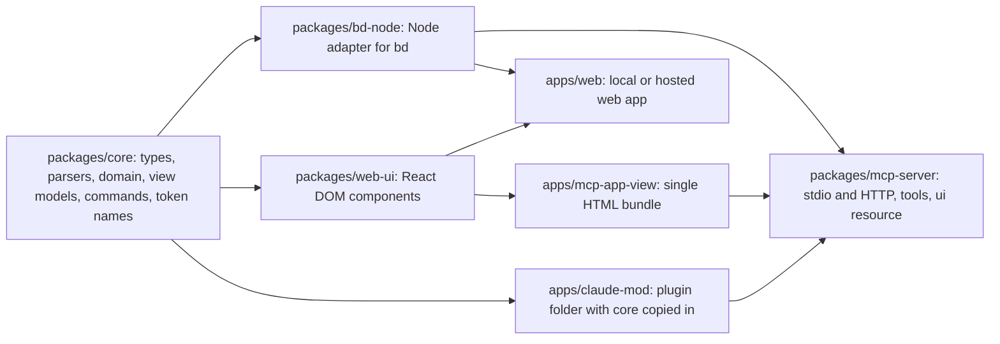

# beads-ui research leg B: Claude Code mods, MCP Apps and the shared core

## Summary

1. A mod returns a plain-data element tree, and Claude Code draws it with Ink in the terminal. JSX
   compiles to Claude Code's own `h` function. The module has no React, no DOM and no Node, and it
   may import only `claude-code` and its own files [VERIFIABLE][^1][^2].
2. Drag and drop works inside a `Client` element: after a `down`, the instance holds the pointer
   and gets every `move` until the `up`. It needs fullscreen rendering. Inside tmux, wheel events
   need tmux mouse mode, and a `Client` gets whole cells only [VERIFIABLE][^2][^3].
3. No mod found writes to Beads or drags a Beads card. baselane-sh/mods ships 19 read-only Beads
   mods under MIT with one star. Outside mods, `mantoni/beads-ui` (755 stars) already holds the
   `beads-ui` package name on npm [VERIFIABLE][^4][^5][^6].
4. MCP Apps has been a stable MCP extension since 2026-01-26. Claude Desktop and claude.ai render
   it, and Claude Code does not. Desktop can run a local stdio Beads server; claude.ai reaches only
   a server on the public internet [VERIFIABLE][^7][^8][^9][^10].
5. The layers all three surfaces can share are data access, domain logic, view models and command
   tables, written as DOM-free, timer-free TypeScript. React components can be shared by the web app
   and the MCP App only. opencode, the largest TUI-plus-web codebase found, shares its client and
   schema packages and keeps separate UI code per surface [VERIFIABLE][^11].
6. The defended estimate is that 35 to 45 percent of the code is shared by all three surfaces. 75 to
   85 percent is shared by at least two. It rests on the mod's runtime limits and on opencode's split
   [INFERENCE].
7. For tooling, `ink-testing-library` does not apply, because a mod is not an Ink app; the mod's
   test runner is `claude plugin test`. tsup now tells users to move to tsdown
   [VERIFIABLE][^1][^12].
8. The mods surface changed twice on 2026-10-14 (2.1.299 and 2.1.300), after the seed docs. A hook
   may now hand `$` to a function declaration imported from another of the mod's files, which makes
   a multi-file shared core loadable [VERIFIABLE][^13].

## 1. What the mods API offers a task-manager mod

The three seed docs give the baseline as of 2026-10-12 to 2026-10-14 [VERIFIABLE][^14][^15][^16].
This section re-reads the current pages and the public types file and keeps their three evidence
classes. "Documented" means a page on code.claude.com states it. "Types file only" means only
`mods/types/claude-code.d.ts` states it. "Inferred" means reasoning from those two.

### 1.1 Documented

A mod is a plugin whose hooks module exports `register(on, options)`. Claude Code loads `.js` and
`.ts` files directly, with no bundler or build step. The module has no Node.js APIs and no timer
globals such as `setTimeout`, and it reaches files, processes and the network only through `$`
[VERIFIABLE][^1][^17]. It may import its own files by relative path, and "the one bare import
allowed is `claude-code`" (see Summary item 1).

Render surfaces a task manager can use:

| Site or call | What it is | Where it draws |
|---|---|---|
| `Pane` | A sidebar beside the transcript in a wide fullscreen terminal, otherwise a framed region above the prompt; several panes become tabs | Terminal, Desktop |
| `AbovePrompt` (the band) | One strip above the prompt that every mod shares | Terminal, Desktop |
| Claude Code's own rows | `UserMessage`, `AssistantMessage`, `ToolUse`, `ToolResult`, `Spinner` and others, which a mod can restyle or replace | Terminal, Desktop (some terminal only) |
| `$.ui.status(text)` | One line under the prompt, prefixed with the mod's name | Not stated per surface |
| `$.ui.toast(text)` | A toast for 4 seconds unless `timeoutMs` is set | Not stated per surface |
| `$.ui.log(text)` | A dim transcript line that Claude does not read | Not stated per surface |
| `$.ui.ask` | A question asked from inside a hook; time inside a `$` call does not count against the hook's limit | Not stated per surface |

Sources for the table: the reference, the interface guide and the API guide. The permission
prompt is not a render site [VERIFIABLE][^17][^18][^19].

Elements a board needs are `Box` (flex layout, borders, hover), `Text`, `Button`, `Input`,
`Select`, `Markdown`, `Code`, `Link` and `Client`. `Raster` and `Image` draw in the terminal only,
and `Svg` in the Desktop app only. `Client` is "a region drawn by a second file of yours, for
animation and pointer input", and that file gets no mods API [VERIFIABLE][^18][^19].

Input reaches a mod through its controls. A `Button` calls `onPress`, an `Input` calls `onSubmit`
and `onInput`, and a `Select` calls `onSelect`; other mods can intercept each use. Keys reach a
pane only while it has focus. A `hotkey` is one digit or one lowercase letter, and "a mod
can't bind Tab or the arrow keys to anything else" [VERIFIABLE][^19].

Layout uses `Box` flex props (`flexDirection`, `gap`, `padding`, `width`, `height`, `borderStyle`,
`position`). A pane reports its width in `e.props.bodyColumns` and its docked height in
`e.props.scroll.bodyRows`, and a taller tree scrolls as a whole. A `Text` colour is "a theme key
or a color such as `'red'`" [VERIFIABLE][^18][^19].

State has three homes. A module-level variable lasts until the module reloads. `$.state` is
reactive for the session and redraws the sites that read it. `$.store` persists across sessions,
holds "4 MiB of JSON in total", and "a `get` followed by a `set` isn't atomic" [VERIFIABLE][^18][^19].

Processes, files and the network:

| Call | Limit or rule |
|---|---|
| `$.process.run(argv)` | Argument list, no shell; 30 seconds by default, 10 minutes at most; resolves whatever the exit code |
| `$.process.spawn` | Streams a long-running command's output |
| `$.fs.read`, `$.fs.write` | 4 MiB per file; `write` is not atomic |
| `$.http.fetch` | 4 MiB bodies; 30 seconds per call; 5 redirects; cross-origin redirects drop `Authorization` |
| `$.mcp.call` | Calls a tool on a connected MCP server |
| `$.mcp.connect(server)` | Connects an MCP server that the plugin's own manifest lists; absent from the public types file |
| One hook's own run time | 10 seconds per event, time inside `$` calls excluded |
| Redraws | Throttled to 10 a second, or 30 for the visible pane in the terminal |

Sources for the table: the reference's API and limits tables and the API guide
[VERIFIABLE][^17][^18].

A mod "runs with your permissions", and "Mods aren't sandboxed". It installs as a plugin from a
marketplace, loads for one session with `--plugin-dir`, and `claude plugin validate` lists its
hooks and calls before install. The terminal floor is v2.1.287 and the Desktop floor v2.1.286.
Only the terminal and the Desktop app draw. The VS Code chat panel, `claude -p`, the Agent SDK
and cloud sessions run hooks and draw nothing [VERIFIABLE][^20].

### 1.2 Documented in the types file only

The public types file still says "Written by Claude Code 2.1.277", although its last commit is
dated 2026-10-13. It states facts the pages leave out [VERIFIABLE][^2]:

- JSX compiles against two globals, "`h` and `Fragment` (what JSX compiles against)", and the
  suggested `tsconfig.json` sets `"jsxFactory": "h"`.
- The environment has "no DOM, no Node", plus web APIs such as `URL`, `TextEncoder` and
  `crypto.subtle`.
- The terminal surface is Ink: "`terminal` is Ink, which draws" the tree, and remote surfaces draw
  it themselves.
- `Box` props are "the layout, position, margin, padding and border props of Ink's Box a tree may
  set", plus hover.

It also states limits and surfaces the pages do not [VERIFIABLE][^2]:

- The render surface type lists `terminal`, `desktop`, `mobile` ("the Claude mobile app") and
  `vscode`. The overview says only the terminal and Desktop draw; "Gaps" records the conflict.
- A `Client` module runs "on the drawing thread, a second per call at most", and its tree keeps
  the bounds of 20,000 nodes, 32 deep and 100,000 characters, or it unmounts.
- `$.mcp.call` uses "the engine's own connection and credentials", with "No permission prompt".

### 1.3 Inferred

React cannot run inside a mod. JSX there builds Claude Code's frozen element records, the mod has
no reconciler of its own, and the environment has no DOM [INFERENCE from §1.2].

A third-party npm package can run only as a copy inside the plugin folder. It must also need no
timers, Node built-ins or DOM [INFERENCE from the import rule and the environment line].

A board with hundreds of cards needs windowing. The 100,000-character tree bound and the
20,000-node `Client` bound cap one drawing, and redraws are throttled [INFERENCE].

The write path is either `bd`, the Beads CLI, run with `$.process.run`, or an MCP server called
with `$.mcp.call`. Both are documented calls, and the choice is for the design stage [INFERENCE].

### 1.4 Changed since the seed docs

The changelog's newest headings are 2.1.300 and 2.1.299, both dated October 14, 2026. This host
runs 2.1.296 (measured 2026-10-15 00:15Z). Changes that bear on a task-manager mod:

| Version | Change |
|---|---|
| 2.1.299 | `Text` gains `size`, `weight`, `mono` and `tabular`; `Box` gains named spacing steps `xs` to `xl`; `bold` is deprecated |
| 2.1.299 | A hook may hand `$` to a function declaration imported from another file of the mod |
| 2.1.299 | Actions a hook can block are refused when the hook cannot be handed them or cannot answer |
| 2.1.299 | `$.ui.open` no longer reports a pane as placed where no surface draws it, such as VS Code and `claude -p` |
| 2.1.299 | `turn.start` also fires for subagents' turns; `agent.spawn` fires on resume and carries `resume` |
| 2.1.300 | `$.ui.view({ agentId })` shows an agent's transcript in the main view; a `prompt.change` hook; `virtualText` prompt decorations; a `dir` prop for right-to-left `Text` |

Source for the table: the changelog [VERIFIABLE][^13].

The import fix affects a shared core. The create page still says passing `$` to "a function
you import from another of your files fails validation". The changelog says such mods were
refused and that this is fixed, so the page lags the release [VERIFIABLE][^1][^13].

### Hand-offs

- To the design stage: the minimum Claude Code version. The candidates are 2.1.287 for mods and
  2.1.295 for the guard fixes (the fleet's `sec-fleet` floor). 2.1.299 adds multi-file `$`
  passing and `Text` weights [INFERENCE].
- To the design stage: the write path, `bd` from the mod or the Beads MCP server through
  `$.mcp.call`. Section 5.4 discusses both.
- To leg C: how `bd` exposes reads and writes as JSON, and its locking under concurrent sessions.

## 2. Mouse control inside a mod

### 2.1 What a mod receives

Ordinary elements report presses only. A `Button` click runs `onPress`, and a `Box` with a `key`
restyles itself on hover with no hook running. Only a `Client` sees raw pointer events
[VERIFIABLE][^2][^19].

A `Client`'s surface module sets one listener with `surface.onPointer`. Each event carries a type
(`down`, `move`, `up`, `enter`, `leave`), the cell `x` and `y`, the button (`left`, `middle`,
`right`) and the held modifiers. The type documents pointer capture. After a `down`, "every `move`
reaches it, past the edges too" until the `up`, which is what a drag needs [VERIFIABLE][^2].

A sub-cell position arrives only where the terminal reports pixels: "kitty, Ghostty, iTerm2,
WezTerm and foot do; tmux passes none through". The terminal-browser plugin README says the
opposite: "claude code does not enable pixel coordinate mouse reporting" [VERIFIABLE][^2][^21].
Neither was measured here. A board needs only cells, so the conflict does not block it
[INFERENCE].

The surface module sends data to the hooks with `surface.post`, at most one post per frame. A
`ui.message` hook may answer with the instance's next props [VERIFIABLE][^2].

### 2.2 Conditions for the pointer to reach the mod

Mouse support comes from fullscreen rendering, which "captures mouse events and handles them
inside Claude Code". Bedrock sessions fetch no feature flags, and on such a machine whose first
launch ran v2.1.239 or later, fullscreen is the default.

| Condition | Effect on a drag |
|---|---|
| Classic renderer (`/tui default`, `CLAUDE_CODE_NO_FLICKER=0`) | No mouse capture; keyboard only |
| tmux without `set -g mouse on` | Wheel events go to tmux; the docs do not say whether clicks reach Claude Code |
| iTerm2 `tmux -CC` | Fullscreen rendering is incompatible with it |
| `CLAUDE_CODE_DISABLE_MOUSE=1` or `CLAUDE_CODE_DISABLE_MOUSE_CLICKS=1` | Clicks and drags stop reaching Claude Code |
| Shift held | Most terminals keep Shift-drag for native selection; Ghostty does not send Shift with mouse reports by default |
| Windows Terminal and other ConPTY hosts | Stale fragments on screen; `CLAUDE_CODE_ALT_SCREEN_FULL_REPAINT=1` is the fix |

Sources for the paragraph and table: the fullscreen page and Ghostty's reference
[VERIFIABLE][^3][^22].

### 2.3 Terminal mouse protocols

Claude Code owns the terminal's mouse mode, so a mod never parses escape sequences. The modes
still decide what a terminal can deliver.

| Mode | What it reports |
|---|---|
| 1000 | Button press and release |
| 1002 | Button-event tracking: motion while a button is held, per cell |
| 1003 | Any-event tracking: all motion, even with no button down |
| 1006 | SGR encoding; a release uses its own final character |
| 1016 | SGR-Pixels: positions in pixels instead of cells |

Source for the table: XTerm Control Sequences, patch 411 [VERIFIABLE][^23].

| Terminal | Evidence |
|---|---|
| kitty, Ghostty, iTerm2, WezTerm, foot | Report pixel positions to a `Client` |
| iTerm2 | Needs "Enable mouse reporting" per profile for wheel and clicks |
| VS Code terminal (xterm.js) | Supports 1000, 1002, 1003, 1006 and 1016 |
| tmux 3.8 | With `mouse` on, tmux "captures the mouse"; no pixel positions reach a `Client` |
| Windows Terminal | Fixed SGR motion reports in May 2025 to "match what everyone else is doing" |
| Apple Terminal | Not measured or documented for mods [NO SOURCE] |

Sources for the table: the types file, the fullscreen page, xterm.js, tmux and Windows Terminal
[VERIFIABLE][^2][^3][^24][^25][^26].

Which mode Claude Code enables is not documented. Hover styling on `Box` needs motion with no
button down, which implies mode 1003 [INFERENCE].

### 2.4 What existing mods and TUIs do for drag

Inside Claude Code, the Social Champ calendar mod lets a user "drag posts not yet published to
another day", and every change waits for an explicit "Yes". The seed survey records
`codebase-galaxy` panning a braille graph by drag, and terminal-browser forwarding `down`, `move`
and `up` from a transparent `Client` to Chromium [VERIFIABLE][^14][^15][^27].

Outside Claude Code, terminal kanban boards already drag cards. kanban-tui (Python, Textual)
supports moving between columns and reordering within one "via mouse drag and drop". rust_kanban
(Ratatui) lists "Drag and Drop cards with the mouse" [VERIFIABLE][^28][^29].

### 2.5 Design consequences

A drag between columns should live inside one `Client` that draws the whole board. Capture belongs
to the instance that saw the `down`, so a second `Client` cannot see the drop [INFERENCE].

The `Client` keeps its own drag state with `setState` and posts only the finished move to the
hooks. The hooks then run the Beads write, behind a confirmation for destructive changes
[INFERENCE].

Every pointer action needs a keyboard path. Tmux without mouse mode, the classic renderer and the
mouse opt-outs leave the keyboard as the only input [INFERENCE from §2.2]. Keys reach a `Client`
only "while a click has given it the focus" [VERIFIABLE][^2].

### Hand-offs

- To leg A: drag affordances, drop indicators and keyboard reorder patterns from Jira, Linear and
  Trello.
- To the design stage: a live drag check in the fleet's real setup (tmux over SSM, and Ghostty or
  kitty locally). No terminal was driven in this run.

## 3. Open-source mods and Beads prior art

### 3.1 Galleries, lists and marketplaces

| Source | Reading on 2026-10-15 |
|---|---|
| claude-mods.com, human-checked directory | 211 mods, updated Oct 14, 2026 |
| mods.aidojo.si, automated scanner | 3,836 mods, last scanned Oct 13, 2026 |
| GitHub topic `claude-mods` | 112 repositories; 5 match task, board or kanban, each with 0 stars |

Sources for the table [VERIFIABLE][^30][^31][^32].

The seed docs list the other indexes and marketplaces, among them `wh000wh000/awesome-claude-mods`,
`hamzafer/claude-code-mods` and Anthropic's community marketplace [VERIFIABLE][^15]. This run did
not re-read them.

### 3.2 The baselane-sh/mods Beads family

baselane-sh/mods ships 19 Beads mods: bars above the prompt, panes, slash commands, a guard and
reminders, for `bd` 1.2 or later. The README states "No beads mod creates, changes or closes a
bead". The pane runs `bd -C <cwd> --readonly <args> --json` through `$.process.run`, because "bd
reads an embedded database: at most one load every 10 seconds" [VERIFIABLE][^4].

The repo builds each plugin folder from shared engines with `scripts/build.mjs`, and "Each mod has
its own copy of its engine". beads-ui faces the same problem: plugin code cannot import outside its
own folder [VERIFIABLE][^4].

Its Route A signals are 1 star, 0 forks, creation on 2026-10-04, a last push on 2026-10-06 and no
releases [VERIFIABLE][^4]. By the fleet's source-vetting rule it is exploratory. Its MIT licence
allows copying with attribution [INFERENCE].

### 3.3 Other task, board and issue-tracker mods

The directory lists task-shaped mods: a Linear mod described as "Your Linear projects and issues
in a pane", `storybloq`'s ticket board and a `pull-request-pane` [VERIFIABLE][^30]. None of the
task-shaped listings read in this run names kanban, Jira or Beads; that reading came through a page
extraction [INFERENCE].

No mod found writes to Beads or drags a card. The seed doc reached the same result: "None of these
writes to Beads, and none was found that drags cards with the mouse" [VERIFIABLE][^15].

### 3.4 Beads boards outside the mods ecosystem

A GitHub search for Beads UIs returned 95 repositories. The ones with activity:

| Project | Kind | Stack | Stars | Last push | Licence |
|---|---|---|---|---|---|
| mantoni/beads-ui | Local web UI; npm `beads-ui`, bin `bdui` | JavaScript, express, ws, lit-html, esbuild | 755 | 2026-08-11 | MIT |
| zjrosen/perles | Terminal kanban with a Beads query language | Go | 191 | 2026-10-13 | MIT |
| brendan-appstart/bead-me-up-scotty | Web board with drag and drop, writes through `bd` | Next.js 16, TypeScript | 150 | 2026-10-14 | MIT |
| assimelha/bdui | Terminal UI with kanban, tree and graph views | Ink (React) | 118 | 2025-11-26 | not checked |
| ChrisEdwards/abacus | Terminal UI | Go | 44 | 2026-07-19 | MIT |
| vanderheijden86/b9s | Keyboard-driven terminal UI | Go | 13 | 2026-10-14 | MIT |
| cuongbphv/beads-ui-vscode-ext | VS Code extension with kanban and roadmap | TypeScript | 4 | 2026-10-03 | MIT |

Sources for the table: the search, repository metadata, npm and package.json
[VERIFIABLE][^5][^6].

bead-me-up-scotty already does what A001 asks of a board: users "drag them between columns, and
change their status directly in the UI". It writes with `bd update --status`, `bd close` and
`bd delete`, the last behind a confirmation [VERIFIABLE][^33].

mantoni's package holds the name `beads-ui` on npm [VERIFIABLE][^6]. A public monorepo here would
publish under a scope or other names [INFERENCE].

### 3.5 Doc viewers and browser mods

The browser seed doc covers these. Only terminal-browser shows a live Chromium page, and it needs
kitty or Ghostty outside tmux. MIT Markdown and PDF readers exist to borrow from
[VERIFIABLE][^15]. This run looked for nothing new; they belong to the doc-editor epic.

### 3.6 Reuse, fork or borrow

| Project | Licence | Maintenance | Verdict |
|---|---|---|---|
| baselane-sh/mods Beads family | MIT | Exploratory, days old | Borrow the read helper and the build-per-plugin pattern; copying with attribution is allowed |
| mantoni/beads-ui | MIT | Most adopted Beads UI; releases | Borrow the board and epic views and the live-update approach; its lit-html stack does not match a React plan |
| bead-me-up-scotty | MIT | Active, weekly pushes | Borrow the drag-to-status mapping and the archive and delete flows |
| perles, abacus, b9s | MIT | Active Go TUIs | Patterns only; Go code cannot run in a mod |
| kanban-tui, rust_kanban | MIT | Active | Patterns for terminal drag and drop |
| Social Champ calendar mod | MIT | One vendor, new | Pattern for drag plus preview-then-approve in a mod |

The verdicts are [INFERENCE] from the licence and activity figures above.

### Hand-offs

- To leg A: the UX of the Beads boards above, and Jira and Linear patterns for board, backlog and
  sprint views.
- To leg C: how each Beads UI reads and writes the store (bd CLI, JSON envelope, polling).
- To the coordinator: the package naming question raised by the npm collision.

## 4. MCP Apps for a Beads app

### 4.1 Specification status and SDK

MCP Apps is specified in SEP-1865, whose status reads "Stable (2026-01-26)", under the extension
identifier `io.modelcontextprotocol/ui` [VERIFIABLE][^7][^10]. A `draft` version also sits in the
repository; this run did not read it [NO SOURCE].

The SDK is `@modelcontextprotocol/ext-apps`, at v2.0.3 (2026-09-25), with 2,957 stars. Version 2.0
moved to the split MCP TypeScript SDK 2.0 packages and zod 4.2, and "The MCP Apps wire protocol is
unchanged" [VERIFIABLE][^34].

MCP-UI, the earlier community project, now reads "MCP-UI is now standardized into MCP Apps!", and
its `@mcp-ui/client` package renders MCP Apps inside a host. The MCP blog says MCP-UI and the OpenAI
Apps SDK "pioneered the patterns" that MCP Apps standardizes [VERIFIABLE][^35][^36].

### 4.2 How a server declares a UI

A tool's description carries `_meta.ui.resourceUri`, which points at a `ui://` resource that the
host can fetch before the tool is called. The resource "MUST use the `ui://` URI scheme" and has
the MIME type `text/html;profile=mcp-app` [VERIFIABLE][^7][^37].

The resource's `_meta.ui.csp` declares `connectDomains`, `resourceDomains`, `frameDomains` and
`baseUriDomains`; without it the default includes `connect-src 'none';`. A tool whose `visibility`
is `"app"` "is callable by the app from the same server connection only". The host hides it
from the model [VERIFIABLE][^7].

### 4.3 Sandbox, bridge and display modes

"MCP Apps run in a sandboxed iframe controlled by the host." The app talks to the host over
`postMessage`, in a JSON-RPC dialect that shares `tools/call` with core MCP and adds `ui/` methods.
A web host wraps the view in a sandbox proxy on another origin, which "MUST have the following
permissions: `allow-scripts`, `allow-same-origin`" [VERIFIABLE][^7][^37].

The spec defines three display modes, `"inline" | "fullscreen" | "pip"`, and the host passes
`containerDimensions` with a fixed or maximum size [VERIFIABLE][^7].

### 4.4 What Claude supports as of this run

| Fact | Detail |
|---|---|
| Hosts | Claude web and Claude Desktop render MCP Apps; Claude Code has no row in the matrix |
| Custom connectors | Any account, Free to Enterprise, can add a server by URL |
| Permission | Claude asks before it displays an app, with Allow and Always allow |
| Local servers | Claude Desktop runs example servers locally over stdio from `claude_desktop_config.json` |
| Sandbox origin | `ui.domain` is `{hash}.claudemcpcontent.com`; local stdio connectors cannot use it |
| Nested iframes | `frameDomains` is restricted in Claude pending security review |
| Tool result size | About 150,000 characters on claude.ai and Desktop; Claude Code's limit is 25,000 tokens |
| Tool call timeout | 240 seconds per call on claude.ai and Desktop |
| Mobile | A native WebView; a connector must be added on web or desktop first |
| Gestures on mobile | Inline, vertical pans that start inside the app scroll the conversation |
| Network path | Tool calls are proxied through Claude's backend from Anthropic's IP ranges |
| Unsupported MCP features | Resource subscriptions, sampling and draft capabilities |

Sources for the table: the matrix and Claude's connector and MCP Apps pages
[VERIFIABLE][^8][^9][^10][^38][^39][^40].

Claude's design guidelines steer a board-shaped app to full screen. Inline cards should have no
nested scrolling, no menus or popovers and no drill-ins, while full screen suits dashboards with the
composer always visible. Claude passes style tokens as CSS variables such as
`--color-background-primary`, in light and dark modes [VERIFIABLE][^38].

### 4.5 Developer tooling and task-manager examples

The developer route is the SDK quickstart, the `ext-apps` examples (React, Vue, Svelte, Preact,
Solid and vanilla starters), the `basic-host` example, Claude Desktop's developer tools and the MCP
Apps skills plugin for Claude Code [VERIFIABLE][^8][^37][^39].

Asana was a launch partner on 2026-01-26: "Turn chats into projects, tasks, and timelines your
team can see and execute in Asana" [VERIFIABLE][^41]. No Asana source code or open-source
task-manager MCP App was found. Searches for Linear, Jira, monday.com and ClickUp MCP Apps
returned nothing usable [NO SOURCE].

### 4.6 What a Beads MCP App needs

| Need | Claude Desktop (local) | claude.ai (web) |
|---|---|---|
| Server kind | Local stdio server, or an MCPB bundle with Node bundled | Remote server over Streamable HTTP, reachable over the internet |
| Reaching the Beads store | The server runs on the machine, so it can run `bd` in the repo | Claude reaches the server from Anthropic's side, so a local server needs a tunnel |
| Authentication | None for stdio | OAuth 2.0, a static header credential, or none; keep auth on behind a tunnel |
| Stable sandbox origin | Not available for local stdio | `ui.domain` from the connector URL |
| Platforms | Claude Desktop on macOS and Windows | Any browser; mobile after the connector is added on web or desktop |

Sources for the table: Claude's connector, testing, MCPB and MCP Apps pages
[VERIFIABLE][^8][^9][^38][^39][^40][^42]. The "Reaching the Beads store" cell for Desktop is
[INFERENCE].

One server package can offer both transports, with the `ui://` view bundled into it
[INFERENCE]. For claude.ai the options are a tunnel to the user's machine or a hosted server with
its own copy of the Beads store. Which is safer is a design question [INFERENCE].

A drag-heavy board on mobile has to run in full screen, because inline vertical drags scroll the
conversation [INFERENCE from §4.4].

### Hand-offs

- To leg C: how a hosted server gets a current Beads store (Dolt remote, sync, or a tunnel), and
  write contention when the TUI mod and a hosted app write the same issues.
- To leg A: hosting the web app and the hosted MCP server (templates, auth, deploy targets).
- To the design stage: whether claude.ai support belongs in the MVP or a later phase.

## 5. The shared core across the TUI mod, the MCP App and the web app

### 5.1 What a mod renders with

React does not run inside a mod. JSX compiles to Claude Code's `h`, which calls the element
constructors `$.ui.resolve(e)` hands out. Ink draws the tree in the terminal, and remote surfaces
such as Desktop draw it themselves [VERIFIABLE][^2]. A mod therefore cannot bring its own
reconciler, renderer or layout engine; it gets Ink's flex layout [INFERENCE from §1].

Third-party npm packages can run only as copies inside the plugin folder that avoid timers, Node
and the DOM. A practitioner reports that "A module file over 1 MB is not read", and asks Anthropic
to promise static multi-file imports [VERIFIABLE][^1][^2][^17][^43].

The README's planned layout lists "data access, state, layout and theme" for the core package
(measured in the README at `c9261f3`). Layout cannot be shared with the mod, and only some state
code can. "Gaps" carries this as an alignment note.

### 5.2 Layer by layer

| Layer | Mod | MCP App view | Web app | Shared by |
|---|---|---|---|---|
| Beads data access | `bd` through `$.process.run`, or the Beads MCP server through `$.mcp.call` | `tools/call` through the host to the server | Its own server running `bd` | Argv builders, JSON parsers and validators: all three. Transports: per surface |
| Domain logic (columns, sort, filter, rank, burndown, dependency graph) | Pure TypeScript | Same | Same | All three |
| View models and state | Module variables, `$.state`, `$.store`, `Client` local state | Any DOM state library | Same | Pure reducers and selectors: all three. React state libraries: two |
| Commands and keys | `Button` hotkeys and `Client` `onKey` | DOM key events | DOM key events | The command catalog as data: all three. Bindings: per surface |
| Layout | `Box` with Ink's flex props | CSS | CSS | The two DOM surfaces only |
| Theme | Theme keys or raw colours | Claude's CSS variables | Its own tokens | Semantic token names: all three. Values: per surface |
| Components | Element constructors | React DOM | React DOM | MCP App and web app |

The mod column restates §1 and §2, and the MCP App column restates §4. MCP Apps accept "any
framework or none at all", and a mod "never reads the keyboard itself" [VERIFIABLE][^19][^37]. The
"Shared by" column is [INFERENCE].

Whether TanStack Query core, Zustand's vanilla store or XState run without timer globals was not
checked [NO SOURCE]. A one-file import probe under `claude plugin test` would settle each.

### 5.3 Codebases that target terminal and web from one core

| Project | Terminal | Web or other | What is shared | Stars |
|---|---|---|---|---|
| opencode | OpenTUI with Solid | Solid DOM app with Kobalte, TanStack Solid Query and Vite | `@opencode/client` (with a `./solid` export), schema, core, util and plugin packages; the TUI imports `@opencode/ui` only for audio files | 213,531 |
| OpenTUI | Zig core with React and Solid renderers | `@opentui/keymap`, a keymap engine for terminal and DOM apps | The keymap engine | 13,537 |
| Ink | React renderer using Yoga flexbox | None of its own | React code above the renderer, inferred | 40,102 |
| Textual with textual-serve | Textual app | The same app in a browser | The whole app, shown as a terminal | 37,463 and 407 |
| Ratzilla | Ratatui | Browser through WebAssembly with a DOM backend | The whole app, with a terminal look | 1,470 |
| Bubble Tea with Wish | Bubble Tea | SSH | The whole app, over SSH | 45,417 and 5,554 |
| react-blessed, react-nil | React renderers | None | Not applicable; last pushes 2021-05-06 and 2025-01-13 | 4,496 and 1,000 |

Sources for opencode and OpenTUI [VERIFIABLE][^11][^44]. Sources for the other rows
[VERIFIABLE][^45][^46][^47][^48][^49]. Claude Code's own mods follow a third pattern: one element
tree that Ink and the remote surfaces each draw [VERIFIABLE][^2].

Textual, Ratzilla and Wish share everything by putting a terminal UI on the web. opencode shares
the client and domain packages and writes separate UI per surface. beads-ui's ask, Jira-like web
views plus a TUI, matches the opencode pattern [INFERENCE from the table].

### 5.4 The MCP server as a shared boundary

The mod can call the same Beads MCP server with `$.mcp.call` that the MCP App calls through the
host, and the call has "No permission prompt". The Social Champ mod already reads and writes only
through its vendor's MCP connector [VERIFIABLE][^2][^14][^37]. That gives one validated write path
for both surfaces, and the mod must draw its own confirmation [INFERENCE].

Claude Code is not an MCP Apps host [VERIFIABLE][^10][^14]. Whether it hides `visibility: ["app"]`
tools from its model is unknown [NO SOURCE]. If it does not, app-only Beads write tools would show
up as model tools in Claude Code.

### 5.5 Estimate of the shareable fraction

Let $L$ be lines of code in each layer after the MVP. Then

$$f_{3} = \frac{L_{core}}{L_{total}}, \qquad f_{\ge 2} = \frac{L_{core} + L_{dom} + L_{node}}{L_{total}}$$

where $L_{core}$ is the DOM-free core, $L_{dom}$ the React components shared by the web app and
the MCP App, and $L_{node}$ the Node `bd` adapter shared by the web server and the MCP server.

The assumed MVP split is core 40 percent, DOM components 30, mod renderer and adapter 15, and
servers and adapters 15. Half of the last share is the shared `bd` adapter. That gives $f_{3} \approx 0.40$
and $f_{\ge 2} \approx 0.78$. The ranges of 35 to 45 percent and 75 to 85 percent allow for the
split being wrong either way [INFERENCE].

The split is an assumption. Three facts support it: the mod cannot share components or layout
(§5.1), opencode shares only client and domain code (§5.3), and a board's domain logic carries no
rendering [INFERENCE]. The coordinator can test it after the MVP by counting lines per package and
checking the import graph.

### 5.6 Package boundary proposal

This is a proposal for the design stage to test. It decides nothing.

Rules for `packages/core`, each a check the coordinator can run:

1. It compiles under the tsconfig the types file suggests, with `"lib": ["es2023"]` and
   `"types": []` [VERIFIABLE][^2].
2. It uses no timer globals and no Node or DOM APIs, enforced by a lint rule [INFERENCE].
3. It has no runtime dependency, or only small copies that pass rule 1 [INFERENCE].
4. Its tests pass under Vitest and under `claude plugin test` in the mod [INFERENCE].
5. The mod's hooks module, with core copied in, passes `claude plugin validate` and stays under
   1 MB. The `$` calls stay in the mod's own files, because the validator reads each one from
   source [VERIFIABLE][^1][^43].

### Hand-offs

- To leg A: the component library and the board, backlog and roadmap components in
  `packages/web-ui`.
- To leg C: the Beads data model that `packages/core` types and parses.
- To the design stage: whether the mod writes through `bd` directly or through the MCP server.

## 6. Monorepo tooling

### 6.1 Maintenance signals

| Need | Tool | Stars | Last push | Weekly npm downloads |
|---|---|---|---|---|
| Workspaces | pnpm | 36,810 | 2026-10-15 | not read |
| Task runner | Turborepo (`turbo`) | 31,197 | 2026-10-15 | 29,886,059 |
| Task runner | Nx (`nx`) | 29,406 | 2026-10-15 | 10,795,403 |
| App build | Vite | 83,303 | 2026-10-14 | 195,261,248 |
| Library build | tsdown | 4,301 | 2026-10-14 | 4,296,519 |
| Library build | tsup | 11,300 | 2026-10-14 | 9,515,999 |
| Bundler | esbuild | 40,083 | 2026-08-09 | 303,541,978 |
| Unit tests | Vitest | 17,226 | 2026-10-14 | 125,253,587 |
| Browser tests | Playwright | 97,728 | 2026-10-15 | not read |
| Ink tests | ink-testing-library | 153 | 2024-06-28 | 779,650 |
| Release | changesets (`@changesets/cli`) | 12,487 | 2026-10-11 | 5,632,233 |
| Lint and format | Biome (`@biomejs/biome`) | 25,953 | 2026-10-14 | 17,944,016 |
| Lint | oxlint (oxc) | 23,051 | 2026-10-14 | 26,765,467 |
| Lint | ESLint | 27,557 | 2026-10-14 | 158,743,826 |
| Format | Prettier | 52,371 | 2026-10-14 | 139,055,087 |

Sources for the table: repository metadata and npm downloads for 2026-10-06 to 2026-10-12
[VERIFIABLE][^50][^51].

tsup's README reads "This project is not actively maintained anymore. Please consider using tsdown
instead." [VERIFIABLE][^12]. ink-testing-library tests Ink components. A mod builds no Ink component
tree of its own, so the library does not apply to it [INFERENCE from §5.1].

### 6.2 What comparable projects use

| Project | Workspaces | Runner | Lint and format | Tests | Release |
|---|---|---|---|---|---|
| opencode | Bun 1.4.2 with catalogs | Turborepo | oxlint, Prettier | Bun test | not read |
| ext-apps | npm workspaces | npm scripts, a Bun build | Prettier | Playwright end-to-end | GitHub releases |
| mantoni/beads-ui | Single package | npm scripts | ESLint, Prettier | Vitest, jsdom | `@studio/changes` |
| baselane-sh/mods | One repo with a build script | Node scripts | not read | `claude plugin test` | Release branches |

Sources for the table [VERIFIABLE][^4][^6][^11][^34].

### 6.3 Constraints the mod adds

The plugin folder must be self-contained, so a build step copies core into it. baselane-sh/mods
generates its plugin folders this way and marks each "Edit the engine or the catalog, not this
folder" [VERIFIABLE][^4]. A marketplace installs from the repository, so the generated folder must
be committed or published on a release branch [INFERENCE].

The validator reads each `$.namespace.method` call from source. One practitioner bundles to "about
900 KB minified" and the mod loads [VERIFIABLE][^1][^43]. Renaming `$` in the hooks module would
still break validation, so only `$`-free core code should be bundled [INFERENCE].

`claude plugin test` runs each test file "in an environment like the one a plugin's hooks run in",
with no fs, network or process [VERIFIABLE][^2]. Core tests that need fixtures should import them
as data [INFERENCE].

The beads-ui scaffold at `c9261f3` is a Copier template with pre-commit (markdownlint, a test gate,
a Beads check). Its root `package.json` holds only `markdownlint-cli2` (measured 2026-10-15).
The JavaScript tooling has to plug into that test gate.

### 6.4 Options for the design stage

- pnpm workspaces with Turborepo fit a repo of four to seven packages; Nx adds generators and
  module-boundary rules the repo may not need [HEURISTIC].
- Vite builds the web app and the single-file MCP App view; tsdown or esbuild builds the libraries
  and the core copy for the mod [HEURISTIC].
- Vitest covers core and the servers, and `claude plugin test` covers the mod. Playwright covers
  the web app and the MCP App view inside the `basic-host` example [HEURISTIC].
- changesets versions the publishable packages under a scope, given the npm name collision
  [HEURISTIC].
- Biome replaces ESLint and Prettier with one tool; oxlint with Prettier is the opencode choice
  [HEURISTIC].

### Hand-offs

- To the design stage: the choice among these options. No tool was installed or run here.

## Gaps, blindspots and emergent findings

### Gaps

- Nothing was run in a session or a terminal. No pane was drawn, no drag was tried and no MCP App
  was rendered. Every behaviour claim comes from docs, types, READMEs or issue text [NO SOURCE].
- The types file lists `mobile` and `vscode` render surfaces, and its test kit mounts trees on them.
  The overview says only the terminal and Desktop draw. This may be unreleased work; it is
  unresolved [VERIFIABLE][^2][^20].
- Pixel mouse positions conflict between the types file and terminal-browser (§2.1).
- Whether clicks reach a `Client` inside tmux with mouse mode off was not found [NO SOURCE].
- Which mouse tracking mode Claude Code sets is not documented [NO SOURCE].
- Whether common state libraries load in the mod environment was not checked [NO SOURCE].
- Whether Claude Code hides MCP Apps' app-only tools from its model is unknown [NO SOURCE].
- The Claude Code docs index lists "Claude Desktop on Linux (beta)", while the MCPB page names only
  macOS and Windows. Linux is out of scope here, and the page was not read.
- Social sources were not searched. No host web-search tool was available, and Bing returned little
  for Claude-specific queries. Coverage is vendor docs, GitHub, npm and the two catalogues.

### Emergent findings

- The `beads-ui` npm name belongs to an established MIT project with 755 stars (§3.4). Publishing
  needs a scope or other names.
- The fleet's seed doc records that disabling a mod "does not stop it in a session that is already
  running". That led to a live off-switch rule [VERIFIABLE][^14]. A write-capable board mod needs
  the same switch [INFERENCE].
- The Desktop Code tab has a built-in Browser pane, so the web app can sit beside a Desktop session
  with no mod [VERIFIABLE][^14].
- On mobile, Claude renders MCP Apps in a native WebView [VERIFIABLE][^38]. A Beads MCP App would
  reach phones before any native mobile app exists [INFERENCE].
- `$.agent.list()` returns "this session's subagents and teammates" only [VERIFIABLE][^18]. A view
  of every Claude Code session's tasks needs another source.

### Five-perspective critic pass

| Perspective | Challenge | Disposition |
|---|---|---|
| Conventional | Build the TUI in Ink and share React with the web | Rejected for the mod by §5.1. A standalone Ink TUI outside Claude Code could share React code; the ask names the Claude Code TUI |
| Contrarian | Skip the mod; use the web app in Desktop's Browser pane | Recorded above as a cheaper Desktop route. It does not cover terminal sessions in tmux |
| Historical | The fleet already removed one mod that could not be stopped live | Carried as an emergent finding |
| Adjacent | Contribute to mantoni/beads-ui or bead-me-up-scotty | Not assessed; the ask chose a new public repo. Recorded for the design stage |
| Skeptic | The 35 to 45 percent figure rests on an assumed split | Conceded; §5.5 marks it as inference and gives the test |

The model that wrote this packet also ran the critic pass. A different model should review it.

### Alignment with the founding ask

| Entry | Requirement for this leg | Disposition |
|---|---|---|
| A001 | A board in the Claude Code TUI with mouse control, drag, reorder, create, update, and delete behind an "are you sure?" step | Covered by §1 and §2. Narrowed: mouse needs fullscreen, and tmux without mouse mode is keyboard-only. The confirmation can be drawn in the pane or asked with `$.ui.ask` |
| A001 | View all Claude Code session tasks | Narrowed: a mod lists this session's agents only. Handed to leg C |
| A001 | Timeline and roadmap views, burndown and analytics charts | Narrowed: `Svg` draws in Desktop only, so the terminal needs `Raster` or text charts (§1.1) |
| A001 | Retire the Claude Code task panel per machine profile | Not covered; leg C and the design stage |
| A002 | One repo with shared components for the mod, the MCP UI app and the web app | Narrowed: logic is shared by all three, components by two (§5) |
| A002 | Mobile and desktop apps separate, later | Deferred by the brief. Emergent: MCP Apps already render on Claude mobile |
| A003 | Research mainly the web app, the Claude web and desktop MCP UI app and the Claude Code TUI | Covered for the MCP App and the TUI; web hosting handed to leg A |
| A004 | Integrate the autonomous task queue | Not covered; leg C |

The README's planned core of "data access, state, layout and theme" is narrowed by §5.1: layout
cannot be shared with the mod.

## Sources

[^1]: Anthropic. (2026). [Create a mod](https://code.claude.com/docs/en/plugins/mods/create.md). Claude Code Documentation. Verified accessible (HTTP 200, WebFetch) 2026-10-15. (No build step; import rules for a hooks module; generated type files; `claude plugin validate` rules; `claude plugin test`.)
[^2]: Anthropic. (2026). [claude-code: mods/types/claude-code.d.ts](https://github.com/anthropics/claude-code/blob/main/mods/types/claude-code.d.ts). GitHub. Read in full via the GitHub REST API (HTTP 200) 2026-10-15; 517,451 bytes; header "Written by Claude Code 2.1.277"; last commit to the path `bf2323b302`, 2026-10-13. (JSX factory, runtime environment, `ClientModule`, `ClientSurface`, `ClientPointerEvent`, render surfaces, `$.mcp.call`.)
[^3]: Anthropic. (2026). [Fullscreen rendering](https://code.claude.com/docs/en/fullscreen.md). Claude Code Documentation. Verified accessible (HTTP 200, WebFetch) 2026-10-15. (Mouse capture, tmux mouse mode, `tmux -CC`, default renderer table, mouse opt-out variables, native selection keys.)
[^4]: Baselane. (2026). [baselane-sh/mods](https://github.com/baselane-sh/mods). GitHub. README, tree, `engines/pane/hooks/beads.ts` and `plugins/bead-chime/.generated` read via the GitHub REST API (HTTP 200) 2026-10-15; 1 star, 0 forks, MIT, created 2026-10-04, last push 2026-10-06, 0 releases.
[^5]: GitHub. (2026). [Repository search: "beads ui"](https://api.github.com/search/repositories?q=beads+ui+in:name,description&sort=stars&per_page=15) and a repo-qualified search for six Beads projects. GitHub REST API (HTTP 200) 2026-10-15; `total_count` 95. (Stars, forks, language, licence and dates for mantoni/beads-ui, zjrosen/perles, brendan-appstart/bead-me-up-scotty, ChrisEdwards/abacus, vanderheijden86/b9s, cuongbphv/beads-ui-vscode-ext; assimelha/bdui README read separately.)
[^6]: Antoni, M. (2026). [beads-ui on npm](https://registry.npmjs.org/beads-ui/latest) and [mantoni/beads-ui package.json](https://github.com/mantoni/beads-ui/blob/main/package.json). npm registry and GitHub. Verified accessible (HTTP 200) 2026-10-15; version 0.12.6, bin `bdui`, latest release 2026-08-11.
[^7]: Salomon, I., Yosef, L., Chafik, O., et al. (2026). [SEP-1865: MCP Apps: Interactive User Interfaces for MCP](https://github.com/modelcontextprotocol/ext-apps/blob/main/specification/2026-01-26/apps.mdx). modelcontextprotocol/ext-apps. Read in full via the GitHub REST API (HTTP 200) 2026-10-15; 59,181 bytes; status "Stable (2026-01-26)"; a `draft` directory also exists.
[^8]: Anthropic. (2026). [Get started with MCP Apps](https://claude.com/docs/connectors/building/mcp-apps/getting-started). Claude Documentation. Verified accessible (HTTP 200, WebFetch) 2026-10-15. (Local stdio example servers in Claude Desktop, the display permission prompt, `ui.domain` for Claude, the MCP Apps skills plugin.)
[^9]: Anthropic. (2026). [Build an MCP server for Claude](https://claude.com/docs/connectors/building/index). Claude Documentation. Verified accessible (HTTP 200, WebFetch) 2026-10-15. (Remote versus local servers, Streamable HTTP, OAuth, size and timeout limits per surface, unsupported MCP features.)
[^10]: Model Context Protocol. (2026). [Extension Support Matrix](https://modelcontextprotocol.io/extensions/client-matrix). modelcontextprotocol.io. Verified accessible (HTTP 200, WebFetch) 2026-10-15. (MCP Apps clients; no Claude Code row.)
[^11]: Anomaly. (2026). [anomalyco/opencode](https://github.com/anomalyco/opencode). GitHub. Root and per-package `package.json` files (`tui`, `app`, `client`, `ui`, `theme`) and a code search of `packages/tui/src` read via the GitHub REST API (HTTP 200) 2026-10-15; 213,531 stars, MIT, last push 2026-10-14.
[^12]: egoist. (2026). [tsup](https://github.com/egoist/tsup). GitHub. README verified accessible (HTTP 200, WebFetch) 2026-10-15. (Maintenance notice recommending tsdown.)
[^13]: Anthropic. (2026). [Claude Code changelog](https://code.claude.com/docs/en/changelog.md). Claude Code Documentation. Verified accessible (HTTP 200, WebFetch, first 100,000 characters) 2026-10-15. (Entries 2.1.299 and 2.1.300, both dated October 14, 2026; no 2.1.297 or 2.1.298 heading.)
[^14]: ai-harness. (2026). [Claude Code mods: capabilities, ecosystem and fit for the fleet](https://github.com/sergeiwallace/ai-harness/blob/main/docs/research/claude-code-mods.md). ai-harness `docs/research/claude-code-mods.md`, 1,148 lines. Read in full from the local main tree 2026-10-15. (Seed doc; refreshed 2026-10-12.)
[^15]: ai-harness. (2026). [A working web browser inside the Claude Code TUI through mods](https://github.com/sergeiwallace/ai-harness/blob/main/docs/research/claude-code-mods-web-browser-in-the-tui.md). ai-harness `docs/research/claude-code-mods-web-browser-in-the-tui.md`, 680 lines. Read in full from the local main tree 2026-10-15. (Seed doc, 2026-10-14.)
[^16]: ai-harness. (2026). [Claude Code mods for ai-harness and every project](https://github.com/sergeiwallace/ai-harness/blob/main/docs/designs/aih-xhc5u-claude-code-mods.md). ai-harness `docs/designs/aih-xhc5u-claude-code-mods.md`, 1,401 lines. Read in full from the local main tree 2026-10-15. (Seed design doc.)
[^17]: Anthropic. (2026). [Use the mods API](https://code.claude.com/docs/en/plugins/mods/api.md). Claude Code Documentation. Verified accessible (HTTP 200, WebFetch) 2026-10-15. (Commands, tools, model calls, timers, status line, toasts, messaging, files, processes, network.)
[^18]: Anthropic. (2026). [Mods reference](https://code.claude.com/docs/en/plugins/mods/reference.md). Claude Code Documentation. Verified accessible (HTTP 200, WebFetch) 2026-10-15. ("As of v2.1.290"; files, events, API namespaces, render sites, elements by surface, limits, settings.)
[^19]: Anthropic. (2026). [Draw in the interface with a mod](https://code.claude.com/docs/en/plugins/mods/interface.md). Claude Code Documentation. Verified accessible (HTTP 200, WebFetch) 2026-10-15. (Panes, the band, elements, JSX, keyboard focus, hotkeys, `Raster`, redraws, `$.state`, `$.store`.)
[^20]: Anthropic. (2026). [Mods overview](https://code.claude.com/docs/en/plugins/mods/overview.md). Claude Code Documentation. Verified accessible (HTTP 200, WebFetch) 2026-10-15. (Where mods run and draw, version floor, trust model, install, built-in mods.)
[^21]: zenbu-labs. (2026). [terminal-browser: claude-code-plugin README](https://github.com/zenbu-labs/terminal-browser/blob/main/claude-code-plugin/README.md). GitHub. Read via the GitHub REST API (HTTP 200) 2026-10-15. (Multiplexer caveat; pixel mouse reporting caveat.)
[^22]: Ghostty. (2026). [Configuration reference](https://ghostty.org/docs/config/reference). ghostty.org. Verified accessible (HTTP 200, WebFetch, first 100,000 characters) 2026-10-15. (`mouse-reporting`, `mouse-shift-capture`.)
[^23]: Dickey, T. (2026). [XTerm Control Sequences](https://invisible-island.net/xterm/ctlseqs/ctlseqs.html). invisible-island.net. Verified accessible (HTTP 200, WebFetch, two reads) 2026-10-15; "updated for XTerm Patch #411 (2026/08/23)". (Mouse modes 1000, 1002, 1003, 1006, 1016.)
[^24]: xterm.js. (2026). [Supported Terminal Sequences](https://xtermjs.org/docs/api/vtfeatures/). xtermjs.org. Verified accessible (HTTP 200, WebFetch) 2026-10-15. (DECSET 1000, 1002, 1003, 1006 and 1016 marked supported.)
[^25]: tmux. (2026). [tmux.1 manual page source](https://github.com/tmux/tmux/blob/master/tmux.1) and [releases](https://github.com/tmux/tmux/releases). GitHub. Read via the GitHub REST API (HTTP 200) 2026-10-15; latest release 3.8, 2026-09-09. (The `mouse` option.)
[^26]: Microsoft. (2025). [Fix SGR mouse movement reports (pull request #18864)](https://github.com/microsoft/terminal/pull/18864). GitHub, microsoft/terminal. Read via the GitHub REST API (HTTP 200) 2026-10-15; merged 2025-05-02.
[^27]: Social Champ. (2026). [socialchamp-claude-mods](https://github.com/SocialChamp/socialchamp-claude-mods). GitHub. README read via the GitHub REST API (HTTP 200) 2026-10-15. (Drag to reschedule; preview-then-approve writes; Claude Code 2.1.293 floor.)
[^28]: Zaloog. (2026). [kanban-tui](https://github.com/Zaloog/kanban-tui). GitHub. README read via the GitHub REST API (HTTP 200) 2026-10-15; 286 stars, Python, last push 2026-08-28.
[^29]: yashs662. (2025). [rust_kanban](https://github.com/yashs662/rust_kanban). GitHub. README read via the GitHub REST API (HTTP 200) 2026-10-15; 272 stars, Rust, last push 2025-02-13.
[^30]: Claude Mods. (2026). [Claude Mods directory](https://claude-mods.com/). claude-mods.com. Verified accessible (HTTP 200, WebFetch) 2026-10-15. ("211 mods listed", updated Oct 14, 2026; task-shaped listings.) The listing page for the Linear mod at `/linear/` returned HTTP 404, so only the directory entry is cited.
[^31]: karanb192. (2026). [Claude Code mods scanner](https://mods.aidojo.si/). mods.aidojo.si. Verified accessible (HTTP 200, WebFetch, first 100,000 characters) 2026-10-15. ("3836 mods", last scanned Oct 13, 2026.)
[^32]: GitHub. (2026). [Search API: topic:claude-mods](https://api.github.com/search/repositories?q=topic:claude-mods&per_page=1) and a task, board and kanban query on the same topic. GitHub REST API (HTTP 200) 2026-10-15; `total_count` 112 and 5.
[^33]: brendan-appstart. (2026). [bead-me-up-scotty](https://github.com/brendan-appstart/bead-me-up-scotty). GitHub. README read via the GitHub REST API (HTTP 200) 2026-10-15; 150 stars, TypeScript, MIT, last push 2026-10-14.
[^34]: Model Context Protocol. (2026). [modelcontextprotocol/ext-apps](https://github.com/modelcontextprotocol/ext-apps) and its [v2.0.0 release notes](https://github.com/modelcontextprotocol/ext-apps/releases/tag/v2.0.0). GitHub. Read via the GitHub REST API (HTTP 200) 2026-10-15; 2,957 stars, 404 forks, latest release v2.0.3 2026-09-25; root `package.json` read for tooling.
[^35]: Model Context Protocol. (2026, January 26). [MCP Apps: Bringing UI capabilities to MCP clients](https://blog.modelcontextprotocol.io/posts/2026-01-26-mcp-apps/). MCP blog. Verified accessible (HTTP 200, WebFetch) 2026-10-15.
[^36]: MCP-UI. (2026). [MCP-UI](https://mcpui.dev/). mcpui.dev. Verified accessible (HTTP 200, WebFetch) 2026-10-15.
[^37]: Model Context Protocol. (2026). [MCP Apps](https://modelcontextprotocol.io/extensions/apps/overview). modelcontextprotocol.io. Verified accessible (HTTP 200, WebFetch) 2026-10-15. (How MCP Apps work, security model, framework support, client list, examples.)
[^38]: Anthropic. (2026). [Design guidelines for MCP Apps](https://claude.com/docs/connectors/building/mcp-apps/design-guidelines). Claude Documentation. Verified accessible (HTTP 200, WebFetch) 2026-10-15. (Display modes, mobile WebView, gestures, CSP in Claude, style variables.)
[^39]: Anthropic. (2026). [Troubleshoot MCP Apps](https://claude.com/docs/connectors/building/mcp-apps/troubleshooting). Claude Documentation. Verified accessible (HTTP 200, WebFetch) 2026-10-15. (Developer tools, the 150,000-character threshold, iOS `Referer`, `ui.domain` and local stdio servers.)
[^40]: Anthropic. (2026). [Test your connector](https://claude.com/docs/connectors/building/testing). Claude Documentation. Verified accessible (HTTP 200, WebFetch) 2026-10-15. (Custom connectors on every plan; tunnelling a local server.)
[^41]: Anthropic. (2026, January 26). [Interactive tools in Claude](https://claude.com/blog/interactive-tools-in-claude). Claude blog. Verified accessible (HTTP 200, WebFetch) 2026-10-15. (Launch apps including Asana; surfaces and plans.)
[^42]: Anthropic. (2026). [Build a desktop extension with MCPB](https://claude.com/docs/connectors/building/mcpb). Claude Documentation. Verified accessible (HTTP 200, WebFetch) 2026-10-15. (Local stdio bundles for Claude Desktop, bundled Node.js, platforms.)
[^43]: poteat (Anthropic) and commenters. (2026). [Mods - make Claude 10x more extensible (issue #91870)](https://github.com/anthropics/claude-code/issues/91870). GitHub, anthropics/claude-code. All comments read via the GitHub REST API (HTTP 200) 2026-10-15; open. (The 1 MB module report and practitioner bundling notes.)
[^44]: Anomaly. (2026). [anomalyco/opentui](https://github.com/anomalyco/opentui) README and [packages/keymap README](https://github.com/anomalyco/opentui/blob/main/packages/keymap/README.md). GitHub. Read via the GitHub REST API (HTTP 200) 2026-10-15; 13,537 stars, MIT, last push 2026-10-14.
[^45]: Demedes, V. (2026). [Ink](https://github.com/vadimdemedes/ink) README and [v8.0.0 release notes](https://github.com/vadimdemedes/ink/releases/tag/v8.0.0). GitHub. Read via the GitHub REST API (HTTP 200) 2026-10-15; 40,102 stars; v8.0.0 2026-10-03.
[^46]: Ratatui. (2026). [ratzilla](https://github.com/ratatui/ratzilla). GitHub. README read via the GitHub REST API (HTTP 200) 2026-10-15; 1,470 stars, Apache-2.0, last push 2026-07-04.
[^47]: Textualize. (2025). [textual-serve](https://github.com/Textualize/textual-serve). GitHub. README read via the GitHub REST API (HTTP 200) 2026-10-15; 407 stars, last push 2025-11-01.
[^48]: Charm. (2026). [wish](https://github.com/charmbracelet/wish). GitHub. README read via the GitHub REST API (HTTP 200) 2026-10-15; 5,554 stars, last push 2026-10-04.
[^49]: GitHub. (2026). [Repository search for UI framework repositories](https://api.github.com/search/repositories?q=repo:Yomguithereal/react-blessed+repo:pmndrs/react-nil+repo:Textualize/textual+repo:charmbracelet/bubbletea), with the same query extended to ratatui, textual-web, textual-serve, wish, ratzilla, ink, opentui and opencode. GitHub REST API (HTTP 200) 2026-10-15. (Stars, language, licence, last push, archived flag.)
[^50]: GitHub. (2026). [Repository search for monorepo and build tools](https://api.github.com/search/repositories?q=repo:evanw/esbuild+repo:egoist/tsup+repo:rolldown/tsdown), with the same query extended to pnpm, turborepo, nx, vite, vitest, playwright, ink-testing-library, changesets, biome, eslint, prettier and oxc. GitHub REST API (HTTP 200) 2026-10-15.
[^51]: npm. (2026). [Download counts, last week](https://api.npmjs.org/downloads/point/last-week/turbo,nx,vitest,tsdown,tsup,ink-testing-library,eslint,prettier,oxlint,vite,esbuild,ink), plus single queries for `@biomejs/biome` and `@changesets/cli`. api.npmjs.org. Verified accessible (HTTP 200, WebFetch) 2026-10-15; window 2026-10-06 to 2026-10-12.

## Appendix: Provenance Ledger

Every row is SUPPORTED. Quotes from GitHub-hosted sources and the seed docs were checked with a
whitespace-normalized substring test against copies fetched in this run. Quotes from pages read
only through WebFetch were copied from the fetch output, as each row's last column says.

| Claim | Source URL | Verbatim quote | Verdict | Live? |
|---|---|---|---|---|
| A hooks module imports only `claude-code`; JSX compiles to `h` | https://code.claude.com/docs/en/plugins/mods/create.md; https://github.com/anthropics/claude-code/blob/main/mods/types/claude-code.d.ts | "The one bare import allowed is `claude-code`, for types and a few helpers." / "`h` and `Fragment` (what JSX compiles against)" | SUPPORTED | Yes, HTTP 200, 2026-10-15; partly substring-checked |
| A `Client` holds the pointer from down to up; mouse needs fullscreen | https://github.com/anthropics/claude-code/blob/main/mods/types/claude-code.d.ts; https://code.claude.com/docs/en/fullscreen.md | "After a `down` in the region the instance holds the pointer until the" / "Fullscreen rendering captures mouse events and handles them inside Claude Code" | SUPPORTED | Yes, HTTP 200, 2026-10-15; partly substring-checked |
| Baselane Beads mods are read-only; Beads boards exist; npm name taken | https://github.com/baselane-sh/mods; https://api.github.com/search/repositories?q=beads+ui+in:name,description&sort=stars&per_page=15; https://registry.npmjs.org/beads-ui/latest | "No beads mod creates, changes or closes a bead." / "multi-view kanban board Terminal UI for Beads" / ""name": "beads-ui"" | SUPPORTED | Yes, HTTP 200, 2026-10-15; substring-checked |
| MCP Apps stable; Desktop runs stdio servers; claude.ai needs a remote server; no Claude Code row | https://github.com/modelcontextprotocol/ext-apps/blob/main/specification/2026-01-26/apps.mdx; https://claude.com/docs/connectors/building/mcp-apps/getting-started; https://claude.com/docs/connectors/building/index; https://modelcontextprotocol.io/extensions/client-matrix | "Stable (2026-01-26)" / ""--stdio"" / "A remote server runs on infrastructure you host and is reachable over the internet." / "Interactive HTML interfaces rendered inline in the conversation" | SUPPORTED | Yes, HTTP 200, 2026-10-15; partly substring-checked |
| opencode TUI uses OpenTUI Solid; the app shares the client package | https://github.com/anomalyco/opencode | ""@opentui/solid": "catalog:"" / ""@opencode/client": "workspace:*"" | SUPPORTED | Yes, HTTP 200, 2026-10-15; substring-checked |
| Mods test with `claude plugin test`; tsup points to tsdown | https://code.claude.com/docs/en/plugins/mods/create.md; https://github.com/egoist/tsup | "run them from your shell with `claude plugin test`" / "This project is not actively maintained anymore. Please consider using tsdown instead." | SUPPORTED | Yes, HTTP 200, 2026-10-15; read from the fetch output |
| 2.1.299 lets a hook hand `$` to an imported function declaration | https://code.claude.com/docs/en/changelog.md | "Fixed mods loaded from source files being refused when a hook hands `$` to a function declaration imported from another file of the mod" | SUPPORTED | Yes, HTTP 200, 2026-10-15; read from the fetch output |
| The seed docs set the baseline | https://github.com/sergeiwallace/ai-harness/blob/main/docs/research/claude-code-mods.md; https://github.com/sergeiwallace/ai-harness/blob/main/docs/research/claude-code-mods-web-browser-in-the-tui.md; https://github.com/sergeiwallace/ai-harness/blob/main/docs/designs/aih-xhc5u-claude-code-mods.md | "Claude Code is not an MCP Apps host." / "None of these writes to Beads, and none was found that drags cards with the mouse." / "Mods read that state through a file contract" | SUPPORTED | Yes, HTTP 200, 2026-10-15; substring-checked |
| No build step; no Node APIs or timer globals; only `claude-code` as a bare import | https://code.claude.com/docs/en/plugins/mods/create.md; https://code.claude.com/docs/en/plugins/mods/api.md | "You don't need Node.js, a bundler, or a build step, because Claude Code loads `.js` and `.ts` files directly." / "The hooks module itself has no Node.js APIs, no timer globals such as `setTimeout`" | SUPPORTED | Yes, HTTP 200, 2026-10-15; read from the fetch output |
| Render surfaces table; the permission prompt is not a render site | https://code.claude.com/docs/en/plugins/mods/api.md; https://code.claude.com/docs/en/plugins/mods/reference.md; https://code.claude.com/docs/en/plugins/mods/interface.md | "One line under the prompt that stays until you change it." / "Placed from 144 terminal columns, 110 after they've opened it once" / "The permission prompt isn't a render site" | SUPPORTED | Yes, HTTP 200, 2026-10-15; read from the fetch output |
| Elements by surface; `Client` is a second file with no mods API | https://code.claude.com/docs/en/plugins/mods/reference.md; https://code.claude.com/docs/en/plugins/mods/interface.md | "An SVG document, up to 131,072 characters" / "A region drawn by a second file of yours, for animation and pointer input. That file gets no mods API." | SUPPORTED | Yes, HTTP 200, 2026-10-15; read from the fetch output |
| Input comes through controls; Tab and arrows cannot be rebound | https://code.claude.com/docs/en/plugins/mods/interface.md | "A mod can't bind Tab or the arrow keys to anything else" | SUPPORTED | Yes, HTTP 200, 2026-10-15; read from the fetch output |
| Layout props, pane size props and theme-key colours | https://code.claude.com/docs/en/plugins/mods/reference.md; https://code.claude.com/docs/en/plugins/mods/interface.md | "`e.props.scroll.bodyRows` is the number of rows the pane has for your tree" / "A `color` is a theme key or a color such as `'red'`." | SUPPORTED | Yes, HTTP 200, 2026-10-15; read from the fetch output |
| State homes; `$.store` 4 MiB and not atomic | https://code.claude.com/docs/en/plugins/mods/reference.md; https://code.claude.com/docs/en/plugins/mods/interface.md | "4 MiB of JSON in total" / "A `get` followed by a `set` isn't atomic." | SUPPORTED | Yes, HTTP 200, 2026-10-15; read from the fetch output |
| Process, file, network and MCP limits table | https://code.claude.com/docs/en/plugins/mods/api.md; https://code.claude.com/docs/en/plugins/mods/reference.md | "takes an argument list and uses no shell" / "`connect(server)` connects an MCP server that your own plugin's manifest lists." | SUPPORTED | Yes, HTTP 200, 2026-10-15; read from the fetch output |
| Trust, install, version floor and where mods draw | https://code.claude.com/docs/en/plugins/mods/overview.md | "Mods aren't sandboxed." / "In the terminal, use Claude Code v2.1.287 or later." / "Drawing is narrower: only the terminal and the Desktop app show a mod's panes, bands, and replaced rows." | SUPPORTED | Yes, HTTP 200, 2026-10-15; read from the fetch output |
| Types file: JSX factory, no DOM or Node, Ink terminal, Ink Box props | https://github.com/anthropics/claude-code/blob/main/mods/types/claude-code.d.ts | "Written by Claude Code 2.1.277." / "no DOM, no Node." / "`terminal` is Ink, which draws" / "the layout, position, margin, padding and border props" | SUPPORTED | Yes, HTTP 200, 2026-10-15; substring-checked |
| Types file: mobile and vscode surfaces, Client bounds, `$.mcp.call` with no prompt | https://github.com/anthropics/claude-code/blob/main/mods/types/claude-code.d.ts | "`mobile` the Claude mobile app" / "Runs on the drawing thread, a second per call at most" / "nodes, 32 deep, 100,000 characters serialized) or the instance unmounts." / "No permission prompt: the" | SUPPORTED | Yes, HTTP 200, 2026-10-15; substring-checked |
| Changelog 2.1.299 and 2.1.300 items for a task-manager mod | https://code.claude.com/docs/en/changelog.md | "Added `size`, `weight`, `mono` and `tabular` to a mod's `Text`" / "Changed actions a plugin hook can block to be refused, not let through" / "Fixed `$.ui.open` reporting a mod's pane as placed in sessions where no surface draws it" / "Added `$.ui.view({ agentId })` for mods" | SUPPORTED | Yes, HTTP 200, 2026-10-15; read from the fetch output |
| The create page lags the 2.1.299 import fix | https://code.claude.com/docs/en/plugins/mods/create.md; https://code.claude.com/docs/en/changelog.md | "a function you import from another of your files fails validation" / "Fixed mods loaded from source files being refused" | SUPPORTED | Yes, HTTP 200, 2026-10-15; read from the fetch output |
| Buttons report presses; keyed Box hover runs no hook | https://github.com/anthropics/claude-code/blob/main/mods/types/claude-code.d.ts; https://code.claude.com/docs/en/plugins/mods/interface.md | "No hook runs and nothing crosses to the plugin." / "takes `onPress(e)`, where `e.surface` is the app the press came from" | SUPPORTED | Yes, HTTP 200, 2026-10-15; partly substring-checked |
| Pointer events carry type, cells, button, modifiers, and capture | https://github.com/anthropics/claude-code/blob/main/mods/types/claude-code.d.ts | "Which button is down (`down`, `move` while held) or came up (`up`);" / "every `move` reaches it, past the edges too" | SUPPORTED | Yes, HTTP 200, 2026-10-15; substring-checked |
| Pixel positions: types file and terminal-browser disagree | https://github.com/anthropics/claude-code/blob/main/mods/types/claude-code.d.ts; https://github.com/zenbu-labs/terminal-browser/blob/main/claude-code-plugin/README.md | "kitty, Ghostty, iTerm2, WezTerm and foot do; tmux passes none through." / "since claude code does not enable pixel coordinate mouse reporting" | SUPPORTED | Yes, HTTP 200, 2026-10-15; substring-checked |
| `surface.post` sends one post per frame; `ui.message` may return props | https://github.com/anthropics/claude-code/blob/main/mods/types/claude-code.d.ts | "Sends plain data to the plugin's hooks module" / "one per frame at most" | SUPPORTED | Yes, HTTP 200, 2026-10-15; substring-checked |
| Conditions table: fullscreen, Bedrock default, tmux, opt-outs, Shift, ConPTY | https://code.claude.com/docs/en/fullscreen.md; https://ghostty.org/docs/config/reference | "this machine's first Claude Code launch ran v2.1.239 or later" / "Mouse wheel scrolling requires tmux's mouse mode." / "Fullscreen rendering is incompatible with iTerm2's tmux integration mode" / "to opt out of mouse capture" / "to repaint every cell on every frame instead of sending incremental updates" / "The default value of `false` means that the shift key is not sent with the mouse protocol" | SUPPORTED | Yes, HTTP 200, 2026-10-15; read from the fetch output |
| Mouse modes 1000 to 1016 | https://invisible-island.net/xterm/ctlseqs/ctlseqs.html | "report position in pixels rather than character cells" | SUPPORTED | Yes, HTTP 200, 2026-10-15; read from the fetch output |
| Terminal-by-terminal mouse evidence | https://github.com/anthropics/claude-code/blob/main/mods/types/claude-code.d.ts; https://code.claude.com/docs/en/fullscreen.md; https://xtermjs.org/docs/api/vtfeatures/; https://github.com/tmux/tmux/blob/master/tmux.1; https://github.com/microsoft/terminal/pull/18864 | "tmux passes none through" / "turn on Enable mouse reporting" / "Enable SGR-Pixels Mouse Mode." / "captures the mouse and allows mouse events to be bound as key bindings." / "This PR updates our implementation to match what everyone else is doing" | SUPPORTED | Yes, HTTP 200, 2026-10-15; partly substring-checked |
| Mods that drag: Social Champ, codebase-galaxy, terminal-browser | https://github.com/sergeiwallace/ai-harness/blob/main/docs/research/claude-code-mods.md; https://github.com/sergeiwallace/ai-harness/blob/main/docs/research/claude-code-mods-web-browser-in-the-tui.md; https://github.com/SocialChamp/socialchamp-claude-mods | "drag or arrows pan" / "queues pointer events (`down`, `move`, `up`)" / "lets you drag posts not yet published to another day." | SUPPORTED | Yes, HTTP 200, 2026-10-15; substring-checked |
| Terminal kanban boards drag cards | https://github.com/Zaloog/kanban-tui; https://github.com/yashs662/rust_kanban | "Movement between columns and reordering within a column are also supported via mouse drag and drop." / "Drag and Drop cards with the mouse" | SUPPORTED | Yes, HTTP 200, 2026-10-15; substring-checked |
| Keys reach a `Client` only after a click gives it focus | https://github.com/anthropics/claude-code/blob/main/mods/types/claude-code.d.ts | "reached while a click has given it the focus" | SUPPORTED | Yes, HTTP 200, 2026-10-15; substring-checked |
| Gallery counts | https://claude-mods.com/; https://mods.aidojo.si/; https://api.github.com/search/repositories?q=topic:claude-mods&per_page=1 | "211 mods listed" / "3836 mods" / ""total_count":112" | SUPPORTED | Yes, HTTP 200, 2026-10-15; partly substring-checked |
| Other indexes listed in the browser seed | https://github.com/sergeiwallace/ai-harness/blob/main/docs/research/claude-code-mods-web-browser-in-the-tui.md | "wh000wh000/awesome-claude-mods" | SUPPORTED | Yes, HTTP 200, 2026-10-15; substring-checked |
| Baselane: 19 read-only Beads mods; `bd --readonly --json`; 10-second gap | https://github.com/baselane-sh/mods | "19 mods show your beads in Claude Code" / "'--readonly', ...args, '--json'" / "bd reads an embedded database: at most one load every 10 seconds." | SUPPORTED | Yes, HTTP 200, 2026-10-15; substring-checked |
| Baselane builds plugin folders; each mod copies its engine | https://github.com/baselane-sh/mods | "Each mod has its own copy of its engine" / "Built by scripts/build.mjs from catalog/." | SUPPORTED | Yes, HTTP 200, 2026-10-15; substring-checked |
| Baselane Route A signals | https://github.com/baselane-sh/mods | "Merge pull request #5 from baselane-sh/release/0.5.1" | SUPPORTED | Yes, HTTP 200, 2026-10-15; substring-checked |
| Task-shaped mods in the directory | https://claude-mods.com/ | "Your Linear projects and issues in a pane." | SUPPORTED | Yes, HTTP 200, 2026-10-15; read from the fetch output |
| No mod writes to Beads or drags a card | https://github.com/sergeiwallace/ai-harness/blob/main/docs/research/claude-code-mods-web-browser-in-the-tui.md | "None of these writes to Beads, and none was found that drags cards with the mouse." | SUPPORTED | Yes, HTTP 200, 2026-10-15; substring-checked |
| Beads boards table | https://api.github.com/search/repositories?q=beads+ui+in:name,description&sort=stars&per_page=15; https://registry.npmjs.org/beads-ui/latest | ""total_count":95" / "multi-view kanban board Terminal UI for Beads" / ""bdui": "bin/bdui.js"" | SUPPORTED | Yes, HTTP 200, 2026-10-15; substring-checked |
| bead-me-up-scotty drags cards and writes through `bd` | https://github.com/brendan-appstart/bead-me-up-scotty | "drag them between columns, and change their status directly in the UI." / "Dragging between columns runs `bd update --status` / `bd close`." | SUPPORTED | Yes, HTTP 200, 2026-10-15; substring-checked |
| mantoni's package holds `beads-ui` on npm | https://registry.npmjs.org/beads-ui/latest | ""name": "beads-ui"" | SUPPORTED | Yes, HTTP 200, 2026-10-15; substring-checked |
| Browser seed: one live browser mod; MIT Markdown and PDF readers | https://github.com/sergeiwallace/ai-harness/blob/main/docs/research/claude-code-mods-web-browser-in-the-tui.md | "two PDF renderers already exist to borrow from" | SUPPORTED | Yes, HTTP 200, 2026-10-15; substring-checked |
| SEP-1865 is stable; identifier `io.modelcontextprotocol/ui` | https://github.com/modelcontextprotocol/ext-apps/blob/main/specification/2026-01-26/apps.mdx; https://modelcontextprotocol.io/extensions/client-matrix | "Stable (2026-01-26)" / "`io.modelcontextprotocol/ui`" | SUPPORTED | Yes, HTTP 200, 2026-10-15; partly substring-checked |
| ext-apps 2.0 keeps the wire protocol | https://github.com/modelcontextprotocol/ext-apps | "The MCP Apps wire protocol is unchanged" | SUPPORTED | Yes, HTTP 200, 2026-10-15; substring-checked |
| MCP-UI is standardized into MCP Apps | https://blog.modelcontextprotocol.io/posts/2026-01-26-mcp-apps/; https://mcpui.dev/ | "pioneered the patterns that MCP Apps now standardizes" / "MCP-UI is now standardized into MCP Apps!" | SUPPORTED | Yes, HTTP 200, 2026-10-15; read from the fetch output |
| A tool points at a `ui://` resource the host can preload | https://github.com/modelcontextprotocol/ext-apps/blob/main/specification/2026-01-26/apps.mdx; https://modelcontextprotocol.io/extensions/apps/overview | "MUST use the `ui://` URI scheme" / "The host can preload this resource before the tool is even called" | SUPPORTED | Yes, HTTP 200, 2026-10-15; partly substring-checked |
| CSP defaults and app-only visibility | https://github.com/modelcontextprotocol/ext-apps/blob/main/specification/2026-01-26/apps.mdx | "connect-src 'none';" / "Tool is callable by the app from the same server connection only" | SUPPORTED | Yes, HTTP 200, 2026-10-15; substring-checked |
| Sandboxed iframe, JSON-RPC over postMessage, sandbox proxy | https://github.com/modelcontextprotocol/ext-apps/blob/main/specification/2026-01-26/apps.mdx; https://modelcontextprotocol.io/extensions/apps/overview | "The Sandbox MUST have the following permissions: `allow-scripts`, `allow-same-origin`." / "MCP Apps run in a sandboxed iframe controlled by the host." | SUPPORTED | Yes, HTTP 200, 2026-10-15; partly substring-checked |
| Display modes inline, fullscreen, pip | https://github.com/modelcontextprotocol/ext-apps/blob/main/specification/2026-01-26/apps.mdx | "type McpUiDisplayMode = "inline" \| "fullscreen" \| "pip";" | SUPPORTED | Yes, HTTP 200, 2026-10-15; substring-checked |
| What Claude supports today (table) | https://claude.com/docs/connectors/building/mcp-apps/getting-started; https://claude.com/docs/connectors/building/index; https://modelcontextprotocol.io/extensions/client-matrix; https://claude.com/docs/connectors/building/mcp-apps/design-guidelines; https://claude.com/docs/connectors/building/mcp-apps/troubleshooting; https://claude.com/docs/connectors/building/testing | "Claude asks for permission to display the app." / "240 seconds per tool call" / "Interactive HTML interfaces rendered inline in the conversation" / "is restricted in Claude pending security review" / "MCP tool calls are proxied through Claude's backend" / "Any Claude account can do this, on Free, Pro, Max, Team, or Enterprise" | SUPPORTED | Yes, HTTP 200, 2026-10-15; read from the fetch output |
| Claude design guidance and style tokens | https://claude.com/docs/connectors/building/mcp-apps/design-guidelines | "Nested scrolling, because inline cards should auto-fit content height" / "color-background-primary" | SUPPORTED | Yes, HTTP 200, 2026-10-15; read from the fetch output |
| Developer tooling for MCP Apps | https://claude.com/docs/connectors/building/mcp-apps/getting-started; https://modelcontextprotocol.io/extensions/apps/overview; https://claude.com/docs/connectors/building/mcp-apps/troubleshooting | "/plugin install mcp-apps@mcp-apps" / "basic-host example" / "Enable Developer Mode" | SUPPORTED | Yes, HTTP 200, 2026-10-15; read from the fetch output |
| Asana launch app | https://claude.com/blog/interactive-tools-in-claude | "Turn chats into projects, tasks, and timelines your team can see and execute in Asana." | SUPPORTED | Yes, HTTP 200, 2026-10-15; read from the fetch output |
| Beads MCP App needs, Desktop versus claude.ai | https://claude.com/docs/connectors/building/mcp-apps/getting-started; https://claude.com/docs/connectors/building/index; https://claude.com/docs/connectors/building/mcp-apps/design-guidelines; https://claude.com/docs/connectors/building/mcp-apps/troubleshooting; https://claude.com/docs/connectors/building/testing; https://claude.com/docs/connectors/building/mcpb | "followed by `.claudemcpcontent.com`" / "reachable over the internet" / "users must add a connector on web or desktop before it appears on mobile" / "local connectors have no URL to hash" / "Claude reaches your server from Anthropic's infrastructure, so a server running on your machine needs a public URL." / "Claude Desktop runs on macOS (`darwin`) and Windows (`win32`)." | SUPPORTED | Yes, HTTP 200, 2026-10-15; read from the fetch output |
| JSX calls Claude Code's element constructors; Ink draws the terminal | https://github.com/anthropics/claude-code/blob/main/mods/types/claude-code.d.ts | "and `h` calls a function tag with its" / "the hook's whole tree; the rest are remote surfaces drawing it themselves." | SUPPORTED | Yes, HTTP 200, 2026-10-15; substring-checked |
| npm packages only as copies; no timers, Node or DOM; 1 MB report | https://code.claude.com/docs/en/plugins/mods/create.md; https://github.com/anthropics/claude-code/blob/main/mods/types/claude-code.d.ts; https://code.claude.com/docs/en/plugins/mods/api.md; https://github.com/anthropics/claude-code/issues/91870 | "Import only from files inside the plugin directory, by relative path." / "no DOM, no Node." / "no timer globals such as `setTimeout`" / "A module file over 1 MB is not read." | SUPPORTED | Yes, HTTP 200, 2026-10-15; partly substring-checked |
| MCP Apps use any framework; a mod never reads the keyboard | https://code.claude.com/docs/en/plugins/mods/interface.md; https://modelcontextprotocol.io/extensions/apps/overview | "Your mod never reads the keyboard itself." / "you can use any framework or none at all" | SUPPORTED | Yes, HTTP 200, 2026-10-15; read from the fetch output |
| opencode and OpenTUI sharing | https://github.com/anomalyco/opencode; https://github.com/anomalyco/opentui | ""@tanstack/solid-query"" / "A host-agnostic keymap engine for terminal and DOM apps." / "It is written in Zig." | SUPPORTED | Yes, HTTP 200, 2026-10-15; substring-checked |
| Ink, Ratzilla, textual-serve, Wish, react-blessed, react-nil | https://github.com/vadimdemedes/ink; https://github.com/ratatui/ratzilla; https://github.com/Textualize/textual-serve; https://github.com/charmbracelet/wish; https://api.github.com/search/repositories?q=repo:Yomguithereal/react-blessed+repo:pmndrs/react-nil+repo:Textualize/textual+repo:charmbracelet/bubbletea | "to build Flexbox layouts in the terminal" / "Require React 19.3+" / "Build terminal-themed web applications with Rust and WebAssembly." / "With 3 lines of code, any Textual app can run in the browser." / "you can even render TUIs directly over an SSH connection." / "2021-05-06" | SUPPORTED | Yes, HTTP 200, 2026-10-15; substring-checked |
| Claude Code mods: one tree drawn by Ink and remote surfaces | https://github.com/anthropics/claude-code/blob/main/mods/types/claude-code.d.ts | "Each surface's ask is its own evaluation" | SUPPORTED | Yes, HTTP 200, 2026-10-15; substring-checked |
| A mod can call the same MCP server, with no permission prompt | https://github.com/anthropics/claude-code/blob/main/mods/types/claude-code.d.ts; https://github.com/sergeiwallace/ai-harness/blob/main/docs/research/claude-code-mods.md; https://modelcontextprotocol.io/extensions/apps/overview | "No permission prompt: the" / "reads and changes your calendar only through" / "The app can request tool calls" | SUPPORTED | Yes, HTTP 200, 2026-10-15; partly substring-checked |
| Claude Code is not an MCP Apps host | https://modelcontextprotocol.io/extensions/client-matrix; https://github.com/sergeiwallace/ai-harness/blob/main/docs/research/claude-code-mods.md | "Which MCP clients implement which official extensions" / "Claude Code is not an MCP Apps host." | SUPPORTED | Yes, HTTP 200, 2026-10-15; partly substring-checked |
| Core compiles under the types file's tsconfig | https://github.com/anthropics/claude-code/blob/main/mods/types/claude-code.d.ts | ""target": "es2023", "lib": ["es2023"], "types": []," | SUPPORTED | Yes, HTTP 200, 2026-10-15; substring-checked |
| Hooks module must pass validate and stay under 1 MB | https://code.claude.com/docs/en/plugins/mods/create.md; https://github.com/anthropics/claude-code/issues/91870 | "Write each mods API call in full" / "A module file over 1 MB is not read." | SUPPORTED | Yes, HTTP 200, 2026-10-15; partly substring-checked |
| Tooling signals table | https://api.github.com/search/repositories?q=repo:evanw/esbuild+repo:egoist/tsup+repo:rolldown/tsdown; https://api.npmjs.org/downloads/point/last-week/turbo,nx,vitest,tsdown,tsup,ink-testing-library,eslint,prettier,oxlint,vite,esbuild,ink | "2026-08-09" / "29886059" | SUPPORTED | Yes, HTTP 200, 2026-10-15; partly substring-checked |
| tsup maintenance notice | https://github.com/egoist/tsup | "Please consider using tsdown instead." | SUPPORTED | Yes, HTTP 200, 2026-10-15; read from the fetch output |
| What comparable projects use | https://github.com/baselane-sh/mods; https://registry.npmjs.org/beads-ui/latest; https://github.com/anomalyco/opencode; https://github.com/modelcontextprotocol/ext-apps | "release/0.5.1" / ""test": "vitest run"" / ""packageManager": "bun@1.4.2"" / ""test:e2e": "playwright test"" | SUPPORTED | Yes, HTTP 200, 2026-10-15; substring-checked |
| Baselane marks generated plugin folders | https://github.com/baselane-sh/mods | "Edit the engine or the catalog, not this folder." | SUPPORTED | Yes, HTTP 200, 2026-10-15; substring-checked |
| Validator reads `$` calls; a 900 KB minified bundle loads | https://code.claude.com/docs/en/plugins/mods/create.md; https://github.com/anthropics/claude-code/issues/91870 | "Write each mods API call in full" / "bundles to about 900 KB minified" | SUPPORTED | Yes, HTTP 200, 2026-10-15; partly substring-checked |
| `claude plugin test` has no fs, network or process | https://github.com/anthropics/claude-code/blob/main/mods/types/claude-code.d.ts | "in an environment like the one a plugin's hooks run in (no fs, network or" | SUPPORTED | Yes, HTTP 200, 2026-10-15; substring-checked |
| Types list mobile and vscode; overview says terminal and Desktop | https://github.com/anthropics/claude-code/blob/main/mods/types/claude-code.d.ts; https://code.claude.com/docs/en/plugins/mods/overview.md | "`mobile` the Claude mobile app" / "only the terminal and the Desktop app show a mod's panes" | SUPPORTED | Yes, HTTP 200, 2026-10-15; partly substring-checked |
| Disabling a mod did not stop it in a running session | https://github.com/sergeiwallace/ai-harness/blob/main/docs/research/claude-code-mods.md | "disabling a mod does not stop it in a session that is already running" | SUPPORTED | Yes, HTTP 200, 2026-10-15; substring-checked |
| Desktop Code tab Browser pane needs no mod | https://github.com/sergeiwallace/ai-harness/blob/main/docs/research/claude-code-mods.md | "The cheapest companion view may need no mod." | SUPPORTED | Yes, HTTP 200, 2026-10-15; substring-checked |
| Claude mobile renders MCP Apps in a WebView | https://claude.com/docs/connectors/building/mcp-apps/design-guidelines | "On mobile, Claude renders apps in a native WebView" | SUPPORTED | Yes, HTTP 200, 2026-10-15; read from the fetch output |
| `$.agent.list()` covers this session only | https://code.claude.com/docs/en/plugins/mods/reference.md | "`list()` returns this session's subagents and teammates" | SUPPORTED | Yes, HTTP 200, 2026-10-15; read from the fetch output |

## Run History

- 2026-10-15, claude-opus-5-5 (researcher leaf for aih-3), effort high. Read the founding ask and the
  three seed docs in full, then the code.claude.com mods pages, the public mods types file, the
  changelog, the MCP Apps spec and Claude's connector docs, terminal mouse references, GitHub and npm
  for mods and Beads prior art, cross-target UI frameworks and monorepo tools. About 95 live fetches
  through WebFetch and the GitHub REST API back the 51 cited sources. One failed with HTTP 404 (dead:
  the claude-mods.com Linear page, replaced by the directory entry). Five reads were cut at 100,000
  characters (kept, then re-read at an offset or replaced by a primary copy). Four of six Bing
  queries returned nothing relevant. No session, install, build, test or model call was run.
