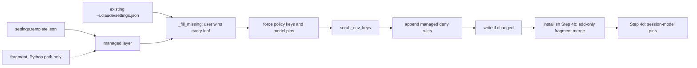

# beads-ui spike: the ai-harness task-panel switch and timer-free state cores

> Researched: 2026-10-15 | Confidence: high for every code reading, medium for runtime behaviour,
> because nothing was installed, built or run.

This packet answers the three questions of the design spike for the beads-ui design doc. It reads
ai-harness at commit `01d5ee82d4`, the base of the read-only ai-harness worktree. The reading ran on
2026-10-15 between 01:10 and 01:30 UTC, and ai-harness `main` moved to `f0189b93` during it. The GitHub
compare API lists three changed files between the two, and none is cited here.

The library sources were read at their release tags through the GitHub API, and their published
builds through unpkg. The starting evidence was the landscape doc's sections 5.2 and 6.3 [^42],
leg C's sections 3 and 4 [^43] and leg B's section 5 [^44].

## Summary

1. ai-harness renders `~/.claude/settings.json` in `merge_settings_template`, where the user's file
   wins every leaf. Removing the opt-in key from a layer changes nothing on an installed machine;
   only `scrub_env_keys` deletes it. [VERIFIABLE][^1]
2. The closest per-machine precedent is `_MOUSE_CAPTURE_MACHINES` (cli.py:743-763), a hardcoded set
   that scrubs two env keys. The config home that matches the ask is a new attribute in the
   `[machine.<name>]` registry, which already exports to `machines.json`. [VERIFIABLE][^2][^6]
3. A machine fragment cannot carry the switch. install.sh Step 4b keeps an existing `permissions.deny`
   list whole, which drops fragment deny rules, and it never deletes an env key. [VERIFIABLE][^3]
4. `plan` and `doctor` have no settings output today, so the switch needs a new plan line and a new
   doctor check. `apply` already reports each deny rule it appends. [VERIFIABLE][^1][^2]
5. 92 tracked files name a Task symbol: 28 break, 23 degrade, 40 are unaffected and one is the
   switch's target. 28 files use `CLAUDE_CODE_TASK_LIST_ID` as the session identity key, so the
   launcher must keep pinning it. [VERIFIABLE][^15]
6. `zustand/vanilla` 5.0.15 is a 25-line file with no timer, host global or import, so it runs in a
   mod unmodified. [VERIFIABLE][^33][^34]
7. `@tanstack/query-core` 5.104.2 loads in a mod, then throws on an unguarded `process.env.NODE_ENV`
   at its first timer or fetch. It runs only as a build output with a define, a scheduler and a
   timeout provider over `$.clock`. [VERIFIABLE][^25][^29]
8. `xstate` 5.33.2 cannot load in a hooks module. `createActor.ts:70` reads `console` at import, the
   hooks environment has none, and every XState entry path imports that file. [VERIFIABLE][^23][^38][^40]

## 1. Where a per-profile task-panel switch lives in ai-harness's settings rendering

### 1.1 The render path, step by step

Three writers produce `~/.claude/settings.json` on an install. install.sh Step 4 calls
`_aih_apply_step settings` (install.sh:4063), Step 4b merges a machine fragment, and Step 4d writes
the session-model pins. The renderer module is `src/ai_harness/settings_merge.py`, entry
`merge_settings_template` (lines 275-335). `_settings_step` (cli.py:846-849) reaches it through
`_merge_settings` (cli.py:755-763), passing the canonical machine name and no fragment.
`_merge_settings` is the function that applies per-machine differences. It is the only one that
branches on the machine name, through its `scrub_env_keys` argument, and its docstring calls it
"install.sh's retired Step 4". [VERIFIABLE][^1][^2][^3]

`merge_settings_template` applies its layers in a fixed order (settings_merge.py:315-327). The
table names each operation and the lines that implement it.

| Order | Operation | settings_merge.py lines | Effect on `env` and `permissions.deny` |
|---|---|---|---|
| 1 | Read the packaged template | 306-309 | Template `env` (template lines 5-10) and `deny` (lines 20-25) |
| 2 | Deep-merge a fragment onto the template | 316-319 | Runs only when a fragment path is passed |
| 3 | `_fill_missing(existing, managed)` | 321, 163-182 | Adds keys the user's file lacks; the user's value wins every leaf, a list included |
| 4 | `_force_policy_keys` | 323, 206-222 | Forces `tui` and the two subagent env keys over the user's file |
| 5 | `_force_fragment_model_keys` | 323, 251-262 | Forces the six model pins the fragment names |
| 6 | `_scrub_env_keys` | 324, 199-203 | Deletes each named key from `env` |
| 7 | `_append_managed_deny_rules` | 325, 225-248 | Appends managed deny rules the list lacks and never removes one |
| 8 | `_write_if_changed` | 332, 338-370 | Atomic write only when the bytes differ |

So the `env` block is composed at template lines 5-10, then at settings_merge.py lines 321, 323 and
324. The `permissions.deny` list is composed at template lines 20-25, then at lines 321 and 325.
[VERIFIABLE][^1][^4]



Orders 3 and 7 decide the switch's shape. Order 3's docstring says "``existing`` wins at every leaf,
a list included". An installed machine already holds `"CLAUDE_CODE_ENABLE_TODO_TOOLS": "1"`, so
removing the key from the template or a fragment leaves it in place. Only order 6 deletes it.
Order 7 is the only route that adds a deny rule to an existing user list. Its docstring says the
user's file "wins the list wholesale in the merge" and ends "Append missing, never remove one."
[VERIFIABLE][^1]

### 1.2 How machines.json and the per-machine inputs feed it

There are three per-machine inputs. Only one reaches `settings.json`, and it does not reach it
through the Python renderer.

The machine registry is the `[machine.<name>]` tables in `projects-wide-session-config/ai-harness.toml`
(lines 1355-1618), with a closed vocabulary at lines 1387-1409. `scripts/fleet_machines.py generate`
exports them to `~/.config/ai-fleet/machines.json` (lines 1358-1362). The loader,
`src/ai_harness/machine_registry.py`, is schema-generic, so a new attribute needs a vocabulary line
and no loader code. Every attribute is required, and "a missing attribute fails naming the machine
and the attribute" (lines 15-17, 215-219). The settings merge reads the registry only to
canonicalize aliases (`_canonical_machine`, cli.py:725-740). [VERIFIABLE][^2][^6][^7]

The context overlays, `[modules.overlay.claude]` (toml lines 72-80), compile into
`CLAUDE.<machine>.md` files and do not feed `settings.json`. The settings fragments are
`.claude/settings.<machine>.json` for `host-a`, `host-c`, `host-d` and
`host-e`. Each sets `env` keys only, plus `totalTokensReminder` on `host-c`.
[VERIFIABLE][^5][^6]

A fragment reaches the Python renderer only through `[[site.machine]] settings_fragment`
(config.py:89-93, 263-264; cli.py:1497-1510). ai-harness.toml declares no such entry, and the step's
comment says "the machine fragment (Step 4b) is still the shell's". Step 4b's inline `deep_merge`
"adds new keys, never removes existing ones" (install.sh:4131). It keeps an existing list whole, so a
fragment's deny entries never land, because the template already wrote a deny list.
[VERIFIABLE][^2][^3][^8]

That rules out the fragment as the switch's carrier for either half. It cannot delete the env key,
and its deny rules never land. [INFERENCE from install.sh:4130-4140 and the template's deny list.]

### 1.3 The closest existing per-machine key

The closest precedent in mechanism is `_MOUSE_CAPTURE_MACHINES`, a hardcoded set that drops two env
keys on one profile. It works through the same `scrub_env_keys` argument a task-panel switch needs.
It is declared at cli.py:743-752 and applied at 755-763:

```python
_MOUSE_CAPTURE_MACHINES = frozenset({"host-d"})
_MOUSE_SUPPRESSOR_ENV_KEYS = (
    "CLAUDE_CODE_DISABLE_MOUSE",
    "CLAUDE_CODE_DISABLE_MOUSE_CLICKS",
)


def _merge_settings(machine: str | None, fragment_path: Path | None = None) -> None:
    """install.sh's retired Step 4: the template merge into ~/.claude/settings.json."""
    merge_settings_template(
        fragment_path=fragment_path,
        scrub_env_keys=(
            _MOUSE_SUPPRESSOR_ENV_KEYS if machine in _MOUSE_CAPTURE_MACHINES else ()
        ),
        out=sys.stdout,
    )
```

The comment above it explains why scrubbing is needed. A stale `1` left by an earlier pin would
"otherwise survive" the user-wins merge (cli.py:744-745). The task-panel key sits in the same trap.
The comment adds that `tests/test_settings_machine_scoped_env.py` "pins the scope both ways".
[VERIFIABLE][^2]

The closest precedent in declaration style is a registry attribute such as `billing_mode`. It is
declared once in the vocabulary (toml line 1395) and once per machine table (for example line 1417).
It differs by machine profile today, but no settings code reads it. [VERIFIABLE][^6]

### 1.4 Options for declaring the switch

Each option was checked against the code above. The design stage chooses; this table records the
evidence.

| Option | Where it is declared | Drops the env key | Adds the deny rules | Evidence and cost |
|---|---|---|---|---|
| A. Registry attribute `task_panel` | `[machine_schema.attributes]` plus each `[machine.<name>]` table | Yes, through `scrub_env_keys` | Yes, with a new merge argument | A config file per machine profile, as A001 asks; validated by the schema-generic loader; changes the registry digest, so `machines.json` and the committed fallback regenerate |
| B. Hardcoded set beside `_MOUSE_CAPTURE_MACHINES` | `cli.py` | Yes | Yes, with a new merge argument | Smallest diff and an exact precedent; it is code, not config, which the fleet's config-over-code rule disfavours |
| C. Machine fragment | `.claude/settings.<machine>.json` | No | No | Step 4b keeps existing lists whole and never deletes keys (install.sh:4130-4140) |

Option A fits the ask's words, "a config file setting though per machine profile for ai-harness
repo". The registry is already where per-profile facts live. [INFERENCE from A001 and section 1.2.]

### 1.5 Measured insertion points for option A

The proposal below names every file and line a change would touch. It was not built or run.

1. Vocabulary: add `task_panel = ["enabled", "retired"]` to `[machine_schema.attributes]`
   (ai-harness.toml:1392-1401).
2. Declarations: add `task_panel = "enabled"` to each of the nine machine tables (toml lines 1411,
   1432, 1456, 1477, 1504, 1528, 1549, 1573 and 1595). Retiring a profile is then a one-line edit.
   The loader refuses a table that omits it (machine_registry.py:215-219).
3. Export: run `scripts/fleet_machines.py generate` and `emit-fallback`. The digest covers every
   attribute (machine_registry.py:336-356), and the toml comment says `--check` "fails when either
   is stale".
4. Constants: beside `_MOUSE_SUPPRESSOR_ENV_KEYS` (cli.py:748-752), add a tuple holding
   `CLAUDE_CODE_ENABLE_TODO_TOOLS` and a tuple of the five bare names `TaskCreate`, `TaskGet`,
   `TaskList`, `TaskUpdate` and `TodoWrite`.
5. Resolution: `_merge_settings` (cli.py:755-763) receives only a machine name. It needs the
   resolved attribute, from `load_registry(config.data)` and `resolve` (machine_registry.py:255-320).
   Both callers already hold the config (cli.py:848 and 1510).
6. Env half: when the attribute is `retired`, extend the `scrub_env_keys` tuple with the env key.
   Scrubbing runs after the template fill (settings_merge.py:321-324), so the template's `"1"` is
   removed on every apply.
7. Deny half: `merge_settings_template` (settings_merge.py:275-282) needs a new argument carrying
   extra deny rules. They can join `managed["permissions"]["deny"]` before line 321, so the existing
   append at line 325 adds them and reports them.
8. Reversal: setting the attribute back to `enabled` re-adds the env key on its own, because
   `_fill_missing` restores a missing template key. The deny rules do not leave, because line 325
   never removes a rule. Removal needs new code, and it must remove only rules the switch added.
9. Removal precedent: `session_model.apply` keeps a `last-written.json` record and does a three-way
   comparison before it changes a value (session_model.py:580-604). The same record would tell a
   switch-added deny rule from one the user wrote.
10. Tests: `tests/test_settings_machine_scoped_env.py` is the pattern, and it sets `AI_HOST`
    explicitly in every case. `tests/test_settings_permissions_deny.py` covers the deny append, and
    `tests/test_settings_template_parity.py` keeps the two template copies identical.

Both halves are needed. The Task tools "are available by default only on Opus 4.7, Sonnet 4.6,
Haiku 4.5, and earlier models". A session on those models gets them without the env key. The
key's row says "Set to `1` to get the task-tracking tools on every model", and
`CLAUDE_CODE_ENABLE_TASKS` only picks the Task tools or `TodoWrite`. Other opt-in routes exist:
"Name one of the tools in `--allowedTools`", or use `--tools` or the Agent SDK options.
[VERIFIABLE][^11][^12]

No tracked ai-harness file passes a Task tool to `--allowedTools` or `--tools`. The repo-wide search
for either flag followed by a Task name returned nothing. As a positive control, `allowedTools` alone
matched three files in `scripts/`, `src/`, `.claude/bin/` and `skills/`. The `ai c` launcher lives
in ai-cli-utils and was not read. [VERIFIABLE][^15]

A bare deny rule closes every route: "A bare tool name like `Bash` removes the tool from Claude's
context entirely". Precedence favours it, since "Rules are evaluated in order: deny, then ask, then
allow" and "a user-level deny blocks a project-level allow". [VERIFIABLE][^13]

Session kind changes what the switch reaches. In background sessions "Claude Code provides the same
tools on every model, listed or not", so only the deny half retires the panel there. Cloud sessions
never read the rendered file: user settings are "not read. Both stay on your machine". The sibling
spike, merged to main during this run, reached the same reading. [VERIFIABLE][^11][^46][^47]

The template itself does not change under this proposal, and both copies stay byte-identical (blob
`7b825e1a10`). It sets `DISABLE_GROWTHBOOK` to an empty string, so the feature-flag gates on the
Task tools that the fleet's research records are live. The deny rules make the switch independent
of them. [VERIFIABLE][^4][^14]

### 1.6 How the switch surfaces in plan, apply and doctor

The machine-install contract defines three verbs. `plan` never mutates, `apply` is "the only verb
that does", and `doctor` exits "0 healthy, 1 unhealthy". ai-harness `plan` prints generation, link
and Docker lines (cli.py:637-655, 1457-1482) and no settings line. `doctor` aggregates generation,
capability, hook, storage, boot-order and Buzz checks (cli.py:1422-1450) and has no settings check.
`_buzz_allow_list_doctor` (cli.py:682-695) returns `(lines, healthy)`, the pattern a task-panel
check would follow. [VERIFIABLE][^2][^9]

`apply` already prints each deny rule it appends, as `[+ ]  permissions.deny: added ...`
(settings_merge.py:326-330), while `_scrub_env_keys` prints nothing (lines 199-203). A second
`apply` writes nothing, because `_write_if_changed` compares bytes first (lines 338-347), and the
report reads `unchanged` (line 334). The contract's `<scope> apply: <count> mutations` line exists in
ai-harness only for storage. [VERIFIABLE][^1][^9]

So the switch needs a new plan line that names the env key it drops and the rules it adds. The scrub
needs its own report line, and `doctor` needs a new check. [INFERENCE from the two paragraphs above.]

A task-panel doctor check would fail a `retired` profile whose settings still hold the env key or
lack any of the five deny rules. It would also fail an `enabled` profile that holds the switch's deny
rules. [INFERENCE from section 1.5.]

The change takes effect only after a restart: the bootstrap table lists
"`CLAUDE_CODE_ENABLE_TODO_TOOLS` → the CC task panel | restart". The contract's sync prompt fires
only for its three ai-harness trigger files, and option A edits none of them. [VERIFIABLE][^9][^10]

### Hand-offs

- The choice between options A, B and C, and the attribute's name and values: the coordinator's
  design stage, implemented in ai-harness.
- The removal path for switch-added deny rules: the design stage.
- Whether cloud sessions are in scope, which only a repo-level or server-managed deny can reach: the
  design stage, per the sibling spike's hand-off.
- Whether ai-core's `machines.json` reader accepts an unknown attribute: an ai-core check before the
  registry change lands.
- The backup of `~/.claude/tasks/` and its destination: leg C's hand-off to the coordinator.

## 2. Every ai-harness surface that reads or writes the task panel

### 2.1 Method

The search used `git grep -E` over tracked files at `01d5ee82d4`, so the haystack is the git index.
The symbols were `TaskCreate`, `TaskUpdate`, `TaskList`, `TaskGet`, `TodoWrite`, `\.claude/tasks`,
`CLAUDE_CODE_TASK_LIST_ID`, `CLAUDE_CODE_ENABLE_TODO_TOOLS` and `CLAUDE_CODE_ENABLE_TASKS`. The
directories were the six the brief named plus `.claude/bin/`, `.githooks/`, `hooks/` and
`install.sh`, which also run on every machine. It matched 92 files, none in `hooks/` or `install.sh`.
The template's line 7 is in the result, the positive control that the pattern fires.
[VERIFIABLE][^15]

A path join such as `Path.home() / ".claude" / "tasks"` does not contain the string `.claude/tasks`.
A second search for `"tasks"`, `/tasks`, `tasks_root` and `.highwatermark` found five more files,
listed in section 2.4. [VERIFIABLE][^15]

Each file gets one class, defined here once:

- Break: the file's purpose needs a Task tool call or the panel directory, so on a retired machine
  it cannot do its job, or a rule it states cannot be followed.
- Degrade: one step in a wider flow calls a Task tool or reads the panel directory. The flow still
  runs, but that step yields nothing or a wrong zero.
- Unaffected: the symbol appears, but the behaviour does not depend on the tools or the directory.

The count is 28 break, 23 degrade, 40 unaffected, and one file that is the switch's own target. The
counts are my classification of the 92 matches. [INFERENCE from the tables below.]

### 2.2 Break (28 files)

| Path | Lines | What it does with the panel |
|---|---|---|
| `skills/load-task-panel/SKILL.md` | 22-409 (21 hits) | Repaints the panel with `TaskList` and paired `TaskUpdate` calls; reads `~/.claude/tasks` at 146 and 254 |
| `skills/curate-task-panel/SKILL.md` | 10-193 (11 hits) | Reconciles, reorders and trims one panel; the driver makes every Task call |
| `skills/curate-task-panel/scripts/curate.py` | 12-675 (8 hits) | Plans curation from the driver's `TaskList` and `TaskGet` observations |
| `skills/curate-task-panel/scripts/trim_panel.py` | 16-753 (9 hits) | Returns `TaskUpdate status: deleted` calls that bring a panel under a cap |
| `scripts/cc_task_curation.py` | 4-1001 (10 hits) | Snapshot, reorder and recheck engine behind the curate skill |
| `skills/clean-task-panel/SKILL.md` | 14-15 | `TaskList`, then `TaskUpdate status: deleted` for each completed row |
| `docs/procedures/cc-task-panel-audit.md` | 22-41 | A procedure whose output is a list of Task calls to apply |
| `skills/shadow-codex-launch/SKILL.md` | 11-50 | Creates a child row with `TaskCreate`, then stops: "If `TaskCreate fails`, stop" |
| `scripts/shadow_codex_launch.py` | 4 | Its docstring says the live turn owns the `TaskCreate` and `TaskUpdate` calls |
| `scripts/agent_session_registry.py` | 2066 | The live-turn binding requires a `TaskCreate` row before any watcher lease |
| `src/ai_harness/shadow_watcher.py` | 3, 238-290 | Writes the row file directly and raises when the namespace is missing |
| `src/ai_harness/shadow_watcher_pickup.py` | 369-370 | Tells the session to `TaskCreate` a dedicated child before the claim |
| `projects-wide-session-config/modules/claude-delta.md` | 17, 19 | The mirror rule and the one-row-per-agent rule, compiled into every machine |
| Nine compiled `projects-wide-session-config/CLAUDE.<machine>.md` | 185, 187 each | The same two rules as delivered context |
| `skills/delegate/SKILL.md` | 444 | Every launch: `TaskCreate` then `TaskUpdate` with the launch name |
| `skills/handoff/SKILL.md` | 65 | `TaskUpdate` the row to `in_progress` with the agent as owner |
| `docs/procedures/agent-delegation.md` | 1754-1757, 1812 | The two-call rule for an owned agent row |
| `docs/procedures/agent-lifecycle-and-worktree-naming.md` | 92, 239-244, 496, 538 | Same rule, as lifecycle step and checklist item |
| `docs/procedures/background-agent-lifecycle.md` | 351-352 | Same rule for background agents |
| `docs/procedures/landing-the-plane.md` | 214 | "every `TaskCreate` requires an existing owning `bd` issue" |

The shadow Codex path is the only break that raises an error in code. The curation scripts lose
their input, and the remaining breaks are instruction text. The resolver raises `TaskPreconditionError` on a missing namespace, and the module's docstring says
"Claude Code exposes no documented external TaskUpdate interface". [VERIFIABLE][^17]

### 2.3 Degrade (23 files)

| Path | Lines | What it does with the panel |
|---|---|---|
| `skills/next/SKILL.md` and `skills/next/SKILL.share.md` | 62-251 (7 hits each) | Calls `TaskList` on every `/next` run (line 203) and matches rows to Beads |
| `skills/save-state/SKILL.md` | 55, 325, 352-358 | Panel reconciliation before the docket refresh; lists the force-gate Task tools |
| `skills/progress-review/SKILL.md` | 25, 66, 96 | `TaskList` and `TaskGet` for every in-progress row |
| `skills/beads-task/SKILL.md` | 82, 173 | Creates the mirror row after the Beads issue |
| `skills/auto-start/SKILL.md` | 30 | Reads open CC tasks with `TaskList` as a startup step |
| `skills/track/SKILL.md` | 21 | `TaskList` as the first discovery step |
| `skills/status-update/SKILL.md` | 19 | Checks `TaskList` for in-progress items |
| `skills/start-goal/SKILL.md` | 99 | Reads each session's `TaskList` before arming |
| `skills/fleet-brief/SKILL.md` | 47 | Counts `in_progress` rows in the pinned namespace directory |
| `docs/procedures/development-workflow.md` | 27 | A `TaskList` reconciliation after every ship event |
| `docs/procedures/goal-exit-robustness.md` | 235 | `TaskList` per session before arming a goal |
| `docs/procedures/chief-of-staff-vp-coordination.md` | 426 | Reads the same namespace count |
| `src/ai_harness/defaults/goal-waker-nudge.md` and `goal-waker-nudge.sem-kg.md` | 2 | The injected nudge says to re-read in-progress Beads issues and CC tasks with `TaskList` |
| `src/ai_harness/defaults/injection-repair-limit-escalation.md` | 11 | Asks for a mirror row "so it shows on the task panel, which is the surface Sergei" watches |
| `src/ai_harness/defaults/injection-self-heal-bug-fix.md` | 12 | Same request for a repair round |
| `.claude/hooks/install-harness-remediation-pickup.sh` | 3, 33 | Tells the session to create one `TaskCreate` mirror for a remediation |
| `.claude/hooks/worktree-creation-guard.sh` | 62 | A deny message asking for "a CC task (TaskCreate)" beside the Beads issue |
| `.githooks/post-checkout` | 101-102 | Same request for a degraded backstop |
| `scripts/flat_worktree_backstop_notice.py` | 93-96 | Same request, rendered by the notice |
| `scripts/bd_ready_mirror.py` | 9-332 | Plans `TaskCreate` and `TaskUpdate` calls from a supplied `TaskList` snapshot |
| `scripts/chief_of_staff_cli.py` | 1414-1455 | Counts `in_progress` task files in the session's pinned namespace |

The chief-of-staff count degrades silently. Its docstring says "under a pin an absent or empty
directory is a true zero". On a retired machine every pinned session would report zero in-progress
work, and the reader cannot tell that from idleness. [VERIFIABLE][^16]

The two injection templates make the panel the place Sergei sees an escalation. On a retired
machine that surface moves to beads-ui, so the templates need new wording.
[VERIFIABLE][^15]

### 2.4 Found by the second search (5 files)

| Path | Lines | What it does | Class |
|---|---|---|---|
| `src/ai_harness/shadow_watcher_runner.py` | 149 | Builds `TaskRowResolver(Path.home() / ".claude" / "tasks")` | Break, with the shadow watcher |
| `.claude/bin/cx-retry-idle-reap` | 102-111 | Reads `tasks/<session>/*.json` as one source of an exit cause | Degrade: the glob is empty and the helper falls through |
| `scripts/probe_task_panel_order.py` | 1-114 | Checks panel order and `.highwatermark` from driver observations | Degrade: no observations to check |
| `scripts/agent_session_registry.py` | 1199 | Stores `native_task_root`, which nothing else reads | Unaffected |
| `scripts/ec2-migration/cutover_push_session_state.sh` | 205 | Copies a session's task directory during a host migration | Unaffected: a one-off script |

### 2.5 Unaffected (40 files)

| Group | Paths and lines | Why it is unaffected |
|---|---|---|
| Session identity through `CLAUDE_CODE_TASK_LIST_ID` | `.claude/bin/bedrock_auth.py:769, 817-818`; `.claude/bin/resume-lib.sh:21, 79, 108`; `.claude/hooks/context-supervisor-{idle-prompt,postcompact,session-end,user-prompt}.sh`; `held-replay-session-start.sh:10, 45`; `launch-resume-{prompt-submit,session-end,session-start}.sh`; `precompact-safety.sh:24, 36`; `resume-inject.sh:52, 340`; `scripts/agent_worktree_preflight.py:153, 1033`; `scripts/claude_sessions.py:216`; `scripts/provenance_identity.py:193`; `scripts/wq_hooks.py:201`; `src/ai_harness/{context_supervisor.py:9303, 9408; goal_waker.py:1287; job_supervisor.py:1263; prompt_injection/targets.py:211, 315; reboot_resume.py:47, 70, 292; session_rekey.py:32; shadow_watcher_canary.py:52-53; submit_fifo.py:12, 32}`; `skills/{exit-goal,explain,format-decision,summary}/SKILL.md` | The variable names the session for resume keys, held-doc identity, FIFOs and injection targets; none reads the directory |
| Docs naming the pinned namespace | `docs/procedures/bms-sagemaker-local-toolchain.md:42`; `kg2-throwaway-session-cutover-brief.md:138-139`; `host-c-reboot-resume.md:69` | Describe the pin as a session key |
| Tool-name lists | `src/ai_harness/context_supervisor.py:249-252`; `scripts/summary_nudge.py:21-24`; `projects-wide-session-config/hooks-manifest.json:978, 997`; `hooks-manifest.share.json:291` | An allow-list or matcher that names an absent tool never fires |
| Anti-TaskCreate text from upstream Beads | `.claude/hooks/bd-prime.sh:19`; `scripts/bd_prime_filter.py:15, 42`; `scripts/bd_repo_setup.py:285`; `docs/procedures/beads-context-ownership.md:46, 604, 619` | They strip Beads' "Do NOT use TodoWrite, TaskCreate" advice; on a retired machine that advice becomes true |
| One-off and notes | `scripts/ec2-migration/kg2-ec2-step22-pull-waves-1-and-2a.sh:31-64`; `docs/procedures/new-machine-bootstrap.md:266` | A migration script, and a doc row to update |

`context_supervisor.py` appears in two groups and is counted once. `agent-delegation.md:1780-1781`
holds hook design notes that are unaffected, but the file is classed break for its other lines.

28 of the 40 files use `CLAUDE_CODE_TASK_LIST_ID` as the fleet's session identity key, and three
docs describe it that way. Three skills classed degrade also use it for held-doc identity. Claude
Code documents it only as the task-list directory: "To share a task list across sessions, set
`CLAUDE_CODE_TASK_LIST_ID` to use a named directory in `~/.claude/tasks/`". The fleet reads it as
`${CLAUDE_CODE_TASK_LIST_ID}@${AI_HOST}` in the held-doc skills. [VERIFIABLE][^15][^45]

So a retired machine must keep the launcher pinning the variable, even though no task is ever
written under it. Dropping the pin with the panel would break resume, held-doc identity and the
submit FIFO. [INFERENCE from the identity group above.]

The context supervisor touches the panel twice, and neither use needs the directory. Its key fallback
reads the variable directly and is marked "LIBRARY-ABSENT FALLBACK ONLY" (context_supervisor.py:
9403-9411). Its force gate allows the four Task tools because "The CC panel is a display mirror of
Beads" (line 247). Removing the tools only shortens that list. [VERIFIABLE][^19]

### 2.6 Near misses that are not the panel

Several files read `/tmp/claude-<uid>/<slug>/<session>/tasks/<id>.output`, which holds background
task output, not panel rows: `.claude/bin/agent-transcript:9`, `scripts/agent_transcript_locate.py`,
`scripts/background_wait_guard.py` and `scripts/machine_contention.py:374-388`. The `wq next` panel
reconciliation exists in the queue design, which says "An inaccessible or missing task-list
namespace is logged and skipped". In ai-harness code, `scripts/wq_hooks.py:201` only records the
variable. [VERIFIABLE][^15][^18]

### 2.7 What the inventory adds to the retirement preconditions

The instruction text is the largest single dependency. The rules in `claude-delta.md:17-19` compile
into all nine machines' context files. The compile step has per-machine overlay modules
(ai-harness.toml:72-80) but no per-machine variant of the shared delta. Hook wiring already has a
per-machine scope. Each `hooks-manifest.json` entry carries a `machines` field, which is `"all"` for
the two entries whose matchers name Task tools (lines 978 and 997). [VERIFIABLE][^6][^20][^21]

### Hand-offs

- The replacement for the one-row-per-agent rule and the mirror rule on retired machines: the
  coordinator's design stage. beads-ui's session view is the candidate surface.
- How the compiled context drops panel rules on a retired machine: the design stage, implemented in
  ai-harness's compile step.
- The shadow Codex launch path on a retired machine: an ai-harness design question; it is the only
  code path that cannot run.
- The chief-of-staff and fleet-brief counts: a guard that reports "panel retired" instead of zero.

## 3. Timer-free state cores for a Claude Code mod

### 3.1 The environment a copied file must run in

The mods API page states the limit: "The hooks module itself has no Node.js APIs, no timer
globals such as `setTimeout`, and no network or file access of its own." It adds that `URL`,
`TextEncoder`, `AbortController` and `crypto.subtle` are available. [VERIFIABLE][^22]

The public types file is stricter. Its `global` block (lines 11570-11705) opens "The globals of a
hooks module's environment: these and no others (no DOM, no Node)". It adds "No code generation
either: `eval` and `new Function` over a string throw". It then says "A surface module's environment
(Client) has the same globals and a `console`; neither has timers". The listed host globals are `h`,
`Fragment`, `AbortSignal`, `AbortController`, `TextEncoder`, `TextDecoder`, `URLSearchParams`, `URL`,
`atob`, `btoa`, `structuredClone`, `crypto` and `performance`. The suggested `tsconfig.json` (line 66)
sets `"lib": ["es2023"], "types": []`. [VERIFIABLE][^23]

So a hooks module has no `console`, `process`, `window`, `queueMicrotask` or `setTimeout`.
ECMAScript's own built-ins, such as `Promise`, `Map`, `Set` and `Symbol`, come from the language and
the `es2023` lib. [INFERENCE from the block above.]

Time comes from the mods API instead. `$.clock.after(ms, fn)` and `$.clock.every(ms, fn)` each
return a `Timer` whose `cancel()` stops it (types lines 2923-2939 and 9963-9974). The API page says
they "take the place of `setInterval` and `setTimeout`". A `Client` module has only `every(ms, fn)`,
which returns a stop function (types lines 1280-1285). [VERIFIABLE][^22][^23]

`$` is not a global: "Every hook receives it as its first argument, `$`". The API page's example
calls `$.process.run` inside a `$.clock.every` callback started from `session.start`. The types file
calls `$` "the engine interface, frozen, the same object at every invocation" (line 3978). So a timer
provider can close over the `$` it was built from. [VERIFIABLE][^22][^23]

### 3.2 Zustand vanilla store

The current release is `zustand` 5.0.15, and every peer dependency is optional. The published
`esm/vanilla.mjs` is 25 lines. It uses `new Set`, `Object.is` and `Object.assign`, and contains no
timer, no host global, no `process`, no `import.meta` and no import statement. Listeners run
synchronously inside `setState` (line 9), so the store needs no scheduler. [VERIFIABLE][^32][^33]

The TypeScript source at the tag, `src/vanilla.ts` (100 lines), agrees. Its only runtime references
are `new Set` (line 64), `Object.is` (73) and `Object.assign` (78), and it exports `createStore` at
line 99. The docs say `createStore` "lets you create a vanilla store that exposes API utilities".
[VERIFIABLE][^34][^35]

The middleware entry is different. The fetch reported `devtools` reading `import.meta.env` and
`window.__REDUX_DEVTOOLS_EXTENSION__` near line 64. It reported `persist` defaulting to
`window.localStorage` near line 332. [VERIFIABLE][^36]

Verdict: `zustand/vanilla` can run as a copied file in a hooks module and in a `Client` module,
unmodified. The middleware should not be copied. [INFERENCE from sections 3.1 and 3.2.]

### 3.3 TanStack Query core

The current release is `@tanstack/query-core` 5.104.2, with no runtime dependencies and 40,039 bytes
minified, far under the 1 MB module ceiling leg B recorded. All 23 source files were read at tag
commit `b699b52d60`. [VERIFIABLE][^24][^25][^31][^44]

Every identifier the brief named was searched. The table gives each hit and when it is evaluated.

| Identifier | File and line | Context | Evaluated |
|---|---|---|---|
| `setTimeout`, `clearTimeout`, `setInterval`, `clearInterval` | `timeoutManager.ts:62-68` | The default provider's closures | At call |
| `setTimeout` | `timeoutManager.ts:258-259` | `systemSetTimeoutZero`, the `notifyManager` default (`notifyManager.ts:19`) | At call |
| `timeoutManager.setTimeout` and `setInterval` | `removable.ts:31`, `queryObserver.ts:527, 553`, `utils.ts:528` | Garbage collection, staleness, refetch interval, retry sleep | At call, through the provider |
| `window` | `focusManager.ts:25-32`, `onlineManager.ts:26-36` | Behind `typeof window !== 'undefined'` | Guarded |
| `document` | `focusManager.ts:137` | `globalThis.document?.visibilityState` | Guarded |
| `window`, `Deno` | `utils.ts:116` | `isServer`, a `typeof` test | At load, safe |
| `process.env.NODE_ENV` | `hydration.ts:150`; `query.ts:739, 872`; `utils.ts:549, 652`; `queriesObserver.ts:143`; `timeoutManager.ts:121, 142, 170, 217` | Unguarded development checks | At call |
| `console.error`, `console.warn` | Inside the branches above | Development only | At call |
| `AbortController` | `query.ts:747` | One per fetch | At call; present in a mod |
| `queueMicrotask`, `requestAnimationFrame` | `notifyManager.ts:134, 137` | Doc comments only | Never |
| `navigator`, `require`, `node:` imports | none | | |

All ten `process.env.NODE_ENV` reads sit inside function bodies, so the module loads. The published
build keeps them unguarded. The fetch counted four in `build/modern/timeoutManager.js` and two in
`build/modern/query.js`, and reported that neither of the latter has a `typeof process` test.
[VERIFIABLE][^25][^29][^30]

`timeoutManager.setTimeout` checks `process.env.NODE_ENV` before it calls the provider
(`timeoutManager.ts:169-173`). So even a custom provider does not help a verbatim copy. The first
timer or fetch reads an undeclared `process` and throws a `ReferenceError`. [INFERENCE from the
source lines and the environment in section 3.1.]

query-core treats a runtime with no `window` as a server. That "disables scheduling refetch timers
and changes the default `retry` count", and `gcTime` too (`environmentManager.ts:16-20`). In a mod
that removes most timers. Staleness and refetch timers are skipped (`queryObserver.ts:502-508`),
retry defaults to 0 (`retryer.ts:251`), and `gcTime` defaults to `Infinity`, so no collection timer
starts (`removable.ts:30-46`). One timer stays: the default batch scheduler on every notification is
`systemSetTimeoutZero` (`notifyManager.ts:19`), which calls the global `setTimeout`.
[VERIFIABLE][^25][^27][^28]

A copy can run only with four changes, none of them to the library's logic:

1. A copy-time define that replaces `process.env.NODE_ENV` with `"production"`. Dead-code
   elimination then drops every development branch and its `console` call. [HEURISTIC]
2. `notifyManager.setScheduler` with a `Promise`-based microtask. The docs offer `queueMicrotask` as
   an example scheduler, and a mod lacks it, so the `Promise` form stands in.
3. `timeoutManager.setTimeoutProvider` over `$.clock.after` and `$.clock.every`, set before any
   `QueryClient` exists, as the docs require. A timer id must be a number or have
   `Symbol.toPrimitive` (`timeoutManager.ts:17`), so the provider keeps a map from numbers to
   `Timer` handles.
4. A choice on server mode. Keeping it means polling with `$.clock.every`, and
   `environmentManager.setIsServer(() => false)` restores client timers through the provider.

Items 2 to 4 rest on the three reference pages and the source line cited. [VERIFIABLE][^25][^26][^27][^28]

Verdict: query-core cannot run as a copy of its published files. It can run as a build output with
the four changes above. [INFERENCE from this section.]

### 3.4 XState

The current release is `xstate` 5.33.2, with no dependencies and 46,874 bytes minified. The core
sources were read from the release tarball at commit `fbee62e7c1`. [VERIFIABLE][^37][^38][^41]

| Identifier | File and line | Context | Evaluated |
|---|---|---|---|
| `setTimeout`, `clearTimeout` | `createActor.ts:61-69` | The default `clock` in `defaultOptions` | At call |
| `console` | `createActor.ts:70` | `logger: console.log.bind(console)` in the top-level `defaultOptions` | At module load |
| `setTimeout` | `reportUnhandledError.ts:9-13` | Rethrows an actor error nobody observed | When an error has no listener |
| `setTimeout`, `clearTimeout` | `waitFor.ts:64-73` | The `timeout` option | Only with a finite timeout |
| `clock.setTimeout`, `clock.clearTimeout` | `system.ts:125, 142` | Delayed events through the injected clock | At call |
| `new Function`, `eval` | `scxml.ts:151, 588` | The SCXML converter | Not exported from `index.ts` |
| `window`, `self`, `global` | `dev/index.ts:21-33, 51, 63` | Behind `typeof` tests | Guarded |
| `console.warn`, `console.error` | `assign.ts:166`, `send.ts:252`, `State.ts:310`, `createActor.ts:742` and nine more | Each behind `isDevelopment` | Development only |
| `process`, `navigator`, `document` | none in code | `document` appears in doc comments only | |

Line 70 decides the verdict. `logger: console.log.bind(console),` sits in a top-level `const`, so
importing `createActor.ts` reads `console` at once, and a hooks module has no `console`. Every entry
path imports that file: `StateMachine.ts:3`, `actions/spawnChild.ts:3` and `spawn.ts:1` import it,
and the pure `transition` API reaches it through `getNextSnapshot.ts` (`transition.ts:2`,
`getNextSnapshot.ts:1`). [VERIFIABLE][^23][^38]

The published build keeps the line. The fetch found `logger: console.log.bind(console),` inside
`const defaultOptions` in `dist/raise-97446fd4.esm.js`. It also found that `dist/xstate.esm.js` <!-- gitignored-path-ok: file paths inside the published xstate@5.33.2 npm package, cited by unpkg URL in the footnotes; not paths in this repo -->
imports that chunk at top level. [VERIFIABLE][^39][^40]

A `Client` surface module has a `console`, so XState loads there. Its delayed transitions still need
a `clock` option, because "By default, the native `setTimeout` and `clearTimeout` functions are
used" (`types.ts:1890-1908`). A `Client` has only `every`. [VERIFIABLE][^23][^38]

A hooks-module copy needs three changes. The first is a `console` shim or a copy-time patch of line
70. The second is `clock` and `logger` options on every `createActor`. The third is an error
listener on every actor, so `reportUnhandledError` never reaches the global `setTimeout`.
[INFERENCE from the table.]

The shim route depends on a module being allowed to add a global. The types file says nothing on
that, and nothing was run. [NO SOURCE]

Verdict: XState cannot load in a hooks module as published. It loads in a `Client` module, and it
runs there only with a custom `clock`. [INFERENCE from this section.]

### 3.5 Comparison

| Criterion | `zustand/vanilla` 5.0.15 | `@tanstack/query-core` 5.104.2 | `xstate` 5.33.2 |
|---|---|---|---|
| Timer globals referenced | None | Default provider and `systemSetTimeoutZero` | Default clock, `reportUnhandledError`, `waitFor` |
| Read at module load | Nothing missing | `window` and `Deno` through `typeof` only | `console` (`createActor.ts:70`) |
| Unguarded host globals at call time | None | `process` (10 sites) | `setTimeout` in two helpers |
| Node built-ins or `require` | None | None | None |
| Code generation | None | None | SCXML only, not exported |
| Loads in a hooks module | Yes | Yes | No |
| Runs in a hooks module unmodified | Yes | No | No |
| Changes needed | None | Define, scheduler, timeout provider, server-mode choice | `console` shim or patch, `clock`, `logger`, error listeners |
| Minified size | 25-line file | 40,039 bytes | 46,874 bytes |

### 3.6 The minimal alternative

No hand-written replacement is needed for the store. `zustand/vanilla` qualifies as is. Its whole
algorithm is a `Set` of listeners, an `Object.is` check and a shallow merge. [VERIFIABLE][^33]

A mod also has its own reactive store. Leg B records that `$.state` "is reactive for the session and
redraws the sites that read it". Pure reducers over `$.state` may need no store library at all.
[VERIFIABLE][^44]

For data fetching in the mod, query-core's value in server mode is deduplication and a cache. A
`Map` from query key to data, fetch time and in-flight promise gives the same, with `$.clock.every`
for polling. [INFERENCE]

For flows such as drag and confirm-delete, a discriminated-union reducer is the plain substitute for
a state machine. XState can still serve the two DOM surfaces, where its globals exist.
[INFERENCE]

### Hand-offs

- A one-file import probe of each candidate under `claude plugin test`: the coordinator's first
  build task. Nothing here was run.
- Whether `claude plugin validate` refuses a `process` or `console` reference by static reading:
  the same probe.
- Whether a hooks module may assign to `globalThis`: the same probe, before any shim is designed.
- Which state approach the shared core adopts: the coordinator's design stage, against leg B's
  package rules.

## Gaps, blindspots and emergent findings

### Emergent findings beyond the question list

The panel's environment variable outlives the panel. `CLAUDE_CODE_TASK_LIST_ID` keys resume, held
docs, FIFOs and injection targets across 28 files (section 2.5). A retirement that drops the pin
would break those, and no panel test would notice. [VERIFIABLE][^15]

install.sh Step 4b drops a fragment's deny rules on every machine. The repo holds two fragment
merges with different list rules, and only the shell one runs. Any future per-machine deny rule
placed in a fragment would be lost without a message. [VERIFIABLE][^2][^3]

`ai-harness plan` prints no settings, plugin or session-model line, while the contract says `plan`
"prints every intended mutation". That sentence is written for ai-core's `[WOULD_APPLY]` lines, so
whether it binds ai-harness is a reading of the contract. [VERIFIABLE][^2][^9]

The registry comment at ai-harness.toml:1362 says `emit-fallback` writes
`src/ai_harness/_fleet_machines.py`. The generator writes `scripts/_fleet_machines.py`
(`scripts/fleet_machines.py:77-78`), the loader's docstring agrees (`machine_registry.py:6`), and the
`src/` path does not exist. The comment is stale. [VERIFIABLE][^6][^7]

Leg C wrote that "The queue's `wq next` reconciles `TaskList` before offering pool work". In
ai-harness code that reconciliation is design text only (section 2.6). ai-core's queue service was
not read. [VERIFIABLE][^18][^43]

In a mod, query-core's server mode drops `refetchInterval` and staleness timers without an error. A
mod author who sets `refetchInterval` would see no polling. [VERIFIABLE][^25]

### Defects found and not fixed

Two pre-existing defects surfaced: the stale fallback path in the ai-harness.toml comment, and the
missing settings line in `ai-harness plan`. Both live in ai-harness.

I did not fix them, and I did not file them. This brief makes the ai-harness worktree read-only and
forbids `bd` write verbs, which closes both routes. The coordinator should file both in the
ai-harness store.

### Blindspots I could not resolve

Nothing was run. No `claude plugin test` probe loaded any library, so every runtime claim rests on
docs, the types file and source reading. [NO SOURCE]

The absence of `console` in a hooks module is stated by the types file and not by the API page. The
XState verdict depends on it. [VERIFIABLE][^22][^23]

Whether a hooks module may assign to `globalThis` is not stated anywhere I read. The types file has
no hit for `globalThis`, `lockdown` or `harden(`, and its "frozen" hits describe `$`, event objects
and element tables. The API page, read in full, does not mention it. [NO SOURCE]

The `ai c` launcher is in ai-cli-utils, which was not in scope. Whether it passes `--allowedTools`
or sets the opt-in key itself is unknown, and either would bypass the env half of the switch. The
deny half would still hold. [NO SOURCE]

ai-core reads `machines.json`. Whether its reader accepts an attribute it does not know was not
checked. [NO SOURCE]

No document states outright that a bare-name deny removes the Task tools in a background session.
The sibling spike searched the changelog for it and found nothing. [NO SOURCE]

70 test files under `tests/` name a Task symbol. They were outside the named directories and were
not classified. They include `tests/test_curate_task_panel_cli.py` and
`tests/test_shadow_codex_launch.py`, which exercise break-class code. [VERIFIABLE][^15]

Other fleet repos, such as ai-core, ai-cli-utils and sw-bms-workspace, were not searched. [NO SOURCE]

The published-build observations for query-core and XState came through WebFetch, whose model quoted
the lines. Each was corroborated against the raw source at the tag, which was substring-checked.

### Contrarian evidence

The mod may need no state library. `$.state` already redraws the sites that read it, and pure
reducers over it cover a board's view state. That weakens the case for copying any of the three
into the mod. [VERIFIABLE][^44]

Option B, the hardcoded set, has an exact precedent and an existing test pattern. Option A costs a
registry digest change, regenerated `machines.json` and fallbacks, and an untested ai-core reader.
The ask's "config file setting" wording is the argument for A. [INFERENCE from section 1.4.]

Dropping the env key alone retires the panel in a terminal session on a model newer than those the
tools reference lists. "On every other model, Claude Code leaves the tools out unless you opt in."
The deny rules could be skipped, avoiding step 8's removal code, only if background sessions and
older models were out of scope. [VERIFIABLE][^11]

### Five-perspective critic pass

I ran this pass myself over the draft. No second model reviewed the packet.

| Perspective | Finding | Severity | Resolution |
|---|---|---|---|
| Conventional | The standard answer is "bundle with a define and test under `claude plugin test`"; the packet must not imply the copies were tested | High | Conceded: every verdict is tagged as source reading, and the probe is a hand-off |
| Contrarian | `$.state` plus reducers makes the library question moot for the mod | Medium | Evidenced in "Contrarian evidence" and section 3.6 |
| Historical | The query-core verdict depends on `timeoutManager` and `environmentManager`, and an older pin may lack them | Medium | Conceded: the verdict holds for 5.104.2; the docs pages name no version that added either |
| Adjacent | ai-core consumes `machines.json`, so option A crosses a repo boundary | Medium | Evidenced as a hand-off and a blindspot |
| Skeptic | The panel-retirement count could hide panel readers that use other spellings | High | Fixed: the second search found five more files (section 2.4); tests and other repos are named as unsearched |
| Skeptic | Build-file quotes came from a fetch model | Medium | Fixed: each is corroborated by the raw source at the tag |

### Alignment with the founding ask

A001 asks that retiring the panel "should be a config file setting though per machine profile for
ai-harness repo". Section 1 covers it with measured insertion points, and option A matches the
wording. The backup half of that sentence is leg C's and is not repeated here. The ask is narrowed
in one place: a per-machine switch reaches terminal and background sessions, never cloud sessions
(section 1.5). [INFERENCE from section 1.5.]

A001 also asks to "disable the claude task panel / tasks feature entirely". The switch covers the
four Task tools and `TodoWrite`. Section 2 lists the instruction text, skills and shadow Codex path
that depend on the panel. They are not settings, so they go to the design stage.

A002 asks whether the web app, the MCP UI app and the TUI mod can share code. Section 3 narrows the
state layer's answer. `zustand/vanilla` crosses into the mod as is, query-core crosses only as a
build output, and XState does not reach a hooks module.

A003 names the three surfaces for now. Section 3 bears on the mod surface only, because the web app
and the MCP App have a DOM, timers and `console`.

A004 asks to keep the queue where it is. Section 2.6 records that its panel reconciliation is design
text in ai-harness, which changes nothing about where it lives.

No requirement was dropped. The runtime behaviour of every library in a live mod could not be
verified, as the blindspots state.

## Sources

[^1]: Wallace, S. (2026). [src/ai_harness/settings_merge.py](https://github.com/sergeiwallace/ai-harness/blob/main/src/ai_harness/settings_merge.py), lines 1-370. sergeiwallace/ai-harness (private), GitHub. Read at commit 01d5ee82d4, unchanged at main f0189b93. Verified accessible (HTTP 200, GitHub API with the owner's credential) 2026-10-15. (The four-layer settings merge.)
[^2]: Wallace, S. (2026). [src/ai_harness/cli.py](https://github.com/sergeiwallace/ai-harness/blob/main/src/ai_harness/cli.py), lines 637-695, 725-863, 1255-1300, 1415-1530. sergeiwallace/ai-harness (private), GitHub. Read at commit 01d5ee82d4. Verified accessible (HTTP 200, GitHub API tree listing) 2026-10-15. (The settings step, the mouse precedent, plan and doctor.)
[^3]: Wallace, S. (2026). [install.sh](https://github.com/sergeiwallace/ai-harness/blob/main/install.sh), lines 4053-4271. sergeiwallace/ai-harness (private), GitHub. Read at commit 01d5ee82d4. Verified accessible (HTTP 200, GitHub API tree listing) 2026-10-15. (Step 4 hand-off and the Step 4b machine fragment merge.)
[^4]: Wallace, S. (2026). [src/ai_harness/defaults/settings.template.json](https://github.com/sergeiwallace/ai-harness/blob/main/src/ai_harness/defaults/settings.template.json), lines 1-42. sergeiwallace/ai-harness (private), GitHub. Read at commit 01d5ee82d4. Verified accessible (HTTP 200, GitHub API tree listing) 2026-10-15. (Byte-identical to `.claude/settings.template.json`, blob `7b825e1a10`.)
[^5]: Wallace, S. (2026). [.claude/settings.host-a.json and the three other machine fragments](https://github.com/sergeiwallace/ai-harness/blob/main/.claude/settings.host-a.json). sergeiwallace/ai-harness (private), GitHub. Read at commit 01d5ee82d4. Verified accessible (HTTP 200, GitHub API tree listing) 2026-10-15. (Fragments exist for host-a, host-c, host-d and host-e.)
[^6]: Wallace, S. (2026). [projects-wide-session-config/ai-harness.toml](https://github.com/sergeiwallace/ai-harness/blob/main/projects-wide-session-config/ai-harness.toml), lines 1-135 and 1355-1618. sergeiwallace/ai-harness (private), GitHub. Read at commit 01d5ee82d4. Verified accessible (HTTP 200, GitHub API tree listing) 2026-10-15. (Overlays, the machine registry and its schema.)
[^7]: Wallace, S. (2026). [src/ai_harness/machine_registry.py](https://github.com/sergeiwallace/ai-harness/blob/main/src/ai_harness/machine_registry.py), lines 1-389. sergeiwallace/ai-harness (private), GitHub. Read at commit 01d5ee82d4. Verified accessible (HTTP 200, GitHub API tree listing) 2026-10-15. (Schema-generic loader, required attributes, digest and export.)
[^8]: Wallace, S. (2026). [src/ai_harness/config.py](https://github.com/sergeiwallace/ai-harness/blob/main/src/ai_harness/config.py), lines 64-96 and 198-264. sergeiwallace/ai-harness (private), GitHub. Read at commit 01d5ee82d4. Verified accessible (HTTP 200, GitHub API tree listing) 2026-10-15. (`[[site.machine]]` and its `settings_fragment` key.)
[^9]: Wallace, S. (2026). [docs/procedures/machine-install-contract.md](https://github.com/sergeiwallace/ai-harness/blob/main/docs/procedures/machine-install-contract.md), lines 1-334. sergeiwallace/ai-harness (private), GitHub. Read in full at commit 01d5ee82d4. Verified accessible (HTTP 200, GitHub API tree listing) 2026-10-15. (Verbs, idempotency oracle, shared data, sync-prompt triggers.)
[^10]: Wallace, S. (2026). [docs/procedures/new-machine-bootstrap.md](https://github.com/sergeiwallace/ai-harness/blob/main/docs/procedures/new-machine-bootstrap.md), lines 260-270. sergeiwallace/ai-harness (private), GitHub. Read at commit 01d5ee82d4. Verified accessible (HTTP 200, GitHub API tree listing) 2026-10-15. (What needs a restart after an install.)
[^11]: Anthropic. (2026). [Tools reference](https://code.claude.com/docs/en/tools-reference.md). Claude Code Docs. Verified accessible (HTTP 200) 2026-10-15. (Section "Task tool availability" and the tool table rows.)
[^12]: Anthropic. (2026). [Environment variables](https://code.claude.com/docs/en/env-vars.md). Claude Code Docs. Verified accessible (HTTP 200) 2026-10-15. (Rows for `CLAUDE_CODE_ENABLE_TODO_TOOLS` and `CLAUDE_CODE_ENABLE_TASKS`; read to character 100,000 of 171,035.)
[^13]: Anthropic. (2026). [Configure permissions](https://code.claude.com/docs/en/permissions.md). Claude Code Docs. Verified accessible (HTTP 200) 2026-10-15. (Bare-name deny rules, evaluation order, scopes.)
[^14]: Codex research leaf for Wallace, S. (2026). [Threading the needle: Task tools, native cross-session messaging, and Remote Control under one GrowthBook gate](https://github.com/sergeiwallace/ai-harness/blob/main/docs/research/cross-session-messaging-vs-task-tools-vs-remote-control-growthbook-tension.md), lines 98-380. sergeiwallace/ai-harness (private), GitHub. Read at commit 01d5ee82d4. Verified accessible (HTTP 200, GitHub API tree listing) 2026-10-15. (Feature-flag gates on the Task tools.)
[^15]: Wallace, S. (2026). [sergeiwallace/ai-harness repository tree](https://github.com/sergeiwallace/ai-harness/tree/main). GitHub (private). Searched with `git grep` over tracked files at commit 01d5ee82d4. Verified accessible (HTTP 200, GitHub API recursive tree, 6,716 blobs, not truncated) 2026-10-15. (The Task-symbol inventory in section 2.)
[^16]: Wallace, S. (2026). [scripts/chief_of_staff_cli.py](https://github.com/sergeiwallace/ai-harness/blob/main/scripts/chief_of_staff_cli.py), lines 1414-1455. sergeiwallace/ai-harness (private), GitHub. Read at commit 01d5ee82d4. Verified accessible (HTTP 200, GitHub API tree listing) 2026-10-15. (The per-session in-progress count.)
[^17]: Wallace, S. (2026). [src/ai_harness/shadow_watcher.py](https://github.com/sergeiwallace/ai-harness/blob/main/src/ai_harness/shadow_watcher.py), lines 1-34 and 238-290. sergeiwallace/ai-harness (private), GitHub. Read at commit 01d5ee82d4. Verified accessible (HTTP 200, GitHub API tree listing) 2026-10-15. (Direct task-row writer for shadow Codex watchers.)
[^18]: Wallace, S. (2026). [docs/designs/autonomous-work-queue-coordinator-and-pwa-dashboard.md](https://github.com/sergeiwallace/ai-harness/blob/main/docs/designs/autonomous-work-queue-coordinator-and-pwa-dashboard.md), lines 628-642. sergeiwallace/ai-harness (private), GitHub. Read at commit 01d5ee82d4. Verified accessible (HTTP 200, GitHub API tree listing) 2026-10-15. (The `wq next` panel reconciliation as designed.)
[^19]: Wallace, S. (2026). [src/ai_harness/context_supervisor.py](https://github.com/sergeiwallace/ai-harness/blob/main/src/ai_harness/context_supervisor.py), lines 236-261 and 9400-9411. sergeiwallace/ai-harness (private), GitHub. Read at commit 01d5ee82d4. Verified accessible (HTTP 200, GitHub API tree listing) 2026-10-15. (Force-gate tool allow-list and the session-key fallback.)
[^20]: Wallace, S. (2026). [projects-wide-session-config/hooks-manifest.json](https://github.com/sergeiwallace/ai-harness/blob/main/projects-wide-session-config/hooks-manifest.json), lines 970-1005. sergeiwallace/ai-harness (private), GitHub. Read at commit 01d5ee82d4. Verified accessible (HTTP 200, GitHub API tree listing) 2026-10-15. (Hook matchers naming Task tools, and the per-hook `machines` field.)
[^21]: Wallace, S. (2026). [projects-wide-session-config/modules/claude-delta.md](https://github.com/sergeiwallace/ai-harness/blob/main/projects-wide-session-config/modules/claude-delta.md), lines 17-19. sergeiwallace/ai-harness (private), GitHub. Read at commit 01d5ee82d4. Verified accessible (HTTP 200, GitHub API tree listing) 2026-10-15. (The panel-mirror and one-row-per-agent rules every machine compiles.)
[^22]: Anthropic. (2026). [Use the mods API](https://code.claude.com/docs/en/plugins/mods/api.md). Claude Code Docs. Verified accessible (HTTP 200) 2026-10-15. (The `$` argument, `$.clock`, and the hooks module's environment.)
[^23]: Anthropic. (2026). [mods/types/claude-code.d.ts](https://github.com/anthropics/claude-code/blob/main/mods/types/claude-code.d.ts), lines 1-40, 60-70, 1275-1290, 2897-2940, 3976-3982, 9960-9974 and 11570-11705. anthropics/claude-code, GitHub. Read in full through the GitHub API (517,451 bytes; header "Written by Claude Code 2.1.277"; last commit to the path `bf2323b302`, 2026-10-13). Verified accessible (HTTP 200) 2026-10-15. (The hooks and surface module globals, `$.clock` and `surface.every`.)
[^24]: npm. (2026). [@tanstack/query-core, latest](https://registry.npmjs.org/@tanstack/query-core/latest). npm registry. Verified accessible (HTTP 200) 2026-10-15. (Version 5.104.2, no runtime dependencies.)
[^25]: TanStack. (2026). [query/packages/query-core/src at @tanstack/query-core@5.104.2](https://github.com/TanStack/query/tree/%40tanstack/query-core%405.104.2/packages/query-core/src). GitHub. All 23 source files read through the GitHub API at commit `b699b52d60` (2026-10-11). Verified accessible (HTTP 200) 2026-10-15. (The `grep` results in section 3.3.)
[^26]: TanStack. (2026). [timeoutManager reference](https://tanstack.com/query/latest/docs/reference/timeoutManager). TanStack Query Docs. Verified accessible (HTTP 200) 2026-10-15.
[^27]: TanStack. (2026). [environmentManager reference](https://tanstack.com/query/latest/docs/reference/environmentManager). TanStack Query Docs. Verified accessible (HTTP 200) 2026-10-15.
[^28]: TanStack. (2026). [notifyManager reference](https://tanstack.com/query/latest/docs/reference/notifyManager). TanStack Query Docs. Verified accessible (HTTP 200) 2026-10-15.
[^29]: TanStack. (2026). [build/modern/timeoutManager.js in @tanstack/query-core@5.104.2](https://unpkg.com/@tanstack/query-core@5.104.2/build/modern/timeoutManager.js). unpkg. Verified accessible (HTTP 200) 2026-10-15. (Published build; read through WebFetch, whose model quoted the lines.)
[^30]: TanStack. (2026). [build/modern/query.js in @tanstack/query-core@5.104.2](https://unpkg.com/@tanstack/query-core@5.104.2/build/modern/query.js). unpkg. Verified accessible (HTTP 200) 2026-10-15. (Published build; read through WebFetch, whose model quoted the lines.)
[^31]: Bundlephobia. (2026). [@tanstack/query-core@5.104.2 size](https://bundlephobia.com/api/size?package=@tanstack/query-core@5.104.2). Bundlephobia API. Verified accessible (HTTP 200) 2026-10-15. (40,039 bytes minified, 11,427 gzipped.)
[^32]: npm. (2026). [zustand, latest](https://registry.npmjs.org/zustand/latest). npm registry. Verified accessible (HTTP 200) 2026-10-15. (Version 5.0.15; every peer dependency optional.)
[^33]: pmndrs. (2026). [esm/vanilla.mjs in zustand@5.0.15](https://unpkg.com/zustand@5.0.15/esm/vanilla.mjs). unpkg. Verified accessible (HTTP 200) 2026-10-15. (The whole 25-line published file, reproduced by the fetch.)
[^34]: pmndrs. (2026). [src/vanilla.ts at v5.0.15](https://github.com/pmndrs/zustand/blob/v5.0.15/src/vanilla.ts). GitHub. Read through the GitHub API at commit `2115efb9e2` (2026-08-13), 100 lines. Verified accessible (HTTP 200) 2026-10-15.
[^35]: pmndrs. (2026). [createStore](https://zustand.docs.pmnd.rs/reference/apis/create-store). Zustand documentation. Verified accessible (HTTP 200) 2026-10-15. (The older `/apis/create-store` path returned 404.)
[^36]: pmndrs. (2026). [esm/middleware.mjs in zustand@5.0.15](https://unpkg.com/zustand@5.0.15/esm/middleware.mjs). unpkg. Verified accessible (HTTP 200) 2026-10-15. (Line numbers approximate, from the fetch model.)
[^37]: npm. (2026). [xstate, latest](https://registry.npmjs.org/xstate/latest). npm registry. Verified accessible (HTTP 200) 2026-10-15. (Version 5.33.2, no dependencies.)
[^38]: Stately. (2026). [xstate/packages/core/src at xstate@5.33.2](https://github.com/statelyai/xstate/tree/xstate%405.33.2/packages/core/src). GitHub. Release tarball read through the GitHub API at commit `fbee62e7c1` (2026-09-15). Verified accessible (HTTP 200) 2026-10-15. (The `grep` results in section 3.4.)
[^39]: Stately. (2026). [dist/xstate.esm.js in xstate@5.33.2](https://unpkg.com/xstate@5.33.2/dist/xstate.esm.js). unpkg. Verified accessible (HTTP 200) 2026-10-15. (Published entry and its chunk imports, quoted by the fetch model.)
[^40]: Stately. (2026). [dist/raise-97446fd4.esm.js in xstate@5.33.2](https://unpkg.com/xstate@5.33.2/dist/raise-97446fd4.esm.js). unpkg. Verified accessible (HTTP 200) 2026-10-15. (The chunk holding `createActor`, quoted by the fetch model.)
[^41]: Bundlephobia. (2026). [xstate@5.33.2 size](https://bundlephobia.com/api/size?package=xstate@5.33.2). Bundlephobia API. Verified accessible (HTTP 200) 2026-10-15. (46,874 bytes minified, 14,559 gzipped.)
[^42]: Wallace, S. (2026). [beads-ui: task-manager surfaces, the Claude Code mods ecosystem and one shared core](https://github.com/sergeiwallace/beads-ui/blob/main/docs/research/beads-ui-task-manager-landscape.md). sergeiwallace/beads-ui, GitHub. Read at main `f68067e`. Verified accessible (HTTP 200, GitHub API) 2026-10-15. (Sections 5.2 and 6.3.)
[^43]: Wallace, S. (2026). [beads-ui research leg C: Beads, the work queue and the task panel](https://github.com/sergeiwallace/beads-ui/blob/main/docs/research/findings/beads-ui-beads-queue-and-panel.md). sergeiwallace/beads-ui, GitHub. Read at main `f68067e`. Verified accessible (HTTP 200, GitHub API) 2026-10-15. (Sections 3 and 4.)
[^44]: Wallace, S. (2026). [beads-ui research leg B: Claude Code mods, MCP Apps and the shared core](https://github.com/sergeiwallace/beads-ui/blob/main/docs/research/findings/beads-ui-mods-and-shared-core.md). sergeiwallace/beads-ui, GitHub. Read at main `f68067e`. Verified accessible (HTTP 200, GitHub API) 2026-10-15. (Sections 1.2 and 5.)
[^45]: Anthropic. (2026). [Interactive mode](https://code.claude.com/docs/en/interactive-mode.md). Claude Code Docs. Verified accessible (HTTP 200) 2026-10-15. (Section "Task list": `Ctrl+T`, five visible tasks, `CLAUDE_CODE_TASK_LIST_ID`.)
[^46]: Anthropic. (2026). [Settings files and precedence](https://code.claude.com/docs/en/settings). Claude Code Docs. Verified accessible (HTTP 200) 2026-10-15. (Which settings files a cloud session reads.)
[^47]: Wallace, S. (2026). [beads-ui design spike: bd serve request schemas, MCP app-only tool visibility and Task-tool deny rules](https://github.com/sergeiwallace/beads-ui/blob/main/docs/research/findings/beads-ui-spike-bd-serve-and-tool-visibility.md). sergeiwallace/beads-ui, GitHub. Read at main `9a43c80`, merged during this run. Verified accessible (HTTP 200, GitHub API) 2026-10-15. (Section 3 and its hand-offs.)

## Appendix: Provenance Ledger

One row per `[VERIFIABLE]` claim, in body order. "Checked" means a whitespace-normalized substring
test against the raw file (GitHub API bytes, `git` working tree or the saved page). "Fetch output"
means the quote came from WebFetch's model and was not checked against raw bytes.

| Claim | Source URL | Verbatim quote | Verdict | Live? |
|---|---|---|---|---|
| S1 user file wins every leaf | https://github.com/sergeiwallace/ai-harness/blob/main/src/ai_harness/settings_merge.py | "``existing`` wins at every leaf, a list included" | SUPPORTED | Yes, HTTP 200 (API); checked |
| S2 mouse precedent; registry export | https://github.com/sergeiwallace/ai-harness/blob/main/src/ai_harness/cli.py ; https://github.com/sergeiwallace/ai-harness/blob/main/projects-wide-session-config/ai-harness.toml | "_MOUSE_CAPTURE_MACHINES = frozenset({"host-d"})" / "exports them to ~/.config/ai-fleet/machines.json" | SUPPORTED | Yes, HTTP 200 (API); checked |
| S3 Step 4b add-only merge | https://github.com/sergeiwallace/ai-harness/blob/main/install.sh | "adds new keys, never removes existing ones." | SUPPORTED | Yes, HTTP 200 (API); checked |
| S4 plan and doctor lack settings output | https://github.com/sergeiwallace/ai-harness/blob/main/src/ai_harness/cli.py ; https://github.com/sergeiwallace/ai-harness/blob/main/src/ai_harness/settings_merge.py | ""write committed manifest"," / "permissions.deny: added" | SUPPORTED | Yes, HTTP 200 (API); checked |
| S5 inventory and identity key | https://github.com/sergeiwallace/ai-harness/tree/main | ""CLAUDE_CODE_ENABLE_TODO_TOOLS": "1"," / "TASK_LIST_ID_ENV = "CLAUDE_CODE_TASK_LIST_ID"" | SUPPORTED | Yes, HTTP 200 (API tree); checked |
| S6 zustand vanilla has no globals | https://unpkg.com/zustand@5.0.15/esm/vanilla.mjs ; https://github.com/pmndrs/zustand/blob/v5.0.15/src/vanilla.ts | "const listeners: Set<Listener> = new Set()" | SUPPORTED | Yes, HTTP 200; checked (source), fetch output (build) |
| S7 query-core unguarded process | https://github.com/TanStack/query/tree/%40tanstack/query-core%405.104.2/packages/query-core/src ; https://unpkg.com/@tanstack/query-core@5.104.2/build/modern/timeoutManager.js | "if (process.env.NODE_ENV !== 'production') {" | SUPPORTED | Yes, HTTP 200; checked (source), fetch output (build) |
| S8 XState reads console at import | https://github.com/anthropics/claude-code/blob/main/mods/types/claude-code.d.ts ; https://github.com/statelyai/xstate/tree/xstate%405.33.2/packages/core/src ; https://unpkg.com/xstate@5.33.2/dist/raise-97446fd4.esm.js | "A surface module's environment (Client) has the same globals and a" / "logger: console.log.bind(console)," | SUPPORTED | Yes, HTTP 200; checked (source), fetch output (build) |
| 1.1 render path and writers | https://github.com/sergeiwallace/ai-harness/blob/main/src/ai_harness/cli.py ; https://github.com/sergeiwallace/ai-harness/blob/main/install.sh | "install.sh's retired Step 4" / "_aih_apply_step settings \|\|" | SUPPORTED | Yes, HTTP 200 (API); checked |
| 1.1 env and deny composition sites | https://github.com/sergeiwallace/ai-harness/blob/main/src/ai_harness/settings_merge.py ; https://github.com/sergeiwallace/ai-harness/blob/main/src/ai_harness/defaults/settings.template.json | "_scrub_env_keys(merged, scrub_env_keys)" / ""Agent(general-purpose)"," | SUPPORTED | Yes, HTTP 200 (API); checked |
| 1.1 orders 3 and 7 | https://github.com/sergeiwallace/ai-harness/blob/main/src/ai_harness/settings_merge.py | "Append missing, never remove one." | SUPPORTED | Yes, HTTP 200 (API); checked |
| 1.2 registry, loader, alias-only read | https://github.com/sergeiwallace/ai-harness/blob/main/src/ai_harness/machine_registry.py | "a missing attribute fails naming the machine and the attribute" | SUPPORTED | Yes, HTTP 200 (API); checked |
| 1.2 overlays and fragments | https://github.com/sergeiwallace/ai-harness/blob/main/.claude/settings.host-a.json ; https://github.com/sergeiwallace/ai-harness/blob/main/projects-wide-session-config/ai-harness.toml | ""totalTokensReminder": "off"" / "[modules.overlay.claude]" | SUPPORTED | Yes, HTTP 200 (API); checked |
| 1.2 fragment path idle; Step 4b drops lists | https://github.com/sergeiwallace/ai-harness/blob/main/src/ai_harness/cli.py ; https://github.com/sergeiwallace/ai-harness/blob/main/install.sh | "the machine fragment (Step 4b) is still the shell's" / "adds new keys, never removes existing ones." | SUPPORTED | Yes, HTTP 200 (API); checked |
| 1.3 scrub rationale and test | https://github.com/sergeiwallace/ai-harness/blob/main/src/ai_harness/cli.py | "pins the scope both ways" | SUPPORTED | Yes, HTTP 200 (API); checked |
| 1.3 `billing_mode` declaration | https://github.com/sergeiwallace/ai-harness/blob/main/projects-wide-session-config/ai-harness.toml | "billing_mode       = ["subscription", "api"]" | SUPPORTED | Yes, HTTP 200 (API); checked |
| 1.5 default models and opt-in routes | https://code.claude.com/docs/en/tools-reference.md ; https://code.claude.com/docs/en/env-vars.md | "are available by default only on Opus 4.7, Sonnet 4.6, Haiku 4.5, and earlier models" / "Set to `1` to get the task-tracking tools on every model." | SUPPORTED | Yes, HTTP 200; checked (tools page), fetch output (env page) |
| 1.5 no flag opt-in in ai-harness | https://github.com/sergeiwallace/ai-harness/tree/main | Positive control hit: "fields.get("disallowedTools", "")" | SUPPORTED | Yes, HTTP 200 (API tree); checked |
| 1.5 bare deny rules | https://code.claude.com/docs/en/permissions.md | "A bare tool name like `Bash` removes the tool from Claude's context entirely" | SUPPORTED | Yes, HTTP 200; checked |
| 1.5 session kinds the switch reaches | https://code.claude.com/docs/en/tools-reference.md ; https://code.claude.com/docs/en/settings ; https://github.com/sergeiwallace/beads-ui/blob/main/docs/research/findings/beads-ui-spike-bd-serve-and-tool-visibility.md | "Claude Code provides the same tools on every model, listed or not." / "not read. Both stay on your machine" | SUPPORTED | Yes, HTTP 200; checked |
| 1.5 template unchanged; flag gates | https://github.com/sergeiwallace/ai-harness/blob/main/src/ai_harness/defaults/settings.template.json ; https://github.com/sergeiwallace/ai-harness/blob/main/docs/research/cross-session-messaging-vs-task-tools-vs-remote-control-growthbook-tension.md | ""DISABLE_GROWTHBOOK": ""," / "families, `DISABLE_GROWTHBOOK=1` now leaves Task/Todo tools off unless" | SUPPORTED | Yes, HTTP 200 (API); checked |
| 1.6 verbs; plan and doctor today | https://github.com/sergeiwallace/ai-harness/blob/main/docs/procedures/machine-install-contract.md | "\| `doctor` \| never \| 0 healthy, 1 unhealthy \|" | SUPPORTED | Yes, HTTP 200 (API); checked |
| 1.6 apply report and idempotency | https://github.com/sergeiwallace/ai-harness/blob/main/src/ai_harness/settings_merge.py | "{'merged' if changed else 'unchanged'}" | SUPPORTED | Yes, HTTP 200 (API); checked |
| 1.6 restart; sync triggers | https://github.com/sergeiwallace/ai-harness/blob/main/docs/procedures/new-machine-bootstrap.md | "\| `CLAUDE_CODE_ENABLE_TODO_TOOLS` → the CC task panel \| restart \|" | SUPPORTED | Yes, HTTP 200 (API); checked |
| 2.1 search method, 92 files | https://github.com/sergeiwallace/ai-harness/tree/main | ""CLAUDE_CODE_ENABLE_TODO_TOOLS": "1"," | SUPPORTED | Yes, HTTP 200 (API tree); checked |
| 2.1 second search | https://github.com/sergeiwallace/ai-harness/tree/main | "resolver = TaskRowResolver(Path.home() / ".claude" / "tasks")" | SUPPORTED | Yes, HTTP 200 (API tree); checked |
| 2.2 shadow Codex path breaks in code | https://github.com/sergeiwallace/ai-harness/blob/main/src/ai_harness/shadow_watcher.py | "Claude Code exposes no documented external TaskUpdate interface." | SUPPORTED | Yes, HTTP 200 (API); checked |
| 2.3 chief-of-staff zero | https://github.com/sergeiwallace/ai-harness/blob/main/scripts/chief_of_staff_cli.py | "under a pin an absent or empty directory is a true zero" | SUPPORTED | Yes, HTTP 200 (API); checked |
| 2.3 panel as escalation surface | https://github.com/sergeiwallace/ai-harness/blob/main/src/ai_harness/defaults/injection-repair-limit-escalation.md | "so it shows on the task panel, which is the surface Sergei" | SUPPORTED | Yes, HTTP 200 (API); checked |
| 2.5 identity key; Claude Code's definition | https://github.com/sergeiwallace/ai-harness/tree/main ; https://code.claude.com/docs/en/interactive-mode.md | "To share a task list across sessions, set `CLAUDE_CODE_TASK_LIST_ID` to use a named directory in `~/.claude/tasks/`" | SUPPORTED | Yes, HTTP 200; checked |
| 2.5 context supervisor uses | https://github.com/sergeiwallace/ai-harness/blob/main/src/ai_harness/context_supervisor.py | "LIBRARY-ABSENT FALLBACK ONLY" / "The CC panel is a display mirror of Beads." | SUPPORTED | Yes, HTTP 200 (API); checked |
| 2.6 near misses; `wq next` design only | https://github.com/sergeiwallace/ai-harness/blob/main/docs/designs/autonomous-work-queue-coordinator-and-pwa-dashboard.md | "An inaccessible or missing task-list namespace is logged and skipped" | SUPPORTED | Yes, HTTP 200 (API); checked |
| 2.7 compiled rules; hook scope | https://github.com/sergeiwallace/ai-harness/blob/main/projects-wide-session-config/modules/claude-delta.md ; https://github.com/sergeiwallace/ai-harness/blob/main/projects-wide-session-config/hooks-manifest.json | "Every agent launch gets its own panel row" / ""machines": "all"," | SUPPORTED | Yes, HTTP 200 (API); checked |
| 3.1 API page environment | https://code.claude.com/docs/en/plugins/mods/api.md | "The hooks module itself has no Node.js APIs, no timer globals such as `setTimeout`" | SUPPORTED | Yes, HTTP 200; fetch returned the page text |
| 3.1 types file globals | https://github.com/anthropics/claude-code/blob/main/mods/types/claude-code.d.ts | "No code generation either: `eval` and `new Function` over a" / "neither has timers (a hooks module waits on `$.clock`, a" | SUPPORTED | Yes, HTTP 200 (API); checked |
| 3.1 `$.clock` and `surface.every` | https://code.claude.com/docs/en/plugins/mods/api.md ; https://github.com/anthropics/claude-code/blob/main/mods/types/claude-code.d.ts | "take the place of `setInterval` and `setTimeout`" / "Calls `fn` every `ms` milliseconds on the surface's frame clock until" | SUPPORTED | Yes, HTTP 200; checked (types) |
| 3.1 `$` is passed and stable | https://code.claude.com/docs/en/plugins/mods/api.md ; https://github.com/anthropics/claude-code/blob/main/mods/types/claude-code.d.ts | "Every hook receives it as its first argument, `$`" / "the engine interface, frozen, the same object at every invocation;" | SUPPORTED | Yes, HTTP 200; checked (types) |
| 3.2 zustand release and build | https://registry.npmjs.org/zustand/latest ; https://unpkg.com/zustand@5.0.15/esm/vanilla.mjs | "listeners.forEach((listener) => listener(state, previousState));" | SUPPORTED | Yes, HTTP 200; fetch output |
| 3.2 zustand source and docs | https://github.com/pmndrs/zustand/blob/v5.0.15/src/vanilla.ts ; https://zustand.docs.pmnd.rs/reference/apis/create-store | "export const createStore = ((createState) =>" / "lets you create a vanilla store that exposes API utilities" | SUPPORTED | Yes, HTTP 200; checked (source), fetch output (docs) |
| 3.2 middleware globals | https://unpkg.com/zustand@5.0.15/esm/middleware.mjs | "storage: createJSONStorage(() => window.localStorage)," | SUPPORTED | Yes, HTTP 200; fetch output, line numbers approximate |
| 3.3 query-core release and size | https://registry.npmjs.org/@tanstack/query-core/latest ; https://bundlephobia.com/api/size?package=@tanstack/query-core@5.104.2 | "5.104.2" / "40039" | SUPPORTED | Yes, HTTP 200; fetch output |
| 3.3 ten unguarded reads | https://github.com/TanStack/query/tree/%40tanstack/query-core%405.104.2/packages/query-core/src ; https://unpkg.com/@tanstack/query-core@5.104.2/build/modern/query.js | "if (process.env.NODE_ENV !== 'production') {" / "const abortController = new AbortController()" | SUPPORTED | Yes, HTTP 200; checked (source), fetch output (build) |
| 3.3 server mode and the remaining timer | https://github.com/TanStack/query/tree/%40tanstack/query-core%405.104.2/packages/query-core/src ; https://tanstack.com/query/latest/docs/reference/notifyManager | "export const defaultScheduler: ScheduleFunction = systemSetTimeoutZero" / "The default behavior is `setTimeout(callback, 0)`." | SUPPORTED | Yes, HTTP 200; checked (source), fetch output (docs) |
| 3.3 changes 2 to 4 | https://tanstack.com/query/latest/docs/reference/timeoutManager ; https://tanstack.com/query/latest/docs/reference/environmentManager | "export type ManagedTimerId = number \| { [Symbol.toPrimitive]: () => number }" / "It is important to call `setTimeoutProvider` before creating a" | SUPPORTED | Yes, HTTP 200; checked (source), fetch output (docs) |
| 3.4 xstate release and size | https://registry.npmjs.org/xstate/latest ; https://bundlephobia.com/api/size?package=xstate@5.33.2 | "5.33.2" / "46874" | SUPPORTED | Yes, HTTP 200; fetch output |
| 3.4 line 70 and entry paths | https://github.com/statelyai/xstate/tree/xstate%405.33.2/packages/core/src | "logger: console.log.bind(console)," / "import { createActor } from './createActor.ts';" | SUPPORTED | Yes, HTTP 200 (API tarball); checked |
| 3.4 published build keeps it | https://unpkg.com/xstate@5.33.2/dist/xstate.esm.js ; https://unpkg.com/xstate@5.33.2/dist/raise-97446fd4.esm.js | "import './xstate-dev.esm.js';" / "logger: console.log.bind(console)," | SUPPORTED | Yes, HTTP 200; fetch output, corroborated by checked source |
| 3.4 Client needs a clock | https://github.com/statelyai/xstate/tree/xstate%405.33.2/packages/core/src | "By default, the native `setTimeout` and `clearTimeout` functions are used." | SUPPORTED | Yes, HTTP 200 (API tarball); checked |
| 3.6 zustand algorithm | https://unpkg.com/zustand@5.0.15/esm/vanilla.mjs | "if (!Object.is(nextState, state)) {" | SUPPORTED | Yes, HTTP 200; fetch output |
| 3.6 `$.state` | https://github.com/sergeiwallace/beads-ui/blob/main/docs/research/findings/beads-ui-mods-and-shared-core.md | "is reactive for the session and redraws the sites that read it" | SUPPORTED | Yes, HTTP 200 (API); checked |
| G identity key outlives panel | https://github.com/sergeiwallace/ai-harness/tree/main | "TASK_LIST_ID_ENV = "CLAUDE_CODE_TASK_LIST_ID"" | SUPPORTED | Yes, HTTP 200 (API tree); checked |
| G two fragment merges | https://github.com/sergeiwallace/ai-harness/blob/main/src/ai_harness/cli.py ; https://github.com/sergeiwallace/ai-harness/blob/main/install.sh | "matched_machine.settings_fragment if matched_machine is not None else None" / "adds new keys, never removes existing ones." | SUPPORTED | Yes, HTTP 200 (API); checked |
| G plan sentence in the contract | https://github.com/sergeiwallace/ai-harness/blob/main/docs/procedures/machine-install-contract.md | "prints every intended mutation" | SUPPORTED | Yes, HTTP 200 (API); checked |
| G stale fallback path | https://github.com/sergeiwallace/ai-harness/blob/main/projects-wide-session-config/ai-harness.toml ; https://github.com/sergeiwallace/ai-harness/blob/main/src/ai_harness/machine_registry.py | "module src/ai_harness/_fleet_machines.py" / "``scripts/_fleet_machines.py`` is the generated committed fallback." | SUPPORTED | Yes, HTTP 200 (API); checked |
| G leg C correction | https://github.com/sergeiwallace/beads-ui/blob/main/docs/research/findings/beads-ui-beads-queue-and-panel.md ; https://github.com/sergeiwallace/ai-harness/blob/main/docs/designs/autonomous-work-queue-coordinator-and-pwa-dashboard.md | "The queue's `wq next` reconciles `TaskList` before offering pool work" / "fail-closed for pool work" | SUPPORTED | Yes, HTTP 200 (API); checked |
| G silent server mode | https://github.com/TanStack/query/tree/%40tanstack/query-core%405.104.2/packages/query-core/src | "!isServerEnvironment() &&" | SUPPORTED | Yes, HTTP 200 (API); checked |
| G console absence is types-only | https://github.com/anthropics/claude-code/blob/main/mods/types/claude-code.d.ts ; https://code.claude.com/docs/en/plugins/mods/api.md | "A surface module's environment (Client) has the same globals and a" | SUPPORTED | Yes, HTTP 200; checked (types) |
| G 70 test files | https://github.com/sergeiwallace/ai-harness/tree/main | "{"tool": "TaskList", "result": [{"id": 1}]}," | SUPPORTED | Yes, HTTP 200 (API tree); checked |
| G `$.state` contrarian | https://github.com/sergeiwallace/beads-ui/blob/main/docs/research/findings/beads-ui-mods-and-shared-core.md | "is reactive for the session and redraws the sites that read it" | SUPPORTED | Yes, HTTP 200 (API); checked |
| G env key alone on newer models | https://code.claude.com/docs/en/tools-reference.md | "On every other model, Claude Code leaves the tools out unless you opt in." | SUPPORTED | Yes, HTTP 200; checked |

## Run History

2026-10-15, Claude Opus 5.5 (`us.anthropic.claude-opus-5-5`), effort high: read ai-harness at `01d5ee82d4` (settings merge, cli, install.sh, registry, contract, 92-file Task-symbol grep plus a path-join grep), the public mods types file, and the three libraries at their release tags; after merging `origin/main` (`9a43c80`, which carried the sibling spike), folded in its session-kind findings; 27 WebFetch calls and about 40 GitHub API reads, with 2 WebFetch failures, both HTTP 404 (a GitHub contents URL with the wrong tag name, retried through the API, and a moved zustand docs path, replaced by its new URL).
