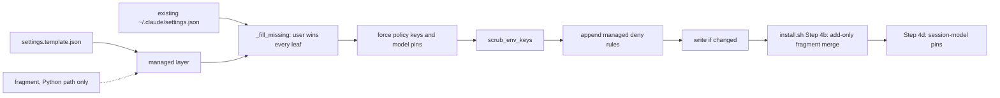

# beads-ui spike: the ai-harness task-panel switch and timer-free state cores

> Researched: 2026-10-15 | Confidence: high for every code reading, medium for runtime behaviour,
> because nothing was installed, built or run.

This packet answers the three questions of the design spike for the beads-ui design doc. It reads
ai-harness at commit `01d5ee82d4`, the base of the read-only ai-harness worktree, on 2026-10-15
between 01:10 and 01:30 UTC. ai-harness `main` moved to `f0189b93` during the run. The GitHub
compare API lists three changed files between the two, and none is cited here.

The library sources were read at their release tags through the GitHub API, and their published
builds through unpkg. The starting evidence was the landscape doc's sections 5.2 and 6.3 [^42],
leg C's sections 3 and 4 [^43] and leg B's section 5 [^44].

<!-- SUMMARY -->

## 1. Where a per-profile task-panel switch lives in ai-harness's settings rendering

### 1.1 The render path, step by step

Three writers produce `~/.claude/settings.json` on an install, in this order. install.sh Step 4
calls `_aih_apply_step settings` (install.sh:4063), which runs `ai-harness apply --only settings`.
Step 4b then merges a machine fragment, and Step 4d writes the session-model pins. [VERIFIABLE][^3]

The renderer module is `src/ai_harness/settings_merge.py`. Its entry is `merge_settings_template`
(lines 275-335). The apply step reaches it through `_settings_step` (cli.py:846-849), which calls
`_merge_settings` (cli.py:755-763) with the canonical machine name and no fragment. [VERIFIABLE][^1][^2]

The function that applies per-machine differences is `_merge_settings`. It is the only place that
branches on the machine name, and it does so through one argument, `scrub_env_keys`. The function's
own docstring calls it "install.sh's retired Step 4". [VERIFIABLE][^2]

`merge_settings_template` applies its layers in a fixed order (settings_merge.py:315-327). The
table names each operation and the lines that implement it.

| Order | Operation | settings_merge.py lines | Effect on `env` and `permissions.deny` |
|---|---|---|---|
| 1 | Read the packaged template | 306-309 | Template `env` (template lines 5-10) and `deny` (lines 20-25) |
| 2 | Deep-merge a fragment onto the template | 316-319 | Runs only when a fragment path is passed |
| 3 | `_fill_missing(existing, managed)` | 321, 163-182 | Adds keys the user's file lacks; the user's value wins every leaf, a list included |
| 4 | `_force_policy_keys` | 323, 206-222 | Forces `tui` and the two subagent env keys over the user's file |
| 5 | `_force_fragment_model_keys` | 323, 251-262 | Forces the six model pins the fragment names |
| 6 | `_scrub_env_keys` | 324, 199-203 | Deletes each named key from `env` |
| 7 | `_append_managed_deny_rules` | 325, 225-248 | Appends managed deny rules the list lacks and never removes one |
| 8 | `_write_if_changed` | 332, 338-370 | Atomic write only when the bytes differ |

So the `env` block is composed at template lines 5-10, then at settings_merge.py lines 321, 323 and
324. The `permissions.deny` list is composed at template lines 20-25, then at lines 321 and 325.
[VERIFIABLE][^1][^4]



Order 3 decides the switch's shape. The docstring says "``existing`` wins at every leaf, a list
included". An installed machine already holds `"CLAUDE_CODE_ENABLE_TODO_TOOLS": "1"`, so removing
the key from the template or a fragment leaves it in place. Only order 6 deletes it. [VERIFIABLE][^1]

Order 7 is the only route that adds a deny rule to a user list that already exists. Its docstring
says the user's file "wins the list wholesale in the merge" and ends "Append missing, never remove
one." [VERIFIABLE][^1]

### 1.2 How machines.json and the per-machine inputs feed it

There are three per-machine inputs. Only one reaches `settings.json`, and it does not reach it
through the Python renderer.

The machine registry is the `[machine.<name>]` tables in `projects-wide-session-config/ai-harness.toml`
(lines 1355-1618). Its closed vocabulary is `[machine_schema.attributes]` and
`[machine_schema.tooling]` (lines 1387-1409). `scripts/fleet_machines.py generate` exports the
tables to `~/.config/ai-fleet/machines.json` (toml comment at lines 1358-1362). [VERIFIABLE][^6]

The loader is `src/ai_harness/machine_registry.py`. It is schema-generic: a new attribute needs a
vocabulary line in the toml and no loader code. Every declared attribute is required on every
machine, and "a missing attribute fails naming the machine and the attribute" (lines 15-17,
215-219). [VERIFIABLE][^7]

The settings merge reads the registry only to canonicalize aliases (`_canonical_machine`,
cli.py:725-740). No registry attribute reaches `settings.json` today. [VERIFIABLE][^2]

The per-machine context overlays are `[modules.overlay.claude]` (toml lines 72-80). They compile into
`CLAUDE.<machine>.md` context files and do not feed `settings.json`. [VERIFIABLE][^6]

The machine settings fragments are `.claude/settings.<machine>.json`. Four exist: `acn-mac`,
`sem-kg-ec2`, `sem-kg-sagemaker` and `sem-kg-windows`. Each sets only `env` keys, plus
`totalTokensReminder` on `sem-kg-ec2`. [VERIFIABLE][^5]

A fragment reaches the Python renderer only through `[[site.machine]] settings_fragment`
(config.py:89-93, 263-264; consumed at cli.py:1497-1510). ai-harness.toml declares no
`[[site.machine]]` entry, so that path is idle in production. The `_settings_step` comment says
"the machine fragment (Step 4b) is still the shell's". [VERIFIABLE][^2][^6][^8]

install.sh Step 4b merges the fragment with its own inline Python (install.sh:4088-4271). Its
`deep_merge` "adds new keys, never removes existing ones" (line 4131). A list that already exists
is kept whole, so a fragment's `permissions.deny` entries are silently dropped on every machine,
because the template has already written a deny list. [VERIFIABLE][^3]

That rules out the fragment as the switch's carrier for either half. It cannot delete the env key,
and its deny rules never land. [INFERENCE from install.sh:4130-4140 and the template's deny list.]

### 1.3 The closest existing per-machine key

The closest precedent in mechanism is `_MOUSE_CAPTURE_MACHINES` in cli.py. It is a hardcoded set
that drops two env keys on one machine profile, through the same `scrub_env_keys` argument a task
panel switch needs. [VERIFIABLE][^2]

Declared at cli.py:743-752 and applied at 755-763:

```python
_MOUSE_CAPTURE_MACHINES = frozenset({"sem-kg-sagemaker"})
_MOUSE_SUPPRESSOR_ENV_KEYS = (
    "CLAUDE_CODE_DISABLE_MOUSE",
    "CLAUDE_CODE_DISABLE_MOUSE_CLICKS",
)


def _merge_settings(machine: str | None, fragment_path: Path | None = None) -> None:
    """install.sh's retired Step 4: the template merge into ~/.claude/settings.json."""
    merge_settings_template(
        fragment_path=fragment_path,
        scrub_env_keys=(
            _MOUSE_SUPPRESSOR_ENV_KEYS if machine in _MOUSE_CAPTURE_MACHINES else ()
        ),
        out=sys.stdout,
    )
```

The comment above it explains why scrubbing is needed: "a stale `1` from the reversed AIH-524 pin
would otherwise survive 'user wins'". That is the same trap the task-panel key sits in.
`tests/test_settings_machine_scoped_env.py` pins the scope in both directions. [VERIFIABLE][^2]

The closest precedent in declaration style is a registry attribute such as `billing_mode`. It is
declared once in the vocabulary (toml line 1395) and once per machine table (for example line 1417).
It differs by machine profile today, but no settings code reads it. [VERIFIABLE][^6]

### 1.4 Options for declaring the switch

Each option was checked against the code above. The design stage chooses; this table records the
evidence.

| Option | Where it is declared | Drops the env key | Adds the deny rules | Evidence and cost |
|---|---|---|---|---|
| A. Registry attribute `task_panel` | `[machine_schema.attributes]` plus each `[machine.<name>]` table | Yes, through `scrub_env_keys` | Yes, with a new merge argument | A config file per machine profile, as A001 asks; validated by the schema-generic loader; changes the registry digest, so `machines.json` and the committed fallback regenerate |
| B. Hardcoded set beside `_MOUSE_CAPTURE_MACHINES` | `cli.py` | Yes | Yes, with a new merge argument | Smallest diff and an exact precedent; it is code, not config, which the fleet's config-over-code rule disfavours |
| C. Machine fragment | `.claude/settings.<machine>.json` | No | No | Step 4b keeps existing lists whole and never deletes keys (install.sh:4130-4140) |

Option A fits the ask's words, "a config file setting though per machine profile for ai-harness
repo". The registry is already where per-profile facts live. [INFERENCE from A001 and section 1.2.]

### 1.5 Measured insertion points for option A

The proposal below names every file and line a change would touch. It was not built or run.

1. Vocabulary: add `task_panel = ["enabled", "retired"]` to `[machine_schema.attributes]`
   (ai-harness.toml:1392-1401).
2. Declarations: add `task_panel = "enabled"` to each of the nine machine tables (toml lines 1411,
   1432, 1456, 1477, 1504, 1528, 1549, 1573 and 1595). Retiring a profile is then a one-line edit.
   The loader refuses a table that omits it (machine_registry.py:215-219).
3. Export: run `scripts/fleet_machines.py generate` and `emit-fallback`. The digest covers every
   attribute (machine_registry.py:336-356), and the toml comment says `--check` "fails when either
   is stale".
4. Constants: beside `_MOUSE_SUPPRESSOR_ENV_KEYS` (cli.py:748-752), add a tuple holding
   `CLAUDE_CODE_ENABLE_TODO_TOOLS` and a tuple of the five bare names `TaskCreate`, `TaskGet`,
   `TaskList`, `TaskUpdate` and `TodoWrite`.
5. Resolution: `_merge_settings` (cli.py:755-763) receives only a machine name. It needs the
   resolved attribute, from `load_registry(config.data)` and `resolve` (machine_registry.py:255-320).
   Both callers already hold the config (cli.py:848 and 1510).
6. Env half: when the attribute is `retired`, extend the `scrub_env_keys` tuple with the env key.
   Scrubbing runs after the template fill (settings_merge.py:321-324), so the template's `"1"` is
   removed on every apply.
7. Deny half: `merge_settings_template` (settings_merge.py:275-282) needs a new argument carrying
   extra deny rules. They can join `managed["permissions"]["deny"]` before line 321, so the existing
   append at line 325 adds them and reports them.
8. Reversal: setting the attribute back to `enabled` re-adds the env key on its own, because
   `_fill_missing` restores a missing template key. The deny rules do not leave, because line 325
   never removes a rule. Removal needs new code, and it must remove only rules the switch added.
9. Removal precedent: `session_model.apply` keeps a `last-written.json` record and does a three-way
   comparison before it changes a value (session_model.py:580-604). The same record would tell a
   switch-added deny rule from one the user wrote.
10. Tests: `tests/test_settings_machine_scoped_env.py` is the pattern, and it sets `AI_HOST`
    explicitly in every case. `tests/test_settings_permissions_deny.py` covers the deny append, and
    `tests/test_settings_template_parity.py` keeps the two template copies identical.

The template itself does not change under this proposal. The fleet default stays `enabled`, and
both template copies stay byte-identical (blob `7b825e1a10` for each). [VERIFIABLE][^4]

Both halves are needed, for reasons the Claude Code docs give. The Task tools "are available by
default only on Opus 4.7, Sonnet 4.6, Haiku 4.5, and earlier models", so the env key matters only on
newer models. A session on one of those older models still gets the tools without it. [VERIFIABLE][^11]

The env key's own row says "Set to `1` to get the task-tracking tools on every model". Its sibling
`CLAUDE_CODE_ENABLE_TASKS` only chooses between the four Task tools and `TodoWrite`, so it cannot
retire the panel. [VERIFIABLE][^12]

The opt-in has routes other than the env key. The tools reference lists `--allowedTools`, `--tools`
and the Agent SDK options, as in "Name one of the tools in `--allowedTools`". [VERIFIABLE][^11]

No tracked ai-harness file passes a Task tool to `--allowedTools` or `--tools`. The repo-wide search
for either flag followed by a Task name returned nothing. As a positive control, `allowedTools` alone
matched three files in `scripts/`, `src/`, `.claude/bin/` and `skills/`. The `ai c` launcher lives
in ai-cli-utils and was not read. [VERIFIABLE][^15]

A bare deny rule closes every route. "A bare tool name like `Bash` removes the tool from Claude's
context entirely", "Rules are evaluated in order: deny, then ask, then allow", and "a user-level deny
blocks a project-level allow". [VERIFIABLE][^13]

The fleet's own research records feature-flag gates on the Task tools, separate from the model test.
The template sets `DISABLE_GROWTHBOOK` to an empty string, so those flags are live. The deny rules
make the switch independent of them. [VERIFIABLE][^4][^14]

### 1.6 How the switch surfaces in plan, apply and doctor

The machine-install contract defines three verbs. `plan` never mutates and exits 0 when a plan was
produced. `apply` is "the only verb that does". `doctor` never mutates and exits "0 healthy, 1
unhealthy". [VERIFIABLE][^9]

`plan` today prints the generation and link mutations (cli.py:637-655) and the Docker defaults and
roots (cli.py:1457-1482). It prints no settings line. A retired profile would need a new line naming
the env key it drops and the deny rules it adds. [VERIFIABLE][^2]

`apply` already prints each deny rule it appends, as `[+ ]  permissions.deny: added ...`
(settings_merge.py:326-330). `_scrub_env_keys` prints nothing (lines 199-203), so a scrub needs its
own report line. [VERIFIABLE][^1]

A second `apply` on a converged machine writes nothing, because `_write_if_changed` compares bytes
first (settings_merge.py:338-347). The report then reads `(unchanged)` (line 334). The contract's
`<scope> apply: <count> mutations` line exists in ai-harness only for storage. [VERIFIABLE][^1][^9]

`doctor` today aggregates generation, capability, hook, storage, boot-order and Buzz allow-list
checks (cli.py:1422-1450). It has no settings check. `_buzz_allow_list_doctor` (cli.py:682-695)
returns `(lines, healthy)` and is the pattern a task-panel check would follow. [VERIFIABLE][^2]

A task-panel doctor check would fail a `retired` profile whose settings still hold the env key or
lack any of the five deny rules. It would also fail an `enabled` profile that holds the switch's deny
rules. [INFERENCE from section 1.5.]

The change takes effect only after a restart. The bootstrap procedure's table lists
"`CLAUDE_CODE_ENABLE_TODO_TOOLS` → the CC task panel | restart". [VERIFIABLE][^10]

The contract's sync prompt fires only for its three trigger files in ai-harness. Option A edits none
of them, so it needs no cross-machine sync prompt. ai-core does read `machines.json`, and whether it
tolerates a new attribute was not checked. [VERIFIABLE][^9]

### Hand-offs

- The choice between options A, B and C, and the attribute's name and values: the coordinator's
  design stage, implemented in ai-harness.
- The removal path for switch-added deny rules: the design stage.
- Whether a deny rule removes the Task tools in background and cloud sessions: the sibling spike.
- Whether ai-core's `machines.json` reader accepts an unknown attribute: an ai-core check before the
  registry change lands.
- The backup of `~/.claude/tasks/` and its destination: leg C's hand-off to the coordinator.

## 2. Every ai-harness surface that reads or writes the task panel

### 2.1 Method

The search used `git grep -E` over tracked files at `01d5ee82d4`, so the haystack is the git index.
The symbols searched were `TaskCreate`, `TaskUpdate`, `TaskList`, `TaskGet`, `TodoWrite`,
`\.claude/tasks`, `CLAUDE_CODE_TASK_LIST_ID`, `CLAUDE_CODE_ENABLE_TODO_TOOLS` and
`CLAUDE_CODE_ENABLE_TASKS`. [VERIFIABLE][^15]

The directories were `skills/`, `scripts/`, `src/`, `.claude/hooks/`, `projects-wide-session-config/`
and `docs/procedures/`. I added `.claude/bin/`, `.githooks/`, `hooks/` and `install.sh`, which also
run on every machine. [VERIFIABLE][^15]

The search matched 92 files. `hooks/` and `install.sh` matched none. The template's own line 7 is
in the result, which is the positive control that the pattern fires. [VERIFIABLE][^15]

A path join such as `Path.home() / ".claude" / "tasks"` does not contain the string `.claude/tasks`.
A second search for `"tasks"`, `/tasks`, `tasks_root` and `.highwatermark` found five more panel
readers, listed in section 2.4. [VERIFIABLE][^15]

Each file gets one class, defined here once:

- Break: the file's purpose needs a Task tool call or the panel directory, so on a retired machine
  it cannot do its job, or a rule it states cannot be followed.
- Degrade: one step in a wider flow calls a Task tool or reads the panel directory. The flow still
  runs, but that step yields nothing or a wrong zero.
- Unaffected: the symbol appears, but the behaviour does not depend on the tools or the directory.

The count is 28 break, 23 degrade, 40 unaffected, and one file that is the switch's own target.
[VERIFIABLE][^15]

### 2.2 Break (28 files)

| Path | Lines | What it does with the panel |
|---|---|---|
| `skills/load-task-panel/SKILL.md` | 22-409 (21 hits) | Repaints the panel with `TaskList` and paired `TaskUpdate` calls; reads `~/.claude/tasks` at 146 and 254 |
| `skills/curate-task-panel/SKILL.md` | 10-193 (11 hits) | Reconciles, reorders and trims one panel; the driver makes every Task call |
| `skills/curate-task-panel/scripts/curate.py` | 12-675 (8 hits) | Plans curation from the driver's `TaskList` and `TaskGet` observations |
| `skills/curate-task-panel/scripts/trim_panel.py` | 16-753 (9 hits) | Returns `TaskUpdate status: deleted` calls that bring a panel under a cap |
| `scripts/cc_task_curation.py` | 4-1001 (10 hits) | Snapshot, reorder and recheck engine behind the curate skill |
| `skills/clean-task-panel/SKILL.md` | 14-15 | `TaskList`, then `TaskUpdate status: deleted` for each completed row |
| `docs/procedures/cc-task-panel-audit.md` | 22-41 | A procedure whose output is a list of Task calls to apply |
| `skills/shadow-codex-launch/SKILL.md` | 11-50 | Creates a child row with `TaskCreate`, then stops: "If `TaskCreate fails`, stop" |
| `scripts/shadow_codex_launch.py` | 4 | "The live turn owns `TaskCreate`, `TaskUpdate`, and its claimed Bash call" |
| `scripts/agent_session_registry.py` | 2066 | The live-turn binding requires a `TaskCreate` row before any watcher lease |
| `src/ai_harness/shadow_watcher.py` | 3, 238-290 | Writes the row file directly and raises when the namespace is missing |
| `src/ai_harness/shadow_watcher_pickup.py` | 369-370 | Tells the session to `TaskCreate` a dedicated child before the claim |
| `projects-wide-session-config/modules/claude-delta.md` | 17, 19 | The mirror rule and the one-row-per-agent rule, compiled into every machine |
| Nine compiled `projects-wide-session-config/CLAUDE.<machine>.md` | 185, 187 each | The same two rules as delivered context |
| `skills/delegate/SKILL.md` | 444 | Every launch: `TaskCreate` then `TaskUpdate` with the launch name |
| `skills/handoff/SKILL.md` | 65 | `TaskUpdate` the row to `in_progress` with the agent as owner |
| `docs/procedures/agent-delegation.md` | 1754-1757, 1812 | The two-call rule for an owned agent row |
| `docs/procedures/agent-lifecycle-and-worktree-naming.md` | 92, 239-244, 496, 538 | Same rule, as lifecycle step and checklist item |
| `docs/procedures/background-agent-lifecycle.md` | 351-352 | Same rule for background agents |
| `docs/procedures/landing-the-plane.md` | 214 | "every `TaskCreate` requires an existing owning `bd` issue" |

The shadow Codex path is the only one that breaks in code rather than in instruction text. The
resolver raises `TaskPreconditionError` on a missing namespace, and the module's docstring says
"Claude Code exposes no documented external TaskUpdate interface". [VERIFIABLE][^17]

### 2.3 Degrade (23 files)

| Path | Lines | What it does with the panel |
|---|---|---|
| `skills/next/SKILL.md` and `skills/next/SKILL.share.md` | 62-251 (7 hits each) | "Call `TaskList` on every `/next` run" (203) and match rows to Beads |
| `skills/save-state/SKILL.md` | 55, 325, 352-358 | Panel reconciliation before the docket refresh; lists the force-gate Task tools |
| `skills/progress-review/SKILL.md` | 25, 66, 96 | `TaskList` and `TaskGet` for every in-progress row |
| `skills/beads-task/SKILL.md` | 82, 173 | Creates the mirror row after the Beads issue |
| `skills/auto-start/SKILL.md` | 30 | "Open CC tasks: `TaskList`" as a startup step |
| `skills/track/SKILL.md` | 21 | `TaskList` as the first discovery step |
| `skills/status-update/SKILL.md` | 19 | Checks `TaskList` for in-progress items |
| `skills/start-goal/SKILL.md` | 99 | Reads each session's `TaskList` before arming |
| `skills/fleet-brief/SKILL.md` | 47 | Counts `in_progress` rows in the pinned namespace directory |
| `docs/procedures/development-workflow.md` | 27 | A `TaskList` reconciliation after every ship event |
| `docs/procedures/goal-exit-robustness.md` | 235 | `TaskList` per session before arming a goal |
| `docs/procedures/chief-of-staff-vp-coordination.md` | 426 | Reads the same namespace count |
| `src/ai_harness/defaults/goal-waker-nudge.md` and `goal-waker-nudge.sem-kg.md` | 2 | The injected nudge says to re-read "CC tasks (... TaskList)" |
| `src/ai_harness/defaults/injection-repair-limit-escalation.md` | 11 | Asks for a mirror row "so it shows on the task panel, which is the surface Sergei" watches |
| `src/ai_harness/defaults/injection-self-heal-bug-fix.md` | 12 | Same request for a repair round |
| `.claude/hooks/install-harness-remediation-pickup.sh` | 3, 33 | Tells the session to create one `TaskCreate` mirror for a remediation |
| `.claude/hooks/worktree-creation-guard.sh` | 62 | A deny message asking for "a CC task (TaskCreate)" beside the Beads issue |
| `.githooks/post-checkout` | 101-102 | Same request for a degraded backstop |
| `scripts/flat_worktree_backstop_notice.py` | 93-96 | Same request, rendered by the notice |
| `scripts/bd_ready_mirror.py` | 9-332 | Plans `TaskCreate` and `TaskUpdate` calls from a supplied `TaskList` snapshot |
| `scripts/chief_of_staff_cli.py` | 1414-1455 | Counts `in_progress` task files in the session's pinned namespace |

The chief-of-staff count degrades silently. Its docstring says "under a pin an absent or empty
directory is a true zero". On a retired machine every pinned session would report zero in-progress
work, and the reader cannot tell that from idleness. [VERIFIABLE][^16]

The two injection templates make the panel the place Sergei sees an escalation. On a retired
machine that surface moves to beads-ui, so the templates need new wording rather than a guard.
[VERIFIABLE][^15]

### 2.4 Found by the second search (5 files)

| Path | Lines | What it does | Class |
|---|---|---|---|
| `src/ai_harness/shadow_watcher_runner.py` | 149 | Builds `TaskRowResolver(Path.home() / ".claude" / "tasks")` | Break, with the shadow watcher |
| `.claude/bin/cx-retry-idle-reap` | 102-111 | Reads `tasks/<session>/*.json` as one source of an exit cause | Degrade: the glob is empty and the helper falls through |
| `scripts/probe_task_panel_order.py` | 1-114 | Checks panel order and `.highwatermark` from driver observations | Degrade: no observations to check |
| `scripts/agent_session_registry.py` | 1199 | Stores `native_task_root`, which nothing else reads | Unaffected |
| `scripts/ec2-migration/cutover_push_session_state.sh` | 205 | Copies a session's task directory during a host migration | Unaffected: a one-off script |

### 2.5 Unaffected (40 files)

| Group | Paths and lines | Why it is unaffected |
|---|---|---|
| Session identity through `CLAUDE_CODE_TASK_LIST_ID` | `.claude/bin/bedrock_auth.py:769, 817-818`; `.claude/bin/resume-lib.sh:21, 79, 108`; `.claude/hooks/context-supervisor-{idle-prompt,postcompact,session-end,user-prompt}.sh`; `held-replay-session-start.sh:10, 45`; `launch-resume-{prompt-submit,session-end,session-start}.sh`; `precompact-safety.sh:24, 36`; `resume-inject.sh:52, 340`; `scripts/agent_worktree_preflight.py:153, 1033`; `scripts/claude_sessions.py:216`; `scripts/provenance_identity.py:193`; `scripts/wq_hooks.py:201`; `src/ai_harness/{context_supervisor.py:9303, 9408; goal_waker.py:1287; job_supervisor.py:1263; prompt_injection/targets.py:211, 315; reboot_resume.py:47, 70, 292; session_rekey.py:32; shadow_watcher_canary.py:52-53; submit_fifo.py:12, 32}`; `skills/{exit-goal,explain,format-decision,summary}/SKILL.md` | The variable names the session for resume keys, held-doc identity, FIFOs and injection targets; none reads the directory |
| Docs naming the pinned namespace | `docs/procedures/bms-sagemaker-local-toolchain.md:42`; `kg2-throwaway-session-cutover-brief.md:138-139`; `sem-kg-ec2-reboot-resume.md:69` | Describe the pin as a session key |
| Tool-name lists | `src/ai_harness/context_supervisor.py:249-252`; `scripts/summary_nudge.py:21-24`; `projects-wide-session-config/hooks-manifest.json:978, 997`; `hooks-manifest.share.json:291` | An allow-list or matcher that names an absent tool never fires |
| Anti-TaskCreate text from upstream Beads | `.claude/hooks/bd-prime.sh:19`; `scripts/bd_prime_filter.py:15, 42`; `scripts/bd_repo_setup.py:285`; `docs/procedures/beads-context-ownership.md:46, 604, 619` | They strip Beads' "Do NOT use TodoWrite, TaskCreate" advice; on a retired machine that advice becomes true |
| One-off and notes | `scripts/ec2-migration/kg2-ec2-step22-pull-waves-1-and-2a.sh:31-64`; `docs/procedures/new-machine-bootstrap.md:266` | A migration script, and a doc row to update |

`context_supervisor.py` appears in two groups and is counted once. `agent-delegation.md:1780-1781`
holds hook design notes that are unaffected, but the file is classed break for its other lines.

28 of the 40 files use `CLAUDE_CODE_TASK_LIST_ID` as the fleet's session identity key, and three docs
describe it that way. Three skills classed degrade use it the same way for held-doc identity.
[VERIFIABLE][^15]

Claude Code documents the variable only as the task-list directory: "To share a task list across
sessions, set `CLAUDE_CODE_TASK_LIST_ID` to use a named directory in `~/.claude/tasks/`". The fleet
reads it as `${CLAUDE_CODE_TASK_LIST_ID}@${AI_HOST}` in the held-doc skills. [VERIFIABLE][^15][^45]

So a retired machine must keep the launcher pinning the variable, even though no task is ever
written under it. Dropping the pin with the panel would break resume, held-doc identity and the
submit FIFO. [INFERENCE from the identity group above.]

The context supervisor has a fallback that reads the variable directly, and its comment calls it
"LIBRARY-ABSENT FALLBACK ONLY" (context_supervisor.py:9403-9411). It still depends on the variable,
not on the directory. [VERIFIABLE][^19]

### 2.6 Near misses that are not the panel

Several files read `/tmp/claude-<uid>/<slug>/<session>/tasks/<id>.output`. That directory holds
background task output, not panel rows. They are `.claude/bin/agent-transcript:9`,
`scripts/agent_transcript_locate.py:17-305`, `scripts/background_wait_guard.py:24-629` and
`scripts/machine_contention.py:374-388`. All are unaffected. [VERIFIABLE][^15]

The work queue's `wq next` panel reconciliation exists in the design, not in ai-harness code. The
design says "An inaccessible or missing task-list namespace is logged and skipped". In code,
`scripts/wq_hooks.py:201` only records the variable in the session registry. [VERIFIABLE][^15][^18]

The force gate allows the four Task tools at full context because "The CC panel is a display mirror
of Beads" (context_supervisor.py:247). Removing the tools leaves that gate with fewer allowed tools
and no failure. [VERIFIABLE][^19]

### 2.7 What the inventory adds to the retirement preconditions

The instruction text is the largest single dependency. The rules in `claude-delta.md:17-19` compile
into all nine machines' context files. The compile step has per-machine overlay modules
(ai-harness.toml:72-80) but no per-machine variant of the shared delta. [VERIFIABLE][^6][^21]

Hook wiring already has a per-machine scope. Each `hooks-manifest.json` entry carries a `machines`
field, set to `"all"` for the two entries whose matchers name Task tools (the matchers at lines 978
and 997, the fields at lines 980 and 999). [VERIFIABLE][^20]

### Hand-offs

- The replacement for the one-row-per-agent rule and the mirror rule on retired machines: the
  coordinator's design stage. beads-ui's session view is the candidate surface.
- How the compiled context drops panel rules on a retired machine: the design stage, implemented in
  ai-harness's compile step.
- The shadow Codex launch path on a retired machine: an ai-harness design question; it is the only
  code path that cannot run.
- The chief-of-staff and fleet-brief counts: a guard that reports "panel retired" instead of zero.

<!-- Q3 -->

<!-- GAPS -->

## Sources

[^1]: Wallace, S. (2026). [src/ai_harness/settings_merge.py](https://github.com/sergeiwallace/ai-harness/blob/main/src/ai_harness/settings_merge.py), lines 1-370. sergeiwallace/ai-harness (private), GitHub. Read at commit 01d5ee82d4, unchanged at main f0189b93. Verified accessible (HTTP 200, GitHub API with the owner's credential) 2026-10-15. (The four-layer settings merge.)
[^2]: Wallace, S. (2026). [src/ai_harness/cli.py](https://github.com/sergeiwallace/ai-harness/blob/main/src/ai_harness/cli.py), lines 637-695, 725-863, 1255-1300, 1415-1530. sergeiwallace/ai-harness (private), GitHub. Read at commit 01d5ee82d4. Verified accessible (HTTP 200, GitHub API tree listing) 2026-10-15. (The settings step, the mouse precedent, plan and doctor.)
[^3]: Wallace, S. (2026). [install.sh](https://github.com/sergeiwallace/ai-harness/blob/main/install.sh), lines 4053-4271. sergeiwallace/ai-harness (private), GitHub. Read at commit 01d5ee82d4. Verified accessible (HTTP 200, GitHub API tree listing) 2026-10-15. (Step 4 hand-off and the Step 4b machine fragment merge.)
[^4]: Wallace, S. (2026). [src/ai_harness/defaults/settings.template.json](https://github.com/sergeiwallace/ai-harness/blob/main/src/ai_harness/defaults/settings.template.json), lines 1-42. sergeiwallace/ai-harness (private), GitHub. Read at commit 01d5ee82d4. Verified accessible (HTTP 200, GitHub API tree listing) 2026-10-15. (Byte-identical to `.claude/settings.template.json`, blob `7b825e1a10`.)
[^5]: Wallace, S. (2026). [.claude/settings.acn-mac.json and the three other machine fragments](https://github.com/sergeiwallace/ai-harness/blob/main/.claude/settings.acn-mac.json). sergeiwallace/ai-harness (private), GitHub. Read at commit 01d5ee82d4. Verified accessible (HTTP 200, GitHub API tree listing) 2026-10-15. (Fragments exist for acn-mac, sem-kg-ec2, sem-kg-sagemaker and sem-kg-windows.)
[^6]: Wallace, S. (2026). [projects-wide-session-config/ai-harness.toml](https://github.com/sergeiwallace/ai-harness/blob/main/projects-wide-session-config/ai-harness.toml), lines 1-135 and 1355-1618. sergeiwallace/ai-harness (private), GitHub. Read at commit 01d5ee82d4. Verified accessible (HTTP 200, GitHub API tree listing) 2026-10-15. (Overlays, the machine registry and its schema.)
[^7]: Wallace, S. (2026). [src/ai_harness/machine_registry.py](https://github.com/sergeiwallace/ai-harness/blob/main/src/ai_harness/machine_registry.py), lines 1-389. sergeiwallace/ai-harness (private), GitHub. Read at commit 01d5ee82d4. Verified accessible (HTTP 200, GitHub API tree listing) 2026-10-15. (Schema-generic loader, required attributes, digest and export.)
[^8]: Wallace, S. (2026). [src/ai_harness/config.py](https://github.com/sergeiwallace/ai-harness/blob/main/src/ai_harness/config.py), lines 64-96 and 198-264. sergeiwallace/ai-harness (private), GitHub. Read at commit 01d5ee82d4. Verified accessible (HTTP 200, GitHub API tree listing) 2026-10-15. (`[[site.machine]]` and its `settings_fragment` key.)
[^9]: Wallace, S. (2026). [docs/procedures/machine-install-contract.md](https://github.com/sergeiwallace/ai-harness/blob/main/docs/procedures/machine-install-contract.md), lines 1-334. sergeiwallace/ai-harness (private), GitHub. Read in full at commit 01d5ee82d4. Verified accessible (HTTP 200, GitHub API tree listing) 2026-10-15. (Verbs, idempotency oracle, shared data, sync-prompt triggers.)
[^10]: Wallace, S. (2026). [docs/procedures/new-machine-bootstrap.md](https://github.com/sergeiwallace/ai-harness/blob/main/docs/procedures/new-machine-bootstrap.md), lines 260-270. sergeiwallace/ai-harness (private), GitHub. Read at commit 01d5ee82d4. Verified accessible (HTTP 200, GitHub API tree listing) 2026-10-15. (What needs a restart after an install.)
[^11]: Anthropic. (2026). [Tools reference](https://code.claude.com/docs/en/tools-reference.md). Claude Code Docs. Verified accessible (HTTP 200) 2026-10-15. (Section "Task tool availability" and the tool table rows.)
[^12]: Anthropic. (2026). [Environment variables](https://code.claude.com/docs/en/env-vars.md). Claude Code Docs. Verified accessible (HTTP 200) 2026-10-15. (Rows for `CLAUDE_CODE_ENABLE_TODO_TOOLS` and `CLAUDE_CODE_ENABLE_TASKS`; read to character 100,000 of 171,035.)
[^13]: Anthropic. (2026). [Configure permissions](https://code.claude.com/docs/en/permissions.md). Claude Code Docs. Verified accessible (HTTP 200) 2026-10-15. (Bare-name deny rules, evaluation order, scopes.)
[^14]: Codex research leaf for Wallace, S. (2026). [Threading the needle: Task tools, native cross-session messaging, and Remote Control under one GrowthBook gate](https://github.com/sergeiwallace/ai-harness/blob/main/docs/research/cross-session-messaging-vs-task-tools-vs-remote-control-growthbook-tension.md), lines 98-380. sergeiwallace/ai-harness (private), GitHub. Read at commit 01d5ee82d4. Verified accessible (HTTP 200, GitHub API tree listing) 2026-10-15. (Feature-flag gates on the Task tools.)
[^15]: Wallace, S. (2026). [sergeiwallace/ai-harness repository tree](https://github.com/sergeiwallace/ai-harness/tree/main). GitHub (private). Searched with `git grep` over tracked files at commit 01d5ee82d4. Verified accessible (HTTP 200, GitHub API recursive tree, 6,716 blobs, not truncated) 2026-10-15. (The Task-symbol inventory in section 2.)
[^16]: Wallace, S. (2026). [scripts/chief_of_staff_cli.py](https://github.com/sergeiwallace/ai-harness/blob/main/scripts/chief_of_staff_cli.py), lines 1414-1455. sergeiwallace/ai-harness (private), GitHub. Read at commit 01d5ee82d4. Verified accessible (HTTP 200, GitHub API tree listing) 2026-10-15. (The per-session in-progress count.)
[^17]: Wallace, S. (2026). [src/ai_harness/shadow_watcher.py](https://github.com/sergeiwallace/ai-harness/blob/main/src/ai_harness/shadow_watcher.py), lines 1-34 and 238-290. sergeiwallace/ai-harness (private), GitHub. Read at commit 01d5ee82d4. Verified accessible (HTTP 200, GitHub API tree listing) 2026-10-15. (Direct task-row writer for shadow Codex watchers.)
[^18]: Wallace, S. (2026). [docs/designs/autonomous-work-queue-coordinator-and-pwa-dashboard.md](https://github.com/sergeiwallace/ai-harness/blob/main/docs/designs/autonomous-work-queue-coordinator-and-pwa-dashboard.md), lines 628-642. sergeiwallace/ai-harness (private), GitHub. Read at commit 01d5ee82d4. Verified accessible (HTTP 200, GitHub API tree listing) 2026-10-15. (The `wq next` panel reconciliation as designed.)
[^19]: Wallace, S. (2026). [src/ai_harness/context_supervisor.py](https://github.com/sergeiwallace/ai-harness/blob/main/src/ai_harness/context_supervisor.py), lines 236-261 and 9400-9411. sergeiwallace/ai-harness (private), GitHub. Read at commit 01d5ee82d4. Verified accessible (HTTP 200, GitHub API tree listing) 2026-10-15. (Force-gate tool allow-list and the session-key fallback.)
[^20]: Wallace, S. (2026). [projects-wide-session-config/hooks-manifest.json](https://github.com/sergeiwallace/ai-harness/blob/main/projects-wide-session-config/hooks-manifest.json), lines 970-1005. sergeiwallace/ai-harness (private), GitHub. Read at commit 01d5ee82d4. Verified accessible (HTTP 200, GitHub API tree listing) 2026-10-15. (Hook matchers naming Task tools, and the per-hook `machines` field.)
[^21]: Wallace, S. (2026). [projects-wide-session-config/modules/claude-delta.md](https://github.com/sergeiwallace/ai-harness/blob/main/projects-wide-session-config/modules/claude-delta.md), lines 17-19. sergeiwallace/ai-harness (private), GitHub. Read at commit 01d5ee82d4. Verified accessible (HTTP 200, GitHub API tree listing) 2026-10-15. (The panel-mirror and one-row-per-agent rules every machine compiles.)
[^22]: Anthropic. (2026). [Use the mods API](https://code.claude.com/docs/en/plugins/mods/api.md). Claude Code Docs. Verified accessible (HTTP 200) 2026-10-15. (The `$` argument, `$.clock`, and the hooks module's environment.)
[^23]: Anthropic. (2026). [mods/types/claude-code.d.ts](https://github.com/anthropics/claude-code/blob/main/mods/types/claude-code.d.ts), lines 1-40, 1275-1290, 2897-2940, 9960-9974 and 11570-11705. anthropics/claude-code, GitHub. Read in full through the GitHub API (517,451 bytes; header "Written by Claude Code 2.1.277"; last commit to the path `bf2323b302`, 2026-10-13). Verified accessible (HTTP 200) 2026-10-15. (The hooks and surface module globals, `$.clock` and `surface.every`.)
[^24]: npm. (2026). [@tanstack/query-core, latest](https://registry.npmjs.org/@tanstack/query-core/latest). npm registry. Verified accessible (HTTP 200) 2026-10-15. (Version 5.104.2, no runtime dependencies.)
[^25]: TanStack. (2026). [query/packages/query-core/src at @tanstack/query-core@5.104.2](https://github.com/TanStack/query/tree/%40tanstack/query-core%405.104.2/packages/query-core/src). GitHub. All 23 source files read through the GitHub API at commit `b699b52d60` (2026-10-11). Verified accessible (HTTP 200) 2026-10-15. (The `grep` results in section 3.3.)
[^26]: TanStack. (2026). [timeoutManager reference](https://tanstack.com/query/latest/docs/reference/timeoutManager). TanStack Query Docs. Verified accessible (HTTP 200) 2026-10-15.
[^27]: TanStack. (2026). [environmentManager reference](https://tanstack.com/query/latest/docs/reference/environmentManager). TanStack Query Docs. Verified accessible (HTTP 200) 2026-10-15.
[^28]: TanStack. (2026). [notifyManager reference](https://tanstack.com/query/latest/docs/reference/notifyManager). TanStack Query Docs. Verified accessible (HTTP 200) 2026-10-15.
[^29]: TanStack. (2026). [build/modern/timeoutManager.js in @tanstack/query-core@5.104.2](https://unpkg.com/@tanstack/query-core@5.104.2/build/modern/timeoutManager.js). unpkg. Verified accessible (HTTP 200) 2026-10-15. (Published build; read through WebFetch, whose model quoted the lines.)
[^30]: TanStack. (2026). [build/modern/query.js in @tanstack/query-core@5.104.2](https://unpkg.com/@tanstack/query-core@5.104.2/build/modern/query.js). unpkg. Verified accessible (HTTP 200) 2026-10-15. (Published build; read through WebFetch, whose model quoted the lines.)
[^31]: Bundlephobia. (2026). [@tanstack/query-core@5.104.2 size](https://bundlephobia.com/api/size?package=@tanstack/query-core@5.104.2). Bundlephobia API. Verified accessible (HTTP 200) 2026-10-15. (40,039 bytes minified, 11,427 gzipped.)
[^32]: npm. (2026). [zustand, latest](https://registry.npmjs.org/zustand/latest). npm registry. Verified accessible (HTTP 200) 2026-10-15. (Version 5.0.15; every peer dependency optional.)
[^33]: pmndrs. (2026). [esm/vanilla.mjs in zustand@5.0.15](https://unpkg.com/zustand@5.0.15/esm/vanilla.mjs). unpkg. Verified accessible (HTTP 200) 2026-10-15. (The whole 25-line published file, reproduced by the fetch.)
[^34]: pmndrs. (2026). [src/vanilla.ts at v5.0.15](https://github.com/pmndrs/zustand/blob/v5.0.15/src/vanilla.ts). GitHub. Read through the GitHub API at commit `2115efb9e2` (2026-08-13), 100 lines. Verified accessible (HTTP 200) 2026-10-15.
[^35]: pmndrs. (2026). [createStore](https://zustand.docs.pmnd.rs/reference/apis/create-store). Zustand documentation. Verified accessible (HTTP 200) 2026-10-15. (The older `/apis/create-store` path returned 404.)
[^36]: pmndrs. (2026). [esm/middleware.mjs in zustand@5.0.15](https://unpkg.com/zustand@5.0.15/esm/middleware.mjs). unpkg. Verified accessible (HTTP 200) 2026-10-15. (Line numbers approximate, from the fetch model.)
[^37]: npm. (2026). [xstate, latest](https://registry.npmjs.org/xstate/latest). npm registry. Verified accessible (HTTP 200) 2026-10-15. (Version 5.33.2, no dependencies.)
[^38]: Stately. (2026). [xstate/packages/core/src at xstate@5.33.2](https://github.com/statelyai/xstate/tree/xstate%405.33.2/packages/core/src). GitHub. Release tarball read through the GitHub API at commit `fbee62e7c1` (2026-09-15). Verified accessible (HTTP 200) 2026-10-15. (The `grep` results in section 3.4.)
[^39]: Stately. (2026). [dist/xstate.esm.js in xstate@5.33.2](https://unpkg.com/xstate@5.33.2/dist/xstate.esm.js). unpkg. Verified accessible (HTTP 200) 2026-10-15. (Published entry and its chunk imports, quoted by the fetch model.)
[^40]: Stately. (2026). [dist/raise-97446fd4.esm.js in xstate@5.33.2](https://unpkg.com/xstate@5.33.2/dist/raise-97446fd4.esm.js). unpkg. Verified accessible (HTTP 200) 2026-10-15. (The chunk holding `createActor`, quoted by the fetch model.)
[^41]: Bundlephobia. (2026). [xstate@5.33.2 size](https://bundlephobia.com/api/size?package=xstate@5.33.2). Bundlephobia API. Verified accessible (HTTP 200) 2026-10-15. (46,874 bytes minified, 14,559 gzipped.)
[^42]: Wallace, S. (2026). [beads-ui: task-manager surfaces, the Claude Code mods ecosystem and one shared core](https://github.com/sergeiwallace/beads-ui/blob/main/docs/research/beads-ui-task-manager-landscape.md). sergeiwallace/beads-ui, GitHub. Read at main `f68067e`. Verified accessible (HTTP 200, GitHub API) 2026-10-15. (Sections 5.2 and 6.3.)
[^43]: Wallace, S. (2026). [beads-ui research leg C: Beads, the work queue and the task panel](https://github.com/sergeiwallace/beads-ui/blob/main/docs/research/findings/beads-ui-beads-queue-and-panel.md). sergeiwallace/beads-ui, GitHub. Read at main `f68067e`. Verified accessible (HTTP 200, GitHub API) 2026-10-15. (Sections 3 and 4.)
[^44]: Wallace, S. (2026). [beads-ui research leg B: Claude Code mods, MCP Apps and the shared core](https://github.com/sergeiwallace/beads-ui/blob/main/docs/research/findings/beads-ui-mods-and-shared-core.md). sergeiwallace/beads-ui, GitHub. Read at main `f68067e`. Verified accessible (HTTP 200, GitHub API) 2026-10-15. (Sections 1.2 and 5.)
[^45]: Anthropic. (2026). [Interactive mode](https://code.claude.com/docs/en/interactive-mode.md). Claude Code Docs. Verified accessible (HTTP 200) 2026-10-15. (Section "Task list": `Ctrl+T`, five visible tasks, `CLAUDE_CODE_TASK_LIST_ID`.)

<!-- LEDGER -->
