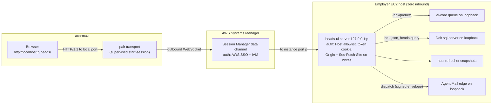
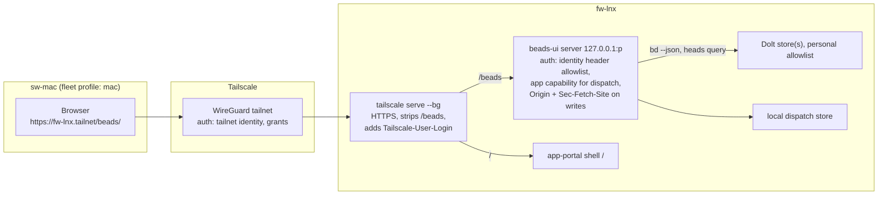

# The web app's backend, its app-portal fit, and access for each machine pair

This packet answers one question for the coordinator. What should the beads-ui web app's server be
built on, how does it join app-portal as a member app, and how does each machine pair reach it
quickly and securely, with a cloud option later?

Repo state was measured on 2026-10-28 between 01:16Z and 01:30Z. beads-ui was read at `0d07e7b`
(its `origin/main`). ai-harness was read at `23ece1e92b6`; its `origin/main` had moved to
`f71b675d986`, and none of the ai-harness files cited here changed between the two. ai-core was
read at `f40fa2bd` and app-portal at `b73683e`; their `origin/main` differences do not touch the
files cited. Host probes are in the tracked evidence file
[`evidence/beads-ui-web-app-backend-access-probes-2026-10-28.md`](evidence/beads-ui-web-app-backend-access-probes-2026-10-28.md).

The sibling legs on UX and on event dispatch are not repeated here. Their findings are used where
they meet this topic and cited as sources.

## Summary

1. D-4 holds for the web server. Reads should come from the host refresher's snapshots plus
   `bd ... --json` for detail, and writes stay guarded `bd` calls. `bd serve` 1.3.2 now has bearer
   tokens with live rotation and a DNS-rebinding Host check, but it is still one process per store,
   fires no hooks and has no TLS. Nothing measured here reopens D-4. [VERIFIABLE][^21][^33]
2. A change feed across every store costs one query. The shared Dolt server answers
   `SELECT @@AIH_head, @@BU_head, ...` for all stores in one call (0.42 s as a `bd sql` process,
   matching `bd vc status` per store). That is the cheapest live-update trigger. The events journal
   is off on every store checked and does not cover synced rows. [VERIFIABLE][^8][^33]
3. The ai-core queue API is the only fleet-wide read model and the only home of sessions, leases and
   durable prompts. It served the full task projection in 0.27 to 1.04 s. Under D-11 the web app should read sessions, prompts, review items and events from
   it on the work pair, and keep `bd` as the source for task fields. [VERIFIABLE][^28][^33]
4. A data-scope issue in the ai-core queue on the work host is tracked privately and constrains the backend design: the web app's backend must filter every store and queue read through a
   per-host repository allowlist. [INFERENCE]
5. app-portal's member contract assumes a FastAPI process serving a static SPA under a
   `tailscale serve` path, with no Node at runtime (its D-5). beads-ui's Node server (D-10) can
   still join through `apps.yaml`, which accepts any loopback upstream, but must re-implement
   `attach_portal()`'s duties in Node. The work pair has no portal origin at all, because the
   employer host runs no Tailscale. [VERIFIABLE][^25][^26][^33]
6. The ai-core queue dashboard member app (Board, Decisions, Epics, Inbox, Review, Sessions,
   TaskDetail and the Lexical composer) is already built in ai-core `web/`, but it is not mounted on
   the employer host (`/` answers 404). D-11 makes the beads-ui web app its replacement, so that
   code is the port source and the scope overlap needs an owner ruling. [VERIFIABLE][^28][^33]
7. Work pair access: bind the server to loopback on the employer host. acn-mac reaches it through
   one more entry in the pair transport's `forwards` map, the supervised Session Manager port
   forward the fleet already runs. An SSH `LocalForward` over the existing SSH-over-Session-Manager
   alias is the measured fallback (`ssh -L` returned `rc=0` from acn-mac). [VERIFIABLE][^1][^30][^31]
8. Personal pair access: bind loopback on fw-lnx and publish with `tailscale serve --bg --set-path
   /beads` from `apps.yaml`. The app reads `Tailscale-User-Login` for identity, and can read an app
   capability from grants (`--accept-app-caps`, Tailscale 1.92 or later) to decide who may dispatch
   prompts. [VERIFIABLE][^4][^5][^6]
9. Neither transport authenticates the browser request. Any web page or local process on acn-mac
   can reach `localhost:<port>`. A server that sends prompts to shell-capable agents therefore
   needs its own layer: a Host allowlist, an Origin and `Sec-Fetch-Site` check on every write, and
   on the work pair a per-host session token. [VERIFIABLE][^11][^12][^33] for the mechanisms; the
   combination is [INFERENCE].
10. Phase 6's templates need one change. Fly.io's `fly.toml` and Render's `render.yaml` are current.
    Railway's `railway.json` config-as-code is deprecated, and Railway stops reading it on
    2026-12-01 in favour of `.railway/railway.ts` infrastructure as code. A hosted copy must never
    mount a private store or an employer store, and should join the tailnet before it gets a public
    origin. [VERIFIABLE][^15][^16][^17][^18]

## 1. Backend over Beads

### 1.1 The four routes, re-measured

D-4 compared `bd --json`, `bd serve` and Dolt SQL for the mod, the web app and the MCP server, and
chose `bd --json` with `bd serve` later behind loopback or a token. [VERIFIABLE][^21] This leg asks
whether a server that also dispatches prompts and shows every store changes that.

| Route | Many stores on one host | Guarded writes | Change feed | Cost measured |
|---|---|---|---|---|
| `bd ... --json` subprocess | One process per store per call, `-C <repo>` | `--if-status`, `--if-assignee`, exit 13 | None; poll | 0.32 to 0.42 s per call on this host; `bd list --all` on the ai-harness store is 7.2 MB and 0.45 to 0.58 s (D-26) |
| `bd serve` 1.3.2 | One server per workspace, fixed port each | `expected_version`, `expected_status`, `409` | `events:watch`, journal only | Not run |
| Dolt SQL, read-only | One connection reaches every database on the shared server | None; bypasses `bd` | `@@<db>_head` per database | One query for four heads, 0.42 s as a `bd sql` process |
| ai-core queue API | One projection over all repositories | Through the bridge; `409` on stale expected status | SSE on `/api/queue/events` | `/api/queue/tasks` 6.8 MB in 0.27 to 0.69 s |

Sources: the D-4 and D-26 text, the bd-serve spike, the queue design, and this leg's probes.
[VERIFIABLE][^21][^22][^27][^33]

### 1.2 What changed in `bd serve` since the spike

The spike read v1.3.0. The host now runs `bd version 1.3.2 (9b65b9e19)`. [VERIFIABLE][^33] Its help
text adds three things a server deployment needs:

- Optional bearer auth from `--auth-token-file`, "ONE TOKEN PER LINE and every line is accepted",
  re-read while running, so rotation needs no restart. There is "deliberately no --auth-token flag"
  because a credential in argv is visible in the process list.
- A DNS-rebinding check: the server "answers only to loopback spellings and the bind address", with
  `--allowed-host` for other names.
- `--allow-non-loopback` "REQUIRES a token file".

The limits stand: "No TLS", "Hooks do not fire", and an HTTP actor is "caller-asserted provenance
... not authenticated identity". It also "does not run under --readonly". [VERIFIABLE][^33]

For the web server this means `bd serve` is safer to run than D-4 assumed, but it still costs one
supervised server per store (ten on the employer host), still skips the hooks D-4 relied on for
the fleet's gates, and cannot be started read-only. [INFERENCE] D-4's revisit condition ("only if
the journal is turned on and hooks parity is no longer needed") is still unmet: the journal is off
on the beads-ui and ai-harness stores. [VERIFIABLE][^21][^33]

### 1.3 A change feed that costs one query

Dolt exposes `@@<dbname>_head`, which "reflects the current HEAD commit's hash" and is read-only.
[VERIFIABLE][^8] On the shared server one `bd sql` call read the heads of four stores, and the values
matched what `bd vc status --json` reported per store. [VERIFIABLE][^33] The same call over all ten
store databases (`SHOW DATABASES` lists `AIDO`, `AIH`, `AI_CLI`, `BU`, `CORE`, `COS`, `DED`, `KG`,
`PORT`, `TPL`) costs one process, against ten for per-store `bd vc status`. [VERIFIABLE][^33]

A Node server holding one persistent read-only MySQL-protocol connection would pay a network round
trip instead of a process start. That figure is unmeasured; the connection would need credentials
for the shared server, which this leg did not read. [NO SOURCE]

Dolt can also act as a MySQL binlog source, "often useful for change data capture (CDC)", for one
branch. [VERIFIABLE][^9] That would give row-level change events, but it is an operator change to
the shared server and is more than a head-poll trigger needs. [INFERENCE]

The events journal is not a fit for the fleet view. It is off (`false`) on the beads-ui and
ai-harness stores. Its own help says raw `bd sql` writes are "NOT journaled" and that a pulled or
merged row is not journaled either, so "a consumer that mirrors a synced workspace must
re-baseline". [VERIFIABLE][^33] Every fleet store syncs between machines, so the journal misses
exactly the cross-machine changes a fleet board most needs to show. [INFERENCE]

### 1.4 Reuse the host refresher

D-26's host refresher already reads every store once a minute, re-reads a board only "when the
store's Dolt head moved" (read with `bd vc status --json`), and writes per-store snapshot files.
[VERIFIABLE][^21][^34][^35] On this host it
was live: `counts.json` was written a minute before the probe. [VERIFIABLE][^33]

The web server can read those snapshots for first paint and watch them for change, instead of
starting its own `bd list` per store. That keeps the number of `bd` readers per host at one,
which is what D-26 was decided for. [INFERENCE]

One defect showed up. The refresher keys a board snapshot by the session's worktree path, so five
sessions in five ai-harness worktrees produced five identical 1.1 MB files for one store.
[VERIFIABLE][^33] A web server reading every store would add a sixth. Keying board snapshots by
database name would remove the duplicates. [INFERENCE] This leg is forbidden to file Beads issues,
so it is flagged instead.

### 1.5 Writes and dispatch

Writes stay `bd update ... --if-status <prev>` through `packages/bd-node`, with exit 13 mapped to a
conflict toast, exactly as the design's write sequence shows. [VERIFIABLE][^21] On the work pair,
D-11 adds a second path: a status change on a task the queue leases goes through
`POST /api/queue/tasks/{repo}/{task_id}/status` (T-3.4). [VERIFIABLE][^21]

A dispatch (a prompt, decision answer or owner change) needs a durable record before any delivery
attempt. The dispatch leg recommends that record and then addressed Agent Mail. [VERIFIABLE][^23] On
the work pair the queue's `POST /api/queue/prompts` is that durable record, kept in Postgres with
ack and consumed receipts. [VERIFIABLE][^27][^28]

The personal pair has no queue. `config/work_queue.toml` marks `fw-lnx` and `mac` `disabled`, and
only the employer host is `supervised`. [VERIFIABLE][^36] So the web server needs its own dispatch
store behind the same interface when no `queue.url` is set. A small append-only file or SQLite
database in the beads-ui state directory would do; D-11's switch already makes the queue optional.
[INFERENCE]

### 1.6 Does D-4 need to change for a dispatching server?

No. The dispatcher's writes are not Beads writes: they go to the queue's prompt store, to Agent
Mail, or to the local dispatch store. The Beads writes it adds (a `bd comment` mirroring a delivered
dispatch, an assignee change through `/handoff`) are ordinary guarded CLI writes whose hooks must
fire. [INFERENCE] What the dispatcher adds is a second data store, which D-4 never covered. That
needs a new decision (R3), and D-4 stays as written.

## 2. ai-core: what is live and what the web app should use

### 2.1 Live services on the employer host

| Service | Listener | Used by the web app? |
|---|---|---|
| ai-core API | loopback | Yes, on the work pair: `/api/queue/*` |
| Postgres | loopback | Only through the queue API |
| NATS JetStream | loopback | Only through the queue's SSE route |
| Agent-mail edge (the message board) | loopback | Dispatch carrier, per the dispatch leg |
| Shared Dolt server | loopback | Head polling; reads through `bd` |

Source: `ss -ltn` and `ps` in the evidence file. [VERIFIABLE][^33]

The queue API answered its health and sessions routes on the host's loopback. Its auth model is
the queue design's own concern; the beads-ui server must add its own browser auth layer either
way (section 6.2). [VERIFIABLE][^23][^27][^33]

### 2.2 The data model the web app consumes

Each projection row carries `task_id`, `display_id`, `repo`, `title`, `status`, `priority`,
`issue_type`, `labels`, `parent_id`, `blocked_by`, `owner_session`, `queue_state`,
`autonomous_eligible`, `requires_approval`, `source_commit` and `exported_at`. [VERIFIABLE][^33] It
has no description, notes, acceptance criteria, metadata or dates. A task detail view therefore
still needs `bd show --json` on the owning store. [INFERENCE]

The projection refreshes from the bridge's periodic `bd export` push, at most every 5 minutes
(queue D-20). [VERIFIABLE][^27] A board fed only by the projection lags Beads by up to that long,
which is why the head poll in section 1.3 should drive refresh of the authoritative per-store read.
[INFERENCE]

### 2.3 The division of work under D-11

D-11 approved: "the beads-ui web app becomes the queue's Phase 2 member app, queue service
unchanged". [VERIFIABLE][^21] Read against what is live, the split is:

| Concern | Owner | Why |
|---|---|---|
| Task fields, edits, dependencies, history | Beads through `bd` | D-4; hooks fire |
| Sessions, liveness, leases, claim | ai-core queue | The design calls its registry "the only source of session liveness" |
| Durable prompts and receipts (work pair) | ai-core queue | Postgres, ack and consumed routes exist |
| Review items | Both: held items through the held verb (D-37), queue review items through `/api/queue/review` | Two sources the UX leg's Review view merges |
| Live events | Store heads (beads-ui server) plus `/api/queue/events` (queue) | The projection lags; the queue owns session events |
| UI, keyboard, composer, dispatch orchestration | beads-ui | D-10, D-11 |

Sources: the Integration table and D-11 in the design, the queue design. [VERIFIABLE][^21][^27]

The substrate's `recall` and ai-core's GraphQL are not needed for task data. Nothing in the ask
for this app requires semantic search over memories, and the queue API already carries the
read model. [INFERENCE]

### 2.4 The member app ai-core already built

ai-core `web/` is "the app-portal member app for the autonomous work-queue coordinator ... Phase 2",
with views `Board`, `Decisions`, `Epics`, `Inbox`, `Review`, `Sessions` and `TaskDetail`, the Lexical
`Composer.tsx`, generated OpenAPI types and a `portalConfig` for the `queue` app.
[VERIFIABLE][^28] On the employer host it is not mounted: the API's root route returned 404
because no built bundle is configured. [VERIFIABLE][^33]

The dispatch leg's F-1 already asked whether to supersede that issue. [VERIFIABLE][^23] The new
fact is that most of the dashboard exists as code. The beads-ui web app should port its queue
client, review list, decisions view and composer, and the ai-core dashboard should be retired when
the beads-ui app reaches parity. [INFERENCE]

## 3. The app-portal fit

### 3.1 How a member app joins today

app-portal's design: "each member repo ships a Vite + React 19 + TypeScript single-page app ...
served as static files by that repo's own FastAPI process under its path prefix on the single
tailnet origin `tailscale serve` already fronts. There is no Node process at runtime." [VERIFIABLE][^25]

The parts a member touches, read from source:

- `apps.yaml` rows `{id, title, path, upstream, kind, health}`. `kind` is `portal` or `external`;
  a `portal` row must name `health`. Any `upstream` URL validates. [VERIFIABLE][^26]
- `app-portal serve-sync` prints `tailscale serve --set-path <path> <upstream>` per `portal` row and
  says "Dry run only ... applying it is a separate human-gated action". [VERIFIABLE][^26]
- `attach_portal()` (Python) mounts `dist/` with an SPA fallback that never shadows `/api/*`, adds
  security headers (`Content-Security-Policy` with `frame-ancestors 'self'`, `nosniff`,
  `no-store`, a referrer policy) and `/healthz`. [VERIFIABLE][^26]
- `portalConfig({ appId, apiPort })` sets `base: "/<id>/"`, keeps `vite-plugin-pwa` disabled and
  emits a manifest only. [VERIFIABLE][^26]
- `tailscale serve` strips the mount path before proxying, so a member builds with `base: "/<id>/"`
  while its routes stay unprefixed. [VERIFIABLE][^25]
- Auth: "None in this phase, by the standing tailnet-only invariant". [VERIFIABLE][^25]

The only registered member is `queue` at `/queue`, with a loopback upstream. [VERIFIABLE][^26]

### 3.2 Where beads-ui does not fit as-is

The web app is a Node server per D-10 and the design's Architecture section. [VERIFIABLE][^21]
app-portal's D-5 chose "no Node at runtime" to keep one supervised Python process per repo.
[VERIFIABLE][^25] beads-ui cannot adopt `attach_portal()`, which is a FastAPI helper, and it must run
without app-portal for the public project. [INFERENCE]

The registry does not block a Node upstream, so beads-ui can register as
`{id: beads, path: /beads, upstream: http://127.0.0.1:<port>, kind: portal, health: /healthz}`
and implement the same duties in its own server: the SPA fallback, `/healthz`, the header set and no
service worker. [INFERENCE] This departs from app-portal D-5 for one member, and that is for the
coordinator to rule (Flagged, F-4).

### 3.3 The work pair has no portal origin

app-portal's single origin is `tailscale serve` on a tailnet host. [VERIFIABLE][^25] The employer host
runs no Tailscale, and the fleet's messaging design states that machines on the employer pair
"never join a tailnet". [VERIFIABLE][^32][^33] No portal shell was listening on the employer host.
[VERIFIABLE][^33]

So on the work pair either the beads-ui server is reached directly (its own origin at
`localhost:<port>`) or app-portal gains a loopback path router that implements the same `apps.yaml`
rules, reached through one forward. The queue design's D-16 amendment already treats Session
Manager port forwarding as a sanctioned transport for the same invariant. [VERIFIABLE][^27] The
router would be an app-portal change. [INFERENCE]

### 3.4 One build for both shapes

Vite's `base` is fixed at build time. If the beads-ui server serves its SPA under `/beads/` itself,
the same build works behind `tailscale serve --set-path /beads` (prefix stripped, then re-added by
the server's own mount) and directly at `http://localhost:<port>/beads/`. [INFERENCE] This avoids two
builds and two sets of absolute URLs.

### 3.5 Tokens, Radix and Base UI

app-portal's package depends on `@radix-ui/react-dialog`, `-label`, `-slot` and `-toast`, React
`^19.2.0` and Vite `^7.3.2`. [VERIFIABLE][^26] D-10 picks Base UI and the UX leg plans Vite 8.
[VERIFIABLE][^24] A member app ships its own bundle, so the two never share a component at runtime.
[INFERENCE]

What can be shared without friction:

- `@app-portal/ui/tokens.css`, a plain CSS export. beads-ui maps its D-19 semantic names onto it.
- `@app-portal/ui/shell`'s `<AppShell>`, which uses no Radix in the source read. It fetches
  `/api/apps` from the origin root, so in standalone mode it shows its error state.

Source: the package exports and `shell.tsx`. [VERIFIABLE][^26] Importing `@app-portal/ui/components`
would pull Radix into the beads-ui bundle beside Base UI, so it should not be imported. [INFERENCE]

### 3.6 Module federation, a separate bundle, or an iframe

Module Federation 2.0 describes itself as "more suitable for use as a micro-frontend architecture
in large-scale Web applications", and its start page lists Rspack and Webpack, with no Vite.
[VERIFIABLE][^20] app-portal composes apps by path, one bundle per member, which needs no runtime
sharing. [VERIFIABLE][^25]

An iframe works under the shell's `frame-ancestors 'self'`, but it breaks deep links and the shell's
single service worker scope. [VERIFIABLE][^26] [INFERENCE] A separate bundle per path fits.
Module federation shares code at runtime between bundles, and no two members here need that.
[INFERENCE]

### 3.7 PWA

The shell owns the root service worker. Member apps "emit a manifest only and register no service
worker", and the shell's worker "never caches `/api/*`". [VERIFIABLE][^25] beads-ui must follow that
in portal mode and may register its own worker only when it runs standalone. [INFERENCE]

## 4. Access for sem-kg-ec2 and acn-mac

### 4.1 What the employer host allows

The host has zero inbound security-group rules, no public IP and no Tailscale. Access is AWS
Systems Manager Session Manager. [VERIFIABLE][^27][^29] `sshd` listens on port 22 on all interfaces,
unreachable from any network because no inbound rule admits it. [VERIFIABLE][^27][^33]

Two Session Manager routes are already in daily use:

- SSH over Session Manager (`AWS-StartSSHSession` as a `ProxyCommand`), used by VS Code Remote-SSH
  from acn-mac since 2026-09-23, with a pinned host key and a dedicated key pair.
  [VERIFIABLE][^30]
- `AWS-StartPortForwardingSession`, measured end to end on 2026-10-05 from the host to itself:
  "The tunnel is transparent: identical status and body shape, and client-certificate auth survives
  it". [VERIFIABLE][^29]

The queue design's D-19 says a reverse SSH channel is impossible because "no `authorized_keys`
credential exists". That is out of date: the remote-access procedure installed a dedicated key.
[VERIFIABLE][^27][^30] The web app needs only a
forward from client to host, so this matters for the record and not for the route. [INFERENCE]

### 4.2 The candidate routes

`AWS-StartPortForwardingSession` takes `portNumber` (on the instance) and `localPortNumber` (on the
client). `AWS-StartPortForwardingSessionToRemoteHost` adds `host`, reachable from the instance, and
needs SSM Agent 3.1.1374.0 or later. [VERIFIABLE][^1] For a server bound to the instance's own
loopback, the plain document is enough. [INFERENCE]

| Route | How acn-mac opens it | Lifetime | Reconnect | Already in the fleet |
|---|---|---|---|---|
| Pair transport `forwards` entry | Supervisor starts `start-session` per declared forward | Supervised, self-healing | Capped backoff; local port probe; state file | Yes: `scripts/pair_transport.py` reads `pairs.<pair>.forwards` |
| SSH `LocalForward` on the existing alias | `ssh -N -L 127.0.0.1:<p>:127.0.0.1:<p> <alias>` or a `LocalForward` line | Lives with the SSH master | `ControlPersist 10m`; manual | `ssh -L` measured `rc=0` from acn-mac |
| VS Code Ports view | "Forward a Port" in the Remote-SSH window | "for the duration of the session" unless `remote.restoreForwardedPorts` | With the window | VS Code Remote-SSH is the daily route |
| Ad hoc `start-session` | One command | Until the terminal closes | None | Measured from the host only |

Sources: the AWS page, the pair transport module and config, the remote-access procedure and VS
Code's docs. [VERIFIABLE][^1][^14][^30][^31]

The pair transport is the fleet's own tool for exactly this job. It "runs one `start-session` child
for the relay forward, plus one per extra forward the pair declares under `forwards` (the ... Agent
Mail board ...)", and treats "a live child is not a working forward" by probing the local port.
[VERIFIABLE][^31] Adding `{"beads-ui": {"remote_port": <p>, "local_port": <p>}}` to the work pair is
a config change in ai-harness, with the SSM target and profile already in the local overlay.
[INFERENCE] The messaging design records that on acn-mac "the pair transport was up" on 2026-10-10.
[VERIFIABLE][^32]

### 4.3 Session limits, latency and sleep

Session Manager's idle timeout defaults to 20 minutes and can be set from 1 to 60. The timer resets
on "client-side inputs" such as keyboard input, resize events and `ResumeSession`. [VERIFIABLE][^2]
Maximum session duration is off by default and can be 1 to 1,440 minutes. [VERIFIABLE][^3]

Whether bytes on a port-forward data channel count as input that resets the idle timer is not
stated. [NO SOURCE] Searches tried: the idle-timeout and maximum-duration preference pages, and the
start-session page. The fleet's own open question asks the same thing for acn-mac (establishment
time, the 20-minute idle timeout under traffic, sleep and wake, and concurrent forwards), and its
results were still empty. [VERIFIABLE][^32] The supervised forward makes this a reconnect delay, not
an outage: a dropped forward reads `down` and is restarted. [VERIFIABLE][^31]

Session Manager does not log port-forward or SSH sessions: "Logging isn't available for Session
Manager sessions that connect through port forwarding or SSH". [VERIFIABLE][^1] The web app's audit
trail (dispatch records, `bd comment` mirrors) is the only record of what was sent. [INFERENCE]

Latency through the forward was not measured from acn-mac. The host-to-itself round trip returned
the same body as the direct call, and no timing was recorded. [VERIFIABLE][^29] [NO SOURCE] for
acn-mac latency.

### 4.4 Authenticating the user when the tunnel is the only path

The tunnel authenticates whoever opened it, through AWS SSO and IAM. It does not authenticate the
browser request that arrives at `localhost:<p>` on acn-mac. [INFERENCE] Any process on the laptop can
connect. A web page on any site can try too.

Chrome's Local Network Access gates "any request from the public network to a local network or
loopback destination" behind a permission prompt, "launching in Chrome 142". [VERIFIABLE][^11] That
helps against a hostile page in Chrome. It does nothing for other browsers or for a local process.
[INFERENCE]

The ai-core queue on FastAPI 0.135.4 refuses a JSON body sent as `text/plain`, the classic simple
cross-site POST, because FastAPI since 0.65.2 parses JSON only for a JSON content type.
[VERIFIABLE][^13][^33] It has no Host check and no Origin check, so a DNS-rebinding page that resolves
to 127.0.0.1 would be same-origin to the browser and could read `/api/queue/tasks` through a running
forward. [INFERENCE] `bd serve` added a DNS-rebinding Host check for this reason. [VERIFIABLE][^33]

The web app's server therefore needs, on this pair:

1. A Host allowlist (`localhost`, `127.0.0.1`, and any name configured), refusing anything else
   with 400, as `bd serve` does.
2. A per-host secret: a launch command opens `http://localhost:<p>/beads/?code=<one-time>`, the
   server exchanges it for an `HttpOnly`, `SameSite=Strict` cookie, and every API call needs that
   cookie.
3. On every state-changing request, `Sec-Fetch-Site: same-origin` or a matching `Origin`, plus a
   custom header such as `X-Beads-UI: 1`, which forces a preflight from any other origin.

OWASP calls Fetch Metadata "a lightweight and reliable method", makes origin verification a
"mandatory" fallback, and says a custom header means a browser request "must have been
preflighted". [VERIFIABLE][^12] The combination is [INFERENCE].

## 5. Access for fw-lnx and sw-mac

### 5.1 Tailscale Serve

Serve "lets you route traffic from other devices on your Tailscale network" to a local service, and
requires HTTPS certificates enabled in the tailnet. [VERIFIABLE][^4] With `--bg` it "runs
persistently in the background" and resumes after a reboot or `tailscale down` and `up`.
[VERIFIABLE][^5] Mount points behave like Go `ServeMux` patterns. [VERIFIABLE][^5] app-portal measured
that Serve strips the mount path and that fw-lnx already serves `/` and `/job-pilot` on one HTTPS
origin. [VERIFIABLE][^25]

Funnel "does not include identity headers" and would make the app public. app-portal and the queue
design forbid it. [VERIFIABLE][^4][^25][^27]

### 5.2 Identity and authorization

Serve adds `Tailscale-User-Login`, `Tailscale-User-Name` and `Tailscale-User-Profile-Pic`, strips
incoming copies, and advises that the service listen only on localhost so the headers cannot be
spoofed. The headers are absent for traffic from tagged devices. [VERIFIABLE][^4] With
`--accept-app-caps` (Tailscale 1.92 or later) Serve forwards app capabilities in
`Tailscale-App-Capabilities`. [VERIFIABLE][^4][^5]

Grants carry application capabilities in an `app` field named `"domainName/capabilityName"`, and
Tailscale says to "favor grants for most use cases". [VERIFIABLE][^6] `tailscale whois` maps an IP
and port to its user and lists "the grants for the device". [VERIFIABLE][^7]

For beads-ui this gives two layers with no login screen. The server trusts `Tailscale-User-Login`
only on a loopback bind, compares it to an allowlist, and reads a capability such as
`<domain>/beads-ui-dispatch` to decide who may send a prompt. A request with no identity header
(a tagged device, or a direct loopback hit) falls back to the per-host token of section 4.4.
[INFERENCE]

### 5.3 Certificates and names

HTTPS uses Tailscale's certificate for the node's MagicDNS name. Serve provisions it. `tailscale
cert` writes files that must be renewed every 90 days, which Serve makes unnecessary. [VERIFIABLE][^4][^7]
Tailscale Services (`--service`, `svc:<name>`) give a service its own virtual IP, distinct from the
device. [VERIFIABLE][^5] That would let the web app move hosts without changing its URL, and it is
not needed for one host. [INFERENCE]

Whether Serve offers HTTP/2 to browsers is not stated on the pages fetched. [NO SOURCE] It matters
for section 6.3.

### 5.4 One config shape for both pairs

Both pairs bind loopback and differ only in which identity the server can trust. One table covers
them:

```toml
[server]
bind = "127.0.0.1:7841"            # loopback only; a non-loopback bind refuses to start (Phase 6 AC)
base_path = "/beads"
allowed_hosts = ["localhost", "127.0.0.1"]   # plus the tailnet name on the personal pair

[auth]
mode = "token"                     # token | tailscale
trusted_identity_header = ""       # "Tailscale-User-Login" in tailscale mode
allowed_logins = []
dispatch_capability = ""           # an app capability name, read from Tailscale-App-Capabilities

[stores]
allow = ["AIH", "BU", "CORE"]      # databases this host may read; anything else is never opened
```

The port and the store names are placeholders, not measurements. The shape is [INFERENCE]; it
follows the design's call-time `beads-ui.toml`. [VERIFIABLE][^21]

## 6. Security

### 6.1 Threats specific to this app

A prompt typed in the web app is "injected exactly as if Sergei had typed it", and the receiving
session has shell access. [VERIFIABLE][^27] The web server is therefore the most sensitive endpoint
in the fleet after the agent sessions themselves. The threats, with the control for each:

| Threat | Control |
|---|---|
| A hostile web page posts a prompt through `localhost` | Origin and `Sec-Fetch-Site` check, custom header, `SameSite=Strict` cookie |
| DNS rebinding to 127.0.0.1 reads tasks | Host allowlist |
| Another local process on acn-mac calls the API | Per-host token cookie; on fw-lnx, the identity header |
| A forged prompt reaches a session | The dispatch leg's signed envelope, verified on the receiving host |
| A private task reaches the employer host | Per-host store allowlist; the queue's ingest allowlist |
| Secrets typed into the composer | The ai-core composer's secret-shape refusal, ported |

Sources: the dispatch leg's envelope (R-3), the queue design's security section, and the web
mechanisms cited in section 4.4. [VERIFIABLE][^12][^23][^27] The table itself is [INFERENCE].

### 6.2 The queue API's auth boundary

The queue's own design sets its auth model (its D-16), and the web app must not depend on it.
[VERIFIABLE][^27][^28]
The web server proxies a subset of it, and must never widen it: the browser talks only to the
beads-ui server, which reaches the queue on the host's loopback. [INFERENCE] The queue design defers
"application authorization, CSRF controls for cookie sessions, and the no-tokens-in-browser-storage
rule" until a non-tailnet ingress exists. [VERIFIABLE][^27] A browser app that sends prompts is that
case in effect, because `localhost` on a laptop is reachable from any page. [INFERENCE] The token
should live in an `HttpOnly` cookie, never `localStorage`, which also meets the deferred
no-tokens-in-storage rule. [INFERENCE]

### 6.3 Live updates and the connection limit

The work pair reaches the server as plain `http://localhost:<p>`, which is HTTP/1.1. Without HTTP/2,
browsers allow about six SSE connections "per browser + domain", shared across tabs, and Chrome and
Firefox marked it "Won't fix". [VERIFIABLE][^10] A user with the board, the review queue and a task
open in three tabs, each holding two streams, would exhaust it. [INFERENCE] The server should send one
multiplexed SSE stream per tab, and tabs should share one connection through a `SharedWorker` or a
`BroadcastChannel` leader. [INFERENCE]

## 7. Cloud hosting later

### 7.1 The Phase 6 templates in 2026

| Platform | File named in Phase 6 | Status found | Note |
|---|---|---|---|
| Fly.io | `fly.toml` | Current: "Configuration of builds, environment variables, internet-exposed services, disk mounts" | `[[mounts]]` volumes; `auto_stop_machines` default `"off"` |
| Railway | `railway.json` | "Config as Code is deprecated"; files read "until **2026-12-01**" | Replacement is `.railway/railway.ts`, which declares services and volumes |
| Render | `render.yaml` | Current Blueprint file | "You can't scale a service with an attached persistent disk" |
| OAuth proxy | oauth2-proxy | 7.15.x in the docs | Google, GitHub "and others" |

Sources: each platform's docs, fetched this session. [VERIFIABLE][^15][^16][^17][^18][^19] Phase 6's
`deploy/railway.json` should become `.railway/railway.ts` or be dropped. [INFERENCE]

The design's Phase 6 AC refuses to start "without an auth layer configured and ... bound beyond
loopback". [VERIFIABLE][^21] `bd serve`'s rule (`--allow-non-loopback` requires a token file) is the
same rule one layer down. [VERIFIABLE][^33]

### 7.2 What a privacy-safe hosted copy must exclude

1. No private store. The founding ask requires that private goals and their tasks live only in
   stores outside the shared harness set; a hosted checkout must be built from an explicit allowlist
   of public or shared stores, never a sync of everything. [INFERENCE]
2. No employer store. Employer task data cannot move to a personal cloud account. [INFERENCE]
3. No dispatch. A hosted server cannot reach a Claude Code session without a new inbound channel to
   a fleet host, so it should be read-mostly and say so. [INFERENCE]
4. Prefer a tailnet node to a public origin. A container that joins the tailnet keeps the queue's
   D-16(a) invariant; a public origin is D-16(b), "a new security design". [VERIFIABLE][^27]
   [INFERENCE]

The dispatch leg found that git-inbox commits message bodies into the shared ai-harness repository,
so private dispatch bodies must never ride it. [VERIFIABLE][^23] A hosted copy inherits the same
rule.

## 8. Privacy consequences for the backend

The sibling privacy leg owns the rule. This leg found three backend consequences.

First, a data-scope issue in the ai-core queue on the work host is tracked privately and constrains the backend design. The queue's ingest design text has no per-host
allowlist, so the web app cannot rely on the queue to scope what it shows. [VERIFIABLE][^27]
[INFERENCE] for the missing allowlist.

Second, the web server must open only the stores its host allows (the `[stores] allow` list), and on
the employer host that list must exclude every personal store. Auto-discovery over a projects root
is unsafe there. [INFERENCE]

Third, the firstmate's all-repos view is per pair. The two pairs share no transport the web app can
use for content, and cross-pair aggregation would carry private titles across. The fleet view should
stay per pair. [VERIFIABLE][^23] [INFERENCE]

## Recommended architecture and access

### Data path

The server is the Node process in `apps/web` (D-10). It reads in three tiers:

1. First paint: the host refresher's per-store board snapshots (D-26, D-29).
2. Detail: `bd show --json`, `bd history --events` and `bd comments` on the owning store through
   `packages/bd-node`.
3. Fleet index on the work pair: `/api/queue/tasks`, `/sessions`, `/review` and `/inbox`.

Writes are guarded `bd` calls (D-4). On the work pair, leased tasks write through the queue's status
route (T-3.4). Dispatch records go to the queue's prompt store on the work pair and to a local
dispatch store on the personal pair. The server only ever opens stores on its host's allowlist.

### Live-update path

One timer in the server reads every allowed store's `@@<db>_head` in one query every few seconds.
When a head moves, the server re-reads that store, or reads the refresher's fresh snapshot, and
pushes a typed event on one SSE stream per tab. On the work pair the server also subscribes to
`/api/queue/events` for session and prompt events and forwards them on the same stream. No model
tokens are spent; all waiting is in the server.

### Member-app integration

On the personal pair: `apps.yaml` row `{id: beads, path: /beads, upstream:
http://127.0.0.1:<p>, kind: portal, health: /healthz}`, applied through `serve-sync`'s printed
`tailscale serve` rule. beads-ui imports `@app-portal/ui/tokens.css` and, optionally, `<AppShell>`.
The server implements `attach_portal()`'s header set, `/healthz` and SPA fallback itself. It emits a
manifest and no service worker.

On the work pair the same build runs at `http://localhost:<p>/beads/` through the forward, until
app-portal gains a loopback router there.

### Work pair (acn-mac and the employer EC2 host)



### Personal pair (sw-mac and fw-lnx)



### Cloud, later

A container from `fly.toml` or `render.yaml` that joins the tailnet as a node, serves an allowlisted
set of non-private, non-employer stores read-mostly, and stays behind Tailscale Serve. A public
origin waits for the D-16(b) security design.

## Recommendations for the design

### R1. The server's read path

#### (a) Refresher snapshots plus `bd --json`, with a heads query for change

**Pros:**
- One `bd` reader per host already exists (D-26).
- Hooks fire on every write; D-4 is unchanged.

**Cons:**
- Snapshots are a minute behind unless the heads query triggers a re-read.
- The refresher's per-path keying duplicates snapshots today.

#### (b) `bd serve` per store

**Pros:**
- No process per call; typed OpenAPI client.

**Cons:**
- Ten supervised servers on the employer host; no hooks; `events:watch` needs the journal, which is off.

#### (c) The queue projection alone

**Pros:**
- One read for every repository.

**Cons:**
- Up to 5 minutes stale; no description or metadata; absent on the personal pair; its data scope on the work host is tracked privately.

Recommendation: (a), with (c) as the cross-store index on the work pair. Deciding criterion: the
read path must work on both pairs and keep D-4's hooks. Confidence: high. [INFERENCE]

### R2. The live-update trigger

#### (a) Poll `@@<db>_head` for every allowed store in one query

**Pros:**
- One query for all stores; catches synced and pulled changes.

**Cons:**
- Tells only that a store moved; the server re-reads to learn what.

#### (b) The events journal and `events:watch`

**Pros:**
- Row-level events, pushed.

**Cons:**
- Off on every store checked; misses pulled rows; 7-day retention.

#### (c) Dolt binlog replication into a CDC reader

**Pros:**
- Row-level changes from the shared server.

**Cons:**
- An operator change to the shared server; one branch only; a new component to run.

Recommendation: (a). Deciding criterion: it must see changes that arrived by sync. Confidence:
high. [INFERENCE]

### R3. The dispatch record store

#### (a) The queue's prompt store where `queue.url` is set, a local append-only store otherwise

**Pros:**
- Uses the durable Postgres store and receipts that exist on the work pair.
- Works on the personal pair, where the queue is disabled.

**Cons:**
- Two implementations behind one interface.

#### (b) A local store on both pairs

**Pros:**
- One implementation.

**Cons:**
- Duplicates the queue's prompt, ack and consumed state on the work pair; the queue's hook pull would not see web prompts.

#### (c) Bring up the queue on fw-lnx

**Pros:**
- One store shape everywhere.

**Cons:**
- A new supervised service and Postgres on the personal host; a human act per D-13(c) activation.

Recommendation: (a). Deciding criterion: reuse what runs on each pair. Confidence: medium, because
the dispatch leg's ladder may change which receipts the store needs. [INFERENCE]

### R4. The server's runtime inside app-portal

#### (a) beads-ui's own Node server as a `kind: portal` upstream

**Pros:**
- The public project runs alone; one server for both pairs.
- `apps.yaml` already accepts any upstream.

**Cons:**
- Departs from app-portal D-5 ("no Node at runtime") for one member.
- beads-ui re-implements `attach_portal()`'s headers and fallback.

#### (b) beads-ui ships a static bundle and ai-core serves it with a Python `bd` adapter

**Pros:**
- Matches app-portal D-5 exactly.

**Cons:**
- A second `bd` adapter in Python; the public project then needs ai-core.

#### (c) Both: Node for standalone, ai-core for portal mode

**Pros:**
- Each context gets its native shape.

**Cons:**
- Two backends to keep at parity.

Recommendation: (a). Deciding criterion: D-10 already chose a Node server, and the public project
must run without the fleet. Confidence: high on the technical call; the D-5 departure goes to the
coordinator (F-4). [INFERENCE]

### R5. Work pair transport

#### (a) A `forwards` entry in the pair transport

**Pros:**
- Supervised, self-healing, with a state file; already carries the Agent Mail board.
- Config only, no new code.

**Cons:**
- Depends on the acn-mac supervisor being installed and up; the acn-mac measurements are still open.

#### (b) `LocalForward` on the SSH-over-Session-Manager alias

**Pros:**
- Measured from acn-mac; multiplexed with `ControlMaster`.

**Cons:**
- Lives with the SSH master; no supervision.

#### (c) VS Code Ports view

**Pros:**
- Zero setup while a Remote-SSH window is open.

**Cons:**
- Ends with the window unless `remote.restoreForwardedPorts` is set.

Recommendation: (a), with (b) documented as the fallback. Deciding criterion: the app must stay
reachable without a terminal or editor window open. Confidence: medium, until the acn-mac
measurements land. [INFERENCE]

### R6. Browser authentication

#### (a) Per-host token cookie plus Host allowlist plus Origin and Fetch Metadata checks; on the tailnet, the identity header and an app capability on top

**Pros:**
- Closes the hostile-page, DNS-rebinding and local-process cases on both pairs.
- No identity provider to run.

**Cons:**
- A token bootstrap step per browser; a cookie to rotate.

#### (b) Transport identity only (tunnel or tailnet)

**Pros:**
- Nothing to build; matches app-portal today.

**Cons:**
- Leaves `localhost` open to any page or process on acn-mac.

#### (c) An OAuth proxy in front

**Pros:**
- Real user identity on any network.

**Cons:**
- An identity provider and its secrets on an employer host; more than a loopback app needs.

Recommendation: (a). Deciding criterion: the endpoint can make agents run commands, so the browser
request itself must be authenticated. Confidence: high. [INFERENCE]

### R7. Live-update transport to the browser

#### (a) One multiplexed SSE stream per tab, shared across tabs through a `SharedWorker` or `BroadcastChannel` leader

**Pros:**
- Stays under the six-connection HTTP/1.1 limit on the forward.

**Cons:**
- A small client-side coordination module.

#### (b) One SSE stream per view

**Pros:**
- Simplest client.

**Cons:**
- Exhausts the HTTP/1.1 limit with a few tabs.

#### (c) WebSocket

**Pros:**
- One bidirectional socket.

**Cons:**
- More server code; no `Last-Event-ID` resume.

Recommendation: (a). Deciding criterion: the work pair's route is HTTP/1.1. Confidence: high.
[INFERENCE]

### R8. Phase 6 hosting

#### (a) A tailnet-joined container from `fly.toml` or `render.yaml`, read-mostly, allowlisted stores

**Pros:**
- Keeps the D-16(a) invariant; no public origin.

**Cons:**
- Needs a tailnet auth key for the container; no dispatch.

#### (b) A public origin behind oauth2-proxy

**Pros:**
- Any device, no Tailscale client.

**Cons:**
- D-16(b): a new security design for the most sensitive surface.

#### (c) No hosted option

**Pros:**
- Nothing to secure.

**Cons:**
- Drops the ask's "can also support being hosted by cloud service with infra-as-config templates".

Recommendation: (a), with Railway's template moved to `.railway/railway.ts` or dropped. Deciding
criterion: keep the ask's cloud option without a new public surface. Confidence: medium. [INFERENCE]

## Gaps, blindspots & emergent findings

### Emergent findings

1. A data-scope issue in the ai-core queue on the work host, tracked privately (section 8). The
   brief did not anticipate it.
2. The ai-core dashboard is mostly built (section 2.4). The brief described it as "still open".
3. The refresher writes one board snapshot per worktree path, so one store appears five times
   (section 1.4).
4. Railway's config-as-code deprecation, with a 2026-12-01 cutoff (section 7.1).
5. Session Manager does not log port-forward sessions, so the app's own records are the audit trail
   (section 4.3).
6. The queue design's D-19 statement that no `authorized_keys` credential exists is out of date
   (section 4.1).
7. The founding ask says "sw-mac"; the fleet's machine profile is `mac`, and no config file
   contains `sw-mac`. [VERIFIABLE][^33] Config that names the personal pair must use `mac`.
8. The first `/api/queue/tasks` call timed out at 5 s; the next four took 0.27 to 0.69 s.
   [VERIFIABLE][^33] A cold first read can be slow, so the web app should show its snapshot first.

### Anchor-bias check

The brief listed `bd --json`, `bd serve`, Dolt SQL and the queue. The `@@<db>_head` query and the
refresher reuse came from reading the shipped code, not from that list. The brief named Session
Manager, SSH and VS Code; the pair transport's `forwards` map came from the fleet's own module and
is the route recommended. The brief framed authentication around the tunnel; the browser-side
threats (hostile page, DNS rebinding) were followed separately.

### Contrarian evidence

app-portal relies on loopback binding and the tailnet for auth. That is right for a
tailnet-only portal whose clients are phones and laptops on the tailnet. It is weaker for a
`localhost` port on a laptop that also browses the open web, which is the work pair's shape.

`bd serve` 1.3.2 is better than D-4 assumed. A future where the journal is on and minting moved fully
into core (D-9 already mints in core) would make `bd serve` the better transport for writes. The
condition D-4 set has not been met.

### Blindspots not resolved

- Whether Session Manager's idle timer counts port-forward bytes as activity. Not documented.
- Latency, sleep and wake behaviour, and concurrent forwards from acn-mac. The fleet's own
  measurement task is open; this leg could not open a session.
- Whether Tailscale Serve speaks HTTP/2 to browsers. Not stated on the pages fetched.
- The live state of Tailscale, app-portal and the queue on fw-lnx. This leg ran on the employer host
  and cannot reach fw-lnx.
- The account's Session Manager preferences (idle timeout, maximum duration). Reading them needs a
  credential and was out of scope.
- Whether a persistent MySQL-protocol connection to the shared Dolt server is acceptable for the web
  server. Its credentials were not read.

## Flagged for the coordinator

- F-1. A data-scope issue in the ai-core queue on the work host is tracked privately and constrains the backend design. Needs: a per-host repository allowlist in the web app's backend,
  and the queue's own scope is handled by its owner.
- F-2. Scope against the built ai-core dashboard. The dispatch leg's F-1 asked who owns the queue's
  Phase 2 member app. New evidence: ai-core `web/` already holds seven views and the composer, built
  but not mounted on the employer host. Recommendation: port from it and retire it at parity, under
  D-11. Needs a ruling across two epics.
- F-3. The app-portal origin on the work pair. The ask: "remember that this should be able to fit
  within the app-portal system". The employer host cannot run Tailscale, so app-portal has no origin
  there. Options: (a) the beads-ui server stands alone on that pair until app-portal adds a loopback
  router (recommended for now); (b) app-portal adds a loopback router driven by `apps.yaml`, reached
  through one forward; (c) no portal on the work pair. Option (c) would narrow the ask on one pair
  and should not be chosen without escalation.
- F-4. app-portal D-5's "no Node at runtime". A Node member breaks it for one app (R4). This is a
  departure from a decision in another repository's design. It needs the app-portal owner's
  agreement, or a recorded amendment.
- F-5. New decisions this leg opens: the dispatch record store (R3), the browser authentication
  layer (R6), the per-host store allowlist (section 8), and replacing `deploy/railway.json`
  (R8). None of the decided D-N covers them.
- F-6. Refresher snapshot keying (section 1.4). A small beads-ui fix: key board snapshots by
  database. Not filed, because this brief forbids Beads writes.
- F-7. The out-of-date line in the queue design's D-19 about `authorized_keys`. A doc fix in
  ai-harness.
- F-8. No finding here reopens D-4, D-11, D-14, D-16, D-24 or D-26. D-14's HTTP-with-auth plan for
  Phase 6 holds; R8 changes the hosting template list, not D-14.
- F-9. Tool refusals, verbatim. The isolation guard refused compound shell lines, for example: "this
  command runs bd with a value computed at runtime (the variable r) inside a construct too complex
  to verify". Each probe was re-run as a plain command. No web-search tool was available, so sources
  were fetched directly from vendor documentation.

### Alignment with the founding ask

| Requirement in this topic | Disposition |
|---|---|
| Built on the Beads Dolt store backend and whatever from ai-core fits | Kept: `bd` and the shared Dolt server for tasks; the ai-core queue for sessions, prompts and review on the work pair |
| Open to changing backend or frontend | Kept: R3 adds a dispatch store; F-4 proposes a Node member in app-portal; no change to D-4 was warranted |
| Fits app-portal as a modular member web app | Kept on the personal pair; on the work pair it depends on F-3 |
| Local hosting for now | Kept: loopback binds on both pairs |
| The employer host with acn-mac, safely and securely, "SSM or SSH or whatever makes sense" | Kept: supervised Session Manager forward, SSH fallback, plus R6's browser layer |
| fw-lnx with sw-mac through Tailscale | Kept: Tailscale Serve with identity headers and grants |
| Cloud hosting from infra-as-config templates later | Kept: R8, with Railway's template updated |

Nothing in this topic was dropped. F-3's option (c) would narrow the app-portal requirement on the
work pair, and is marked for escalation if chosen.

## Files read

Every internal source in the Sources list ([^21] to [^36]) was read at the commit it names. Also
read: `plugins/beads-ui/core/src/snapshot.ts` (`stateDirOf`), ai-core `web/vite.config.ts`,
`pyproject.toml` and `uv.lock` (FastAPI pin), and ai-harness's writing anti-patterns and
source-vetting procedures.

## Sources

[^1]: Amazon Web Services. (2026). [Start a session](https://docs.aws.amazon.com/systems-manager/latest/userguide/session-manager-working-with-sessions-start.html). AWS Systems Manager User Guide. Verified accessible (HTTP 200) 2026-10-28. (Port forwarding, remote-host forwarding, SSH sessions, logging limit.)
[^2]: Amazon Web Services. (2026). [Specify an idle session timeout value](https://docs.aws.amazon.com/systems-manager/latest/userguide/session-preferences-timeout.html). AWS Systems Manager User Guide. Verified accessible (HTTP 200) 2026-10-28.
[^3]: Amazon Web Services. (2026). [Specify maximum session duration](https://docs.aws.amazon.com/systems-manager/latest/userguide/session-preferences-max-timeout.html). AWS Systems Manager User Guide. Verified accessible (HTTP 200) 2026-10-28.
[^4]: Tailscale. (2026). [Tailscale Serve](https://tailscale.com/kb/1312/serve). Tailscale Docs. Verified accessible (HTTP 200) 2026-10-28. (Identity headers, HTTPS requirement, Funnel difference.)
[^5]: Tailscale. (2026). [tailscale serve command](https://tailscale.com/kb/1242/tailscale-serve). Tailscale Docs, last validated 2026-01-26. Verified accessible (HTTP 200) 2026-10-28. (`--set-path`, `--bg`, `--accept-app-caps`, Services.)
[^6]: Tailscale. (2026). [Grants](https://tailscale.com/kb/1324/grants). Tailscale Docs. Verified accessible (HTTP 200) 2026-10-28.
[^7]: Tailscale. (2026). [Tailscale CLI](https://tailscale.com/kb/1080/cli). Tailscale Docs. Verified accessible (HTTP 200) 2026-10-28. (`whois`, `cert`.)
[^8]: DoltHub. (2026). [Dolt system variables](https://www.dolthub.com/docs/sql-reference/version-control/dolt-sysvars). Dolt Documentation. Verified accessible (HTTP 200, after a 301 from docs.dolthub.com) 2026-10-28.
[^9]: DoltHub. (2026). [Replication](https://www.dolthub.com/docs/sql-reference/server/replication). Dolt Documentation. Verified accessible (HTTP 200, after a 301 from docs.dolthub.com) 2026-10-28. (Dolt as a MySQL replication source.)
[^10]: Mozilla. (2026). [EventSource](https://developer.mozilla.org/en-US/docs/Web/API/EventSource). MDN Web Docs. Verified accessible (HTTP 200) 2026-10-28. (Six-connection limit without HTTP/2.)
[^11]: Google Chrome. (2025). [New permission prompt for Local Network Access](https://developer.chrome.com/blog/local-network-access). Chrome for Developers, published 2025-06-09, updated 2025-09-29. Verified accessible (HTTP 200) 2026-10-28.
[^12]: OWASP Foundation. (2026). [Cross-Site Request Forgery Prevention Cheat Sheet](https://cheatsheetseries.owasp.org/cheatsheets/Cross-Site_Request_Forgery_Prevention_Cheat_Sheet.html). OWASP Cheat Sheet Series. Verified accessible (HTTP 200) 2026-10-28.
[^13]: FastAPI. (2021). [Requests with incorrect Content-Type can lead to CSRF (GHSA-8h2j-cgx8-6xv7)](https://github.com/fastapi/fastapi/security/advisories/GHSA-8h2j-cgx8-6xv7). GitHub Security Advisory. Verified accessible (HTTP 200) 2026-10-28. (Foundational: the fix every later FastAPI version carries.)
[^14]: Microsoft. (2026). [Remote Development using SSH](https://code.visualstudio.com/docs/remote/ssh). Visual Studio Code Docs. Verified accessible (HTTP 200) 2026-10-28. (Forwarding a port, `remote.restoreForwardedPorts`, `LocalForward`.)
[^15]: Fly.io. (2026). [App configuration (fly.toml)](https://docs.fly.io/reference/configuration). Fly Docs. Verified accessible (HTTP 200, after a 301 from fly.io/docs) 2026-10-28.
[^16]: Railway. (2026). [Config as code](https://docs.railway.com/reference/config-as-code). Railway Docs. Verified accessible (HTTP 200) 2026-10-28. (Deprecation notice and the 2026-12-01 cutoff.)
[^17]: Railway. (2026). [Infrastructure as Code](https://docs.railway.com/infrastructure-as-code). Railway Docs. Verified accessible (HTTP 200) 2026-10-28.
[^18]: Render. (2026). [Blueprint YAML reference](https://render.com/docs/blueprint-spec). Render Docs. Verified accessible (HTTP 200) 2026-10-28.
[^19]: OAuth2 Proxy. (2026). [OAuth2 Proxy documentation](https://oauth2-proxy.github.io/oauth2-proxy/). Project docs, version 7.15.x. Verified accessible (HTTP 200) 2026-10-28.
[^20]: Module Federation. (2026). [Introduction](https://module-federation.io/guide/start/index.html). Module Federation Docs. Verified accessible (HTTP 200) 2026-10-28.
[^21]: beads-ui. (2026). [docs/designs/beads-ui-design.md](../../designs/beads-ui-design.md). Repository file at `0d07e7b`, read 2026-10-28. (Architecture, Integration, Phases 3 and 6, D-4, D-11, D-14, D-26.)
[^22]: beads-ui. (2026). [beads-ui design spike: bd serve request schemas](beads-ui-spike-bd-serve-and-tool-visibility.md). Repository file at `0d07e7b`, read 2026-10-28.
[^23]: beads-ui. (2026). [Event-driven dispatch findings](beads-ui-web-app-event-dispatch.md) and [its host probe](evidence/beads-ui-web-app-event-dispatch-host-probe.md). Repository files at `0d07e7b`, read 2026-10-28.
[^24]: beads-ui. (2026). [UX, stack and shared-code findings](beads-ui-web-app-ux-stack-and-shared-code.md). Repository file at `0d07e7b`, read 2026-10-28.
[^25]: app-portal. (2026). [docs/designs/eve-15f-app-portal-architecture.md](https://github.com/sergeiwallace/app-portal/blob/main/docs/designs/eve-15f-app-portal-architecture.md). Private repository file at `b73683e`, read locally 2026-10-28; link requires repository access.
[^26]: app-portal. (2026). [apps.yaml, src/app_portal/, src/vite.ts, src/shell.tsx, package.json](https://github.com/sergeiwallace/app-portal). Private repository files at `b73683e` and `a1ddc13`, read locally 2026-10-28; link requires repository access.
[^27]: ai-harness. (2026). [docs/designs/autonomous-work-queue-coordinator-and-pwa-dashboard.md](https://github.com/sergeiwallace/ai-harness/blob/main/docs/designs/autonomous-work-queue-coordinator-and-pwa-dashboard.md). Private repository file at `23ece1e92b6`, read locally 2026-10-28; link requires repository access.
[^28]: ai-core. (2026). [src/ai_core/queue/router.py, src/ai_core/main.py, web/README.md](https://github.com/sergeiwallace/ai-core). Private repository files at `f40fa2bd`, read locally 2026-10-28; link requires repository access.
[^29]: ai-harness. (2026). [docs/procedures/sem-kg-ec2-host-facts.md](https://github.com/sergeiwallace/ai-harness/blob/main/docs/procedures/sem-kg-ec2-host-facts.md), section on Session Manager. Private repository file at `23ece1e92b6`, read locally 2026-10-28; link requires repository access.
[^30]: ai-harness. (2026). [VS Code remote-access procedure for the employer EC2 host](https://github.com/sergeiwallace/ai-harness/tree/main/docs/procedures). Private repository file under `docs/procedures/` at `23ece1e92b6`, read locally 2026-10-28; link requires repository access.
[^31]: ai-harness. (2026). [scripts/pair_transport.py, scripts/wq_tunnel.py, config/message-transports.json](https://github.com/sergeiwallace/ai-harness/tree/main/scripts). Private repository files at `23ece1e92b6`, read locally 2026-10-28; link requires repository access.
[^32]: ai-harness. (2026). [docs/designs/aih-f4o46-buzz-primary-cross-machine-messaging.md](https://github.com/sergeiwallace/ai-harness/blob/main/docs/designs/aih-f4o46-buzz-primary-cross-machine-messaging.md). Private repository file at `23ece1e92b6`, read locally 2026-10-28; link requires repository access.
[^33]: beads-ui. (2026). [Evidence: read-only host probes for the backend, portal and access leg](evidence/beads-ui-web-app-backend-access-probes-2026-10-28.md). Repository file, measured 2026-10-28. (Listeners, queue routes and timings, projection counts, Dolt heads, bd 1.3.2 help, refresher snapshots.)
[^34]: beads-ui. (2026). [plugins/beads-ui/core/src/argv.ts](../../../plugins/beads-ui/core/src/argv.ts). Repository file at `0d07e7b`, read 2026-10-28. (`headArgv` is `bd vc status --json`.)
[^35]: beads-ui. (2026). [plugins/beads-ui/refresher/refresher.mjs](../../../plugins/beads-ui/refresher/refresher.mjs). Repository file at `0d07e7b`, read 2026-10-28.
[^36]: ai-harness. (2026). [config/work_queue.toml](https://github.com/sergeiwallace/ai-harness/blob/main/config/work_queue.toml). Private repository file at `23ece1e92b6`, read locally 2026-10-28; link requires repository access.
