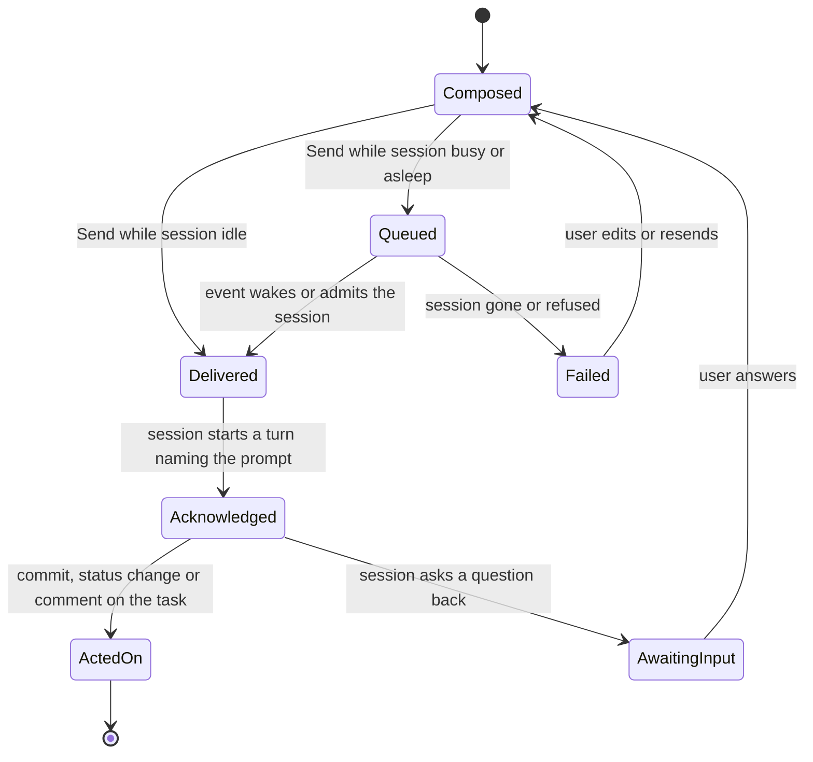

# beads-ui web app: review-queue UX, the per-task prompt composer, a stack recheck and shared code

Scope: the parts of the web app that the new founding ask adds beyond the board already planned in
Phase 3 of `docs/designs/beads-ui-design.md`. Those parts are the review queue for blockers,
decisions and open questions, the per-task prompt composer and owner change, rendering held-doc
content, the 2025 to 2026 board delta, a recheck of D-10's stack, and code shared with the mod and
the MCP App. Measured against beads-ui `origin/main` at `c5f6e57` (the PR #77 merge), which matches
the brief's snapshot. `packages/web-ui` and `apps/web` still do not exist.

Retrieval note: no web-search tool loaded in this run and Context7 was not offered, so every external
claim comes from a page fetched directly by URL, from the npm registry through `npm view`, or from
the GitHub REST API through `gh api`. Raw stack readings are in
[evidence/beads-ui-web-app-stack-signals-2026-10-28.md](evidence/beads-ui-web-app-stack-signals-2026-10-28.md).

## Summary

1. No surveyed product has a queue built for answering decisions. The closest pattern is the triage
   queue: Linear Triage maps Accept, Decline and Duplicate to the keys `1`, `2` and `3` and snooze to
   `H`, and Gmail and GitHub mark an item done with `E` and undo with `Z`. The Review view should be a
   split list and detail triage queue whose number keys pick a decision's options. [VERIFIABLE][^1][^3][^4][^5]
2. Held decisions are already structured. Each block carries `format-decision` markers, `##### (a)`
   options with Pros and Cons, and a Recommendation naming a letter, and ai-harness's
   `format_decision` module already parses that shape. The web app should get options from a held
   verb as JSON, as D-37 does for the item list, and keep rendered Markdown for the full body. [INFERENCE]
3. Every agent-delegation product surveyed shows a per-session state and a follow-up box. Linear names
   six states, `pending`, `active`, `error`, `awaitingInput`, `complete` and `stale`. Claude Code's own
   Remote Control docs warn that a disconnected banner says nothing about whether work continues. The
   composer therefore needs separate indicators for session liveness, delivery and the session's
   response. [VERIFIABLE][^17][^22]
4. The fleet already has a Sergei-approved prompt composer in the work queue's dashboard (ai-core
   `web/src/components/Composer.tsx`): Lexical rich text, a `/skill` typeahead, Enter as newline, an
   explicit "Queue prompt" button and a secret-guard refusal line. Under D-11 the web app replaces that
   dashboard, so the composer should be ported, not redesigned. [INFERENCE]
5. D-10's stack holds as of 2026-10-28. Every library is maintained except `cmdk`, whose last release
   is 2025-03-14 and last push 2025-10-29. shadcn's Command still wraps it, and Base UI's Autocomplete
   now covers filtering, groups, keyboard movement and virtualization, so D-10's planned replacement
   path exists. [VERIFIABLE][^36][^37][^38][^39]
6. Three corrections to the prior stack record: Base UI's package is now `@base-ui/react` (1.0.0 on
   2025-12-11); Frappe Gantt released 1.2.2 on 2026-02-25, not "last release February 2025"; and Vite
   8 (2026-03-12) bundles with Rolldown. React Compiler reached 1.0 on 2025-10-07 and is worth enabling
   for a dense board. [VERIFIABLE][^36][^41][^42]
7. The 2026 board delta is small and concentrated in Linear: drag-to-reorder groups and swimlanes (May
   2026), shareable filtered-view URLs (July 2026), a Priority inbox tab (September 2026) and agent
   replies grouped in their own inbox section. Asana's fall 2026 release adds AI Teammates and a "Work
   Graph". Huly's repository is now frozen. [VERIFIABLE][^9][^10][^11][^12][^33]
8. Single-letter shortcuts in the Gmail and Linear style need an off switch or a remap to meet WCAG
   2.1.4 at Level A; Gmail ships them off by default. The web app needs a keyboard setting for them,
   which none of the decided D-N covers. [VERIFIABLE][^5][^45]
9. The shared-code split from the prior research stands: core reducers and commands are shared by all
   three surfaces, and React components by the web app and the MCP App. New shared candidates are the
   review-queue reducer, the decision-option model, the composer's delivery-state machine and the key
   map. MCP Apps' `ui/message` posts into the Claude conversation, not into a Claude Code session, so
   the MCP App sends a session prompt through a server tool. [VERIFIABLE][^49][^52] [INFERENCE]

## 1. Triage and review queues

The question is which products let one person clear a queue of blockers, decisions and open
questions fastest. The answer from the evidence is a keyboard-first triage queue with a split list
and detail, one key per outcome, snooze, undo, and saved filters. No product found renders
multiple-choice decisions with pros and cons as queue items. The design has to combine a triage queue
with a question card.

### 1.1 Product by product

Linear Triage gives each issue three numbered outcomes: Accept (`1`), Decline (`2`) and Mark as
duplicate (`3` or `MM`). Snooze (`H`) hides an issue until "a time of your choosing, or when there's
new activity," whichever comes first. [VERIFIABLE][^1] Triage Intelligence "suggests properties such
as assignee and label" and surfaces likely duplicates, on Business and Enterprise plans.
[VERIFIABLE][^1] A July 2026 fix made "triage shortcuts now follow the order of the actions".
[VERIFIABLE][^10] Linear's Triage page describes no count or progress display. [VERIFIABLE][^1]

Linear Inbox splits into a Priority tab and an Other tab, with `J` and `K` moving through items in
both the list and the detail. `U` toggles read, `H` snoozes, and `Backspace` deletes, with
`Shift Backspace` deleting all read items. Snooze accepts typed phrases such as "next quarter".
[VERIFIABLE][^2] The Inbox page does not mention undo. [VERIFIABLE][^2]

GitHub's notification inbox has Done, Save, Unsubscribe and read actions, keyed `E`, `Shift I`,
`Shift U` and `Shift M`. [VERIFIABLE][^3][^4] It allows "up to 15 custom filters", each a name and a
query such as `repo:octocat/open-source-project-name reason:participating`, and bulk actions through a
"More options" menu on a selection. [VERIFIABLE][^3]

Gmail's triage keys are `x` select, `e` archive, `b` snooze, `z` undo, `j` and `k` older and newer,
and `]` or `[` archive and move on. They "won't work unless keyboard shortcuts are turned on."
[VERIFIABLE][^5] Superhuman's help pages returned HTTP 403 in this run. [NO SOURCE] Its 2021 post on
command palettes is background only: "Your command palette must be the one place where users can find
every command", with typo-tolerant matching and aliases. [VERIFIABLE][^6]

Plane Intake has Accept, Decline, Snooze and Mark as duplicate. It splits Open (Pending and Snoozed)
from Closed (Accepted, Declined, Duplicate). It filters by state, priority, assignee, labels and
dates, and moves through pending requests with up and down buttons. Its page names no keyboard
shortcuts or bulk actions. [VERIFIABLE][^7]

Graphite's pull-request inbox opens six default sections: "Needs your review", "Approved", "Returned
to you", "Merging and recently merged", "Drafts" and "Waiting for review". Users add sections with
their own filters, share a section's filters by link and drag sections into order. [VERIFIABLE][^8]
That is the strongest example found of a queue grouped by what the reader must do next.

Asana Inbox: the help article bodies were not readable in this run. [NO SOURCE] Height: the site
closed the connection on three attempts, so its status is unknown. [NO SOURCE] Huly: its README now
says "This repository is frozen and is no longer actively maintained" and "The hosted Huly service has
been discontinued", so it is no longer a reference to copy. [VERIFIABLE][^9]

### 1.2 One-action answers and free text

Three close analogues for "pick the recommended option in one action" exist.

- Claude's own `AskUserQuestion` tool sends "2-4 choices, each with `label` and `description`", a
  short `header` of at most 12 characters, `multiSelect`, an optional `preview` per option, and a
  free-text "Other" that returns "the user's custom text as the answer value". [VERIFIABLE][^13]
- GitHub suggested changes apply in one click ("Commit suggestion") or in a batch ("Add suggestion to
  batch", then "Commit suggestions"). [VERIFIABLE][^14]
- shadcn's Questionnaire (August 2026) is "a new component for building multi-step question flows
  with fixed, freeform, multiple, and skippable answers", with "Keyboard navigation with optional
  letter or number shortcuts", built for Base UI, React Aria and Radix. [VERIFIABLE][^15] It names no
  "recommended" option. [VERIFIABLE][^15]

A held decision maps onto this shape directly: each `##### (a)` option is an option with its Pros and
Cons as the description, the Recommendation's letter marks one option, and the item's `ask` line is
the question. [INFERENCE] The default ask in the held decision template already reads "Approve
(<letter>) <option label>, or pick another option; one word is enough." [VERIFIABLE][^58] So a one-key "approve the recommendation"
is the action the held store already expects. [INFERENCE]

shadcn's August 2026 human-in-the-loop helpers model the same lifecycle for AI SDK chat tools: a tool
call with `needsApproval: true` holds until the user decides, then streams the approved or denied
result. [VERIFIABLE][^16] That is mock tooling, useful for testing a decision card's states.
[INFERENCE]

### 1.3 What the evidence supports for the Review view

| Behaviour | Strongest documented pattern | Fit for beads-ui |
|---|---|---|
| Keyboard movement | `J`/`K` in list and detail (Linear Inbox, Gmail) | Same keys in both panes [INFERENCE] |
| One key per outcome | Linear Triage `1`/`2`/`3` | Option letters `a` to `d` or digits per decision [INFERENCE] |
| Approve the recommendation | Held ask "one word is enough"; GitHub "Commit suggestion" | One key plus a visible button on the recommended option [INFERENCE] |
| Free-text answer | `AskUserQuestion` "Other"; Questionnaire freeform | A composer below the options, always present [INFERENCE] |
| Snooze | Linear "until a time ... or when there's new activity" | Snooze until a time or the next change to the item or its issue [INFERENCE] |
| Undo | Gmail `z` | Undo window before the answer write (see 1.4) [INFERENCE] |
| Sections by next action | Graphite's six default sections | Open decisions, blockers, answered-not-acted-on, snoozed [INFERENCE] |
| Saved filters | GitHub 15 named queries; Linear shared view URLs | D-40's filter grammar in the URL, plus named saved views [INFERENCE] |
| Progress | none documented in any surveyed queue | "N left" counter per section [NO SOURCE] |

Progress feedback ("12 left") is the one asked-for behaviour with no documented precedent in the
products surveyed; it remains a requirement from the ask, kept as a plain counter. [NO SOURCE]

The sort keys the ask names map onto fields the fleet already records. Priority is Beads `priority`.
Impact and size are the curation metadata fields `value` and `effort` on each issue, scored by
ai-harness's `scripts/bd_curation_metadata.py` and combined into a `composite` score. Type is the
issue type, and epic is the parent. [VERIFIABLE][^60] A held item has none of these itself; they
come from the item's joined issue, as D-37's join already supplies title, status, priority, labels
and parent. [INFERENCE] Goal is not yet a Beads field; the goals-system leg owns it. [INFERENCE]

### 1.4 Undo for an answer

The held store's `answer` verb commits Sergei's text in the owning session's landing pad, and D-39
then starts a turn in the session. [VERIFIABLE][^53] Once the turn
starts, a session may act on the answer, so an undo after the write cannot be clean. [INFERENCE] A
short delayed-send window, about 5 to 10 seconds, between the key press and the `answer` call gives
Gmail-style undo without a compensating write. [HEURISTIC] Bulk answering makes the window more
valuable, since one wrong key applies to many items. [INFERENCE]

## 2. The per-task prompt composer and owner change

The question is how a user types a prompt for the session that owns a task, sees whether that
session is live, sees delivery state, and changes the owner so a handoff runs. The products agree on
the states to show and differ on confirmation.

### 2.1 Analogues

| Product | How work is sent | States the user sees | Follow-up and stop |
|---|---|---|---|
| Linear agents | Delegate an issue or @mention the agent [VERIFIABLE][^19] | `pending`, `active`, `error`, `awaitingInput`, `complete`, `stale`; "Linear tracks session lifecycle automatically based on the last emitted activity" [VERIFIABLE][^17] | A user message becomes a `prompt` activity and fires a `prompted` webhook [VERIFIABLE][^17] |
| Linear delegate field | "Assigning an issue to your app now sets it as the `delegate`, not the `assignee`" so "humans maintain ownership" [VERIFIABLE][^18] | First `thought` within 10 seconds [VERIFIABLE][^18] | Stop signal not documented [VERIFIABLE][^17] |
| GitHub Copilot coding agent | From "the agents panel, a conversation, or an issue or pull request" [VERIFIABLE][^20] | Session log with progress, token usage and length [VERIFIABLE][^21] | A follow-up in the box under the log; "Copilot applies the change after its current tool call finishes"; "Stop session" [VERIFIABLE][^21] |
| Claude Code Remote Control | Messages from terminal, browser or phone "interchangeably" [VERIFIABLE][^22] | "a computer icon with a green status dot when online"; `/rc active` in the terminal [VERIFIABLE][^22] | Push "when a long-running task finishes or when it needs a decision from you" [VERIFIABLE][^22] |
| Cursor cloud agents | cursor.com/agents to "Start and manage agents" [VERIFIABLE][^23] | No status labels documented [VERIFIABLE][^23] | Team follow-ups off by default; "Viewing is read-only" without them [VERIFIABLE][^23] |
| Codex cloud | "Describe your task and send it" [VERIFIABLE][^24] | Status list from the CLI only in the fetched page [VERIFIABLE][^24] | "request follow-ups" after review [VERIFIABLE][^24] |
| Jules | A plan first; "approve plan" to execute [VERIFIABLE][^26] | Notifies when a task "completes or needs your input" [VERIFIABLE][^25] | Chat at any point; the plan auto-approves "on a timer" [VERIFIABLE][^26] |
| Devin | Main chat | Not documented on the fetched page [VERIFIABLE][^27] | `/btw` side chats that do not interrupt; stop to take over [VERIFIABLE][^27] |

### 2.2 Three indicators, kept apart

Claude Code's Remote Control docs say "Remote Control disconnected" or "Can't reach" means the
browser lost contact, and "Neither message tells you whether Claude or a subagent you were watching
is still working on your computer." [VERIFIABLE][^22] Linear derives its state from the last
activity the agent emitted. [VERIFIABLE][^17] GitHub applies a steering message only after the
current tool call. [VERIFIABLE][^21] Taken together, a prompt to a session passes through three
states that can each fail on its own, so the composer shows them separately. [INFERENCE]

- Session liveness: live and idle, live and busy, compacting, gone or unknown. The data model already
  has `Session.state` as `idle`, `busy`, `compacting` or `gone` (Data Model, core types), and D-42's
  registry supplies liveness. [VERIFIABLE][^53]
- Delivery: composed, queued (the session is busy or asleep), delivered (the session has the text in
  context), or failed with a reason. [INFERENCE]
- Response: no response yet, acknowledged (the session started a turn on it), acted on (a commit, a
  status change or a comment), or the session asked a question back. [INFERENCE]

Which event moves Queued to Delivered belongs to the event-dispatch leg and ai-harness's event-driven
idle-wake design (`docs/designs/aih-p811n7-event-driven-idle-wake.md`, draft). This leg only fixes
the states the UI needs from it. [INFERENCE]

### 2.3 Changing the owner

Linear separates the human owner from the agent delegate. [VERIFIABLE][^18] D-17 already does the
same on Beads: `assignee` is the session and `metadata.owner` is the person. [VERIFIABLE][^53] So "change the owning session" in the ask is an `assignee`
change, written with `--if-assignee` as every guarded write is, and the handoff follows from it.
[INFERENCE]

None of the surveyed products documents a confirmation step for reassigning an agent's work.
[NO SOURCE] An owner change starts work in another session and may interrupt the first, which makes
it closer to D-13's close than to a priority edit. [INFERENCE] A confirm-in-place popover is the
right weight: it names the old and new session, each one's liveness, and whether a prompt typed in
the composer travels with the handoff. [HEURISTIC]

### 2.4 Fleet prior art

The work queue's dashboard in ai-core already ships a prompt composer. Its header comment says it
was "approved by Sergei (2026-09-21)". It uses Lexical for "rich text like the Claude iOS prompt
box", a "trigger-based typeahead for `/skill` completion", and Markdown serialization "so the stored
prompt stays plain markdown text and the editor state is never the record". Enter inserts a newline,
and "submission requires the explicit Send/Queue action". [VERIFIABLE][^61] Its Review view resolves
items from a `queue.review.resolved` event and classifies an accept outcome as no-suggestion,
dependency-open or refused. [VERIFIABLE][^61]

D-11 makes the beads-ui web app that dashboard's Phase 2 member app. [VERIFIABLE][^53] Porting the composer keeps a Sergei-approved interaction and
its tests, and avoids a second composer that drifts from the first. [INFERENCE] The ask's "auto
trigger `/start-goal`" fits as a `/skill` token the typeahead already completes. [INFERENCE]

## 3. Rendering held-doc content in a task detail

The question is how to draw decision blocks, open questions and blockers from Markdown inside a task
detail, with anchors back to the doc and answers inline. The evidence favours structured fields for
the parts the user acts on and rendered Markdown for the rest.

### 3.1 What a held item already carries

A held decision's body is fenced by `<!-- held:decision:begin -->` and `<!-- held:decision:end -->`.
Each decision sits inside `<!-- format-decision:begin id="<id>" task="<task>" -->` with a generated
`<a id="decision-<slug>">` anchor and heading, options as `##### (a) <label>` with `**Pros:**` and
`**Cons:**` lists, a `**Recommendation**` naming a letter, and `Recorded in:`, `Held:` and `Compiled
in:` link lines. [VERIFIABLE][^57][^58] Open questions arrive as decisions, as D-40 notes.
[VERIFIABLE][^53]

ai-harness's `src/ai_harness/format_decision.py` already matches options with
`^(#{3,6})\s+\(([a-z])\)(.*)$`, finds the Recommendation in both the chat and the doc shapes, and
refuses a block whose Recommendation names no option letter. [VERIFIABLE][^59] The
parser that would give the web app structured options exists; it is not yet exposed as JSON by a
held verb. [INFERENCE]

### 3.2 Options

| Approach | What it gives | Risk |
|---|---|---|
| Structured fields from a held verb (`show --json` with options, recommendation and anchors) | Option cards, number keys, a recommended badge | A second ai-harness change before the card can draw [INFERENCE] |
| Parse the Markdown in the web app with remark | No ai-harness change | A second copy of the block grammar in TypeScript, the drift D-37 rejected for selection rules [INFERENCE] |
| Rendered Markdown only | Nothing to build | No one-key answers; the ask's "efficient UI/UX" is lost [INFERENCE] |

Rendering itself is settled practice. react-markdown "is secure by default", escapes or ignores raw
HTML unless `rehype-raw` is added "in a trusted setting", and lets each element be replaced through
`components`, where "Every component will receive a `node`." [VERIFIABLE][^28] unist positions give a
node's `start` and `end` line, column and offset, and a generated node has none. [VERIFIABLE][^29]
mdast headings carry a `depth` from 1 to 6. [VERIFIABLE][^30] Positions are what map a rendered
section back to a line in the held file. [INFERENCE]

GitHub's anchors are the lower-cased heading with spaces turned to hyphens and punctuation removed,
with "a hyphen and an auto-incrementing integer" on duplicates. Editing a heading changes its
anchor, and custom `<a name>` anchors do not take part in that numbering. [VERIFIABLE][^31] The held
store's own explicit `<a id="decision-...">` anchors are therefore the stable target for "Open in the
doc" links, since a renamed heading changes its GitHub anchor. [INFERENCE]

### 3.3 Answering inline

Inline answering already has a decided path: D-39 runs `held_cli.py answer` with the text as typed,
then starts a fixed-template turn. [VERIFIABLE][^53] What the web
app adds is the option card. When the user picks option (b), the answer text has to be produced by
the UI, which sits awkwardly with D-39's "text exactly as typed". This is flagged for the coordinator
below. [INFERENCE]

## 4. The board delta for 2025 and 2026

The prior findings covered board, backlog, sprint and drag patterns as of 2026-10-15. Changes since,
or missed then:

- Linear "Reorder groups" (2026-05-21): "Click the reorder groups icon in display options, then drag
  groups into your preferred order", which covers board swimlanes. [VERIFIABLE][^11]
- Linear "Share filtered views" (2026-07-02): a filtered view is shared by copying its URL, with
  `Shift Cmd/Ctrl C`. [VERIFIABLE][^11]
- Linear "Issue duplicates" (2026-05-21) changed how triage handles duplicates. [VERIFIABLE][^11]
- Linear "Priority inbox" (2026-09-03): Linear picks Priority by default, and users customize it by
  choosing notification sources or a filter. The post does not say how Priority is ordered.
  [VERIFIABLE][^12]
- Linear Review Inbox (2026-05-28) added review notifications and a Reviews tab, and agent-authored
  replies "now group into an 'Agents' section". [VERIFIABLE][^11]
- Linear "Refreshed issue sidebar" (2026-07-23) and a fix so sub-issues created through MCP or Linear
  Agent inherit the parent's project (2026-10-22). [VERIFIABLE][^10]
- Asana's fall 2026 release adds "30+ prebuilt AI Teammates", "Asana Dash" described as an AI chief
  of staff for prioritizing, a redesigned navigation, and "the Asana Work Graph, a shared map of
  people, agents, tasks, projects, goals, and dependencies". [VERIFIABLE][^33]
- Jira: the newest primary source reached is the 2024-10-18 "new Jira" post, with a customizable
  sidebar, goals in list, timeline and calendar views, and a program board. It is background only.
  [VERIFIABLE][^32] Jira: no significant post-2024 board developments found in the pages reachable
  this run. [NO SOURCE]
- Todoist: the What's New page reached covers 2023 only. Todoist: no significant post-2024 board
  developments found. [VERIFIABLE][^34] [NO SOURCE]

Two of these change beads-ui's plan. Shareable view URLs are cheap in a web app and fit D-40's filter
grammar, so the Board and Review filters should live in the URL. [INFERENCE] Grouping agent activity
apart from human activity matches D-41's agent indicator and suggests a Review section for "the
session asked a question back". [INFERENCE] The goals-system leg should read Asana's Work Graph and
Jira's goals entries. [INFERENCE]

## 5. Stack recheck

D-10 still holds. Every library is maintained, permissive and React 19 compatible except where noted.
The table gives the readings; raw output is in the evidence file. [VERIFIABLE][^36][^37]

| D-10 choice | Latest (publish date) | Signal | Verdict |
|---|---|---|---|
| React | 19.3.1 (2026-10-14); 19.3.0 2026-09-09 | Active | Holds |
| Vite | 8.3.5 (2026-10-21); Vite 8 on Rolldown since 2026-03-12 [VERIFIABLE][^42] | Active | Holds; plan for Vite 8 |
| TanStack Query | 5.105.0 (2026-10-26) | Active | Holds |
| TanStack Table | 9.3.1 (2026-10-12) | Active | Holds |
| TanStack Virtual | 3.14.23 (2026-10-26) | Active | Holds |
| Zustand | 5.0.16 (2026-10-22) | Active | Holds |
| Base UI | `@base-ui/react` 1.9.0 (2026-10-09); 1.0.0 2025-12-11 | 11,248 stars, pushed 2026-10-27 | Holds; use the new package name |
| shadcn/ui | CLI 4.23.0 (2026-10-27); Base UI default since July 2026 [VERIFIABLE][^47] | 126,716 stars | Holds |
| Pragmatic drag and drop | 4.0.0 (2026-09-24), no React peer | 12,787 stars, pushed 2026-10-23 | Holds |
| Recharts | 3.10.1 (2026-07-25), React 19 in peer range | Active | Holds |
| cmdk | 1.1.1 (2025-03-14) | Pushed 2025-10-29, 77 open issues and PRs, repo now `dip/cmdk` | Stale; replace behind one component |
| Frappe Gantt | 1.2.2 (2026-02-25) | Pushed 2026-06-18 | Holds; prior "Feb 2025" reading is outdated |

Pragmatic drag and drop 4.0.0 is a packaging major: it removes "deprecated Volt re-export shims from
public package entry points". [VERIFIABLE][^40] Its accessibility companion
`@atlaskit/pragmatic-drag-and-drop-react-accessibility` is at 3.2.4. [VERIFIABLE][^36]

shadcn's Command page says "The <Command /> component uses the cmdk component by Dip", and it now
offers Base UI, React Aria and Radix tabs. [VERIFIABLE][^38] Base UI's Autocomplete has a custom
`filter`, `Autocomplete.Group`, arrow-key movement with `loopFocus`, and a `virtualized` prop shown
with 10,000 items through TanStack Virtual. Its docs say to "Use Combobox instead of Autocomplete if
the selection should be remembered". [VERIFIABLE][^39] Nested palette pages and shortcut handling
are not built in. [VERIFIABLE][^39] D-10 already isolates `cmdk` behind one component, so this is the
replacement it named, now available. [INFERENCE]

### 5.1 Additions worth recording

- React Compiler 1.0 (2025-10-07) is "a build-time tool that optimizes your React app through
  automatic memoization", "fully production-ready", with "certain interactions ... more than 2.5×
  faster" at Meta Quest Store, and Vite templates offer it. [VERIFIABLE][^41] A board with hundreds of
  cards and a live SSE feed is the case it targets. [INFERENCE]
- Motion 14.7.1 (2026-10-27, 34,594 stars, pushed 2026-10-27) is the maintained React animation
  library for layout transitions on drop and reorder. [VERIFIABLE][^36][^37]
- React Flow (`@xyflow/react` 12.12.0, 38,798 stars) is maintained and suits the dependency graph and
  the goal graph the goals leg covers. [VERIFIABLE][^36][^37]
- TanStack Hotkeys is "currently in beta". It offers sequences such as `['G', 'G']`, scopes, a
  default that "ignores single-key shortcuts while the user types in a text field", and `Mod` for
  Command or Control. [VERIFIABLE][^44] It was created on 2026-01-21 and has 755 stars, so under the
  source-vetting rule it is exploratory. [VERIFIABLE][^37] [INFERENCE]
- TanStack DB 0.15.2 (pre-1.0) adds live queries and optimistic collections on top of TanStack
  Query. [VERIFIABLE][^36][^43] Pre-1.0 and unneeded while `bd` is the store, so it is a watch item.
  [INFERENCE]

### 5.2 A Linear-quality look

Linear's 2024 redesign moved its themes to an LCH-based generator defined by "base color, accent
color, and contrast" in place of "98 separate variables per theme", with a contrast control for
high-contrast themes and Inter Display for headings. [VERIFIABLE][^35] It is a 2024 source, used here
as background for the approach. shadcn's theming uses "semantic background and foreground pairs" as
CSS variables in oklch, exposed to Tailwind through `@theme inline`, with dark mode as the same
tokens overridden under `.dark`. [VERIFIABLE][^46] D-19's semantic tokens map onto those pairs one to
one, so the web surface's token map is a CSS file of `--status-wip`, `--priority-p0` and the like.
[INFERENCE] shadcn's October 2025 components add `Kbd` ("Display a keyboard key or group of keys"),
`Empty`, `Item`, `Field`, `Input Group`, `Button Group` and `Spinner`. These cover shortcut hints,
empty states and dense list rows. [VERIFIABLE][^48]

app-portal's `package.json` names Radix packages and Vite 7, and no Base UI. [VERIFIABLE][^62] A member app ships its own bundle, so this does not block D-10, but the two should share the
token CSS. The app-portal leg owns that call. [INFERENCE]

## 6. Shared code across the web app, the MCP App and the mod

The prior finding stands. All three surfaces share DOM-free core logic, and the web app and the MCP
App share React components. The mod draws through D-35's band and pane adapters. [VERIFIABLE][^53][^55] What changed is the MCP Apps status and
the set of new core candidates.

### 6.1 MCP Apps in late 2026

The specification table lists 2026-01-26 as "Stable", with a draft in development, and "The wire
protocol is unchanged between `ext-apps` 1.x and 2.x". [VERIFIABLE][^51] The SDK's latest tag is
2.0.4 (2026-10-27); 2.1.0 was published the same morning without the `latest` tag. [VERIFIABLE][^36]
The React entry point provides "React hooks for Views (useApp, useHostStyles, etc.)". [VERIFIABLE][^51]
Supported clients include Claude, Claude Desktop, VS Code GitHub Copilot, Microsoft 365 Copilot,
Goose, Postman, MCPJam and Archestra.AI. [VERIFIABLE][^49] The client matrix does not list Claude
Code. [VERIFIABLE][^50]

The MCP Apps overview names "Approving expense reports, reviewing code changes, or triaging issues"
as a fit, because an app "provides navigation controls, action buttons, and state that persists
across interactions". [VERIFIABLE][^49] The Review queue is that use case. [INFERENCE]

The spec's `ui/message` sends content "to the host's chat interface", and `ui/update-model-context`
lets the view update the model's context, each call overwriting the last. [VERIFIABLE][^52] Hosts
pass style variables such as `--color-background-primary`, `--color-text-primary`, `--font-sans` and
`--border-radius-md`, and "should use the CSS `light-dark()` function". [VERIFIABLE][^52] A tool
marked `"app"` "is callable by the app from the same server connection only". [VERIFIABLE][^52]

So a prompt typed in the MCP App for a Claude Code session goes through an app-only server tool that
calls the same dispatch the web server calls. `ui/message` would only post into the Claude Desktop or
claude.ai conversation, which is a different session. [INFERENCE] The MCP App can also use
`ui/update-model-context` to tell the conversation which task is open, so the user can ask Claude
about it. [INFERENCE]

### 6.2 Layer by layer for the new features

| Layer | Web app | MCP App | Mod | Where it lives |
|---|---|---|---|---|
| Review-queue reducer (sections, filters, sort by priority, value, effort, type, epic; snooze; "N left") | yes | yes | yes | core, beside D-40's `reviewList.ts` [INFERENCE] |
| Decision model (options, recommendation, anchors) | yes | yes | yes | core types; data from the held verb [INFERENCE] |
| Delivery-state machine (section 2.2) | yes | yes | yes | core reducer; events from the dispatch leg [INFERENCE] |
| Command catalog and key map | yes | yes | yes | core `commands.ts` already holds keys [VERIFIABLE][^53] |
| Answer and handoff writes | `packages/bd-node` and the held command | server tools | `$.process.run` | adapters [INFERENCE] |
| Option card, composer, queue list | React | the same React | D-35 components | `packages/web-ui` and `hooks/components` [INFERENCE] |
| Tokens | CSS variables | host style variables mapped to D-19 names | theme keys (D-43) | core names, per-surface values [VERIFIABLE][^53] |

The key map is shared as data, not as a library. Each surface binds keys its own way: a DOM listener
on the web, and the mods API's hotkeys in the terminal, which reserves Tab and the arrow keys.
[VERIFIABLE][^54] [INFERENCE]

A separate MCP App build is the better call only where the host differs. Inline cards in Claude are
small by design, so the Review queue there is a fullscreen view, and the inline card shows one item
with its recommended option. [VERIFIABLE][^56] [INFERENCE]

## 7. Keyboard accessibility and the single-key problem

WCAG 2.2 keeps Success Criterion 2.1.4, Character Key Shortcuts, at Level A. It requires that a
single-character shortcut can be turned off, remapped "to include one or more non-printable keyboard
keys", or be "only active when that component has focus". [VERIFIABLE][^45] Gmail meets it by
shipping shortcuts off. [VERIFIABLE][^5] Linear and GitHub bind bare letters. [VERIFIABLE][^2][^4]
Speech-input users trigger single letters by accident, which is the criterion's reason.
[HEURISTIC]

A web app that copies Linear's `J`, `K`, `H` and `1`, `2`, `3` needs a setting to turn single-key
shortcuts off, and needs them scoped to the queue list when it has focus. [INFERENCE] TanStack
Hotkeys' default of ignoring single keys in text fields covers the composer. [VERIFIABLE][^44]

## Recommendations for the design

Each choice below is one the web app design will face in this leg's scope.

### R1. Layout of the Review queue

#### (a) Split list and detail, keyboard-first, sections by next action

- **Pros:**
  - Matches Linear Inbox, Linear Triage, Plane Intake and Graphite.
  - The detail pane holds the option card and composer while the list shows "N left".
- **Cons:**
  - Needs about 1,100 px for both panes; below that the detail opens over the list.

#### (b) One card at a time, focus mode

- **Pros:**
  - Fastest for clearing a run of similar decisions.
- **Cons:**
  - Loses the overview; sorting and grouping become invisible.

#### (c) A table with bulk actions

- **Pros:**
  - Fast for bulk answers such as "approve every recommendation in this epic".
- **Cons:**
  - Pros and cons do not fit in a row; a decision needs its text.

Recommendation: (a), with a bulk selection on the list for (c)'s case. Criterion: the ask's "quickly
go through and review blockers and decisions" with sorting by priority, impact, type and size, which
needs the list visible. Confidence: high. [INFERENCE]

### R2. Source of a decision's options

#### (a) A held verb that prints each decision's options, recommendation and anchors as JSON

- **Pros:**
  - The block grammar stays in the module that already validates it, the same principle as D-37.
  - Every surface gets the same options.
- **Cons:**
  - An ai-harness change lands before the card draws.

#### (b) Parse the Markdown in core with a TypeScript grammar

- **Pros:**
  - No ai-harness change.
- **Cons:**
  - A second copy of the grammar that drifts when ai-harness changes it.

#### (c) Rendered Markdown only

- **Pros:**
  - Nothing to build.
- **Cons:**
  - No option keys or recommended button; fails "efficient UI/UX".

Recommendation: (a), with the rendered body always shown below the card and used alone when the
verb finds no block. Criterion: one owner for the held grammar (D-37's reasoning). Confidence: high.
[INFERENCE]

### R3. One-key approval of the recommendation

#### (a) A key and a button that send a generated answer naming the option, marked as chosen by control

- **Pros:**
  - One action, as the held ask already invites ("one word is enough").
- **Cons:**
  - The text was not typed, which D-39 assumed.

#### (b) The control fills the composer with "(a)" and the user presses Send

- **Pros:**
  - The answer is still typed, in effect, and editable.
- **Cons:**
  - Two actions instead of one.

Recommendation: (a), with the undo window from section 1.4, if the coordinator confirms that a
generated answer meets D-39 and the held README's verbatim rule; else (b). Criterion: speed with the
answer record intact. Confidence: medium, pending the flag below. [INFERENCE]

### R4. The prompt composer

#### (a) Port the ai-core Lexical composer into `packages/web-ui`

- **Pros:**
  - Sergei approved it; `/skill` completion and the secret guard already exist and are tested.
  - D-11 retires the dashboard it lives in, so it would otherwise be lost.
- **Cons:**
  - Lexical adds weight to the MCP App bundle.

#### (b) A Base UI textarea with a `/skill` Autocomplete

- **Pros:**
  - Lighter, on the chosen primitives.
- **Cons:**
  - Rebuilds what exists and loses the approved behaviour.

Recommendation: (a). Criterion: keep an approved interaction under D-11. Confidence: high.
[INFERENCE]

### R5. Delivery and liveness display

#### (a) Three separate indicators: session liveness, delivery state, response

- **Pros:**
  - Each can fail apart, as Claude Code's own Remote Control docs warn.
- **Cons:**
  - More to draw on a narrow card.

#### (b) One combined status chip

- **Pros:**
  - Compact.
- **Cons:**
  - Hides which step failed.

Recommendation: (a), drawn as one chip with three segments on narrow layouts. Criterion: the user
must know whether to wait, resend or reassign. Confidence: high. [INFERENCE]

### R6. Owner change and handoff

#### (a) An inline owner select with a confirm popover naming both sessions and their liveness

- **Pros:**
  - One step for a common action; the guarded `--if-assignee` write catches races.
- **Cons:**
  - A popover can be confirmed by habit.

#### (b) A modal

- **Pros:**
  - Harder to confirm by accident.
- **Cons:**
  - Slow for routine reassignment.

Recommendation: (a). Criterion: D-13's ladder puts a reversible write below a modal. Confidence:
medium, since no product documents this confirmation. [INFERENCE]

### R7. Keyboard handling

#### (a) Bindings as data in core's command catalog, bound by a small DOM listener in `packages/web-ui`

- **Pros:**
  - One key map for all three surfaces; no beta dependency.
  - The WCAG 2.1.4 off switch and scoping are one setting in core.
- **Cons:**
  - Sequences such as `G I` need their own small state machine.

#### (b) TanStack Hotkeys

- **Pros:**
  - Sequences, scopes and the text-field rule built in.
- **Cons:**
  - Beta, 755 stars; exploratory under the source-vetting rule.

Recommendation: (a), with TanStack Hotkeys re-checked at its 1.0. Criterion: the shared catalog and
no beta dependency on a public package's core path. Confidence: medium. [INFERENCE]

### R8. Command palette

#### (a) Keep `cmdk` behind one component, as D-10 says

- **Pros:**
  - shadcn's Command still uses it; nothing to build now.
- **Cons:**
  - No release since 2025-03-14.

#### (b) Base UI Autocomplete

- **Pros:**
  - Maintained, virtualized, on the chosen primitives.
- **Cons:**
  - Nested pages and shortcut hints are hand-built.

Recommendation: (a) for Phase 3, and (b) when `cmdk` breaks on a React or Base UI upgrade. Criterion:
D-10's own mitigation, which this run found ready. Confidence: high. [INFERENCE]

### R9. Visual tokens

#### (a) D-19 token names as shadcn-style oklch CSS variables, light and dark, with a contrast setting

- **Pros:**
  - Fits shadcn, Tailwind 4 and the MCP host's `light-dark()` guidance.
  - The same names map to Claude's host variables in the MCP App.
- **Cons:**
  - Hand-tuned values in two themes.

#### (b) A generated theme from base, accent and contrast, as Linear does

- **Pros:**
  - Three inputs make every theme; high contrast for free.
- **Cons:**
  - A generator to build and test; Linear's source is from 2024.

Recommendation: (a) now, keeping the token file small enough to replace with (b) later. Criterion:
ship the look in Phase 3 on maintained tools. Confidence: medium. [INFERENCE]

## Gaps, blindspots & emergent findings

### Emergent findings

- The fleet's work queue dashboard holds a composer and a Review view that this design would
  otherwise rebuild (section 2.4). [INFERENCE]
- Held decisions are already machine-readable, so the "decision card" needs one ai-harness verb, not
  a Markdown parser (section 3.1). [INFERENCE]
- Huly moved from "hosted shut down" to a frozen repository, and Height could not be reached. Two of
  the brief's named references are no longer live products to copy. [VERIFIABLE][^9] [NO SOURCE]
- WCAG 2.1.4 sits against the Linear-style single-letter keys the ask's "best practice" points to,
  and no decided D-N records a keyboard setting. [VERIFIABLE][^45]

### Anchor-bias check

The brief named Linear first, and Linear's changelog is the richest source found, so this report
leans on Linear. Graphite (sections by next action) and the `AskUserQuestion` shape (options with
descriptions and free text) came from outside the named list and shaped R1 and R3. [INFERENCE]

### Contrarian evidence

- Jules auto-approves its plan "on a timer" when the user leaves. [VERIFIABLE][^26] A default that
  acts without the user would contradict the held store's purpose and is not recommended. [INFERENCE]
- Cursor's cloud agents are read-only to teammates unless an admin enables follow-ups.
  [VERIFIABLE][^23] Not every product lets anyone prompt an agent, so the composer may need its own
  rule for who may prompt which session. The privacy leg should check it against the ask's
  access-control requirement. [INFERENCE]

### Blindspots not resolved

- No web search was available, so products reachable only through search results (Superhuman's
  current shortcut list, Asana Inbox, Height's status, Jira's 2025 and 2026 board changes, the
  Linear keyboard reference) are [NO SOURCE]. A rerun with search would close these.
- No usability study measured triage speed for any of these patterns. The speed claims are vendor
  claims or heuristics.
- Whether a `Select` or `Input` in the mod's band takes focus as the pane's do is still unchecked
  live, per D-35's note; the option card's band form depends on it.
- The delivery states assume the dispatch leg can report "acknowledged" and "acted on". If its
  events stop at "delivered", the composer's third indicator has no data.

## Flagged for the coordinator

1. A generated answer and D-39's verbatim rule. D-39 says the pane runs `held_cli.py answer` "with
   Sergei's text exactly as typed". The held README says "A reply Sergei gives in chat is transcribed
   verbatim". A one-key "approve (a)" sends text the UI wrote. Options: (a) accept a generated answer
   marked as chosen by control, the line recording which option and that it came from a control, or
   (b) fill the composer and require Send. Either option refines D-39 and leaves its answer path
   in place; the coordinator decides it under the decision framework. Sources: `docs/designs/beads-ui-design.md`
   D-39; ai-harness `docs/held/README.md` § Answering.
2. A new ai-harness verb (R2). Structured decision JSON needs a held verb over
   `src/ai_harness/format_decision.py`. That is a second repository's change, like D-37's review
   verb.
3. app-portal's primitives. app-portal uses Radix and Vite 7; D-10 picks Base UI and Vite. This does
   not reopen D-10, since a member app has its own bundle; token sharing goes to the app-portal leg.
   Source: the evidence file.
4. A correction to the prior record that leaves D-10 as decided. `docs/research/findings/beads-ui-task-manager-ux.md`
   §6.1 and §6.5 give Frappe Gantt's latest release as v1.0.3 of 2025-02-03; the registry shows
   1.2.2 of 2026-02-25. Base UI's package is `@base-ui/react`, not `@base-ui-components/react`, whose
   last version is a 1.0.0 release candidate.
5. The keyboard setting (section 7). No decided D-N covers turning single-key shortcuts off. It is a
   new web-app decision beside D-10.
6. Tool refusal, verbatim. Loading a web-search tool returned "No matching deferred tools found", and
   Context7 was not among the available tools. Direct fetches, `npm view` and `gh api` were used
   instead.

No finding in this run would reopen D-10, D-11, D-14, D-17, D-19, D-22, D-23 or D-35 to D-43.

## Files read

- `/data/projects/beads-ui/.worktrees/aih-ec2-3-agents/bu-agent-research-web-vmfu/docs/designs/beads-ui-design.md`
- `/data/projects/beads-ui/.worktrees/aih-ec2-3-agents/bu-agent-research-web-vmfu/docs/research/beads-ui-task-manager-landscape.md`
- `/data/projects/beads-ui/.worktrees/aih-ec2-3-agents/bu-agent-research-web-vmfu/docs/research/findings/beads-ui-task-manager-ux.md`
- `/data/projects/beads-ui/.worktrees/aih-ec2-3-agents/bu-agent-research-web-vmfu/docs/research/findings/beads-ui-mods-and-shared-core.md`
- `/data/projects/ai-harness/.worktrees/aih-ec2-3-agents/bu-agent-research-web-vmfu/docs/held/README.md`
- `/data/projects/ai-harness/.worktrees/aih-ec2-3-agents/bu-agent-research-web-vmfu/docs/prompts/held/decision/TEMPLATE.md`
- `/data/projects/ai-harness/.worktrees/aih-ec2-3-agents/bu-agent-research-web-vmfu/docs/procedures/source-vetting-and-corroboration.md`
- `/data/projects/ai-harness/.worktrees/aih-ec2-3-agents/bu-agent-research-web-vmfu/docs/procedures/ai-writing-anti-patterns.md`
- `/data/projects/ai-harness/.worktrees/aih-ec2-3-agents/bu-agent-research-web-vmfu/docs/procedures/wsjf-scoring-rubric.md`
- `/data/projects/ai-harness/.worktrees/aih-ec2-3-agents/bu-agent-research-web-vmfu/docs/research/TEMPLATE.md`
- `/data/projects/ai-harness/.worktrees/aih-ec2-3-agents/bu-agent-research-web-vmfu/docs/designs/aih-p811n7-event-driven-idle-wake.md` (summary only)
- `/data/projects/ai-harness/.worktrees/aih-ec2-3-agents/bu-agent-research-web-vmfu/scripts/format_decision_check.py`
- `/data/projects/ai-harness/.worktrees/aih-ec2-3-agents/bu-agent-research-web-vmfu/src/ai_harness/format_decision.py`
- `/data/projects/ai-harness/.worktrees/aih-ec2-3-agents/bu-agent-research-web-vmfu/scripts/held_cli.py` (verb and option search only)
- `/data/projects/ai-harness/.worktrees/aih-ec2-3-agents/bu-agent-research-web-vmfu/scripts/bd_curation_metadata.py` (field names only)
- `/data/projects/app-portal/package.json` (read-only, main tree)
- `/data/projects/ai-core/web/src/components/Composer.tsx` (read-only, main tree)
- `/data/projects/ai-core/web/src/views/Review.tsx` (read-only, main tree)

## Sources

[^1]: Linear. (2026). [Triage](https://linear.app/docs/triage). Linear Docs. Verified accessible (fetched) 2026-10-28. (Accept, Decline, Duplicate keys, snooze, Triage Intelligence.)
[^2]: Linear. (2026). [Inbox](https://linear.app/docs/inbox). Linear Docs. Verified accessible (fetched) 2026-10-28. (Priority and Other tabs, J/K, U, H, Backspace.)
[^3]: GitHub. (2026). [Managing notifications from your inbox](https://docs.github.com/en/subscriptions-and-notifications/how-tos/viewing-and-triaging-notifications/managing-notifications-from-your-inbox). GitHub Docs. Verified accessible (fetched) 2026-10-28. (Done, Save, 15 custom filters, bulk.)
[^4]: GitHub. (2026). [Keyboard shortcuts](https://docs.github.com/en/get-started/accessibility/keyboard-shortcuts). GitHub Docs. Verified accessible (fetched) 2026-10-28. (Notification keys E, Shift I, Shift U, Shift M.)
[^5]: Google. (2026). [Keyboard shortcuts for Gmail](https://support.google.com/mail/answer/6594). Gmail Help. Verified accessible (fetched) 2026-10-28. (x, e, b, z, j/k; shortcuts off by default.)
[^6]: Boucher, T. (2021). [How to build a remarkable command palette](https://blog.superhuman.com/how-to-build-a-remarkable-command-palette/). Superhuman Blog. Verified accessible (fetched) 2026-10-28. (Background source, pre-2024.)
[^7]: Plane. (2026). [Intake](https://docs.plane.so/core-concepts/intake). Plane Docs. Verified accessible (fetched) 2026-10-28.
[^8]: Graphite. (2026). [Use the PR inbox](https://graphite.com/docs/use-pr-inbox). Graphite Docs. Verified accessible (fetched after a 301 from graphite.dev) 2026-10-28.
[^9]: Hardcore Engineering. (2026). [Huly platform README](https://github.com/hcengineering/platform). GitHub. Verified accessible (fetched) 2026-10-28. (Repository frozen; hosted service discontinued.)
[^10]: Linear. (2026). [Changelog](https://linear.app/changelog). Linear. Verified accessible (fetched) 2026-10-28. (Entries 2026-07-20 to 2026-10-22.)
[^11]: Linear. (2026). [Changelog, page 2](https://linear.app/changelog/page/2). Linear. Verified accessible (fetched) 2026-10-28. (Entries 2026-04-16 to 2026-07-02.)
[^12]: Linear. (2026, September 3). [Priority inbox](https://linear.app/changelog/2026-09-03-priority-inbox). Linear Changelog. Verified accessible (fetched) 2026-10-28.
[^13]: Anthropic. (2026). [Handle approvals and user input](https://code.claude.com/docs/en/agent-sdk/user-input). Claude Code Docs. Verified accessible (fetched) 2026-10-28. (AskUserQuestion question format.)
[^14]: GitHub. (2026). [Incorporating feedback in your pull request](https://docs.github.com/en/pull-requests/collaborating-with-pull-requests/reviewing-changes-in-pull-requests/incorporating-feedback-in-your-pull-request). GitHub Docs. Verified accessible (fetched) 2026-10-28.
[^15]: shadcn. (2026, August). [Questionnaire](https://ui.shadcn.com/docs/changelog/2026-08-questionnaire). shadcn/ui Changelog. Verified accessible (fetched) 2026-10-28.
[^16]: shadcn. (2026, August). [Human in the Loop](https://ui.shadcn.com/docs/changelog/2026-08-helpers-human-in-the-loop). shadcn/ui Changelog. Verified accessible (fetched) 2026-10-28.
[^17]: Linear. (2026). [Agent interaction](https://linear.app/developers/agent-interaction). Linear Developers. Verified accessible (fetched) 2026-10-28. (Six session states, activity types, prompted webhook.)
[^18]: Linear. (2026). [Agents](https://linear.app/developers/agents). Linear Developers. Verified accessible (fetched) 2026-10-28. (Delegate, not assignee; 10-second thought.)
[^19]: Linear. (2026). [Agents in Linear](https://linear.app/docs/agents-in-linear). Linear Docs. Verified accessible (fetched) 2026-10-28.
[^20]: GitHub. (2026). [About Copilot coding agent](https://docs.github.com/en/copilot/concepts/agents/coding-agent/about-coding-agent). GitHub Docs. Verified accessible (fetched) 2026-10-28.
[^21]: GitHub. (2026). [Tracking Copilot's sessions](https://docs.github.com/en/copilot/how-tos/use-copilot-agents/coding-agent/track-copilot-sessions). GitHub Docs. Verified accessible (fetched) 2026-10-28. (Steering after the current tool call; Stop session.)
[^22]: Anthropic. (2026). [Continue local sessions from any device with Remote Control](https://code.claude.com/docs/en/remote-control). Claude Code Docs. Verified accessible (fetched) 2026-10-28.
[^23]: Cursor. (2026). [Cloud agents](https://cursor.com/docs/background-agent). Cursor Docs. Verified accessible (fetched) 2026-10-28.
[^24]: OpenAI. (2026). [Codex cloud](https://learn.chatgpt.com/docs/cloud). Verified accessible (fetched after a 308 from developers.openai.com/codex/cloud) 2026-10-28.
[^25]: Google. (2026). [Jules documentation](https://jules.google/docs/). Verified accessible (fetched) 2026-10-28.
[^26]: Google. (2026). [Reviewing plans and feedback](https://jules.google/docs/review-plan/). Jules Docs. Verified accessible (fetched) 2026-10-28.
[^27]: Cognition. (2026). [Devin session tools](https://docs.devin.ai/work-with-devin/devin-session-tools). Devin Docs. Verified accessible (fetched) 2026-10-28.
[^28]: remarkjs. (2025). [react-markdown README](https://github.com/remarkjs/react-markdown). GitHub. Verified accessible (fetched) 2026-10-28.
[^29]: syntax-tree. (2024). [unist specification](https://github.com/syntax-tree/unist). GitHub. Verified accessible (fetched) 2026-10-28. (Position and generated nodes; a specification, stable over time.)
[^30]: syntax-tree. (2024). [mdast specification](https://github.com/syntax-tree/mdast). GitHub. Verified accessible (fetched) 2026-10-28. (Heading depth.)
[^31]: GitHub. (2026). [Basic writing and formatting syntax](https://docs.github.com/en/get-started/writing-on-github/getting-started-with-writing-and-formatting-on-github/basic-writing-and-formatting-syntax). GitHub Docs. Verified accessible (fetched) 2026-10-28. (Section links and custom anchors.)
[^32]: Atlassian. (2024, October 18). [The new Jira](https://www.atlassian.com/blog/jira/the-new-jira). Atlassian Blog. Verified accessible (fetched) 2026-10-28. (Background, 2024.)
[^33]: Asana. (2026). [What's new: Fall 2026 release](https://asana.com/whats-new). Asana. Verified accessible (fetched) 2026-10-28.
[^34]: Doist. (2023). [What's new](https://todoist.com/help/articles/whats-new). Todoist Help. Verified accessible (fetched) 2026-10-28. (Page covers 2023 only.)
[^35]: Linear. (2024, March 28). [How we redesigned the Linear UI](https://linear.app/now/how-we-redesigned-the-linear-ui). Linear. Verified accessible (fetched) 2026-10-28. (Background, 2024.)
[^36]: npm, Inc. (2026). [npm public registry](https://registry.npmjs.org/), queried with `npm view` for each package named in the evidence file. Verified accessible 2026-10-28. Raw output: `docs/research/findings/evidence/beads-ui-web-app-stack-signals-2026-10-28.md`.
[^37]: GitHub. (2026). [REST API, Get a repository](https://docs.github.com/en/rest/repos/repos#get-a-repository), queried with `gh api repos/<owner>/<repo>` for each repository named in the evidence file. Verified accessible 2026-10-28.
[^38]: shadcn. (2026). [Command](https://ui.shadcn.com/docs/components/command). shadcn/ui Docs. Verified accessible (fetched) 2026-10-28.
[^39]: MUI. (2026). [Autocomplete](https://base-ui.com/react/components/autocomplete). Base UI Docs. Verified accessible (fetched, first 100,000 characters) 2026-10-28.
[^40]: Atlassian. (2026). [pragmatic-drag-and-drop core CHANGELOG](https://github.com/atlassian/pragmatic-drag-and-drop/blob/main/packages/core/CHANGELOG.md). GitHub. Verified accessible (fetched) 2026-10-28.
[^41]: Tan, L., Savona, J., & Zhang, M. (2025, October 7). [React Compiler v1.0](https://react.dev/blog/2025/10/07/react-compiler-1). React Blog. Verified accessible (fetched) 2026-10-28.
[^42]: Vite. (2026, March 12). [Vite 8 is out](https://vite.dev/blog/announcing-vite8). Vite Blog. Verified accessible (fetched) 2026-10-28.
[^43]: TanStack. (2026). [TanStack DB overview](https://tanstack.com/db/latest/docs/overview). TanStack Docs. Verified accessible (fetched) 2026-10-28.
[^44]: TanStack. (2026). [TanStack Hotkeys overview](https://tanstack.com/hotkeys/latest/docs/overview). TanStack Docs. Verified accessible (fetched) 2026-10-28.
[^45]: W3C. (2023). [Understanding SC 2.1.4: Character Key Shortcuts](https://www.w3.org/WAI/WCAG22/Understanding/character-key-shortcuts.html). WAI. Verified accessible (fetched) 2026-10-28. (A standard, current in WCAG 2.2.)
[^46]: shadcn. (2026). [Theming](https://ui.shadcn.com/docs/theming). shadcn/ui Docs. Verified accessible (fetched) 2026-10-28.
[^47]: shadcn. (2026). [Changelog](https://ui.shadcn.com/docs/changelog). shadcn/ui Docs. Verified accessible (fetched) 2026-10-28. (Index of 2025 and 2026 entries.)
[^48]: shadcn. (2025, October). [New components](https://ui.shadcn.com/docs/changelog/2025-10-new-components). shadcn/ui Changelog. Verified accessible (fetched) 2026-10-28.
[^49]: Model Context Protocol. (2026). [MCP Apps](https://modelcontextprotocol.io/extensions/apps/overview). MCP Docs. Verified accessible (fetched) 2026-10-28.
[^50]: Model Context Protocol. (2026). [Extension support matrix](https://modelcontextprotocol.io/extensions/client-matrix). MCP Docs. Verified accessible (fetched) 2026-10-28.
[^51]: Model Context Protocol. (2026). [ext-apps README](https://github.com/modelcontextprotocol/ext-apps). GitHub. Verified accessible (fetched) 2026-10-28.
[^52]: Model Context Protocol. (2026). [MCP Apps specification 2026-01-26](https://github.com/modelcontextprotocol/ext-apps/blob/main/specification/2026-01-26/apps.mdx). GitHub. Verified accessible (fetched) 2026-10-28.
[^53]: beads-ui. (2026). [beads-ui design doc](https://github.com/sergeiwallace/beads-ui/blob/main/docs/designs/beads-ui-design.md), `docs/designs/beads-ui-design.md`. Read from the worktree at `c5f6e57` 2026-10-27. (Data Model, Phase 1 as built, D-11, D-17, D-19, D-35, D-39, D-40, D-42, D-43.)
[^54]: beads-ui. (2026). [Leg A findings: task-manager UX, components and web hosting](https://github.com/sergeiwallace/beads-ui/blob/main/docs/research/findings/beads-ui-task-manager-ux.md), `docs/research/findings/beads-ui-task-manager-ux.md`. Read from the worktree at `c5f6e57` 2026-10-27.
[^55]: beads-ui. (2026). [Leg B findings: Claude Code mods, MCP Apps and the shared core](https://github.com/sergeiwallace/beads-ui/blob/main/docs/research/findings/beads-ui-mods-and-shared-core.md), `docs/research/findings/beads-ui-mods-and-shared-core.md`. Read from the worktree at `c5f6e57` 2026-10-27.
[^56]: beads-ui. (2026). [beads-ui landscape research doc](https://github.com/sergeiwallace/beads-ui/blob/main/docs/research/beads-ui-task-manager-landscape.md), `docs/research/beads-ui-task-manager-landscape.md` §4.1. Read from the worktree at `c5f6e57` 2026-10-27. (Quotes Claude's inline-card design guidelines.)
[^57]: ai-harness. (2026). [Held store README](https://github.com/sergeiwallace/ai-harness/blob/main/docs/held/README.md), `docs/held/README.md` § File format, § Decision headings, § Answering. Private repository; read from a worktree at `23ece1e92b6` 2026-10-28.
[^58]: ai-harness. (2026). [Held decision template](https://github.com/sergeiwallace/ai-harness/blob/main/docs/prompts/held/decision/TEMPLATE.md), `docs/prompts/held/decision/TEMPLATE.md` (`held-decision-1.0.0`). Private repository; read at `23ece1e92b6` 2026-10-28.
[^59]: ai-harness. (2026). [format_decision module](https://github.com/sergeiwallace/ai-harness/blob/main/src/ai_harness/format_decision.py), `src/ai_harness/format_decision.py` (`_OPTION`, the Recommendation patterns and the no-option-letter check). Private repository; read at `23ece1e92b6` 2026-10-28.
[^60]: ai-harness. (2026). [WSJF scoring rubric](https://github.com/sergeiwallace/ai-harness/blob/main/docs/procedures/wsjf-scoring-rubric.md) and [bd_curation_metadata.py](https://github.com/sergeiwallace/ai-harness/blob/main/scripts/bd_curation_metadata.py). Private repository; read at `23ece1e92b6` 2026-10-28. (Fields `value`, `time_criticality`, `risk_opportunity`, `effort`, `confidence`; the composite.)
[^61]: ai-core. (2026). [Composer.tsx](https://github.com/sergeiwallace/ai-core/blob/main/web/src/components/Composer.tsx) and [Review.tsx](https://github.com/sergeiwallace/ai-core/blob/main/web/src/views/Review.tsx). Private repository; read from the local main tree at `f40fa2bd` 2026-10-28, read-only.
[^62]: beads-ui. (2026). [Web app stack signals, measured 2026-10-28](https://github.com/sergeiwallace/beads-ui/blob/main/docs/research/findings/evidence/beads-ui-web-app-stack-signals-2026-10-28.md), `docs/research/findings/evidence/beads-ui-web-app-stack-signals-2026-10-28.md`. Committed with this file. (app-portal `package.json` reading at `b73683e`.)
