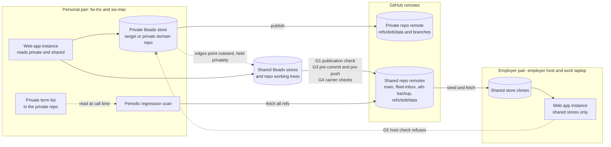

# Keeping private goals and their tasks out of shared repositories: classification, placement and guards

This packet is the privacy leg of the goals-system research for beads-ui. It answers how to guarantee by enforcement that goals marked personal, private, sensitive or domain-specific, and their tasks, never reach a shared core repository. Measurements behind it are in [the evidence file](evidence/goals-privacy-measurements-2026-10-28.md).

## Summary

1. The main leak path today is the Beads store itself, and no git commit hook sees it. The ai-harness store has no tracked JSONL any more. It publishes through `bd_dolt_publish.py` to `refs/dolt/data` on the ai-harness GitHub remote, and a fresh machine seeds its database from that ref. A private goal written into the ai-harness store reaches every machine, the employer host included, through a path that pre-commit never inspects. [VERIFIABLE][^26][^30][^31]
2. A Dolt push carries history. Each commit references a full database root, and a push sends whatever chunks the remote lacks, so deleting a private row later leaves it in the remote's history. The guard has to stop the record before publication. Cleanup after publication does not undo it. [VERIFIABLE][^16] [INFERENCE]
3. Session artifacts are the second large path. Founding-ask records are routed by session prefix to ai-harness `docs/asks/`. Held items from any source repository without its own route, the sergei repository included, fall to the `source_repo = "*"` row and land in `ai-harness/docs/held`. A goal typed into a session prompt can therefore be committed verbatim into ai-harness by tools working as designed. [VERIFIABLE][^32][^33]
4. Several fleet writers bypass `pre-commit` entirely. git-inbox builds its commits with `commit-tree` and then runs `git push`. The worktree backup transport pushes every local branch to `refs/heads/aih-backup/<branch>` from a commit-hook queue, before any review or merge. A guard placed only at commit or only at merge misses both. Pre-push over the full pushed range is the narrowest hook that sees them all. [VERIFIABLE][^7][^34][^39]
5. Content scanning cannot be the primary guard. The word "goal" already names the fleet's session-goal feature: 585 of 8,576 tracked ai-harness paths match it, mostly `/start-goal` and `/draft-goal` skills and tests. The list of private terms a scanner would need is itself private, so it cannot live in ai-harness or on the employer host. Structure has to carry the guarantee: a record's store and marking decide where it may go. Scanning is the backstop. [VERIFIABLE][^26][^29] [INFERENCE]
6. The fleet already ships most of the parts: a fail-closed staged gitleaks gate with a task-id rule, a public-repo checker whose denylist lives outside the guarded repo, an artifact routing table that refuses an unrouted class, and an installer step that deploys every repo's pre-commit hooks on every machine. [VERIFIABLE][^27][^28][^29][^32][^38]
7. The existing task-id rule does not catch modern ids. It matches only the legacy `PREFIX-<digits>` form, so `SW-8e730k` and slug display ids pass. `SW` is the sergei repository's prefix. A private-id rule needs the hash and slug forms. [VERIFIABLE][^26][^27][^37]
8. Links across the privacy boundary belong in the private store, and the shared store should know nothing, not even an opaque id. A Beads `external:<project>:<capability>` edge is stored as written, so it names the private project in the shared store. It "remains blocking" wherever that project is unconfigured, which on the employer host is always. [VERIFIABLE][^18][^26] Atlassian forbids links across its restriction boundary, and Linear shows a private issue's id as a linkback on pull requests. [VERIFIABLE][^19][^20]
9. No server-side guard is available on a personal-account private GitHub repository. Pre-receive hooks are documented only for GitHub Enterprise Server. Push-protection custom patterns need Secret Protection, which requires a Team or Enterprise plan. Enforcement is therefore client-side, measured on every machine, with a periodic scan from a personal host as the regression detector. [VERIFIABLE][^2][^3][^6]
10. Encryption inside a shared repo does not meet the ask. git-crypt leaves file names and commit messages visible and cannot revoke a key, and the ciphertext would still be cloned onto the employer host. [VERIFIABLE][^11] [INFERENCE]
11. The owner has already ruled on history: "nah, don't worry about commit history. its fine... just focus on files". The prior-work compile is scrubbing tip files only. The ruling's words cover git commit history. Whether it also covers the ai-harness store's Dolt history is unrecorded, and that is flagged below. [VERIFIABLE][^42]

## 1. Classification

The four markings answer one enforcement question: may this record exist in a shared core repository? All four answer no. They differ in where the record may live and which hosts may read it. I propose these operational meanings. [INFERENCE]

| Marking | Meaning | Home store | Hosts that may hold it |
|---|---|---|---|
| `personal` | About the owner's own life: health, family, money, career outside the employer | The sergei repository | Personal pair only (fw-lnx, sw-mac) |
| `private` | Not to be seen by anyone else, whether or not it is about the owner's life | The sergei repository or a private domain repository | Personal pair only |
| `sensitive` | Personal or private, plus stricter handling: no prompt text in any carrier, not indexed by recall, not sent to a delegate | As for `private` | Personal pair only |
| `domain:<repo>` | Belongs to a named domain repository that is not in the shared set | That repository's own Beads store | Whatever hosts clone that repository |
| `shared` | Harness or tooling goals meant for every machine | A shared store such as ai-harness | Every host |

Rationale: the ask names the first four and places them "in sergei repo or another domain-specific repo that is on my personal machine pair". `shared` is added because the guard must tell an intended shared goal from an unmarked one. `sensitive` only gains meaning beyond `private` if it changes handling. The handling rules in its row are my proposal, not the ask's, and are flagged. [INFERENCE]

### Where the marking lives

The store is the authority and the field is a declaration the guards check against it. A record in a private-class store is private however it is labelled. A record in a shared-class store must carry `shared`, and a goal-type record there without it is refused at publication. A label alone fails because nothing stops a label from being omitted. A store alone fails because a goal created in the wrong store looks valid. Both together give the guard a mismatch to detect. [INFERENCE]

Beads 1.3.2 has labels and a `metadata` column but no write-time policy hook, and `bd lint` checks template sections only. The marking can be a label such as `privacy:personal`. Its enforcement has to come from fleet code: the `bd-new` wrapper, the web app API and the publication check. [VERIFIABLE][^26]

### Inheritance

A task takes its marking from where it is created. A task created as a child of a private goal is created in the private store and is private. A shared task that a private goal links to stays shared, because the work itself, such as a harness feature, is not private. Only the link is private, and the link lives in the private store (§2). A record that mixes private content with shared work has to be split into a private task and the shared task it links to. [INFERENCE]

This avoids the failure Notion documents. Notion "respects the broadest level of access given to a user", and moving a parent page to Private leaves its subpages' grants as they were, so inherited permission fails open. Placement in a separate store fails closed, because nothing in a shared store can be read as private. [VERIFIABLE][^21] [INFERENCE]

### Default for a new goal

A new goal should default to `private` and be created in the private store. Creating one in a shared store needs an explicit `shared`, and a goal-type record with no marking is refused there. Atlassian makes the reverse a one-way door: a goal is restricted only at creation, "You can't change an existing open goal to restricted", and the restriction covers the whole hierarchy. Defaulting to the restrictive side avoids needing that door. [VERIFIABLE][^20] [INFERENCE]

### Re-classification

Shared to private: create the record in the private store, rewire the links there, close the shared record, and accept that its earlier content stays in git and Dolt history (see §6). Leaving a tombstone or forwarding pointer in the shared store would leak the fact being hidden, so the shared side gets nothing.

Private to shared: an explicit owner action copies the record into the shared store marked `shared`. The guards pass it because it carries the marking.

Both moves are copy-then-close between stores. Beads has no cross-store move except `bd migrate-personal`, which selects issues by creator git identity. [VERIFIABLE][^26] The owner creates shared and private work under one identity, so creator identity cannot separate them. [INFERENCE]

## 2. Placement and links

Private goals and their tasks live in a Beads store inside a private-class repository: the sergei repository, or a private domain repository. Its Dolt remote is that repository's own GitHub remote. Those repositories are cloned only on personal-pair hosts. The sergei repository is absent from the employer host today (measured), and the prior-work issue records that it "should never be cloned down" to the employer-pair machines. [VERIFIABLE][^26][^42]

### Which side holds the edge

Every edge that crosses the boundary is stored in the private store and points outward at the shared record's id. The shared store holds no edge, no id and no digest. This verifies and extends the sibling products leg's conclusion that link records must live on the private side. [VERIFIABLE][^43] Consider an edge stored on the shared side. Beads stores an `external:<project>:<capability>` reference "as-is", so the shared store would name the private project. Resolution needs an `external_projects` entry, and "an unconfigured or unavailable project remains blocking". On the employer host, which never has the private project, that shared task would read as blocked forever. [VERIFIABLE][^18][^26]

### What the shared store may know

Nothing. An opaque id still reveals that a private goal exists, how many there are and which shared work serves them. Linear's own private-team docs show that leakage: private issues "appear as linkbacks on PRs or MRs showing only the issue ID and link". A digest of a goal title is weaker still. Goal titles are short natural-language strings, so a dictionary attack recovers them. [VERIFIABLE][^19] [INFERENCE]

### How the goal views show both

The web app instance on the personal pair reads the private store and the shared stores and joins them in its server. Private goals appear beside the shared work they link to, and nothing is copied into a shared store. Beads `bd repo` hydration can do the same join inside Beads, but only in one direction. The private store may hydrate from shared stores. A shared store must never list a private repository under `repos.additional`, because hydration copies issues "into a single database". The shared database then publishes to the shared remote. The feature is also labelled experimental in the shipped config, and nothing in ai-harness uses it yet: the block is commented out. [VERIFIABLE][^26] [INFERENCE]

The web app instance on the employer host never opens a private store, so private goals do not appear there. This follows from the ask's placement rule. Rendering a private goal in a browser on the work laptop would route its content through the employer host's server. [INFERENCE] Flagged as a consequence for the design.

## 3. Leak surfaces

The ranking weighs likelihood (how often normal work would hit the path) against impact (how far the content travels). A push to a shared GitHub remote reaches every clone, the employer host included, and stays in history. That is the high-impact case. Local-only copies on a personal host are low impact. The table in [Leak surfaces and guards](#leak-surfaces-and-guards) gives each surface's guard. The notes below cover what the table cannot.

Session artifacts rank first on likelihood. The owner plans goal work by talking to sessions, and today three tools commit what was said into ai-harness without any classification step. Founding-ask capture routes by session prefix. Held items route by source repository with a `*` fallback to ai-harness. The ai-core transcript harvester routes answered decisions by the `repos` it is given and commits them under `docs/decisions/transcripts/`. [VERIFIABLE][^32][^33][^41] All three route by where the session stands, never by what the content is.

The Beads store ranks first on impact. A `bd create` run from a shared checkout writes to that checkout's store, and publication then pushes it to `refs/dolt/data`, which install seeds onto later machines. [VERIFIABLE][^30][^31] Dolt's own access controls cannot help. Branch permissions govern writes only; "all users ... still have read access to all branches", and local CLI operations such as `dolt push` bypass them. Column-level grants are not supported. [VERIFIABLE][^14][^15]

The carriers matter because they push outside the normal path. git-inbox message files live on `refs/heads/fleet-inbox/*` in the ai-harness repository. The sender drops old files from the ref's tip, but "history keeps them". [VERIFIABLE][^34] A sibling leg found that the work pair's Agent Mail board runs on the employer host and that dispatch bodies for private tasks must carry only an id and a digest. [VERIFIABLE][^44] For a `sensitive` task even the digest should be dropped, for the dictionary reason above. [INFERENCE]

Backups push before review: a commit-hook queue sends every committed branch to `refs/heads/aih-backup/<branch>`, after a gitleaks refusal that is a ready insertion point for the private-id rules. [VERIFIABLE][^39]

Agent reads and delegation are a path the ask does not name. On a personal host, a session whose working directory is ai-harness can read the sergei checkout. Claude Code accepts `Read(<path>)` deny rules in user or managed settings. [VERIFIABLE][^24] They cover its file tools and the file commands it recognises in Bash. The docs say they do not apply to "arbitrary subprocesses that read or write files indirectly, like a Python or Node script". OS-level blocking needs the sandbox. [VERIFIABLE][^25] A research leg or delegate briefed about a private goal writes its findings into whatever repository its brief names, usually a shared one. [INFERENCE]

Public repositories are worse than shared ones. beads-ui is public, and it is where the goals UI will be built. Demo data, test fixtures, screenshots and design examples for a goals UI are a natural place for real goals to appear. Its pre-commit runs the employer-name check only. [VERIFIABLE][^29] [INFERENCE]

## 4. Enforcement design: structure and scanning

Use both, with structure as the gate and scanning as the backstop. A structural rule is "a record of the private kind can never serialize into a shared store". It needs no knowledge of what any goal says, so it works the same on every host. It is exact for records that carry markings and live in stores, and blind to free text: a goal pasted into a held item or a commit message has no marking. Content scanning catches free text but needs the private terms, has false positives, and cannot run where the terms are absent. [INFERENCE]

The structural rules, each cheap to evaluate:

- A shared-class store holds no record marked other than `shared`, and no goal-type record without `shared`.
- No text column of a shared-class store contains an id with a private-class prefix in any form: legacy numeric, hash or slug.
- No `external:` reference in a shared-class store names a private-class project.
- A shared-class store's `repos.additional` lists only shared-class repositories.
- No staged or pushed file in a shared or public repository contains a private-class id, or a `privacy:` marking other than `shared` in frontmatter or a label line.

A private-class id prefix is the strongest structural signal for free text. It is short, fixed and assigned by the fleet's prefix manifest, so the guard can match it without knowing any goal. The manifest already pins `SW` to the sergei repository. [VERIFIABLE][^37] The existing task-id rule shows the shape, with a cross-store proof that exempts ids proved local to the staged store. It matches only the legacy numeric form, so it misses the ids Beads issues today (measured). [VERIFIABLE][^26][^27][^28]

Content scanning then uses a private term list held in the private repository and read at call time. This is the same shape as the public-repo checker, whose denylist is "read at call time from this checkout, so the public repo never carries the list", and which exits 2 when the list cannot be read. [VERIFIABLE][^29] On the employer host the list is absent by design. There the guard reports `content-scan: not-declared` and runs the structural rules only. It must not fail closed on the missing list, or every commit on that host would be refused. [INFERENCE]

### Hook points

| Hook | What it sees | Fails when |
|---|---|---|
| `bd-new` wrapper and web app write API | One record at creation | A goal or restricted marking targets a shared-class store |
| `bd_dolt_publish.py` before push, plus the pre-push `bd-invariants` gate | The whole store about to publish | Any structural store rule is broken |
| `pre-commit` in every shared and public repo | Staged blobs | A private-class id, a restricted marking, or a private term (personal hosts) |
| `pre-push` in every shared and public repo | Every commit in the pushed range, every ref | As pre-commit; this is the hook that sees plumbing commits and backup pushes |
| Carrier send (git-inbox, Agent Mail, held add, ask capture) | One message body | As pre-commit, plus any body text for a `sensitive` task |
| Install, doctor and web app startup | The host's `governance` value and its configured stores | A private-class store is present or configured on an employer-gated host |
| Periodic scan from a personal host | Remote tips and new commits of every shared repo and store | Any rule; reports and alerts, cannot block |

Git's semantics fix this layering. `pre-commit` "can be bypassed with the `--no-verify` option", while a non-zero `pre-push` makes "git push ... abort without pushing anything". [VERIFIABLE][^7] The fleet bans `--no-verify` by rule, and the periodic scan catches its use.

### Fail-closed behaviour

Each guard has three exits: 0 clean, 1 refused, 2 no verdict (configuration unreadable, store unreachable). Exit 2 refuses the mutation, as the evidence-citation gate does: "A sensor fault that exited 0 would read exactly like a clean document." [VERIFIABLE][^45] The guard performs the mutation itself, as `bd_dolt_publish.py` does, where "A push is unreachable when any earlier step refuses". [VERIFIABLE][^30] The one deliberate non-failure is the absent term list on a host whose governance class says the list is never present.

A guard's output names the path, line and rule id only. The public-repo checker prints the matched text, and gitleaks redacts only with `--redact`. [VERIFIABLE][^8][^29] Echoing a matched private term into a session transcript on the wrong host would itself be a leak.

### False-positive cost

Structural rules have a low false-positive rate because they match fleet-assigned tokens. The main risk is a legitimate mention of a private-class id in a shared doc, such as a design doc that says "the sergei repository uses prefix SW". The rule should match only an id shape with a suffix, never a bare prefix, and allow a per-line waiver with a required reason, the pattern the evidence-citation gate uses. [VERIFIABLE][^45] Term scanning is costly: common words in goal titles will match ordinary prose. The term list should hold distinctive phrases, never single common words, and term hits should refuse only on shared and public repos, never on private ones. [INFERENCE]

## 5. Prior art

| Tool or pattern | What it gives | Adoption and maintenance evidence | Fit |
|---|---|---|---|
| gitleaks custom rules | Regex, keyword and path rules, allowlists, `git` and `dir` scans, `--redact` | 30.4k stars, MIT; the README says it is feature complete, future releases are security patches only, and the maintainer is moving to Betterleaks [VERIFIABLE][^8] | Already the fleet's detector, pinned at 8.30.1. Good for private-id rules; poor for the private term list, which cannot sit in a tracked `.gitleaks.toml` [VERIFIABLE][^27] |
| Betterleaks | Successor scanner from the gitleaks authors; v2 on `main`, v1 on `v1.x` | 2.4k stars, MIT, "maintained by the folks who made Gitleaks" [VERIFIABLE][^9] | Watch item. The docs fetched say nothing about `.gitleaks.toml` compatibility, so migration cost is unknown [NO SOURCE] |
| trufflehog custom detectors | Regex plus keyword detectors; pre-commit use | 28.7k stars, AGPL-3.0 [VERIFIABLE][^10] | Adds nothing over gitleaks for this rule set |
| git-crypt, SOPS, transcrypt | Encryption of chosen files or values inside the repo | git-crypt 10.0k stars, 0.8.0 of 2025-09-23; SOPS 23.5k stars, CNCF sandbox; transcrypt 1.7k stars [VERIFIABLE][^11][^12][^13] | Rejected. git-crypt "does not encrypt file names, commit messages, symlink targets, gitlinks, or other metadata" and "does not support revoking access" [VERIFIABLE][^11]. For all three, ciphertext in a shared repo still puts the content into it. git-secret was not fetched [NO SOURCE] |
| GitHub push protection and custom patterns | Server-side block on pushes matching patterns | Repository push protection "Requires GitHub Secret Protection", which needs a Team or Enterprise plan; user push protection covers public repositories [VERIFIABLE][^1][^2][^3] | Not available on the owner's private repos as far as the fetched docs show; also needs the private terms uploaded to GitHub |
| GitHub push rulesets | Block pushes changing given paths, extensions or sizes | Documented for private and internal repositories; the rulesets page frames rulesets for Team and Enterprise plans [VERIFIABLE][^4][^5] | Path rules cannot recognise content; plan availability for this account unverified |
| Pre-receive hooks | Server-side content checks | Documented for GitHub Enterprise Server only [VERIFIABLE][^6] | Not available on GitHub.com |
| Dolt grants and branch permissions | Users, roles, database and table grants; per-branch write and merge control | Read access to all branches for all users; local CLI bypasses them; no column-level grants [VERIFIABLE][^14][^15] | Cannot hide rows; separate databases are the only Dolt-level boundary |
| Beads contributor routing | Routes planning issues to a separate repo, "Keeps experimental work out of PRs"; routing targets are local paths from local config | 28.2k stars on the Beads repository [VERIFIABLE][^17] | Closest native feature to private placement, but it routes by contributor role, not by marking |
| Atlassian Goals restriction | Restrict at creation only, whole hierarchy, no cross-boundary links, restricted goals still shown in the link picker | Atlassian support docs [VERIFIABLE][^20] | Copy the no-cross-link rule; do not copy the picker exposure |
| Linear private teams | Members-only issues; private issues show as id-only linkbacks; "The API, webhooks, and Zapier can expose private team and issue titles" | Linear docs [VERIFIABLE][^19] | Shows integrations and links are where private-space models leak |
| Notion page permissions | Subpages inherit; broadest grant wins | Notion help [VERIFIABLE][^21] | Counter-example: inherited permission fails open |
| Open Policy Agent and Conftest | Rego policies over structured config | OPA is a "graduated Cloud Native Computing Foundation (CNCF) project"; Conftest has 3.3k stars and "helps you write tests against structured configuration data" [VERIFIABLE][^22][^23] | Fits store-record checks in principle; adds a Go binary and Rego to a Python-stdlib fleet for rules that are a few SQL predicates. Exploratory here |

Vetting: gitleaks, SOPS, OPA and Beads clear the adoption bar on stars and governance. The encryption tools fail on fit. Betterleaks and Conftest stay exploratory here.

Server-side checks on personal-account private repositories: no significant post-2024 developments found in the GitHub docs fetched.

## 6. Existing exposure and regression detection

The prior-work compile measured, as counts and paths only, that live ai-harness goal files carried employer, name, private-id and health pattern matches. It recorded these as review candidates, not confirmed leaks. It also counted 804 goal-ish paths and 305 deleted goal-named paths across 17,442 commits of ai-harness history. [VERIFIABLE][^42] On 2026-10-28 the owner ruled, through the chief's relay, to scrub files at the tip only, with no history rewrite and no re-clone. The compile's tip scrub is on an open ai-harness pull request. [VERIFIABLE][^42]

The design should say that the guard prevents new leaks and erases no old ones, that the history stays on every existing clone by the owner's choice, and that a rewrite remains an owner decision. [INFERENCE]

Two exposures sit outside that ruling's words. First, the ai-harness Beads store's Dolt history: the prior-work inventory covered Beads issues and comments, but the ruling speaks of "commit history". Second, git-inbox refs, whose history keeps every message body. [VERIFIABLE][^34][^42] Both are flagged.

Regression detection is a scheduled job on a personal-pair host, because only there can the full rule set, term list included, run. Each run fetches every ref of every shared repository, including `fleet-inbox/*` and `aih-backup/*`. It reads each shared Beads store from its remote and scans the commits since a stored watermark, not only the tips. A leak committed and removed between two runs is then still caught. It reports counts and paths, alerts on any finding, and never prints matched text. [INFERENCE] The publication-scan script already runs redacted gitleaks scans over the working tree and all refs into one safe report, so it is the base to extend. [VERIFIABLE][^28]

## Leak surfaces and guards

Likelihood and impact are my ratings. [INFERENCE]

| Surface | How content would leak | Likelihood | Impact | Guard | Hook point | Reuse or new |
|---|---|---|---|---|---|---|
| Shared Beads store records | `bd create` from a shared checkout, or a goal created in the wrong store, then published to `refs/dolt/data` and seeded onto every machine | High | High | Store-class rules: no restricted marking, no unmarked goal, no private-id text, no private `external:`, no private `repos.additional` | `bd-new`, web app API, `bd_dolt_publish.py`, pre-push `bd-invariants` | Extend `bd_dolt_publish.py` and the `bd-invariants` gate; new rule module |
| Founding-ask records | Owner's prompt about a private goal captured verbatim into `docs/asks/` | High | High | Ask capture refuses or reroutes a body with restricted markers or private ids; private-repo sessions route to their own repo | Ask capture tool; pre-commit | Extend `agent_artifact_routing.toml` routes |
| Held items | A session in a private repo hits the `*` row and lands in `ai-harness/docs/held` | High | High | Explicit held route per private-class repo to its own store; a private source with no row refuses, mirroring the existing rule for employer repos | `held_cli.py add`; pre-commit | Extend `[[held_routes]]` |
| Docs, plans, commit messages, PR bodies in shared repos | Agent or human writes goal text into a doc or message | Medium | High | Private-id and marking rules everywhere; term list on personal hosts | pre-commit, commit-msg, pre-push | Extend `gitleaks_staged.py`, or a new stdlib checker shaped like `public_repo_name_check.py` |
| Worktree backup pushes | Unmerged commit pushed to `aih-backup/<branch>` | Medium | High | Same rules in the backup's existing gitleaks refusal and in pre-push | Backup transport; pre-push | Extend `worktree_backup.py` refusal |
| git-inbox bodies | Message about a private task committed to `fleet-inbox/*`; history keeps it | Medium | High | Send refuses restricted markers and private ids; private-task dispatch is pointer-only and personal-pair-only | `git_inbox.py` send; pre-push | Extend git-inbox send |
| Agent Mail bodies | Dispatch body stored on the board on the employer host | Medium | Medium | Same body check; `sensitive` sends no digest | Agent Mail send path | Extend sender; sibling dispatch design |
| Public repos (beads-ui, doc-editor, chassis) | Real goals used as demo data, fixtures, screenshots | Medium | Very high | Same rules plus synthetic-fixture policy | pre-commit, pre-push | Add hook id to each public repo's `.pre-commit-config.yaml` |
| Web app and MCP App read path | Employer-host instance opens a private store; browser or server caches private rows | Medium if misconfigured | High | Server refuses to open a private-class store on an employer-gated host; no persistent client cache of private rows | Web app startup and store adapter | New; keyed on machine `governance` |
| Transcripts and harvesters | Session on the employer host discusses a private goal; transcript on disk; decision harvester commits it | Medium | Medium | Harvester skips rows carrying restricted markers or private ids; private work runs in personal-pair sessions | ai-core transcript extract; pre-commit | Extend ai-core `transcripts.py` |
| Research legs and delegates | Brief about a private goal; findings written into a shared repo; employer model gateway sees the prompt | Medium | High | Private-goal delegation only from personal-pair sessions into private repos; brief check for markers | Brief renderer; pre-commit | Extend brief carrier |
| Agent reads on personal hosts | Session in ai-harness reads the sergei checkout and copies text | Low | High | Claude Code `Read` deny plus sandbox for the private paths in shared-repo sessions; commit guards as backstop | Session settings | Claude Code settings |
| Substrate and recall indexes | ai-core reconcile indexes a private repo into a shared or hosted index; personal machines reach a remote substrate | Low | Medium | Index only repositories whose class allows it, by allowlist, as the substrate procedure already requires for recall [VERIFIABLE][^40] | `core reconcile` project list | Extend ai-core instance config |
| Merges | A PR merge lands content | Low | High | Content was already pushed to the PR branch; pre-push covers it. A server-side squash runs no local hook | pre-push | Covered by pre-push |
| Local backups | `bd backup` or Dolt backup of a private store on a personal host | Low | Low | None needed beyond host placement | n/a | Explicit gap, accepted |
| Encrypted copies | Someone "solves" privacy with git-crypt in a shared repo | Low | High | Refuse `.gitattributes` filter lines for encryption in shared repos | pre-commit | New, small |

## Recommended enforcement design

### Classification model

One `privacy` marking per goal and task, with values `shared`, `domain:<repo>`, `personal`, `private` and `sensitive`, stored as a Beads label.

Every repository is shared unless it declares itself private. The declaration is a committed marker file inside the private repository's own tree. Shared and public repositories are listed with a `privacy_class` key in `config/fleet-projects.toml`, which the install test reads. Private domain repositories are never named in the ai-harness registry, because a repository name can itself be sensitive. The guard installed in every repository enforces unless it finds the private marker, so a new or forgotten repository is guarded by default. [INFERENCE]

The class should be stored, not derived from an existing repo set, because the measured sets disagree. `[wake.repo_sets.core]` lists ai-harness, ai-core, aido, ai-cli-utils and knowledge-curation and omits project-template; the cross-pair launch allow-list adds beads-ui. [VERIFIABLE][^35][^36] The private id prefixes do have to sit in the shared prefix manifest so shared repos can refuse them, and `SW` already does. [VERIFIABLE][^37]

### Placement and link rule

Private records live in a private-class repository's Beads store, cloned only on personal-pair hosts. Install refuses to clone or configure a private-class repository on a machine whose `governance` is the employer-gated value. Every machine table already declares that key. [VERIFIABLE][^26][^35] Every edge across the boundary is stored in the private store. The shared store holds no trace. The personal-pair web app joins the stores in its server.

### Guards

The guards are the rows of the §4 hook table, numbered for the diagram. The store rules come first because they cover the highest-impact surface.

- G1, the publication check: inside `bd_dolt_publish.py` and the pre-push `bd-invariants` gate. The push is unreachable on exit 1 or 2.
- G2, the write check: `bd-new` and the web app API. A convenience layer that raw `bd create` bypasses, which is why G1 exists.
- G3, the content check: pre-commit, commit-msg and pre-push in every shared and public repository.
- G4, the carrier checks: git-inbox, Agent Mail, `held_cli.py add` and ask capture, plus new `[[held_routes]]` rows for private-class sources.
- G5, the host check: install, doctor and web app startup.
- G6, the periodic scan from a personal host.

G2 sits on every write into the shared stores, and G6 is the scan node.

### Test strategy

Each guard is pinned by tests with synthetic fixtures. No real goal ever appears in a fixture, and the fixture text is generated from a fixed vocabulary. The arms follow the fleet's lesson that a positive control alone proves little: the `.gitleaks.toml` comments record a config form that parsed cleanly and allowlisted nothing, caught only by a no-allowlist arm. [VERIFIABLE][^27]

- Positive arm: a synthetic private record or private-id string is refused, and the mutation (push, commit, send) is shown not to have happened by reading the remote ref or the store afterwards. An exit code alone does not prove it.
- Negative arm: the same shape marked `shared`, or a bare prefix in prose, passes.
- Sensor-fault arm: unreadable rule config, unreachable store or an unparseable registry gives exit 2, and the mutation is unreachable.
- Bypass arms: a `commit-tree` plus `git push` (the git-inbox shape) is refused at pre-push. A raw `bd create` in a shared store is refused at publication. A `repos.additional` entry naming a private repo is refused.
- Host arm: with the governance marker set to the employer-gated value, the term-list scan reports `not-declared` and the structural rules still refuse.
- Output arm: no refusal message contains the matched text.

Publication tests can use the existing `DoltCliTransport`, which runs the publish protocol against an embedded directory with a `file://` remote "with real Dolt and no mocks". [VERIFIABLE][^30]

### Installation path to every profile

The installer step `repo-hook-self-heal` runs `pre-commit install` for every stage the fleet uses in every repository carrying `.pre-commit-config.yaml`, on every machine. It also deploys each repository's own `.githooks/` hooks and the pre-push chain. [VERIFIABLE][^38] So the content check reaches a machine when its hook id is in each shared and public repository's `.pre-commit-config.yaml` and in project-template, which seeds new repositories. The publication check reaches every machine with the ai-harness checkout, because `bd_dolt_publish.py` is the fleet's only publication path. [VERIFIABLE][^30]

"Installed on every profile" should be measured, not inferred from a merged config. The install contract's activation report gives each capability a class with `status` of `pass`, `fail` or `not-declared` per machine. [VERIFIABLE][^35] A `privacy` class there should report, per repository, that the hook is installed and that a synthetic refusal fired. A test should pin that every repository with `privacy_class` `shared` or `public` carries the hook id.

## Recommendations for the design

### R1. Where the marking lives

- (a) Store class plus a `privacy` label, with the store authoritative.
  - **Pros:**
    - The guard gets a mismatch to detect.
    - Works with Beads 1.3.2 unchanged.
  - **Cons:**
    - Two things to keep consistent.
    - The label is unenforced by Beads itself.
- (b) Label only.
  - **Pros:**
    - Simplest data model.
  - **Cons:**
    - An omitted label reads as shared.
    - Nothing stops a private record sitting in a shared store.
- (c) Store only.
  - **Pros:**
    - No field to forget.
  - **Cons:**
    - A goal created in the wrong store looks valid.
    - It cannot express `sensitive` handling.

Recommendation: (a). Deciding criterion: the guard must be able to detect the wrong-store case. [INFERENCE] Confidence: high.

### R2. Default for a new goal

- (a) `private`, created in the private store; a shared store refuses an unmarked goal.
  - **Pros:**
    - Fails closed.
    - Matches the ask's framing of goals "in life".
  - **Cons:**
    - Harness goals need an explicit `shared` every time.
- (b) `shared`.
  - **Pros:**
    - No friction for harness work.
  - **Cons:**
    - One forgotten flag publishes a life goal to every machine.
- (c) No default; the creator must choose.
  - **Pros:**
    - Explicit every time.
  - **Cons:**
    - The friction falls on the web app's quick-add path, where speed is part of the ask.

Recommendation: (a). Deciding criterion: the cost asymmetry between an extra flag and a permanent leak. [INFERENCE] Confidence: high.

### R3. What a shared store may know about a private goal

- (a) Nothing.
  - **Pros:**
    - Nothing to leak.
    - No permanently blocked edges on the employer host.
  - **Cons:**
    - Shared-only views cannot show that a task serves a private goal.
- (b) An opaque id.
  - **Pros:**
    - Shared views can show "serves a private goal".
  - **Cons:**
    - Reveals existence, count and which work serves it, as Linear's linkbacks do.
- (c) A digest of the goal.
  - **Pros:**
    - Lets a shared view check membership.
  - **Cons:**
    - Short titles fall to a dictionary attack.

Recommendation: (a). Deciding criterion: the ask's "never make their way into" admits no partial trace. [VERIFIABLE][^19] [INFERENCE] Confidence: high.

### R4. How the personal goal view joins private and shared work

- (a) The web app server reads each store and joins in memory.
  - **Pros:**
    - No Beads feature dependence.
    - The direction of data flow is explicit in code.
  - **Cons:**
    - Graph queries such as cycles and ready sets need reimplementing across stores.
- (b) `bd repo` hydration of shared stores into the private database.
  - **Pros:**
    - Native Beads queries over the union.
  - **Cons:**
    - Labelled experimental.
    - A misconfigured direction leaks.
    - Hydrated public rows republish to the private remote.
- (c) `bd federation` peers.
  - **Pros:**
    - Designed for cross-workspace sync.
  - **Cons:**
    - Synchronises in both directions.
    - The wrong primitive for a one-way boundary.

Recommendation: (a), with (b) as a later optimisation guarded by the `repos.additional` rule. Deciding criterion: a one-way boundary should be one-way by construction. [VERIFIABLE][^26] [INFERENCE] Confidence: medium.

### R5. Enforcement core

- (a) Structural rules only.
  - **Pros:**
    - Exact, cheap, the same on every host.
  - **Cons:**
    - Blind to pasted free text.
- (b) Content scanning only.
  - **Pros:**
    - Catches free text.
  - **Cons:**
    - Needs private terms everywhere.
    - "goal" is a fleet word.
    - High false-positive cost.
- (c) Both, with structure as the gate and scanning as the backstop.
  - **Pros:**
    - Covers records and free text.
  - **Cons:**
    - Two rule sets to maintain and test.

Recommendation: (c). Deciding criterion: the leak surfaces include both stores and free-text artifacts. [INFERENCE] Confidence: high.

### R6. The private term list on the employer host

- (a) Keep it in the private repo; personal hosts only; the employer host runs structural rules only.
  - **Pros:**
    - The terms never reach the employer host.
  - **Cons:**
    - Free text typed on the employer host is checked only for ids and markings.
- (b) Ship keyed digests of terms to every host.
  - **Pros:**
    - Same coverage everywhere.
  - **Cons:**
    - An unkeyed digest falls to a dictionary attack.
    - A keyed one needs the key on the employer host, which defeats it.
- (c) No term list anywhere.
  - **Pros:**
    - No private config to manage.
  - **Cons:**
    - Loses the backstop for free text on personal hosts, where most private writing happens.

Recommendation: (a). Deciding criterion: the employer host should hold no private content, the term list included. [INFERENCE] Confidence: medium.

### R7. Scanner implementation

- (a) A new standard-library checker shaped like `public_repo_name_check.py`, with rules read at call time.
  - **Pros:**
    - Prints no matched text.
    - Reads the term list from outside the repo.
    - No new dependency.
  - **Cons:**
    - A second scanner beside gitleaks.
- (b) Extend `.gitleaks.toml` and `gitleaks_staged.py`.
  - **Pros:**
    - One detector of record.
    - The cross-store id proof already exists.
  - **Cons:**
    - The term list cannot go in a tracked config.
    - Upstream is now patch-only.
- (c) Adopt Betterleaks.
  - **Pros:**
    - Maintained successor.
  - **Cons:**
    - v2 in development.
    - Config compatibility unverified.

Recommendation: (a) for the private-id, marking and term rules, keeping gitleaks for secrets. Revisit (c) when Betterleaks v2 is stable. Deciding criterion: the term list must stay out of tracked config, and matched text must never be echoed. [VERIFIABLE][^8][^9][^29] Confidence: medium.

### R8. Server-side enforcement

- (a) None; client-side guards plus the periodic scan.
  - **Pros:**
    - Works with the account as it is.
  - **Cons:**
    - A `--no-verify` or an unhooked machine is caught only after the push.
- (b) Buy Secret Protection where available and add custom patterns.
  - **Pros:**
    - A real server-side block.
  - **Cons:**
    - The docs tie it to Team or Enterprise plans.
    - The private terms would be uploaded to GitHub.
- (c) A self-hosted mirror with pre-receive hooks as the push target.
  - **Pros:**
    - Full server-side control.
  - **Cons:**
    - New infrastructure.
    - Every fleet remote would change.

Recommendation: (a). Deciding criterion: availability on the existing account and no new infrastructure. [VERIFIABLE][^2][^3][^6] Confidence: medium (account plan not verified).

### R9. Existing exposure

The owner already ruled for tip-only scrubbing, so the design records that ruling and does not reopen it. [VERIFIABLE][^42] The open question is whether it extends to the Beads store's Dolt history and to git-inbox ref history (flagged below). Confidence: high on the ruling, low on its scope.

### R10. Shipping state

Ship every guard enabled, as the fleet rule for requested features requires; I found no concrete reason to ship one off. The term-list rule carries the real false-positive cost, and its mitigation is a curated phrase list with reasoned per-line waivers. [INFERENCE] Confidence: medium.

## Alignment with the founding ask

| Named element | Status in this packet |
|---|---|
| Four markings: personal, private, sensitive, domain-specific | Kept, each given an operational meaning (§1). The `sensitive` handling rules are a proposal beyond the ask; flagged |
| Goals and their related tasks | Kept; tasks follow their goal by placement, links held privately (§1, §2) |
| Never committed, pushed or merged into any shared core repo | Kept; guards at commit, push (all refs), publication and carriers; merge covered via pre-push (§4) |
| Lives in the sergei repo or another domain-specific repo on the personal pair | Kept; host check refuses private stores on employer-gated hosts (§2). The employer-domain case is ambiguous; flagged |
| An enforcement and validation system, not convention | Kept; every guard has a refusing exit, a test and an install path (Recommended enforcement design) |
| "or another core repo that is cloned down and configured on all machines (generally speaking)" | Broadened to public repos and to any repository not positively marked private. Flagged as a broadening |

The brief's line that private goals "still show up in the person's goal views" holds only on the personal pair's web app instance. The employer-host instance does not show them (§2). The founding ask does not require private goals on the employer host, and its placement clause forbids it, so no requirement is narrowed. [INFERENCE]

## Gaps, blindspots & emergent findings

1. The Dolt publication path is invisible to git hooks. It is the biggest gap in a design that thinks in commits, and the brief's framing of Beads publication as a JSONL file in git is out of date. The JSONL mirror was retired in September and October 2026. [VERIFIABLE][^30][^31] Whether a `bd dolt push` to a `git+ssh` remote runs the repository's git `pre-push` hook is unmeasured. [NO SOURCE] The design should not rely on it, which is why the check sits inside the publisher.
2. Fleet tools route artifacts by where a session stands, never by what it says. That holds for founding asks, held items and transcript decisions alike. [VERIFIABLE][^32][^33][^41] Any content-aware routing is new work.
3. The word "goal" is overloaded. The fleet's session-goal feature owns 585 goal-named paths in ai-harness. A keyword guard on "goal" would refuse the fleet's own tooling, and a reviewer reading "goal" in a diff cannot tell the two features apart (measured). [VERIFIABLE][^26]
4. The existing task-id rule has a coverage gap beyond privacy. It matches only legacy numeric ids, so it no longer catches the hash and slug ids Beads issues now (measured). Its scope is deliberately "legacy numeric" per its own wrapper. Whether that rule's original purpose, internal ids in published content, still holds for modern ids is a question for its owner. [VERIFIABLE][^26][^27][^28] Flagged, not filed: this run may not write Beads.
5. Model providers are a leak path the ask does not name. On the employer host, delegated prompts go through the employer's model gateway. A private goal in a brief there leaves the personal pair even if no repository ever holds it. The placement rule (private work only in personal-pair sessions) closes it as a side effect. The design should say so. [INFERENCE]
6. The guard's own configuration can leak. A scrub rule that names the identifier it removes is itself private content. The prior-work compile left one such policy file untouched for that reason. [VERIFIABLE][^42] Term lists, waivers and test fixtures for the privacy guard must live in the private repo or be synthetic.
7. Repository names can be sensitive. Registering a private domain repository in the shared fleet registry would publish its name. The self-declared private marker avoids it (Recommended enforcement design).
8. Prompt injection on the agent read path is unaddressed. A shared-repo session on a personal host that can read the private checkout can be steered to copy from it. Claude Code deny rules do not cover subprocesses, and the docs point to the sandbox for OS-level blocking. [VERIFIABLE][^25] Commit and push guards remain the backstop.
9. Counter-evidence to the strict model: Atlassian shows restricted goals in the link picker, and Linear shows id-only linkbacks and exposes titles through its API. [VERIFIABLE][^19][^20] Those products accept partial disclosure for usability. The ask's wording does not, so this packet keeps the strict model and names the cost in R3.
10. Anchor-bias check: beyond the listed surfaces I added backups, plumbing commits, public repositories, harvesters, model gateways, guard configuration and repository names.

## Flagged for the coordinator

1. Scope of the history ruling. The relayed owner turn reads: "nah, don't worry about commit history. its fine. that sounds like more hassle than its worth. just focus on files". Source: the prior-work compile's Beads comment of 2026-10-28 00:49 in the ai-harness store. [VERIFIABLE][^42] The ai-harness store's Dolt history and the git-inbox ref history are separate histories the words do not name. Options: (a) read the ruling as covering all history, (b) ask the owner once, with a count of goal records in the store's Dolt history, which nobody has measured yet. Recommendation: (b), because the Dolt store is seeded onto every new machine. The scope of the owner's own ruling is not an AI decision under the decision framework.
2. Employer-domain goals. The ask places restricted goals "in sergei repo or another domain-specific repo that is on my personal machine pair". A goal about the employer work would naturally live in the work pair's workspace repository on the employer host, which is not on the personal pair. Options: (a) employer-domain goals are `shared` and live in the workspace store, (b) they are `domain:<workspace>` and allowed on the employer pair, (c) they are refused as restricted goals. This changes which hosts may hold a restricted record, so it needs the owner. Recommendation: (b).
3. `sensitive` handling. The ask names the marking without saying how it differs from `private`. The proposed extra rules (no digest in carriers, no recall indexing, no delegation) broaden the ask. Options: (a) adopt them, (b) treat `sensitive` as a synonym of `private`. Recommendation: (a). The design author can decide this within the Gate 0 rule because it adds protection and drops nothing.
4. Broadening to public repositories. beads-ui is public and is where the goals UI is built. Guarding it goes beyond "core repo ... cloned ... on all machines". Recommendation: include it, as a broadening that adds protection.
5. Task-id rule coverage (Gaps item 4). It needs a Beads issue in ai-harness for the rule's owner. This run's brief forbids Beads writes, so it was not filed.
6. Unverified: whether the owner's GitHub account plan includes Secret Protection or push rulesets for private repositories. The docs fetched tie both to Team or Enterprise plans. [VERIFIABLE][^2][^3][^4] A read-only check of the account's plan would settle R8.

## Files read

ai-harness at `23ece1e92b6`, byte-identical at `origin/main` `c6b37c0b72b` for every file listed: `.gitleaks.toml`; `scripts/gitleaks_staged.py`, `run_publication_security_scan.py`, `public_repo_name_check.py`, `evidence_citation_gate.py`, `far_fidelity.py`, `bd_dolt_publish.py` and `worktree_backup.py` (headers and named lines); `.beads/.gitignore` and `.beads/config.yaml`; `config/fleet-projects.toml`, `bd_fleet_prefixes.yaml` and `agent_artifact_routing.toml`; `docs/held/README.md`; `docs/procedures/machine-install-contract.md`, `substrate-usage.md` and `ai-writing-anti-patterns.md`; `docs/designs/aih-bq0gl-dolt-only-beads-stores.md` (grep); `projects-wide-session-config/ai-harness.toml`, `orchestrator/repo_hook_steps.py` and `orchestrator/install-sequence.toml`; `.githooks/install.sh`; `src/ai_harness/git_inbox.py`; `docs/research/prompts/TEMPLATE.md`. Line ranges are in the Sources entries.

ai-core at `f40fa2bdff`: `src/ai_core/decisions/transcripts.py`. beads-ui at `0d07e7b`: `docs/research/goals-system.md`, `docs/research/beads-ui-web-app.md`, and the two sibling findings files cited. Beads: the prior-work compile issue, read-only, and Beads 1.3.2 help output for `repo`, `migrate-personal`, `dep`, `ship`, `federation`, `config`, `lint` and `dolt`.

Not read: the sergei repository, or any file the prior-work inventory flagged.

## Sources

[^1]: GitHub. (2026). [About push protection](https://docs.github.com/en/code-security/secret-scanning/introduction/about-push-protection). GitHub Docs. Verified accessible (HTTP 200) 2026-10-28.
[^2]: GitHub. (2026). [Defining custom patterns for secret scanning](https://docs.github.com/en/code-security/secret-scanning/using-advanced-secret-scanning-and-push-protection-features/custom-patterns/defining-custom-patterns-for-secret-scanning). GitHub Docs. Verified accessible (HTTP 200) 2026-10-28.
[^3]: GitHub. (2026). [About GitHub Advanced Security](https://docs.github.com/en/get-started/learning-about-github/about-github-advanced-security). GitHub Docs. Verified accessible (HTTP 200) 2026-10-28.
[^4]: GitHub. (2026). [About rulesets](https://docs.github.com/en/repositories/configuring-branches-and-merges-in-your-repository/managing-rulesets/about-rulesets). GitHub Docs. Verified accessible (HTTP 200) 2026-10-28.
[^5]: GitHub. (2026). [Available rules for rulesets](https://docs.github.com/en/repositories/configuring-branches-and-merges-in-your-repository/managing-rulesets/available-rules-for-rulesets). GitHub Docs. Verified accessible (HTTP 200) 2026-10-28.
[^6]: GitHub. (2026). [About pre-receive hooks](https://docs.github.com/en/enterprise-server@latest/admin/enforcing-policies/enforcing-policy-with-pre-receive-hooks/about-pre-receive-hooks). GitHub Enterprise Server Docs. Verified accessible (HTTP 200) 2026-10-28.
[^7]: Git project. (2026). [githooks](https://git-scm.com/docs/githooks). Git documentation. Verified accessible (HTTP 200) 2026-10-28.
[^8]: Gitleaks. (2026). [gitleaks/gitleaks](https://github.com/gitleaks/gitleaks). GitHub repository. Verified accessible (HTTP 200) 2026-10-28.
[^9]: Betterleaks. (2026). [betterleaks/betterleaks](https://github.com/betterleaks/betterleaks). GitHub repository. Verified accessible (HTTP 200) 2026-10-28.
[^10]: Truffle Security. (2026). [trufflesecurity/trufflehog](https://github.com/trufflesecurity/trufflehog). GitHub repository. Verified accessible (HTTP 200) 2026-10-28.
[^11]: Ayer, A. (2025). [AGWA/git-crypt](https://github.com/AGWA/git-crypt). GitHub repository. Verified accessible (HTTP 200) 2026-10-28.
[^12]: SOPS project. (2026). [getsops/sops](https://github.com/getsops/sops). GitHub repository. Verified accessible (HTTP 200) 2026-10-28.
[^13]: elasticdog. (2025). [elasticdog/transcrypt](https://github.com/elasticdog/transcrypt). GitHub repository. Verified accessible (HTTP 200) 2026-10-28.
[^14]: DoltHub. (2026). [Access management](https://www.dolthub.com/docs/sql-reference/server/access-management). Dolt documentation. Verified accessible (HTTP 200) 2026-10-28.
[^15]: DoltHub. (2026). [Branch permissions](https://www.dolthub.com/docs/sql-reference/server/branch-permissions). Dolt documentation. Verified accessible (HTTP 200) 2026-10-28.
[^16]: DoltHub. (2026, October 8). [How Dolt remotes work](https://www.dolthub.com/blog/2026-10-08-how-dolt-remotes-work/). DoltHub Blog. Verified accessible (HTTP 200) 2026-10-28.
[^17]: Gastown Hall. (2026). [gastownhall/beads](https://github.com/gastownhall/beads). GitHub repository. Verified accessible (HTTP 200) 2026-10-28.
[^18]: Gastown Hall. (2026). [Dependencies: cross-repo dependencies](https://github.com/gastownhall/beads/blob/main/docs/core-concepts/dependencies.md). Beads documentation. Verified accessible (HTTP 200) 2026-10-28.
[^19]: Linear. (2026). [Private teams](https://linear.app/docs/private-teams). Linear Docs. Verified accessible (HTTP 200) 2026-10-28.
[^20]: Atlassian. (2026). [Restrict who can view and edit goals](https://support.atlassian.com/platform-experiences/docs/restrict-who-can-view-and-edit-goals/). Atlassian Support. Verified accessible (HTTP 200) 2026-10-28.
[^21]: Notion. (2026). [Sharing and permissions](https://www.notion.com/help/sharing-and-permissions). Notion Help Center. Verified accessible (HTTP 200) 2026-10-28.
[^22]: Open Policy Agent. (2026). [OPA documentation](https://www.openpolicyagent.org/docs). Verified accessible (HTTP 200) 2026-10-28.
[^23]: Open Policy Agent. (2026). [open-policy-agent/conftest](https://github.com/open-policy-agent/conftest). GitHub repository. Verified accessible (HTTP 200) 2026-10-28.
[^24]: Anthropic. (2026). [Settings files and precedence](https://code.claude.com/docs/en/settings). Claude Code Docs. Verified accessible (HTTP 200) 2026-10-28.
[^25]: Anthropic. (2026). [Configure permissions](https://code.claude.com/docs/en/permissions). Claude Code Docs. Verified accessible (HTTP 200) 2026-10-28.
[^26]: beads-ui. (2026). [Measurements behind the private-goal privacy findings](https://github.com/sergeiwallace/beads-ui/blob/main/docs/research/findings/evidence/goals-privacy-measurements-2026-10-28.md), `docs/research/findings/evidence/goals-privacy-measurements-2026-10-28.md`. This run's measurements M-1 to M-7, committed beside this file.
[^27]: ai-harness. (2026). [.gitleaks.toml](https://github.com/sergeiwallace/ai-harness/blob/main/.gitleaks.toml), lines 1-8, 100-198. Private repository; read at `c6b37c0b72b` 2026-10-28.
[^28]: ai-harness. (2026). [gitleaks_staged.py](https://github.com/sergeiwallace/ai-harness/blob/main/scripts/gitleaks_staged.py) and [run_publication_security_scan.py](https://github.com/sergeiwallace/ai-harness/blob/main/scripts/run_publication_security_scan.py). Private repository; read at `c6b37c0b72b` 2026-10-28. (Legacy numeric id scope; redacted working-tree and all-ref scans.)
[^29]: ai-harness. (2026). [public_repo_name_check.py](https://github.com/sergeiwallace/ai-harness/blob/main/scripts/public_repo_name_check.py), lines 1-89. Private repository; read at `c6b37c0b72b` 2026-10-28. (Denylist outside the guarded repo; exit 2 when unreadable; prints matched text.)
[^30]: ai-harness. (2026). [.beads/.gitignore](https://github.com/sergeiwallace/ai-harness/blob/main/.beads/.gitignore), lines 79-87, and [bd_dolt_publish.py](https://github.com/sergeiwallace/ai-harness/blob/main/scripts/bd_dolt_publish.py), lines 1-60. Private repository; read at `c6b37c0b72b` 2026-10-28.
[^31]: ai-harness. (2026). [Dolt-only Beads stores design](https://github.com/sergeiwallace/ai-harness/blob/main/docs/designs/aih-bq0gl-dolt-only-beads-stores.md), lines 49, 97, 173. Private repository; read at `c6b37c0b72b` 2026-10-28. (Later machines seed from `refs/dolt/data`.)
[^32]: ai-harness. (2026). [agent_artifact_routing.toml](https://github.com/sergeiwallace/ai-harness/blob/main/config/agent_artifact_routing.toml), lines 1-60, 131-156. Private repository; read at `c6b37c0b72b` 2026-10-28.
[^33]: ai-harness. (2026). [Held store README](https://github.com/sergeiwallace/ai-harness/blob/main/docs/held/README.md), lines 100-129. Private repository; read at `c6b37c0b72b` 2026-10-28.
[^34]: ai-harness. (2026). [ai-harness.toml](https://github.com/sergeiwallace/ai-harness/blob/main/projects-wide-session-config/ai-harness.toml) `[git_inbox_notify]`, lines 1438-1501, and [git_inbox.py](https://github.com/sergeiwallace/ai-harness/blob/main/src/ai_harness/git_inbox.py), lines 769, 881-919. Private repository; read at `c6b37c0b72b` 2026-10-28.
[^35]: ai-harness. (2026). [ai-harness.toml](https://github.com/sergeiwallace/ai-harness/blob/main/projects-wide-session-config/ai-harness.toml), lines 1521-1583 and machine `governance` keys; [Machine-install contract](https://github.com/sergeiwallace/ai-harness/blob/main/docs/procedures/machine-install-contract.md), lines 47-110. Private repository; read at `c6b37c0b72b` 2026-10-28.
[^36]: ai-harness. (2026). [fleet-projects.toml](https://github.com/sergeiwallace/ai-harness/blob/main/config/fleet-projects.toml), lines 225-494. Private repository; read at `c6b37c0b72b` 2026-10-28.
[^37]: ai-harness. (2026). [bd_fleet_prefixes.yaml](https://github.com/sergeiwallace/ai-harness/blob/main/config/bd_fleet_prefixes.yaml), lines 1-30, 60. Private repository; read at `c6b37c0b72b` 2026-10-28.
[^38]: ai-harness. (2026). [repo_hook_steps.py](https://github.com/sergeiwallace/ai-harness/blob/main/projects-wide-session-config/orchestrator/repo_hook_steps.py) docstring and [.githooks/install.sh](https://github.com/sergeiwallace/ai-harness/blob/main/.githooks/install.sh), lines 1-50. Private repository; read at `c6b37c0b72b` 2026-10-28.
[^39]: ai-harness. (2026). [worktree_backup.py](https://github.com/sergeiwallace/ai-harness/blob/main/scripts/worktree_backup.py), lines 1-10, 152-240. Private repository; read at `c6b37c0b72b` 2026-10-28.
[^40]: ai-harness. (2026). [Substrate usage procedure](https://github.com/sergeiwallace/ai-harness/blob/main/docs/procedures/substrate-usage.md), lines 140-235. Private repository; read at `c6b37c0b72b` 2026-10-28. (Topology per machine; recall allowlist, never denylist.)
[^41]: ai-core. (2026). [transcripts.py](https://github.com/sergeiwallace/ai-core/blob/main/src/ai_core/decisions/transcripts.py), lines 1-20. Private repository; read from the local main tree at `f40fa2bdff` 2026-10-28.
[^42]: ai-harness Beads store. (2026). Prior-work compile issue `AIH-8e730k`, description and comments of 2026-10-27 23:20 to 2026-10-28 01:08. Read with `bd show` 2026-10-28. [no online source located] A Beads record published to the private ai-harness `refs/dolt/data`, not a file; identified by its id.
[^43]: beads-ui. (2026). [Goals over work items](https://github.com/sergeiwallace/beads-ui/blob/main/docs/research/findings/goals-products-and-visualisation-landscape.md), Summary item 10 and § 6. Read at `0d07e7b` 2026-10-28. (Sibling leg: link records on the private side.)
[^44]: beads-ui. (2026). [Event dispatch findings](https://github.com/sergeiwallace/beads-ui/blob/main/docs/research/findings/beads-ui-web-app-event-dispatch.md), lines 733-736. Read at `0d07e7b` 2026-10-28. (Work-pair Agent Mail board on the employer host; pointer-only bodies.)
[^45]: ai-harness. (2026). [evidence_citation_gate.py](https://github.com/sergeiwallace/ai-harness/blob/main/scripts/evidence_citation_gate.py), lines 1-30. Private repository; read at `c6b37c0b72b` 2026-10-28. (Exit 2 as a distinct no-verdict answer; reasoned per-line waiver.)
