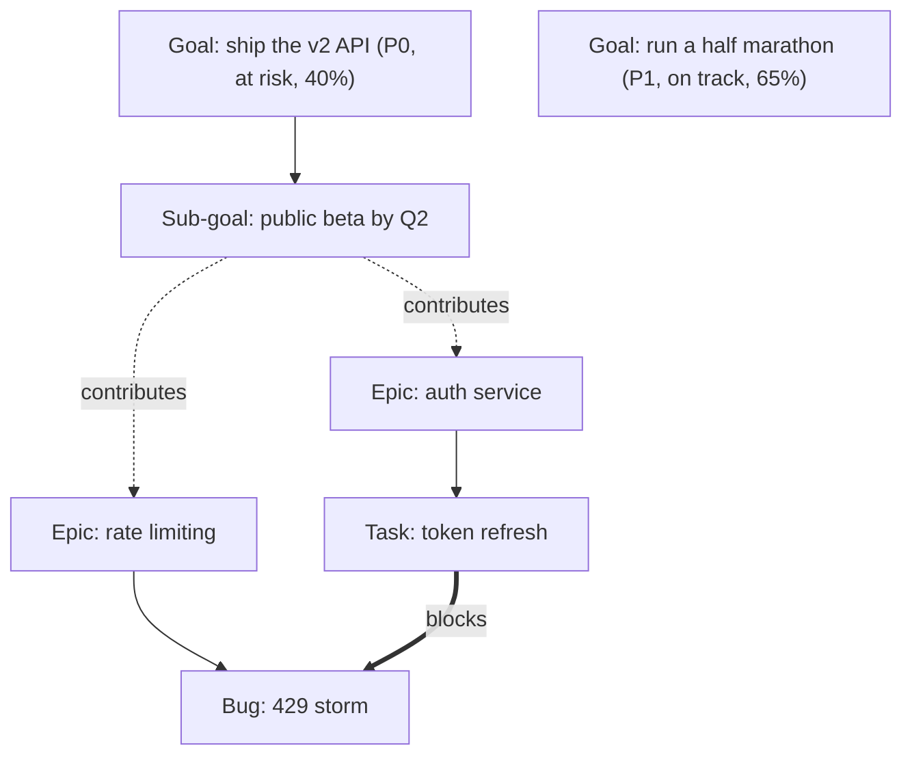

# Goals over work items: how products model and draw them, and which React libraries fit

This packet is one research leg for the beads-ui goals system. It covers how task, project and OKR products model goals above epics, stories, tasks and bugs; what their goal views look like; and which interactive visualisation libraries suit a goal graph, Gantt, timeline and dependency views in the beads-ui web app. The coordinator synthesises it with the other legs (goal science and ontology, the privacy guard, and the prior goals work) into the research and design docs.

## Summary

1. Atlassian Goals does not compute goal progress from linked work, which is the clearest documented reason it is "just okay". It says outright that for several work items linked to one goal "progress won't be automatically calculated across all of them", and caps linked Jira work items at 100 per goal. Plane and ClickUp count completed work, and Asana names its sources most precisely. A goal's progress is `manual`, `subgoal_progress`, `project_task_completion`, `project_milestone_completion`, `task_completion` or `external`, and each supporting link carries a `contribution_weight` from 0 to 1. [VERIFIABLE][^2][^3][^18][^19]
2. Goal-to-work is many-to-many in every product that models it well, and goal-to-goal is a tree with an optional second parent. Linear joins projects to initiatives through a separate `InitiativeToProject` record, so a project can sit under several initiatives. Asana returns "all of the parent goals of a goal". GitHub keeps one parent, and Atlassian's pages state no second parent. [VERIFIABLE][^2][^14][^18][^24]
3. Health and progress are two separate signals in the better products. Linear derives health from the most recent written update, flags a project "Update Missing" when an update is overdue, and computes progress as "(completed estimate points + 0.25 * in progress estimate points) / total estimate points". beads-ui can copy this split directly. [VERIFIABLE][^10][^14]
4. Beads 1.3.2 can hold goals without a schema change, but not cleanly. A custom `goal` type is allowed through `types.custom`, priority, `due_at` and dependencies already exist, and `bd dep cycles` exists. There is no planned start date, no progress or target-value field, `--parent` allows one parent only, and no CLI flag writes the `metadata` column on a dependency edge, so contribution weights have no writable home today. [VERIFIABLE][^79]
5. The goal-membership edge kind is a design decision this leg cannot settle alone. The natural Beads kind, `tracks`, is already D-5's sprint-membership edge, and the default kind, `blocks`, removes the dependent from `bd ready`. [VERIFIABLE][^79] Flagged below.
6. For the goal graph, React Flow (`@xyflow/react` 12.12.0, MIT, 38,798 stars) with ELK's layered layout in a Web Worker fits D-10's stack best. React Flow renders DOM nodes with keyboard focus, ARIA labels and a live region, which no canvas or WebGL graph library in the survey offers. Its expand-and-collapse and auto-layout examples are paid "Pro" examples, and ELK is EPL-2.0 with by far the largest bundle of the layout engines React Flow compares. [VERIFIABLE][^56][^58][^59][^60][^61][^62]
7. No permissive open-source Gantt library offers a critical path. SVAR React Gantt and DHTMLX Gantt both reserve auto-scheduling and critical path for paid PRO editions; Frappe Gantt draws dependency arrows but has no hierarchy and no release since February 2025. The cheapest route to the founding ask's Gantt is a custom SVG timeline shared with the Phase 3 Roadmap, with critical path computed in the DOM-free core. [VERIFIABLE][^61][^68][^69][^73]
8. Recharts, already chosen in D-10, ships `Sankey`, `Treemap`, `SunburstChart` and `RadialBarChart`, which covers effort-allocation and progress-ring views with no new chart library. [VERIFIABLE][^76]
9. Products have started exposing goals to AI agents. Perdoo ships an MCP server whose tools list OKRs and log "a progress update (new value + status + note)", Tability sells "both human and Agent teams" with agent check-ins, and Linear lets a user filter and segment work by the agent it was delegated to. None of them shows whether agent effort is going to the highest-priority goals; that view is new design work. [VERIFIABLE][^16][^38][^39]
10. Privacy boundaries break links in the products that have them. Atlassian restricts a goal only at creation, applies the restriction to the whole hierarchy, and forbids links between restricted and open goals. For beads-ui, where a private goal may live in a different repository than the public work it serves, the link records must live on the private side. [VERIFIABLE][^6] [INFERENCE] Flagged to the privacy leg.

## 1. Product survey of goal features

### 1.1 Comparison table

The table keeps the products with a goal object or a goal-like level above projects. Cells say "not stated" where the vendor page read in this run did not say.

| Product | Licence and price tier | Goal model | Hierarchy | Links to work | Roll-up method | Views | Notable strength | Notable weakness |
|---|---|---|---|---|---|---|---|---|
| Atlassian Goals (Atlassian Home) | Proprietary SaaS; one Goals app per organization | Name, owner, contributing teams, followers, start and target date, status or 0.0 to 1.0 score, success measures with metrics | Sub-goals up to 30 levels; parent count not stated | Any Jira work type, many goals per work item; 100 linked Jira work items per goal | Average of success-measure progress; no roll-up from linked work | Goal directory, saved views, dashboards | Rich update and follower model | Manual monthly status; work does not move progress |
| Jira Plans (Advanced Roadmaps) | Proprietary; Premium tier | Custom levels above Epic | Admin-defined levels via Parent field | Parent-child | Not stated | Plan timeline | Arbitrary levels above Epic | Single Parent field; strategy lives in another app |
| Linear Initiatives and Projects | Proprietary SaaS; saved initiative views need Enterprise | Initiative: owner, lead team, status, priority, labels, target date, health | Initiative tree through `InitiativeRelation`; public API exposes one parent | Project to initiative many-to-many; issue to one project | Project progress from estimate points; health from latest update | List, board, timeline grouped by initiative | Health from written updates, staleness flags, date resolution | Timeline shows projects only, never issues |
| Asana Goals and Portfolios | Proprietary SaaS; paid tiers | Goal with `start_on`, `due_on`, time period (FY, H1, Q1 and so on), metric, status | Multiple parent goals | Projects, portfolios, tasks and goals as supporting resources | Six named progress sources, weighted links | Goal list and detail; help centre unreadable in this run | Weighted, typed roll-up | Numeric metrics need manual update |
| ClickUp Goals | Proprietary SaaS | Goal with targets (number, true or false, tasks), owners, due date | Goal folders | Task targets | Task completion counts toward a target | Folders | Simple target types | No hierarchy found |
| Plane Initiatives | AGPL-3.0; initiatives are Pro | Title, lead, start and end dates, state (Draft to Closed), labels | Initiative over projects and epics | Any work item type; an epic pulls in its children | Counts by state group across all linked items and descendants | Overview, updates stream, timeline with FS, SS, FF dependencies | Roll-up over descendants, any work type | Pro only; no critical path stated |
| OpenProject | GPL-3.0 | Work packages, no goal object | Parent-child | Relates, precedes and follows, blocks, includes, requires, duplicates | Not stated | Gantt with relation lines | Dependency-aware rescheduling | No goals; no critical path stated |
| Leantime | AGPL-3.0 | Goal: outcome title, metric, start, current and target value, start and end date, status | Child goals | One milestone per goal | Metric value against target | Goal canvas, milestones on timeline and Gantt | Metric fields and AI tool surface | One milestone link per goal |
| GitHub Projects | Proprietary SaaS | No goal object; sub-issues and fields | 8 levels, 100 sub-issues per parent, one parent | Blocked-by dependencies | Sub-issue progress shown | Roadmap by start and target fields | Fields drive every view | No goal concept |
| Aha! Roadmaps | Proprietary SaaS | Goals and initiatives | Goals roll up to parent workspace lines; reports show up to six levels | Initiatives and work; feature inherits its epic's goal on Enterprise+ | Not stated | Detail and chart view of goals | Strategy to feature traceability | Expensive tiers for automation |
| Perdoo | Proprietary SaaS | Ultimate goal, strategic pillars, objectives, key results, KPIs | Strategy map from ultimate goal down | Projects and tasks linked to goals | Progress "pulled in from your apps" | Strategy map | Visual goal tree; MCP server for agents | Roll-up mechanics not documented |
| Tability | Proprietary SaaS | Goals and key results, KPIs | Strategy map | Syncs from Jira, Linear, Salesforce | Agent and human check-ins | Strategy map, people views | Agents as goal owners | Mechanics of sync not documented |
| Strides | Proprietary app | Habit, target, average and project trackers | Project milestones | None | Pace line against a target date | Tracker list | Pace line | Personal only, no task system |

### 1.2 Atlassian Goals, and why it is "just okay"

A goal is created with "a minimum of three pieces of information" and carries an owner, contributing teams, followers, linked sub-goals, projects and Jira epics, highlights (learnings, risks, decisions), a start and target date, and a status the owner keeps current. [VERIFIABLE][^1] Status is either a simple On track, At risk or Off track (plus Pending, Paused, Completed) or a 0.0 to 1.0 score mapped onto those bands, and only an admin can switch the method, for the whole workspace. [VERIFIABLE][^5] Owners get an automated reminder to share a monthly update. [VERIFIABLE][^5]

Goals link to "any work type" through a Goals field in Jira, and a work item can carry several goals. [VERIFIABLE][^2] Success measures carry a metric with a start value and a target value, and the goal's progress bar is the average of its success measures' progress. [VERIFIABLE][^4] Limits: 100 linked Jira work items per goal, 20 success measures per goal, 30 levels of sub-goals, one Goals app per organization; Atlassian recommends keeping hierarchies to "about 2 to 4 levels". [VERIFIABLE][^3]

The evidence for "just okay" is in Atlassian's own documentation.

- Linked work does not move the goal. "progress won't be automatically calculated across all of them", and Atlassian's advice is to create a sub-goal per piece of work instead. [VERIFIABLE][^2]
- The Jira integration page describes syncing project titles, target dates and tags, and says nothing about progress. [VERIFIABLE][^7]
- A goal can hold at most 100 linked Jira work items, so a goal served by a large epic tree cannot list its work. [VERIFIABLE][^3]
- Health is a monthly, owner-written opinion with a 280-character summary, so a goal can read "On track" for a month while its work stalls. [VERIFIABLE][^3][^5]
- Privacy is coarse. A goal can be restricted only when it is created, the restriction covers the whole hierarchy, and restricted goals cannot link to open goals. [VERIFIABLE][^6]
- The strategy layer is split across apps. Funding and capacity allocation against goals sit in Focus, a separate Strategy Collection app, and metric period targets also need that collection. [VERIFIABLE][^45][^46]

User reviews and forum threads that would corroborate this from the user side could not be read in this run (see section 1.12). [NO SOURCE]

### 1.3 Jira Plans hierarchy levels

Jira Plans adds levels above Epic (the documentation's examples are "Legend, Odyssey, or Anthology"), defined per plan and "independent from" the work-type order, and wired through the Parent field. [VERIFIABLE][^8] The page does not say whether a work item can have more than one parent. [NO SOURCE] The design lesson is that a level above Epic in the issue tree gives one parent per item, which is the shape Beads' `parent-child` already has; it does not give many-to-many goal membership. [INFERENCE]

### 1.4 Linear Initiatives, Projects and updates

Initiatives group projects around company objectives, nest as sub-initiatives that "ladder up to broader company goals", and carry one owner, a lead team, a status (Proposed, Planned, Active, Completed, Canceled), priority, labels and a target date. [VERIFIABLE][^9] The schema shows the many-to-many link: `InitiativeToProject` joins one initiative and one project with a `sortOrder`, and `Project.initiatives` lists "Initiatives that this project belongs to". [VERIFIABLE][^14] Initiative nesting runs through `InitiativeRelation` (parent, child, sort order); the public field is a single `parentInitiative`, with a plural `parentInitiatives` marked "[Internal]". [VERIFIABLE][^14] An issue belongs to one project at a time. [VERIFIABLE][^11]

Updates drive health. Each update is On track, At risk or Off track; reminders go to the owner or lead on a daily or interval schedule with nudges "1 working day later, and 2 working days after"; a project is marked "Update Missing" when its last update was On track and it is a reminder cycle plus three days overdue. [VERIFIABLE][^10] Initiative updates automatically include owner, target-date and status changes since the previous update. [VERIFIABLE][^10] Progress is computed from estimate points, with in-progress work counted at a quarter. [VERIFIABLE][^14]

Dates carry a resolution. A project's start and target date can be a year, half-year, quarter, month or day, stored as `startDateResolution` and `targetDateResolution`. [VERIFIABLE][^11][^14] Goals are often dated to a quarter, such as "by Q3", so the goal model needs the same resolution. [INFERENCE]

The timeline shows projects only and groups them by initiative. [VERIFIABLE][^12] Project dependencies are end-to-start only, created by dragging from a bar's end, drawn as lines that turn red when violated, filterable as "Project has violated dependencies"; moving a project bumps planned projects in its chain unless Cmd or Ctrl is held. [VERIFIABLE][^13] Recent changelog entries added team-led initiatives and excluded completed projects from initiative health counts. [VERIFIABLE][^15]

### 1.5 Asana Goals and Portfolios

Asana's API is the most precise goal model found. A goal has `start_on`, `due_on`, a `time_period` (FY, H1, H2, Q1 to Q4), followers and a metric. [VERIFIABLE][^20] Its `metric.progress_source` enum is `manual`, `subgoal_progress`, `project_task_completion`, `project_milestone_completion`, `task_completion` and `external`, with an `is_custom_weight` switch for the computed sources. [VERIFIABLE][^18] Status is `green`, `yellow` or `red` while open and `missed`, `achieved`, `partial` or `dropped` when closed. [VERIFIABLE][^18]

A goal relationship links a supporting resource ("a project, task, portfolio, or goal") to a supported goal, with a `contribution_weight` that "can be 0, 1, or any value in between" and a subtype of `subgoal` or `supporting_work`. [VERIFIABLE][^19] A goal can have several parents. [VERIFIABLE][^18] The marketing page adds that numeric tracking such as revenue "must be updated manually" unless linked to a Salesforce report. [VERIFIABLE][^17] The Asana help centre rendered no article bodies to the fetch tool, so Asana's goal tree or strategy-map UI is unverified here. [NO SOURCE]

### 1.6 ClickUp, monday.com, Notion and Obsidian

ClickUp groups goals in folders, supports number, true-or-false and task targets, and tracks task targets "automatically ... as you complete them". [VERIFIABLE][^21] monday.com's goals pages returned 403 and 404 in this run. [NO SOURCE]

Notion's "life OS" pattern is relations plus rollups. A relation can hold several pages or be capped at one, can be made two-way, and a rollup aggregates a property of related pages, for example "Percent not empty". [VERIFIABLE][^54] Obsidian Bases builds table, card, list, kanban and map views over note properties, and "All the data in Obsidian Bases is stored in your local Markdown files". [VERIFIABLE][^55] In both, the user defines the goal-to-task relation and its roll-up. [INFERENCE]

### 1.7 GitHub Projects

GitHub allows "up to 100 sub-issues per parent issue" and "up to eight levels of nested sub-issues". [VERIFIABLE][^22] The REST API's `replace_parent` flag "instructs the operation to replace the sub-issues current parent issue", which implies one parent per sub-issue. [VERIFIABLE][^24] Blocked issues show a "Blocked" icon on boards. [VERIFIABLE][^23] The roadmap places items by chosen start and target fields, drags to reschedule, zooms from a month to a year, and draws iteration and milestone markers; dependency lines are not mentioned. [VERIFIABLE][^25] GitHub has no goal object.

### 1.8 Productboard and Aha!

Aha! lets a goal "roll a goal up to its parent workspace or workspace line", reports up to six goal levels, links goals to initiatives and work, and on Enterprise+ ties a feature to "the epic's goal and initiative" automatically. [VERIFIABLE][^35] Its Goals page has a detail view and a chart view. [VERIFIABLE][^35] Productboard's public page lists objectives, key results, initiatives and "progress and risk monitoring", and its support article URL returned 404, so its linking model is unverified. [VERIFIABLE][^36] [NO SOURCE]

### 1.9 Open-source products

Plane is the most useful open-source reference. Initiatives are a Pro feature with a lead, start and end dates and a state from Draft to Closed; "one initiative can span any number of projects"; any work item type can be added; linking an epic brings in everything inside it; and progress counts work items by state group across linked projects, epics and their descendants. [VERIFIABLE][^26] Plane's timeline supports finish-to-start, start-to-start and finish-to-finish dependencies, draws violated ones in red, and moves dependents when a task moves. [VERIFIABLE][^27] Admins can define custom relation types with an inward and outward name. [VERIFIABLE][^28]

OpenProject has the widest relation vocabulary: related to, predecessor and successor with lag in working days, duplicates, blocks, includes, requires, and parent-child. [VERIFIABLE][^29] Its Gantt drags and resizes bars, draws predecessor lines, pushes followers later, and does not mention a critical path. [VERIFIABLE][^30]

Leantime has a real goal object. Its AI tool for goal creation takes an outcome-statement `title`, a `description` that is "The metric being tracked", `startValue`, `currentValue`, `endValue`, `startDate`, `endDate`, one `milestoneId`, a `metricType` and a status of on track, at risk or missed. [VERIFIABLE][^32] Leantime describes goals as "quantifiable, measurable outcomes" and asks users to "explicitly connect each milestone to your primary goal". [VERIFIABLE][^31]

Vikunja has sub-projects, task relations such as subtask and blocking, and a Gantt chart, and no goals. [VERIFIABLE][^33] Huly's home page mentions no goals, roadmaps or Gantt. [VERIFIABLE][^34] Taiga's documentation pages read in this run did not describe epics, and its `kaleidos-ventures/taiga` repository was last pushed in December 2023. [VERIFIABLE][^61] Licences from GitHub metadata: Plane, Leantime, Vikunja and AppFlowy AGPL-3.0; OpenProject GPL-3.0; Huly EPL-2.0. [VERIFIABLE][^61] Focalboard has not released since June 2024. [VERIFIABLE][^61] None of these is a code donor for a public MIT or Apache monorepo. [INFERENCE]

### 1.10 OKR tools

Perdoo's hierarchy runs from an "Ultimate Goal" through strategic pillars, objectives and key results, with KPIs alongside, shown in a Strategy Map with progress percentages on each goal; projects and tasks link to goals. [VERIFIABLE][^37] Perdoo's MCP server (dated 2026-09-15) lets an agent list OKRs, read progress history, log "a progress update (new value + status + note) on a KPI or key result", and create draft objectives. [VERIFIABLE][^38]

Tability calls itself "An AI-native platform to build, roll out and execute your business strategy with both human and Agent teams", says "Agent check-ins run on schedule", offers a strategy map, and syncs from Jira, Linear and Salesforce. [VERIFIABLE][^39] WorkBoard supports OKRs, OGSMs and Hoshin Kanri, describes "Visible and measurable alignment from company to individual goals", and sells portfolio, chief-of-staff and coaching agents. [VERIFIABLE][^40] `quantive.com` answered with an HTTP 302 to `workboard.com` in this run. [VERIFIABLE][^41] Whether that is an acquisition was not verified. [NO SOURCE]

Lattice describes cascading goals that "accept the progress of their supporting goals" and non-cascading goals that do not. [VERIFIABLE][^43] Mooncamp embeds goal reviews in weekly meetings and pulls numbers from Power BI, Excel, Azure DevOps and Salesforce. [VERIFIABLE][^42] Profit.co lists "Strategic Alignment" and a "Department Heatmap" without describing roll-up. [VERIFIABLE][^44] Weekdone was not read in this run. [NO SOURCE]

### 1.11 Personal-goal apps and life systems

Strides offers habit, target, average and project trackers, with a "pace line" for target and project trackers. [VERIFIABLE][^48] Lifetick starts from core values, uses SMART goals broken into tasks, keeps "Dreams" that convert to goals, and logs a time-stamped journal. [VERIFIABLE][^49] Sunsama sets weekly objectives and ends the day with a shutdown ritual; its page does not explain linking tasks to objectives. [VERIFIABLE][^50] Motion auto-schedules tasks by priority and deadline with no goal feature on its home page. [VERIFIABLE][^51] Akiflow lists "Goals" in its toolbox and "goal-aligned" AI nudges without detail. [VERIFIABLE][^52] Things has no goal feature; an Area groups work that supports "an ongoing ambition". [VERIFIABLE][^53] Todoist's karma help article returned the help-centre landing page. [NO SOURCE]

Two patterns from the personal apps transfer to beads-ui. A pace line against a target date shows whether a goal is ahead or behind schedule, which a percentage alone does not. A values or "life areas" layer above goals appears in Lifetick and in Things' Areas. [INFERENCE] Whether that layer belongs in the ontology is the science leg's call.

### 1.12 What users praise and complain about

The run found little first-hand sentiment. A web search tool was unavailable, a general search engine returned off-topic results for six product-specific queries, and the Atlassian community index pages returned 404. Two Hacker News comments surfaced through the public search API: one says "the vast majority of companies that use OKRs do it incorrectly" and objects to requiring "every team to write OKRs for every quarter", and a 2026 comment criticises "vibe OKRs" built on metrics a bot "hallucinated". [VERIFIABLE][^78] That is too thin to rank products by sentiment, so this packet relies on vendors' documented limits. [NO SOURCE]

## 2. Linkage models

### 2.1 Goal to work

Every product with a working goal-to-work link makes it many-to-many and keeps it separate from the work hierarchy. Atlassian uses a Goals field holding several goals. [VERIFIABLE][^2] Linear uses a join record between initiatives and projects. [VERIFIABLE][^14] Asana uses a goal-relationship record with a weight. [VERIFIABLE][^19] Plane adds scope items to an initiative and pulls in descendants of a linked epic. [VERIFIABLE][^26]

Two variants differ in where the link attaches. Linear attaches goals to projects only, so issues inherit through their single project. [VERIFIABLE][^11] Atlassian and Plane attach to any work type. [VERIFIABLE][^2][^26] Plane's descendant inclusion avoids linking every task one by one, and it is the model that fits Beads, where epics already parent their work. [INFERENCE]

### 2.2 Goal to goal

The relations found are parent and child (all products), several parents (Asana), roll-up across organisational lines (Aha!), and cascading or non-cascading progress (Lattice). [VERIFIABLE][^18][^35][^43] No goal product read here offers "blocks" or "depends on" between goals; those exist between projects in Linear and between work items in Plane, OpenProject and GitHub. [VERIFIABLE][^13][^23][^27][^29] The founding ask wants goals to carry "relates to and dependencies and blocks", so beads-ui will have them where most goal products do not. Beads already provides those kinds. [VERIFIABLE][^79]

### 2.3 Cycles and orphans

Beads checks each new edge for cycles by default and offers `bd dep cycles` for a whole-graph check. [VERIFIABLE][^79] Linear and Plane signal violated date dependencies in red. [VERIFIABLE][^13][^27] No product page read here documents how it prevents cycles in a goal tree or how it surfaces orphaned goals and unaligned work. [NO SOURCE] A single-parent tree cannot form a parent cycle when re-parenting is checked against descendants, and a second "contributes to" edge needs the same check. [INFERENCE]

## 3. Visualisation patterns worth copying

### 3.1 The goal tree or strategy map

Perdoo's Strategy Map draws the goal tree from one ultimate goal down, with progress on each node. [VERIFIABLE][^37] Tability and WorkBoard advertise the same kind of map. [VERIFIABLE][^39][^40] Atlassian supports 30 levels while recommending 2 to 4. [VERIFIABLE][^3] For beads-ui the map should open collapsed to two levels, show each node's priority, health and progress, and expand on demand; React Flow's own performance guidance for deep trees is to hide nodes and reveal them on expansion. [VERIFIABLE][^57] [INFERENCE]

The goal graph also needs the work below the goals, with dependency and blocker edges. Beads already renders this shape: `bd graph --html` produces a "Self-contained interactive HTML with D3.js visualization", layered by dependency order. [VERIFIABLE][^79] beads-ui can treat that output as a working prototype of the layered layout. [INFERENCE]

Solid arrows are the single-parent tree, dotted arrows the many-to-many contribution links, and the thick arrow a blocker. The second goal shows that unrelated goals sit side by side as separate roots.

### 3.2 Dependency views with blockers

The pattern shared by Linear, Plane and OpenProject is a line from the end of one bar to the start of another, coloured when violated, with a filter for violations. [VERIFIABLE][^13][^27][^30] Linear's drag modifiers (Cmd or Ctrl to hold the chain, Shift to move it) are a compact answer to "move this and its dependents". [VERIFIABLE][^13] Critical-path highlighting appears only in paid Gantt editions among the sources read. [VERIFIABLE][^68][^69]

### 3.3 Timelines, roadmaps and Gantt

Linear's timeline groups projects by initiative, so goals become swimlanes. [VERIFIABLE][^12] GitHub's roadmap shows the minimum a roadmap needs: start and target fields, drag to reschedule, month-to-year zoom and markers. [VERIFIABLE][^25] Linear's date resolution lets a bar span "Q3" without inventing day precision. [VERIFIABLE][^11]

### 3.4 Effort and progress charts

A Sankey of effort from goals through epics to work, a treemap or sunburst of open estimate by goal, and a radial progress ring per goal are all standard chart types. Recharts has `Sankey`, `Treemap`, `SunburstChart` and `RadialBarChart`. [VERIFIABLE][^76] Nivo offers Sankey, Sunburst, TreeMap, Icicle, CirclePacking and Bullet, with Canvas versions for TreeMap and CirclePacking. [VERIFIABLE][^77] ECharts has `sankey`, `sunburst`, `treemap`, `tree` and `graph` series and a custom-series Gantt example. [VERIFIABLE][^75] A burn-up per goal is a line chart of completed against total scope over time, which Recharts already draws. [INFERENCE] A pace line in the Strides style is one extra reference line on that chart. [VERIFIABLE][^48] [INFERENCE]

## 4. Libraries for these views in React 19

### 4.1 Maintenance and licence signals

Values read on 2026-10-28 from GitHub and npm; the full table is in `docs/research/findings/evidence/goals-visualisation-measurements-2026-10-28.md`. [VERIFIABLE][^60][^61]

| View | Library | Licence | Stars | Latest release | React 19 | Rendering | Notes |
|---|---|---|---|---|---|---|---|
| Graph | React Flow (`@xyflow/react`) | MIT | 38,798 | 12.12.0 on npm | peer `react >=17` | DOM and SVG | Keyboard, ARIA, live region; expand-collapse and auto-layout examples are Pro |
| Layout | elkjs | EPL-2.0 | 2,854 | 0.12.0, 2026-07-17 | n/a | Web Worker | Layered, stress, mrtree, radial, force; largest bundle in React Flow's comparison |
| Layout | dagre | MIT | 5,841 | v2.0.0, 2025-11-23 | n/a | n/a | Fast; sub-flow caveat |
| Graph | Cytoscape.js | MIT | 11,253 | v3.34.4, 2026-10-15 | no React package | Canvas, WebGL preview | Compound nodes; dagre, ELK, Cola layouts |
| Graph | AntV G6 | MIT | 12,353 | 5.1.1, 2026-04-17 | no peer deps | Canvas | 11 runtime dependencies; 319 open issues |
| Graph | Sigma.js | MIT | 12,207 | 4.0.4, 2026-10-27 | framework-agnostic | WebGL | Built on graphology |
| Graph | Reagraph | Apache-2.0 | 1,098 | 4.32.0 on npm | peer `react >=16` | WebGL | Tree, radial, force, hierarchical layouts |
| Graph | vis-network | Apache-2.0 | 3,634 | v10.1.4, 2026-10-27 | no React package | Canvas | 323 open issues |
| Tree editor | headless-tree | MIT | 910 | core 1.8.0, 2026-10-15 | yes | DOM | Ordered drag and drop, 100k+ items virtualised |
| Tree editor | react-arborist | MIT | 3,714 | v4.0.1, 2026-10-11 | peer `>= 18` | DOM | Requires `react-dnd` |
| Gantt | SVAR React Gantt | MIT core, paid PRO | 215 | 2.8.2 on npm | "fully compatible with React 18 and 19" | DOM | Critical path, auto-scheduling, four link types in PRO |
| Gantt | Frappe Gantt | MIT | 6,155 | v1.0.3, 2025-02-03 | vanilla JS | SVG | Dependency arrows, `move_dependencies` |
| Gantt | DHTMLX Gantt | MIT community, paid PRO | 1,867 | v10.0.3, 2026-09-03 | wrapper only; `ReactGantt` is PRO | DOM | Critical path, auto-scheduling, resources in PRO |
| Gantt | Bryntum Gantt | Commercial | n/a | n/a | yes | DOM | Scheduling engine runs off the DOM |
| Gantt | Syncfusion | Commercial; community licence under $1M revenue | n/a | n/a | yes | DOM | Licence terms restrict eligibility |
| Gantt | KendoReact Gantt | Commercial ("part of KendoReact premium") | n/a | n/a | yes | DOM | 30-day trial |
| Timeline | vis-timeline | Apache-2.0 or MIT | 2,572 | v8.5.6, 2026-10-26 | no React package | DOM | 267 open issues |
| Timeline | react-calendar-timeline | MIT | 2,162 | 0.30.0-beta.19 on GitHub; npm `latest` is beta.4 | peer pinned to a React 19 RC | DOM | Beta only |
| Timeline | Planby | "Custom License - All Rights Reserved" | 1,722 | v2.1.0 | n/a | n/a | Not usable |
| Charts | Recharts (in D-10) | MIT | 27,666 | v3.10.1, 2026-07-25 | yes | SVG | Sankey, Treemap, Sunburst, RadialBar |
| Charts | Nivo | MIT | 14,122 | v0.99.0, 2025-05-23 | peer includes `^19.0` | SVG and Canvas | No release for 17 months |
| Charts | visx | MIT | 21,087 | v4.0.0, 2026-06-11 | yes | SVG | Low-level scales and shapes for custom views |
| Charts | ECharts (+ echarts-for-react) | Apache-2.0 (+ MIT) | 67,611 | 6.1.0, 2026-05-19 | wrapper | Canvas and SVG | 1,272 open issues; second theme system |
| Mind map | markmap | MIT | 13,206 | v0.18.0, 2024-12-19 | no React package | SVG | Markdown to mind map |

The feature and licence-term cells come from each library's own page, in table order: React Flow, elkjs, Cytoscape.js, Sigma.js, Reagraph, headless-tree, SVAR, DHTMLX, Bryntum, Syncfusion, KendoReact, Frappe, ECharts, Recharts and Nivo. [VERIFIABLE][^56][^58][^59][^62][^63][^64][^65][^66][^67][^68][^69][^70][^71][^72][^73][^74][^75][^76][^77] Planby's licence title and vis-timeline's dual licence are carried from the earlier UX packet; this run's metadata shows both licences as `NOASSERTION`, which is consistent with a non-standard or dual licence file. [INFERENCE]

### 4.2 Graph libraries at 500 to 5,000 nodes

React Flow renders each node as a DOM element and its docs name re-renders, full-array subscriptions and heavy CSS as the causes of slowness, with no node-count threshold given. [VERIFIABLE][^57] Cytoscape's WebGL preview moved a 1,200-node, 16,000-edge network from about 20 FPS to over 100 FPS, and a 3,200-node, 68,000-edge network from 3 to 10 FPS, with edge styling limits (no dashes, solid colours only). [VERIFIABLE][^64] No benchmark for React Flow at 5,000 nodes was found. [NO SOURCE]

A goal map is read by a person deciding priorities, and a few hundred visible nodes is already more than a person reads at once. [HEURISTIC] So the realistic need is a DOM graph showing tens to a few hundred nodes at a time, with collapse and filters, and a WebGL fallback only for an "everything" overview. [INFERENCE] React Flow's ARIA and keyboard support decides it for the primary view, because canvas and WebGL libraries draw nodes that a screen reader cannot reach. [VERIFIABLE][^58] [INFERENCE]

ELK is the only layout engine in React Flow's comparison with sub-flow layout and edge routing, and it runs asynchronously, which suits a Web Worker. [VERIFIABLE][^56][^62] React Flow's comparison shows a bundle-size badge of 1,455,420 for ELK against 39,882 for dagre (units unstated), so ELK should load lazily. [VERIFIABLE][^56] [INFERENCE] EPL-2.0 is a file-level copyleft licence that permits use from an MIT or Apache project when the ELK files are not modified; the coordinator should still record it. [HEURISTIC]

### 4.3 Gantt and timeline

The founding ask names a Gantt chart with dependencies and blockers. Every permissive Gantt option drops something: SVAR's MIT core has summary tasks and finish-to-start links but no critical path or auto-scheduling, DHTMLX's community edition lacks critical path and a React component, and Frappe has no hierarchy and an old release. [VERIFIABLE][^68][^69][^73] SVAR's 215 stars fail the adoption route of the source-vetting rule, so it is exploratory. [VERIFIABLE][^61] [INFERENCE]

A custom SVG timeline built on visx scales and TanStack Virtual (already in D-10) can serve the Phase 3 Roadmap (T-3.2), the goal timeline and the Gantt from one component. [INFERENCE] Critical path is a longest-path computation over a directed acyclic graph of durations, which belongs in the DOM-free core with tests. [HEURISTIC] The cost is building drag, resize and dependency-line interactions, each a plain field write. [INFERENCE]

### 4.4 Charts

Recharts covers every chart this leg found a use for, so no second chart library is needed. [VERIFIABLE][^76] [INFERENCE] ECharts is the fallback if a chart needs canvas performance, at the cost of a second theming system next to D-19's tokens. [INFERENCE]

## 5. Prioritisation surfaces that tie work to goals

The products found offer pieces of an alignment view:

- Linear segments work by the agent it was delegated to: custom views filter by Delegate, and Insights segment by Delegate to measure agent workload. [VERIFIABLE][^16]
- Atlassian Focus allocates budget and capacity to goals and connects "incoming business requests directly to top strategic goals". [VERIFIABLE][^45]
- Jellyfish shows "how development work is distributed across work categories, product lines, initiatives, deliverables, and more". [VERIFIABLE][^47]
- Perdoo's MCP server and Tability's agent check-ins let agents report progress against goals. [VERIFIABLE][^38][^39]
- Leantime exposes goal creation, editing and child-goal reads as AI tools. [VERIFIABLE][^32]

No product read here shows an explicit "unaligned work" list or compares effort share against goal priority. [NO SOURCE] No product computes goal alignment for AI agent work against the owner's goals. [NO SOURCE] Both are new design work for beads-ui. [INFERENCE]

beads-ui already has the inputs. Assignees name sessions under D-17, `estimated_minutes` and closed timestamps measure effort, and goal priority comes from the goal issue's own `priority`. [VERIFIABLE][^79] [INFERENCE] Three views follow from them:

1. An unaligned-work list: open issues with no contribution path to any open goal, sorted by priority.
2. An allocation chart: for each goal, its priority-weighted share of planned effort beside its actual share of closed estimate over the last N days, split into human and agent sessions.
3. A goal health board: goals in priority order with health, progress, pace against target date, staleness of the last update, and open blockers.

These views fit the founding ask's event-based requirement. A goal's health changes only when an update, a status change or a close arrives, so each view can recompute on those events and never on a timer. [INFERENCE]

## 6. Configuration UX

Atlassian links a goal from a work item by creating, searching or pasting a goal link, and bulk-links from the list view's Goals column. [VERIFIABLE][^2] Linear creates a dependency by dragging from a timeline bar's end and from the command bar. [VERIFIABLE][^13] Plane adds scope through "Add scope". [VERIFIABLE][^26] Atlassian restricted goals "still appear in the link picker so you can find them". [VERIFIABLE][^6]

For re-parenting in a tree, headless-tree supports "ordered and unordered drag-and-drop" with virtualisation past 100,000 items, and is the successor to React Complex Tree. [VERIFIABLE][^67] react-arborist requires `react-dnd`, a second drag library beside D-10's Pragmatic drag and drop. [VERIFIABLE][^60] Every drag needs a keyboard and menu path ("Move under..."), as D-10 and T-3.1 already require for the board. [INFERENCE]

For visibility, Linear initiatives are visible to all workspace members except guests, with private work handled through a private team. [VERIFIABLE][^9] Atlassian restricts per goal at creation, for the whole hierarchy. [VERIFIABLE][^6] ClickUp manages "view and edit permissions for who can access a Goal". [VERIFIABLE][^21] On the UI side a private goal needs a visible badge, a placeholder node when a viewer cannot see it, and a clear refusal when a public item is linked to it. [INFERENCE] Enforcement belongs to the privacy leg.

## Requirement coverage

| Founding-ask requirement in this leg's topic | Where covered | Status |
|---|---|---|
| Goals as the top of the Beads hierarchy above epics | §1, What Beads has and lacks, R1 | Covered; needs a custom type |
| Any issue assigned to zero, one or many goals | §2.1, R2 | Covered; edge kind flagged |
| Goal views organised by priority | §5 item 3, R7 | Covered |
| Relates to, depends on, blocks | §2.2, R3 | Covered; Beads has the kinds |
| Start, end and due dates | §1.4, What Beads has and lacks, R5 | Covered; start date needs metadata |
| Hierarchical linked graph | §3.1, R7 | Covered |
| Gantt | §4.3, R7 | Covered; critical path needs custom code |
| Timeline | §3.3, R7 | Covered |
| Graph view with dependency and blocker lines | §3.2, R7 | Covered |
| Prioritise own and agents' work toward goals | §5, R8 | Covered as new design work; no product precedent |
| Breadth across paid, freemium, free, open source | §1, §4 | Narrowed: sentiment and four vendors unreadable |

No requirement in this topic was dropped.

## What Beads has and lacks for goals

Measured with read-only commands against Beads 1.3.2 in the beads-ui worktree; values are recorded in the evidence file. [VERIFIABLE][^79]

| Need | Beads 1.3.2 | Gap |
|---|---|---|
| A goal type | Built-in types include `epic`, `milestone`, `story`; custom types via `types.custom` (this store has `research`, `follow_up`) | No built-in `goal`; add one to `types.custom` per store |
| Goal above epic | `parent-child` edge, `--parent` reparents, one parent | A goal can parent epics, but then each epic has only that goal |
| Many-to-many goal links | Edge kinds `blocks`, `tracks`, `related`, `parent-child`, `discovered-from`, `until`, `caused-by`, `validates`, `relates-to`, `supersedes` | No dedicated "contributes to" kind; `tracks` is D-5's sprint edge; `blocks` hides the dependent from `bd ready` |
| Contribution weight | `dependencies.metadata` JSON column exists | No CLI flag writes edge metadata |
| Goal to goal relates, depends, blocks | `relates-to` via `bd dep relate`, `blocks`, cycle checks | None |
| Priority | `priority` 0 to 4 | None |
| Due or target date | `due_at` | No date resolution (quarter, half-year) |
| Start date | `started_at` records actual start | No planned start; use `metadata`, as D-5 does with `sprint.starts_at` |
| Progress, target metric, health | `metadata` JSON on the issue; `bd epic status` for epic completion | No progress, metric or health fields |
| Check-in updates | Comments, notes, `bd history --events` | No structured update with health |
| Graph output | `bd graph --html` (D3.js), `--dot`, `bd dep tree --format mermaid` | Not interactive editing |
| Cross-store goals | `bd repo` multi-repo hydration; `external:<project>:<capability>` edges; `bd migrate-personal` | Privacy rules for which store holds the edge |

## Recommendations for the design

Each recommendation names the deciding criterion and a confidence. All are the design author's to decide under the decision framework.

### R1. Goal representation

Option (a): a `goal` custom issue type, with goal-only fields in `metadata`.

**Pros:**
- Priority, status, due date, labels, comments, history and dependencies come free.
- Existing board, list and detail views show goals with no new storage.

**Cons:**
- Metadata fields are untyped and need validation in core.
- Every store must add `goal` to `types.custom`.

Option (b): a separate goals file or table outside Beads.

**Pros:**
- Free schema.

**Cons:**
- Loses Beads history, dependencies, cycle checks and `bd` tooling.
- A second store to sync and secure.

Option (c): an upstream Beads change adding a goal type and fields.

**Pros:**
- Typed fields.

**Cons:**
- Blocks on an external project's roadmap.

Recommendation: (a), with `metadata.goal` holding `starts_at`, date resolution, `progress_source`, target metric (start, current, target, unit) and visibility. Deciding criterion: reuse of Beads behaviour the ask already depends on (priority, blocks, relates). Confidence: high. [INFERENCE]

### R2. Goal membership edge (many-to-many)

Option (a): a `tracks` edge from the work item to the goal, told apart from D-5's sprint edge by the target's type (`goal` against `milestone`).

**Pros:**
- Same direction and meaning as D-5 ("member tracks container").
- No new kind; queries filter by target type.

**Cons:**
- Two meanings on one kind; every reader must check the target type.
- Weight has no CLI-writable home.

Option (b): a `goal:<slug>` label on the work item.

**Pros:**
- Indexed and filterable with `bd list --label`, as D-5's sprint labels are.

**Cons:**
- Not a graph edge, so no cycle checks and no `bd graph` drawing.
- Label slugs leak goal names into whichever store holds the work item.

Option (c): `validates` or `relates-to` as the membership kind.

**Pros:**
- No overlap with D-5.

**Cons:**
- The names mean something else; `relates-to` is bidirectional and loses direction.

Recommendation: (a) for the graph, with descendant inclusion as Plane does (link an epic, and its children count). Store weights in the goal's metadata keyed by member id until Beads can write edge metadata. Deciding criterion: one link model that the graph, roll-up and `bd graph` all read. Confidence: medium, because it overloads D-5's edge and touches privacy (flagged). [INFERENCE]

### R3. Goal-to-goal links

Option (a): `parent-child` for the primary goal tree, plus `tracks` for a second "contributes to" parent, plus `blocks` and `relates-to`.

**Pros:**
- Matches Asana's several parents and Linear's single public parent.
- Every kind already exists in Beads.

**Cons:**
- Two ways to be "under" a goal need clear UI wording.

Option (b): `parent-child` only.

**Pros:**
- Simplest tree.

**Cons:**
- Cannot express a sub-goal serving two goals.

Recommendation: (a). Deciding criterion: the ask names relates, dependencies and blocks between goals. Confidence: high. [INFERENCE]

### R4. Progress roll-up

Option (a): a per-goal `progress_source` copied from Asana's enum: `manual`, `subgoals`, `work_count`, `work_estimate`, `metric`.

**Pros:**
- Each goal states how its number is made; Atlassian's main weakness is avoided.

**Cons:**
- More configuration per goal.

Option (b): one fixed formula, Linear's estimate-weighted progress with in-progress at 0.25.

**Pros:**
- Zero configuration.

**Cons:**
- Many Beads issues have no `estimated_minutes`, so it degrades to noise.

Option (c): manual status only.

**Pros:**
- Matches OKR practice.

**Cons:**
- Reproduces the "just okay" problem.

Recommendation: (a), defaulting to `work_estimate` with a count fallback when fewer than half the members carry estimates, and health kept as a separate signal (R5). Deciding criterion: progress must move when work closes. Confidence: medium-high. [INFERENCE]

### R5. Health, check-ins and dates

Option (a): health from structured updates (on track, at risk, off track) with Linear-style staleness, plus a pace line from start and target dates.

**Pros:**
- Separates opinion (health) from measurement (progress).
- Agents can post updates through the same write path.

**Cons:**
- Needs an update record shape (a comment with metadata, or a child event issue).

Option (b): health computed from progress against pace only.

**Pros:**
- No updates to write.

**Cons:**
- Misses risks that do not show in counts yet.

Recommendation: (a), with date resolution stored beside `due_at`. Deciding criterion: the ask wants to see whether work is progressing toward goals. Confidence: medium. [INFERENCE]

### R6. Goal graph view and library

Option (a): React Flow with elkjs layered layout in a Web Worker, lazy-loaded, collapsed to two levels by default.

**Pros:**
- MIT, 38,798 stars, React 19 peer range, keyboard and ARIA support.
- Nodes are React components using D-19's tokens.

**Cons:**
- Expand-collapse and auto-layout examples are paid; beads-ui writes its own.
- elkjs is EPL-2.0 and has the largest bundle of the layout engines compared.

Option (b): Cytoscape.js with its WebGL renderer.

**Pros:**
- Best large-graph frame rates measured; compound nodes.

**Cons:**
- Canvas and WebGL nodes are invisible to screen readers; no React package.

Option (c): Reagraph or Sigma.js in WebGL.

**Pros:**
- Built-in tree and radial layouts (Reagraph).

**Cons:**
- Reagraph has 1,098 stars and no GitHub releases; same accessibility gap.

Recommendation: (a), with dagre for pure-tree layouts when ELK's bundle is not loaded, and (b) reserved for a later read-only "whole graph" overview if a measured need appears. Deciding criterion: accessibility and D-10 consistency at the node counts a person reads. Confidence: medium-high. [INFERENCE]

### R7. Gantt, timeline and roadmap

Option (a): one custom SVG timeline on visx and TanStack Virtual, serving the Roadmap (T-3.2), the goal timeline and the Gantt, with critical path computed in core.

**Pros:**
- One component, D-19 tokens, no paid tier, permissive licences.
- Matches T-3.2's "draw blocks and parent-child dependencies as lines".

**Cons:**
- beads-ui builds drag, resize and dependency-line interactions itself.

Option (b): SVAR React Gantt MIT core.

**Pros:**
- React 19, summary tasks, dependency links, drag from a backlog.

**Cons:**
- 215 stars (exploratory); critical path and auto-scheduling only in PRO.

Option (c): a commercial Gantt (Bryntum, DHTMLX PRO, Syncfusion, KendoReact).

**Pros:**
- Complete scheduling features.

**Cons:**
- Paid licences in a public MIT or Apache repo; Syncfusion's free tier depends on revenue and headcount.

Recommendation: (a), with a short spike to compare its cost against SVAR's core before the build. Deciding criterion: the critical path and blocker lines the ask names, without a paid licence. Confidence: medium. [INFERENCE]

### R8. Alignment and allocation views

Option (a): the three views in section 5 (unaligned-work list, allocation chart split by human and agent, goal health board) on Recharts.

**Pros:**
- Directly answers "prioritise both my own work and my agents' work toward my goals".
- No new library.

**Cons:**
- No product precedent to copy; the allocation formula needs design.

Option (b): a goal health board only.

**Pros:**
- Small.

**Cons:**
- Drops the agent-work half of the requirement.

Recommendation: (a). Deciding criterion: the founding ask names agent work explicitly, so (b) would narrow it. Confidence: high on scope, medium on formulas. [INFERENCE]

### R9. Tree editing for goals

Option (a): headless-tree for the goals outline, with a "Move under..." menu for keyboard and touch.

**Pros:**
- MIT, ordered drag and drop, virtualised, maintained (core release 2026-10-15).

**Cons:**
- 910 stars, so exploratory under the source-vetting rule.

Option (b): react-arborist.

**Pros:**
- 3,714 stars.

**Cons:**
- Pulls in `react-dnd` beside Pragmatic drag and drop.

Option (c): TanStack Table expanding rows with Pragmatic drag and drop.

**Pros:**
- No new dependency.

**Cons:**
- Tree drop semantics built by hand.

Recommendation: (c) if the Phase 3 backlog already uses expanding rows, else (a) after a spike. Deciding criterion: one drag library in the app. Confidence: low-medium. [INFERENCE]

## Gaps, blindspots & emergent findings

1. Anchor bias. The brief's product list leans toward team OKR software. Personal-goal apps and life systems model goals differently (pace lines, values layers, local Markdown storage), and the owner of this system is one person directing agents. The design should weight Strides-style pace and Linear-style health above enterprise cascading. [INFERENCE]
2. Agent-facing goal APIs are a 2026 pattern. Perdoo's MCP server, Leantime's goal tools and Tability's agent teams all appeared in this run; Linear treats agents as delegates with their own workload views. [VERIFIABLE][^16][^32][^38][^39] beads-ui's MCP App (Phase 4) could expose goal reads and goal updates the same way. [INFERENCE]
3. Vendor consolidation. `quantive.com` redirects to `workboard.com`, Focalboard has not released since 2024, and Taiga's monorepo has been idle since 2023. [VERIFIABLE][^41][^61] Goal tooling built on Beads avoids that dependency. [INFERENCE]
4. Contrarian evidence. Atlassian recommends only 2 to 4 hierarchy levels and 1 to 3 success measures, and the Hacker News comments object to mandatory OKRs for every team. [VERIFIABLE][^3][^78] A goals system that demands a goal link on every issue would reproduce that failure; the unaligned-work list should inform, never block. [INFERENCE]
5. Date precision. Linear's date resolution (`startDateResolution`, `targetDateResolution`) is absent from Beads and from the ask's wording, yet goals are usually dated to a quarter. [VERIFIABLE][^14] [INFERENCE]
6. Privacy breaks graph edges. Atlassian forbids links across a restriction boundary. [VERIFIABLE][^6] In Beads an edge lives in the store of the issue that carries it, and `bd repo` can hydrate several stores into one database. [VERIFIABLE][^79] A `tracks` edge from a public work item to a private goal would put the private goal's id into the public store. The edge needs to live in the private store, pointing outward. [INFERENCE] This belongs to the privacy leg.
7. Unresolved blindspots. Asana's goal UI, monday.com goals, Productboard's objective linking, Weekdone, Todoist and user-review sentiment could not be read with the tools available in this run. Academic work on node-link readability and on Gantt comprehension was not reached; one arXiv lookup failed. [NO SOURCE]

## Flagged for the coordinator

1. Edge-kind collision with D-5. D-5 says sprint "Members link to it with `tracks`". Using `tracks` for goal membership (R2a) overloads it. The alternatives are a label (no graph) or a mismatched kind. Source: `docs/designs/beads-ui-design.md` § Conventions on Beads; `bd dep add --help`. This needs a design decision.
2. No writable edge metadata. `dependencies.metadata` exists, but no `bd dep add` flag writes it, so contribution weights (Asana's `contribution_weight`) need a metadata map on the goal or an upstream Beads change. Source: evidence file, Beads section.
3. No planned start date in Beads. The ask names "start / end / due date fields". `started_at` is an actual start. The design must store a planned start in metadata, as D-5 stores `sprint.starts_at`. Raw excerpt: "it should also have start / end / due date fields and should be able to be visualized as like a gantt chart, timeline, graph view".
4. Cross-store edges and privacy. Raw excerpt: "any goals and their related tasks etc that are marked personal / private / sensitive etc never make their way into ai-harness repo." A link record stored beside a public task leaks the private goal's id. Hand to the privacy leg with finding 6 of the previous section.
5. Critical path. The ask names a Gantt with "dependencies and blockers"; every permissive Gantt library omits a critical path. R7 proposes computing it in core. Confirm the Gantt needs a critical path.
6. Agent-work alignment has no product precedent. Raw excerpt: "prioritizing my take and agentic ai work towards them appropriately." R8 treats it as new design work; the allocation formula is an open design question.
7. Evidence gaps. This run had no web search tool. Product pages that render client-side (Asana help, ClickUp help, monday.com) and review sites were unreadable, so sentiment and four vendors' UIs are unverified. A rerun with a working search tool would close section 1.12.

## Files read

- `docs/designs/beads-ui-design.md`: The web app, Data Model, Conventions on Beads, Configuration, Integration, Phase 3, Decision Summary.
- `docs/research/beads-ui-task-manager-landscape.md`: timeline and library passages.
- `docs/research/findings/beads-ui-task-manager-ux.md`: sections 1, 6.5 and the library table.
- `docs/research/findings/evidence/goals-visualisation-measurements-2026-10-28.md`: this leg's measurements.
- From the ai-harness repository, read-only: the source-vetting and corroboration procedure, the AI writing anti-patterns procedure, and the research prompt and research artifact templates.
- Beads 1.3.2 help for the top level, `create`, `update`, `dep`, `show`, `link`, `graph`, `epic`, `repo`, `migrate-personal` and `types`, plus two read-only `SHOW COLUMNS` queries.

## Sources

[^1]: Atlassian. (2026). [What is a goal?](https://support.atlassian.com/platform-experiences/docs/what-is-a-goal/). Atlassian Support. Verified accessible (HTTP 200) 2026-10-28. (Goal fields, sub-goals, scoring.)
[^2]: Atlassian. (2026). [Link goals and projects to work in Jira](https://support.atlassian.com/platform-experiences/docs/link-goals-and-projects-to-work-in-jira/). Atlassian Support. Verified accessible (HTTP 200) 2026-10-28. (Any work type, several goals, no automatic progress.)
[^3]: Atlassian. (2026). [Goals app data limits and guardrails](https://support.atlassian.com/platform-experiences/docs/goals-app-data-limits-and-guardrails/). Atlassian Support. Verified accessible (HTTP 200) 2026-10-28. (100 work items, 30 levels, guardrails.)
[^4]: Atlassian. (2026). [What is a metric?](https://support.atlassian.com/platform-experiences/docs/what-is-a-metric/). Atlassian Support. Verified accessible (HTTP 200) 2026-10-28. (Start and target values, averaged progress.)
[^5]: Atlassian. (2026). [Use goal status to track objectives and key results](https://support.atlassian.com/platform-experiences/docs/use-goal-status-to-track-objectives-and-key-results/). Atlassian Support. Verified accessible (HTTP 200) 2026-10-28. (Status, score bands, monthly reminder.)
[^6]: Atlassian. (2026). [Restrict who can view and edit goals](https://support.atlassian.com/platform-experiences/docs/restrict-who-can-view-and-edit-goals/). Atlassian Support. Verified accessible (HTTP 200) 2026-10-28. (Restriction at creation, whole hierarchy, no cross-boundary links.)
[^7]: Atlassian. (2026). [Understand how goals and projects work with Jira](https://support.atlassian.com/platform-experiences/docs/understand-how-goals-and-projects-work-with-jira/). Atlassian Support. Verified accessible (HTTP 200) 2026-10-28. (Project sync of titles, dates, tags.)
[^8]: Atlassian. (2026). [Configure custom hierarchy levels in Advanced Roadmaps](https://support.atlassian.com/jira-software-cloud/docs/configure-custom-hierarchy-levels-in-advanced-roadmaps/). Atlassian Support. Verified accessible (HTTP 200) 2026-10-28. (Levels above Epic.)
[^9]: Linear. (2026). [Initiatives](https://linear.app/docs/initiatives). Linear Docs. Verified accessible (HTTP 200) 2026-10-28. (Fields, sub-initiatives, health, visibility.)
[^10]: Linear. (2026). [Initiative and project updates](https://linear.app/docs/initiative-and-project-updates). Linear Docs. Verified accessible (HTTP 200) 2026-10-28. (Reminders, health, Update Missing.)
[^11]: Linear. (2026). [Projects](https://linear.app/docs/projects). Linear Docs. Verified accessible (HTTP 200) 2026-10-28. (Lead, date precision, one project per issue.)
[^12]: Linear. (2026). [Timeline](https://linear.app/docs/timeline). Linear Docs. Verified accessible (HTTP 200) 2026-10-28. (Projects only, grouping by initiative.)
[^13]: Linear. (2026). [Project dependencies](https://linear.app/docs/project-dependencies). Linear Docs. Verified accessible (HTTP 200) 2026-10-28. (End-to-start, red lines, drag modifiers.)
[^14]: Linear. (2026). [Linear SDK GraphQL schema](https://github.com/linear/linear/blob/master/packages/sdk/src/schema.graphql). GitHub. Read raw via the GitHub API (HTTP 200) 2026-10-28. (InitiativeToProject, InitiativeRelation, progress formula, date resolution.)
[^15]: Linear. (2026). [Changelog](https://linear.app/changelog). Linear. Verified accessible (HTTP 200) 2026-10-28. (Entries 2026-07-20 to 2026-10-22.)
[^16]: Linear. (2026). [Agents in Linear](https://linear.app/docs/agents-in-linear). Linear Docs. Verified accessible (HTTP 200) 2026-10-28. (Delegation by assignment, delegate filters and insights.)
[^17]: Asana. (2026). [Goals](https://asana.com/features/goals-reporting/goals). Asana. Verified accessible (HTTP 200) 2026-10-28. (Progress from linked work, manual numeric tracking.)
[^18]: Asana. (2026). [Asana OpenAPI specification](https://github.com/Asana/openapi/blob/master/defs/asana_oas.yaml). GitHub. Read raw via the GitHub API (HTTP 200) 2026-10-28. (progress_source enum, status values, parent goals.)
[^19]: Asana. (2026). [Goal relationships](https://developers.asana.com/reference/goal-relationships). Asana Developers. Verified accessible (HTTP 200) 2026-10-28. (Supporting resources, contribution_weight, subtypes.)
[^20]: Asana. (2026). [Goals](https://developers.asana.com/reference/goals). Asana Developers. Verified accessible (HTTP 200) 2026-10-28; first 200,000 of 935,522 characters read. (start_on, due_on, time_period.)
[^21]: ClickUp. (2026). [Goals](https://clickup.com/features/goals). ClickUp. Verified accessible (HTTP 200) 2026-10-28. (Folders, targets, permissions.)
[^22]: GitHub. (2026). [Adding sub-issues](https://docs.github.com/en/issues/tracking-your-work-with-issues/using-issues/adding-sub-issues). GitHub Docs. Verified accessible (HTTP 200) 2026-10-28. (100 per parent, eight levels.)
[^23]: GitHub. (2026). [Creating issue dependencies](https://docs.github.com/en/issues/tracking-your-work-with-issues/using-issues/creating-issue-dependencies). GitHub Docs. Verified accessible (HTTP 200) 2026-10-28. (Blocked icon.)
[^24]: GitHub. (2026). [REST API endpoints for sub-issues](https://docs.github.com/en/rest/issues/sub-issues). GitHub Docs. Verified accessible (HTTP 200) 2026-10-28. (replace_parent.)
[^25]: GitHub. (2026). [Customizing the roadmap layout](https://docs.github.com/en/issues/planning-and-tracking-with-projects/customizing-views-in-your-project/customizing-the-roadmap-layout). GitHub Docs. Verified accessible (HTTP 200) 2026-10-28. (Date fields, drag, zoom, markers.)
[^26]: Plane. (2026). [Initiatives](https://docs.plane.so/core-concepts/projects/initiatives). Plane Docs. Verified accessible (HTTP 200) 2026-10-28. (Scope, descendant roll-up, Pro.)
[^27]: Plane. (2026). [Timeline dependencies](https://docs.plane.so/core-concepts/issues/timeline-dependency). Plane Docs. Verified accessible (HTTP 200) 2026-10-28. (FS, SS, FF, red violations.)
[^28]: Plane. (2026). [Custom relations](https://docs.plane.so/work-items/custom-relations). Plane Docs. Verified accessible (HTTP 200) 2026-10-28. (Inward and outward names.)
[^29]: OpenProject. (2026). [Work package relations and hierarchies](https://www.openproject.org/docs/user-guide/work-packages/work-package-relations-hierarchies/). OpenProject User Guide. Verified accessible (HTTP 200) 2026-10-28. (Relation types, lag.)
[^30]: OpenProject. (2026). [Gantt charts](https://www.openproject.org/docs/user-guide/gantt-chart/). OpenProject User Guide. Verified accessible (HTTP 200) 2026-10-28. (Drag, relation lines, pushed followers.)
[^31]: Leantime. (2026). [Goals](https://leantime.io/goals/). Leantime. Verified accessible (HTTP 200) 2026-10-28. (Measurable outcomes, milestone links.)
[^32]: Leantime. (2026). [CreateGoalTool.php](https://github.com/Leantime/leantime/blob/master/app/Domain/Goalcanvas/Tools/CreateGoalTool.php). GitHub. Read raw via the GitHub API (HTTP 200) 2026-10-28. (Goal fields as AI tool parameters.)
[^33]: Vikunja. (2026). [Features](https://vikunja.io/features/). Vikunja. Verified accessible (HTTP 200) 2026-10-28. (Sub-projects, relations, Gantt.)
[^34]: Huly. (2026). [Huly](https://huly.io/). Huly. Verified accessible (HTTP 200) 2026-10-28. (No goals or roadmap on the home page.)
[^35]: Aha!. (2026). [Goals](https://support.aha.io/aha-roadmaps/support-articles/strategy/goals). Aha! Support. Verified accessible (HTTP 200) 2026-10-28; first 100,000 of 171,798 characters read. (Roll-up, six levels, views.)
[^36]: Productboard. (2026). [Roadmaps](https://www.productboard.com/product/roadmaps/). Productboard. Verified accessible (HTTP 200) 2026-10-28; support article URL returned 404. (Objectives, initiatives, monitoring.)
[^37]: Perdoo. (2026). [Perdoo](https://www.perdoo.com/). Perdoo. Verified accessible (HTTP 200) 2026-10-28. (Goal types, Strategy Map.)
[^38]: Perdoo. (2026). [MCP server](https://support.perdoo.com/en/articles/14470891-mcp-server). Perdoo Support. Verified accessible (HTTP 200) 2026-10-28; page dated 2026-09-15. (Agent tools.)
[^39]: Tability. (2026). [Tability](https://www.tability.io/). Tability. Verified accessible (HTTP 200) 2026-10-28. (Human and agent teams, check-ins, strategy map.)
[^40]: WorkBoard. (2026). [WorkBoard](https://www.workboard.com/). WorkBoard. Verified accessible (HTTP 200) 2026-10-28. (Frameworks, alignment, agents.)
[^41]: Quantive. (2026). [quantive.com](https://www.quantive.com/). Verified 2026-10-28: HTTP 302 with Location `https://www.workboard.com/`. (Redirect only.)
[^42]: Mooncamp. (2026). [OKR software](https://mooncamp.com/okr-software). Mooncamp. Verified accessible (HTTP 200) 2026-10-28. (Check-ins, data connectors.)
[^43]: Lattice. (2026). [Goals](https://lattice.com/platform/goals). Lattice. Verified accessible (HTTP 200) 2026-10-28. (Cascading and non-cascading goals.)
[^44]: Profit.co. (2026). [OKR software](https://www.profit.co/okr-software/). Profit.co. Verified accessible (HTTP 200) 2026-10-28. (Strategic Alignment, heatmap.)
[^45]: Atlassian. (2026). [Focus](https://www.atlassian.com/software/focus). Atlassian. Verified accessible (HTTP 200) 2026-10-28. (Funding and capacity against goals.)
[^46]: Atlassian. (2026). [Goals and projects capabilities in Strategy Collection](https://support.atlassian.com/platform-experiences/docs/goals-and-projects-capabilities-in-strategy-collection/). Atlassian Support. Verified accessible (HTTP 200) 2026-10-28. (Metric period targets.)
[^47]: Jellyfish. (2026). [Resource allocations](https://jellyfish.co/platform/resource-allocations/). Jellyfish. Verified accessible (HTTP 200) 2026-10-28. (Effort by category and initiative.)
[^48]: Strides. (2026). [Strides](https://www.stridesapp.com/). Strides. Verified accessible (HTTP 200) 2026-10-28. (Tracker types, pace line.)
[^49]: Lifetick. (2026). [Lifetick](http://lifetick.com/). Lifetick. Verified accessible (HTTP 200) 2026-10-28. (Values, SMART goals, journal.)
[^50]: Sunsama. (2026). [Sunsama](https://www.sunsama.com/). Sunsama. Verified accessible (HTTP 200) 2026-10-28. (Weekly objectives, shutdown.)
[^51]: Motion. (2026). [Motion](https://www.usemotion.com/). Motion. Verified accessible (HTTP 200) 2026-10-28. (Auto-scheduling.)
[^52]: Akiflow. (2026). [Akiflow](https://akiflow.com/). Akiflow. Verified accessible (HTTP 200) 2026-10-28. (Goals in toolbox.)
[^53]: Cultured Code. (2026). [Things guide](https://culturedcode.com/things/guide/). Cultured Code. Verified accessible (HTTP 200) 2026-10-28. (Areas, projects.)
[^54]: Notion. (2026). [Relations and rollups](https://www.notion.com/help/relations-and-rollups). Notion Help. Verified accessible (HTTP 200) 2026-10-28. (Relations, rollups.)
[^55]: Obsidian. (2026). [Bases](https://obsidian.md/help/bases). Obsidian Help. Verified accessible (HTTP 200) 2026-10-28. (Views over local Markdown properties.)
[^56]: xyflow. (2026). [Layouting](https://reactflow.dev/learn/layouting/layouting). React Flow Docs. Verified accessible (HTTP 200) 2026-10-28. (Dagre, d3, ELK comparison and bundle sizes.)
[^57]: xyflow. (2026). [Performance](https://reactflow.dev/learn/advanced-use/performance). React Flow Docs. Verified accessible (HTTP 200) 2026-10-28. (Re-renders, hidden nodes.)
[^58]: xyflow. (2026). [Accessibility](https://reactflow.dev/learn/advanced-use/accessibility). React Flow Docs. Verified accessible (HTTP 200) 2026-10-28. (Keyboard, ARIA, live region.)
[^59]: xyflow. (2026). [Examples](https://reactflow.dev/examples). React Flow. Verified accessible (HTTP 200) 2026-10-28. (Pro-marked examples.)
[^60]: npm. (2026). Registry `latest` metadata for [@xyflow/react](https://registry.npmjs.org/@xyflow/react/latest), [@svar-ui/react-gantt](https://registry.npmjs.org/@svar-ui/react-gantt/latest), [react-calendar-timeline](https://registry.npmjs.org/react-calendar-timeline/latest), [@nivo/core](https://registry.npmjs.org/@nivo/core/latest), [reagraph](https://registry.npmjs.org/reagraph/latest), [react-arborist](https://registry.npmjs.org/react-arborist/latest) and [@antv/g6](https://registry.npmjs.org/@antv/g6/latest). Verified accessible (HTTP 200) 2026-10-28. (Versions, licences, peer ranges.)
[^61]: GitHub. (2026). Repository metadata via the [GitHub GraphQL API](https://docs.github.com/en/graphql) for the 35 repositories listed in `docs/research/findings/evidence/goals-visualisation-measurements-2026-10-28.md`, including [xyflow/xyflow](https://github.com/xyflow/xyflow), [svar-widgets/react-gantt](https://github.com/svar-widgets/react-gantt), [frappe/gantt](https://github.com/frappe/gantt), [kaleidos-ventures/taiga](https://github.com/kaleidos-ventures/taiga) and [mattermost-community/focalboard](https://github.com/mattermost-community/focalboard). Read (HTTP 200) 2026-10-28 about 00:10Z. (Stars, licence, push date, issues, latest release.)
[^62]: Kieler. (2026). [elkjs](https://github.com/kieler/elkjs). GitHub. Verified accessible (HTTP 200) 2026-10-28; `LICENSE.md` read via the GitHub API. (Web Worker, algorithms, EPL-2.0.)
[^63]: Cytoscape Consortium. (2026). [Cytoscape.js](https://js.cytoscape.org/). Cytoscape.js. Verified accessible (HTTP 200) 2026-10-28; first 100,000 of 401,573 characters read. (Compound nodes, layout extensions.)
[^64]: Cytoscape Consortium. (2025). [WebGL renderer preview](https://blog.js.cytoscape.org/2025/01/13/webgl-preview/). Cytoscape.js Blog. Verified accessible (HTTP 200) 2026-10-28. (Frame rates, limitations.)
[^65]: Sigma.js. (2026). [Sigma.js](https://www.sigmajs.org/). Sigma.js. Verified accessible (HTTP 200) 2026-10-28. (WebGL, graphology.)
[^66]: reaviz. (2026). [Reagraph](https://github.com/reaviz/reagraph). GitHub. Verified accessible (HTTP 200) 2026-10-28. (WebGL layouts, Apache-2.0.)
[^67]: Bach, L. (2026). [Headless Tree](https://headless-tree.lukasbach.com/). Headless Tree. Verified accessible (HTTP 200) 2026-10-28. (Drag and drop, virtualisation, successor to React Complex Tree.)
[^68]: SVAR. (2026). [React Gantt](https://svar.dev/react/gantt/). SVAR. Verified accessible (HTTP 200) 2026-10-28. (MIT core and PRO features, React 19.)
[^69]: DHTMLX. (2026). [DHTMLX Gantt](https://github.com/DHTMLX/gantt). GitHub. Verified accessible (HTTP 200) 2026-10-28. (MIT community edition, PRO-only features.)
[^70]: Bryntum. (2026). [React Gantt](https://bryntum.com/products/react-gantt/). Bryntum. Verified accessible (HTTP 200) 2026-10-28. (Scheduling engine, commercial.)
[^71]: Syncfusion. (2026). [Community license](https://www.syncfusion.com/products/communitylicense). Syncfusion. Verified accessible (HTTP 200) 2026-10-28. (Eligibility.)
[^72]: Progress Telerik. (2026). [KendoReact Gantt](https://www.telerik.com/kendo-react-ui/components/gantt). Telerik. Verified accessible (HTTP 200) 2026-10-28. (Premium component.)
[^73]: Frappe. (2026). [Frappe Gantt](https://github.com/frappe/gantt). GitHub. Verified accessible (HTTP 200) 2026-10-28. (Dependency arrows, view modes.)
[^74]: Apache ECharts. (2026). [Features](https://echarts.apache.org/en/feature.html). Apache ECharts. Verified accessible (HTTP 200) 2026-10-28. (Renderers, large data, accessibility.)
[^75]: Apache ECharts. (2026). [ECharts chart sources](https://github.com/apache/echarts/tree/master/src/chart) and [examples](https://github.com/apache/echarts-examples/tree/gh-pages/public/examples/ts). GitHub. Read via the GitHub API and fetched (HTTP 200) 2026-10-28. (sankey, sunburst, treemap, tree, graph; custom-gantt example.)
[^76]: Recharts. (2026). [Recharts chart sources](https://github.com/recharts/recharts/tree/main/src/chart). GitHub. Read via the GitHub API (HTTP 200) 2026-10-28. (Sankey, Treemap, SunburstChart, RadialBarChart.)
[^77]: Nivo. (2026). [Components](https://nivo.rocks/components/). Nivo. Verified accessible (HTTP 200) 2026-10-28. (Component list and Canvas variants.)
[^78]: Hacker News. (2024, 2026). Comments [39273225](https://news.ycombinator.com/item?id=39273225) and [49215305](https://news.ycombinator.com/item?id=49215305), found through the [HN Algolia search API](https://hn.algolia.com/api). Verified accessible (HTTP 200) 2026-10-28. (OKR criticism.)
[^79]: Beads contributors. (2026). [Beads](https://github.com/gastownhall/beads). GitHub. Repository metadata read (HTTP 200) 2026-10-28; CLI help and read-only schema queries from `bd version 1.3.2 (9b65b9e19)` run locally the same day, recorded in `docs/research/findings/evidence/goals-visualisation-measurements-2026-10-28.md`. (Types, dependency kinds, columns, graph output, multi-repo.)
