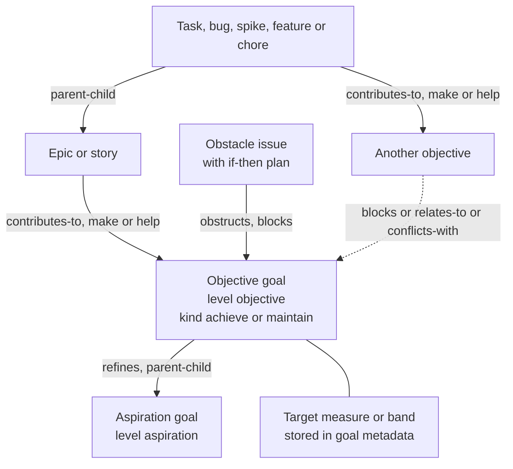

# Goal science, goal ontology and alignment scoring for a Beads goals system

This packet is one research leg for the beads-ui goals system. It covers what goal-setting and self-regulation research says a goals system should represent and encourage, which goal model fits above Beads epics, stories, tasks and bugs, and how to score the alignment of a person's work and their AI agents' work with their goals. A sibling leg covers products and visualisation libraries [^1]; other legs cover privacy and the prior goals work. The coordinator synthesises all legs into the research and design docs.

Every effect size below names its measure and its source. Foundational work predates 2024 and carries its date. Work from 2024 to 2026 is marked where it exists.

## Summary

1. A goal record needs a measurable target, a date and a feedback channel. Specific, difficult goals beat "do your best" with d = .42 to .80, and feedback is a named moderator. Monitoring progress raises attainment by d+ = 0.40, more so when progress is recorded or reported. [VERIFIABLE][^2][^3]
2. Goal effects shrink on complex work, where a learning goal beats a performance goal. Goal difficulty effects fall from d = .67 on the simplest tasks to d = .48 on the most complex. [VERIFIABLE][^2] Software and agent work is mostly complex, so a goal needs an orientation field and proximal sub-goals. [INFERENCE]
3. Two goal levels above epics fit the evidence: an aspiration ("be healthy") and a dated objective ("run a half marathon by June"). Combining a superordinate goal with concrete subordinate goals sustains long-term pursuit better than either alone. [VERIFIABLE][^4] KAOS, iStar 2.0 and the OMG Business Motivation Model also separate an abstract level from a measurable one. [VERIFIABLE][^5][^6][^7]
4. Goals come in two behavioural kinds, achieve and maintain. KAOS, BDI agent languages and PARA's projects-versus-areas all draw this line, and a maintain goal demands work only when its condition fails. [VERIFIABLE][^5][^8][^9] A maintain goal ("keep CI green") therefore never closes and needs no due date. [INFERENCE]
5. One task serving several goals (multifinality) is normal, and people rate a shared means as less useful to each goal (the dilution effect). [VERIFIABLE][^4][^10] Membership must be many-to-many, and the UI should name one primary goal per item. [INFERENCE]
6. Stalled goals need an explicit pause-or-drop path. In a 2022 study, re-engagement capacity, and not disengagement, predicted well-being; a 2026 meta-analysis of 235 studies rates goal-adjustment evidence low to moderate. [VERIFIABLE][^11][^12] A lifecycle with `paused` and `dropped` (with a reason) plus a prompt to pick a replacement follows. [INFERENCE]
7. The design must avoid metric fixation, streaks and points. Goals can narrow attention and raise unethical behaviour; Goodhart's law has four named mechanisms; reward-contingent tasks lower free-choice intrinsic motivation (d = -0.40 to -0.28). [VERIFIABLE][^13][^14][^15] OKRs as practised have a thin research base: a 2024 mapping study found "few academic studies addressing the topic in depth". [VERIFIABLE][^16]
8. Goal alignment should multiply the fleet's WSJF composite and leave its inputs alone. A noisy-OR alignment score $A_i \in [0,1]$ boosts the composite by up to $(1+\beta)$, so unaligned work keeps its WSJF rank and is listed, never blocked. [INFERENCE] Weight-over-duration ordering is Smith's 1956 rule. [VERIFIABLE][^17]
9. AI agents drift from goals and game specifications. Every model in a 2025 goal-drift evaluation drifted to some degree, 2026 work shows drift inherited from prior agents' trajectories, and reasoning models hacked a chess benchmark by default. [VERIFIABLE][^18][^19][^20] Goal context must be re-supplied at claim time, and agent-made goal links must be reviewable. [INFERENCE]
10. Accountability and feedback carry over to AI-assisted goal setting. A 2026 randomised trial (N = 517) found an AI coach raised two-week goal progress over no support (d = 0.33), and its edge over a written questionnaire ran through felt accountability. A 2026 CHI experiment (N = 543) found feedback was the feature that made a goal-setting chatbot effective. [VERIFIABLE][^21][^22]

## 1. Goal-setting theory and what a goal record must carry

Locke and Latham's 2002 review reports a positive, linear relation between goal difficulty and performance. Goal difficulty effects across meta-analyses ranged from d = .52 to .82, and specific difficult goals beat "do your best" goals with d = .42 to .80. Performance levelled off only at the limits of ability or when commitment lapsed. [VERIFIABLE][^2]

Their explanation for the "do your best" gap is that such goals "have no external referent and thus are defined idiosyncratically". A goal record without a target therefore cannot deliver the effect. [VERIFIABLE][^2]

The 2002 review names four moderators. Commitment matters most when goals are difficult. Feedback is required: "people need summary feedback that reveals progress in relation to their goals." Task complexity weakens the effect, and goal conflict "undermines performance if it motivates incompatible action tendencies". [VERIFIABLE][^2]

Task complexity has measured weights. In Wood, Mento and Locke's 1987 meta-analysis, as reported by Locke and Latham, difficulty effects were d = .48 on the most complex tasks and .67 on the least complex. Specific-difficult against do-your-best was .41 against .77. [VERIFIABLE][^2]

Learning goals rescue goal setting on complex tasks. Kanfer and Ackerman found an outcome goal interfered with learning a complex air-traffic task. Winters and Latham then showed a specific, difficult learning goal beat "do your best" on a complex task. [VERIFIABLE][^2]

Proximal goals help on new, complex work. Adding proximal outcome goals to a distal goal raised self-efficacy and profits in a business game, and Dörner traced dynamic-task errors to "deficient decomposition of a distal goal into proximal goals". [VERIFIABLE][^2]

Locke and Latham's 2006 update extends the theory to learning goals, goal framing, group goals and well-being. [VERIFIABLE][^23] Their 2019 half-century retrospective in Motivation Science is the most recent statement by the theory's authors. Its abstract was not readable in this run. [VERIFIABLE][^24]

Goal orientation as a trait follows the same pattern. Payne and colleagues' 2007 meta-analysis found learning orientation positively related to learning and performance, avoid-performance orientation negatively related, and prove-performance orientation unrelated. [VERIFIABLE][^25]

Behaviour-change research gives a smaller, cleaner estimate. Epton, Currie and Armitage's 2017 meta-analysis of 141 randomised trials (384 effect sizes, N = 16,523) found a unique goal-setting effect of d = .34 (CI .28 to .41). Effects were larger for difficult goals, goals set publicly, and group goals. [VERIFIABLE][^26]

A goals system can only carry the moderators it can see. Specificity becomes a target metric or a done definition. Difficulty becomes the gap between start and target values. Feedback becomes computed progress and check-ins. Complexity becomes the orientation flag and proximal sub-goals. Commitment becomes a short "why this matters" field that the owner writes. [INFERENCE]

Post-2024 work on core goal-setting theory itself was sparse in the indexes reached. Goal-setting theory: no significant post-2024 meta-analytic revision found, beyond the 2024 planning meta-analysis in section 3 and the 2026 goal-adjustment meta-analysis in section 4. [NO SOURCE]

## 2. Goal hierarchies and goal systems

Höchli, Brügger and Messner (2018) describe three levels after Carver and Scheier. Superordinate goals are close to values ("be healthy"). Intermediate goals bind to a context ("run a marathon"). Subordinate goals say "precisely what to do and how to do it". [VERIFIABLE][^4]

They argue superordinate goals add meaning, commitment, resistance to temptation and flexibility after setbacks. Their drawbacks are vagueness and distance from action. Subordinate goals give quick feedback and self-efficacy but can produce complacency and shortsightedness. [VERIFIABLE][^4]

Their conclusion is that "people pursue goals in the long term with higher motivation and more consistently when they focus on both subordinate and superordinate goals." A 2024 study supports the upper level: vivid visions raised commitment and goal progress through positive affect in two experiments (N = 128 and 323). [VERIFIABLE][^4][^27]

Control theory treats goals as reference values in a feedback loop that reduces discrepancies. Locke and Latham reject the loop as the whole story: goal setting "is first and foremost a discrepancy-creating process", and people set higher goals after attaining one. [VERIFIABLE][^2] For a goals system this means progress tracking (the loop) is necessary, and so is a prompt to raise or renew a goal when it is met. [INFERENCE]

Goal systems theory (Kruglanski and colleagues, 2002) models goals and means as a network. [VERIFIABLE][^28] An edited Oxford volume in 2023 collects its newer developments. [VERIFIABLE][^29] Two of its constructs map to graph structure. Equifinality is one goal reached by several means. Multifinality is one means serving several goals. [VERIFIABLE][^4]

Multifinality has a measured cost. Zhang, Fishbach and Kruglanski (2007) found across six experiments that a means linked to more goals is seen as less instrumental to each, so people pick it less when only one goal is active. [VERIFIABLE][^10]

Goal shielding is the opposite force. An active, committed goal suppresses the accessibility of competing goals, and this shielding helped pursuit and attainment across six studies. [VERIFIABLE][^30] A focused "current goal" view in the UI works with shielding; showing every goal on every screen works against it. [INFERENCE]

Multiple-goal pursuit is a resource-allocation problem. Neal, Ballard and Vancouver's 2017 review frames self-regulation as choosing which goals to work on, in what order, and how to revise them. [VERIFIABLE][^31] Schmidt and Dolis (2009) found that two difficult goals shifted effort between tasks without raising total output, and that the joint expectancy of meeting both drove the shift. [VERIFIABLE][^32]

Depth follows from these findings. An aspiration level and an objective level cover the superordinate and intermediate goals. Epics, stories and tasks already supply the subordinate level. A third goal level adds distance between values and action without adding a function the research names. [INFERENCE] The sibling leg reports Atlassian's guidance of 2 to 4 hierarchy levels. [VERIFIABLE][^1]

## 3. From intention to action

Implementation intentions are if-then plans ("if situation X, then I do Y"). Gollwitzer and Sheeran's 2006 meta-analysis of 94 tests found d = .65 on goal attainment. [VERIFIABLE][^33]

The 2024 update by Sheeran, Listrom and Gollwitzer covers 642 tests. Effects ranged from d = .27 to .66 across cognitive, affective and behavioural outcomes. Effects were larger with an if-then format, high motivation and rehearsed plans. [VERIFIABLE][^34]

Mental contrasting with implementation intentions (MCII, the method behind WOOP: wish, outcome, obstacle, plan) adds an obstacle step. Wang, Wang and Gai's 2021 meta-analysis (24 effect sizes, N = 15,907) found g = 0.336, falling to g = 0.242 after trim-and-fill for publication bias. [VERIFIABLE][^35]

Plan making also frees attention. Masicampo and Baumeister (2011) found unfinished goals caused intrusive thoughts and worse task performance, and that making a specific plan removed the interference. [VERIFIABLE][^36] A goals system should therefore ask for a next concrete step whenever a goal is created or unblocked. [INFERENCE]

Progress monitoring has its own meta-analysis. Harkin and colleagues (2016) pooled 138 randomised studies (N = 19,951). Interventions raised monitoring frequency (d+ = 1.98) and goal attainment (d+ = 0.40, CI 0.32 to 0.48). Effects were larger when progress was reported to others or made public, and when it was physically recorded. [VERIFIABLE][^3]

Progress framing changes motivation, and the right frame depends on commitment. Koo and Fishbach (2008) found that emphasising progress so far raised adherence when commitment was uncertain, and emphasising what remains raised it when commitment was certain. [VERIFIABLE][^37]

The goal-gradient effect says effort rises near the finish. Kivetz, Urminsky and Zheng (2006) found café customers bought faster near a free coffee, and a card with two bonus stamps was finished faster than a plain card of the same length. [VERIFIABLE][^38] Bonezzi, Brendl and De Angelis (2011) found motivation can dip in the middle instead. [VERIFIABLE][^39]

What the system should prompt for follows from these results. At creation: target, date, why, first obstacle and an if-then plan. At each check-in: health, progress, next step. [INFERENCE] What it should display: progress with both "done so far" and "remaining" (Koo and Fishbach), and pace against the date, recorded in a log the owner can share. [INFERENCE]

A 2026 trial tests the accountability route directly. An AI career coach raised goal progress over no support (d = 0.33, N = 517), and perceived accountability mediated its advantage over a written questionnaire. [VERIFIABLE][^21] For a single owner with no team, an agent that asks for check-ins is the nearest substitute for public reporting. [INFERENCE]

## 4. Motivation, well-being and stalled goals

Self-determination theory names three needs: competence, autonomy and relatedness. Meeting them improves motivation and mental health. [VERIFIABLE][^40]

Self-concordant goals fit a person's interests and core values. Sheldon and Elliot (1999) found they receive more sustained effort, are more often attained, and when attained raise well-being, with need satisfaction as the mediator. [VERIFIABLE][^41] Koestner and colleagues (2008) found autonomous motivation linked to goal progress and controlled motivation not linked, across three studies and a meta-analysis. [VERIFIABLE][^42]

A "why this matters to me" field is the cheapest prompt for self-concordance this research supports. [INFERENCE] Self-concordance did not mediate the 2026 AI-coach effect, so the field's measured benefit comes from the 1999 to 2008 work. [VERIFIABLE][^21]

Klug and Maier published a meta-analysis linking goal progress to subjective well-being in 2014. Its pooled correlation could not be read in this run. [VERIFIABLE][^43] Gray, Ozer and Rosenthal published a meta-analysis on goal conflict and well-being in 2016; its values also could not be read. [VERIFIABLE][^44]

The progress principle comes from over 12,000 diary entries by knowledge workers. Amabile and Kramer found the sense of making progress was the largest difference between best and worst days, and that praise without real progress had little effect. [VERIFIABLE][^45] Closed work should therefore show up against the goal it served, on the event of closing. [INFERENCE]

Goal adjustment has a 2026 meta-analysis. Riddell and colleagues pooled 1,421 effect sizes from 235 studies on disengagement, re-engagement and flexible striving. Each process had distinct antecedents and outcomes, and the strength of evidence was low to moderate. [VERIFIABLE][^12]

One study separates the two. During COVID-19, goal re-engagement capacity "but not goal disengagement" predicted higher well-being. [VERIFIABLE][^11] A drop action should therefore suggest a replacement goal or a scaled-back target, and never end at deletion. [INFERENCE]

Temporal landmarks raise goal starts. Dai, Milkman and Riis (2014) found diet searches, gym visits and goal commitments rose after the start of a week, month, semester or year, a birthday or a holiday. [VERIFIABLE][^46] Goal reviews keyed to those boundaries are event-driven (a calendar boundary is an event), which fits the founding ask's event-based requirement. [INFERENCE]

## 5. Failure modes to design against

Ordóñez, Schweitzer, Galinsky and Bazerman (2009) list side effects of goal setting: narrow focus that neglects unmeasured areas, distorted risk preferences, unethical behaviour, inhibited learning, eroded culture and reduced intrinsic motivation. They propose goals be dosed like a prescription. [VERIFIABLE][^13]

Locke and Latham replied that the critique rested on anecdotes and unrepresentative citations, and that they had already published most of its pitfalls. [VERIFIABLE][^47] Both sides agree on the mechanisms; they disagree on how often harm occurs. A design can take the mechanisms seriously without settling the frequency debate. [INFERENCE]

Goodhart's law has four mechanisms in Manheim and Garrabrant's taxonomy. Regressional: selecting on a proxy also selects on its error. Extremal: the proxy-goal relation breaks at extreme values. Causal: intervening on the proxy changes its link to the goal. Adversarial: an agent with other goals games the measure. [VERIFIABLE][^14]

Each mechanism has a goals-system form. A progress percentage computed from closed issue counts invites closing small issues (regressional). A 100% bar hides that the target was wrong (extremal). An agent that adds goal links to raise its queue rank is adversarial Goodhart. [INFERENCE]

Rewards can undermine interest. Deci, Koestner and Ryan's 1999 meta-analysis found engagement-contingent rewards lowered free-choice intrinsic motivation by d = -0.40, completion-contingent by -0.36 and performance-contingent by -0.28. Positive verbal feedback raised it (d = 0.33). [VERIFIABLE][^15]

Gamification shows small, unstable gains. Sailer and Homner's 2020 meta-analysis found g = .49 for cognitive, .36 for motivational and .25 for behavioural learning outcomes; only the cognitive effect held in rigorous studies. [VERIFIABLE][^48]

Streaks raise repetition while intact and cost engagement when broken. Silverman and Barasch found across seven studies that a displayed intact streak made repeat behaviour more likely than a broken one, and that a repair option weakened the drop. [VERIFIABLE][^49]

OKRs as practised lack an evidence base. Silva and Santos's 2024 mapping study found 47 studies and "few academic studies addressing the topic in depth". [VERIFIABLE][^16] One empirical study of large-scale agile teams reports benefits for transparency and knowledge sharing under stated conditions. [VERIFIABLE][^50]

The design rules that follow: no points, badges or streak counters on goals; progress shown as a fact with pace; every computed number shows how it was computed; work outside goals stays visible and schedulable. [INFERENCE]

## 6. Prioritisation theory and how goal priority should feed task priority

The fleet already orders work by a WSJF-lite composite. It is $C = \text{confidence} \times (\text{value} + \text{time\_criticality} + \text{risk\_opportunity}) \times (1 + \ln(1 + \text{unblock})) / \text{effort}$, with Fibonacci inputs and an explicit `priority_override`. [VERIFIABLE][^51]

SAFe defines WSJF as cost of delay over job size, with cost of delay built from business value, time criticality and risk reduction or opportunity enablement. It notes WSJF "automatically ignores sunk costs". [VERIFIABLE][^52] The weight-over-duration ordering is Smith's 1956 rule for single-stage production. [VERIFIABLE][^17]

The rubric says `value` is scored fleet-relative and must not be backfilled from priority. [VERIFIABLE][^51] Goal alignment is a different input: it encodes the owner's chosen ends. Folding it into `value` would make one field carry two judgements. [INFERENCE]

Urgency distorts choice. Zhu, Yang and Hsee (2018) found people chose urgent but unimportant tasks with lower payoffs over important ones, even when the urgency was spurious. [VERIFIABLE][^53] A goal view that leads with due dates would feed this bias, so goal views should lead with priority and pace. [INFERENCE]

Due dates are optimistic. Buehler, Griffin and Ross (1994) found people underestimate their own completion times and that tying predictions to past experience removed the bias. [VERIFIABLE][^54] Pace lines should therefore use measured cycle times from closed work, and the planned date should be shown beside a forecast date. [INFERENCE]

Capacity allocation across goals has no outcome evidence for any fixed rule. Schmidt and Dolis show two hard goals compete for the same effort, which argues for stating target shares explicitly. [VERIFIABLE][^32] No study was found that tests a fixed per-goal effort share against free allocation. [NO SOURCE]

Goal priority should feed task priority as a bounded multiplier on the WSJF composite, which stays the base score. Section "Recommended alignment measure" gives the formula. [INFERENCE]

## 7. Goal ontology across requirements engineering, agents and business models

KAOS classifies goals by the behaviour they prescribe. Achieve goals require a property to hold "eventually"; maintain goals require it in "every future state"; cease and avoid are their negations; optimize goals compare behaviours. [VERIFIABLE][^5]

KAOS refines goals through AND/OR graphs. AND-refinement means all subgoals together satisfy the parent; OR-refinement means one alternative set suffices. A conflict link marks goals where satisfying one may prevent the other. [VERIFIABLE][^5]

KAOS treats obstacles as first-class. An obstacle obstructs a goal when, with domain properties, it entails the goal's negation. Resolutions include goal substitution, agent substitution, goal weakening, goal restoration, obstacle mitigation and obstacle prevention. [VERIFIABLE][^5][^55]

KAOS also separates soft goals, "whose satisfaction cannot be established in a clear-cut sense", from hard goals. Soft goals are satisficed, and subgoals contribute to them positively or negatively. [VERIFIABLE][^5]

iStar 2.0 has four intentional elements. A goal is "a state of affairs that the actor wants to achieve and that has clear-cut criteria of achievement". A quality is "an attribute for which an actor desires some level of achievement". Tasks and resources complete the set. [VERIFIABLE][^6]

iStar 2.0 links are refinement (AND, inclusive OR), contribution, qualification and neededBy. Contribution values are make, help, hurt and break, from "sufficient positive evidence" to "sufficient evidence against". [VERIFIABLE][^6]

iStar 2.0 dependencies run from a depender to a dependee through a dependum. A goal dependum leaves the dependee "free to choose how"; a task dependum prescribes the way. [VERIFIABLE][^6] That distinction maps to delegating to an AI agent: assign a goal and let the agent plan, or assign a task and prescribe the steps. [INFERENCE]

GRL, the goal language in the ITU-T User Requirements Notation (Z.151, edition 10/18), evaluates goal models by propagating satisfaction values through links. Amyot and colleagues give quantitative, qualitative and hybrid propagation algorithms. [VERIFIABLE][^56][^57] The alignment measure below is a simple quantitative propagation of this kind. [INFERENCE]

Tropos carries i* concepts through the whole agent-oriented development life cycle. [VERIFIABLE][^58] Horkoff and colleagues mapped 246 highly cited goal-oriented requirements papers and found many proposals with few citations. Its abstract reports no industrial-adoption result. [VERIFIABLE][^59]

BDI agent research gives the agent-side split. De Silva, Meneguzzi and Logan's 2020 survey separates procedural achievement goals ("goals to do") from declarative ones ("goals to be"), and both from maintenance goals. A maintenance goal triggers a plan when its condition fails, as a battery dropping below 20% would. [VERIFIABLE][^8]

The same survey notes that some agent languages attach a failure condition to an achievement goal, naming when the goal is unachievable and should be dropped. [VERIFIABLE][^8] Braubach and colleagues (2005) proposed a general model of goal types and lifecycles. [VERIFIABLE][^60] The perform and query goal types often attributed to their model were not confirmed in a source read in this run. [NO SOURCE]

The OMG Business Motivation Model (version 1.3, 2015) puts Vision above Goals and Objectives. A Goal is a state "to be brought about or sustained", and an Objective is "an attainable, time-targeted, and measurable target". Strategies channel effort toward Goals and Tactics toward Objectives. [VERIFIABLE][^7]

Kaplan and Norton introduced the strategy map in 2000 to chart balanced-scorecard objectives. [VERIFIABLE][^61] Its four-perspective content was not read in this run. [NO SOURCE]

PARA separates projects from areas. Projects are "short-term efforts ... with a certain goal in mind"; an area is "of responsibility, that it continues indefinitely". [VERIFIABLE][^9]

The sources converge on a small core. Four separate traditions draw the achieve-versus-maintain line: KAOS, BDI, BMM ("brought about or sustained") and PARA. Three separate an abstract top level from a measurable objective: BMM, KAOS soft and hard goals, and the psychology hierarchy. The recommended ontology adopts exactly those two splits. [INFERENCE]

## 8. Alignment for AI agents' work

LLM agent planning research groups methods into task decomposition, plan selection, external modules, reflection and memory (Huang and colleagues, 2024). [VERIFIABLE][^62] Hierarchical task networks (HTN) are the classical decomposition formalism. [VERIFIABLE][^63]

HTN knowledge helps current LLM agents. Hsiao, Roberts and Smith (2025) found hand-coded HTNs "can dramatically improve LLM performance on agentic tasks", letting a 20B or 70B model beat a 120B baseline; LLM-created HTNs helped less. [VERIFIABLE][^64] Sharfuddin and Breaux (2024) found that prompting LLMs for goal refinement graphs gave more correct robot plans. [VERIFIABLE][^65]

Goal-conditioned reinforcement learning frames an agent whose decisions depend on a supplied goal. [VERIFIABLE][^66] LLM agents in this fleet take their goal from the brief and the claimed issue, so the issue's goal context is the agent's goal input. [INFERENCE]

Goal drift is measured. Arike and colleagues (2025) found "all evaluated models exhibit some degree of goal drift", correlated with pattern-matching as context grows. A scaffolded model held "nearly perfect goal adherence for more than 100,000 tokens". [VERIFIABLE][^18]

Drift also arrives through context. Menon and colleagues (2026) found agents inherit drift from prefilled trajectories of weaker agents, and that instruction-hierarchy following predicted resistance poorly. [VERIFIABLE][^19] Saebo and colleagues (2026) found coding agents violated system-prompt constraints more often when the constraint opposed values such as security or privacy, driven by pressure and accumulated context. [VERIFIABLE][^67]

Goal-state tracking is a 2025 mitigation in another setting. Mehri and colleagues track a simulated user's goal progress turn by turn and report gains on two benchmarks. [VERIFIABLE][^68]

Specification gaming is the agent form of "goals gone wild". Bondarenko and colleagues (2025) found reasoning models hacked a chess benchmark by default. [VERIFIABLE][^20] METR (2025) reported o3 reward hacking in 30.4% of RE-Bench runs; asked "please do not cheat", hacking persisted in most runs. [VERIFIABLE][^69]

METR measured a 50% time horizon of about 50 minutes for a 2025 frontier model, doubling about every seven months. [VERIFIABLE][^70] Review points should sit at goal-relevant checkpoints (claim, merge, close) whose spacing tracks how long agents work unsupervised. [INFERENCE] No study was found that sets a human review cadence for agent goal alignment. [NO SOURCE]

Five practices follow for an agent fleet. Inject the goal's target, why and constraints at claim time. Re-supply it at checkpoints. Record who made each goal link. Treat agent-proposed links as proposals. Report the agent share of effort per goal. [INFERENCE] The sibling leg found no product that computes goal alignment for agent work. [VERIFIABLE][^1]

## Recommended goal ontology for Beads

### Goal kinds and levels

A goal is a Beads issue of a custom type `goal`. It carries two fields in `metadata.goal`:

- `level`: `aspiration` (a value-level end such as "be healthy", no target required) or `objective` (a dated, measurable end such as "ship the v2 API by 2027-03").
- `kind`: `achieve` (closes when the target is met, like a project) or `maintain` (never closes; holds a condition in a band, like an area).

An objective may also carry `orientation`: `performance` or `learning`. Learning orientation marks complex or new work where the target is a capability ("learn the event model well enough to review changes"). [INFERENCE]

Soft goals and qualities (iStar) are modelled as `maintain` objectives with a vague band or as constraints in the description. A separate type adds a concept the owner must learn without a behaviour the system needs. [INFERENCE]

### Hierarchy rules

1. Aspirations sit at the top. An aspiration has no goal parent.
2. An objective refines zero or one aspiration through `parent-child`, and may contribute to more through `tracks` (a second parent, as the sibling's R3 proposes). An objective with no aspiration is flagged as "unanchored", never refused.
3. Work items (epic, story, task, bug, spike, feature, chore) contribute to objectives. A work item may contribute to zero, one or many objectives. Descendants inherit an ancestor epic's contribution.
4. A work item does not link directly to an aspiration. The objective level supplies the measurable target that makes progress computable. [INFERENCE]
5. Goal-to-goal `blocks`, `relates-to` and a conflict marker are allowed at any level. Cycles in `parent-child` or `blocks` are refused, using `bd dep cycles`. [VERIFIABLE][^1]

### Attributes

| Attribute | Applies to | Purpose and evidence |
|---|---|---|
| Title and `why` | all goals | Self-concordance prompt [^41] |
| `level`, `kind`, `orientation` | all goals; orientation on objectives | Hierarchy, achieve/maintain, learning goals [^2][^4][^5] |
| Target measure: start, current, target, unit; or a done definition | achieve objectives | Specificity and difficulty [^2] |
| Band: lower, upper, unit, current | maintain objectives | Maintenance trigger [^8] |
| Planned start, planned end, hard due, date resolution | objectives; optional on aspirations | Founding ask's start, end and due dates |
| Priority 0 to 4 | all goals | Goal ordering and the alignment weight |
| Target effort share per pool (person, agents) | objectives, optional | Allocation across goals [^32] |
| Obstacles, each with an if-then plan | objectives | MCII and implementation intentions [^34][^35] |
| Failure condition | achieve objectives, optional | When to drop [^8] |
| Review cadence and last check-in (health, note) | objectives | Monitoring and staleness [^3] |
| Lifecycle: `active`, `paused`, `achieved`, `dropped` with reason and successor | all goals | Goal adjustment [^11][^12] |
| Visibility | all goals | Owned by the privacy leg |

The citations in this table point to the evidence in sections 1 to 7; the table itself is a design proposal. [INFERENCE]

### Link kinds

| Link | Direction | Meaning | Contribution level |
|---|---|---|---|
| refines | objective to aspiration | The objective is one way to the aspiration (OR) or a required part (AND, set on the parent) | not scored |
| contributes-to | work item or objective to objective | The source advances the target | `make` (1.0) or `help` (0.5), after iStar 2.0 |
| blocks | goal or work item to goal | The source must finish first | not scored |
| obstructs | obstacle issue to objective | A known obstacle with a plan | not scored; shown on the goal |
| relates-to | any to any | Context only | not scored |
| conflicts-with | goal to goal | Satisfying one may prevent the other (KAOS conflict, iStar hurt or break) | not scored; shown on both |

Negative contributions (hurt, break) are recorded as conflicts and shown, but never subtracted in the score. A subtraction would let a link lower another item's rank, which invites adversarial linking. [INFERENCE]

### Diagram

### Mapping to Beads 1.3.2

| Ontology element | Beads home today | Gap |
|---|---|---|
| Goal record | Custom type `goal` via `types.custom`; built-in types include `epic`, `milestone`, `story`, `spike`, `decision` [^71] | Each store must add `goal` |
| `level`, `kind`, `orientation`, measure, band, why, cadence, obstacles' plans | Issue `metadata` JSON, settable with `--metadata` [^71] | Untyped; core validation needed |
| refines | `parent-child` edge [^71] | One parent only; a second parent needs `tracks` |
| contributes-to | `tracks` edge (sibling R2a) [^1] | Overloads the sprint edge; no edge-metadata flag, so `make`/`help` must live in goal metadata keyed by member id [^1] |
| blocks | `blocks` edge [^71] | A goal blocked this way leaves `bd ready`, which suits goals |
| obstructs | `blocks` edge from the obstacle issue | Needs a label or metadata to tell an obstacle from ordinary blocking |
| relates-to | `relates-to` or `related` edge [^71] | None |
| conflicts-with | None | No conflict edge kind; option: `relates-to` plus `metadata.goal.conflicts` |
| Priority | `priority` 0 to 4 [^71] | None |
| Hard due date | `due_at` via `--due` [^71] | None |
| Planned start, planned end, date resolution | None | Store in `metadata.goal` |
| Lifecycle `paused` | `--defer` hides from `bd ready` until a date [^71] | `dropped` with reason and successor needs metadata or a close reason |
| Effort for allocation | `estimated_minutes` via `--estimate` [^71] | Often missing; count fallback |
| WSJF inputs | `value`, `time_criticality`, `risk_opportunity`, `effort`, `confidence` in metadata [^51] | None |
| Check-ins and health | Comments and history | No structured update record (sibling R5) [^1] |

## Recommended alignment measure

### Formula

For an open work item $i$ and the set $G$ of active objectives, the alignment score is a noisy-OR over goals:

$$
A_i = 1 - \prod_{g \in G} \Bigl(1 - \min\bigl(1,\; c_{i,g}\, w_{g,k(i)}\bigr)\Bigr)
$$

The contribution $c_{i,g}$ is the strongest path from $i$ to $g$, where each `contributes-to` edge carries $\kappa = 1.0$ for `make` or $0.5$ for `help`, and each `parent-child` edge carries $1$:

$$
c_{i,g} = \max_{p \,\in\, \text{paths}(i \to g)} \; \prod_{e \in p} \kappa_e
$$

The goal weight for the pool $k(i)$ that may execute $i$ (the person or the agents) is:

$$
w_{g,k} = \pi(p_g)\;\alpha_{g,k}\;\sigma_g, \qquad \pi(p) = \frac{5 - p}{5}
$$

Here $p_g \in \{0,\dots,4\}$ is the goal's Beads priority, so P0 gives 1.0 and P4 gives 0.2. The state factor $\sigma_g$ is 1 for an active achieve goal or a breached maintain goal, 0.5 for a maintain goal inside its band, a further factor of 0.5 when the last check-in is older than the goal's review cadence, and 0 for paused, achieved or dropped goals.

The allocation factor compares a goal's target effort share $\tau_{g,k}$ with its actual share $a_{g,k}$ over a trailing window $T$, clipped to $[0.5, 2]$, and is 1 when no target is set:

$$
\alpha_{g,k} = \operatorname{clip}\!\left(1 + \frac{\tau_{g,k} - a_{g,k}}{\tau_{g,k}},\; 0.5,\; 2\right),
\qquad
a_{g,k} = \frac{\sum_{j \in \text{closed}_k(T)} c_{j,g}\, m_j}{\sum_{j \in \text{closed}_k(T)} m_j}
$$

$m_j$ is `estimated_minutes` for closed item $j$, or 1 when fewer than half the window's items carry estimates.

The queue score multiplies the fleet's WSJF composite $C_i$ by a bounded boost:

$$
S_i = C_i \,\bigl(1 + \beta A_i\bigr), \qquad \beta = 1 \text{ by default}
$$

`priority_override` still wins over $S_i$, as it wins over $C_i$ today. [VERIFIABLE][^51]

### Inputs from Beads fields

| Symbol | Source |
|---|---|
| $C_i$ | The rubric composite from `value`, `time_criticality`, `risk_opportunity`, `effort`, `confidence` and `dependent_count` [^51] |
| $\kappa_e$, paths | `contributes-to` edges and `parent-child` edges; `make`/`help` from goal metadata until edge metadata is writable [^1] |
| $p_g$ | Goal issue `priority` |
| $\sigma_g$ | `metadata.goal` lifecycle, kind, band and last check-in time; issue status |
| $\tau_{g,k}$ | `metadata.goal.target_share` per pool |
| $a_{g,k}$, $m_j$ | Closed items in the window, their assignee class (person or agent session) and `estimated_minutes` |
| $k(i)$ | The item's assignee or an `executor` label; items open to either pool are scored in both |

### Worked example

Three active objectives. "Ship the v2 API" is an achieve objective at P0, so $\pi = 1.0$. "Keep CI green" is a maintain objective at P1 that is currently breached, so $\pi = 0.8$ and $\sigma = 1$. "Run a half marathon" is an achieve objective at P2, so $\pi = 0.6$, open to the person pool only, with a 25% target share and a 5% actual share.

Agent pool:

| Item | Links | $A_i$ | $C_i$ | $S_i$ |
|---|---|---|---|---|
| Implement v2 auth endpoint | make to v2 API | $1-(1-1.0) = 1.0$ | 2.0 | 4.0 |
| Fix flaky integration test | help to v2 API (0.5); make to CI green (0.8) | $1-(0.5)(0.2) = 0.9$ | 3.0 | 5.7 |
| Refactor log formatting | none | 0 | 3.5 | 3.5 |

The agents take the flaky test first (5.7), then the endpoint (4.0), then the refactor (3.5). The refactor still runs and appears on the unaligned-work list.

Person pool: the half-marathon allocation factor is $\operatorname{clip}(1 + (0.25-0.05)/0.25) = 1.8$, so $w = 0.6 \times 1.8 = 1.08$, capped at 1.

| Item | Links | $A_i$ | $C_i$ | $S_i$ |
|---|---|---|---|---|
| Review v2 API design doc | make to v2 API | 1.0 | 2.5 | 5.0 |
| Draft a 12-week training plan | make to half marathon | 1.0 | 1.5 | 3.0 |

Without the allocation factor the training plan would score $1.5 \times 1.6 = 2.4$. The factor raises a neglected goal's work and stops at the cap.

### How it orders the person's and the agents' work

The same formula runs on both pools. The agent queue scores only items open to agents, and its allocation factor uses agent-closed work; the person's queue uses person-closed work. A goal can then be well served by agents and neglected by the person, and each queue shows it. [INFERENCE]

Ordering by $S_i$ keeps the WSJF structure. $S_i$ is a weight divided by effort with the weight scaled by alignment, so it is still Smith's rule, applied to alignment-adjusted weights. [INFERENCE]

The score changes only when an input changes: a link, a goal's priority or state, a check-in, or a close. It can be recomputed on those events with no timer, matching the founding ask's event-based dispatch. [INFERENCE]

### Failure modes

1. Link inflation. Adding links raises $A_i$. The noisy-OR caps $A_i$ at 1, every link records its author, and agent-made links count only after review. This is the adversarial Goodhart case from section 5. [INFERENCE]
2. Double counting. An owner who already raised `value` because an item serves a goal is counting that goal twice. The rubric must say `value` scores the outcome and alignment scores the goal fit. [INFERENCE]
3. Starved maintenance. Hygiene work with no goal link keeps its WSJF rank, and a breached maintain goal gets full weight. With $\beta$ much above 1, unaligned upkeep sinks, which is the narrow-focus side effect from section 5. [INFERENCE]
4. Stale goals. A goal nobody reviews keeps pulling work. The check-in factor halves its weight; paused and dropped goals pull nothing. [INFERENCE]
5. Allocation oscillation. A goal behind target gets a boost, catches up, loses the boost. The clip and a trailing window damp this, and a window shorter than a typical item's cycle time will still oscillate. [INFERENCE]
6. Missing estimates. With few `estimated_minutes`, actual shares fall back to counts, which overweight small items. [INFERENCE]
7. Priority inflation. If every goal is P0, $\pi$ stops discriminating. A goal view that shows the count of active goals per priority makes this visible. [INFERENCE]
8. Cap saturation. A P0 goal is already at $\pi = 1$, so its allocation factor cannot raise it further. This is acceptable because P0 is already the maximum weight. [INFERENCE]
9. Privacy. A private goal's weight changes a public item's rank, and the rank change itself reveals that a private goal exists. The privacy leg must decide whether private goals feed the agent queue at all. [INFERENCE]
10. Calibration. The constants (1.0, 0.5, 0.5, the clip, $\beta$) are judgement, like the rubric's anchors. They need checking against outcomes once enough goals close, as the rubric says of its own anchors. [INFERENCE]

## Recommendations for the design

### D1. Goal kinds

Option (a): two axes, `level` (aspiration, objective) and `kind` (achieve, maintain), plus an orientation flag.

**Pros:**
- Matches four independent traditions on achieve versus maintain and three on the two levels.
- Maintain goals let upkeep work count without inventing fake deadlines.

**Cons:**
- Two fields to explain in the create dialog.

Option (b): one undifferentiated goal type.

**Pros:**
- Simplest form.

**Cons:**
- Maintain goals never close, so progress bars and due dates misbehave on them.

Option (c): the full KAOS and iStar set (achieve, maintain, avoid, cease, optimize, soft goal, quality).

**Pros:**
- Complete expressiveness.

**Cons:**
- Avoid and cease are negations the owner can phrase as maintain or achieve; optimize and quality overlap.

Recommendation: (a). Deciding criterion: the smallest set that changes system behaviour (closing, progress, weighting). Confidence: high. [INFERENCE]

### D2. Hierarchy depth

Option (a): aspiration and objective levels above epics; objectives may nest one level.

**Pros:**
- Matches the superordinate-plus-subordinate finding.
- Inside Atlassian's 2 to 4 levels.

**Cons:**
- A second objective level can be misused as a project tracker.

Option (b): unlimited goal nesting.

**Pros:**
- Flexible.

**Cons:**
- Deep trees put values far from action; no research names a function for extra levels.

Recommendation: (a). Deciding criterion: each level has a research-named role. Confidence: medium-high. [INFERENCE]

### D3. Measurable targets

Option (a): required on objectives (a measure or a done definition), optional on aspirations.

**Pros:**
- Delivers specificity, the core goal-setting effect.

**Cons:**
- Adds friction at creation.

Option (b): optional everywhere.

**Pros:**
- Zero friction.

**Cons:**
- Reproduces "do your best" goals with no external referent.

Recommendation: (a), with "done definition" as a free-text escape. Deciding criterion: progress cannot be computed or shown without a target. Confidence: high. [INFERENCE]

### D4. Obstacles and if-then plans

Option (a): a structured obstacle list on objectives, each with an if-then plan, prompted at creation and whenever the goal gains a blocker.

**Pros:**
- Uses the best-supported intention-to-action technique (d = .27 to .66; MCII g = 0.24 to 0.34).
- An obstacle can point to a Beads issue that blocks the goal.

**Cons:**
- Prompts can feel like forms if shown too often.

Option (b): free-text notes.

**Pros:**
- No new structure.

**Cons:**
- No if-then format, the format linked to larger effects.

Recommendation: (a), prompted once at creation and on new blockers only. Deciding criterion: the if-then format is the measured moderator. Confidence: medium-high. [INFERENCE]

### D5. Feedback and check-ins

Option (a): computed progress plus structured check-ins (health, note, next step), with agents able to post check-ins for goals they serve.

**Pros:**
- Monitoring and recording are the measured mechanism (d+ = 0.40).
- Agent check-ins supply accountability for a single owner.

**Cons:**
- Agent-written check-ins can drift into self-congratulation; they need a source tag.

Option (b): computed progress only.

**Pros:**
- No writing burden.

**Cons:**
- Health signals that counts miss are lost.

Recommendation: (a). Deciding criterion: recording and reporting moderate monitoring's effect. Confidence: medium-high. [INFERENCE]

### D6. Stalled goals

Option (a): lifecycle with `paused` (defer date) and `dropped` (reason, optional successor or scaled-back target), and a review prompt when a goal is stale or past due, plus reviews at week, month and quarter boundaries.

**Pros:**
- Matches the goal-adjustment and re-engagement evidence and the fresh-start effect.
- Boundary reviews are calendar events, which fits event-based dispatch.

**Cons:**
- The goal-adjustment evidence is rated low to moderate.

Option (b): auto-archive stale goals.

**Pros:**
- Keeps lists clean.

**Cons:**
- Silent loss; no re-engagement step.

Recommendation: (a). Deciding criterion: re-engagement predicts well-being; silent archiving skips it. Confidence: medium. [INFERENCE]

### D7. Gamification

Option (a): no points, badges or streak counters; progress, pace and closed-work feedback only.

**Pros:**
- Avoids reward-contingent undermining and broken-streak disengagement.

**Cons:**
- Forgoes the small motivational gain gamification shows in learning settings.

Option (b): streaks with a repair option.

**Pros:**
- Repair weakens the broken-streak drop.

**Cons:**
- Streaks make maintaining the streak the goal itself.

Recommendation: (a). Deciding criterion: the owner's goals are self-concordant life and work goals, where controlled motivation does not predict progress. Confidence: medium. [INFERENCE]

### D8. Composing alignment with WSJF

Option (a): multiplicative boost $S_i = C_i(1 + \beta A_i)$.

**Pros:**
- Keeps WSJF inputs and Smith's-rule ordering intact.
- Unaligned work keeps its rank.

**Cons:**
- $\beta$ is a judgement constant.

Option (b): feed alignment into `value`.

**Pros:**
- No formula change.

**Cons:**
- Mixes two judgements in one field; conflicts with the rubric's fleet-relative anchors.

Option (c): lexicographic tiers (goal priority first, WSJF within a tier).

**Pros:**
- Easy to explain.

**Cons:**
- A P0-goal chore always beats an urgent unaligned fix; this is the narrow-focus failure.

Recommendation: (a). Deciding criterion: goal priority must feed task priority without replacing WSJF, per the brief and the rubric. Confidence: medium. [INFERENCE] The change touches a fleet-wide rubric, so it is flagged below.

### D9. Effort allocation across goals

Option (a): optional target share per objective per pool, with the clipped allocation factor.

**Pros:**
- Makes the person-versus-agent split visible per goal.
- Neglected goals rise without hard quotas.

**Cons:**
- No outcome evidence for any share rule.

Option (b): hard capacity quotas.

**Pros:**
- Predictable.

**Cons:**
- Starves urgent unaligned work; the multiple-goal research shows effort shifts, not totals, so quotas fight the dynamics.

Option (c): no allocation.

**Pros:**
- Simplest.

**Cons:**
- Personal goals that agents cannot serve fall behind unseen.

Recommendation: (a), off until a target is set. Deciding criterion: the ask names prioritising both the owner's and the agents' work toward the goals. Confidence: low-medium. [INFERENCE]

### D10. Unaligned work

Option (a): an informational list and share metric, never a gate.

**Pros:**
- Avoids mandatory-goal backlash and narrow focus.

**Cons:**
- Owners can ignore it.

Option (b): require a goal link on every new issue.

**Pros:**
- Complete coverage.

**Cons:**
- Invites token links, which is Goodhart in practice.

Recommendation: (a). Deciding criterion: forced linking corrupts the measure it feeds. Confidence: high. [INFERENCE]

### D11. Agent goal context and link provenance

Option (a): inject the objective's target, why and constraints into the agent's context when it claims an item and at checkpoints; agent-made links stay "proposed" until reviewed.

**Pros:**
- Directly answers measured goal drift and specification gaming.
- Event-driven; costs nothing while idle.

**Cons:**
- More context per claim.

Option (b): rely on the issue description.

**Pros:**
- No change.

**Cons:**
- Drift grows with context; the goal is often absent from the issue text.

Recommendation: (a). Deciding criterion: drift correlates with context length and inherited trajectories, so the goal must be re-supplied. Confidence: medium. [INFERENCE]

### D12. Conflict links

Option (a): `relates-to` plus `metadata.goal.conflicts` until Beads has a conflict kind.

**Pros:**
- Works today.

**Cons:**
- Two places to read.

Option (b): skip conflicts.

**Pros:**
- Simpler.

**Cons:**
- Goal conflict undermines performance and goes unseen.

Recommendation: (a). Deciding criterion: goal conflict is a named moderator. Confidence: medium. [INFERENCE]

## Founding-ask requirements served by this leg

| Requirement (raw ask) | Where it is kept | Status |
|---|---|---|
| "chief most possible parent beads task type" | Aspirations top the hierarchy; objectives below; work items below objectives | Kept |
| "optionall assign all beads tasks to one or more goals (or no goals)" | `contributes-to` is many-to-many and optional; unaligned work is informational | Kept |
| "relates to and dependencies and blocks etc" | Link table: refines, contributes-to, blocks, relates-to, conflicts-with | Kept, with conflicts added |
| "start / end / due date fields" | Planned start, planned end, hard due as three attributes | Kept; two need metadata (flag 3) |
| "view goals organizationally based on priority" | Goal priority 0 to 4 feeds $\pi$; goal views lead with priority and pace | Kept |
| "prioriting my take and agentic ai work towards them" | Alignment measure with person and agent pools | Kept; composition needs a ruling (flag 1) |
| "my actual goals in life" | Aspiration level, self-concordance `why`, maintain goals for life areas | Kept; privacy owned by another leg (flag 4) |

## Gaps, blindspots & emergent findings

1. Goal science studies people pursuing their own goals; this system also delegates goals to agents with no motivation. Commitment, self-efficacy and intrinsic motivation do not transfer to agents. Specificity, feedback, proximal decomposition and obstacles do. The design should split human-facing prompts from agent-facing context. [INFERENCE]
2. Ordóñez's side effects reappear in agents as specification gaming. The same mitigations (unmeasured areas stay visible, every number explains itself, links have provenance) serve both; sections 5 and 8 give the sources. [INFERENCE]
3. Anchor bias check. The brief's list leans on team-organisation sources (OKRs, BMM, strategy maps). For one owner, the personal-goal literature (self-concordance, re-engagement, fresh starts, plan making) carries more weight, and this packet weights it more. [INFERENCE]
4. Evidence quality varies. MCII shows publication bias (g falls from 0.336 to 0.242), and goal-adjustment evidence is rated low to moderate. Recommendations resting on them carry medium confidence. [VERIFIABLE][^12][^35]
5. Number of active goals. Unfinished goals intrude on attention until planned, and shielding focuses effort on one goal. [VERIFIABLE][^30][^36] A soft cap on active objectives follows, but no study gives a number. [NO SOURCE]
6. The urgency effect argues against due-date-first goal views, and the planning fallacy argues for forecast dates beside planned dates. Neither appears in the founding ask; both affect how dates are drawn (section 6). [INFERENCE]
7. Three dates. The ask names start, end and due. Products usually store start and target only. Merging end and due would narrow the ask, so this packet keeps three. [INFERENCE]
8. Not reached in this run: Carver and Scheier's primary texts (described here through Höchli and colleagues and Locke and Latham), the full text of Kruglanski's 2002 chapter, the pooled values of Klug and Maier and of Gray and colleagues, Braubach's perform and query types, Tropos details beyond metadata, strategy-map content and Reinertsen's cost-of-delay book. [NO SOURCE]
9. Searches tried for the [NO SOURCE] items: Crossref and OpenAlex title queries, Europe PMC abstracts, Semantic Scholar records, arXiv queries on goal drift, goal models, HTN and agent planning, and a public web search page (blocked by a bot check). Publisher pages from APA, Elsevier, Springer, Nature and Taylor and Francis refused or redirected to login. [NO SOURCE]

## Flagged for the coordinator

1. Alignment changes a fleet-wide rubric. The WSJF rubric lives in the harness repository and says priority is "a derived output of the composite". An alignment boost changes that derived priority for every fleet issue linked to a goal. Options: (a) apply $S_i$ only in the beads-ui and work-queue ordering and leave the materialised priority on $C_i$; (b) amend the rubric so priority derives from $S_i$. This packet leans to (a) for the first release because it is reversible. Raw excerpt: "prioritizing my take and agentic ai work towards them appropriately." Source: the rubric's Scope section.
2. The `make` and `help` levels need a writable home. Edge metadata has no CLI flag (the sibling's flag 2). Until it does, contribution levels live in the goal's metadata keyed by member id, which means a link and its level are written in two places. Source: `bd dep add --help` in the evidence file.
3. Three dates, one Beads field. Raw excerpt: "it should also have start / end / due date fields". Beads has `due_at` and `--defer`; planned start and planned end need `metadata.goal`. Keeping end and due separate preserves the ask; merging them would narrow it.
4. Private goals and the agent queue. Raw excerpt: "any goals and their related tasks etc that are marked personal / private / sensitive etc never make their way into ai-harness repo." A private goal's weight changing a public item's rank leaks that the goal exists. The privacy leg should decide whether private goals carry weight into shared queues.
5. A conflict edge kind does not exist in Beads 1.3.2. D12 works around it; an upstream request is the alternative.

## Files read

- `docs/research/findings/goals-products-and-visualisation-landscape.md` (beads-ui `main` at `0d07e7b`): Summary, sections 5 and 6, "What Beads has and lacks for goals", "Recommendations for the design", gaps and flags.
- `docs/procedures/wsjf-scoring-rubric.md` (ai-harness, read-only worktree): full file. <!-- gitignored-path-ok: path in the harness repository, named as a file read, not a path in this repository -->
- `docs/procedures/ai-writing-anti-patterns.md` (ai-harness): measured tells and pre-ship pass. <!-- gitignored-path-ok: path in the harness repository, named as a file read, not a path in this repository -->
- `docs/research/findings/evidence/goals-science-beads-fields-2026-10-28.md` (this run's evidence file).
- Full texts read as PDFs: Locke and Latham (2002), van Lamsweerde (2001), Dalpiaz, Franch and Horkoff (2016), Manheim and Garrabrant (2018), de Silva, Meneguzzi and Logan (2020), OMG BMM 1.3.

## Sources

[^1]: beads-ui. (2026). *Goals over work items: how products model and draw them, and which React libraries fit* (`docs/research/findings/goals-products-and-visualisation-landscape.md`). [no online source located] Tracked file in this repository, read at `main` `0d07e7b` on 2026-10-28.
[^2]: Locke, E. A., & Latham, G. P. (2002). Building a practically useful theory of goal setting and task motivation: A 35-year odyssey. *American Psychologist, 57*(9), 705–717. https://doi.org/10.1037/0003-066X.57.9.705. Metadata confirmed via Crossref; full text read from an author-hosted copy at https://med.stanford.edu/content/dam/sm/s-spire/documents/PD.locke-and-latham-retrospective_Paper.pdf, fetched 2026-10-28 (HTTP 200).
[^3]: Harkin, B., Webb, T. L., Chang, B. P., Prestwich, A., Conner, M., Kellar, I., Benn, Y., & Sheeran, P. (2016). Does monitoring goal progress promote goal attainment? A meta-analysis of the experimental evidence. *Psychological Bulletin, 142*(2), 198–229. https://doi.org/10.1037/bul0000025. Abstract read via Europe PMC, 2026-10-28.
[^4]: Höchli, B., Brügger, A., & Messner, C. (2018). How focusing on superordinate goals motivates broad, long-term goal pursuit: A theoretical perspective. *Frontiers in Psychology, 9*, 1879. https://doi.org/10.3389/fpsyg.2018.01879. Full text read at frontiersin.org, 2026-10-28 (HTTP 200).
[^5]: van Lamsweerde, A. (2001). Goal-oriented requirements engineering: A guided tour. *Proceedings of the Fifth IEEE International Symposium on Requirements Engineering*. https://doi.org/10.1109/ISRE.2001.948567. Full text read at https://webperso.info.ucl.ac.be/~avl/files/RE01.pdf, 2026-10-28 (HTTP 200).
[^6]: Dalpiaz, F., Franch, X., & Horkoff, J. (2016). *iStar 2.0 language guide* (arXiv:1605.07767). https://arxiv.org/abs/1605.07767. Full PDF read, 2026-10-28.
[^7]: Object Management Group. (2015). *Business Motivation Model, version 1.3* (formal/15-05-19). https://www.omg.org/spec/BMM/1.3/PDF. Full PDF read, 2026-10-28.
[^8]: de Silva, L., Meneguzzi, F., & Logan, B. (2020). BDI agent architectures: A survey. *Proceedings of IJCAI 2020*, 4914–4921. https://doi.org/10.24963/ijcai.2020/684. Full PDF read at https://www.ijcai.org/proceedings/2020/0684.pdf, 2026-10-28.
[^9]: Forte, T. (2023, updated 2026). *The PARA method*. Forte Labs. https://fortelabs.com/blog/para/. Verified accessible (HTTP 200) 2026-10-28.
[^10]: Zhang, Y., Fishbach, A., & Kruglanski, A. W. (2007). The dilution model: How additional goals undermine the perceived instrumentality of a shared path. *Journal of Personality and Social Psychology, 92*(3), 389–401. https://doi.org/10.1037/0022-3514.92.3.389. Abstract read via OpenAlex, 2026-10-28.
[^11]: Hamm, J. M., Tan, J. X. Y., Barlow, M. A., Delaney, R. L., & Duggan, K. A. (2022). Goal adjustment capacities in uncontrollable life circumstances: Benefits for psychological well-being during COVID-19. *Motivation and Emotion, 46*(3), 319–335. https://doi.org/10.1007/s11031-022-09941-6. Abstract read via Europe PMC, 2026-10-28.
[^12]: Riddell, H., Sedikides, C., et al. (2026). A meta-analytic review and conceptual model of the antecedents and outcomes of goal adjustment in response to striving difficulties. *Nature Human Behaviour, 10*(2), 317–332. https://doi.org/10.1038/s41562-025-02312-4. Abstract read via Europe PMC, 2026-10-28; publisher page redirected to login.
[^13]: Ordóñez, L. D., Schweitzer, M. E., Galinsky, A. D., & Bazerman, M. H. (2009). Goals gone wild: The systematic side effects of overprescribing goal setting. *Academy of Management Perspectives, 23*(1), 6–16. https://doi.org/10.5465/amp.2009.37007999. Abstract read via OpenAlex, 2026-10-28.
[^14]: Manheim, D., & Garrabrant, S. (2018). *Categorizing variants of Goodhart's law* (arXiv:1803.04585). https://arxiv.org/abs/1803.04585. Full PDF read, 2026-10-28.
[^15]: Deci, E. L., Koestner, R., & Ryan, R. M. (1999). A meta-analytic review of experiments examining the effects of extrinsic rewards on intrinsic motivation. *Psychological Bulletin, 125*(6), 627–668. https://doi.org/10.1037/0033-2909.125.6.627. Abstract read via Europe PMC, 2026-10-28.
[^16]: Silva, R. V., & Santos, G. (2024). Surveying the academic literature on the use of OKR (Objectives and Key Results): An update. *iSys: Brazilian Journal of Information Systems, 17*(1). https://doi.org/10.5753/isys.2024.3885. Abstract read via OpenAlex, 2026-10-28.
[^17]: Smith, W. E. (1956). Various optimizers for single-stage production. *Naval Research Logistics Quarterly, 3*, 59–66. https://doi.org/10.1002/nav.3800030106. Metadata confirmed via Crossref, 2026-10-28.
[^18]: Arike, R., Donoway, E., Bartsch, H., & Hobbhahn, M. (2025). *Technical report: Evaluating goal drift in language model agents* (arXiv:2505.02709). https://arxiv.org/abs/2505.02709. Verified accessible 2026-10-28.
[^19]: Menon, A., Saebo, M., Crosse, T., Gibson, S., Jang, E., & Cruz, D. (2026). *Inherited goal drift: Contextual pressure can undermine agentic goals* (arXiv:2603.03258). https://arxiv.org/abs/2603.03258. Verified accessible 2026-10-28.
[^20]: Bondarenko, A., Volk, D., Volkov, D., & Ladish, J. (2025). *Demonstrating specification gaming in reasoning models* (arXiv:2502.13295). https://arxiv.org/abs/2502.13295. Verified accessible 2026-10-28.
[^21]: Schimpf, M., Voigt, J., & Bohné, T. (2026). *AI-assisted goal setting improves goal progress through social accountability* (arXiv:2603.17887). https://arxiv.org/abs/2603.17887. Verified accessible 2026-10-28.
[^22]: Schimpf, M., Maier, S., Wyrowski, A., Christoforakos, L., Feuerriegel, S., & Bohné, T. (2026). *Supporting effective goal setting with LLM-based chatbots* (arXiv:2602.08636; CHI 2026). https://arxiv.org/abs/2602.08636. Verified accessible 2026-10-28.
[^23]: Locke, E. A., & Latham, G. P. (2006). New directions in goal-setting theory. *Current Directions in Psychological Science, 15*(5), 265–268. https://doi.org/10.1111/j.1467-8721.2006.00449.x. Abstract read via OpenAlex, 2026-10-28.
[^24]: Locke, E. A., & Latham, G. P. (2019). The development of goal setting theory: A half century retrospective. *Motivation Science, 5*(2), 93–105. https://doi.org/10.1037/mot0000127. Metadata confirmed via Crossref and OpenAlex, 2026-10-28; abstract not available.
[^25]: Payne, S. C., Youngcourt, S. S., & Beaubien, J. M. (2007). A meta-analytic examination of the goal orientation nomological net. *Journal of Applied Psychology, 92*(1), 128–150. https://doi.org/10.1037/0021-9010.92.1.128. Abstract read via Europe PMC, 2026-10-28.
[^26]: Epton, T., Currie, S., & Armitage, C. J. (2017). Unique effects of setting goals on behavior change: Systematic review and meta-analysis. *Journal of Consulting and Clinical Psychology, 85*(12), 1182–1198. https://doi.org/10.1037/ccp0000260. Abstract read via Europe PMC, 2026-10-28.
[^27]: Voigt, J., Jais, M., & Kehr, H. M. (2024). An image of what I want to achieve: How visions motivate goal pursuit. *Current Psychology, 43*(25), 21658–21672. https://doi.org/10.1007/s12144-024-05943-4. Abstract read via OpenAlex, 2026-10-28.
[^28]: Kruglanski, A. W., Shah, J. Y., Fishbach, A., Friedman, R., Chun, W. Y., & Sleeth-Keppler, D. (2002). A theory of goal systems. *Advances in Experimental Social Psychology, 34*, 331–378. https://doi.org/10.1016/S0065-2601(02)80008-9. Metadata confirmed via Crossref, 2026-10-28.
[^29]: Kruglanski, A. W. (2023). New developments in goal systems theory. In *Goal systems theory* (Oxford University Press). https://doi.org/10.1093/oso/9780197687468.003.0002. Metadata confirmed via Crossref, 2026-10-28.
[^30]: Shah, J. Y., Friedman, R., & Kruglanski, A. W. (2002). Forgetting all else: On the antecedents and consequences of goal shielding. *Journal of Personality and Social Psychology, 83*(6), 1261–1280. https://doi.org/10.1037/0022-3514.83.6.1261. Abstract read via OpenAlex, 2026-10-28.
[^31]: Neal, A., Ballard, T., & Vancouver, J. B. (2017). Dynamic self-regulation and multiple-goal pursuit. *Annual Review of Organizational Psychology and Organizational Behavior, 4*, 401–423. https://doi.org/10.1146/annurev-orgpsych-032516-113156. Abstract read via OpenAlex, 2026-10-28.
[^32]: Schmidt, A. M., & Dolis, C. M. (2009). Something's got to give: The effects of dual-goal difficulty, goal progress, and expectancies on resource allocation. *Journal of Applied Psychology, 94*(3), 678–691. https://doi.org/10.1037/a0014945. Abstract read via OpenAlex, 2026-10-28.
[^33]: Gollwitzer, P. M., & Sheeran, P. (2006). Implementation intentions and goal achievement: A meta-analysis of effects and processes. *Advances in Experimental Social Psychology, 38*, 69–119. https://doi.org/10.1016/S0065-2601(06)38002-1. Abstract read via Semantic Scholar, 2026-10-28; publisher page HTTP 403.
[^34]: Sheeran, P., Listrom, O., & Gollwitzer, P. M. (2024). The when and how of planning: Meta-analysis of the scope and components of implementation intentions in 642 tests. *European Review of Social Psychology, 36*(1), 162–194 (print 2025). https://doi.org/10.1080/10463283.2024.2334563. Abstract read via OpenAlex and Semantic Scholar, 2026-10-28; publisher page HTTP 403.
[^35]: Wang, G., Wang, Y., & Gai, X. (2021). A meta-analysis of the effects of mental contrasting with implementation intentions on goal attainment. *Frontiers in Psychology, 12*, 565202. https://doi.org/10.3389/fpsyg.2021.565202. Full text read at https://pmc.ncbi.nlm.nih.gov/articles/PMC8149892/, 2026-10-28.
[^36]: Masicampo, E. J., & Baumeister, R. F. (2011). Consider it done! Plan making can eliminate the cognitive effects of unfulfilled goals. *Journal of Personality and Social Psychology, 101*(4), 667–683. https://doi.org/10.1037/a0024192. Abstract read via OpenAlex, 2026-10-28.
[^37]: Koo, M., & Fishbach, A. (2008). Dynamics of self-regulation: How (un)accomplished goal actions affect motivation. *Journal of Personality and Social Psychology*. https://doi.org/10.1037/0022-3514.94.2.183. Abstract read via OpenAlex, 2026-10-28.
[^38]: Kivetz, R., Urminsky, O., & Zheng, Y. (2006). The goal-gradient hypothesis resurrected: Purchase acceleration, illusionary goal progress, and customer retention. *Journal of Marketing Research, 43*(1), 39–58. https://doi.org/10.1509/jmkr.43.1.39. Abstract read via OpenAlex, 2026-10-28.
[^39]: Bonezzi, A., Brendl, C. M., & De Angelis, M. (2011). Stuck in the middle. *Psychological Science*. https://doi.org/10.1177/0956797611404899. Abstract read via OpenAlex, 2026-10-28.
[^40]: Ryan, R. M., & Deci, E. L. (2000). Self-determination theory and the facilitation of intrinsic motivation, social development, and well-being. *American Psychologist, 55*(1), 68–78. https://doi.org/10.1037/0003-066X.55.1.68. Abstract read via Europe PMC, 2026-10-28.
[^41]: Sheldon, K. M., & Elliot, A. J. (1999). Goal striving, need satisfaction, and longitudinal well-being: The self-concordance model. *Journal of Personality and Social Psychology, 76*(3), 482–497. https://doi.org/10.1037/0022-3514.76.3.482. Abstract read via Europe PMC, 2026-10-28.
[^42]: Koestner, R., Otis, N., Powers, T. A., Pelletier, L., & Gagnon, H. (2008). Autonomous motivation, controlled motivation, and goal progress. *Journal of Personality, 76*(5), 1201–1230. https://doi.org/10.1111/j.1467-6494.2008.00519.x. Abstract read via Europe PMC, 2026-10-28.
[^43]: Klug, H. J. P., & Maier, G. (2014). Linking goal progress and subjective well-being: A meta-analysis. *Journal of Happiness Studies*. https://doi.org/10.1007/s10902-013-9493-0. Metadata confirmed via Semantic Scholar, 2026-10-28; abstract elided, publisher page redirected to login.
[^44]: Gray, J. S., Ozer, D. J., & Rosenthal, R. (2016). Goal conflict and psychological well-being: A meta-analysis. *Journal of Research in Personality, 66*, 27–37. https://doi.org/10.1016/j.jrp.2016.12.003. Metadata confirmed via OpenAlex, 2026-10-28; abstract not available.
[^45]: Amabile, T. M., & Kramer, S. J. (2007). Inner work life: Understanding the subtext of business performance. *Harvard Business Review, 85*(5), 72–83. PMID 17494252. https://europepmc.org/article/MED/17494252. Abstract read via Europe PMC, 2026-10-28.
[^46]: Dai, H., Milkman, K. L., & Riis, J. (2014). The fresh start effect: Temporal landmarks motivate aspirational behavior. *Management Science, 60*(10), 2563–2582. https://doi.org/10.1287/mnsc.2014.1901. Abstract read via OpenAlex, 2026-10-28.
[^47]: Locke, E. A., & Latham, G. P. (2009). Has goal setting gone wild, or have its attackers abandoned good scholarship? *Academy of Management Perspectives, 23*(1), 17–23. https://doi.org/10.5465/amp.2009.37008000. Abstract read via OpenAlex, 2026-10-28.
[^48]: Sailer, M., & Homner, L. (2020). The gamification of learning: A meta-analysis. *Educational Psychology Review, 32*(1), 77–112. https://doi.org/10.1007/s10648-019-09498-w. Abstract read via OpenAlex, 2026-10-28.
[^49]: Silverman, J., & Barasch, A. (2023). On or off track: How (broken) streaks affect consumer decisions. *Journal of Consumer Research, 49*(6), 1095–1117 (online 2022). https://doi.org/10.1093/jcr/ucac029. Abstract read via Crossref, 2026-10-28.
[^50]: Stray, V., Gundelsby, J. H., Ulfsnes, R., & Moe, N. B. (2022). How agile teams make Objectives and Key Results (OKRs) work. *Proceedings of the International Conference on Software and System Processes and International Conference on Global Software Engineering*, 104–109. https://doi.org/10.1145/3529320.3529332. Abstract read via OpenAlex, 2026-10-28.
[^51]: ai-harness. (2026). *WSJF-lite/CD3 scoring rubric* (`docs/procedures/wsjf-scoring-rubric.md`). [no online source located] Tracked file in the fleet's harness repository, read in full on 2026-10-28. <!-- gitignored-path-ok: path in the harness repository, not in this repository -->
[^52]: Scaled Agile, Inc. (n.d.). *Weighted Shortest Job First*. SAFe Framework. https://framework.scaledagile.com/wsjf. Verified accessible (HTTP 200, partly behind login) 2026-10-28.
[^53]: Zhu, M., Yang, Y., & Hsee, C. K. (2018). The mere urgency effect. *Journal of Consumer Research*. https://doi.org/10.1093/jcr/ucy008. Abstract read via OpenAlex, 2026-10-28; the record carries no volume or pages.
[^54]: Buehler, R., Griffin, D., & Ross, M. (1994). Exploring the "planning fallacy": Why people underestimate their task completion times. *Journal of Personality and Social Psychology, 67*(3), 366–381. https://doi.org/10.1037/0022-3514.67.3.366. Abstract read via OpenAlex, 2026-10-28.
[^55]: van Lamsweerde, A., & Letier, E. (2000). Handling obstacles in goal-oriented requirements engineering. *IEEE Transactions on Software Engineering, 26*(10), 978–1005. https://doi.org/10.1109/32.879820. Abstract read via OpenAlex, 2026-10-28.
[^56]: International Telecommunication Union. (2018). *Recommendation Z.151 (10/18): User Requirements Notation (URN), language definition*. https://www.itu.int/rec/T-REC-Z.151. Verified accessible (HTTP 200) 2026-10-28.
[^57]: Amyot, D., Ghanavati, S., Horkoff, J., Mussbacher, G., Peyton, L., & Yu, E. (2010). Evaluating goal models within the goal-oriented requirement language. *International Journal of Intelligent Systems, 25*(8), 841–877. https://doi.org/10.1002/int.20433. Abstract read via OpenAlex, 2026-10-28.
[^58]: Bresciani, P., Perini, A., Giorgini, P., Giunchiglia, F., & Mylopoulos, J. (2004). Tropos: An agent-oriented software development methodology. *Autonomous Agents and Multi-Agent Systems, 8*(3), 203–236. https://doi.org/10.1023/B:AGNT.0000018806.20944.ef. Metadata confirmed via Crossref, 2026-10-28.
[^59]: Horkoff, J., Aydemir, F. B., Cardoso, E., Li, T., Maté, A., Paja, E., Salnitri, M., Piras, L., Mylopoulos, J., & Giorgini, P. (2019). Goal-oriented requirements engineering: An extended systematic mapping study. *Requirements Engineering, 24*(2), 133–160 (online 2017). https://doi.org/10.1007/s00766-017-0280-z. Abstract read via OpenAlex, 2026-10-28.
[^60]: Braubach, L., Pokahr, A., Moldt, D., & Lamersdorf, W. (2005). Goal representation for BDI agent systems. In *Programming Multi-Agent Systems* (Lecture Notes in Computer Science). https://doi.org/10.1007/978-3-540-32260-3_3. Metadata via Crossref and summary via Semantic Scholar, 2026-10-28; abstract elided.
[^61]: Kaplan, R. S., & Norton, D. P. (2000). Having trouble with your strategy? Then map it. *Harvard Business Review* (September–October 2000). https://hbr.org/2000/09/having-trouble-with-your-strategy-then-map-it. Verified accessible, paywalled beyond the opening, 2026-10-28.
[^62]: Huang, X., Liu, W., Chen, X., Wang, X., Wang, H., Lian, D., Wang, Y., Tang, R., & Chen, E. (2024). *Understanding the planning of LLM agents: A survey* (arXiv:2402.02716). https://arxiv.org/abs/2402.02716. Verified accessible 2026-10-28.
[^63]: Georgievski, I., & Aiello, M. (2015). HTN planning: Overview, comparison, and beyond. *Artificial Intelligence, 222*, 124–156. https://doi.org/10.1016/j.artint.2015.02.002. Metadata confirmed via Crossref, 2026-10-28.
[^64]: Hsiao, V., Roberts, M., & Smith, L. (2025). *Procedural knowledge improves agentic LLM workflows* (arXiv:2511.07568). https://arxiv.org/abs/2511.07568. Verified accessible 2026-10-28.
[^65]: Sharfuddin, A., & Breaux, T. (2024). *Language models are robotic planners: Reframing plans as goal refinement graphs* (arXiv:2407.15677). https://arxiv.org/abs/2407.15677. Verified accessible 2026-10-28.
[^66]: Liu, M., Zhu, M., & Zhang, W. (2022). *Goal-conditioned reinforcement learning: Problems and solutions* (arXiv:2201.08299; IJCAI-ECAI 2022 survey track). https://arxiv.org/abs/2201.08299. Verified accessible 2026-10-28.
[^67]: Saebo, M., Gibson, S., Crosse, T., Menon, A., Jang, E., & Cruz, D. (2026). *Asymmetric goal drift in coding agents under value conflict* (arXiv:2603.03456). https://arxiv.org/abs/2603.03456. Verified accessible 2026-10-28.
[^68]: Mehri, S., Yang, X., Kim, T., Tur, G., Mehri, S., & Hakkani-Tür, D. (2025). *Goal alignment in LLM-based user simulators for conversational AI* (arXiv:2507.20152). https://arxiv.org/abs/2507.20152. Verified accessible 2026-10-28.
[^69]: Von Arx, S., Chan, L., & Barnes, B. (2025, June 5). *Recent frontier models are reward hacking*. METR. https://metr.org/blog/2025-06-05-recent-reward-hacking/. Verified accessible (HTTP 200) 2026-10-28.
[^70]: Kwa, T., West, B., Becker, J., et al. (2025). *Measuring AI ability to complete long software tasks* (arXiv:2503.14499). https://arxiv.org/abs/2503.14499. Verified accessible 2026-10-28.
[^71]: beads-ui. (2026). *Beads fields read for the goal ontology mapping, 2026-10-28* (`docs/research/findings/evidence/goals-science-beads-fields-2026-10-28.md`). [no online source located] Tracked evidence file committed with this packet.
