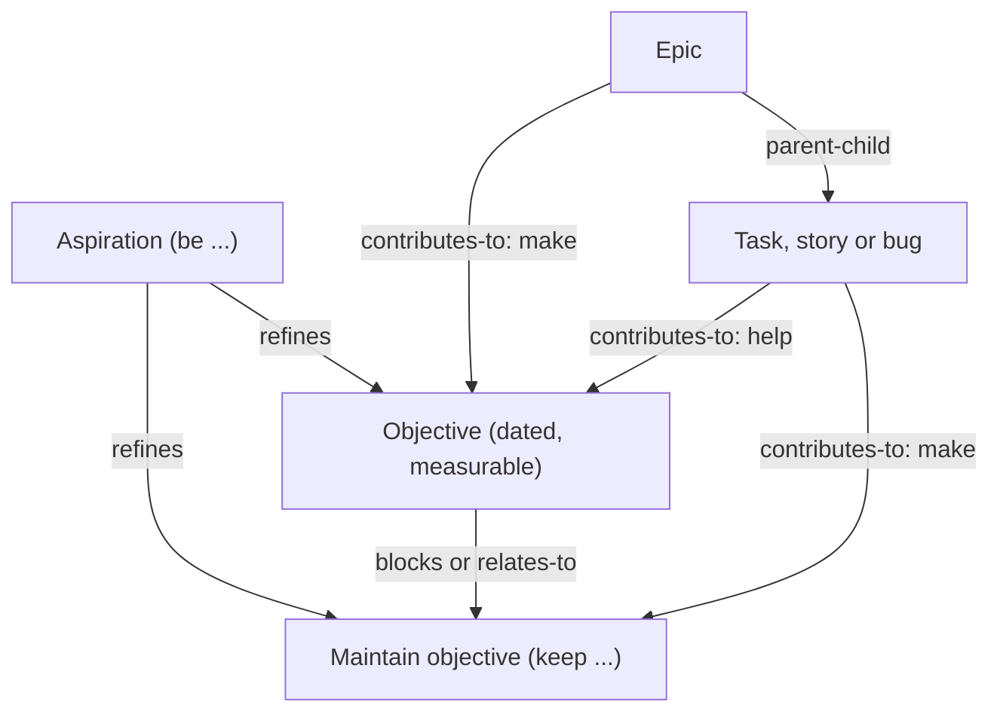
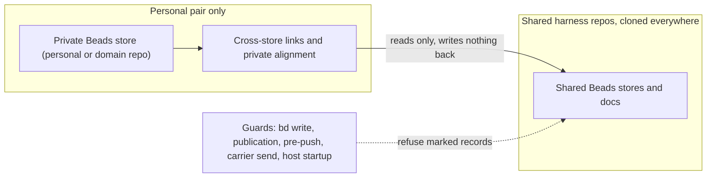

# A goals system above epics, stories and tasks: products, science and ontology, visualisation and privacy

## Founding Ask Coverage

`canonical_root_json`: `{"blob_oid":"8b43d16fb45272c4911f8de4d1b491e6bb472134","capture_commit":"b5eaeefd646b1fee17f189518ca9d32a67e9aad2","content_sha256":"79619e87b5d6a8e02204a9bf35e294caa65ab910f8be7f0d136e7035009caed0","entry_ids":["A001"],"generation":1,"path":"docs/asks/BU-epic-goals-system-usmm.md","previous_ref_sha256":null,"repository":"ai-harness","schema_version":1,"task_id":"BU-epic-goals-system-usmm"}`

`founding_ask_ref_sha256`: `c12436184b45bdc5c279f8f1d3928c6610536b5802f38b0760a6d47d4997dae6`

The founding ask record has one entry, A001, recorded verbatim in ai-harness at `docs/asks/BU-epic-goals-system-usmm.md`. This index is non-authoritative; the raw entry governs. A001 covers two systems. This doc covers the goals clauses and the privacy guard; the web app clauses are covered by [the beads-ui web app research](beads-ui-web-app.md). Each row below is one goals clause of A001.

| A001 clause (quoted or closely paraphrased) | Coverage and disposition |
|---|---|
| A001: a goals system "as a fundamental architectural component to the beads task system hierarchy where it will be like the chief most possible parent beads task type" | Covered: [§2](#2-how-goals-link-to-work), [§4](#4-goal-ontology), [§10](#10-fit-with-beads) |
| A001: "optionall assign all beads tasks to one or more goals (or no goals)" | Covered: [§2](#2-how-goals-link-to-work), [§10](#10-fit-with-beads) |
| A001: view goals organisationally by priority; "all the usual linkages such as relates to and dependencies and blocks" | Covered: [§2](#2-how-goals-link-to-work), [§7](#7-configuration-and-review-ux) |
| A001: a goal system "that sits on top of like epic / story / task issues (jira atlassian has a goal system but its just okay, not that great)" | Covered: [§1](#1-goal-and-okr-products), including why Atlassian Goals falls short |
| A001: interactive visualisations of the epics, stories, tasks and bugs under each goal, their dependencies, blockers and other links, "in a hierarchical linked graph" | Covered: [§6](#6-visualisation-patterns-and-libraries) |
| A001: "start / end / due date fields"; Gantt chart, timeline and graph views with dependency and blocker links | Covered: [§6](#6-visualisation-patterns-and-libraries), [§10](#10-fit-with-beads) |
| A001: orient and prioritise work toward "my actual goals in life"; prioritise "my take and agentic ai work towards them" | Covered: [§5](#5-goal-alignment-for-a-persons-and-their-agents-work) |
| A001: popular apps and systems across free, open-source, freemium and paid tiers, repos, packages, tools and libraries | Covered: [§1](#1-goal-and-okr-products), [§6](#6-visualisation-patterns-and-libraries) |
| A001: "technical blog or academic etc research on the science and engineering / theory of goals and goal alignment and accomplishment" and how to structure goals "ontologically and practically" | Covered: [§3](#3-the-science-of-goals), [§4](#4-goal-ontology) |
| A001: effective UI/UX for organising and configuring goals; visualisations, components and web patterns to copy or learn from | Covered: [§6](#6-visualisation-patterns-and-libraries), [§7](#7-configuration-and-review-ux) |
| A001: fold in aih-fw-2's compile of the first goals attempt, link it, research any new leads; never read goal docs in the sergei repo | Covered: [§9](#9-prior-work-from-the-first-goals-system). The sergei repo was not read |
| A001: a privacy and access-control system so personal, private, sensitive or domain-specific goals and their tasks never reach ai-harness, ai-cli-utils, ai-core, project-template, aido or another shared core repo; enforcement and validation, not convention | Covered: [§8](#8-privacy-and-access-control-for-personal-goals) |
| A001: web app clauses (board, review queue, prompt dispatch, framework, shared code, backend, app-portal, hosting) | Out of this doc by split, covered in full by [the beads-ui web app research](beads-ui-web-app.md) |
| A001: the process clauses (orchestrate, research, wait for the compile, merge, sync, reap, design through /auto-flow, Sergei's review) | Process, not content. Recorded in the Run History of this doc and the coordinator's report |

**Status:** in progress (synthesis continues as the remaining legs report)

**Created:** 2026-10-27

<!-- doc:region name="context" kind="immutable" -->

## Table of Contents

<!-- FILL THIS IN as you write. The entries below are this stub's own placeholder sections, so
     they already resolve; as you add, rename, or remove a heading, update this list in the same
     edit. A ToC that lists headings the doc does not have, or omits ones it does, is worse than
     no ToC because it looks like working navigation.
     The doc's D5 (c) decision: list EVERY `## ` and EVERY `### ` heading in the real doc, with
     GitHub-style anchors (lowercase, spaces→hyphens, punctuation stripped) so they navigate
     in-window (incl. VS Code Remote-SSH). If all-`###` proves too noisy, fall back to D5 (a)
     "meaningful `###`" — a deterministic OR-rule: include a `###` when it (1) has child `####`,
     (2) its body ≥ ~8-10 lines, (3) its parent `##` is allowlisted, or (4) matches a pattern.
     Hand-maintained: the not-yet-shipped `aido toc check` tool. Verify with
     `scripts/check_doc_toc.py <this-doc>`, which fails on an anchor that does not resolve.
     Manual `<!-- toc:skip -->` / `<!-- toc:include -->` override. -->

- [Context](#context)
- [Ambiguous Items from Auto-Remediation (Post-Run Review)](#ambiguous-items-from-auto-remediation-post-run-review)
- [Appendix: Research Prompt](#appendix-research-prompt)
- [Appendix: Provenance Ledger](#appendix-provenance-ledger)
- [Run History](#run-history)

## Context

Sergei asked on 2026-10-27 for a goals system as a fundamental part of the Beads task hierarchy: a goal is the top-most parent type, any issue can belong to zero, one or many goals, and goals carry the usual links (relates to, depends on, blocks) and start, end and due dates. He wants it viewable by priority and as a hierarchical linked graph, a Gantt chart and a timeline with dependency and blocker lines, so that his own work and his AI agents' work are prioritised toward the goals that matter. The research spans goal and task products of every licence tier, the science and theory of goals and their ontology, interactive visualisation patterns and libraries, prior work from an earlier attempt at a goals system, and a privacy and access-control guard that keeps personal, private or sensitive goals and their tasks out of every shared harness repo.

**Primary period:** 2024–2026 for products, libraries and practice; no cutoff for goal science, where the foundational literature predates 2024 and is cited with its publication date.
**Source weighting:** 2026 primary, 2025 secondary, 2024 tertiary for products and tooling; peer-reviewed and meta-analytic sources first for goal science. Fleet sources are read at the commits each finding names.

<!-- /doc:region name="context" -->

<!-- doc:region name="body" kind="replaceable" -->

## Temporal Scope

Product, library and practice claims weight 2026 first, then 2025, then 2024. Goal science has no cutoff: its foundational theory and meta-analyses predate 2024 and are cited with their publication dates. Fleet claims (Beads 1.3.x, the beads-ui design, the fleet's repo classes and guards, the prior goals work) are read at the commits each findings file names, measured on 2026-10-27 and 2026-10-28 UTC. Each research leg's full evidence, with its footnoted sources, is in its findings file under [findings/](findings/); this doc synthesizes them and cites the findings file for detail.

## Executive Summary

1. A goal is a custom Beads issue type at two levels, an aspiration over dated objectives, and of two kinds, achieve and maintain. Any issue joins zero, one or many goals through a `contributes-to` link with a strength, goals link to each other with `refines`, `blocks` and `relates-to`, and Beads 1.3.2 holds all of it today except edge weights, planned start dates and a conflict edge ([§2](#2-how-goals-link-to-work), [§4](#4-goal-ontology), [§10](#10-fit-with-beads)).
2. Progress is computed from linked work and kept separate from health, which comes from written check-ins. Copying Asana's typed progress sources and Linear's split is what Atlassian Goals lacks, since it does not compute progress from linked work at all ([§1](#1-goal-and-okr-products)).
3. Goal science sets the record's fields: a measurable target, a date and feedback, with recorded progress monitoring, explicit pause and drop states, and no streaks or points ([§3](#3-the-science-of-goals)).
4. A noisy-OR alignment score multiplies the fleet's existing WSJF composite, so the person's and the agents' queues both favour work that serves the top goals without hiding unaligned work, and agent-proposed links count only after review ([§5](#5-goal-alignment-for-a-persons-and-their-agents-work)).
5. The views are a React Flow goal graph with ELK layout, a custom SVG Gantt and timeline with critical path computed in core, and Recharts allocation charts. Private goals live only in private stores on the personal pair, every link that touches them stays there, and client-side guards at every writer refuse a marked record before it reaches a shared repository ([§6](#6-visualisation-patterns-and-libraries), [§8](#8-privacy-and-access-control-for-personal-goals)).

## 1. Goal and OKR products

Atlassian Goals is "just okay" for a documented reason: it does not compute a goal's progress from the work linked to it. Its own help says that when several work items link to one goal, "progress won't be automatically calculated across all of them", and it caps linked Jira work items at 100 per goal [VERIFIABLE][^2][^3]. Plane and ClickUp count completed work [VERIFIABLE][^1] (§ 1 of that file). Asana names its progress sources most precisely: a goal's progress is `manual`, `subgoal_progress`, `project_task_completion`, `project_milestone_completion`, `task_completion` or `external`, and each supporting link carries a `contribution_weight` from 0 to 1 [VERIFIABLE][^4][^5].

The better products keep health and progress as two separate signals. Linear derives a project's health from its most recent written update, flags "Update Missing" when an update is overdue, and computes progress from estimate points as completed plus a quarter of in-progress over the total [VERIFIABLE][^6][^7]. Health answers "is this on track, in the owner's judgment", progress answers "how much of the work is done", and a goal view needs both.

Products have started exposing goals to AI agents. Perdoo ships an MCP server whose tools list OKRs and log progress updates, Tability sells to "both human and Agent teams" with agent check-ins, and Linear lets a user filter and segment work by the agent it was delegated to [VERIFIABLE][^8][^9][^10]. None shows whether agent effort is going to the highest-priority goals, so that view is new design work (see [§5](#5-goal-alignment-for-a-persons-and-their-agents-work)).

The full product survey, with a comparison table across licence tiers, is in the products leg's findings [VERIFIABLE][^1]. Its gaps: no web-search tool reached the leg, so user sentiment and four vendors' goal pages are unverified there [NO SOURCE].

### When to use

Copy Asana's typed progress sources and weighted links, and Linear's split of health from progress. Avoid Atlassian's manual-only progress.

## 2. How goals link to work

Goal-to-work is many-to-many in every product that models it well, and goal-to-goal is a tree with an optional second parent. Linear joins projects to initiatives through a separate `InitiativeToProject` record, so a project can sit under several initiatives; Asana returns "all of the parent goals of a goal"; GitHub sub-issues keep one parent [VERIFIABLE][^7][^4][^11]. The founding ask's "assign all beads tasks to one or more goals (or no goals)" is exactly this many-to-many shape, and its "relates to and dependencies and blocks" between goals matches Linear's initiative relations and Beads' own `relates-to` and `blocks` edges [INFERENCE].

Privacy boundaries break links in the products that have them. Atlassian restricts a goal only at creation, applies the restriction to its whole hierarchy, and forbids links between restricted and open goals [VERIFIABLE][^12]. Where a private goal lives in a different repository from the public work it serves, the link records must live on the private side, or the public store leaks the private goal's id (see [§8](#8-privacy-and-access-control-for-personal-goals)) [INFERENCE].

### When to use

Model goal membership as a link from the goal to each member, many-to-many, with descendant inclusion: linking an epic counts its children, as Plane does [INFERENCE].

## 3. The science of goals

A goal record needs a measurable target, a date and a feedback channel. Specific, difficult goals beat "do your best" with effect sizes of d = .42 to .80, and feedback is a named moderator of that effect [VERIFIABLE][^22]. Monitoring progress raises attainment by d+ = 0.40, more so when progress is recorded or reported, so a goal view that shows progress is itself an intervention [VERIFIABLE][^23].

Goal effects shrink on complex work. Goal-difficulty effects fall from d = .67 on the simplest tasks to d = .48 on the most complex, and on complex tasks a learning goal can beat a performance goal [VERIFIABLE][^22]. Software and agent work is mostly complex, so a goal benefits from an orientation (learn or perform) and from proximal sub-goals rather than one distant target [INFERENCE].

Stalled goals need an explicit pause-or-drop path. In a 2022 study the capacity to re-engage with a new goal, not disengagement alone, predicted well-being, and a 2026 meta-analysis of 235 studies rates the goal-adjustment evidence low to moderate [VERIFIABLE][^31][^32]. A goal lifecycle with `paused` and `dropped` states, a recorded reason and a prompt to pick a replacement follows from this [INFERENCE].

The design must avoid metric fixation, streaks and points. Goals can narrow attention and raise unethical behaviour, Goodhart's law has four named mechanisms, and reward-contingent tasks lower free-choice intrinsic motivation (d = -0.40 to -0.28) [VERIFIABLE][^33][^34][^35]. OKRs as practised have a thin research base: a 2024 mapping study found "few academic studies addressing the topic in depth" [VERIFIABLE][^36]. This is directly relevant to the first goals system, whose daily scoring and achievement layers are the parts the prior-work compile marks for caution (see [§9](#9-prior-work-from-the-first-goals-system)).

Accountability and feedback carry over to AI-assisted goal setting. A 2026 randomised trial (N = 517) found an AI coach raised two-week goal progress over no support (d = 0.33), with its edge over a written questionnaire running through felt accountability; a 2026 CHI experiment (N = 543) found feedback was the feature that made a goal-setting chatbot effective [VERIFIABLE][^41][^42].

### When to use

Ask for a target, a date and an orientation when a goal is created; show progress and recorded check-ins; offer pause, drop and replace for stalled goals; never add streaks or points.

## 4. Goal ontology

Two goal levels above epics fit the evidence: an aspiration ("be healthy") and a dated objective ("run a half marathon by June"). Combining a superordinate goal with concrete subordinate goals sustains long-term pursuit better than either alone [VERIFIABLE][^24]. Requirements engineering and business modelling make the same split: KAOS separates soft and hard goals, iStar 2.0 separates qualities from goals, and the OMG Business Motivation Model separates goals from objectives [VERIFIABLE][^25][^26][^27].

Goals also come in two behavioural kinds, achieve and maintain. KAOS, BDI agent languages and PARA's projects versus areas all draw this line, and a maintain goal demands work only when its condition fails [VERIFIABLE][^25][^28][^29]. A maintain goal ("keep CI green") therefore never closes and needs no due date [INFERENCE].

One task serving several goals is normal, and people rate a shared means as less useful to each goal it serves (the dilution effect) [VERIFIABLE][^30]. Membership must be many-to-many, as §2 found in the products, and the UI should name one primary goal per item so the dilution does not blur ownership [INFERENCE].

The theory leg's recommended ontology, mapped onto the Beads fields its evidence file measured, is in the table below [VERIFIABLE][^21].

| Element | Values | Beads home today |
|---|---|---|
| Goal type | custom `goal` type | `types.custom` per store |
| Level | `aspiration`, `objective` | issue `metadata` |
| Kind | `achieve`, `maintain` | issue `metadata` |
| Lifecycle | open, in progress, paused, dropped (with reason), done | status plus `metadata` for paused and dropped |
| Goal to goal | `refines` (objective to aspiration), `blocks`, `relates-to`, `conflicts-with` | `parent-child`, `blocks`, `relates-to`; no conflict edge |
| Work to goal | `contributes-to`, strength `make` (1.0) or `help` (0.5) | no dedicated edge kind; no writable edge metadata |
| Dates | planned start, due, date resolution | `due_at`; planned start in `metadata` |



Legend: an arrow points from the serving item to the goal it serves; `make` counts fully toward the goal, `help` counts half.

### When to use

Use the two levels and the two kinds as the goal's own fields; use `contributes-to` with a strength for every work-to-goal link.

## 5. Goal alignment for a person's and their agents' work

Goal alignment should multiply the fleet's existing WSJF composite and leave its inputs alone, so that unaligned work keeps its rank and is listed, never blocked [INFERENCE]. The theory leg proposes a noisy-OR alignment score for item $i$ over its goals $G$, where $c_{i,g}$ is the strongest contribution path from $i$ to goal $g$ (1.0 for `make`, 0.5 for `help`, 1 for each `parent-child` step) and $w_{g,k}$ is goal $g$'s weight for owner class $k$ (the person or the agents):

$$
A_i = 1 - \prod_{g \in G} \Bigl(1 - \min\bigl(1,\; c_{i,g}\, w_{g,k(i)}\bigr)\Bigr)
$$

$$
S_i = C_i \,\bigl(1 + \beta A_i\bigr), \qquad \beta = 1 \text{ by default}
$$

Here $C_i$ is the WSJF composite the fleet already computes, and an explicit `priority_override` still wins over $S_i$ as it wins over $C_i$ today [VERIFIABLE][^43]. Ordering by weight over duration is Smith's 1956 rule, so the score keeps WSJF's structure with alignment-adjusted weights [VERIFIABLE][^37]. Running the score separately for the person's queue and the agents' queue answers the founding ask's "prioritising my task and agentic AI work towards them" [INFERENCE].

AI agents drift from goals and game specifications. Every model in a 2025 goal-drift evaluation drifted to some degree, 2026 work shows drift inherited from earlier agents' trajectories, and reasoning models hacked a chess benchmark by default [VERIFIABLE][^38][^39][^40]. Two rules follow: goal context is re-supplied to an agent when it claims work, and links an agent adds stay proposed until a person reviews them, which also blocks the main failure mode of the score, link inflation [INFERENCE].

No surveyed product shows whether agent effort goes to the highest-priority goals (§1), so the alignment and allocation views are new design work, drawn with the Recharts Sankey and treemap views §6 selects [VERIFIABLE][^1].

### When to use

Rank work by $S_i$ in both the person's and the agents' queues, show unaligned work as a list rather than hiding it, and review agent-proposed links before they count.

## 6. Visualisation patterns and libraries

For the hierarchical linked goal graph, React Flow (`@xyflow/react` 12.12.0, MIT, about 38,800 GitHub stars) with ELK's layered layout running in a Web Worker fits D-10's React stack best [VERIFIABLE][^13][^14]. React Flow draws DOM nodes with keyboard focus, ARIA labels and a live region, which no canvas or WebGL graph library in the survey offers [VERIFIABLE][^13]. Two costs come with it: its expand-and-collapse and auto-layout examples are paid "Pro" examples, and ELK is EPL-2.0 with the largest bundle of the layout engines React Flow compares, so dagre serves pure-tree layouts when ELK is not loaded [VERIFIABLE][^13].

No permissive open-source Gantt library offers a critical path. SVAR React Gantt and DHTMLX Gantt both reserve auto-scheduling and critical path for paid PRO editions, and Frappe Gantt draws dependency arrows but has no hierarchy [VERIFIABLE][^15][^16][^17]. (Frappe Gantt released 1.2.2 on 2026-02-25 per the npm registry; the products leg's "no release since February 2025" is superseded by the web app UX leg's registry read [VERIFIABLE][^18].) The cheapest route to the founding ask's Gantt, timeline and dependency lines is a custom SVG timeline on visx, shared with the beads-ui Phase 3 Roadmap, with critical path computed in the DOM-free core [INFERENCE].

Recharts, already in D-10, ships `Sankey`, `Treemap`, `SunburstChart` and `RadialBarChart`, which covers effort-allocation and progress-ring views with no new chart library [VERIFIABLE][^19].

| View | Pick | Why |
|---|---|---|
| Goal graph (hierarchy, links, blockers) | React Flow with ELK (dagre for trees) | Accessible DOM nodes, D-10 fit |
| Gantt, timeline, roadmap | Custom SVG on visx, critical path in core | No permissive library has a critical path |
| Effort allocation, progress rings | Recharts (already chosen) | No new dependency |
| Goal tree editing | TanStack Table expanding rows with Pragmatic drag and drop | One drag library in the app |

### When to use

The graph view answers "what serves this goal and what blocks it". The timeline answers "when, and what is on the critical path". The allocation charts answer "where is the effort actually going".

## 7. Configuration and review UX

Creating, re-parenting and linking goals has to be as quick as editing a task. The products that do it well offer inline creation in the goal tree, drag to re-parent, a link picker that searches across work types, and bulk assignment of selected issues to a goal; the products leg recommends TanStack Table expanding rows with Pragmatic drag and drop for the goal tree, so the app keeps one drag library [VERIFIABLE][^1] (§§ 6 and R9 of that file). Health and progress stay separate on screen (§1): progress is computed, health comes from the latest check-in, and an overdue check-in is flagged rather than guessed [VERIFIABLE][^6].

Review follows the same triage pattern as the web app's Review view: goals whose check-in is overdue, goals paused without a replacement, and agent-proposed links awaiting review form one queue sorted by goal priority [INFERENCE] (see [the web app research § 1](beads-ui-web-app.md#1-review-and-triage-of-blockers-decisions-and-open-questions)).

Visibility belongs in the UI only as a reflection of where the record lives. A private goal is shown with a marking and a store name, and the UI offers no "make public" toggle that would move it into a shared store; re-classification is an explicit move with its own guard [INFERENCE].

### When to use

Use the tree for structure, the link picker for membership, the Review queue for upkeep, and the marking as a read-only fact of the record's store.

## 8. Privacy and access control for personal goals

The main leak path today is the Beads store itself, and no git commit hook sees it. The ai-harness store no longer keeps a tracked JSONL; it publishes through `bd_dolt_publish.py` to `refs/dolt/data` on the ai-harness remote, and a fresh machine seeds its database from that ref [VERIFIABLE][^44][^47]. A private goal written into the ai-harness store would reach every machine, the employer-provisioned host included, through a path pre-commit never inspects, and because a Dolt push carries history, deleting the row later leaves it in the remote's history [VERIFIABLE][^46]. The guard therefore has to stop the record before it is written to a shared store, not after.

Session artifacts are the second large path, and several writers bypass pre-commit. Founding-ask records route by session prefix to ai-harness `docs/asks/`, held items from a repository without its own route fall to the `source_repo = "*"` row and land in `ai-harness/docs/held`, and git-inbox builds its commits with `commit-tree` and then pushes [VERIFIABLE][^48][^49]. A goal typed into a session prompt can therefore be committed verbatim into ai-harness by tools working as designed. Pre-push over the full pushed range is the narrowest git hook that sees every writer [VERIFIABLE][^44][^49].

Content scanning cannot be the primary guard. The word "goal" already names the fleet's session-goal feature, matching 585 of 8,576 tracked ai-harness paths, and the list of private terms a scanner would need is itself private, so it cannot live in ai-harness or on the employer host [VERIFIABLE][^45][^50]. Structure carries the guarantee: a record's store and marking decide where it may go, and scanning is the backstop [INFERENCE]. The fleet's existing task-id scan rule matches only legacy `PREFIX-<digits>` ids, so slug and hash display ids pass it; that gap is tracked privately [VERIFIABLE][^45].

Links across the privacy boundary belong in the private store, and the shared store should know nothing about a private goal, not even an opaque id. A Beads `external:<project>:<capability>` edge is stored as written, so it would name the private project in the shared store, and it "remains blocking" wherever that project is unconfigured, which on the employer host is always [VERIFIABLE][^52]. Atlassian forbids links across its restriction boundary, and Linear shows a private issue's id as a linkback on pull requests, which is the kind of trace to avoid [VERIFIABLE][^12][^53]. The theory leg adds one more trace: a private goal that boosts a public item's rank through the alignment score of §5 reveals that the goal exists, so alignment for shared items is computed on the private side and never written back [INFERENCE].

No server-side guard is available. Pre-receive hooks are documented only for GitHub Enterprise Server, push-protection custom patterns need a Team or Enterprise plan, and the fleet retired GitHub Actions, so enforcement is client-side, installed and measured on every machine through the existing installer step that deploys each repository's pre-commit hooks [VERIFIABLE][^54][^55][^56][^51]. Encryption inside a shared repo does not meet the ask: git-crypt leaves file names, commit messages and change patterns visible, cannot revoke a key, and the ciphertext would still be cloned onto the employer host [VERIFIABLE][^57].

The same rule applies beyond Beads stores. A data-scope issue in the ai-core queue on the work host is tracked privately and constrains the backend design: every reader on a host, the web app included, filters by a per-host repository allowlist [INFERENCE] (see [the web app research § 7](beads-ui-web-app.md#7-backend-over-beads-and-ai-core)). On git history, the owner has already ruled "nah, don't worry about commit history. its fine... just focus on files"; whether that ruling also covers the ai-harness store's Dolt history is unrecorded [VERIFIABLE][^44] (§ 6 of that file).

The recommended enforcement design [INFERENCE]:

| Guard point | What it refuses | Reuses |
|---|---|---|
| `bd` write and create | A goal or task marked personal, private, sensitive or domain-specific written into a shared store | `bd-new` and the store registry |
| Store publication | Publishing a shared store that holds a marked record | `bd_dolt_publish.py` |
| Pre-commit and pre-push | Marked records, private ids and private-store references in any committed file, over the full pushed range | the staged gitleaks gate, the public-repo checker with its denylist kept outside the repo |
| Carrier send | A marked body in git-inbox, Agent Mail or held items routed to a shared repo | the artifact routing table's refuse-by-default row |
| Host startup | A private store present on a host whose class forbids it (the employer pair) | the machine install contract |
| Periodic scan | Regressions, run from a personal host only | the same rules |

Every guard fails closed and never echoes matched text; each is pinned by a test and installed on every profile through the existing installer step, which is the privacy issue's own Done-when [INFERENCE].



Legend: every arrow into the shared side is a read; the dashed edge marks the guards that refuse a marked record before it reaches a shared store.

### When to use

Mark every goal at creation, defaulting to private; keep private goals, their tasks and every link that touches them in a private store on the personal pair; and rely on the guards, not on care, to keep them there.

<!-- section-9-slot -->

## 10. Fit with Beads

Beads 1.3.2 can hold goals without a schema change, though not cleanly [VERIFIABLE][^20]. A custom `goal` type is allowed through `types.custom` per store; priority, `due_at` and dependency edges already exist; and `bd dep cycles` checks for cycles. Beads has no planned start date, no progress or target-value field, `--parent` allows one parent only, and no CLI flag writes the `metadata` column on a dependency edge, so contribution weights have no writable home today [VERIFIABLE][^20].

| Need | Beads 1.3.2 today | Gap |
|---|---|---|
| A goal type | Custom types via `types.custom` | No built-in `goal` type |
| Goal above epic | `parent-child`, one parent | A goal can parent an epic, but the epic then has only that goal |
| Many-to-many membership | `blocks`, `tracks`, `related`, `relates-to` and other edge kinds | No "contributes to" kind; `tracks` is already D-5's sprint edge; `blocks` hides the member from `bd ready` |
| Contribution weight | `dependencies.metadata` column | No CLI flag writes it |
| Dates | `due_at`; `started_at` records the actual start | No planned start; D-5 already stores `sprint.starts_at` in metadata |
| Progress, metric, health | Issue `metadata` JSON; `bd epic status` | No fields |
| Cross-store goals | `bd repo` hydration, `external:<project>:<capability>` edges, `bd migrate-personal` | Which store holds a cross-store link is a privacy rule (§8) |

The goal-membership edge kind is the one data-model call this research cannot settle. `tracks` is the natural kind but already means sprint membership under D-5, and the default `blocks` would remove every member from `bd ready` [VERIFIABLE][^20]. The design must choose between overloading `relates-to`, adding a custom edge kind, or holding membership in the goal's metadata [INFERENCE].

### When to use

Represent a goal as a custom-type issue with `metadata.goal` holding its planned start, date resolution, progress source, target metric and visibility, and keep weights in the goal's metadata keyed by member until Beads can write edge metadata [INFERENCE].

## Comparison

How the surveyed products and the recommended design handle the requirements the founding ask names [INFERENCE]:

| # | Criterion | Atlassian Goals | Linear initiatives | Asana goals | Recommended Beads design |
|---|---|---|---|---|---|
| 1 | Goal above epics, many-to-many | Goals link to any work type; no second parent stated | Projects join initiatives through a join record | Multiple parent goals; weighted supporting links | Custom `goal` type; `contributes-to` many-to-many with strength |
| 2 | Progress from linked work | Not computed across linked items; 100-item cap | Estimate-point formula | Typed progress sources with weights | Computed from members, count fallback, health kept separate |
| 3 | Goal links (relates, blocks, depends) | Limited | Initiative relations | Goal relationships | `refines`, `blocks`, `relates-to`; conflict edge is a gap |
| 4 | Dates and Gantt | Target dates | Timeline view | Timeline | `due_at` plus planned start in metadata; custom SVG Gantt with critical path |
| 5 | Agent work aligned to goals | None | Filter by delegated agent | None | Alignment score in both queues; reviewed agent links |
| 6 | Private goals | Restriction at creation, no cross-boundary links | Private teams | Private goals | Private stores on the personal pair only, enforced by guards |

## Recommendation

Build goals as a first-class Beads type with the ontology in §4, the progress and health split in §1, the alignment score in §5, the views in §6 and the privacy design in §8, and decide two data-model gaps in the design: where contribution strength lives until Beads can write edge metadata, and which edge kind carries membership, since `tracks` is already D-5's sprint edge. Every external pattern adopted here is documented by its vendor or published research and in production use; the library picks carry the maintenance signals in the products leg's evidence file [VERIFIABLE][^1][^14].

## Open Questions

1. Which edge kind should carry goal membership: an overloaded `relates-to`, a new custom kind, or membership held in the goal's metadata, given that `tracks` already means sprint membership under D-5?
2. Does the owner's ruling on commit history also cover the ai-harness store's Dolt history, which keeps any row once published?
3. Where do employer-domain goals live: in the employer workspace's own store on the work pair, or in a separate store, given that they are neither personal nor shared-harness content?
4. Should the alignment boost change the fleet-wide WSJF rubric's derived priority, or stay a separate ordering inside the goals views until it is checked against outcomes?
5. What from the first goals system's scoring and narrative layers, if anything, should return, given the evidence against streaks and points (§3)? (Answered in part by [§9](#9-prior-work-from-the-first-goals-system).)

## Sources

[^1]: beads-ui. (2026). [Goals research leg 1: goal products and visualisation landscape](findings/goals-products-and-visualisation-landscape.md) (`docs/research/findings/goals-products-and-visualisation-landscape.md`, with `findings/evidence/goals-visualisation-measurements-2026-10-28.md`). Tracked in this repository; merged in PR #79 (0d07e7b), 2026-10-28. (Section numbers cited in the text refer to that file.) Online: [goals-products-and-visualisation-landscape.md](https://github.com/sergeiwallace/beads-ui/blob/main/docs/research/findings/goals-products-and-visualisation-landscape.md).
[^2]: Atlassian. (2026). [Link goals and projects to work in Jira](https://support.atlassian.com/platform-experiences/docs/link-goals-and-projects-to-work-in-jira/). Atlassian Support. Verified accessible (HTTP 200) 2026-10-28 by goals leg 1.
[^3]: Atlassian. (2026). [Goals app data limits and guardrails](https://support.atlassian.com/platform-experiences/docs/goals-app-data-limits-and-guardrails/). Atlassian Support. Verified accessible (HTTP 200) 2026-10-28 by goals leg 1. (100 linked work items per goal.)
[^4]: Asana. (2026). [Asana OpenAPI specification](https://github.com/Asana/openapi/blob/master/defs/asana_oas.yaml). GitHub. Read raw (HTTP 200) 2026-10-28 by goals leg 1. (`progress_source` values, parent goals.)
[^5]: Asana. (2026). [Goal relationships](https://developers.asana.com/reference/goal-relationships). Asana Developers. Verified accessible (HTTP 200) 2026-10-28 by goals leg 1. (`contribution_weight`.)
[^6]: Linear. (2026). [Initiative and project updates](https://linear.app/docs/initiative-and-project-updates). Linear Docs. Verified accessible (HTTP 200) 2026-10-28 by goals leg 1. (Health from updates; Update Missing.)
[^7]: Linear. (2026). [Linear SDK GraphQL schema](https://github.com/linear/linear/blob/master/packages/sdk/src/schema.graphql). GitHub. Read raw (HTTP 200) 2026-10-28 by goals leg 1. (`InitiativeToProject`, progress formula.)
[^8]: Perdoo. (2026). [MCP server](https://support.perdoo.com/en/articles/14470891-mcp-server). Perdoo Support. Verified accessible (HTTP 200) 2026-10-28 by goals leg 1; page dated 2026-09-15.
[^9]: Tability. (2026). [Tability](https://www.tability.io/). Tability. Verified accessible (HTTP 200) 2026-10-28 by goals leg 1. (Human and agent teams, check-ins.)
[^10]: Linear. (2026). [Agents in Linear](https://linear.app/docs/agents-in-linear). Linear Docs. Verified accessible (HTTP 200) 2026-10-28 by goals leg 1. (Delegation by assignment, delegate filters.)
[^11]: GitHub. (2026). [REST API endpoints for sub-issues](https://docs.github.com/en/rest/issues/sub-issues). GitHub Docs. Verified accessible (HTTP 200) 2026-10-28 by goals leg 1. (One parent; `replace_parent`.)
[^12]: Atlassian. (2026). [Restrict who can view and edit goals](https://support.atlassian.com/platform-experiences/docs/restrict-who-can-view-and-edit-goals/). Atlassian Support. Verified accessible (HTTP 200) 2026-10-28 by goals leg 1.
[^13]: xyflow. (2026). [Layouting](https://reactflow.dev/learn/layouting/layouting). React Flow Docs. Verified accessible (HTTP 200) 2026-10-28 by goals leg 1. (Dagre, d3 and ELK compared; Pro examples.)
[^14]: GitHub. (2026). Repository metadata via the [GitHub GraphQL API](https://docs.github.com/en/graphql) for the repositories listed in [findings/evidence/goals-visualisation-measurements-2026-10-28.md](findings/evidence/goals-visualisation-measurements-2026-10-28.md). Read 2026-10-28 by goals leg 1. (Stars, licences, release dates.)
[^15]: SVAR. (2026). [React Gantt](https://svar.dev/react/gantt/). SVAR. Verified accessible (HTTP 200) 2026-10-28 by goals leg 1. (MIT core; PRO features.)
[^16]: DHTMLX. (2026). [DHTMLX Gantt](https://github.com/DHTMLX/gantt). GitHub. Verified accessible (HTTP 200) 2026-10-28 by goals leg 1. (Community edition; PRO-only features.)
[^17]: Frappe. (2026). [Frappe Gantt](https://github.com/frappe/gantt). GitHub. Verified accessible (HTTP 200) 2026-10-28 by goals leg 1. (Dependency arrows, no hierarchy.)
[^18]: npm, Inc. (2026). [npm public registry](https://registry.npmjs.org/), `frappe-gantt` entry; raw output in [findings/evidence/beads-ui-web-app-stack-signals-2026-10-28.md](findings/evidence/beads-ui-web-app-stack-signals-2026-10-28.md). Read 2026-10-28 by web app research leg 1. (1.2.2 released 2026-02-25.) Online: [beads-ui-web-app-stack-signals-2026-10-28.md](https://github.com/sergeiwallace/beads-ui/blob/main/docs/research/findings/evidence/beads-ui-web-app-stack-signals-2026-10-28.md).
[^19]: Recharts. (2026). [Recharts chart sources](https://github.com/recharts/recharts/tree/main/src/chart). GitHub. Read (HTTP 200) 2026-10-28 by goals leg 1. (`Sankey`, `Treemap`, `SunburstChart`, `RadialBarChart`.)
[^20]: Beads contributors. (2026). [Beads](https://github.com/gastownhall/beads). GitHub. Repository metadata read (HTTP 200) 2026-10-28; CLI help and read-only schema queries from `bd version 1.3.2 (9b65b9e19)` recorded in [findings/evidence/goals-visualisation-measurements-2026-10-28.md](findings/evidence/goals-visualisation-measurements-2026-10-28.md) by goals leg 1.
[^21]: beads-ui. (2026). [Goals research leg 2: goal science, ontology and alignment](findings/goals-science-ontology-and-alignment.md) (`docs/research/findings/goals-science-ontology-and-alignment.md`, with `findings/evidence/goals-science-beads-fields-2026-10-28.md`). Tracked in this repository, 2026-10-28. Online: [goals-science-ontology-and-alignment.md](https://github.com/sergeiwallace/beads-ui/blob/main/docs/research/findings/goals-science-ontology-and-alignment.md).
[^22]: Locke, E. A., & Latham, G. P. (2002). Building a practically useful theory of goal setting and task motivation: A 35-year odyssey. *American Psychologist, 57*(9), 705–717. [doi:10.1037/0003-066X.57.9.705](https://doi.org/10.1037/0003-066X.57.9.705). Metadata confirmed by goals leg 2, 2026-10-28.
[^23]: Harkin, B., Webb, T. L., Chang, B. P., Prestwich, A., Conner, M., Kellar, I., Benn, Y., & Sheeran, P. (2016). Does monitoring goal progress promote goal attainment? A meta-analysis of the experimental evidence. *Psychological Bulletin, 142*(2), 198–229. [doi:10.1037/bul0000025](https://doi.org/10.1037/bul0000025). Metadata confirmed by goals leg 2, 2026-10-28.
[^24]: Höchli, B., Brügger, A., & Messner, C. (2018). How focusing on superordinate goals motivates broad, long-term goal pursuit: A theoretical perspective. *Frontiers in Psychology, 9*, 1879. [doi:10.3389/fpsyg.2018.01879](https://doi.org/10.3389/fpsyg.2018.01879). Verified accessible 2026-10-28 by goals leg 2.
[^25]: van Lamsweerde, A. (2001). Goal-oriented requirements engineering: A guided tour. *Proceedings of the Fifth IEEE International Symposium on Requirements Engineering*. [doi:10.1109/ISRE.2001.948567](https://doi.org/10.1109/ISRE.2001.948567). Full text read by goals leg 2, 2026-10-28. (KAOS achieve and maintain goals.)
[^26]: Dalpiaz, F., Franch, X., & Horkoff, J. (2016). *iStar 2.0 language guide* (arXiv:1605.07767). [arxiv.org/abs/1605.07767](https://arxiv.org/abs/1605.07767). Full PDF read by goals leg 2, 2026-10-28.
[^27]: Object Management Group. (2015). *Business Motivation Model, version 1.3* (formal/15-05-19). [omg.org/spec/BMM/1.3/PDF](https://www.omg.org/spec/BMM/1.3/PDF). Full PDF read by goals leg 2, 2026-10-28.
[^28]: de Silva, L., Meneguzzi, F., & Logan, B. (2020). BDI agent architectures: A survey. *Proceedings of IJCAI 2020*, 4914–4921. [doi:10.24963/ijcai.2020/684](https://doi.org/10.24963/ijcai.2020/684). Full PDF read by goals leg 2, 2026-10-28.
[^29]: Forte, T. (2023, updated 2026). [The PARA method](https://fortelabs.com/blog/para/). Forte Labs. Verified accessible (HTTP 200) 2026-10-28 by goals leg 2. (Projects versus areas.)
[^30]: Zhang, Y., Fishbach, A., & Kruglanski, A. W. (2007). The dilution model: How additional goals undermine the perceived instrumentality of a shared path. *Journal of Personality and Social Psychology, 92*(3), 389–401. [doi:10.1037/0022-3514.92.3.389](https://doi.org/10.1037/0022-3514.92.3.389). Metadata confirmed by goals leg 2, 2026-10-28.
[^31]: Hamm, J. M., Tan, J. X. Y., Barlow, M. A., Delaney, R. L., & Duggan, K. A. (2022). Goal adjustment capacities in uncontrollable life circumstances: Benefits for psychological well-being during COVID-19. *Motivation and Emotion*. [doi:10.1007/s11031-022-09941-6](https://doi.org/10.1007/s11031-022-09941-6). Metadata confirmed by goals leg 2, 2026-10-28.
[^32]: Riddell, H., Sedikides, C., et al. (2026). A meta-analytic review and conceptual model of the antecedents and outcomes of goal adjustment in response to striving difficulties. *Nature Human Behaviour, 10*(2), 317–332. [doi:10.1038/s41562-025-02312-4](https://doi.org/10.1038/s41562-025-02312-4). Metadata confirmed by goals leg 2, 2026-10-28.
[^33]: Ordóñez, L. D., Schweitzer, M. E., Galinsky, A. D., & Bazerman, M. H. (2009). Goals gone wild: The systematic side effects of overprescribing goal setting. *Academy of Management Perspectives, 23*(1), 6–16. [doi:10.5465/amp.2009.37007999](https://doi.org/10.5465/amp.2009.37007999). Metadata confirmed by goals leg 2, 2026-10-28.
[^34]: Manheim, D., & Garrabrant, S. (2018). *Categorizing variants of Goodhart's law* (arXiv:1803.04585). [arxiv.org/abs/1803.04585](https://arxiv.org/abs/1803.04585). Full PDF read by goals leg 2, 2026-10-28.
[^35]: Deci, E. L., Koestner, R., & Ryan, R. M. (1999). A meta-analytic review of experiments examining the effects of extrinsic rewards on intrinsic motivation. *Psychological Bulletin, 125*(6), 627–668. [doi:10.1037/0033-2909.125.6.627](https://doi.org/10.1037/0033-2909.125.6.627). Metadata confirmed by goals leg 2, 2026-10-28.
[^36]: Silva, R. V., & Santos, G. (2024). Surveying the academic literature on the use of OKR (Objectives and Key Results): An update. *iSys: Brazilian Journal of Information Systems, 17*(1). [doi:10.5753/isys.2024.3885](https://doi.org/10.5753/isys.2024.3885). Verified accessible 2026-10-28 by goals leg 2.
[^37]: Smith, W. E. (1956). Various optimizers for single-stage production. *Naval Research Logistics Quarterly, 3*, 59–66. [doi:10.1002/nav.3800030106](https://doi.org/10.1002/nav.3800030106). Metadata confirmed via Crossref by goals leg 2, 2026-10-28.
[^38]: Arike, R., Donoway, E., Bartsch, H., & Hobbhahn, M. (2025). *Technical report: Evaluating goal drift in language model agents* (arXiv:2505.02709). [arxiv.org/abs/2505.02709](https://arxiv.org/abs/2505.02709). Verified accessible 2026-10-28 by goals leg 2.
[^39]: Menon, A., Saebo, M., Crosse, T., Gibson, S., Jang, E., & Cruz, D. (2026). *Inherited goal drift: Contextual pressure can undermine agentic goals* (arXiv:2603.03258). [arxiv.org/abs/2603.03258](https://arxiv.org/abs/2603.03258). Verified accessible 2026-10-28 by goals leg 2.
[^40]: Bondarenko, A., Volk, D., Volkov, D., & Ladish, J. (2025). *Demonstrating specification gaming in reasoning models* (arXiv:2502.13295). [arxiv.org/abs/2502.13295](https://arxiv.org/abs/2502.13295). Verified accessible 2026-10-28 by goals leg 2.
[^41]: Schimpf, M., Voigt, J., & Bohné, T. (2026). *AI-assisted goal setting improves goal progress through social accountability* (arXiv:2603.17887). [arxiv.org/abs/2603.17887](https://arxiv.org/abs/2603.17887). Verified accessible 2026-10-28 by goals leg 2.
[^42]: Schimpf, M., Maier, S., Wyrowski, A., Christoforakos, L., Feuerriegel, S., & Bohné, T. (2026). *Supporting effective goal setting with LLM-based chatbots* (arXiv:2602.08636; CHI 2026). [arxiv.org/abs/2602.08636](https://arxiv.org/abs/2602.08636). Verified accessible 2026-10-28 by goals leg 2.
[^43]: ai-harness. (2026). *WSJF scoring rubric* (`docs/procedures/wsjf-scoring-rubric.md`). Read at ai-harness `23ece1e92b6` by goals leg 2, 2026-10-28. [Gated link, repository access required](https://github.com/sergeiwallace/ai-harness/blob/main/docs/procedures/wsjf-scoring-rubric.md). (The composite and `priority_override`.)
[^44]: beads-ui. (2026). [Goals research leg 3: private-goal privacy and access control](findings/goals-privacy-and-access-control.md) (`docs/research/findings/goals-privacy-and-access-control.md`). Tracked in this repository, 2026-10-28. Online: [goals-privacy-and-access-control.md](https://github.com/sergeiwallace/beads-ui/blob/main/docs/research/findings/goals-privacy-and-access-control.md).
[^45]: beads-ui. (2026). [Measurements behind the private-goal privacy findings](findings/evidence/goals-privacy-measurements-2026-10-28.md) (`docs/research/findings/evidence/goals-privacy-measurements-2026-10-28.md`). Tracked in this repository; measured 2026-10-28 by goals leg 3; counts and paths only. Online: [goals-privacy-measurements-2026-10-28.md](https://github.com/sergeiwallace/beads-ui/blob/main/docs/research/findings/evidence/goals-privacy-measurements-2026-10-28.md).
[^46]: DoltHub. (2026, October 8). [How Dolt remotes work](https://www.dolthub.com/blog/2026-10-08-how-dolt-remotes-work/). DoltHub Blog. Verified accessible (HTTP 200) 2026-10-28 by goals leg 3. (A push carries history.)
[^47]: ai-harness. (2026). `.beads/.gitignore` and `scripts/bd_dolt_publish.py`. Read at ai-harness `c6b37c0b72b` by goals leg 3, 2026-10-28. [Gated link, repository access required](https://github.com/sergeiwallace/ai-harness/blob/main/.beads/.gitignore). (Publication to `refs/dolt/data`.)
[^48]: ai-harness. (2026). `config/agent_artifact_routing.toml`. Read at `c6b37c0b72b` by goals leg 3, 2026-10-28. [Gated link, repository access required](https://github.com/sergeiwallace/ai-harness/blob/main/config/agent_artifact_routing.toml). (Ask and held-item routing; the `*` row.)
[^49]: ai-harness. (2026). `projects-wide-session-config/ai-harness.toml` (`[git_inbox_notify]`) and the git-inbox code. Read at `c6b37c0b72b` by goals leg 3, 2026-10-28. [Gated link, repository access required](https://github.com/sergeiwallace/ai-harness/blob/main/projects-wide-session-config/ai-harness.toml). (`commit-tree` then push.)
[^50]: ai-harness. (2026). `scripts/public_repo_name_check.py`. Read at `c6b37c0b72b` by goals leg 3, 2026-10-28. [Gated link, repository access required](https://github.com/sergeiwallace/ai-harness/blob/main/scripts/public_repo_name_check.py). (Denylist kept outside the guarded repository.)
[^51]: ai-harness. (2026). `projects-wide-session-config/orchestrator/repo_hook_steps.py` and `.githooks/install.sh`. Read at `c6b37c0b72b` by goals leg 3, 2026-10-28. [Gated link, repository access required](https://github.com/sergeiwallace/ai-harness/blob/main/projects-wide-session-config/orchestrator/repo_hook_steps.py). (Installs every repository's pre-commit hooks on every machine.)
[^52]: Gastown Hall. (2026). [Dependencies: cross-repo dependencies](https://github.com/gastownhall/beads/blob/main/docs/core-concepts/dependencies.md). Beads documentation. Verified accessible (HTTP 200) 2026-10-28 by goals leg 3. (`external:` edges remain blocking where unconfigured.)
[^53]: Linear. (2026). [Private teams](https://linear.app/docs/private-teams). Linear Docs. Verified accessible (HTTP 200) 2026-10-28 by goals leg 3.
[^54]: GitHub. (2026). [Defining custom patterns for secret scanning](https://docs.github.com/en/code-security/secret-scanning/using-advanced-secret-scanning-and-push-protection-features/custom-patterns/defining-custom-patterns-for-secret-scanning). GitHub Docs. Verified accessible (HTTP 200) 2026-10-28 by goals leg 3.
[^55]: GitHub. (2026). [About GitHub Advanced Security](https://docs.github.com/en/get-started/learning-about-github/about-github-advanced-security). GitHub Docs. Verified accessible (HTTP 200) 2026-10-28 by goals leg 3. (Plan requirements.)
[^56]: GitHub. (2026). [About pre-receive hooks](https://docs.github.com/en/enterprise-server@latest/admin/enforcing-policies/enforcing-policy-with-pre-receive-hooks/about-pre-receive-hooks). GitHub Enterprise Server Docs. Verified accessible (HTTP 200) 2026-10-28 by goals leg 3.
[^57]: Ayer, A. (2025). [AGWA/git-crypt](https://github.com/AGWA/git-crypt). GitHub repository. Verified accessible (HTTP 200) 2026-10-28 by goals leg 3. (Metadata stays visible; no key revocation.)

<!-- /doc:region name="body" -->

<!-- doc:region name="ambiguous_items" kind="replaceable" -->

## Ambiguous Items from Auto-Remediation (Post-Run Review)

(none yet — auto-populated by verify_and_remediate node)

<!-- /doc:region name="ambiguous_items" -->

<!-- doc:region name="appendix_research_prompt" kind="immutable" -->

## Appendix: Research Prompt

```text
None
```

<!-- /doc:region name="appendix_research_prompt" -->

<!-- doc:region name="appendix_provenance" kind="replaceable" -->

## Appendix: Provenance Ledger

(none yet — auto-populated at commit from the validated provenance ledger)

<!-- /doc:region name="appendix_provenance" -->

<!-- doc:region name="run_history" kind="append_only" -->

## Run History

<!-- /doc:region name="run_history" -->
